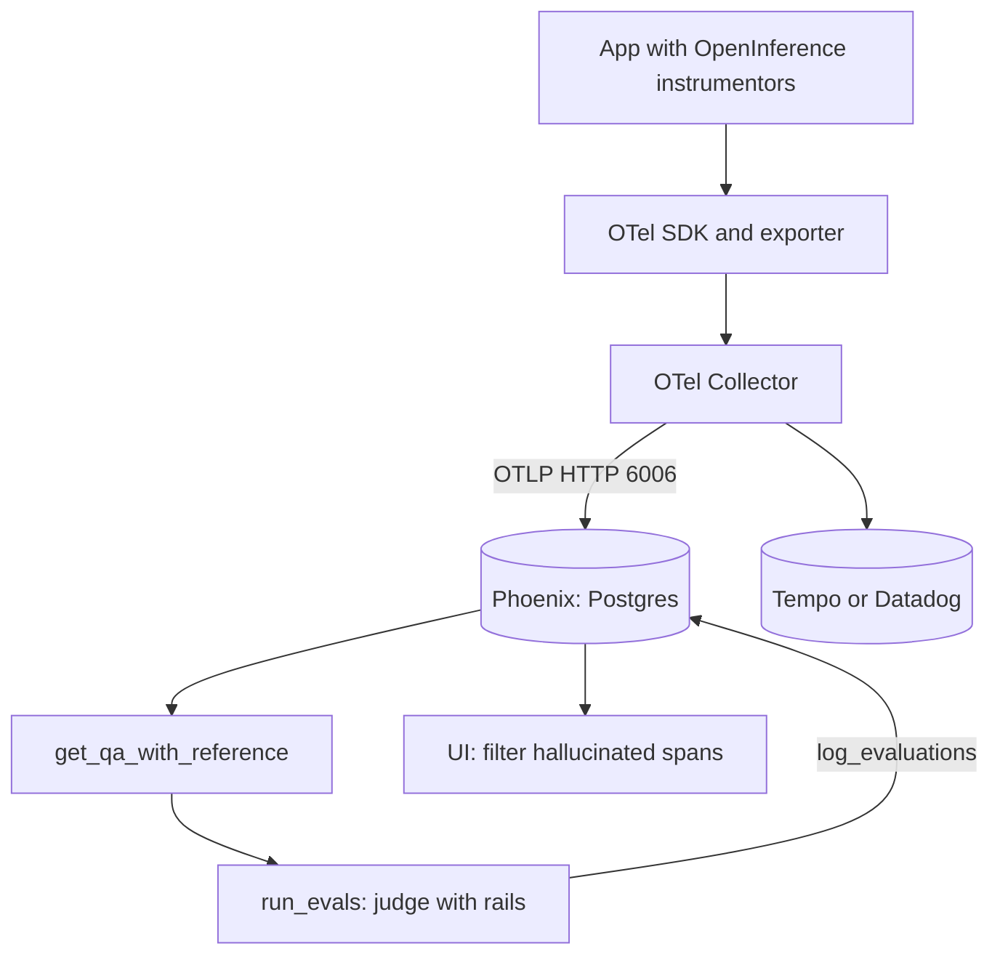

## TL;DR
Arize Phoenix is a self-hostable (source-available, Elastic License 2.0) tool built on OpenTelemetry that
stores your agent's spans with OpenInference attributes (agent, LLM, tool, retriever), runs LLM judges over
them, writes verdicts back onto spans and visualises embeddings.

## For agent builders
- **Why it matters for agents.** RAG agents fail by retrieving the wrong chunks, ignoring good ones or
  picking the wrong tool. Phoenix shows each `AGENT`, `LLM`, `TOOL` and `RETRIEVER` span with its documents
  and messages, and puts a judge's label on the exact span that went wrong.
- **Where it shows up in your stack.** `phoenix.otel.register` plus OpenInference instrumentors for OpenAI,
  Anthropic, LangChain, LlamaIndex, DSPy and others, or an extra exporter on your OTel Collector.
- **What you control.** Span kinds and attributes on your own agent steps, which evaluators run on which
  spans, judge model and sample size, payload hiding, and Postgres retention.
- **What you can skip.** UMAP internals and drift monitoring unless retrieval quality is your problem.
  Know the ingestion path and how an evaluation joins back to a span id.

## Why it exists
- **RAG debugging needs three answers per request:** which chunks were retrieved, were they relevant, and did
  the answer stay inside them. That needs traces carrying the documents and messages plus a quality judgement
  next to each span; classic APMs offered neither.
- **Early LLM tools brought their own SDKs and wire formats,** which meant one more agent in the process and
  traces that could not join the rest of the system's telemetry.
- **Bet one: do not invent a tracing protocol.** Standardise the *attribute names* for LLM work on top of
  OpenTelemetry (that specification is OpenInference, Apache-2.0 licensed, unlike the ELv2 Phoenix server),
  publish instrumentors for OpenAI, Anthropic, Bedrock, LangChain, LlamaIndex, DSPy and others, and compete on
  what you do with the data. Because spans are plain OTel, a Collector can send the same stream to Phoenix and
  to Tempo or Datadog, and switching away costs nothing.
- **Bet two: evaluation belongs next to traces.** A trace says what happened; an evaluation says whether it was
  good; hand-labelling does not scale. Judge templates (hallucination, QA correctness, retrieval relevance,
  toxicity) score spans in bulk and attach results as span evaluations, so you can filter to
  "hallucinated = true".
- **Embedding visualisation** comes from Arize's ML-monitoring origins: retrieval failures cluster, and a UMAP
  projection of query embeddings coloured by evaluation shows the empty region of the corpus at a glance.
  Arize AX is the separate commercial platform.

## How it works
### Deployment
- **One process.** `pip install arize-phoenix` and `phoenix serve` (or the Docker image) serve the UI and an
  OTLP HTTP receiver on port 6006 (`/v1/traces`) plus OTLP gRPC on 4317.
- **Storage.** SQLite by default, fine for a laptop; production points `PHOENIX_SQL_DATABASE_URL` at Postgres.
- **Projects** separate applications and environments.
- **Notebook mode.** `px.launch_app()` runs the same server in-process.
- **Security.** Optional authentication and API keys are enabled through environment variables.

### Ingestion: OpenTelemetry plus OpenInference
1. **`from phoenix.otel import register`** configures a standard OTel `TracerProvider` with an OTLP exporter
   and a resource attribute naming the project.
2. **`auto_instrument=True`** activates whichever OpenInference instrumentors are installed.
3. **An instrumentor** patches a client library and emits spans whose attributes follow the OpenInference
   specification.

| Attribute | Meaning |
|---|---|
| `openinference.span.kind` | `LLM`, `CHAIN`, `RETRIEVER`, `EMBEDDING`, `TOOL`, `AGENT`, `RERANKER`, `GUARDRAIL` or `EVALUATOR` |
| `input.value`, `output.value` | Inputs and outputs, with MIME types |
| `llm.model_name` | Model |
| `llm.input_messages.{i}.message.role` and `.content` | Flattened messages |
| `llm.token_count.prompt`, `.completion`, `.total` | Token counts |
| `retrieval.documents.{i}.document.content` and `.score` | Retrieved documents |
| `tool.name`, `tool.parameters` | Tool calls |

- **Lists are flattened into indexed keys** *because* OTel attributes are flat key–value pairs.
- **Span kind is an attribute, not OTel `SpanKind`,** because OTel's kinds describe RPC roles, not LLM roles.
- **Any OTel SDK can send spans;** those using other conventions still arrive but render with less structure.

### The evaluation library
`phoenix.evals` is a DataFrame-oriented runner.
- **`llm_classify`** applies a judge prompt template to each row with a model wrapper (`OpenAIModel`,
  `AnthropicModel`, `LiteLLMModel`, …), constrains the answer to rails such as `["factual", "hallucinated"]`,
  optionally asks for an explanation, and runs rows concurrently.
- **Why rails:** a judge's free-text verdict cannot be counted. The output is snapped to an allowed label (or
  marked unparseable), so a column of labels becomes a rate, a filter and a trend line.
- **Why explanations:** the opposite trade, unaggregatable but the only way a human can audit why the judge
  decided, which is what calibration needs.
- **Pre-built evaluators** (`HallucinationEvaluator`, `QAEvaluator`, `RelevanceEvaluator`,
  `ToxicityEvaluator`, …) wrap tested templates; `run_evals(dataframe, evaluators)` returns one DataFrame per
  evaluator.
- **Helper queries build rows from traces:** `get_qa_with_reference` yields one row per answered question with
  its retrieved context; `get_retrieved_documents` one row per retrieved document for relevance scoring.
- **Write back** with `log_evaluations(SpanEvaluations(...))` or `DocumentEvaluations(...)`. The UI then shows
  per-span labels and aggregates such as precision@k or NDCG derived from document relevance labels.

### Datasets, experiments, prompts, sessions, annotations
- **Datasets** come from spans or DataFrames; `run_experiment(dataset, task, evaluators)` executes a task over
  the examples and scores it, and the UI compares experiments.
- **Prompts** are versioned; the playground replays a captured span against an edited prompt or another model.
- **Sessions.** A `session.id` attribute groups traces into conversations.
- **Annotations.** Humans add labels and scores in the UI or via the API.

### Embeddings
- **`px.Inferences`** with embedding columns produces a UMAP projection with clustering, coloured by
  evaluation label or by drift between a primary and a reference dataset.
- **The original Phoenix feature,** and still the quickest way to see that a cluster of user queries has no
  nearby documents.

## Diagram
Instrumented spans travel as plain OTLP, so a Collector can feed Phoenix and a general store. Evaluations
are computed off the request path and attached back to the spans they judge.



## Examples
### Tracing a RAG answer and judging it for hallucination
Plain OpenTelemetry plus OpenInference attributes, with the OpenAI instrumentor producing the `LLM` span,
then a notebook step that judges every answered question against its retrieved context and writes verdicts
back.

Function names follow the long-standing evaluator/`run_evals` interface of `phoenix.evals`; newer
releases add a redesigned API alongside it, so pin the version and check import paths for your release.

```python
# pip install arize-phoenix openinference-instrumentation-openai openai
# terminal: phoenix serve   -> UI http://localhost:6006, OTLP http://localhost:6006/v1/traces
from phoenix.otel import register
from openinference.instrumentation.openai import OpenAIInstrumentor
from openinference.semconv.trace import SpanAttributes, OpenInferenceSpanKindValues
from openai import OpenAI

tracer_provider = register(project_name="support-bot", endpoint="http://localhost:6006/v1/traces")
OpenAIInstrumentor().instrument(tracer_provider=tracer_provider)   # LLM spans with messages and token counts
tracer = tracer_provider.get_tracer(__name__)
client = OpenAI()

def retrieve(question: str) -> list[str]:
    with tracer.start_as_current_span("retrieve") as span:
        docs = ["Reset your password under Settings > Security > Reset password."]
        span.set_attribute(SpanAttributes.OPENINFERENCE_SPAN_KIND, OpenInferenceSpanKindValues.RETRIEVER.value)
        for i, d in enumerate(docs):                            # flattened list: one key per document
            span.set_attribute(f"retrieval.documents.{i}.document.content", d)
        return docs

def answer(question: str) -> str:
    with tracer.start_as_current_span("support.answer") as span:
        span.set_attribute(SpanAttributes.OPENINFERENCE_SPAN_KIND, OpenInferenceSpanKindValues.CHAIN.value)
        span.set_attribute(SpanAttributes.INPUT_VALUE, question)
        docs = retrieve(question)
        resp = client.chat.completions.create(model="gpt-4o-mini", messages=[
            {"role": "system", "content": "Answer only from:\n" + "\n".join(docs)},
            {"role": "user", "content": question}])
        out = resp.choices[0].message.content
        span.set_attribute(SpanAttributes.OUTPUT_VALUE, out)
        return out

answer("How do I reset my password?")

# Later, in a notebook: judge each answered question against its retrieved context, write results back
import phoenix as px
from phoenix.evals import HallucinationEvaluator, OpenAIModel, run_evals
from phoenix.session.evaluation import get_qa_with_reference
from phoenix.trace import SpanEvaluations
px_client = px.Client()                                    # talks to the running server
qa = get_qa_with_reference(px_client)                      # columns: input, output, reference
(halluc,) = run_evals(dataframe=qa, provide_explanation=True,
                      evaluators=[HallucinationEvaluator(OpenAIModel(model="gpt-4o-mini"))])
px_client.log_evaluations(SpanEvaluations(eval_name="Hallucination", dataframe=halluc))
```

- **In the UI** the trace reads `support.answer` → `retrieve` and `support.answer` → `ChatCompletion`; the chain
  span carries a `Hallucination` label with the judge's explanation, and the project view filters to the
  hallucinated ones.

### Marking agent and tool spans with OpenInference kinds
For a hand-written agent loop, set the span kind on the run and on each tool call so Phoenix renders them
as agent and tool steps; model calls still come from the instrumentor. `decide` and `TOOLS` stand for your
model call and tool registry.

```python
import json
from openinference.semconv.trace import SpanAttributes, OpenInferenceSpanKindValues as Kind

def run_tool(name: str, args: dict):
    with tracer.start_as_current_span(f"tool {name}") as span:
        span.set_attribute(SpanAttributes.OPENINFERENCE_SPAN_KIND, Kind.TOOL.value)
        span.set_attribute("tool.name", name)
        span.set_attribute("tool.parameters", json.dumps(args))
        result = TOOLS[name](**args)
        span.set_attribute(SpanAttributes.OUTPUT_VALUE, json.dumps(result))
        return result

def run_agent(task: str, max_steps: int = 6) -> str:
    with tracer.start_as_current_span("support.agent") as span:
        span.set_attribute(SpanAttributes.OPENINFERENCE_SPAN_KIND, Kind.AGENT.value)
        span.set_attribute(SpanAttributes.INPUT_VALUE, task)
        observations = []
        for _ in range(max_steps):
            step = decide(task, observations)          # instrumented client: an LLM span per call
            if step["type"] == "final":
                span.set_attribute(SpanAttributes.OUTPUT_VALUE, step["text"])
                return step["text"]
            observations.append(run_tool(step["tool"], step["args"]))
        span.set_attribute(SpanAttributes.OUTPUT_VALUE, "step budget reached")
        return "Sorry, I could not finish."
```

### Worked scenario: judging a week of agent tool calls
Illustrative numbers for a support agent, judged by a model from another family on a sample.

| Quantity | Value |
|---|---|
| Agent runs in the week | 8,000 |
| `TOOL` spans in sampled runs (10% of runs) | 2,600 |
| Judge labels "wrong tool or wrong arguments" | 182, a 7% judged rate |
| Of those, the `search_kb` tool with an empty query | 120 |
| Human check of 100 flagged spans | 85 agree with the judge |

- **The fix was a tool description,** not a model change: `search_kb` now states that `query` is required,
  and the next week's judged rate is the metric to watch.
- **Labels live on the `TOOL` spans,** so filtering by the label lists exactly the bad calls with their
  parent agent runs.

### How the join works, with a day of numbers
The part worth understanding is how a verdict lands on exactly the right span.

| Step | What happens |
|---|---|
| Query | `get_qa_with_reference` returns a DataFrame indexed by the span id of each root span with an input and an output |
| Reference | Built by concatenating the document contents on the retriever spans of the same trace |
| This request | One row: input "How do I reset my password?", the model's answer, the one-sentence reference |
| Judge | Receives all three in its template; returns `label` (`factual` or `hallucinated`), a numeric `score` derived from the label, and an `explanation`, still indexed by span id |
| Write back | `log_evaluations` attaches that row to exactly that span |
| A day of traffic | 2,000 answered questions give 2,000 labels; if 140 are `hallucinated`, the project shows a 7% rate you can filter, open and read |

If the retriever span had carried no documents, the reference would be empty and the judge would be grading
against nothing, a pitfall listed below.

### Fanning one trace stream out to Phoenix and Tempo
A Collector config that keeps the existing tracing store and adds Phoenix, with no application change. The
`otlphttp` exporter appends `/v1/traces` to its endpoint.

```yaml
receivers:
  otlp:
    protocols:
      grpc:
        endpoint: 0.0.0.0:4317
processors:
  batch: {}
exporters:
  otlp/tempo:
    endpoint: tempo:4317
    tls: {insecure: true}
  otlphttp/phoenix:
    endpoint: http://phoenix:6006
service:
  pipelines:
    traces:
      receivers: [otlp]
      processors: [batch]
      exporters: [otlp/tempo, otlphttp/phoenix]
```

Spans without OpenInference attributes still arrive in Phoenix, but only enriched spans render as LLM,
retriever and tool steps.

## Production patterns
- **Postgres from day one.** Set `PHOENIX_SQL_DATABASE_URL` to a managed Postgres for any shared deployment,
  with backups and a retention policy. Monitor database size and UI query latency.
- **Collector fan-out instead of a second SDK.** Add Phoenix as one more exporter on the existing Collector so
  infrastructure and LLM views share trace ids. Monitor exporter failures per destination.
- **Scheduled, sampled evaluation job.** Run a daily job that pulls the previous day's question–answer–reference
  and retrieved-document rows, samples to the judge budget, runs hallucination and relevance evaluators, and
  logs span and document evaluations. Monitor the hallucination rate and relevance aggregates over time.
- **Judge with a different model.** Use a judge from another model family than the generator to limit
  self-preference bias, and calibrate against about a hundred human-labelled examples. Monitor judge-human
  agreement.
- **Control payload size.** Use OpenInference's trace configuration to hide or truncate inputs and messages
  where content is sensitive or large, and sample high-volume routes. Monitor storage growth per project.
- **Span kinds on every agent step.** Agent teams set `AGENT` on the run, `TOOL` on each tool call and
  `RETRIEVER` with documents on retrieval, so evaluators can target tool selection and retrieval relevance
  separately. Monitor the share of agent traces with typed tool spans and the judged tool-error rate per tool.
- **Pin `arize-phoenix` and instrumentor versions** and run the evaluation job in CI against a fixture
  project, because evaluator import paths have changed across releases.

## Trade-offs
- **Portability vs product loop.** OTel-native ingestion means no lock-in and one instrumentation for every
  backend, against a less mature loop for per-user cost accounting and prompt-release workflows than Langfuse
  or LangSmith offer at the time of writing (Phoenix has been adding these, so check the current release).
  Flips when the team wants a managed product loop more than portability.
- **Zero-ops vs ownership.** A single container with SQLite is zero-ops for development, but production needs
  Postgres and you own retention, backups and access control; multi-team scale and RBAC are what the
  commercial platform sells.
- **Notebook evals vs continuous scoring.** DataFrame evaluations are flexible, scriptable and cheap to
  iterate, but the loop is one you run or schedule yourself, whereas server-side online evaluators in other
  tools score traffic continuously without a job.
- **Pre-built templates vs calibration.** They save prompt engineering and are tested by the maintainers, yet
  still need calibration against a human-labelled sample from your own domain before anyone trusts the numbers.
- **Embedding views vs storage.** Embedding visualisation is the fastest way to find corpus gaps, but only if
  you log query and document embeddings, which multiplies storage per trace.

## Pitfalls
- **Instrumentor called late or never.** Called after the client library is already in heavy use. Symptom:
  `CHAIN` and `RETRIEVER` spans with no `LLM` child and no token counts.
- **Exporter and port mismatch.** HTTP spans sent to 4317 or gRPC spans to 6006. Symptom: an empty project with
  no error in the application.
- **SQLite under production concurrency.** Symptom: a sluggish UI, locked-database errors and lost spans at
  peak traffic.
- **Empty references.** Running the hallucination evaluator on traces whose retriever spans carry no
  documents. Symptom: verdicts that are uniformly "factual" or evaluator errors.
- **Self-judging.** Judging a model's outputs with the same model. Symptom: suspiciously high scores that a
  human spot-check contradicts, the self-preference bias of LLM judges.
- **Unbounded payloads.** Full documents and prompts on every span at high volume without sampling or
  truncation. Symptom: storage growth that outpaces the traces' usefulness.
- **Project name mismatch.** The name on `register()` differs from the one queried in the notebook. Symptom:
  "no data" despite a busy UI.

## When to use
- **Use when** you already emit or intend to emit OpenTelemetry traces and want LLM-aware analysis without a
  second SDK, or the work is evaluation-heavy (hallucination, retrieval relevance, agent trajectories) and your
  team lives in notebooks.
- **Use when self-hosting is required** and the budget for a commercial platform is zero. Check that the
  Elastic License 2.0 is acceptable to your legal team; it forbids offering Phoenix itself as a managed
  service, which is rarely an issue for internal use.
- **Prefer Langfuse** when prompt management and per-user cost are the daily workflow; **prefer LangSmith**
  when the stack is LangGraph and a hosted product is acceptable.
- **Measure:** span completeness per project, judge-versus-human agreement on a labelled sample, and retrieval
  relevance aggregates over time.
- **Day to day,** it is where you replay a bad RAG answer, see the chunks that came back, and run a relevance
  judge over last week's retrievals.
- **Interviews:** explain why building on OTel and OpenInference matters and how a span evaluation gets back
  onto a trace.

## Role lens
- **Engineer:** Registers the tracer provider, installs the right OpenInference instrumentors, adds
  retriever document attributes, and schedules the evaluation job that writes labels back to spans.
- **Architect:** Decides to standardise on OpenTelemetry with OpenInference attributes so Phoenix is one
  consumer among several, and sets Postgres, retention and sampling for the deployment.
- **FDE:** Runs Phoenix inside a customer's environment to show their team which retrieved chunks drove a
  wrong answer, and uses relevance evaluations as evidence in retrieval tuning sessions.

## Check yourself
**Q:** You inherit a RAG service that already sends plain OpenTelemetry traces to Grafana Tempo. The team
wants hallucination and retrieval-relevance scores without replacing their stack. How do you add Phoenix?
**A:** Keep the OTel SDK and Tempo. Enrich the spans rather than re-instrumenting: install the OpenInference
instrumentor for the model client so `LLM` spans carry messages and token counts, and add retriever
attributes (`openinference.span.kind = RETRIEVER` and `retrieval.documents.{i}.document.content`) to the
existing retrieval span. In the Collector, add a second OTLP exporter pointing at a Phoenix deployment backed
by Postgres, so Tempo keeps the infrastructure view and Phoenix gets the same traces. Then schedule a job that
pulls question–answer–reference rows and retrieved-document rows, runs the hallucination and relevance
evaluators on a sample sized to the judge budget, and logs the results back as span and document
evaluations. Calibrate the judge against a hundred human-labelled examples before publishing the numbers, add
`session.id` for conversation review, and separate environments by project.

## Interview questions
### What is OpenInference, and why does it flatten lists into indexed attribute keys?
- **Definition:** an Apache-2.0 attribute specification on top of OpenTelemetry for LLM work: span kinds such
  as `LLM` and `RETRIEVER`, messages, token counts, documents and tool calls.
- **Why flatten:** OTel attributes are flat key–value pairs, so a document list becomes
  `retrieval.documents.{i}.document.content`, which also lets each document be labelled individually.
- **Why its own span kind:** OTel `SpanKind` describes RPC roles, not LLM roles.

### The hallucination rate is 0% for a week, but users report made-up answers. How do you debug it?
- **Check the reference column first.** If retriever spans carry no document attributes, the judge grades
  against empty context and returns uniformly "factual" or errors.
- **Then check the judge:** same model as the generator (self-preference), unparseable outputs silently
  dropped, or a project name mismatch so the job read the wrong project.
- **Confirm with humans:** label a small sample by hand and compare with the judge's labels.

### When would you not choose Phoenix?
- **When the daily workflow is prompt releases and per-user cost,** where Langfuse or LangSmith have a more
  complete product loop at the time of writing.
- **When you need continuous server-side scoring** without running your own scheduled job.
- **When your legal team rejects ELv2,** for example if you intend to offer Phoenix itself as a managed service.

### How would you use Phoenix to find out why a RAG agent picks the wrong tool?
- **Make tool calls first-class spans:** `TOOL` kind with `tool.name` and `tool.parameters`, under an `AGENT`
  span, with the instrumented `LLM` span that chose the tool next to them.
- **Judge a sample of tool spans** with rails such as correct versus wrong tool or arguments, using a judge
  from another model family, and log the labels back onto those spans.
- **Group the flagged spans by tool name** and read the deciding `LLM` span's messages; clusters usually point
  at an ambiguous tool description or a missing retrieval result.

### Why do judge templates constrain output to rails, and what do you lose?
- **Rails make verdicts countable:** snapping to `factual` or `hallucinated` turns a column into a rate, a
  filter and a trend line.
- **You lose nuance,** which is why the explanation is kept: unaggregatable, but it is what a human audits
  during calibration.

### You judge 2,000 answers a day and see 140 hallucinated. What do you report, and what would you check?
- **Report a 7% judged rate** with the sample definition and the judge model, not as ground truth.
- **Check calibration:** agreement with about a hundred human-labelled examples tells you whether 7% is
  closer to the real rate or to judge bias.
- **Slice:** open the flagged traces, group by retrieval relevance and route, and see whether failures cluster
  where the corpus has gaps, which the embedding view shows.

## Quiz
### Q: What most distinguishes Phoenix from an LLM observability tool with its own SDK?
- [ ] It can only trace LangChain applications
- [x] It ingests standard OpenTelemetry spans annotated with OpenInference attributes, so the same instrumentation can feed any backend
- [ ] It stores traces only in memory during a notebook session
- [ ] It requires the commercial Arize platform to view traces
> Phoenix standardises attribute names on top of OTel rather than defining a new protocol. That makes
> instrumentation portable and lets a Collector fan the same spans out to Phoenix and a general tracing store.

### Q: Why are evaluation results logged back as span evaluations rather than kept in the notebook?
- [ ] Because `run_evals` cannot return a DataFrame
- [ ] Because cost is computed from evaluation labels
- [x] So traces can be filtered and aggregated by quality in the UI and compared over time next to the spans they describe
- [ ] Because the judge model needs them to be stored before it can run again
> An evaluation detached from its trace is a spreadsheet. Attached to the span, "show me hallucinated answers
> from yesterday" becomes a filter, and relevance labels on documents roll up into retrieval metrics.

### Q: Which attributes mark a span as a retrieval step whose documents Phoenix should display and evaluate?
- [ ] `gen_ai.operation.name = "retrieve"` with the documents in the span's events
- [x] `openinference.span.kind = "RETRIEVER"` with `retrieval.documents.{i}.document.content` entries
- [ ] OTel `SpanKind.CLIENT` with a `db.system` attribute naming the vector store
- [ ] A `session.id` attribute and `input.value` set to the query
> OpenInference carries the LLM-specific role in an attribute, because OTel span kinds describe RPC roles,
> and flattens the document list into indexed keys so each document can be labelled individually.

## Use cases & projects
### Use cases
- **Debugging RAG agents.** See which chunks the retriever returned, judge their relevance per document and
  check whether the answer stayed inside them.
- **Tool-selection quality.** Judge sampled `TOOL` spans for wrong tool or wrong arguments and track the rate
  per tool after each prompt or description change.
- **Adding LLM views to an existing OTel stack.** A Collector fans the agent's spans out to Phoenix and the
  team's tracing store with no new SDK.
- **Finding corpus gaps.** Embedding views of agent queries coloured by relevance labels show clusters with
  no good documents.

### Mini project
**Judge a RAG agent's retrieval and answers (2-3 hours).**
- **Goal:** put hallucination and relevance labels on the spans of a small RAG agent.
- **Steps:** run `phoenix serve`; build an agent with a `search_kb` tool over 20 short documents, an `AGENT`
  span and `RETRIEVER` spans carrying documents; instrument the model client with OpenInference; run 50
  questions, a few with no answer in the corpus; run hallucination and relevance evaluators and log them back.
- **Done when:** the UI filters to hallucinated answers, the questions with no answer in the corpus show low
  relevance labels, and you have checked 10 judge labels by hand.
