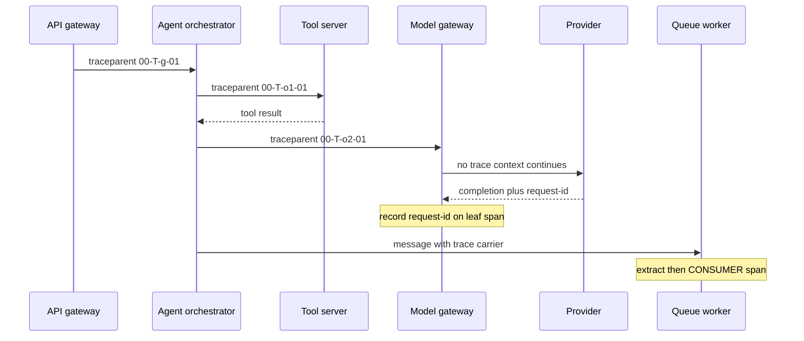

## TL;DR
An agent turn crosses a model gateway, tool servers, sub-agents and queues. Distributed tracing
*propagates* trace and parent span ids across each hop (the W3C `traceparent` header, or message
metadata), so the turn stays one tree.

## For agent builders
- **Why it matters for agents.** Agents fan out: tools behind MCP servers, models behind a gateway,
  sub-agents in other services, long steps run by queue workers. Without propagation, the orchestrator's
  waterfall shows "tool.call: 6 s" and nothing underneath, exactly where the question is.
- **Where it shows up in your stack.** OpenTelemetry `inject` and `extract` (usually via HTTP client and
  server auto-instrumentation), `OTEL_PROPAGATORS`, your AI gateway's span support, and the metadata
  your tool transport or queue can carry.
- **What you control.** That every hop you own extracts and injects, that the sampling flag is honoured
  downstream, that provider request ids land on leaf spans, and that baggage never carries user data to
  third parties.
- **What you can skip.** Writing propagators, or collector internals beyond knowing tail sampling needs
  trace-id routing. Most of the work is verifying each hop, not code.

## Why it exists
- **One turn crosses many processes.** An API gateway, an orchestrator, a retrieval service, a model
  gateway, tool servers, perhaps a queue. The tracer's "current span" lives in a context variable inside
  one process.
- **Context dies at the first HTTP call.** The retrieval service starts its own trace with a fresh id and
  the model gateway behind it starts another: three trees for one request, linked only by approximate
  timestamps and, if you are lucky, a user id.
- **Correlating by timestamp and user fails exactly when you need it:** concurrency (the same user has two
  tabs open), retries (retrieval was called twice; which fed the answer?), and asynchrony (an agent step
  enqueued and run 40 s later by a worker handling hundreds of requests).
- **Grepping logs for a request id across five services** recovers events but not structure or durations,
  and only works if every service logs the same id, which is itself a propagation problem.
- **LLM systems add hops.** Model calls behind a gateway (keys, fallbacks), retrieval behind its own
  service, tools behind MCP servers: four or five hops before the provider is reached. If the trace stops
  at the first hop, the waterfall shows "orchestrator: 8.2 s" and nothing underneath, precisely the
  question you were asking.

## How it works
### Context propagation
1. **Inject (caller):** the tracer writes the current span context into the outgoing request as metadata.
2. **Extract (receiver):** the server reads it and starts its server span as a child of the remote parent.
3. **Export independently:** each service still creates spans locally and exports them on its own; the
   backend reassembles the tree by trace id.
- **Only the ids travel,** *because* having services report synchronously to a central tracer would put
  tracing on the latency path of every call.

### The wire format
The W3C Trace Context standard defines the HTTP header most systems now use:

```
traceparent: 00-4bf92f3577b34da6a3ce929d0e0e4736-00f067aa0ba902b7-01
             ^^ ^^^^^^^^^^^^^^^^^^^^^^^^^^^^^^^^ ^^^^^^^^^^^^^^^^ ^^
          version        trace_id (32 hex)      parent span_id    flags (01 = sampled)
```

- **`tracestate`** is a second header for vendor-specific key-value pairs.
- **Zipkin's B3 headers** were used by older systems. OpenTelemetry can inject and extract both, but every
  service on a path must agree, *because* a B3-only service ignores `traceparent` and starts a new trace,
  silently cutting the chain.

### Sampling decisions travel too
- **The `01` flag** says "this trace is being sampled". It is set at the root and honoured downstream, so
  a trace is complete or absent.
- **Independent sampling is ruinous:** at 10% per service, a five-hop trace would be complete one time in
  a hundred thousand.
- **Tail-based sampling** (decide after the whole trace arrives, keeping every error and slow trace) runs
  in a collector that buffers spans by trace id. It only works if *every* span of a trace reaches the
  *same* collector instance, while services export to whatever instance their load balancer picks.
- **The usual answer is two tiers:** tier one routes spans by hashing the trace id (the OpenTelemetry
  Collector has a load-balancing exporter for this); tier two buffers and decides.
- **The buffer needs a timeout,** and spans arriving after the decision are dropped or kept
  inconsistently: one more reason to keep traces short.

### Queues and asynchronous hops
- **No response to join on,** so context is injected into message headers or a payload metadata field.
  The consumer extracts it and starts a `CONSUMER` span.
- **Batches from many producers** do not fit strict parent-child; the batch span carries *links* to each
  message's producer span.
- **Long gaps** (an agent step scheduled an hour later): continue the trace but also record a durable
  execution id, *because* trace backends retain data for days while the workflow may live for weeks.

### Where LLM systems break the chain
| Hop | What goes wrong | What to do |
|---|---|---|
| **Model and AI gateways** | a proxy that does not propagate is a black hole in every trace | extract incoming context, inject on the outbound call, emit its own span with provider, model, retry and fallback decisions |
| **Tool servers over MCP** | tool calls leave the orchestrator's process | HTTP transports: standard header propagation if both sides are instrumented. MCP requests also carry a `_meta` object for metadata that can carry trace context; whether an SDK does this automatically varies by version, so verify |
| **Third-party providers** | the provider will not continue your trace, so the client span is the leaf | record the provider's request id from response headers (names such as `request-id` or `x-request-id`), *because* it is the only handle their support team can use |
| **Thread pools** | not a network hop, same failure: Python does not copy context into executor threads by default | asyncio tasks copy it at creation and `asyncio.to_thread` copies it; `loop.run_in_executor` and bare `ThreadPoolExecutor.submit` do not. Wrap callables with `contextvars.copy_context().run` or use an instrumented executor |

### Agent-specific hops
- **Sub-agents in other services.** When an orchestrator delegates to a remote agent (over HTTP or an
  agent-to-agent protocol), propagate context on the delegation call so the sub-agent's whole loop nests
  under the orchestrator's step. If the remote agent belongs to another team or company, treat it like the
  edge: link rather than continue.
- **Human approval waits.** A step paused for approval and resumed hours later is an asynchronous hop:
  carry the context and the durable execution id in the stored pending action, and expect a new trace on
  resume with a link back.
- **Parallel tool calls.** Concurrent calls from one step run in asyncio tasks or threads; each must start
  with the step's context, or their spans become orphans while the step shows an unexplained gap.

### The edge is a trust boundary
- **A `traceparent` from the public internet is untrusted input.** A client can set the sampled flag on
  every request and force you to record (and pay to store) all of them, or reuse a trace id so unrelated
  requests merge into one tree.
- **So public-facing services usually start a fresh trace,** optionally adding a *link* to the incoming
  context so a partner's trace can still be found, and honour incoming context only from known internal
  callers. The same applies to incoming baggage.

### Baggage: carrying more than ids
- **W3C Baggage** is a companion header for application key-values (tenant, feature flag, experiment arm)
  that travel with the trace so downstream services can tag spans and logs.
- **Use it sparingly:** baggage is forwarded on *every* outbound call unless filtered, including to
  third-party APIs, so a tenant name or user email in baggage is a data leak by default.

### Clock skew
- **Each service timestamps with its own clock.** Symptom: a child starting before its parent, or a
  negative network gap.
- **Keep hosts under NTP or equivalent;** most trace viewers do not correct for it.

## Diagram
One agent turn crossing a tool server, a model gateway and a queue: every hop injects context and the
next extracts it, so all spans share one trace id; the provider is the leaf.



## Examples
### Inject and extract over HTTP and a queue
- **Same two primitives,** `inject` and `extract`, cover HTTP and queues; only the carrier changes.
- **Auto-instrumentation** for FastAPI, httpx or requests performs exactly these calls; they are written
  out here so the mechanism is visible, including the queue hop where the carrier is a message field.

```python
from opentelemetry import trace
from opentelemetry.propagate import inject, extract
import httpx

tracer = trace.get_tracer("orchestrator")

# calling side (orchestrator)
def call_retrieval(query: str) -> dict:
    with tracer.start_as_current_span("retrieval.client",
                                      kind=trace.SpanKind.CLIENT) as span:
        headers = {}
        inject(headers)                        # adds traceparent (+ tracestate, baggage)
        span.set_attribute("retrieval.query_chars", len(query))
        r = httpx.post("http://retrieval:8000/search",
                       json={"q": query, "k": 5}, headers=headers, timeout=5)
        r.raise_for_status()
        return r.json()

# receiving side (retrieval service request handler)
def handle_search(request_headers: dict, body: dict) -> dict:
    ctx = extract(request_headers)             # remote parent becomes the context
    with tracer.start_as_current_span("retrieval.server", context=ctx,
                                      kind=trace.SpanKind.SERVER) as span:
        hits = [{"id": 11, "score": 0.81}, {"id": 42, "score": 0.77}]   # stand-in
        span.set_attribute("retrieval.hit_ids", [h["id"] for h in hits])
        return {"hits": hits}

# queue hop: inject into the message instead of HTTP headers
def enqueue_agent_step(queue, step: dict):
    carrier = {}
    inject(carrier)
    queue.put({"step": step, "trace": carrier})   # consumer: extract(msg["trace"])
```

### Runnable: why executor threads lose context
Pure standard library. A bare `submit` runs in a thread whose context is empty; wrapping with
`copy_context().run` carries the caller's values (and so the current span) across.

```python
import contextvars
from concurrent.futures import ThreadPoolExecutor

request_id = contextvars.ContextVar("request_id", default=None)

def work():
    return request_id.get()

request_id.set("req-42")
with ThreadPoolExecutor(max_workers=1) as pool:
    lost = pool.submit(work).result()
    kept = pool.submit(contextvars.copy_context().run, work).result()
print(f"bare submit: {lost}   copied context: {kept}")
# bare submit: None   copied context: req-42
```

### Worked scenario: an agent turn with a broken MCP hop
An agent's turn takes 8.2 s. Before the fix, the tool server does not extract context (illustrative
numbers).

| Span | Before: what the orchestrator trace shows | After propagation is fixed |
|---|---|---|
| `agent.run` | 8.2 s | 8.2 s |
| `generation` ×2 | 1.9 s total | 1.9 s total |
| `tool.search_tickets` (CLIENT) | 6.1 s, no children | 6.1 s |
| `tool.search_tickets` (SERVER, tool server) | separate one-span trace, 0.2 s | 0.2 s, child of the client span |
| `db.query` (tool server) | in that separate trace | 0.15 s |
| Client-to-server gap | invisible | 5.9 s: connection pool wait in the transport |

- **Diagnosis:** the tool was never slow; the orchestrator's connection pool to the tool server was
  capped and requests queued. Visible only once the server span joined the agent's tree.

### Worked numbers: independent vs propagated sampling
Five hops, each keeping 10% of spans.

| Strategy | Chance a trace is complete | At 1,000,000 turns a day |
|---|---|---|
| Each hop samples independently at 10% | 0.1^5 = 0.00001 | about 10 complete traces |
| Root decides 10%, flag propagated | 0.1 | about 100,000 complete traces |
| Tail sampling: all errors and slow turns plus 10% of the rest | 1.0 for every error and slow turn | every interesting turn kept |

## Production patterns
- **One propagator list, set fleet-wide.** Configure every service the same way, for example
  `OTEL_PROPAGATORS=tracecontext,baggage` (add `b3` only during a migration). Monitor the fraction of
  traces whose root is an edge service and whose leaf reaches the provider call, per path.
- **Parent-based sampling everywhere below the root.** Use the SDK's parent-based sampler (for example
  `OTEL_TRACES_SAMPLER=parentbased_traceidratio`) so only the root decides and every hop honours the flag.
  Monitor completeness for your deepest paths.
- **Two-tier collector for tail sampling.** Tier one uses the Collector's load-balancing exporter routed
  by trace id; tier two runs the tail sampling processor with a decision wait sized to your longest
  normal trace. Monitor late-arriving spans and collector memory.
- **Reset context at the edge.** Public ingress starts a new root and links to any incoming
  `traceparent`; only mTLS-authenticated or allowlisted internal callers are continued. Monitor trace
  volume per client to catch abuse.
- **Gateway spans with provider ids.** The model gateway emits a span per upstream attempt with provider,
  model, fallback reason and the provider's request id. Monitor fallback rate and per-provider latency
  from those spans.
- **Propagation tests for every agent hop.** In integration tests, run one agent task through the real
  gateway, tool servers and queue, then assert all spans share one trace id and every tool CLIENT span
  has a SERVER child. Monitor the share of tool and sub-agent client spans with a remote child, per tool
  server.
- **Baggage allowlist.** Strip baggage on egress to third parties and allow only named keys internally.
  Monitor outbound headers in a staging egress proxy for unexpected baggage keys.

## Trade-offs
- **W3C standard vs legacy formats.** W3C interoperates with every vendor and language, but migrating a
  fleet already on B3 means a period of dual propagation; vendor formats win only when a legacy system
  cannot be changed.
- **Head-based vs tail-based sampling.** Head-based keeps propagation trivial (one bit in the header) and
  needs no buffering, but drops slow and failed traces at the same rate as healthy ones. Tail-based keeps
  the interesting traces at the cost of a collector tier that buffers every span.
- **Auto vs manual propagation.** Auto-instrumentation of HTTP clients and servers gives propagation for
  free, but invisibly, so when a hop silently loses context nobody knows where to look. Manual inject and
  extract at boundaries is more work and far easier to audit.
- **Continuing vs linking a remote sub-agent.** Continuing the trace gives one waterfall for the whole
  delegation, but lets the remote side's sampling and span volume into your tree. It flips to a link when
  the sub-agent is owned by another team or vendor.
- **Baggage vs explicit fields.** Baggage tags every service's spans and logs with tenant and experiment
  without API changes, but leaks to every downstream call by default. It flips to explicit API fields once
  third-party calls are in the path.

## Pitfalls
- **A gateway, load balancer or mesh that strips unknown headers.** Symptom: traces always end at the same
  hop, while the downstream service shows a matching single-span trace with a fresh id.
- **Mixed propagators (B3 on one service, W3C on another).** Symptom: the same break but only on some
  paths, maddening until you compare the header names each side expects.
- **Submitting work to executor threads without copying context.** Symptom: orphan traces that start
  milliseconds after a gap in the real trace.
- **User identifiers or emails in baggage.** Symptom: a security review finds them in outbound headers to
  a third-party model provider.
- **Continuing whatever `traceparent` the public client sends.** Symptom: trace volume and storage cost
  that track one client's behaviour, or unrelated requests in the same tree.
- **Each service sampling independently.** Symptom: traces complete for short paths and almost never
  complete for deep ones.
- **Parallel tool calls launched without the step's context.** Symptom: an agent step with a multi-second
  gap and a cluster of orphan tool traces starting at the same instant. Fix: start each concurrent call
  from the step's context (asyncio tasks created inside the step span, or copied context for threads).
- **Treating a child-before-parent waterfall as a bug.** Symptom: minutes lost before someone checks the
  hosts' clocks.

## When to use
- **Use from the start** across every internal process boundary; the cost is a few lines or an
  auto-instrumentation package, and retrofitting after a dozen services is slow and political.
- **Essential** the moment a model gateway, retrieval service, tool server or queue enters the path,
  which describes almost every production LLM system.
- **Do not expect** propagation into third-party providers; capture their request ids instead.
- **Measure** the fraction of traces whose root is an edge service and whose leaf reaches the provider
  call, by path: that is your propagation health.
- **Interviews:** sketch the `traceparent` flow across three services and a queue, explain why the
  sampling flag must travel, and name the two usual chain breakers: the gateway and the tool server.

## Role lens
- **Engineer:** Adds inject and extract at every client and server boundary, instruments the queue
  carrier, copies context into executors, and records provider request ids on the leaf span.
- **Architect:** Mandates one propagation format and one collector tier across services, decides head
  versus tail sampling, and writes the baggage policy that keeps tenant data out of outbound headers.
- **FDE:** Verifies that trace context survives the customer's own gateways, meshes and tool servers
  during integration, and uses the complete cross-service waterfall to settle "whose latency is it"
  disputes.

## Check yourself
**Q:** Your traces consistently show the orchestrator's `tool.call` span taking 3–6 seconds, but the
MCP tool server's own traces show every request finishing in under 200 ms, each as a separate
single-span trace. Diagnose the situation and describe the fix.
**A:** Two trees for one request means context is not crossing the boundary: the tool server is
extracting nothing and starting fresh traces. First check what the orchestrator injects (HTTP headers
for an HTTP transport, or the request metadata for MCP) against what the server extracts; a
propagator mismatch (B3 versus W3C) or a proxy stripping headers produces exactly this. Once the
server span is a child of the client span, the gap between them is network and queueing time, which
is where the missing 3–6 s will appear, most likely in the transport (connection setup, a serial pipe,
a connection-pool limit) rather than in tool execution. Add a span around the transport layer, record
the tool request id for correlation, and confirm the fix by watching the fraction of orchestrator tool
spans that have a server child climb towards 100%.

## Interview questions
### What travels in a `traceparent` header, and why only that?
- **Contents:** version, the 32-hex trace id, the parent span id and flags, where `01` means sampled.
- **Why only ids:** each service exports its own spans asynchronously and the backend joins them by
  trace id, so tracing never sits on the request's latency path.

### Your traces always stop at the model gateway. How do you debug it?
- **Compare headers on both sides:** capture what the orchestrator sends and what the gateway receives;
  a proxy or mesh stripping headers, or a B3-versus-W3C mismatch, is the usual cause.
- **Check the gateway itself:** it must extract incoming context, emit its own span and inject on the
  outbound call; look for a fresh single-span trace on the gateway with the same timing.

### An orchestrator agent delegates to an internal sub-agent service and a vendor's agent. How do you trace both?
- **Internal sub-agent: continue the trace.** Inject context on the delegation call so the sub-agent's
  run, steps and tool calls nest under the orchestrator step that delegated, with one sampling decision.
- **Vendor agent: treat it as the edge.** Do not expect it to continue your trace, and do not send
  baggage; record its task or request id on your client span and, if it sends context back, link to it.
- **Either way,** put a shared execution id on both sides so a long delegation stays findable after trace
  retention expires.

### Why not just honour every incoming `traceparent`?
- **It is untrusted input at the edge:** a client can force-sample every request, raising your storage
  bill, or reuse trace ids so unrelated requests merge.
- **Instead,** start a new root at public ingress and add a link to the incoming context, continuing
  context only from known internal callers.

### How do you run tail-based sampling when services export to many collector instances?
- **Route by trace id first:** a load-balancing tier hashes the trace id so every span of a trace lands
  on the same sampling instance.
- **Then buffer and decide** with a timeout, keeping errors and slow traces; late spans are dropped or kept
  inconsistently, so keep traces short.

### How should a queue-based agent step that runs an hour later be traced?
- **Carry context in the message** and start a `CONSUMER` span from it; use links when one worker batch
  serves many producers.
- **Also record a durable execution id,** because trace retention is days while the workflow can live for
  weeks.

## Quiz
### Q: What does the sampled flag in `traceparent` prevent when every downstream service honours it?
- [ ] Clock skew between hosts
- [x] Traces that are partially recorded because each service made its own independent sampling decision
- [ ] Duplicate span ids across services
- [ ] Header stripping by load balancers
> If each hop sampled independently, deep traces would almost never be complete. Carrying the decision
> from the root makes a trace all-or-nothing, which is what makes cross-service waterfalls trustworthy.

### Q: A worker consumes a batch of twenty queued agent steps that came from twenty different user requests. How should its span relate to them?
- [ ] Make the batch span a child of the first message's producer span
- [ ] Start a fresh trace with no relation; batching breaks tracing
- [x] Create one consumer span with links to each producer span, since a span can have only one parent
- [ ] Create twenty parent spans for the single consumer span
> Parent-child is one-to-one and implies containment. Fan-in is many-to-one, and links exist for
> exactly this case so each original request can still find the batch that processed it.

### Q: Why should a call to a third-party model provider be treated as the leaf of a trace, and what should be recorded there?
- [ ] Because provider calls are too fast to need spans
- [ ] Because trace ids cannot be sent over HTTPS
- [x] Because the provider will not continue your trace; record its returned request id so the call can be correlated with the provider's own records
- [ ] Because providers reject requests that carry a traceparent header
> You cannot see inside the provider, but their support can if you give them the identifier they
> returned. Capturing it on the leaf span turns "the API was slow" into something they can investigate.

## Use cases & projects
### Use cases
- **Agents with remote tool servers.** Propagation through MCP or HTTP tool servers shows whether a slow
  tool call is the tool or the transport.
- **Model gateways in the agent path.** Gateway spans with fallback reasons and provider request ids
  explain latency spikes and provider incidents per agent step.
- **Queue-backed long-running agents.** Context carried in messages keeps worker-executed steps in the
  same tree, with an execution id for steps that run much later.
- **Multi-agent systems across services.** One trace per delegated task shows where an orchestrator and
  its sub-agents spent time.

### Mini project
**Propagate one agent turn across three processes (2-3 hours).**
- **Goal:** one trace id from the agent loop through a tool server and a queue worker.
- **Steps:** run an agent process, a small HTTP tool server and a queue worker locally, all with the
  OpenTelemetry SDK exporting to a local collector or the console; inject on the tool call and into the
  queue message, extract on the other side; then deliberately break one hop (strip the header) and
  observe the result.
- **Done when:** a healthy run shows every span under one trace id, the broken run shows the orphan trace
  and the gap, and a test asserts every tool client span has a server child.
