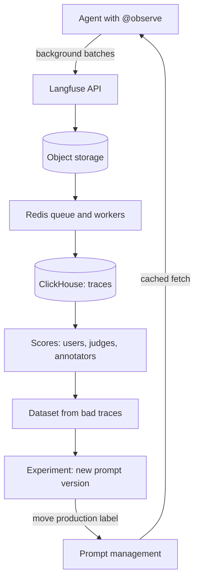

## TL;DR
Langfuse is an open-source, self-hostable platform that records every agent run as a trace of model calls,
tool calls, tokens and cost, then scores, datasets and versioned prompts close the loop from a bad run to
a tested fix.

## For agent builders
- **Why it matters for agents.** A wrong agent answer is usually a bad tool result, a misread one or a
  wasted step. Langfuse shows the run as a nested tree with each generation's prompt, output, tokens and
  cost, grouped by `session_id` for multi-turn agents and by `user_id` for cost.
- **Where it shows up in your stack.** `@observe()` around the agent and its tools, the OpenAI drop-in or
  LangChain, LlamaIndex and LiteLLM integrations, or its OTLP endpoint fed by any OpenTelemetry
  instrumentation.
- **What you control.** Observation boundaries (run, step, tool), trace attributes, masking, sample rate,
  custom model prices, which prompts live in prompt management, and which scores you attach.
- **What you can skip.** The server internals (ClickHouse, Redis, object storage) unless you self-host.
  Know the data model and that the SDK ships events in background batches.

## Why it exists
- **APM sees the wrong thing.** A generic APM sees a model call as a three-second `POST` to a provider that
  returned 200. Debugging needs what was inside: the rendered prompt, the completion, tool calls, retrieved
  chunks, token cost and which conversation it belonged to.
- **HTTP 200 says nothing about a wrong answer,** so you need a quality signal, and a loop: find bad traces,
  annotate them, turn them into a dataset, run the next prompt version against it, compare, promote.
- **Without a tool, teams rebuild this badly.** Prompts and completions go to JSON logs nobody can query by
  user; costs are reconstructed monthly from the invoice; prompts live in code, so every wording change is a
  deployment; "the new prompt is better" rests on three examples in a notebook.
- **Its position is specific.** LangSmith is the deepest fit for LangChain and LangGraph but is proprietary
  and hosted unless you buy enterprise self-hosting. Arize Phoenix is OpenTelemetry-native and strongest on
  evaluation and retrieval diagnostics in notebooks.
- **Langfuse** is framework-agnostic, product-complete (cost, sessions, scores, datasets, prompt management in
  one UI), MIT-licensed at its core, and runs in your VPC with Docker Compose or Helm, which matters when
  prompts contain customer data.

## How it works
### Data model
| Object | What it is |
|---|---|
| **Trace** | One unit of work, typically one request or agent task. Carries `user_id`, `session_id`, tags, metadata, input and output, and a release or version label |
| **Span** (observation) | Any step: retrieval, parsing, a tool call |
| **Generation** (observation) | A model call: model name, parameters, input messages, output, usage split into input and output tokens, cost, and a completion-start timestamp from which time to first token is derived |
| **Event** (observation) | A point in time |
| **Session** | Groups the traces of one conversation so a reviewer reads it in order |
| **User** | Rolls up cost and quality per customer |

- **Observations nest by parent** inside a trace.
- **Finer types are spans underneath.** Recent SDKs add agent, tool, retriever, embedding, guardrail and
  others that render differently in the UI.
- **Generation is the type that matters mechanically,** because it is the only one that carries usage and
  cost.

### Scores
- **What:** a named numeric, categorical or boolean value, with an optional comment, on a trace or observation.
- **Four sources:**
  1. Your code or API (a thumbs-up, a programmatic check).
  2. Human **annotation queues** in the UI.
  3. Managed **LLM-as-a-judge evaluators** that run a judge prompt over a sampled share of incoming traces.
  4. Evaluators run during experiments.
- **Why one model:** the same dashboard compares human labels, judge labels and user feedback per prompt
  version.

### Prompts
- **Named, versioned objects** with labels such as `production` or `staging`.
- **Fetch, cache, fall back.** The SDK fetches a prompt by name and label, caches it with a TTL, and falls
  back to the cached or a supplied default when the server is unreachable.
- **Linked to generations,** so latency, cost and scores break down by prompt version.
- **Why it exists:** prompt edits are the most frequent "deploy" in an LLM product and should not require a
  code release, while still being versioned and measurable.

### Datasets
- **Items** hold an input, an expected output and metadata.
- **A dataset run** executes your application on each item, links the resulting trace to the item, and
  attaches evaluator scores; the UI compares runs side by side.

### Ingestion path
1. **SDK, off the request path.** Events are created in memory, batched and posted by a background thread.
   That is why tracing adds negligible latency, and why a script or serverless function must call `flush()`
   before it exits.
2. **Server.** The current architecture writes raw events to object storage, queues them through Redis, and
   workers materialise them into ClickHouse, a columnar store. That is because trace analytics are large
   scans and aggregations over millions of observations, which the earlier Postgres-only design handled poorly
   at scale.
3. **Postgres** keeps transactional data such as projects, prompts and API keys.

### Cost
- **Price table match.** Cost is computed per generation by matching the model name against a price table:
  built in for the major providers, extensible with custom model definitions for fine-tunes, Azure deployment
  names or self-hosted models.
- **Usage source.** From the provider response when present; for some models it can be estimated with a
  tokenizer when it is not.
- **Arithmetic per usage type:**

```
cost = input_tokens × input_price + output_tokens × output_price (+ cached-read tokens × cached price, …)
```

- **Why usage must be split by type:** output tokens typically cost several times more than input tokens, so
  a total alone cannot be priced.
- **Explicit override.** You can send a cost directly, which overrides the table, for providers whose invoice
  does not follow token counts.

### Instrumentation options
| Option | What it does |
|---|---|
| `@observe()` (Python) | Wraps a function in a span, nests calls through context variables, turns the outermost call into the trace; `as_type="generation"` marks a model call |
| OpenAI drop-in (`from langfuse.openai import openai`) | Captures model, messages, usage and latency automatically |
| Framework integrations | LangChain callback handler, LlamaIndex, LiteLLM; JS/TS SDK with Vercel AI SDK support |
| OTLP endpoint | Spans from any OpenTelemetry SDK, OpenLLMetry or OpenInference instrumentation are mapped onto generations using the GenAI attribute conventions |

- **Built on OTel.** The current Python SDK is itself built on the OpenTelemetry SDK.
- **Masking.** A `mask` callback redacts fields before data leaves the process.
- **Sampling.** A client-side sample rate keeps a fixed fraction of traces. It is decided per trace so a kept
  trace is complete, but scores and cost totals then describe the sample and must be scaled to estimate the
  whole.

## Diagram
The SDK ships batches in the background; the server lands them in ClickHouse; traces then feed scores,
datasets and the next prompt version, which closes the loop.



## Examples
### Tracing a support bot with the Python SDK
The decorator builds the trace, the OpenAI drop-in records the generation, the prompt comes from prompt
management and is linked to the generation, and the trace is tagged with user and session.

Method names follow the OTel-based v3 Python SDK; the earlier SDK exposed the same ideas through
`langfuse_context`, so check the names against the major version you pin.

```python
# pip install langfuse openai ; env: LANGFUSE_PUBLIC_KEY, LANGFUSE_SECRET_KEY, and the host URL if self-hosted
from langfuse import observe, get_client
from langfuse.openai import openai         # drop-in client: every call becomes a 'generation' observation

langfuse = get_client()
PROMPT = langfuse.get_prompt("support-answer", label="production")   # versioned in the UI, cached client-side

@observe()                                  # a span, nested under whatever observation is current
def retrieve(question: str) -> list[str]:
    return ["Reset your password under Settings > Security > Reset password."]

@observe()                                  # the outermost @observe becomes the trace
def answer(question: str, user_id: str, session_id: str) -> str:
    langfuse.update_current_trace(user_id=user_id, session_id=session_id, tags=["support"])
    docs = retrieve(question)
    resp = openai.chat.completions.create(
        model="gpt-4o-mini",
        messages=PROMPT.compile(context="\n".join(docs), question=question),   # chat prompt -> messages
        langfuse_prompt=PROMPT,             # links this generation to the prompt name + version
    )
    trace_id = langfuse.get_current_trace_id()      # hand this to the client so feedback can be scored later
    return resp.choices[0].message.content

print(answer("How do I reset my password?", user_id="u_42", session_id="s_9"))

# Later, when the user clicks thumbs-up: langfuse.create_score(trace_id=..., name="user_feedback", value=1)
langfuse.flush()                            # required in scripts and serverless: events are sent in background batches
```

- **Trace tree:** `answer` → `retrieve` and `answer` → generation, with tokens, cost, latency and the prompt
  version. The trace's input and output default to the outermost function's arguments and return value.
- **Rollups:** the session view shows the whole conversation `s_9`; the user view sums cost for `u_42`.

### Tracing a tool-calling agent loop
Each tool is its own observation, the agent loop is the trace, and a per-run score records whether the
step budget was hit. `TOOLS` and `TOOL_SCHEMAS` stand for your registry; the `as_type` values for agent
and tool observations exist in recent SDK versions, so drop the argument on older ones.

```python
import json
from langfuse import observe, get_client
from langfuse.openai import openai           # every model call becomes a generation

langfuse = get_client()

@observe(as_type="tool")
def call_tool(name: str, args: dict):
    return TOOLS[name](**args)               # input and output are captured on the observation

@observe(as_type="agent")
def run_agent(task: str, user_id: str, session_id: str, max_steps: int = 8) -> str:
    langfuse.update_current_trace(user_id=user_id, session_id=session_id, tags=["agent"])
    messages = [{"role": "user", "content": task}]
    for step in range(max_steps):
        msg = openai.chat.completions.create(model="gpt-4o-mini", messages=messages,
                                             tools=TOOL_SCHEMAS).choices[0].message
        if not msg.tool_calls:
            langfuse.score_current_trace(name="steps_used", value=step + 1)
            return msg.content
        messages.append(msg)
        for c in msg.tool_calls:
            result = call_tool(c.function.name, json.loads(c.function.arguments))
            messages.append({"role": "tool", "tool_call_id": c.id, "content": json.dumps(result)})
    langfuse.score_current_trace(name="hit_step_budget", value=1)
    return "Sorry, I could not finish this task."

run_agent("Refund order 1182 if it shipped late", user_id="u_42", session_id="s_9")
langfuse.flush()
```

- **Trace tree:** `run_agent` → generation, `call_tool`, generation, … in order, so a reviewer reads the run
  step by step and sees exactly which tool output the model acted on.
- **Filter by score:** traces with `hit_step_budget` are the first place to look for loops and bad tools.

### Worked scenario: cost of one agent task
Illustrative prices as in the next example ($0.15 per million input tokens, $0.60 per million output).

| Step | Input tokens | Output tokens | Cost |
|---|---|---|---|
| Turn 1 (plan, pick a tool) | 2,400 | 80 | ≈ $0.00041 |
| Turn 2 (after order lookup) | 3,100 | 60 | ≈ $0.00050 |
| Turn 3 (after refund tool) | 3,700 | 150 | ≈ $0.00065 |
| **Task total** | **9,200** | **290** | **≈ $0.0016** |

- **Input dominates** because every turn re-sends the growing transcript; the trace's per-generation
  usage makes that visible, and a runaway 20-turn run shows up as an outlier in cost per trace.

### Following one turn through the cost machinery
Illustrative prices: $0.15 per million input tokens, $0.60 per million output tokens.

| Quantity | Value |
|---|---|
| Input (compiled prompt plus context) | 1,850 tokens |
| Output | 120 tokens |
| Generation cost | 1,850 × 0.15e-6 + 120 × 0.60e-6 ≈ $0.00028 + $0.00007 = $0.00035 |
| Conversation of six turns, context growing each turn | might cost $0.003 |
| User with forty such conversations | about $0.12 |

- **Cost lives on generations;** trace, session and user totals are aggregates over them.
- **The unmatched-name trap.** If the deployment name were `support-gpt4o-mini-eu` instead of a recognised
  model id, tokens would still be recorded, and every one of those totals would read zero until a custom model
  definition matched the name.

### Promoting a tone change through a dataset
1. **Collect.** Filter traces with low user-feedback or judge scores; add the representative ones, with
   corrected expected outputs, to a dataset.
2. **Edit.** Create a new version of `support-answer` in prompt management, without the `production` label.
3. **Run.** Execute a dataset run of the app against that version; each item's trace is linked and scored by
   the same evaluators.
4. **Compare.** Review the two runs side by side on scores, cost and latency.
5. **Promote.** Move the `production` label to the new version; clients pick it up when their cache TTL
   expires, and generations record the new version for monitoring.

## Production patterns
- **Prompt fetch with a fallback.** In the serving path, call `get_prompt` with a cache TTL and a fallback
  prompt in code, so a Langfuse outage never takes the bot down. Monitor prompt-fetch errors and which
  version generations report.
- **Custom model definitions for every alias.** Add a model definition whose match pattern covers each Azure
  deployment name, fine-tune id or vLLM model name before launch. Monitor the share of generations with a
  matched cost; it should be near 100%.
- **Project per environment.** Separate dev, staging and prod projects with their own API keys, so test
  traffic never pollutes production cost and scores. Monitor key usage by project.
- **Mask before send.** Pass a `mask` function to the client that strips emails, account numbers and secrets
  from inputs and outputs before data leaves the process. Monitor a sampled audit of stored traces.
- **Judge on a sample, calibrate with humans.** Run a managed LLM-as-a-judge evaluator on a small share of
  production traces and a weekly annotation queue of about a hundred traces. Monitor judge-human agreement and
  judge token spend.
- **Agent runs as traces, conversations as sessions.** Make the outermost `@observe` the agent run, each
  tool its own observation, and set `session_id` to the conversation id so a multi-turn agent reads in
  order. Attach run-level scores (task success, steps used, step budget hit) and monitor cost and steps per
  trace by prompt version.
- **Sample only when storage binds.** Keep 100% while affordable; then set the client `sample_rate` and
  scale cost and score totals by its inverse. Monitor ingestion lag and volume.

## Trade-offs
- **Self-host vs cloud.** Self-hosting keeps prompts and customer data in your VPC with no licence cost, but
  you operate Postgres, ClickHouse, Redis and object storage. It flips to Langfuse Cloud when the team has no
  platform capacity or the volume is small.
- **Framework-agnostic vs automatic.** Decorators work with any code, but you place them yourself; LangSmith
  produces node-level LangGraph traces with no decorators, which matters when the stack is entirely LangGraph.
- **Full capture vs PII and storage.** Full inputs and outputs make a trace debuggable, and are also PII and
  storage. Masking and sampling cut both the risk and the debuggability, so decide per field rather than
  globally.
- **Sampling vs fidelity.** Client-side sampling cuts ingestion and storage cost proportionally, but rare
  failures and per-user cost become estimates. Keep 100% while volume is affordable; sample once storage, not
  insight, is the binding cost.
- **Judges vs labels.** Managed LLM-as-a-judge evaluators give a continuous production quality signal without
  labelling, at a judge-model cost per evaluated trace and with judge bias. The sample rate is the knob; a
  human annotation queue is the calibration.
- **Prompt management vs a runtime dependency.** It decouples wording changes from deploys but adds a runtime
  dependency on Langfuse. The SDK cache and fallback mitigate it; the trade is poor if prompts change rarely
  and must go through code review anyway.

## Pitfalls
- **Never calling `flush()`.** Missing or truncated traces from Lambda, Cloud Run jobs or scripts. Symptom:
  everything works locally in a long-lived process and vanishes in production.
- **Unmatched model names.** Tokens present but cost blank, because an Azure deployment name, a fine-tune id or
  a vLLM-served open model matched nothing in the price table. Fix: a custom model definition.
- **Flat traces.** The decorator sits on the wrong boundary or async context was lost. Symptom: generations
  appear as separate root traces and sessions look empty.
- **No `user_id` or `session_id`.** Symptom: nobody can answer "which customer burned $300 yesterday" or
  review a conversation end to end.
- **Scoring the wrong trace.** The trace id was regenerated or never returned to the client. Symptom: scores
  that attach to nothing or to another user's trace.
- **Judge score as ground truth.** Symptom: a quality dashboard that disagrees with the humans in the
  annotation queue, which nobody set up.
- **No `mask` on a hosted instance.** Prompts containing secrets or personal data are sent as-is. Symptom: a
  compliance finding, not an error message.

## When to use
- **Choose Langfuse** for traces with prompts, tokens and cost per user and session, with evaluation and
  prompt versioning beside them, when you need self-hosting for data residency or want to avoid lock-in to a
  framework vendor.
- **Prefer LangSmith** when the application is LangGraph end to end and the hosted model is acceptable.
- **Prefer Phoenix** when the work is evaluation-heavy notebook analysis over OpenTelemetry traces you already
  produce.
- **Measure:** ingestion lag, the share of generations with a matched cost, the fraction of traces carrying
  `user_id`, and agreement between judge scores and human annotations.
- **Day to day,** it is the tab you open when a customer forwards a bad answer.
- **Interviews:** explain the data model, why cost needs a price table, and how you would run a prompt change
  through a dataset before promoting its label.

## Role lens
- **Engineer:** Adds `@observe` at the request and tool boundaries, tags traces with user and session,
  defines custom model prices, and wires thumbs-up feedback to `create_score`.
- **Architect:** Decides self-host versus cloud, what masking is mandatory, which prompts are governed by
  Langfuse labels versus Git, and how judge sampling fits the evaluation budget.
- **FDE:** Stands up a self-hosted instance inside the customer's network, uses sessions to walk through a
  failing conversation with their team, and exports datasets from real traces for acceptance testing.

## Check yourself
**Q:** A support bot handles 50,000 conversations a day. Product wants cost per customer, a weekly quality
number, and the ability to change the tone of answers without a deployment. How would you set this up with
Langfuse, and where would you be careful?
**A:** Trace every request with `user_id` and `session_id`, and define custom model prices for any model the
built-in table misses so per-user cost rolls up correctly. For quality, combine three score sources: user
feedback sent with the trace id, a managed LLM-as-a-judge evaluator on a sampled slice (a few percent is an
illustrative starting point; the judge costs tokens per trace), and a weekly annotation queue of around a
hundred traces that calibrates the judge and gives the human number product trusts. For tone, move the
system prompt into prompt management: edit a new version, run it as a dataset experiment against a golden
set built from annotated traces, compare scores, then move the `production` label. Be careful about
flushing in any serverless component, masking personal data if using the hosted service, SDK prompt
caching with a fallback so an outage of Langfuse never takes the bot down, and keeping dev and prod in
separate projects.

## Interview questions
### What is a generation in Langfuse, and why is it a separate observation type?
- **Definition:** an observation for a model call carrying model name, parameters, messages, output, usage by
  type, cost and completion-start time.
- **Why separate:** cost and time to first token can only be computed where usage and a model name exist, so
  that type is the unit everything aggregates from; spans for retrieval or tools carry none of it.

### Cost dashboards read zero for one deployment although token counts are present. How do you fix it?
- **Diagnose:** cost comes from matching the model name to a price table; an Azure deployment name or
  fine-tune id matches nothing, so tokens are recorded and cost is not.
- **Fix:** add a custom model definition whose match pattern covers the name, with input and output prices.
- **Prevent:** alert on the share of generations with matched cost.

### When would you not use Langfuse prompt management?
- **When prompts change rarely** and must go through code review anyway; Git is simpler and has no runtime
  dependency.
- **When a fetch failure is unacceptable** and you cannot ship a fallback; the SDK cache helps but only after
  a first successful fetch or with a supplied default.
- **Otherwise** it pays off, because wording edits become versioned, measurable releases without a deploy.

### How would you size judge evaluation on 50,000 agent runs (traces) a day?
- **Judge cost scales with sample rate.** At 2%, about 1,000 judged traces a day; multiply by judge prompt plus
  trace tokens and the judge model price to get the daily spend (rough planning figures, not a benchmark).
- **Agent traces are long,** with many turns and tool outputs, so judge the final answer plus a compact
  step summary rather than the full transcript, or judge per step only on sampled failures.
- **Calibrate** with a weekly human annotation queue and track agreement, because an uncalibrated judge drifts
  from what product means by quality.

### Your agent's cost per task doubled after a prompt change. How would you investigate with Langfuse?
- **Break cost down by prompt version** using the generation-to-prompt link, then compare steps per trace
  and input tokens per generation between versions.
- **Open outlier traces:** more turns usually means the model now calls tools it does not need or repeats
  a failing call; larger inputs per turn mean bigger tool results or context.
- **Fix and verify** with a dataset run of both versions, comparing scores, cost and steps before moving the
  `production` label back or forward.

### Why does self-hosted Langfuse need ClickHouse and not just Postgres?
- **Workload shape:** trace analytics are large scans and aggregations over millions of observations, which a
  columnar store handles well and the earlier Postgres-only design handled poorly at scale.
- **Split of duties:** Postgres keeps transactional data (projects, prompts, API keys); events land in object
  storage and Redis-queued workers write them to ClickHouse.

## Quiz
### Q: In Langfuse, what distinguishes a generation from a span?
- [ ] A generation is the root of the trace and spans are its children
- [x] A generation represents a model call and carries model, usage, cost and completion-start time; a span is any other step
- [ ] A span is synchronous and a generation is asynchronous
- [ ] Generations are created only by the OpenAI integration, spans only by the decorator
> Both are observations that nest freely. The generation type exists so token usage, cost and time to first
> token can be computed and aggregated; a retrieval or tool step is a span because it has none of those.

### Q: Why must a serverless function call `flush()` before returning when using the Langfuse SDK?
- [ ] Because traces are only created when `flush()` is called
- [ ] Because scores cannot be attached to an unflushed trace
- [x] Because events are batched and sent by a background thread, which may not run before the process is frozen or exits
- [ ] Because the SDK compresses traces only at flush time to reduce storage cost
> Asynchronous batching is what keeps tracing off the request path. The price is that a process that ends
> early takes its unsent batch with it; `flush()` forces the send.

### Q: A generation shows input and output tokens but no cost. What is the most likely cause?
- [ ] The generation is not nested inside a trace
- [ ] The trace has no `user_id`, so cost cannot be attributed
- [x] The model name did not match any entry in the price table, so no price could be applied
- [ ] Cost is only computed for traces that received a score
> Cost is tokens multiplied by a per-model price. Deployment aliases, fine-tune ids and self-hosted models are
> not in the built-in table; define a custom model that matches the name and the cost appears.

## Use cases & projects
### Use cases
- **Debugging a customer's bad agent run.** Find the session, read the trace step by step and see which
  tool output or prompt version led the agent astray.
- **Cost per customer for an agent product.** `user_id` on every trace plus matched model prices give a
  per-tenant cost rollup across all agent steps.
- **Regression-testing agent prompt changes.** Build a dataset from failed runs, run the new prompt version
  against it with the same evaluators, then promote the label.
- **Continuous quality on production agents.** A sampled LLM-as-a-judge evaluator plus a weekly annotation
  queue gives a calibrated quality number per release.

### Mini project
**From a failing agent run to a promoted fix (2-3 hours).**
- **Goal:** close the trace, dataset, experiment, promote loop for a small agent.
- **Steps:** run Langfuse locally with Docker Compose; build a two-tool agent with `@observe` and the
  OpenAI drop-in; move its system prompt into prompt management; run 30 tasks and score each with a code
  check (right tool called, expected final state) plus `steps_used`; add the failures, with expected
  outputs, to a dataset; run the dataset against the current prompt version, then against an edited one.
- **Done when:** the UI shows both dataset runs side by side with success, cost and steps per task, and the
  `production` label points at the better version with generations recording it.
