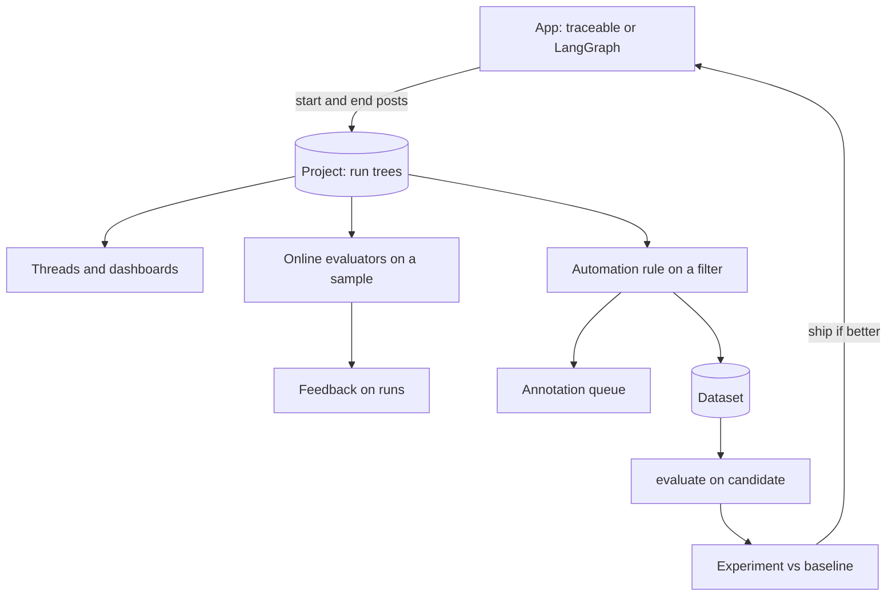

## TL;DR
LangSmith is LangChain Inc.'s closed-source platform for tracing, evaluating and monitoring LLM apps: run
trees with tokens, latency and cost, feedback, online evaluators and dataset experiments. Any code can use
`@traceable`, but for LangChain and LangGraph tracing is an environment-variable switch.

## Why it exists
- **Abstractions hid the model input.** A LangChain chain composed prompt templates, retrievers and parsers;
  when the answer was wrong you could not tell which piece produced the bad input.
- **Callbacks were already there.** The framework fired a callback on every chain, LLM and tool start and
  end; LangSmith grew out of turning those into persistent, queryable run trees.
- **`verbose=True` is not observability.** Console output does not persist, cannot be searched by user or
  compared across versions, and vanishes in production.
- **"The new prompt seems better" is not evidence.** Teams need a dataset with reference outputs, a way to
  run a candidate, evaluators that score each result, and a side-by-side view. LangSmith ties this to
  production: a bad trace becomes a dataset example with one click, an experiment is itself a set of traces,
  and feedback from users, annotators and judges lives on the same runs.
- **Most integrated, least portable.** Deepest LangGraph fit (node-level state, tool calls and token streams
  appear without instrumentation), but proprietary, its own data model, and your data sits in LangChain's
  cloud unless you self-host under an enterprise agreement. Langfuse offers the comparable loop as open
  source; Phoenix offers it on plain OpenTelemetry.

## How it works
### Runs, traces, projects and threads
| Object | What it is |
|---|---|
| **Run** | One unit of work with a `run_type` (`llm`, `chain`, `tool`, `retriever`, `embedding`, `prompt`, `parser`), inputs, outputs, start and end times, an error if any, tags, metadata and a parent run id |
| **Trace** | The root run and its tree |
| **Project** | A container for traces, usually one per application and environment |
| **Thread** | Traces sharing a conversation key in metadata (`session_id`, `thread_id` or `conversation_id`), reassembled into a conversation view so you read a multi-turn chat as the user experienced it |

- **Every run carries `trace_id`** (the root's id) and a `dotted_order` string built from the start time and
  id of every ancestor.
- **Why `dotted_order` exists:** runs arrive out of order. A child usually finishes, and is posted, before its
  parent, and batches from two processes interleave. Sorting by `dotted_order` reconstructs the tree and
  sibling order deterministically without waiting for the parent.

### How runs get created
| Path | Mechanism |
|---|---|
| LangChain or LangGraph | `LANGSMITH_TRACING=true` plus an API key and project name installs a tracer callback handler; every chain, node, model call and tool invocation becomes a run with no code change |
| `@traceable(run_type=...)` | Wraps any function: reads the current run from a context variable, creates a child run, records arguments, return value and exceptions, restores the parent on exit |
| `wrap_openai`, `wrap_anthropic` | Wrap provider clients so each completion becomes an `llm` run with token usage, including streamed responses, which the wrapper reassembles |
| `RunTree` | Manual control when decorators do not fit |

- **Across services,** the caller serialises its run tree to headers (`get_current_run_tree().to_headers()`)
  and the callee opens `tracing_context(parent=headers)`, so its runs become children in the same trace.
- **This is LangSmith's own format, not W3C `traceparent`,** which matters when the hop also runs through
  OpenTelemetry-instrumented middleware.

### Transport
- **Background batches.** Runs are queued and posted to the LangSmith API, so tracing stays off the request
  path.
- **Posted twice.** Once on start (inputs, start time, parent) and once on end (outputs, error, end time,
  usage). That is why an in-flight agent step shows as pending, and why a crash leaves runs with inputs but
  no end.
- **Drain before exit.** A short-lived process must wait for the queue (`wait_for_all_tracers()` or the
  client's flush) or child runs are lost.
- **OTLP endpoint.** OpenTelemetry-instrumented services can send spans into a project without the SDK.

### Feedback and online evaluation
- **Feedback** is a record with a key, a numeric score or categorical value and an optional comment, attached
  to a run.
- **Sources:**
  1. End-user signals sent with the run id.
  2. Human **annotation queues**.
  3. **Online evaluators**: LLM-as-a-judge or code rules on a sampled percentage of incoming traces, writing
     feedback automatically.
  4. **Automation rules** acting on a filter: add matching traces to a dataset, send them to an annotation
     queue, or call a webhook.
- **One shape for all,** so monitoring charts plot feedback over time next to latency, token and cost series.

### Datasets and experiments
- **A dataset** holds examples with inputs, reference outputs and metadata, with versions and splits.
- **`evaluate(target, data, evaluators, experiment_prefix)`** runs the target on every example, traces each
  run, applies the evaluators (plain functions or LLM judges that receive inputs, outputs and reference
  outputs) and records results as feedback. The result is an **experiment** you compare with others.
- **Pairwise evaluators** score two experiments against each other for preference judgements.
- **The playground** launches the same experiments to test prompt variants and models without code.

### Branding scope
As of late 2025 LangChain uses the LangSmith name for its broader platform, including the agent deployment
product previously called LangGraph Platform. This lesson concerns only observability and evaluation;
tracing does not require deploying through LangSmith.

### Prompts and monitoring
- **Prompt hub** versions prompts by commit; `client.pull_prompt("name")` returns a LangChain prompt template,
  and runs record which commit they used.
- **Project dashboards** show trace volume, error rate, latency percentiles, tokens, cost (from a model price
  map you can extend) and feedback trends, with threshold alerts.

## Diagram
Production runs land in a project; online evaluators and rules turn some into feedback and dataset examples;
`evaluate` turns a candidate into an experiment you compare before shipping.



## Examples
### Tracing plus an offline experiment, without LangChain
A traced retriever and chain, a wrapped OpenAI client so the model call is an `llm` run with tokens, a
`session_id` so traces form a thread, then an experiment with a code evaluator against a one-example golden
dataset. Evaluator signatures and the `{"output": ...}` wrapping follow the current SDK; older releases used
`(run, example)` evaluators.

```python
# pip install langsmith openai ; env: LANGSMITH_TRACING=true LANGSMITH_API_KEY=... LANGSMITH_PROJECT=support-bot
from langsmith import Client, traceable, evaluate
from langsmith.wrappers import wrap_openai
from openai import OpenAI

llm = wrap_openai(OpenAI())          # each completion becomes an 'llm' run with tokens, latency and cost

@traceable(run_type="retriever")
def retrieve(question: str) -> list[str]:
    return ["Reset your password under Settings > Security > Reset password."]

@traceable(run_type="chain", name="support_answer")
def answer(question: str) -> str:
    docs = retrieve(question)
    resp = llm.chat.completions.create(
        model="gpt-4o-mini",
        messages=[{"role": "system", "content": "Answer only from this context:\n" + "\n".join(docs)},
                  {"role": "user", "content": question}])
    return resp.choices[0].message.content

# Production call: metadata.session_id groups this trace with others into a Thread in the UI
answer("How do I reset my password?", langsmith_extra={"metadata": {"session_id": "conv-17"}})

# Offline experiment against a golden dataset
ls = Client()
if not ls.has_dataset(dataset_name="support-golden"):
    ds = ls.create_dataset("support-golden")
    ls.create_examples(dataset_id=ds.id,
                       inputs=[{"question": "How do I reset my password?"}],
                       outputs=[{"answer": "Settings > Security > Reset password"}])

def mentions_reference(outputs: dict, reference_outputs: dict) -> bool:      # a code evaluator
    return reference_outputs["answer"].lower() in outputs["output"].lower()

evaluate(lambda inputs: answer(inputs["question"]),      # a str result is stored as {"output": ...}
         data="support-golden", evaluators=[mentions_reference],
         experiment_prefix="system-prompt-v2")
```

- **In the UI:** `support_answer` → `retrieve` and `support_answer` → `ChatOpenAI`-style `llm` run; the
  experiment appears under the dataset with one traced run per example and a `mentions_reference` score.
- **Mechanically,** the production call creates three runs sharing one `trace_id`. `retrieve` starts and ends
  first, so its end record is often posted before `support_answer` has ended; `dotted_order` puts it in place.
- **The `llm` run** records the messages, the response and the provider's usage, from which cost is priced.
- **Thread grouping reads the root.** The `session_id` is set on the root call.
- **In the experiment,** `evaluate` calls the lambda once per example, so each example yields its own trace,
  and the evaluator's boolean becomes a feedback row keyed `mentions_reference` on that trace's root run.

### Joining a tool service to the caller's trace
LangSmith's propagation across an HTTP hop: the caller sends its run tree as headers, the callee continues it.
`do_work` is your own `@traceable` function.

```python
import httpx
import langsmith as ls
from fastapi import FastAPI, Request
from langsmith.run_helpers import get_current_run_tree

@ls.traceable(run_type="chain")
def call_tool_service(payload: dict) -> dict:
    headers = get_current_run_tree().to_headers()        # LangSmith trace headers, not W3C traceparent
    return httpx.post("http://tools:8000/run", json=payload, headers=headers).json()

app = FastAPI()                                          # the tool service

@app.post("/run")
async def run(request: Request):
    payload = await request.json()
    with ls.tracing_context(parent=request.headers):     # runs inside become children of the caller's run
        return await do_work(payload)
```

If a proxy strips unknown headers, the callee's runs appear as separate root traces.

### Worked comparison: reading two experiments
Illustrative numbers for a 200-example golden set, baseline versus `system-prompt-v2`.

| | Baseline | v2 |
|---|---|---|
| Examples passing `mentions_reference` | 150 | 161 |
| Fixed by v2 (fail → pass) | | 14 |
| Broken by v2 (pass → fail) | | 3 |

The comparison view lines up 200 pairs of runs by example id, which is what makes "v2 fixed 14 examples and
broke 3" a readable statement rather than an average. Open the 3 regressions before shipping.

## Production patterns
- **Project per environment.** Set `LANGSMITH_PROJECT` per deployment (for example `support-bot-dev`,
  `-ci`, `-prod`) so test runs never pollute dashboards or spend online-evaluator budget. Monitor trace
  volume per project.
- **Experiments as a CI gate.** Run `evaluate` against the golden dataset on every prompt or model change and
  fail the build if the pass rate drops or any tagged critical example regresses. Monitor pass rate per
  experiment over time.
- **Rules that grow the dataset.** An automation rule on low user feedback or long traces routes matches to an
  annotation queue and a dataset, so the golden set tracks real failures. Monitor queue backlog.
- **Sampled online judges, calibrated.** Apply online evaluators to a small percentage of production traces
  and compare with annotation-queue labels weekly. Monitor judge-human agreement and judge cost.
- **Hide sensitive payloads.** Configure the client's `hide_inputs` and `hide_outputs` processors to redact
  personal data before runs are posted. Monitor a sampled audit of stored runs.
- **Drain in serverless.** Call `wait_for_all_tracers()` or the client's flush at the end of each handler.
  Monitor root runs with missing children.

## Trade-offs
- **Integration vs lock-in.** Deepest LangChain and LangGraph integration (node state, tool calls, streamed
  tokens for free) against a proprietary data model and hosted service. Flips when procurement requires data
  residency and enterprise self-hosting is not on the table.
- **Zero operations vs volume pricing.** Managed SaaS needs no operations, but pricing follows ingested traces
  with retention tiers, so at high volume you sample, shorten retention, or move to a self-hosted open-source
  alternative.
- **Fidelity vs privacy.** `@traceable` records arguments and return values automatically, which is high
  fidelity and also captures personal data and large payloads; input and output processors or hiding inputs
  trade that fidelity back.
- **Online judges vs cost and bias.** Online evaluators give a continuous quality signal on production
  traffic at judge-model cost per sampled trace and with judge bias; annotation queues are the calibration,
  not an optional extra.
- **Prompt hub vs runtime dependency.** It decouples prompt edits from deploys for LangChain templates, but
  your runtime now depends on a pull at start-up or request time; cache it and fall back to a bundled version.

## Pitfalls
- **Wrong environment-variable family.** The older `LANGCHAIN_TRACING_V2` and `LANGCHAIN_API_KEY` names versus
  the current `LANGSMITH_*` names, or a key from another workspace. Symptom: a working app and an empty
  project.
- **Serverless returns before the queue drains.** Symptom: root runs with missing children. Fix: wait for
  tracers before returning.
- **Wrapped client outside any traceable context.** Every model call is its own trace. Symptom: hundreds of
  one-run traces and no threads.
- **Thread key on the wrong run.** The metadata key is missing or set on a child rather than the root.
  Symptom: a conversation view with one turn per thread.
- **Evaluators reading the wrong key.** They read `outputs["answer"]` when the target returned a string
  (stored as `{"output": ...}`) or a dict with a different key. Symptom: every example erroring or scoring
  zero.
- **Dev, CI and production in one project.** Symptom: dashboards and online evaluators polluted by test runs,
  and sampled judges spending budget on fixtures.

## When to use
- **Use when** the app is built on LangChain or LangGraph and a hosted platform is acceptable: agent-level
  traces, threads and evaluations with almost no instrumentation, and a mature dataset-to-experiment loop.
- **Compare first when** the code is plain Python or TypeScript through `@traceable`: the integration
  advantage shrinks, and Langfuse (open source, self-hostable) or Phoenix (OpenTelemetry-native) deserve a
  direct comparison on data residency and cost.
- **Measure:** trace completeness per environment, the fraction of production traces that receive feedback,
  and judge-versus-human agreement on the annotation queue.
- **Day to day,** it is where you reproduce a customer's bad conversation and where a prompt change proves
  itself against the golden dataset before release.
- **Interviews:** explain the run tree, how threads are formed, and the difference between online evaluators
  and offline experiments.

## Role lens
- **Engineer:** Wraps provider clients, decorates service boundaries with `@traceable`, sets session metadata
  on the root run, and writes code evaluators that read the right output keys.
- **Architect:** Decides whether a proprietary hosted tracing store is acceptable for the data involved,
  defines project-per-environment conventions, and sets the sampling and retention budget.
- **FDE:** Uses threads to walk a customer through a failing conversation, builds the customer's golden
  dataset from annotated production traces, and runs experiments as acceptance evidence.

## Check yourself
**Q:** A LangGraph agent in production sometimes calls the same tool repeatedly before answering, and users
complain about slow responses. How would you use LangSmith to quantify the problem, find the cause and
verify a fix?
**A:** Quantify first: filter the project for traces whose tool-run count or latency exceeds a threshold, and
add an automation rule that routes matching traces to an annotation queue and a "looping" dataset so the
sample accumulates. Open a few run trees: LangGraph traces show each node's state and the `llm` run that
chose the next action, so you can read the prompt and output at the step where it re-selected the tool,
which usually reveals a missing observation in state, an ambiguous tool description or no stopping
instruction. Fix the prompt or add a step budget, then run `evaluate` against the looping dataset with a code
evaluator that counts tool runs in the trace, and compare the experiment with the baseline. Ship behind a
canary project, and keep an online evaluator or feedback key tracking the loop rate over time.

## Interview questions
### What is a run tree, and why does each run carry a dotted_order?
- **Definition:** every unit of work is a run with a type, inputs, outputs, timing and a parent; the root run
  and its descendants form the trace.
- **Why `dotted_order`:** children usually finish and post before parents and batches interleave across
  processes; an ancestor-encoded sort key rebuilds the tree deterministically without waiting.

### Each chat turn shows as a separate conversation in the Threads view. How do you debug it?
- **Threads group by a metadata key** (`session_id`, `thread_id` or `conversation_id`) on the root run.
- **Check** the key exists on every turn, is set on the root rather than a child, and is stable across turns
  (not regenerated per request).
- **Also check** model calls are inside a traceable context, otherwise each becomes its own trace.

### When would you not choose LangSmith?
- **When data must stay in your network** and enterprise self-hosting is not available; prompts with customer
  data then rule out the hosted service.
- **When volume makes per-trace pricing dominant** and sampling would hide the failures you need.
- **When the stack is not LangChain,** the integration advantage shrinks, so compare Langfuse or Phoenix on
  cost and residency.

### Some runs show inputs but never an output or end time. What happened?
- **Runs are posted twice,** once on start and once on end, so a run with only a start record means the end
  post never arrived.
- **Likely causes:** the process crashed or was killed mid-step, or a serverless handler returned before the
  background queue drained.
- **Fix:** wait for tracers or flush at the end of each handler, and treat persistent pending runs as a crash
  signal worth alerting on.

### How would you size online judge evaluation for 20,000 traces a day?
- **Pick a sampled percentage,** for example 5% gives about 1,000 judged traces a day; multiply by judge prompt
  plus trace tokens and the judge model price (rough planning figures).
- **Budget human calibration** too: a weekly annotation queue sized to estimate judge-human agreement, because
  that agreement is what makes the automated number trustworthy.

## Quiz
### Q: Which setup produces full traces for a LangGraph application with the least code?
- [ ] Wrap every node function in `@traceable` and every model client in `wrap_openai`
- [x] Set `LANGSMITH_TRACING=true` with an API key and project name; the framework's callbacks already emit runs
- [ ] Add OpenTelemetry auto-instrumentation and point the exporter at LangSmith
- [ ] Export the graph to JSON and upload it as a dataset
> LangChain and LangGraph already fire callbacks for every chain, node, model and tool; the tracer handler
> turns them into runs. Decorators and wrappers are for code outside the framework, and OTLP works but is not the minimal path.

### Q: What is a Thread in LangSmith?
- [ ] A Python thread the SDK uses to post runs in the background
- [x] A set of traces grouped by a shared conversation key in their metadata, shown as one conversation
- [ ] The tree of runs under a single root run
- [ ] A queue of traces waiting for human annotation
> Each turn of a chat is its own trace; a thread stitches turns together through `session_id`, `thread_id`
> or `conversation_id` metadata on the root run, which is why the key must be set there.

### Q: How do online evaluators differ from offline `evaluate` experiments?
- [x] Online evaluators score a sample of live production traces and write feedback; `evaluate` runs a target over dataset examples to produce a comparable experiment
- [ ] Online evaluators use LLM judges while `evaluate` only supports code evaluators
- [ ] `evaluate` runs in the browser playground while online evaluators run in the SDK
- [ ] They are the same mechanism with different names in Python and JavaScript
> Online evaluation answers "how is production doing right now" on traffic you did not choose; offline
> experiments answer "is this change better" on a fixed dataset. Both can use code or judge evaluators.
