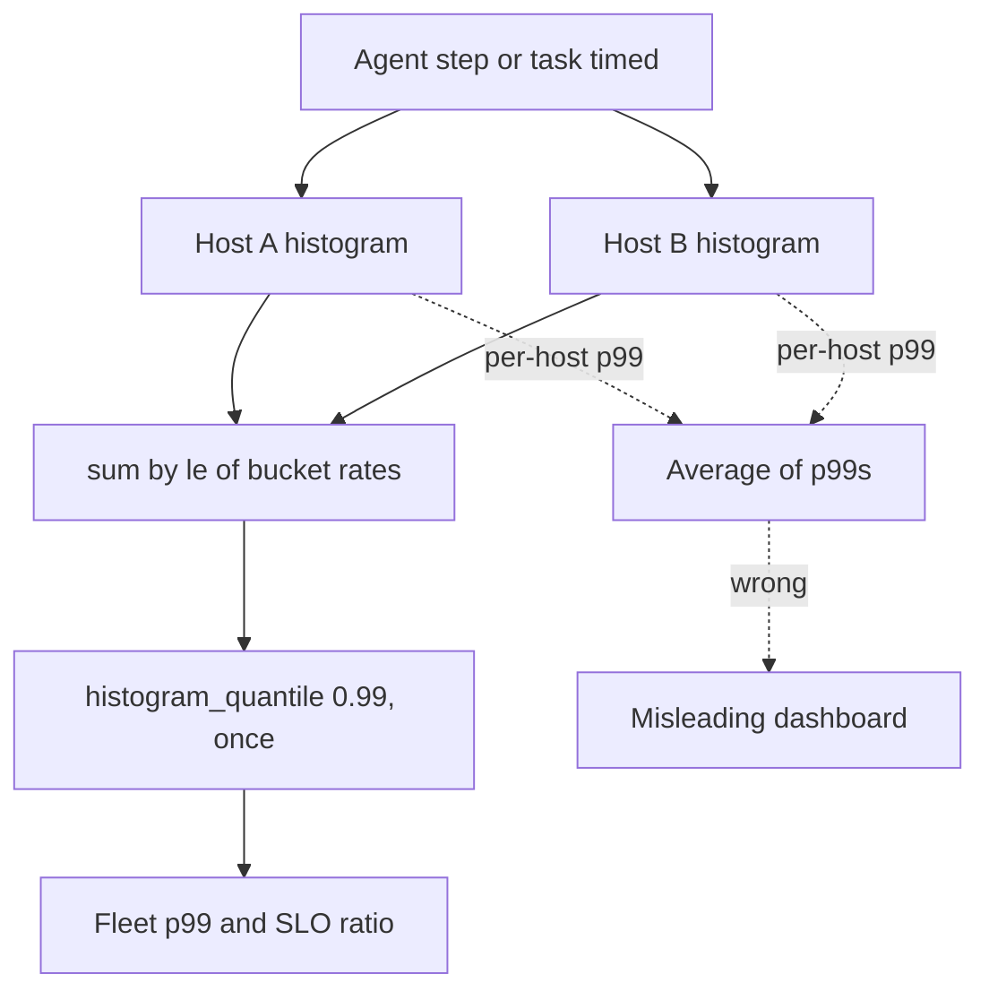

## TL;DR
An agent task is a chain of model and tool calls, so its latency is a distribution whose tail compounds
with every step. Track p50/p95/p99 per phase (TTFT, per-token, total) and per step, merge histograms
before taking quantiles, and never average percentiles.

## For agent builders
- **Why it matters for agents.** A task that makes 20 model and tool calls is slow whenever any one call is
  slow, so a dependency's p99 becomes your users' typical experience. The mean hides this completely.
- **Where it shows up in your stack.** Histograms from your LLM gateway or `prometheus_client`, span
  durations in your tracing backend (Langfuse, LangSmith, Phoenix), TTFT timed client-side on streamed
  calls, and the provider's usage field for output tokens per call.
- **What you control.** Step count, `max_tokens`, streaming, per-call timeouts and retries, hedging of
  idempotent tool calls, and the bucket edges you put on SLO thresholds.
- **What you can skip.** Sketch internals (t-digest, DDSketch maths). Know that they are mergeable with
  bounded relative error, and that per-process summaries are not.

## Lab
### Task
Fix the latency numbers an agent team reports. The dashboard averages per-host p99s, nobody can read the
SLO ratio, and agent steps are timed only when they succeed, so a CRM timeout makes the tail look better.
Time box: 45-60 minutes. Prerequisites: Monitoring and Tracing, plus the bucket example in this lesson.
- **Fleet p99:** sum the cumulative buckets across series, then take one quantile.
- **SLO ratio:** the fraction under a threshold, refused when the threshold is not a bucket edge.
- **Every outcome timed:** each step is recorded under `(step, status)` with `ok`, `timeout` or `error`.

### Starter code
Save as `lab_latency.py`. Plain Python 3.12 plus `pip install pytest` (checked with pytest 9.1.1). A fake
clock stands in for real time, so the 30 s timeout costs nothing.

```python
import time

EDGES = [0.5, 1, 2, 5, 10, float("inf")]                   # task buckets (le), on SLO thresholds
STEP_EDGES = [0.25, 0.5, 1, 2, 5, 10, 30, float("inf")]    # agent-step buckets
HOST_A = [7000, 9000, 9600, 9900, 9980, 10000]             # cumulative counts, busy host
HOST_B = [10, 30, 60, 85, 98, 100]                         # small canary, slow

def quantile(q, edges, cum):
    """What histogram_quantile does: find the crossing bucket, interpolate linearly inside it."""
    target = q * cum[-1]
    lo_edge, lo_count = 0.0, 0
    for edge, count in zip(edges, cum):
        if count >= target:
            if edge == float("inf"):
                return lo_edge                              # cannot interpolate into +Inf
            return lo_edge + (edge - lo_edge) * (target - lo_count) / (count - lo_count)
        lo_edge, lo_count = edge, count
    return lo_edge

def observe(hist, key, seconds, edges=STEP_EDGES):
    """hist maps (step, status) -> cumulative counts; a sample increments every bucket with le >= it."""
    counts = hist.setdefault(key, [0] * len(edges))
    for i, edge in enumerate(edges):
        if seconds <= edge:
            counts[i] += 1

def fleet_quantile(q, edges, series):
    # BUG: averages the per-series quantiles, so a tiny canary dominates the fleet number.
    # YOUR CODE 1: merge first (sum counts per bucket across every series), take the quantile once.
    return sum(quantile(q, edges, cum) for cum in series) / len(series)

def slo_ratio(edges, cum, threshold):
    # YOUR CODE 2: the fraction of requests that finished at or under `threshold`. It is exact only at
    #              a bucket edge, so raise ValueError for a threshold that is not one of `edges`.
    raise NotImplementedError

def timed_step(hist, step, fn, *args, clock=time.perf_counter):
    # BUG: only successes are timed, so a timeout vanishes from the sample and the p99 "improves".
    # YOUR CODE 3: record every outcome under (step, status) with status "ok", "timeout"
    #              (TimeoutError) or "error" (any other exception), with its elapsed time, then re-raise.
    t0 = clock()
    result = fn(*args)
    observe(hist, (step, "ok"), clock() - t0)
    return result

class FakeClock:
    def __init__(self):
        self.now = 0.0
    def __call__(self):
        return self.now

def crm_lookup(clock, seconds):
    clock.now += seconds                                   # the call takes `seconds` of fake time
    if seconds >= 30:
        raise TimeoutError("crm_lookup timed out after 30 s")
    return {"customer": "c-1"}

if __name__ == "__main__":
    print(f"fleet p99  {fleet_quantile(0.99, EDGES, [HOST_A, HOST_B]):.2f} s")
    merged = [a + b for a, b in zip(HOST_A, HOST_B)]
    try:
        print(f"under 2 s  {slo_ratio(EDGES, merged, 2):.1%}")
    except NotImplementedError:
        print("under 2 s  (not implemented)")
    clock, hist = FakeClock(), {}
    for seconds in [0.4] * 9 + [30]:                       # one call in ten hits the 30 s timeout
        try:
            timed_step(hist, "crm_lookup", crm_lookup, clock, seconds, clock=clock)
        except TimeoutError:
            pass
    crm = [cum for (step, _), cum in hist.items() if step == "crm_lookup"]
    calls = sum(cum[-1] for cum in crm)
    print(f"crm_lookup p99 {fleet_quantile(0.99, STEP_EDGES, crm):.2f} s over {calls} timed calls")
```

The starter prints `fleet p99  7.50 s`, `under 2 s  (not implemented)` and `crm_lookup p99 0.50 s over 9
timed calls`: the canary dominates, and the timeout has vanished from the sample.

### Expected output
With a correct solution, `python lab_latency.py` prints:

```
fleet p99  5.75 s
under 2 s  95.6%
crm_lookup p99 28.00 s over 10 timed calls
```

### Tests
Save as `test_lab_latency.py` and run `pytest -q`. On the starter all four fail: the fleet p99 is 7.5,
`slo_ratio` raises `NotImplementedError`, and the `timeout` and `error` series do not exist (`KeyError`).

```python
import pytest
from lab_latency import (EDGES, HOST_A, HOST_B, STEP_EDGES, FakeClock, crm_lookup,
                         fleet_quantile, slo_ratio, timed_step)

def test_fleet_p99_merges_buckets_before_the_quantile():
    assert fleet_quantile(0.99, EDGES, [HOST_A, HOST_B]) == pytest.approx(5.75, abs=0.005)   # not 7.50

def test_slo_ratio_is_exact_at_an_edge_only():
    merged = [a + b for a, b in zip(HOST_A, HOST_B)]
    assert slo_ratio(EDGES, merged, 2) == pytest.approx(9660 / 10100)
    with pytest.raises(ValueError):
        slo_ratio(EDGES, merged, 3)                       # 3 s is not a bucket edge

def test_timeouts_are_timed_and_labelled():
    clock, hist = FakeClock(), {}
    for seconds in [0.4] * 9 + [30]:
        try:
            timed_step(hist, "crm_lookup", crm_lookup, clock, seconds, clock=clock)
        except TimeoutError:
            pass
    assert hist[("crm_lookup", "timeout")][-1] == 1
    crm = [cum for (step, _), cum in hist.items() if step == "crm_lookup"]
    assert fleet_quantile(0.99, STEP_EDGES, crm) == pytest.approx(28.0)

def test_other_failures_are_errors_and_still_raise():
    hist = {}
    def broken():
        raise ValueError("bad arguments")
    with pytest.raises(ValueError):
        timed_step(hist, "billing", broken)
    assert hist[("billing", "error")][-1] == 1
```

### Failure scenarios
- **Weight each host's p99 by its traffic instead of merging.** You get about 5.05 s, close enough to look
  right and still wrong. Debug: compare with the quantile of the summed buckets; only that matches a pooled
  sample.
- **Swallow the exception in `timed_step` after recording it.** The tests pass for the histogram but the
  agent loop now treats a timed-out CRM call as a result. Debug: `pytest.raises` in the last test catches it.
- **Record the timeout as `ok`.** The p99 is right, but the timeout count next to it reads zero. Debug: plot
  the `status` series separately; incidents should show up there first.
- **Ask for "under 3 s".** Interpolating inside the 2-5 s bucket invents a number. Debug: put the SLO
  threshold on a bucket edge, which is why `slo_ratio` refuses it.

### Submission
- `lab_latency.py` and a `pytest -q` run showing 4 passed.
- The three printed lines, matching the expected output exactly.
- One sentence explaining why the fleet p99 (5.75 s) is lower than the average of p99s (7.50 s).
- The PromQL you would write for the same fleet p99 and SLO ratio on `agent_step_seconds`.
- A reviewer checks that the starter's bugs are gone, not hidden: no averaging, no untimed exceptions.

## Why it exists
- **The mean describes nobody.** Latency has a hard floor (network round trip plus minimum compute) and no
  ceiling, so the distribution is right-skewed and the mean is pulled toward the few slow values. A handful
  of slow requests drags it up while most users never see them, and a long tail hides behind a
  healthy-looking average.
- **Slow requests have many causes.** A retry after a timeout, a garbage-collection pause, a cold start, a
  queue behind a 20,000-token prefill, or simply a long answer can take seconds.
- **Worked case.** 100 requests: 95 finish in 200 ms, 5 take 6 s. Mean = (95 × 0.2 + 5 × 6) / 100 =
  0.49 s. Percentiles tell the real story: p50 = 200 ms, p95 = 200 ms, p99 = 6 s. Typical experience is
  fine; one user in twenty waited thirty times longer.
- **Systems compose, so the tail matters more than its share.** A page or agent step waiting on *N* calls is
  as slow as the slowest. If each call exceeds its p99 with probability 1%, the user waits that long with
  probability 1 − 0.99^N: about 10% for 10 calls, 40% for 50, 63% for 100. Dean and Barroso called this
  the tail at scale; an agent making twenty sequential model and tool calls has the additive version.
- **Mean-based alerts fail both ways.** "Alert when average latency doubles" stays silent when 2% of
  requests get five times slower, and pages you when one 60-second outlier lands in a quiet minute. SLOs
  are percentile statements by construction ("99% of requests under 2 s").

## How it works
### Definition
- **Nearest rank.** Sort the *n* latencies of a window ascending; the p-th percentile is the value at rank
  ⌈p/100 × n⌉. It is the value below which p% of requests finish. Interpolating variants differ slightly
  and only matter for small *n*. p50 is the median.
- **Each extra nine needs ~10× more samples.** With 100 requests in a window, p99 is the second-largest
  value, so a single retry defines it. With 1,000 requests the top 1% is ten samples, still noisy.
- **So pair percentiles with their sample count.** That is why p99 over a one-minute window on a
  low-traffic endpoint looks like random noise.

### You cannot keep every sample
At 1,000 requests per second one endpoint produces 86 million latencies a day. Two compressions are
standard, both chosen because they can be **merged** across hosts and across time.

| Approach | How it works | Error | Merge |
|---|---|---|---|
| **Fixed-bucket histogram** (Prometheus `_bucket` series with `le` bounds) | Each sample increments every bucket whose upper bound is at or above it (counts are cumulative). Find the bucket where cumulative count crosses p × n and interpolate linearly inside it | The bucket width; exact at an edge | Sum counts |
| **Quantile sketch** (t-digest, HDR Histogram, DDSketch, OpenTelemetry exponential histogram) | Buckets grow geometrically | Bounded *relative* error from 1 ms to 10 minutes with a few hundred counters | Mergeable |
| **Prometheus *summary*** or in-process `p99` gauge | Quantile computed inside each process, number exported | Precise per process | Not mergeable |

- **Put bucket edges on SLO thresholds** (say 0.5, 1, 2, 5, 10 s), because the number you need exactly is
  "what fraction finished under the threshold", and that is exact at an edge.
- **Sketches suit LLM calls** because their latencies span four orders of magnitude.
- **Summaries are useless for the fleet.** The raw distribution is gone by the time it reaches the backend,
  so you cannot combine 40 per-process p99s into one fleet p99. Use summaries only for a single process you
  will never aggregate.

### Why you merge first and quantile last
- **Percentiles do not compose.** The fleet p99 is not the mean of per-host p99s, nor a traffic-weighted
  mean of them; the daily p99 is not the mean of per-minute p99s.
- **Averaging distorts in both directions.** A canary host on 1% of traffic with a terrible p99 dominates an
  "average p99" while barely moving the real fleet tail; a loaded host's tail can be diluted the same way.
- **Correct query:** sum the histograms first, take the quantile once. In PromQL:
  `histogram_quantile(0.99, sum by (le) (rate(latency_seconds_bucket[5m])))`.

### Windows
- **Short windows (1–5 min)** react to incidents quickly but flap at low traffic.
- **Long windows (1 h, 1 day)** are stable, but a ten-minute outage inside a day barely registers.
- **Alert on a ratio.** "Fraction of requests under the threshold" burning an error budget is more robust
  than alerting on the p99 value, because it is a ratio with a known sample size.

### What makes the tail
- **Queueing, usually.** In the simplest queue model expected wait grows like ρ/(1−ρ) with utilisation ρ, so
  the tail explodes near saturation while the mean still looks fine.
- **Retries.** A retry after a 5-second timeout adds 5 seconds to that request.
- **Others.** Stop-the-world garbage collection, cold starts, lock contention, and cache misses that only
  some requests pay.

LLM serving adds its own sources:

| Phase | Tail source |
|---|---|
| Time to first token (TTFT) | Prefill of unusually long prompts; waiting for a slot in a continuous-batching scheduler |
| Per-token latency | Rises with batch size and context length |
| Provider calls | Rate limits turn into 429s plus backoff |
| End to end | ≈ TTFT + output_tokens × seconds_per_token, so the "tail" is often just long answers |

- **Measure three distributions:** TTFT, inter-token latency (or tokens/s) and total.
- **When total regresses, check output length first**, before blaming infrastructure.

### Cutting the tail
| Remedy | How | Cost |
|---|---|---|
| **Hedged requests** | Send a duplicate to another replica only if the first has not answered by about the p95 delay | At most ~5% of requests duplicated; firing immediately would double load to fix 1% |
| **Timeouts with one retry** | For idempotent calls; set the timeout from the measured distribution, not a round number | The retry adds the full timeout to that request |
| **Admission control** | Reject or queue work above a utilisation target | Attacks the ρ/(1−ρ) term directly |
| **Cap `max_tokens`, stream** | Shortens or hides the decode term | Changes perceived latency more than any infrastructure fix |

None of these is free near saturation: every duplicate is extra load arriving exactly when queues are long.

### Where you measure
- **Edge or client for the SLO.** Server-side timers miss load-balancer queueing, TLS handshakes, network
  and client retries; keep server-side percentiles for diagnosis.
- **Time failures and timeouts too.** If only successes are timed, the p99 *improves* during an incident as
  the slowest requests become timeouts and vanish from the sample.
- **Beware coordinated omission.** Load generators that wait for a slow response before sending the next
  request under-sample the bad period the same way.

## Diagram
Each agent host records every step and every task into the same bucket layout; the fleet number comes
from summing buckets, then taking one quantile. The dotted path is the mistake.



## Examples
### Simulation: averaging p99s and fan-out
Two hosts behind one load balancer. Host A is busy and mostly healthy; host B is a tiny canary with a bad
slow mode. The script shows two mistakes: averaging per-host p99s instead of pooling, and underestimating
how often a fan-out request meets a per-call p99. Numbers are illustrative of the shape, not a benchmark.

```python
import numpy as np
rng = np.random.default_rng(0)

def service(n, slow_frac, slow_ms):
    """Mostly fast (log-normal around 300 ms) with a slow mode: retries, cold starts, long prompts."""
    fast = rng.lognormal(mean=np.log(300), sigma=0.3, size=n)
    slow = rng.random(n) < slow_frac
    return np.where(slow, slow_ms + rng.exponential(1000, size=n), fast)

def summary(x):
    p50, p95, p99 = np.percentile(x, [50, 95, 99])
    return f"n={len(x):>6} mean={x.mean():6.0f} p50={p50:5.0f} p95={p95:5.0f} p99={p99:6.0f} ms"

a = service(100_000, slow_frac=0.005, slow_ms=4000)   # busy host, 0.5% slow
b = service(1_000,   slow_frac=0.20,  slow_ms=4000)   # tiny canary, 20% slow
print("A", summary(a))      # expect p99 around 0.65 s: the slow mode sits below the 1% mark
print("B", summary(b))      # expect p99 around 7 s

# WRONG: average the per-host p99s.  RIGHT: pool the samples (or sum histogram buckets) first.
print("avg of p99s:", (np.percentile(a, 99) + np.percentile(b, 99)) / 2)   # roughly 3.7 s
print("pooled p99 :", np.percentile(np.concatenate([a, b]), 99))          # roughly 0.7 s

# Fan-out: a request that waits on k such calls meets a per-call p99 far more often than 1% of the time.
for k in (1, 10, 50, 100):
    print(f"k={k:3}: P(at least one call >= its p99) = {1 - 0.99**k:.1%}")
```

- **Host A's mean (about 340 ms)** sits between its p50 and p95 and says nothing about the 0.5% of users who
  waited over four seconds.
- **The p99 misses them too,** because they are fewer than 1%. That is the argument for also tracking p99.9,
  or the count of requests over a hard threshold, on user-facing paths.

### Estimating a quantile from cumulative buckets
What `histogram_quantile` does, in pure Python: find the bucket where the cumulative count crosses p × n
and interpolate linearly inside it. Hosts are merged by adding counts per bucket.

```python
edges = [0.5, 1, 2, 5, 10, float("inf")]           # bucket upper bounds (le), seconds
host_a = [7000, 9000, 9600, 9900, 9980, 10000]      # cumulative counts, busy host
host_b = [10, 30, 60, 85, 98, 100]                  # small canary, slow

def quantile(q, edges, cum):
    target = q * cum[-1]
    lo_edge, lo_count = 0.0, 0
    for edge, count in zip(edges, cum):
        if count >= target:
            if edge == float("inf"):
                return lo_edge                       # cannot interpolate into +Inf
            return lo_edge + (edge - lo_edge) * (target - lo_count) / (count - lo_count)
        lo_edge, lo_count = edge, count
    return lo_edge

merged = [a + b for a, b in zip(host_a, host_b)]    # merge = sum counts per bucket
print(f"A p99      {quantile(0.99, edges, host_a):.2f} s")
print(f"B p99      {quantile(0.99, edges, host_b):.2f} s")
print(f"avg of p99 {(quantile(0.99, edges, host_a) + quantile(0.99, edges, host_b)) / 2:.2f} s")
print(f"fleet p99  {quantile(0.99, edges, merged):.2f} s")
print(f"under 2 s  {merged[2] / merged[-1]:.1%}")   # exact at an edge: the SLO ratio
```

- **Output:** A p99 5.00 s, B p99 10.00 s, average of p99s 7.50 s, fleet p99 5.75 s, 95.6% under 2 s.
- **The canary dominates the average** although it carries about 1% of traffic; the merged number is the
  real fleet tail.
- **The SLO ratio is exact** because 2 s is a bucket edge; the p99 values are only as precise as the bucket
  widths (5 to 10 s here). B's p99 falls in the +Inf bucket, so it is clamped to the last finite edge.

### Worked scenario: latency budget for a 12-step support agent
An agent answers a ticket with a planning call, retrieval, several tool calls and a final answer. Per-call
numbers below are illustrative, chosen to show the shape.

| Step type | Calls per task | p50 per call | p99 per call |
|---|---|---|---|
| Model call (plan or decide) | 6 | 1.2 s | 4 s |
| Retrieval | 2 | 0.15 s | 0.8 s |
| External tool (CRM, billing) | 3 | 0.4 s | 5 s |
| Final answer, streamed | 1 | 3 s | 9 s |
| **Task total (sequential)** | **12** | **about 12 s (sum of p50s, a rough guide)** | **far above the 9 s of any single call** |

- **Tails compound.** With 12 calls, the chance at least one hits its own p99 is 1 − 0.99^12, about 11%,
  so roughly one task in nine contains a "rare" slow call.
- **The fix is structural.** Cut steps (merge the two retrievals), run independent tool calls in
  parallel, put a timeout plus one retry on the 5 s CRM tail, and stream the final answer so perceived
  latency is TTFT, not total.

### Timing every agent step with a status label
Wrap each model and tool call in one histogram so the step and the outcome are both recorded, including
timeouts. Label values stay low-cardinality: step type and tool name, never task IDs.

```python
import time
from prometheus_client import Histogram

STEP = Histogram("agent_step_seconds", "Agent step latency", ["step", "tool", "status"],
                 buckets=[0.25, 0.5, 1, 2, 5, 10, 30])

def timed_step(step, tool, fn, *args, **kwargs):
    t0, status = time.perf_counter(), "ok"
    try:
        return fn(*args, **kwargs)
    except TimeoutError:
        status = "timeout"; raise
    except Exception:
        status = "error"; raise
    finally:   # failures are timed too, so an incident cannot improve the tail
        STEP.labels(step, tool, status).observe(time.perf_counter() - t0)

# In the agent loop:
# result = timed_step("tool", "crm_lookup", crm.lookup, customer_id)
# reply  = timed_step("model", "none", client.chat, messages)
```

### Worked incident: a p99 that improved during an outage
| Time | Successes timed | Timeouts (not timed) | Reported p99 |
|---|---|---|---|
| Before | 10,000 | 0 | 3.1 s |
| Incident | 9,200 | 800 at the 30 s timeout | 2.4 s, "better" |
| After fix (timeouts recorded with elapsed time) | 9,200 + 800 | counted | 30 s |

Illustrative numbers. The fix was recording every request with its elapsed time and a status label, and
alerting on the fraction under the threshold.

## Production patterns
- **SLO-edge histograms per phase.** Emit TTFT, inter-token and total as histograms labelled by model,
  endpoint and tenant, with buckets on SLO thresholds, for example
  `Histogram("llm_ttft_seconds", "TTFT", ["model", "route"], buckets=[0.25, 0.5, 1, 2, 5, 10])` in
  `prometheus_client`. Monitor series count, because labels multiply buckets.
- **Ratio-based SLO alerts.** Alert on
  `sum(rate(latency_seconds_bucket{le="2"}[5m])) / sum(rate(latency_seconds_count[5m]))` burning the error
  budget over a short and a long window together, not on the raw p99 value. Monitor the burn rate.
- **Exponential histograms for wide ranges.** When you need p99.9 across milliseconds to minutes, use the
  OpenTelemetry exponential bucket histogram aggregation or a t-digest instead of hand-picked buckets.
  Monitor relative error against a sampled raw log.
- **Hedge at the p95 delay, not immediately.** gRPC service config supports a hedging policy with a hedging
  delay; set it near the measured p95 and only for idempotent calls. Monitor the duplicate rate (expect
  ~5%) and backend utilisation.
- **Time every outcome.** Record errors and timeouts with elapsed time and a `status` label so incidents
  cannot improve the tail. Monitor the timeout count next to p99.
- **Per-step and per-task histograms for agents.** Record one histogram per step type (model, retrieval,
  each tool) and one for whole tasks, plus a histogram of steps per task. Monitor task p95 next to steps
  per task, because a planner that starts taking 15 steps instead of 8 looks like a latency regression.
- **Low-traffic fallback.** For endpoints below a few hundred requests per window, show p90 plus the
  sample count, or widen the window.

## Trade-offs
- **Higher percentile vs sample size.** A higher percentile describes the worst experience more faithfully
  but needs about ten times more samples per extra nine. On a per-tenant endpoint doing 50 requests a
  minute, a one-minute p99 is the maximum, so fall back to p90 or a longer window.
- **Fixed buckets vs sketches.** Fixed-bucket histograms are cheap, mergeable and exact at the bucket edges,
  but imprecise between them. When you need p99.9 across a millisecond-to-minutes range, switch to
  exponential histograms or t-digest.
- **Tail-cutting vs load.** Hedged requests, retries and duplicate speculative calls buy tail latency almost
  free when utilisation is low and make the tail worse near saturation, because they add load exactly when
  queueing is the cause.
- **End-to-end vs per-phase.** End-to-end percentiles are what users feel, but for LLM calls they conflate
  answer length with speed. TTFT and per-token percentiles are diagnosable at the cost of three charts
  instead of one.
- **Short vs long windows.** Short windows catch incidents in minutes but flap; long windows are stable but
  hide short outages, so dashboards usually need both.

## Pitfalls
- **Averaging percentiles across hosts, shards or time buckets.** Symptom: a dashboard p99 that moves when
  you add an idle instance and never matches what a user with a stopwatch sees. Fix: sum buckets, then
  quantile.
- **Alerting on mean latency.** Symptom: a 5× regression on 2% of traffic that nobody notices until support
  tickets arrive, while one 60-second outlier pages the on-call at 3 a.m.
- **Timing only successful requests.** Symptom: a p99 that improves during an incident because the slowest
  requests turned into timeouts and dropped out of the sample.
- **Mixing models, endpoints, tenants or prompt sizes in one percentile.** Symptom: a shelf between p97 and
  p99 that turns out to be the 3% of traffic routed to a slower model.
- **Treating an end-to-end regression as an infrastructure problem.** Symptom: unchanged TTFT and tokens/s
  while the median output length doubled after a prompt edit.
- **Reporting one p99 across agent tasks of very different length.** Symptom: task p99 jumps although
  no call got slower, because a new feature routes more multi-step tasks. Fix: slice task latency by
  steps per task or task type, and track the step-count distribution.
- **Measuring only server-side.** Symptom: a server p99 of 300 ms against customer reports of 4 s, the gap
  being load-balancer queueing, SDK retries or provider-side queueing nobody instrumented.

## When to use
- **Use for every latency you report,** and pick the percentile by audience: p50 for capacity and cost
  conversations, p95/p99 for user-facing SLOs, p99.9 or a hard-threshold count for paths where a single bad
  experience is expensive.
- **Instrument LLM calls** as three histograms (TTFT, inter-token, total) labelled by model, endpoint and
  tenant, with bucket edges at your SLO thresholds; compute every fleet-level number by summing histograms.
- **Avoid p99** on anything that sees fewer than a few hundred requests per window; report p90 and the count.
- **Day to day,** this is the first chart you open in an incident and the number in every capacity review.
- **Interviews:** expect why the mean is misleading, how to aggregate percentiles across hosts, and how
  fan-out turns a dependency's p99 into your p50.

## Role lens
- **Engineer:** Emits latency histograms with sensible buckets from the LLM gateway, splits TTFT from
  decode, and checks output-length percentiles before declaring a latency regression.
- **Architect:** Sets the percentile SLO per path, allocates a latency budget across retrieval, model and
  tools, and decides where hedging or fallbacks are allowed given fan-out depth.
- **FDE:** Translates a customer's "it feels slow sometimes" into a measured p95 by tenant and phase, and
  uses the fan-out arithmetic to explain why their 15-call agent needs a faster per-call target.

## Check yourself
**Q:** After a release, a chat assistant's end-to-end p99 rose from 9 s to 16 s. Mean latency rose only 10%,
GPU utilisation is unchanged, and no infrastructure changed. How do you find the cause, and what do you
report?
**A:** First decompose the metric. Compare the output-token length distribution before and after: a prompt
edit that makes a minority of answers much longer raises the tail of total latency with no change in speed,
which fits a small move in the mean and unchanged GPU load. Then split TTFT from inter-token latency; if per-token speed and
TTFT are flat, it is length. Next slice by model, endpoint and tenant: a new feature sending 3% of traffic
to a slower model or a longer system prompt appears only above p97. Check retry and timeout settings in the
release, since a new retry adds a full timeout to the tail, and check the gateway queue-time span. Finally
confirm the measurement itself did not change, for example streaming end-time now including a post-processing
step. Report which segment and which phase moved, the fraction of requests affected, and the fix, not just
"p99 is up".

## Interview questions
### Why is mean latency a poor SLO metric, and what would you use instead?
- **Latency is right-skewed.** A floor and no ceiling means a few slow requests pull the mean toward values
  almost nobody experienced, while a 5× slowdown on 2% of traffic barely moves it.
- **Use percentiles or threshold ratios.** p50 for the typical request, p95/p99 for the tail, and "fraction
  under 2 s" for alerting, because it is exact at a bucket edge and has a known sample size.

### You run 40 replicas. How do you compute the fleet p99, and why not average the per-replica p99s?
- **Merge, then quantile.** Sum bucket rates by `le` across replicas, then run `histogram_quantile` once.
- **Quantiles do not compose.** A tiny canary with a terrible p99 dominates an average of p99s while barely
  moving the true fleet tail; weighting by traffic does not fix it either.
- **So export histograms or sketches,** not per-process summaries, from anything you will aggregate.

### An agent makes 20 tool calls per task, each with p99 of 1 s. What does that mean for users?
- **Tails compound.** For parallel fan-out, the chance at least one call hits its p99 is 1 − 0.99^20, about
  18%, so the per-call tail becomes a common user experience.
- **Sequential calls add up,** so task latency is the sum of per-call latencies and its tail is fatter still.
- **Response:** tighten per-call targets, hedge idempotent calls at the p95 delay, and cut the call count.

### How would you set a latency SLO for an agent whose tasks take between 3 and 30 steps?
- **Do not put one end-to-end number on all tasks.** Task latency scales with step count, so set the SLO
  per task type, or on time to first visible progress (first streamed token or status update).
- **Budget per step.** Give model calls, retrieval and each tool a p95 target that sums to the task budget,
  and alert on the per-step histograms that break it.
- **Track steps per task as its own metric,** because planner drift adds latency without any slow call.

### When would you not hedge requests to cut tail latency?
- **Near saturation.** Hedging adds load exactly when queueing causes the tail, so the ρ/(1−ρ) term gets
  worse; admission control is the better lever there.
- **For non-idempotent calls,** where a duplicate can double a side effect.
- **For expensive LLM calls,** where a duplicate doubles token cost; capping `max_tokens` and streaming
  usually help perceived latency more.

### End-to-end p99 doubled but TTFT and tokens per second are flat. What happened?
- **Answers got longer.** End-to-end ≈ TTFT + output_tokens × seconds_per_token, so a flat per-phase speed
  points at output length; check its distribution after the last prompt edit.
- **Then slice** by model, route and tenant for a minority segment, and confirm the measurement end point
  did not move.

## Quiz
### Q: A service reports mean latency 480 ms, p50 200 ms and p99 6 s. Which conclusion is best supported?
- [ ] Most requests take about half a second
- [x] Half of requests finish within 200 ms and roughly 1% take 6 s or more, so a slow minority dominates the mean
- [ ] The service is at capacity, because p99 exceeds 10× p50
- [ ] The p95 must be about 3 s, halfway between p50 and p99
> The mean is pulled up by the tail; p50 says the typical request is fast. Nothing here fixes p95 (it could
> still be 200 ms), and a wide p50–p99 gap has many causes besides saturation, such as retries or long outputs.

### Q: You have the per-host p99 for 40 hosts and need the fleet p99 for an SLO report. What is correct?
- [ ] Average the 40 values
- [ ] Weight each host's p99 by its request count and average
- [x] Merge the underlying histograms or samples, then compute the quantile once
- [ ] Take the maximum of the 40 values
> Quantiles do not compose, so neither a plain nor a traffic-weighted average of percentiles is the fleet
> percentile; the maximum is a different statistic. Sum the bucket counts across hosts first, then take p99.

### Q: A page fans out to 30 backend calls in parallel and waits for all of them. If each call independently exceeds its own p99 with probability 1%, roughly how often does the page wait at least that long?
- [ ] About 1%
- [ ] About 3%
- [x] About 26%
- [ ] About 99%
> The page is slow if any call is slow: 1 − 0.99^30 ≈ 0.26. This is the tail-at-scale effect; the
> per-dependency p99 becomes a common user experience once fan-out is wide enough.

## Use cases & projects
### Use cases
- **Agent latency SLOs.** Teams set per-task-type targets and per-step budgets, then alert on the ratio of
  tasks finishing under the threshold.
- **Diagnosing a slow agent release.** Splitting task latency into steps per task, TTFT, per-token speed
  and tool latency shows whether the planner, the model or a tool regressed.
- **Choosing parallel vs sequential tool calls.** Fan-out arithmetic (1 − 0.99^N) tells you when parallel
  calls need hedging or tighter per-call timeouts.
- **Provider and model comparisons.** Comparing p50 and p99 TTFT per model and route, not averages,
  before switching the model behind an agent.

### Mini project
**Latency dashboard for a toy agent (2-3 hours).**
- **Goal:** see how per-call tails compound into agent task latency.
- **Steps:** build a 6-10 step agent with fake tools that sleep for log-normal durations and fail 1% of
  the time with a timeout; wrap every step in a labelled histogram with SLO bucket edges; run 1,000 tasks;
  compute task and per-step p50/p95/p99 from merged buckets; then parallelise two independent tools and
  add one retry on the slowest tool.
- **Done when:** you have a before/after table of task p50 and p99, the measured share of tasks containing
  at least one slow call next to the 1 − 0.99^N prediction, and timeouts visible in the histogram.
