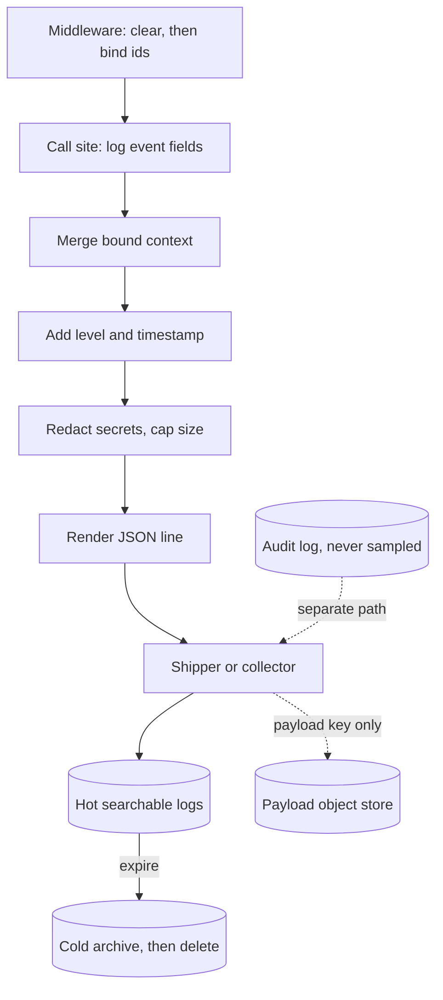

## TL;DR
Logging records discrete events as structured records bound to trace and request ids. In LLM apps logs
hold what traces and metrics should not: rendered prompts, raw completions, tool arguments, guardrail
decisions and provider errors, redacted and retained by policy.

## Why it exists
- **Wrong answers do not raise.** A model can return a well-formed response that is wrong, truncated or
  in the wrong format. Two weeks later a customer forwards the screenshot.
- **Reproducing it needs content:** the exact prompt the model saw (after templating, history compaction
  and truncation), model and parameters, the raw text before your JSON parser touched it, which tool ran
  with which arguments, and what the guardrail decided.
- **Traces and metrics do not keep that.** Traces give structure but are usually sampled, retained
  briefly and light on payloads; metrics give counts. Logs are the durable, searchable record of events
  and their content.
- **`print` or free text fails predictably.** `logger.info(f"calling model for user {uid}")` is not
  queryable ("every request where parsing failed on model X" becomes a regex over terabytes), carries no
  request context unless every call site adds it, and logs payloads in full at every level, so volume and
  PII explode together. The first compliance review then turns logging off entirely, the worst outcome.
- **Structured logging with bound context fixes it:** every line is a JSON object with correlation fields
  injected automatically, event fields added explicitly, and a pipeline that redacts, samples and routes
  before anything is written.

## How it works
### Shape: one event, one object
- **Each record is a flat object:** `timestamp`, `level`, `event` (a short, stable name such as
  `llm.call` or `tool.result`), correlation ids (`trace_id`, `span_id`, `request_id`, and the
  conversation or execution id), tenant and user as opaque ids, then the event's own fields.
- **Fixed names matter** *because* queries, dashboards and alerts are written against field names; a
  field that is `latency_ms` in one service and `duration` in another is two queries forever.
- **Encoding:** JSON Lines, one object per line, append-only, trivially shippable.

### Binding context once
1. **Bind at the edge.** Middleware extracts or creates the request id and reads the current trace id.
2. **Clear first.** The middleware *clears* context at the start of each request, *because* a reused
   worker thread keeps whatever was bound last, and the next request would inherit the previous one's
   tenant and ids.
3. **Merge automatically.** A context-variable processor merges those fields into every record; call
   sites log only what is specific to their event.
- **Why this is the key mechanical choice:** correlation becomes independent of discipline, so a line
  logged deep inside a retry helper still carries the ids.

### Levels mean something
| Level | What goes there |
|---|---|
| `DEBUG` | full payloads (rendered prompt, raw completion, tool results). Off in production by default; switchable per tenant or per request for live debugging |
| `INFO` | one record per meaningful event with sizes, ids and outcomes, not bulky content: `llm.call` with model, token counts, latency, finish reason and prompt hash; `retrieval.done` with hit ids; `tool.call` with tool name and an argument hash |
| `WARNING` | degraded but handled: a retry on rate limiting or overload, a fallback model, output repaired after a parse failure, a guardrail triggered |
| `ERROR` | the request failed for the user, with the provider's error type and request id |

- **Put the *raw* model output in the parse-failure warning,** not the parsed object in the INFO line,
  because you can always re-parse raw text but never recover raw text from a failed parse.

### Payloads: by reference, hashed, or sampled
Prompts and completions are large (tens of kilobytes per call once context is stuffed) and sensitive.
Three techniques, usually combined:
1. **By reference:** store the payload in an object store keyed by request id and log the key.
2. **Hashed:** log a content hash so identical prompts group and the template version is identifiable.
3. **Sampled:** full payloads at a small rate plus 100% of errors and flagged responses.
- **Illustrative arithmetic:** one million calls a day at 20 KB each is 20 GB of payload per day before
  indexing, which is why "just log everything" ends at the first invoice.

### Redaction in the pipeline, not at call sites
- **A pipeline processor** scrubs known secret patterns (API keys, bearer tokens), masks PII fields by
  name, and truncates oversized values.
- **Centralised** *because* a call site that forgets is otherwise a leak, and the rules (a newly
  regulated field) change more often than the code.

### The canonical log line
- **One wide record at the end of each request,** borrowed from high-volume web services: route, tenant,
  model, total tokens, cost, latency breakdown, retries, tools used, guardrail result and outcome.
- **Most "what kinds of requests do X" questions** become a query over this single table; per-event lines
  remain for drilling in.

### Where logs sit relative to traces and metrics
| Signal | Gives | Coverage |
|---|---|---|
| Traces | structure and timing | a sampled subset |
| Logs | events and content | all requests |
| Metrics | aggregates, cheaply | everything, pre-aggregated |

- **The join key** is the trace id (and span id) on every log line. OpenTelemetry's logs signal exists to
  carry that correlation and ship logs through the same collector as spans.

### Retention and deletion
- **Operational logs are not an audit log.** An audit log records who did what with which authority (a
  tool that refunded money, an approval granted); it is append-only, never sampled and kept for years.
  Debugging logs are sampled, redacted and expire.
- **Mixing them forces the worst of both:** audit retention on payload-heavy debug data, or debug sampling
  on records you are legally required to keep.
- **Logs with payloads are user data.** Define retention tiers (hot and searchable briefly, cold archive
  for compliance, then deletion) and make deletion requests executable, which needs records keyed by
  tenant and user ids.

## Diagram
Every record flows through one pipeline: context is merged and secrets redacted before anything is
written, then routed by kind.



## Examples
### A structlog pipeline with binding and redaction
- **Both records** carry `request_id`, `trace_id` and `tenant` although neither call site mentions them.
- **The prompt preview** has its key-shaped token masked before it reaches disk.
- **The parse failure** logs the raw completion rather than the half-parsed result. Token counts are
  stand-ins for the provider's usage.

```python
import hashlib, json, re, time, uuid
import structlog
from structlog.contextvars import bind_contextvars, clear_contextvars, merge_contextvars

SECRET = re.compile(r"\b(sk|key)-[A-Za-z0-9]{8,}")

def redact(logger, method, event):            # pipeline step: runs on every record
    for k, v in list(event.items()):           # top level only; real ones recurse
        if isinstance(v, str):
            event[k] = SECRET.sub("[REDACTED]", v)[:2000]   # mask secrets, cap size
    return event

structlog.configure(processors=[
    merge_contextvars,                         # injects the bound request fields
    structlog.processors.add_log_level,
    structlog.processors.TimeStamper(fmt="iso"),
    redact,
    structlog.processors.JSONRenderer(),
])
log = structlog.get_logger()

def handle_turn(tenant, trace_id, prompt):
    clear_contextvars()                         # drop the previous request's fields
    bind_contextvars(request_id=uuid.uuid4().hex, trace_id=trace_id, tenant=tenant)
    t0 = time.perf_counter()
    raw = '{"status": "shipped", "eta": "2 May"'     # stand-in: truncated model output
    log.info("llm.call", model="example-model", input_tokens=812, output_tokens=21,
             latency_ms=round((time.perf_counter() - t0) * 1000, 1),
             prompt_sha=hashlib.sha256(prompt.encode()).hexdigest()[:12],
             prompt_preview=prompt[:80], finish_reason="length")
    try:
        return json.loads(raw)
    except ValueError as e:
        log.warning("llm.parse_failed", error=str(e), raw_output=raw)   # raw, not parsed
        return None

handle_turn("acme", "4bf92f3577b34da6a3ce929d0e0e4736",
            "Where is my order? my token is key-ABCDEFGH12345")
```

### A canonical log line for one RAG turn
One wide record per request (values illustrative). "Which tenants hit `finish_reason=length` most since
the last deploy" is now a single group-by.

```json
{"event": "request.summary", "level": "info", "timestamp": "2026-05-02T10:14:03Z",
 "request_id": "9c1e...", "trace_id": "4bf92f3577b34da6a3ce929d0e0e4736", "tenant": "acme",
 "route": "/chat", "model": "example-model", "prompt_version": "support-v14",
 "input_tokens": 812, "output_tokens": 21, "retries": 1, "tools": ["get_order"],
 "retrieval_ms": 120, "generation_ms": 600, "total_ms": 970,
 "guardrail": "pass", "finish_reason": "length", "outcome": "repaired"}
```

### Worked numbers: what each payload policy costs
One million calls a day at 20 KB per payload, before indexing.

| Policy | Payload written per day | Can you reproduce a failure? |
|---|---|---|
| Full payload at INFO | 20 GB | yes, every one |
| Hash and key at INFO, payload in object store | ~0 in logs; 20 GB in a store with its own retention | yes, via the key |
| 1% sample plus 100% of errors and warnings | 0.2 GB plus all failures | yes for failures, rarely for healthy calls |

## Production patterns
- **Clear-then-bind middleware.** Every web and worker entry point calls `clear_contextvars()` then binds
  request id, trace id, tenant and conversation id. Monitor the fraction of records carrying a
  `trace_id`; target close to all of them.
- **Raw output on every parse failure.** The repair or retry path logs `llm.parse_failed` at WARNING with
  the raw completion and prompt version, exempt from sampling. Monitor parse failures over calls, grouped
  by prompt version.
- **Per-request debug switch.** A header or tenant flag, checked in middleware, raises that request's
  level to DEBUG so full payloads are captured for one live repro. Monitor how often it is on, and expire
  it automatically.
- **Non-blocking handlers.** With the Python standard library, a `QueueHandler` on the request path and a
  `QueueListener` writing to the real sink keep a slow sink off the latency path. Monitor queue depth and
  dropped records, and flush the listener on shutdown.
- **Dev console, prod JSON.** Switch the final renderer by environment (structlog's
  `ConsoleRenderer` locally, `JSONRenderer` in production) so humans and machines both read well. Monitor
  for unparsed lines at the indexer, which mean a stray `print`.
- **Retention tiers with deletion by key.** Hot searchable logs for a short window, archive after, then
  deletion; deletion jobs filter on tenant and user ids. Monitor time to complete a deletion request.

## Trade-offs
- **Full payloads vs volume and PII.** Every incident becomes reproducible, but volume multiplies by
  prompt size and the log store becomes your largest PII repository. It flips to hashed or by-reference
  payloads as soon as traffic or a compliance review arrives.
- **JSON vs human readability.** JSON is queryable by machines and ugly for humans; a console renderer in
  development and JSON in production costs one configuration switch and keeps both.
- **Middleware binding vs explicit arguments.** Binding removes the burden from call sites but depends on
  context propagating through threads and tasks. It flips to explicit arguments inside executors and
  background workers.
- **Sampling vs completeness.** Sampling payload logs cuts cost dramatically, but the request you need is
  the one not sampled. Keeping 100% of errors, warnings and flagged responses, plus a per-request debug
  switch, recovers most of the value.
- **Synchronous vs asynchronous sinks.** Synchronous logging is simple and loses nothing, but a slow sink
  stalls the request path; asynchronous handlers decouple at the cost of possible loss on crash.

## Pitfalls
- **Logging the parsed or repaired output instead of the raw completion.** Symptom: a parse-failure rate
  you cannot explain because the evidence was destroyed before it was written.
- **Call-site logging without bound context.** Symptom: lines that cannot be joined to a trace or each
  other, so an incident becomes a timestamp-matching exercise.
- **Prompts with customer data or pasted API keys written at INFO.** Symptom: a security finding,
  followed by logging being disabled wholesale.
- **Binding request context without clearing it.** Symptom: one request's lines carry another request's
  tenant or request id, which surfaces as an impossible cross-tenant "leak" in an investigation.
- **Counting log lines as your metrics.** Symptom: dashboards that take minutes to render and a logging
  bill that dwarfs the metrics system.
- **Logging only failures.** Symptom: a model that quietly degrades (wrong but well-formed answers) with
  nothing in the logs to compare against.
- **Unbounded field values (a 200 KB tool result in a log field).** Symptom: records dropped at the
  shipper or indexer, with gaps exactly where the big payloads were.

## When to use
- **Log every event that changes a request's course** or that you would need to reproduce it: each model
  call with parameters and usage, each tool invocation, retrieval, retry or fallback, guardrail decision,
  and the final outcome, at INFO with sizes and ids.
- **Raw payloads** at DEBUG or in a sampled payload stream.
- **Avoid** logging inside tight loops or per token.
- **Measure** log volume per request, the fraction of records carrying a trace id, and the time to answer
  "show me everything about request X".
- **Interviews:** explain what you would log for a RAG request, which fields go on every line versus per
  event, and how to keep prompts out of the log store without losing debuggability.

## Role lens
- **Engineer:** Configures the structured logger with context binding and a redaction processor,
  chooses the event names and fields, and makes sure raw model output is captured on parse failures.
- **Architect:** Sets the log schema and field naming across services, the payload policy (hash,
  reference or sample), retention tiers, and which store receives which level.
- **FDE:** Fits the application's logs into the customer's existing pipeline, proves that no prompt
  content leaves the agreed boundary, and uses the canonical log line to answer the customer's usage
  questions.

## Check yourself
**Q:** A support assistant occasionally returns malformed JSON that your code repairs silently.
Product now wants to know how often it happens, for which prompts, and whether a recent prompt change
made it worse. What should the logging have looked like to answer this?
**A:** Three things. First, the repair path must log a WARNING event such as `llm.parse_failed` with
the raw completion, the error, the model and the prompt template version, because the repaired object
cannot be used to reconstruct what went wrong. Second, every `llm.call` INFO record should carry the
prompt template version or a hash of the rendered prompt, so the failure rate can be grouped by
version and the before-and-after comparison is a query rather than archaeology. Third, both records
must carry the bound request and trace ids so a failing case can be pulled up as a full trace and
turned into a regression test. With that in place, "how often" is a count of warnings over calls,
"which prompts" is a group-by on the version field, and "did the change make it worse" is the same
count split at the deploy timestamp. If payload logging is sampled, warnings and errors must be
exempt from sampling or the numerator is unknown.

## Interview questions
### What makes a log "structured", and why does it matter for an LLM app?
- **Definition:** each record is one object with stable field names (event, level, correlation ids,
  event fields) rather than free text.
- **Why it matters:** questions like "parse failures by model and prompt version" become queries instead
  of regexes, and the trace id on every line joins logs to traces.

### Investigators find log lines for tenant A inside a request that belonged to tenant B. What happened?
- **Likely cause:** request context was bound but never cleared, so a reused worker thread carried the
  previous request's fields into the next one.
- **Fix:** clear context at the start of every request and job, then bind; add a test that runs two
  requests on one thread and asserts no fields leak.

### How would you keep prompts out of the log store without losing debuggability?
- **Log hashes and keys at INFO:** a prompt hash groups identical prompts and identifies template
  versions; the payload goes to an object store keyed by request id with its own retention.
- **Keep raw content where it pays:** 100% of parse failures and errors, a small sample of healthy
  calls, and a per-request debug switch for live repros.

### Why keep the audit log separate from application logs?
- **Different contracts:** audit records are append-only, never sampled and kept for years; debug logs
  are sampled, redacted and expire.
- **Mixing them** forces audit retention onto payload-heavy debug data, or debug sampling onto records
  you must legally keep.

### Your logging bill tripled after a feature launch. Where do you look first?
- **Bytes per request by event name:** a new event logging full tool results or prompts at INFO is the
  usual cause.
- **Then fix the shape:** cap field sizes in the pipeline, move payloads to references, and stop
  deriving dashboards from log counts when a metric would do.

## Quiz
### Q: Why bind request and trace ids in middleware rather than passing them to each log call?
- [ ] Middleware logging is faster than call-site logging
- [x] It makes correlation independent of developer discipline, so lines from helpers and libraries still carry the ids
- [ ] Log libraries cannot accept more than three keyword arguments
- [ ] Trace ids are only available in middleware
> The join between logs and traces fails the first time one call site forgets the id. Injecting the
> fields from a context variable guarantees every record in the request carries them.

### Q: Your JSON parser fails on about 1% of model outputs. Which log design lets you diagnose it later without paying for full-payload logging on every call?
- [ ] Log the parsed object at INFO on success and nothing on failure
- [ ] Log the exception message only, to keep volume down
- [x] Log a WARNING with the raw completion, prompt version and model on every parse failure
- [ ] Log the full prompt and completion at INFO for every call
> Raw output is the only evidence that explains a parse failure, and failures are rare enough to log
> in full. Logging everything at INFO would also work, but at a volume and privacy cost the warning
> path avoids.

### Q: What is the main reason to run redaction as a processor in the logging pipeline rather than at each call site?
- [ ] Processors run in a separate thread, so they are free
- [x] A single enforced step cannot be forgotten by a call site, and the rules can change without touching application code
- [ ] Call sites do not have access to regular expressions
- [ ] Redaction only works on JSON-rendered output
> One forgotten call site is a leak. Centralising redaction turns a per-developer habit into a
> property of the system, and lets compliance rules evolve in one place.
