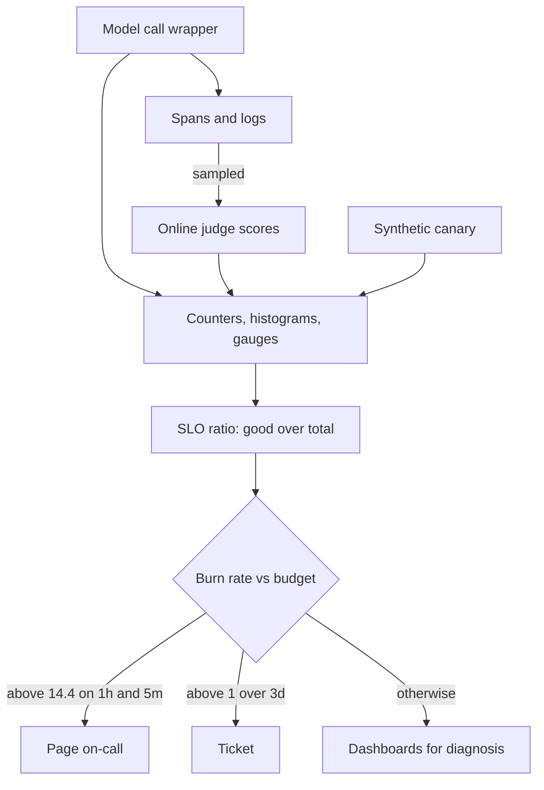

## TL;DR
Monitoring compresses requests into aggregate signals (rates, errors, latency, saturation, quality,
cost), compares them with targets and pages on drift. The LLM difficulty: the worst failures return HTTP
200, so you monitor proxies and sampled quality scores, not just errors.

## Why it exists
- **You cannot read traces faster than users produce them,** and you cannot afford to learn about an
  outage from a customer. Monitoring compresses millions of events into a handful of numbers a human can
  watch and a machine can alert on. A trace explains one request; monitoring says whether the system is
  healthy now.
- **Classic web monitoring is largely solved:** latency, traffic, errors and saturation, with alerts tied
  to what users experience.
- **LLM dependencies are volatile.** A provider degrades for one model and not another, rate limits bite
  at a tenant's peak, a model version is deprecated, a prompt change ships without a code change.
- **The failures that matter most produce no errors.** A retrieval index that stopped updating, a prompt
  edit that makes the model refuse more, a tool now returning empty results, a context window that fills
  so compaction drops the system instructions: each returns 200 with plausible text, and the error-rate
  dashboard stays green while the product gets worse.
- **The naive alternatives fail.** "Average latency and error rate" misses the tail and silent failures.
  "Watch the provider's status page" shows their incidents, not your tenant's rate limits or your prompt
  regression. "We'll notice in the weekly eval" means a week of bad answers. So LLM monitoring adds quality
  proxies, cost signals and sampled online evaluation to the golden signals, and alerts on symptoms.

## How it works
### Metric types and what they are for
| Instrument | Behaviour | Examples | Read as |
|---|---|---|---|
| **Counter** | only increases | requests, tokens, errors | a rate |
| **Gauge** | current value | queue depth, in-flight requests, cache size | the value now |
| **Histogram** | distribution in buckets | latency, tokens per request | percentiles, aggregated across instances |

- **Latency must be a histogram** *because* an average hides the slow tail users complain about; the
  latency-percentiles lesson covers why p95 and p99 are the numbers to watch.
- **Bucketed percentiles are interpolated** within a bucket, so they are only as precise as the bucket
  edges near them.
- **Make the SLO threshold a bucket edge** ("first token within 2 s"), so the fraction under it is an
  exact count rather than an estimate.

### The baseline: golden signals with LLM dimensions
- **Latency splits** into time to first token and total time, since streaming makes the first matter most
  for perceived speed.
- **Every signal gets dimensions:** model, provider, route or feature, prompt version, and (carefully)
  tenant.
- **Dimensions are labels, and each combination is a new series.** A per-user label on a histogram with
  20 buckets creates more than 20 series per user (one per bucket plus the sum and count), which is how
  metrics systems fall over.
- **Rule:** bounded label values only: enums and small sets, never ids.

### LLM-specific signals
| Signal family | What to measure |
|---|---|
| **Provider health as you see it** | error rate by class (rate limited, server error, timeout, overloaded), retry and fallback rate, provider latency split from your own. Your view, not their status page |
| **Format and tool correctness** | structured-output parse-failure rate, tool-argument validation failures, tool-call success rate, empty-retrieval rate |
| **Behavioural proxies** | refusal rate, guardrail trigger rate, output-token distribution (a sudden drop often means truncated or refused answers; a rise often a prompt regression), agent iterations per task, rate of hitting the step budget |
| **Saturation, LLM style** | hosted API: quota headroom, the remaining requests and tokens per minute providers report in rate-limit response headers (names vary by provider), plus in-flight count and queue depth. Self-hosted: queue depth and KV-cache utilisation. Shrinking headroom predicts 429s before they start |
| **Context pressure** | prompt tokens per request, fraction of requests where compaction or truncation ran |
| **Cost** | tokens and computed cost per request, feature and tenant, with a budget burn rate |
| **Cache** | prompt-cache and semantic-cache hit rates; a drop shows up as both cost and latency |

### Online quality: sampled evaluation
- **Sample a small fraction of traces** (a few percent is a common start, plus 100% of flagged ones) and
  score them continuously with an LLM-as-a-judge or task-specific checks, then emit the score as a metric.
- **It is lagging and noisy,** so chart and alert on it over wide windows; never page on a single bad
  sample.
- **User signals** (thumbs-down and escalation rates) are the other quality series: slower still, but
  ground truth.

### Synthetic probes
- **A canary request with a known expected answer,** run every few minutes per model and region, catches
  silent provider changes, deprecated models and broken retrieval before real traffic does.
- **It is a health check that exercises the dependency** rather than pinging it.

### Targets, SLOs and error budgets
1. **Pick a few user-facing symptoms:** time to first token, successful-turn rate, judge score over a day.
2. **Set targets as ratios of good events:** "99% of chat turns get a first token within 2 s over 30
   days".
3. **The error budget is one minus the target:** here 1% of turns.
4. **Alert on symptoms, not causes,** *because* paging on causes (CPU, a single rate-limit response)
   wakes people for things users never noticed. Everything else is a dashboard for diagnosis.

### Burn-rate alerting
```
burn_rate     = observed bad-event ratio / budget ratio
budget_spent  = burn_rate × window_hours / 720        (30 days = 720 h)
```
- **Burn rate 1** spends exactly the 30-day budget in 30 days; **14.4 sustained for one hour** spends 2%
  of it (14.4 × 1 h / 720 h).
- **Multiwindow scheme (SRE Workbook):** page on fast burns (for example above 14.4 over the last hour,
  confirmed over the last 5 minutes so the page clears quickly once the problem stops); ticket on slow
  burns (for example above 1 over three days).
- **Against the 1% budget:** a provider brownout making 15% of turns miss 2 s for an hour is a burn rate
  of 15 and pages. A creeping 2% of slow turns is a burn rate of 2: never pages, still gets a ticket before
  the month's budget is gone.
- **A static "p95 above 2 s" threshold catches neither reliably,** because it ignores how long the problem
  lasted and how much budget it consumed.

### Where the data comes from
- **Derive metrics from the same instrumentation as traces:** a generation span's attributes (model,
  tokens, latency, status) are exactly what counters and histograms need.
- **OpenTelemetry can emit both** from one SDK; alternatively call a metrics client in the same wrapper
  that creates the span.
- **Counting log lines** works at small scale and becomes the most expensive query in the company at
  large scale.

## Diagram
From instrumentation to a page: one wrapper feeds metrics, SLO ratios turn into burn rates, and only
symptom burns page a human.



## Examples
### Instrumenting a streaming call with `prometheus_client`
- **Bounded label sets:** `outcome` maps to a handful of values; nothing per-user or per-conversation
  becomes a label.
- **TTFT buckets include 2 s** because that is the SLO threshold.
- **The closing comment** is the burn-rate alert from above, written in PromQL against these series.

```python
import time
from prometheus_client import Counter, Histogram, Gauge, start_http_server

REQS = Counter("llm_requests_total", "Model calls", ["model", "route", "outcome"])
TOKENS = Counter("llm_tokens_total", "Tokens used", ["model", "route", "direction"])
LATENCY = Histogram("llm_latency_seconds", "Total call latency", ["model", "route"],
                    buckets=(0.25, 0.5, 1, 2, 4, 8, 16, 30))
TTFT = Histogram("llm_ttft_seconds", "Time to first token", ["model", "route"],
                 buckets=(0.1, 0.25, 0.5, 1, 2, 4))
PARSE_FAIL = Counter("llm_parse_failures_total", "Structured output failed", ["route"])
INFLIGHT = Gauge("llm_inflight", "Concurrent model calls", ["model"])

def monitored_call(model, route, call):
    """call() yields (chunk, usage); usage is None until the final chunk."""
    INFLIGHT.labels(model).inc(); t0 = time.perf_counter(); outcome = "ok"
    try:
        text, usage, first = [], None, None
        for chunk, u in call():
            if first is None:
                first = time.perf_counter(); TTFT.labels(model, route).observe(first - t0)
            text.append(chunk); usage = u or usage
        TOKENS.labels(model, route, "input").inc(usage["input_tokens"])
        TOKENS.labels(model, route, "output").inc(usage["output_tokens"])
        return "".join(text)
    except TimeoutError:
        outcome = "timeout"; raise
    except Exception as e:                      # map provider errors to a bounded set
        outcome = "rate_limited" if "429" in str(e) else "error"; raise
    finally:
        LATENCY.labels(model, route).observe(time.perf_counter() - t0)
        REQS.labels(model, route, outcome).inc()
        INFLIGHT.labels(model).dec()

start_http_server(9000)   # exposes /metrics for Prometheus to scrape
# SLO: 99% of chat calls get a first token within 2 s. Bad ratio over a window w:
#   1 - sum(rate(llm_ttft_seconds_bucket{route="chat",le="2.0"}[w]))
#     / sum(rate(llm_ttft_seconds_count{route="chat"}[w]))
# Page if bad_ratio / 0.01 > 14.4 for w=1h AND w=5m; ticket if > 1 for w=3d.
# Failed calls never record TTFT, so a separate success-rate SLO on REQS covers them.
```

### Runnable: the burn-rate decision in plain Python
The same multiwindow logic, so you can check the arithmetic for any target. The "recovered" case shows
why the 5-minute window matters: the last hour was bad, but it has already stopped, so nobody is paged.

```python
SLO = 0.99                      # 99% of turns get a first token within 2 s
BUDGET = 1 - SLO                # 1% of turns may be slow
PERIOD_H = 30 * 24              # 720 hours

def burn_rate(bad_ratio):
    return bad_ratio / BUDGET

def budget_spent(bad_ratio, hours):
    return burn_rate(bad_ratio) * hours / PERIOD_H

def decide(bad_1h, bad_5m, bad_3d):
    if burn_rate(bad_1h) > 14.4 and burn_rate(bad_5m) > 14.4:
        return "page"
    if burn_rate(bad_3d) > 1:
        return "ticket"
    return "ok"

cases = {"brownout": (0.15, 0.15, 0.01), "creep": (0.02, 0.02, 0.02),
         "recovered": (0.15, 0.003, 0.009), "healthy": (0.004, 0.004, 0.004)}
for name, (h1, m5, d3) in cases.items():
    print(f"{name:<9} burn_1h={burn_rate(h1):5.1f}  {decide(h1, m5, d3)}")
print(f"brownout 1h spends {budget_spent(0.15, 1):.1%} of budget")
print(f"creep exhausts budget in {PERIOD_H / burn_rate(0.02) / 24:.0f} days")
# brownout page, creep ticket, recovered ok, healthy ok; 2.1% of budget; 15 days
```

| Scenario | Bad ratio | Burn rate | Outcome | Why |
|---|---|---|---|---|
| Provider brownout, 1 h | 15% | 15 | page | spends ~2.1% of the month's budget in an hour |
| Creeping slow turns | 2% | 2 | ticket | would exhaust the budget in 15 days |
| Static "p95 above 2 s" | either | n/a | unreliable | ignores duration and budget consumed |

## Production patterns
- **SLO thresholds as bucket edges.** When defining a latency histogram, put the SLO value (here `2`
  seconds for TTFT) in the bucket list so the good-event ratio is an exact count. Monitor the SLO ratio
  per route and model.
- **Multiwindow burn-rate alerts as recording rules.** Precompute the bad ratio per window with
  Prometheus recording rules, then alert when both the 1 h and 5 m burn exceed 14.4 (page) or the 3 d burn
  exceeds 1 (ticket), routed through Alertmanager. Monitor pages per week and how many led to action.
- **Prompt and model version as a label.** Stamp `prompt_version` and model id on every LLM metric so a
  step change in refusals or output tokens lines up with a deploy. Monitor output-token and refusal
  distributions per version for a day after each deploy.
- **Canary per model and region.** A scheduled job sends a few realistic prompts with known answers every
  few minutes and records pass or fail as a metric. Monitor canary pass rate; alert when it fails several
  runs in a row.
- **Quota headroom gauges.** Parse the provider's rate-limit response headers into a remaining-requests
  and remaining-tokens gauge per model. Monitor headroom trending to zero at a tenant's peak, before 429s
  appear.
- **Raise judge sampling after deploys.** Score a higher share of traces for the first day of a new prompt
  version, then return to the baseline. Monitor judge pass rate per prompt version with a rolling-day SLO.

## Trade-offs
- **Label dimensions vs series count.** More labels make every chart sliceable, but series multiply with
  each one. It flips the moment a label value is unbounded (user id, conversation id); that belongs in
  traces and logs, not metrics.
- **Symptom alerts vs cause visibility.** Symptom-based alerting pages rarely and only for user impact,
  but says nothing about cause. Pair it with cause dashboards, and page on a cause only when it is a known
  precursor (a cache hit rate collapse that always precedes a latency breach).
- **Sampled evaluation vs noise.** A continuous quality signal without scoring every request, but noisy
  and lagging. Raise the sample rate for new features or prompt versions and lower it once stable.
- **Synthetic canaries vs cost and realism.** They catch silent provider and model changes early, but cost
  tokens and mislead if the prompt is too easy; keep a handful of realistic prompts per model, not one
  trivial one.
- **Static thresholds vs anomaly detection.** Static thresholds are explainable and easy to tune; anomaly
  detection adapts to daily cycles but produces alerts nobody can explain, and wins only once traffic is
  too variable for fixed numbers.

## Pitfalls
- **Charting average latency.** Symptom: a green dashboard while p99 users time out, discovered via
  support tickets rather than alerts.
- **Labelling metrics by user or conversation id.** Symptom: the metrics store runs out of memory or
  queries time out, often weeks later once cardinality has accumulated.
- **Monitoring only errors and latency on an LLM feature.** Symptom: a quality regression after a prompt
  change that nobody detects until the weekly eval or a customer complaint.
- **Histogram buckets chosen without the SLO threshold.** Symptom: a compliance number that moves when
  someone changes the buckets, because the threshold was being interpolated.
- **Paging on causes (any rate-limit response, any retry).** Symptom: alert fatigue and the real page
  being ignored.
- **Trusting the provider's status page over your own measurements.** Symptom: a tenant-specific rate
  limit or regional degradation that never appears there.
- **No prompt or model version dimension.** Symptom: a step change in output tokens or refusals that
  cannot be tied to the deploy that caused it.

## When to use
- **Always, for anything with users;** what you monitor should follow the failure modes you expect.
- **At launch:** golden signals with model, route and version labels, parse and tool failure rates, token
  and cost counters, and a canary. Add sampled online evaluation once a judge score means something.
- **Measure your monitoring:** after each incident, did an alert fire before the first user report, and
  how long did the dashboards take to point at the cause?
- **Day to day,** this is the dashboard you look at after every prompt or model change.
- **Interviews:** name the LLM-specific signals that catch silent failures, explain why you alert on the
  burn rate of a time-to-first-token SLO rather than on provider rate-limit responses, and do the
  burn-rate arithmetic for a given target.

## Role lens
- **Engineer:** Instruments the call wrapper with counters and histograms, keeps label cardinality
  bounded, and adds the parse-failure, tool-success and token metrics that generic APM does not know
  about.
- **Architect:** Defines the SLOs and alert policy, decides which signals page versus inform, and owns
  the budget for sampled online evaluation and canaries across models and regions.
- **FDE:** Builds the customer-facing dashboard that proves the system meets its targets, wires alerts
  into the customer's on-call tooling, and uses provider error breakdowns to settle whose fault an
  outage was.

## Check yourself
**Q:** After a prompt change, support tickets about "unhelpful answers" double over a week while your
error rate and latency dashboards stay flat. What monitoring would have caught it within hours, and
how would you alert on it without constant false pages?
**A:** The regression was semantic, so no error metric moved. Three signals would have caught it: a
sampled online judge score per prompt version, which would show a drop for the new version against
the old within a few hundred samples; behavioural proxies such as refusal rate, guardrail trigger rate
and the output-token distribution per prompt version, which shift immediately when a prompt changes
the model's behaviour; and user feedback rates (thumbs-down, escalations) as the slow ground truth.
The prompt-version label is what makes the comparison possible. For alerting, I would not page on a
single bad judge score; I would define a quality SLO (say, judge pass rate over a rolling day) and
alert on burn rate with two windows, a fast one for sudden collapses and a slow one for gradual
drift, and I would raise the sample rate for the first day after any prompt deploy so the signal
arrives sooner.

## Interview questions
### What are the golden signals, and what do LLM systems add to them?
- **Golden signals:** latency, traffic, errors and saturation, tied to what users experience.
- **LLM additions:** TTFT split from total latency, quota headroom as saturation, parse and tool failure
  rates, refusal and output-token distributions, cost per request, and sampled judge scores, because the
  worst failures return 200.

### Your SLO is 99.5% of turns with a first token under 2 s over 30 days. What burn rate pages, and what does an hour of it cost?
- **Budget:** 0.5% of turns. A fast-burn page at a burn rate above 14.4 means a bad ratio above about 7.2%
  over the last hour, confirmed on the last 5 minutes.
- **Cost:** 14.4 for one hour spends 14.4 / 720 = 2% of the 30-day budget, regardless of the target.

### The error dashboard is green but customer complaints are rising. How do you find the problem?
- **Slice behavioural proxies by version:** refusal rate, output tokens, empty-retrieval rate and tool
  success per prompt version and model often show the step change and the deploy behind it.
- **Then confirm with quality signals:** judge scores on sampled traces and thumbs-down rates, and pull
  individual traces for the worst cases.

### Why not put tenant or user id on every metric?
- **Cardinality:** each label value multiplies series by every histogram bucket, so unbounded ids exhaust
  the metrics store.
- **Instead:** use tenant only when the tenant count is small and bounded, and keep per-user detail in
  traces, logs or a cost table keyed by id.

### When would you page on a cause rather than a symptom?
- **Only for a proven precursor:** for example a cache hit rate collapse that always precedes a latency
  breach, or quota headroom about to reach zero at peak.
- **Otherwise** causes such as a single 429 or high CPU belong on dashboards, because paging on them
  creates alert fatigue.

## Quiz
### Q: Why must latency be recorded as a histogram rather than as a running average?
- [ ] Averages cannot be computed across multiple server instances
- [x] Percentiles such as p95 and p99 need the distribution, and the slow tail is what users experience and what you alert on
- [ ] Histograms use less memory than a single average
- [ ] Monitoring systems do not support averages
> An average of a long-tailed distribution looks healthy while a meaningful fraction of users wait many
> times longer. Buckets preserve the shape so tail percentiles can be computed and aggregated later.

### Q: Which of these is the most dangerous label to put on a request latency histogram?
- [ ] model
- [ ] route
- [x] conversation_id
- [ ] provider
> Each distinct label value creates a new series, multiplied by every bucket. Identifiers are
> unbounded, so a conversation id turns a few series into millions and brings the metrics store down;
> ids belong in traces and logs.

### Q: Your provider's status page is green but one tenant's requests are failing. Which monitoring practice explains why you should still have known?
- [ ] Alerting on CPU utilisation of the orchestrator
- [x] Measuring provider error classes from your own calls, with tenant as a bounded dimension where the tenant count allows, rather than relying on the provider's view
- [ ] Logging full prompts at INFO
- [ ] Increasing the trace sampling rate
> Status pages report broad incidents. Rate limits, regional issues and tenant-specific quotas only
> show up in your own error-class metrics, which is why provider health must be measured from the
> caller's side.
