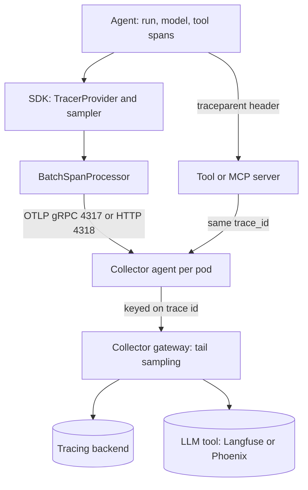

## TL;DR
OpenTelemetry (OTel) is the CNCF vendor-neutral standard for traces, metrics and logs. Instrument your
agent once and every run, model call and tool call becomes a span in one trace; Langfuse, Phoenix or
your APM is then just an OTLP endpoint.

## For agent builders
- **Why it matters for agents.** An agent run is a tree: a root task, model calls that decide, tool calls
  that act, retrievals and sub-agents. OTel gives that tree one `trace_id`, parent links and timings, so
  "which of the fourteen calls was slow or wrong" has an answer.
- **Where it shows up in your stack.** Framework and provider instrumentors (OpenLLMetry, OpenInference,
  `opentelemetry-instrumentation-*`), the OTLP endpoint of Langfuse, Phoenix or LangSmith, and the
  `traceparent` header on calls to MCP or tool servers.
- **What you control.** Span names and boundaries for agent steps, `gen_ai.*` attributes, whether prompt
  and completion content is captured, sampling, and context propagation across async tool tasks.
- **What you can skip.** OTLP protobuf details and Collector internals beyond receivers, processors and
  exporters. Know the API/SDK split, propagation and head versus tail sampling.

## Lab
### Task
Repair the tracing of a tool-calling agent whose run shows up as four unrelated traces. Tools run in a
thread pool, the search tool calls a remote server, and a failing tool looks healthy. Time box: 45-60
minutes. Prerequisites: Tracing and Spans, plus the agent-loop example in this lesson.
- **One trace per run:** tool spans parent to their `agent.turn` span although they run in threads.
- **Joined across the hop:** the search tool injects W3C `traceparent`, and the server span is its child.
- **Failures visible:** a failed tool is an ERROR span with an `exception` event; the run still answers.

### Starter code
Save as `lab_otel.py`. Needs `pip install opentelemetry-sdk pytest` (checked with opentelemetry-sdk
1.45.1, pytest 9.1.1, Python 3.12). `InMemorySpanExporter` stands in for OTLP and a backend, and
`tool_server` stands in for a remote search or MCP server, so nothing leaves the process.

```python
import asyncio
from concurrent.futures import ThreadPoolExecutor
from opentelemetry import propagate, trace
from opentelemetry.sdk.trace import TracerProvider
from opentelemetry.sdk.trace.export import SimpleSpanProcessor
from opentelemetry.sdk.trace.export.in_memory_span_exporter import InMemorySpanExporter
from opentelemetry.trace import SpanKind, Status, StatusCode

EXPORTER = InMemorySpanExporter()                      # stands in for OTLP + a backend
provider = TracerProvider()
provider.add_span_processor(SimpleSpanProcessor(EXPORTER))
trace.set_tracer_provider(provider)
tracer = trace.get_tracer("research-agent")
POOL = ThreadPoolExecutor(max_workers=4)               # tools use blocking clients
LAST_HEADERS: dict = {}                                 # what the tool server received

def tool_server(headers: dict, query: str) -> dict:
    """Stands in for a remote search or MCP server: it continues whatever trace the headers carry."""
    LAST_HEADERS.clear(); LAST_HEADERS.update(headers)
    ctx = propagate.extract(headers)
    with tracer.start_as_current_span("server search", context=ctx, kind=SpanKind.SERVER):
        return {"hits": [f"doc about {query}"]}

def search(query: str) -> dict:
    headers: dict = {}
    # YOUR CODE 2: inject the current context into `headers` so the server joins this trace.
    return tool_server(headers, query)

def lookup_order(order_id: str) -> dict:
    raise ConnectionError("orders DB unreachable")

TOOLS = {"search": search, "lookup_order": lookup_order}
SCRIPT = [[("search", {"query": "refund policy"}), ("lookup_order", {"order_id": "1182"})], []]

def traced_tool(name: str, args: dict) -> dict:
    with tracer.start_as_current_span(f"tool {name}") as span:
        span.set_attribute("app.tool.name", name)
        try:
            return TOOLS[name](**args)
        except Exception as e:
            # YOUR CODE 3: the error goes back to the model as a result, but the span must say so:
            #              record the exception and set an ERROR status before returning.
            return {"error": str(e)}

async def run_tool(name: str, args: dict) -> dict:
    loop = asyncio.get_running_loop()
    # BUG: run_in_executor does not copy contextvars, so each tool span starts a new trace.
    # YOUR CODE 1: run traced_tool in the pool with the current context.
    return await loop.run_in_executor(POOL, traced_tool, name, args)

async def run_agent(task: str, max_steps: int = 4) -> str:
    with tracer.start_as_current_span("agent.run") as root:
        root.set_attribute("app.agent.task_chars", len(task))
        for step in range(max_steps):
            with tracer.start_as_current_span(f"agent.turn {step}"):
                calls = SCRIPT[step]                    # a fake model: tool calls, then an answer
                if not calls:
                    root.set_attribute("app.agent.steps", step + 1)
                    return f"answered after {step + 1} turns"
                await asyncio.gather(*(run_tool(n, a) for n, a in calls))
        root.set_status(Status(StatusCode.ERROR, "max_steps reached"))
        return "gave up"

def print_tree(spans) -> None:
    by_id = {s.context.span_id: s for s in spans}
    kids: dict = {}
    for s in spans:
        parent = s.parent.span_id if s.parent and s.parent.span_id in by_id else None
        kids.setdefault(parent, []).append(s)
    def walk(parent, depth):
        for s in sorted(kids.get(parent, []), key=lambda s: s.name):
            print(f"{'  ' * depth}{s.name} [{s.status.status_code.name}]")
            walk(s.context.span_id, depth + 1)
    print("traces:", len({s.context.trace_id for s in spans}))
    walk(None, 0)

if __name__ == "__main__":
    print(asyncio.run(run_agent("Refund order 1182 if our policy allows it")))
    print_tree(EXPORTER.get_finished_spans())
```

The starter prints `traces: 4`: the agent tree, then `server search`, `tool lookup_order` and
`tool search` as separate roots, all `[UNSET]`.

### Expected output
With a correct solution, `python lab_otel.py` prints:

```
answered after 2 turns
traces: 1
agent.run [UNSET]
  agent.turn 0 [UNSET]
    tool lookup_order [ERROR]
    tool search [UNSET]
      server search [UNSET]
  agent.turn 1 [UNSET]
```

### Tests
Save as `test_lab_otel.py` and run `pytest -q`. On the starter all four fail: four trace ids, a tool span
with no parent (`AttributeError` on `None`), no `traceparent` header (`KeyError`), and an `UNSET` status.

```python
import asyncio
import pytest
from opentelemetry.trace import StatusCode
from lab_otel import EXPORTER, LAST_HEADERS, run_agent

@pytest.fixture
def spans():
    EXPORTER.clear()
    assert asyncio.run(run_agent("Refund order 1182")) == "answered after 2 turns"
    return {s.name: s for s in EXPORTER.get_finished_spans()}

def test_the_whole_run_is_one_trace(spans):
    assert len({s.context.trace_id for s in spans.values()}) == 1

def test_tool_spans_are_children_of_their_turn(spans):
    turn = spans["agent.turn 0"].context.span_id
    assert spans["tool search"].parent.span_id == turn
    assert spans["tool lookup_order"].parent.span_id == turn

def test_tool_server_joins_through_traceparent(spans):
    tool = spans["tool search"].context
    version, trace_id, parent_id, flags = LAST_HEADERS["traceparent"].split("-")
    assert (version, trace_id, parent_id) == ("00", f"{tool.trace_id:032x}", f"{tool.span_id:016x}")
    assert int(flags, 16) & 0x01                          # the sampled bit
    assert spans["server search"].parent.span_id == tool.span_id

def test_failed_tool_is_an_error_span_not_a_crash(spans):
    failed = spans["tool lookup_order"]
    assert failed.status.status_code == StatusCode.ERROR
    assert [e.name for e in failed.events] == ["exception"]
    assert spans["agent.run"].status.status_code == StatusCode.UNSET
```

The test checks the sampled bit, not the whole flags byte: opentelemetry-sdk 1.45.1 sends flags `03`,
because it also sets the W3C level 2 random-trace-id bit.

### Failure scenarios
- **Fix the executor but not the header.** The test run shows two traces: the agent tree and a root
  `server search`. Debug: print `LAST_HEADERS`; an empty dict means nothing called `propagate.inject`.
- **Inject before opening the tool span.** The server joins the trace but parents to `agent.turn 0`, so
  server time is not attributed to the tool. Debug: compare the `traceparent` parent id with the tool span id.
- **Re-raise the tool error.** `asyncio.gather` fails the whole run and every test errors with `ConnectionError`.
  Debug: the model should see `{"error": ...}` as a tool result; only the span records the failure.
- **Swap `SimpleSpanProcessor` for `BatchSpanProcessor`.** `get_finished_spans()` can come back empty, as
  in a Lambda without a flush. Debug: call `provider.force_flush()` before reading spans.

### Submission
- `lab_otel.py` and a `pytest -q` run showing 4 passed.
- The printed tree, matching the expected output exactly.
- One sentence on why `asyncio.create_task` keeps context and `run_in_executor` does not.
- One captured `traceparent` value with its four fields labelled.
- A reviewer checks that the fix copies context rather than passing parent spans around by hand.

## Why it exists
- **Every vendor had its own agent.** A library author who wanted to emit spans had to pick a vendor or
  write adapters, and switching backends meant re-instrumenting every service.
- **Traces broke at service boundaries,** because each system propagated context in its own header (Zipkin's
  `X-B3-*`, Jaeger's `uber-trace-id`, Google's `X-Cloud-Trace-Context`). OpenTracing (an API only) and
  OpenCensus (SDK plus metrics) tried to fix this and merged into OpenTelemetry in 2019.
- **LLM requests cross many systems.** One request crosses an API gateway, the app, a vector store, a model
  provider, tool services and perhaps a queue. The real question is "which of the fourteen calls inside this
  agent run was slow or wrong, and what was its parent"; logs cannot answer it, because they lack the causal
  tree and timing hierarchy.
- **Teams instrumented twice.** Each LLM observability product started with its own SDK, so APM and LLM
  telemetry never joined. The LLM tools have since converged on accepting OTel spans, so learning OTel once
  pays off whichever of them you use.
- **What it buys:** the backend (Jaeger, Tempo, Datadog, Langfuse, Phoenix) is a configuration choice, and an
  LLM span lands in the same trace as the HTTP, queue and database spans around it.

## How it works
### One data model, three signals
| Concept | What it holds |
|---|---|
| **Trace** | A tree of spans sharing a 128-bit `trace_id` |
| **Span** | 64-bit `span_id`, parent span id, name, kind (`SERVER`, `CLIENT`, `INTERNAL`, `PRODUCER`, `CONSUMER`), start and end timestamps, key–value **attributes**, timestamped **events** (an exception is an event), links, status (`UNSET`, `OK`, `ERROR`) |
| **Resource** | Attributes describing the emitter, riding along with every span: `service.name`, `service.version`, `deployment.environment.name` (the older `deployment.environment` is deprecated) |
| **Metrics** | Counters, up/down counters, gauges and histograms (explicit or exponential buckets) with attributes |
| **Logs** | Records carrying `trace_id` and `span_id`, so a log line joins to the span that produced it |

### API versus SDK
- **The API is a no-op until an SDK is installed.** It provides `get_tracer`, `start_span`, `set_attribute`.
- **Why the split:** a library such as an HTTP client or a model provider's SDK can instrument itself without
  pulling in exporters, protobuf or a backend dependency.
- **The application owner** installs the SDK and decides where telemetry goes.

### The export pipeline
1. **`TracerProvider`** holds the resource and a **sampler** and hands out tracers.
2. **Span processor** receives each span when it ends. `SimpleSpanProcessor` exports synchronously
   (debugging only). `BatchSpanProcessor` queues spans and exports them in batches from a background thread,
   because a network call per span would add latency to every operation.
3. **Exporter** speaks **OTLP**: protobuf over gRPC (port 4317) or over HTTP (port 4318, path `/v1/traces`),
   to a Collector or straight to a backend.

### Context propagation
- **In-process,** the current span lives in a context (`contextvars` in Python, `AsyncLocalStorage` in Node),
  so a nested `start_as_current_span` parents itself automatically.
- **Across processes,** a **propagator** injects the W3C `traceparent` header,
  `00-<32 hex trace id>-<16 hex parent span id>-<2 hex flags>`, plus optional `tracestate` and `baggage`. The
  server extracts it and continues the trace.
- **Because it is a W3C standard,** a Go gateway, a Python service and a Node tool server join one trace
  without agreeing on anything else.
- **Queues are the awkward boundary.** The producer injects `traceparent` into message headers; the consumer
  continues that trace as a child, or, when one consumer span processes a batch from many traces, records
  **span links** to each, because a span can have only one parent.

### Sampling
| | Head sampling | Tail sampling |
|---|---|---|
| Decides | At the root, before the trace runs | After the whole trace is seen |
| Typical config | `ParentBased(TraceIdRatioBased(p))`, decision recorded in trace flags so children follow it | Policies: error status, latency over a threshold, a tenant attribute |
| Strength | Cheap and consistent | Keeps the traces that matter |
| Weakness | Blind: decides before anyone knows the trace will error or take 30 seconds | Needs a Collector buffering complete traces, with every span of a trace at the same instance (a load-balancing exporter keyed on trace id) |

- **The ratio sampler is deterministic.** It derives the decision from the trace id rather than a random
  draw, so two services with the same ratio agree about the same trace even without seeing each other's flags.

### The Collector
- **Pipeline stages.** **Receivers** (OTLP, Prometheus scrape, …), **processors** (batch, memory limiter,
  attribute redaction, filtering, tail sampling, transforms) and **exporters** (OTLP to one or several
  backends, Prometheus, files).
- **Why it exists:** changing backends, scrubbing PII, tail sampling and fanning out to two systems become
  configuration changes, not application redeploys.
- **Typical layout:** an agent per host or pod (cheap batching, redaction, host metadata) plus a central
  gateway tier.
- **Tail sampling lives in the gateway tier,** because an agent only sees spans emitted on its own host, and a
  trace that crosses five services is never complete there.

### Semantic conventions and generative AI
- **Standard names** make dashboards work across services: `http.request.method`, `db.system`,
  `server.address`.
- **GenAI span attributes:** `gen_ai.provider.name` (formerly `gen_ai.system`), `gen_ai.request.model`,
  `gen_ai.response.model`, `gen_ai.usage.input_tokens`, `gen_ai.usage.output_tokens`, and
  `gen_ai.operation.name` with values such as `chat`. Recommended span name: `{operation} {model}`.
- **GenAI client metrics:** a `gen_ai.client.token.usage` histogram and a `gen_ai.client.operation.duration`
  histogram, so token and latency dashboards need no span queries.
- **Content is opt-in** (off by default) because prompts and completions are sensitive and large.
- **Still experimental; pin versions.** Names have changed more than once: token counts were renamed from
  `prompt`/`completion` to `input`/`output`, then `gen_ai.system` became `gen_ai.provider.name`.
- **Instrumentation packages** emit such spans for OpenAI, Anthropic, Bedrock, LangChain and others.
  OpenLLMetry and the provider-specific `opentelemetry-instrumentation-*` packages follow the GenAI
  conventions; Arize's OpenInference instrumentors emit plain OTel spans with their own LLM vocabulary
  (`openinference.span.kind`, `llm.token_count.*`).

### Auto-instrumentation
- **Whole process:** `opentelemetry-instrument python app.py` (Python) patches supported libraries at start-up.
- **Selective:** per-library instrumentors (`FastAPIInstrumentor`, `HTTPXClientInstrumentor`, …).
- **What you get free:** HTTP, database and client spans. Spans with domain meaning, "retrieve", "rerank",
  "agent step 3", tool name, remain manual.

## Diagram
Spans from the agent's run, model and tool calls flow from the SDK through a batch processor and OTLP to
an agent Collector, then a gateway that tail samples and fans out. The `traceparent` header is what joins
a remote tool or MCP server to the same trace.



## Examples
### Manual instrumentation of a RAG answer
A root span, a retrieval child and a model-call child carrying GenAI attributes, exported in batches to a
Collector with 25% head sampling. `retrieve`, `build` and `llm` stand for your own code and an
OpenAI-compatible client.

```python
from opentelemetry import trace
from opentelemetry.sdk.resources import Resource
from opentelemetry.sdk.trace import TracerProvider
from opentelemetry.sdk.trace.export import BatchSpanProcessor
from opentelemetry.sdk.trace.sampling import ParentBased, TraceIdRatioBased
from opentelemetry.exporter.otlp.proto.grpc.trace_exporter import OTLPSpanExporter
from opentelemetry.trace import SpanKind, Status, StatusCode

provider = TracerProvider(
    resource=Resource.create({"service.name": "support-bot", "deployment.environment.name": "prod"}),
    sampler=ParentBased(TraceIdRatioBased(0.25)),   # keep 1 trace in 4; children follow the root decision
)
provider.add_span_processor(BatchSpanProcessor(OTLPSpanExporter(endpoint="otel-collector:4317", insecure=True)))
trace.set_tracer_provider(provider)
tracer = trace.get_tracer("support-bot")

def answer(question: str) -> str:
    with tracer.start_as_current_span("support.answer") as root:          # no parent in context: trace root
        root.set_attribute("app.question_chars", len(question))
        with tracer.start_as_current_span("retrieve") as s:
            docs = retrieve(question)
            s.set_attribute("retrieval.document_count", len(docs))
        with tracer.start_as_current_span("chat gpt-4o-mini", kind=SpanKind.CLIENT) as s:
            s.set_attributes({"gen_ai.provider.name": "openai", "gen_ai.operation.name": "chat",
                              "gen_ai.request.model": "gpt-4o-mini"})
            try:
                resp = llm.chat.completions.create(model="gpt-4o-mini", messages=build(question, docs))
            except Exception as e:
                s.record_exception(e); s.set_status(Status(StatusCode.ERROR)); raise
            s.set_attributes({"gen_ai.usage.input_tokens": resp.usage.prompt_tokens,
                              "gen_ai.usage.output_tokens": resp.usage.completion_tokens})
            return resp.choices[0].message.content

# Short-lived process (CLI, Lambda, batch job)? Flush before exit or the batch processor drops the tail:
# provider.force_flush(); provider.shutdown()
```

What crosses the wire is small:
- **The header.** If `retrieve` called a vector service over instrumented HTTP, the request would carry
  `traceparent: 00-4bf92f3577b34da6a3ce929d0e0e4736-00f067aa0ba902b7-01`: version `00`, the 32-hex trace id
  shared by all three spans, the 16-hex id of the calling span, and flags `01` meaning "sampled".
- **Unsampled requests.** Three quarters carry `-00` instead; downstream services see that and record nothing,
  which is how one root decision keeps a trace all-or-nothing.
- **Export side.** The batch processor holds finished spans in a bounded queue and ships them every few
  seconds or when a batch fills; if the queue overflows under load it drops spans rather than block your
  request.
- **With an instrumented HTTP client** making the model call, the `CLIENT` span and `traceparent` injection
  appear without the manual span; keep the GenAI attributes on a wrapping span or let an LLM instrumentation
  library set them.

### Tracing an agent loop: one root, a span per model call and tool call
The agent run is the root; each turn's model call and each tool call is a child, and tool calls run as
asyncio tasks. `call_model` and `TOOLS` stand for your own client and tool registry.

```python
import asyncio, json
from opentelemetry import trace
from opentelemetry.trace import SpanKind, Status, StatusCode

tracer = trace.get_tracer("research-agent")   # provider set up as in the previous example

async def run_tool(call):
    # asyncio tasks copy the current context, so this span parents to the turn span
    with tracer.start_as_current_span(f"tool {call.name}", kind=SpanKind.INTERNAL) as s:
        s.set_attributes({"app.tool.name": call.name, "app.tool.args_chars": len(call.arguments)})
        try:
            return await TOOLS[call.name](**json.loads(call.arguments))
        except Exception as e:
            s.record_exception(e); s.set_status(Status(StatusCode.ERROR)); return {"error": str(e)}

async def run_agent(task: str, max_steps: int = 8):
    with tracer.start_as_current_span("agent.run") as root:
        root.set_attribute("app.agent.max_steps", max_steps)
        messages = [{"role": "user", "content": task}]
        for step in range(max_steps):
            with tracer.start_as_current_span(f"agent.turn {step}"):
                with tracer.start_as_current_span("chat gpt-4o-mini", kind=SpanKind.CLIENT) as s:
                    s.set_attributes({"gen_ai.operation.name": "chat", "gen_ai.request.model": "gpt-4o-mini"})
                    msg, usage = await call_model(messages)
                    s.set_attributes({"gen_ai.usage.input_tokens": usage.input,
                                      "gen_ai.usage.output_tokens": usage.output})
                if not msg.tool_calls:
                    root.set_attribute("app.agent.steps", step + 1); return msg.content
                results = await asyncio.gather(*(run_tool(c) for c in msg.tool_calls))
                messages += [msg.to_dict()] + [{"role": "tool", "tool_call_id": c.id,
                             "content": json.dumps(r)} for c, r in zip(msg.tool_calls, results)]
        root.set_status(Status(StatusCode.ERROR, "max_steps reached"))
```

- **Parallel tool calls appear as siblings** under the turn span, so the trace view shows them overlapping.
- **The `app.*` attributes are your own namespace.** Recent GenAI conventions also describe agent and tool
  spans (for example an `execute_tool` operation and tool-name attributes); they are experimental, so check
  the version you pin before relying on exact names.
- **A failed tool is an ERROR span but not a crash,** because the error goes back to the model as a tool
  result; the root is marked ERROR only when the step budget runs out.

### Collector gateway: keep every error, 10% of the rest
A production gateway config using the contrib `tail_sampling` processor. A trace is kept if any policy
matches, so errors and slow traces are always retained.

```yaml
receivers:
  otlp:
    protocols:
      grpc:
        endpoint: 0.0.0.0:4317
      http:
        endpoint: 0.0.0.0:4318
processors:
  memory_limiter:
    check_interval: 1s
    limit_mib: 1024
  tail_sampling:
    decision_wait: 10s            # buffer spans this long before deciding
    policies:
      - name: errors
        type: status_code
        status_code: {status_codes: [ERROR]}
      - name: slow
        type: latency
        latency: {threshold_ms: 5000}
      - name: baseline
        type: probabilistic
        probabilistic: {sampling_percentage: 10}
  batch: {}
exporters:
  otlp:
    endpoint: tempo:4317
    tls: {insecure: true}
service:
  pipelines:
    traces:
      receivers: [otlp]
      processors: [memory_limiter, tail_sampling, batch]
      exporters: [otlp]
```

- **Agents in front** must use a load-balancing exporter routed by trace id, so every span of a trace reaches
  the same gateway instance.
- **Applications send everything** (`ParentBased` with ratio 1.0, or the default sampler) when tail sampling
  decides, otherwise errors were already dropped at the head.

### Worked sizing: span volume under each policy
Illustrative numbers for an agent service at 200 requests/s, 20 spans per request, 2% error traces.

| Policy | Spans/s stored | Error traces kept |
|---|---|---|
| No sampling | 4,000 | 100% |
| Head 10% | 400 | ~10% |
| Tail: errors + 10% baseline | ~80 (errors) + ~392 (10% of the rest) = ~472 | 100% |

Tail sampling costs about the same storage as head 10% but keeps every failure; the price is gateway
memory to hold `decision_wait` seconds of full traffic (here 40,000 spans for 10 s).

## Production patterns
- **Configure by environment, not code.** Set `OTEL_SERVICE_NAME`, `OTEL_EXPORTER_OTLP_ENDPOINT`,
  `OTEL_EXPORTER_OTLP_PROTOCOL`, `OTEL_TRACES_SAMPLER=parentbased_traceidratio` and
  `OTEL_TRACES_SAMPLER_ARG=0.25` per deployment, so sampling and routing change without a release. Monitor
  trace completeness per service.
- **Agent plus gateway Collectors.** Agents batch, add host metadata and redact; a gateway tier behind the
  `loadbalancing` exporter (routing by trace id) does tail sampling and fan-out. Monitor the Collector's own
  metrics for refused and dropped spans and exporter queue size.
- **Flush in serverless handlers.** Call `provider.force_flush()` at the end of each Lambda or batch job
  invocation, or use the Lambda instrumentation layer. Monitor traces missing their final span.
- **Redact at the Collector.** Use an `attributes` processor with `action: delete` (or a redaction
  processor) on keys that may hold PII before anything leaves the VPC. Monitor for allow-list violations in a
  sampled audit.
- **Pin GenAI instrumentation versions.** Treat the experimental `gen_ai.*` names as a schema: pin package
  versions and test dashboards on upgrade. Monitor token panels for sudden gaps.
- **One span per agent step, named for the step type.** Agent teams name spans `agent.run`, `agent.turn`,
  `tool <name>` and `chat <model>`, and put step index, tool name and outcome in attributes, so a query like
  "p95 duration of tool spans by name" or "runs that hit the step budget" works. Monitor spans per trace,
  because a runaway loop shows up as a trace with hundreds of turn spans.
- **Opt in to content per environment.** Enable prompt and completion capture in staging and for sampled
  production traffic only, using the instrumentation library's content-capture setting (for the OpenAI
  instrumentation that follows the GenAI conventions, `OTEL_INSTRUMENTATION_GENAI_CAPTURE_MESSAGE_CONTENT=true`).
  Monitor span size and storage growth.

## Trade-offs
- **Vendor neutrality vs uneven maturity.** One instrumentation for every backend, but maturity varies across
  languages and signals (traces are stable everywhere, logs arrived last). It flips only if you are committed
  to one vendor's proprietary agent for features OTel does not model, such as continuous profiling.
- **Auto vs manual spans.** Auto-instrumentation yields HTTP, database and client spans in minutes, but adds
  spans you did not ask for and attributes you must size; manual spans cost code and carry the domain
  semantics you will actually query.
- **Collector vs direct export.** A Collector is one more component to run, but it unlocks tail sampling,
  redaction and fan-out. Skip it for a single service sending to one SaaS backend; add it the moment you want
  100% of errors with 10% of successes.
- **Head vs tail sampling.** Head sampling is cheap and consistent but discards the rare failing trace; tail
  sampling keeps what matters at the cost of buffering whole traces in memory and routing spans by trace id.
- **Content on spans vs obligations.** Prompt and completion text makes traces debuggable, yet inflates
  storage and creates PII and retention obligations, which is exactly why the GenAI conventions make content
  opt-in.

## Pitfalls
- **No flush in short-lived processes.** Spans never arrive from Lambda, CLI or batch jobs because
  `BatchSpanProcessor` exports on a timer and the process exited first. Symptom: traces missing their last
  spans, or missing entirely, with no error.
- **Lost context across threads, tasks or queues.** Work crosses a thread pool, an `asyncio` task created
  without copying context, or a queue. Symptom: every tool call appears as its own root trace with no parent.
- **Protocol and port mismatch.** The gRPC exporter pointed at 4318, or the HTTP exporter missing
  `/v1/traces`. Symptom: an empty backend and, at best, connection errors buried in application logs.
- **High-cardinality attributes on metrics.** `user_id` or prompt text on metrics rather than spans. Symptom:
  a series explosion in Prometheus or a surprise bill, followed by slow dashboards.
- **Instrumenting too late.** The client library was imported or instantiated before the instrumentor patched
  it. Symptom: HTTP spans present but model-call spans absent.
- **Ending a streaming span early.** The span ends when the call returns the stream object. Symptom: model
  spans of a few milliseconds and no token counts while users wait ten seconds. Fix: end the span when the
  stream is exhausted and record first-token time as an event or attribute.
- **Unpinned experimental names.** Dashboards built on GenAI attribute names without pinned versions. Symptom:
  token and cost panels go blank after a dependency upgrade renames an attribute.

## When to use
- **Use OTel** as the instrumentation layer for any service that calls a model, a retriever or a tool, and
  pick the backend separately: a general tracing store for the infrastructure view and an LLM-aware tool
  (Langfuse, Phoenix, LangSmith via OTLP) for prompts, tokens and evaluation.
- **Avoid when:** a notebook experiment (unnecessary) or a single script (overkill).
- **Measure:** trace completeness (fraction of requests with a root span and all expected children), exporter
  error rate, and the share of error traces you actually retain under your sampling policy.
- **Day to day:** the `traceparent` you forward through a gateway, the `service.name` you set on a new
  deployment and the flush you add to a serverless handler.
- **Interviews:** explain the API/SDK split, head versus tail sampling and how a trace survives a service
  boundary.

## Role lens
- **Engineer:** Configures providers, processors and exporters, adds domain spans around retrieval and
  agent steps, and fixes broken propagation across async tasks and queues.
- **Architect:** Owns the telemetry topology: Collector placement, sampling policy, which attributes are
  allowed to leave the VPC, and the one trace id that ties gateway, app and model calls together.
- **FDE:** Plugs the deployed solution into the customer's existing OTel Collector and backend instead of
  shipping another agent, and negotiates which prompt content may be captured.

## Check yourself
**Q:** A Python agent service sits behind a Go API gateway and calls a Node tool server; a Lambda summariser
runs afterwards. Traces show three separate roots per request and nothing at all from the Lambda. Diagnose
and fix.
**A:** Three roots means context is not propagated at two boundaries. The gateway must inject (or forward an
incoming) `traceparent`; the Python service must extract it on the inbound request, which FastAPI or WSGI
instrumentation does, and must inject it on outbound calls, which requires instrumenting the HTTP client it
uses; the Node server needs the OTel SDK with the W3C propagator registered and must extract on its inbound
handler. Check nobody is still on B3 and that samplers are `ParentBased` so children honour the root decision.
The Lambda problem is almost certainly the batch processor: the runtime freezes or exits before the timer
fires, so call `force_flush` at the end of the handler or use the Lambda instrumentation that does so. Finally
confirm each service sets a distinct `service.name` so the merged trace is readable.

## Interview questions
### What does OpenTelemetry standardise, and why does it matter for an LLM application?
- **Four things:** the API and SDK per language, the OTLP wire protocol, W3C Trace Context propagation, and
  semantic-convention attribute names, including `gen_ai.*` for model calls.
- **Why it matters:** LLM observability tools accept OTel spans, so a model call lands in the same trace as
  the gateway, retrieval and database spans, and the backend is a configuration change.

### After moving tool execution to asyncio tasks, every tool call shows up as its own root trace. How do you debug it?
- **Symptom means lost context.** The parent lives in `contextvars`; work started in a thread pool or a task
  created without the current context has no parent, so the SDK starts a new root.
- **Usual culprits.** `asyncio.create_task` copies the context at creation, so look for `run_in_executor`
  and thread pools (which do not copy it), or a long-lived worker task created before the span opened.
- **Fix:** propagate context explicitly (copy the context into the task or executor, or use instrumentation
  that does), then verify by checking that tool spans share the root `trace_id`.
- **Also check queues,** where `traceparent` must be injected into message headers.

### When would you choose head sampling over tail sampling?
- **Head sampling** when traffic is uniform, failures are not rare, or you have no Collector tier: it is
  cheap, stateless and consistent through `ParentBased`.
- **Tail sampling** when you must keep every error or slow trace with a small baseline; it costs gateway
  memory for `decision_wait` of full traffic and trace-id routing.
- **Avoid tail sampling** if you cannot guarantee all spans of a trace reach one instance; decisions on
  partial traces are wrong.

### Model-call spans show 5 ms durations and no token counts, but users wait 10 s. What is wrong?
- **The span ends at stream creation.** A streaming call returns immediately; the span closes before any
  tokens arrive, so duration and usage are missing.
- **Fix:** end the span when the stream is exhausted, set `gen_ai.usage.*` from the final chunk's usage, and
  record first-token time as an event or attribute so TTFT is visible.

### How would you structure the spans for a tool-calling agent so failures are easy to find?
- **One root per agent run,** a child per turn, and under each turn one model-call span plus one span per
  tool call, with the step index, tool name and outcome as attributes.
- **Mark tool failures as ERROR spans** even when the agent recovers, and mark the root ERROR when the step
  budget or a guardrail ends the run, so tail sampling keeps both kinds.
- **Propagate `traceparent` to tool and MCP servers,** so their internal spans join the same trace.

### Should prompt and completion text go on spans in production?
- **Default no.** The GenAI conventions make content opt-in because it is large and sensitive, creating PII
  and retention obligations.
- **Pragmatic middle:** capture content in staging and for a sampled or consented slice of production, redact
  at the Collector, and keep token counts and model names on every span.

## Quiz
### Q: Why is OpenTelemetry split into separate API and SDK packages?
- [ ] The API handles traces and the SDK handles metrics and logs
- [x] So libraries can instrument themselves with a no-op dependency while the application chooses the SDK, exporters and backend
- [ ] The SDK is vendor-specific and the API is the only open part
- [ ] To allow sampling decisions to be made in the API layer before spans are created
> A library author cannot know which backend its users run. Depending only on the API lets them emit spans
> that cost nothing until an application installs and configures an SDK; the SDK is as vendor-neutral as the API.

### Q: You head-sample 10% of traces at the root but must retain every trace that contains an error. What is required?
- [ ] Set the sampler to AlwaysOn only on spans whose status is ERROR
- [ ] Raise the ratio to 50% so most errors are statistically included
- [x] Tail sampling in a Collector, with all spans of a trace routed to the same Collector instance
- [ ] Replace the BatchSpanProcessor with a SimpleSpanProcessor
> Head sampling decides before the error happens, so no root-level setting can do it. A tail sampler sees
> the complete trace and keeps it on an error policy, which only works if the whole trace lands in one place.

### Q: What does the W3C `traceparent` header carry?
- [ ] The full set of span attributes of the calling span
- [ ] The caller's service name and resource attributes
- [x] A version, the trace id, the parent span id and trace flags such as the sampled bit
- [ ] The sampling ratio as a floating-point value
> `traceparent` is deliberately tiny: `00-<trace id>-<parent span id>-<flags>`. Attributes and resources
> stay on the spans themselves; the sampled flag, not a ratio, tells downstream services whether to record.

## Use cases & projects
### Use cases
- **Debugging a wrong agent answer.** The trace shows which tool returned bad data, which turn misread it
  and how many steps were spent, instead of a flat log of model calls.
- **One trace across agent, tools and MCP servers.** Propagated `traceparent` joins the agent service, a
  remote tool server and its database calls, so tool latency is attributed correctly.
- **Switching LLM observability vendors.** Instrumenting with OTel lets a team move from one OTLP backend
  to another, or send to two at once through a Collector, without touching agent code.
- **Keeping every failed agent run.** Tail sampling on ERROR status retains every run that hit the step
  budget or a tool error, with a small baseline of successful runs.

### Mini project
**Trace a two-tool agent end to end (2-3 hours).**
- **Goal:** see an agent run as one trace with turns, model calls and parallel tool calls.
- **Steps:** run Jaeger or Phoenix locally as an OTLP backend; build a small agent with two tools (one that
  sometimes raises); instrument it with a root `agent.run` span, turn spans, model spans with `gen_ai.*`
  attributes and tool spans; run the tools as asyncio tasks; then put the contrib Collector
  (`otelcol-contrib`, which ships `tail_sampling`) in front of the backend with an error policy and a 10%
  baseline.
- **Done when:** one run shows a single trace with sibling tool spans, a failing tool appears as an ERROR
  span under its turn, and only error runs plus a baseline survive the Collector.
