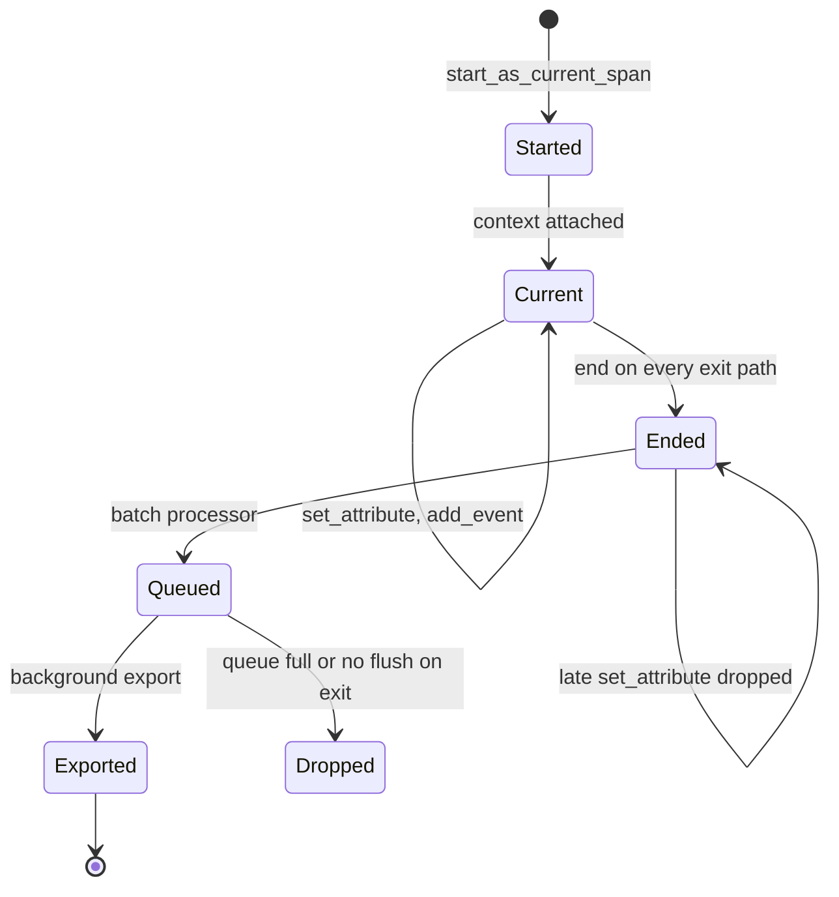

## TL;DR
A span is one named, timed operation with a parent, status, attributes and events. In an agent, every
loop step, model call and tool call is a span, so choosing boundaries and attributes decides which agent
failures you can find.

## For agent builders
- **Why it matters for agents.** "Which tool did step 4 call, with what arguments, and did the error get
  fed back to the model?" is answerable only if the step and the tool call are spans carrying those
  attributes. Badly shaped spans give you a trace you cannot query.
- **Where it shows up in your stack.** `start_as_current_span` in the OpenTelemetry SDK, the
  `@observe`-style decorators and callbacks of LLM tracing tools, and the generation spans that provider
  client instrumentation emits for you.
- **What you control.** Span names (`agent.step`, `tool.<name>`, never ids), what goes into attributes,
  events or by-reference payloads, the status of a tool error the agent recovered from, and keeping
  streaming generation spans open until the stream ends.
- **What you can skip.** The wire format and exporter internals. Know the fields, the lifecycle, the
  streaming trap and the cardinality rule.

## Lab
### Task
Fix the spans of one support-agent turn so they answer the questions you will ask of them. The model
first calls `get_order` with a typo, reads the error, retries correctly, then streams the answer.

The starter gets four things wrong: the generation span ends before streaming starts, the failed tool
span stays `UNSET` with no exception, the step is painted red although the agent recovered, and the
order id leaks into span names. Time box: 45-60 minutes.
- **Prerequisites:** this lesson's How it works (lifecycle, the streaming trap, the agent-loop status
  rules) and tracing.
- **Setup:** Python 3.12 with `pip install opentelemetry-sdk pytest` (checked on opentelemetry-sdk 1.45,
  pytest 9.1). Save the starter as `lab_spans.py` and the tests as `test_lab_spans.py`.
- **Done:** `python lab_spans.py` prints the expected output and `pytest -q` passes.

### Starter code
```python
"""Lab: shape one agent turn's spans (checked on Python 3.12, opentelemetry-sdk 1.45)."""
import json, time
from opentelemetry.sdk.trace import TracerProvider
from opentelemetry.sdk.trace.export import SimpleSpanProcessor
from opentelemetry.sdk.trace.export.in_memory_span_exporter import InMemorySpanExporter
from opentelemetry.trace import Status, StatusCode

EXPORTER = InMemorySpanExporter()           # tests read finished spans from here
provider = TracerProvider()
provider.add_span_processor(SimpleSpanProcessor(EXPORTER))   # demo only; BatchSpanProcessor in prod
tracer = provider.get_tracer("support-agent")


def fake_stream():                          # stand-in for a streaming model call: 4 tokens
    time.sleep(0.05); yield "Order"
    for w in (" A-103", " ships", " Friday."):
        time.sleep(0.01); yield w


def stream_generation(model):
    """LAB 1: the caller iterates the returned tokens. The `generation` span must stay open until
    the stream is exhausted, get a `first_token` event, set gen_ai.usage.output_tokens to the
    number of tokens, and end with status OK (end it in `finally`)."""
    with tracer.start_as_current_span("generation") as span:      # BUG: ends when the iterator is returned
        span.set_attribute("gen_ai.request.model", model)
        return fake_stream()


def get_order(order_id):
    if not order_id.startswith("A-"):
        raise LookupError(f"no such order {order_id}")
    return {"id": order_id, "status": "shipped"}


TOOLS = {"get_order": get_order}


def call_tool(name, args):
    """LAB 2: one span per call named tool.<name> (no ids in names); args go in app.tool.args.
    On an exception: record it on the span, set status ERROR with the exception's type name as the
    description, and return the error to the model as {"ok": False, "content": ...}."""
    with tracer.start_as_current_span(f"tool.{name}.{args['order_id']}") as span:   # BUG: id in the name
        span.set_attribute("app.tool.args", json.dumps(args))
        try:
            result = TOOLS[name](**args)
        except Exception as e:
            return {"ok": False, "content": f"Tool {name} failed: {e}"}   # BUG: span stays UNSET, no exception event
        span.set_status(Status(StatusCode.OK))
        return {"ok": True, "content": str(result)}


def agent_step(iteration, name, args):
    """LAB 3: a step succeeded if the loop can continue. When the tool failed, add the event
    `tool_error_returned_to_model` to the step span and still end the step with status OK."""
    with tracer.start_as_current_span("agent.step") as span:
        span.set_attribute("app.agent.iteration", iteration)
        obs = call_tool(name, args)
        if obs["ok"]:
            span.set_status(Status(StatusCode.OK))
        else:
            span.set_status(Status(StatusCode.ERROR, "tool failed"))     # BUG: a recovered error paints the step red
        return obs


def run_turn():
    with tracer.start_as_current_span("agent.run") as root:
        agent_step(1, "get_order", {"order_id": "A1O3"})       # model copied a typo: letter O
        agent_step(2, "get_order", {"order_id": "A-103"})      # model fixed it after reading the error
        text = "".join(stream_generation("example-model"))
        root.set_status(Status(StatusCode.OK))
        return text


def show(spans):
    for s in sorted(spans, key=lambda s: s.start_time):
        events = ",".join(e.name for e in s.events) or "-"
        line = f"{s.name:<20} {s.status.status_code.name:<6} events={events}"
        if s.name == "generation":
            held = (s.end_time - s.start_time) / 1e9 >= 0.08
            line += f"  output_tokens={s.attributes.get('gen_ai.usage.output_tokens')}"
            line += f"  held_open={'yes' if held else 'no'}"
        print(line)
    print("distinct span names:", len({s.name for s in spans}))


if __name__ == "__main__":
    print(run_turn())
    show(EXPORTER.get_finished_spans())
```

As given, it runs and prints the right answer, but the spans say `agent.step ERROR`,
`tool.get_order.A1O3 UNSET`, `generation UNSET events=-  output_tokens=None  held_open=no` and
`distinct span names: 5`.

### Expected output
```
Order A-103 ships Friday.
agent.run            OK     events=-
agent.step           OK     events=tool_error_returned_to_model
tool.get_order       ERROR  events=exception
agent.step           OK     events=-
tool.get_order       OK     events=-
generation           OK     events=first_token  output_tokens=4  held_open=yes
distinct span names: 4
```

The generation span now covers the 0.05 s to first token plus three 0.01 s tokens, so it lasts at
least 0.08 s instead of a few microseconds.

### Tests
```python
import pytest
from opentelemetry.trace import StatusCode
import lab_spans as lab


@pytest.fixture
def spans():
    lab.EXPORTER.clear()
    assert lab.run_turn() == "Order A-103 ships Friday."
    return lab.EXPORTER.get_finished_spans()


def one(spans, name):
    found = [s for s in spans if s.name == name]
    assert len(found) == 1, f"expected one {name} span, got {[s.name for s in spans]}"
    return found[0]


def test_generation_span_lives_as_long_as_the_stream(spans):
    gen, root = one(spans, "generation"), one(spans, "agent.run")
    assert (gen.end_time - gen.start_time) / 1e9 >= 0.08, "span ended before the stream was consumed"
    assert [e.name for e in gen.events] == ["first_token"]
    assert gen.attributes["gen_ai.usage.output_tokens"] == 4
    assert gen.status.status_code == StatusCode.OK
    assert gen.parent.span_id == root.context.span_id


def test_failed_tool_call_is_an_error_on_the_tool_span(spans):
    tools = sorted((s for s in spans if s.name.startswith("tool.")), key=lambda s: s.start_time)
    assert [t.name for t in tools] == ["tool.get_order", "tool.get_order"]
    bad, good = tools
    assert bad.status.status_code == StatusCode.ERROR and bad.status.description == "LookupError"
    assert "exception" in [e.name for e in bad.events]
    assert good.status.status_code == StatusCode.OK


def test_recovered_tool_error_keeps_step_and_run_ok(spans):
    steps = sorted((s for s in spans if s.name == "agent.step"), key=lambda s: s.start_time)
    assert [s.status.status_code for s in steps] == [StatusCode.OK, StatusCode.OK]
    assert [e.name for e in steps[0].events] == ["tool_error_returned_to_model"]
    assert one(spans, "agent.run").status.status_code == StatusCode.OK


def test_span_names_are_low_cardinality(spans):
    assert {s.name for s in spans} == {"agent.run", "agent.step", "tool.get_order", "generation"}
```

On the starter all four fail for the intended reason: a generation span of a few microseconds,
tool spans named `tool.get_order.A1O3`, a first step with status `ERROR`, and five distinct names.

### Failure scenarios
- **Inject: end the span after the loop instead of in `finally`.** Then call `next()` twice on the
  stream and `close()` it, as a client disconnect does. Observe: no `generation` span is exported at
  all. Debug: count spans per name in the exporter; a missing span at the failing step means an exit
  path skipped `end()`.
- **Inject: set `gen_ai.usage.output_tokens` after `span.end()`.** Observe: the SDK logs `Setting
  attribute on ended span.` and the attribute reads `None`. Debug: search logs for that warning; it
  always means work done after the span froze.
- **Inject: set `ERROR` on the tool span but drop `record_exception`.** Observe: the error-rate panel
  looks right, yet trace detail has no exception type, message or stack. Debug: compare `ERROR` span
  counts with spans carrying an `exception` event; the gap is your missing calls.

### Submission
- **Code:** your `lab_spans.py` with LAB 1-3 done and every `# BUG` line fixed.
- **Test run:** `pytest -q` showing 4 passed, plus your script output next to Expected output.
- **A streamed span from your own agent:** a console-exporter dump or backend screenshot showing the
  `first_token` event and token usage on one generation span.
- **A short note (3-5 sentences):** why the failed tool span is `ERROR` while the step and run are `OK`,
  and which dashboard number each choice protects.
- **Evaluation:** tests pass, names are low-cardinality, and the note ties status to user-visible failure.

## Why it exists
- **A trace tree needs a node unit that does three jobs.** *Timing*, so durations can be summed and
  compared. *Structure*, a parent reference, so trees assemble from pieces emitted by code paths, threads
  or services that never see each other. *Meaning*, enough attributes to find and interpret the span
  without reading the code that emitted it.
- **One span per request has timing but no attribution.** You learn the turn took 6 s and nothing about
  why.
- **One span per function call has structure but no meaning.** A profiler-style tree is hundreds of
  nameless frames, none saying "this was the reranker" or "this generation hit max tokens".
- **Plain log lines have meaning but** neither duration nor a reliable parent.
- **LLM operations are semantic units.** "One generation", "one retrieval", "one tool call", "one agent
  iteration" have properties (which model, how many tokens, which documents, what arguments, why it
  stopped) that are data, not code locations. Spans attach that data to a timed, nested operation, and
  shared conventions let spans from different teams and libraries stay comparable in one backend.

## How it works
### Anatomy of a span
Every tracing system converges on roughly the same fields; OpenTelemetry's names are used because they
are the lingua franca.

| Field | What it is | Why it matters |
|---|---|---|
| `trace_id` / `span_id` | 128-bit id shared by the request / 64-bit id unique to this span | groups spans into one request |
| `parent_span_id` | empty for the root | this single field turns a bag of spans into a tree |
| `name` | low-cardinality operation label: `generation`, `retrieval.hybrid`, `tool.get_order` | names are what you group and compare by; one embedding a user id makes every span unique and aggregation impossible |
| `start_time`, `end_time` | duration is derived, never stored | so clock skew between services shows up as children starting before their parent |
| `kind` | `INTERNAL`, `CLIENT`, `SERVER`, `PRODUCER`, `CONSUMER` | tells the backend which side of a network call this is, so the client-to-server gap reads as network and queueing time |
| `status` | unset, `OK`, or `ERROR` with a description | see below |
| `attributes` | key-value pairs with primitive or array values | where LLM semantics live |
| `events` | timestamped points inside the span, with their own attributes | things that happen *during* an operation: first token received, retry attempted, cache hit decided |
| `links` | references to spans in other traces | fan-in, such as a batch job processing messages from many requests |

- **Recording an exception does not mark the span failed;** you set the status, *because* a caught,
  retried failure inside an otherwise successful operation should not paint it red.
- **OpenTelemetry's convention:** libraries leave a successful span `UNSET` and only application code
  asserts `OK`, so backends treat "not error" as success.

### Lifecycle and context
1. **Start** the span.
2. **Make it current** for the code beneath it. "Current" lives in a context (a `ContextVar` in Python,
   `AsyncLocalStorage` in Node), so a child started anywhere downstream discovers its parent.
3. **Enrich** it with attributes and events.
4. **End it exactly once, on every exit path.** That is why idiomatic APIs are context managers or
   decorators: a span never ended never exports, and the trace looks truncated at exactly the failing
   step, the one you most wanted.

### The streaming trap
- **Ending a span freezes it.** Attributes set afterwards are dropped (the SDK at most logs a warning).
- **Streaming hits this hardest.** If a function opens a span, starts a provider stream and returns the
  iterator, the span ends when the function returns, milliseconds in. Tokens, first-token time and usage
  all arrive later, during iteration.
- **Fix:** keep the span open until the stream is exhausted by wrapping the iteration itself (a generator
  that holds the span), not the call that creates the stream.

### Span processors
| Processor | Behaviour | Use |
|---|---|---|
| **Simple** | exports synchronously as each span ends | demos; in production it puts the exporter's network call on your request path |
| **Batch** | queues ended spans, exports in the background | production, *because* tracing must never add the backend's latency to the user's |

- **Batch cost:** the queue is bounded, so under overload or a dead backend it drops spans rather than
  block.
- **Abrupt exit loses** whatever was still queued unless the provider is shut down (flushed) on exit.

### Attributes for LLM spans
What to record follows from the questions you will ask:
- **Generation:** provider, model id, request parameters (temperature, max tokens, tool choice), input
  and output token counts, finish reason, time to first token as an event, and the prompt and completion
  inline or as a reference to a blob.
- **Retrieval:** the query, index name, top-k, returned ids and scores.
- **Tool call:** tool name, the arguments as the model produced them, result size and status, and
  whether an approval gate fired.
- **Conventions:** OpenTelemetry publishes generative-AI semantic conventions (attribute names prefixed
  `gen_ai.`). At the time of writing they were still marked experimental, so check exact names against
  the current specification rather than memorising them.

### Spans for an agent loop
| Span | Name | Attributes worth recording | Status rule |
|---|---|---|---|
| Run | `agent.run` | task type, session id, steps taken, stopping reason | `ERROR` only if the user got no usable result |
| Step | `agent.step` | iteration number, decision (tool or final), context tokens | `OK` if the loop continued normally |
| Tool | `tool.<name>` | arguments as produced, result size, error type, approval required | `ERROR` when the tool failed, even if the agent recovered |

- **A tool error the model recovers from** is `ERROR` on the tool span and `OK` on the step and run,
  for the same reason as a retried generation: per-tool failure rates stay visible while the run's error
  rate counts only user-visible failures.
- **Approval gates and guardrail decisions are events** on the step or tool span (`approval_requested`,
  `guardrail_blocked`), unless waiting for a human is a duration you will chart; then it is a child span.

### Events versus child spans
- **Rule:** a duration you care about on its own is a child span; an instant is an event.
- **First token:** "waiting for the first token" is a duration but part of the generation, so most teams
  record a `first_token` event on the generation span and derive TTFT as event time minus span start.
- **Retry:** normally a new child span, *because* you want its own status and duration.

### Size and cardinality
- **Attributes are indexed** and sometimes turned into metrics; events and payloads are stored but rarely
  indexed.
- **A 40 KB prompt in an attribute** is tolerated by LLM-focused backends and punished by general-purpose
  ones.
- **Free text in a name,** or any label used for aggregation, is punished everywhere.
- **Rule:** identifiers and enums as attributes, bulky text as payload or by reference, nothing per-user
  in names.

## Diagram
A span's lifecycle: once ended it is frozen and handed to a processor, so late attributes are lost.



## Examples
### A streaming generation with the OpenTelemetry SDK
- **Output:** the console exporter prints two spans sharing one `trace_id`. The `generation` span has the
  root's id as its parent, carries model and usage attributes, and holds a `first_token` event from which
  TTFT can be derived.
- **The span stays open across the whole iteration of the stream,** which is why its duration and usage
  are real.
- **Attribute names follow the `gen_ai.` conventions;** verify them against the current spec before
  relying on them.
- **`start_as_current_span` already records uncaught exceptions** and sets the error status; the explicit
  handler is there to show the mechanism.

```python
import time
from opentelemetry import trace
from opentelemetry.sdk.trace import TracerProvider
from opentelemetry.sdk.trace.export import SimpleSpanProcessor, ConsoleSpanExporter
from opentelemetry.trace import Status, StatusCode

provider = TracerProvider()
provider.add_span_processor(SimpleSpanProcessor(ConsoleSpanExporter()))  # demo; Batch in prod
trace.set_tracer_provider(provider)
tracer = trace.get_tracer("support-bot")

def fake_stream():                        # stand-in for a streaming model call
    time.sleep(0.15); yield "Your"        # first token after ~150 ms
    for w in (" order", " shipped."):
        time.sleep(0.02); yield w

def generate(prompt):
    with tracer.start_as_current_span("generation") as span:
        span.set_attribute("gen_ai.request.model", "example-model")
        span.set_attribute("gen_ai.request.temperature", 0.2)
        span.set_attribute("app.prompt_ref", "s3://prompts/7f3a")   # by reference, not inline
        out, first = [], True
        try:
            for tok in fake_stream():
                if first:
                    span.add_event("first_token"); first = False
                out.append(tok)
            span.set_attribute("gen_ai.usage.output_tokens", len(out))  # real code: provider usage
            span.set_attribute("gen_ai.response.finish_reasons", ["stop"])
            span.set_status(Status(StatusCode.OK))
            return "".join(out)
        except Exception as e:
            span.record_exception(e)
            span.set_status(Status(StatusCode.ERROR, str(e)))
            raise

with tracer.start_as_current_span("chat.turn") as root:
    root.set_attribute("app.tenant", "acme")
    print(generate("Where is my order?"))
```

### Production snippet: a span that lives as long as the stream
When the caller must receive the iterator (a web framework streaming tokens to the client), make the
wrapper itself a generator. `start_span` does not make the span current, so no context is left attached
across `yield`; `finally` ends it even if the client disconnects and the generator is closed.

```python
from opentelemetry.trace import Status, StatusCode

def traced_stream(tracer, make_stream, model):
    span = tracer.start_span("generation")         # parent = context current at first next()
    span.set_attribute("gen_ai.request.model", model)
    first, n = True, 0
    try:
        for tok in make_stream():
            if first:
                span.add_event("first_token"); first = False
            n += 1
            yield tok
        span.set_attribute("gen_ai.usage.output_tokens", n)   # real code: provider usage
        span.set_status(Status(StatusCode.OK))
    except Exception as e:
        span.record_exception(e)
        span.set_status(Status(StatusCode.ERROR, str(e)))
        raise
    finally:
        span.end()                                  # runs on exhaustion, error or close()
```

| Version | Generation span duration | Usage and first token |
|---|---|---|
| Span around the call that returns the stream | a few ms | missing: set after the span ended |
| `traced_stream` around the iteration | full stream time | recorded |

### Agent tool span: failure recorded, run continues
The agent loop catches tool errors and hands them back to the model as an observation. The tool span
still carries `ERROR`, so per-tool failure rates are real while the step stays `OK`. Uses the `tracer`
from the first example; `TOOLS` is a stand-in registry.

```python
import json
from opentelemetry.trace import Status, StatusCode

def call_tool(tracer, name, args, TOOLS):
    with tracer.start_as_current_span(f"tool.{name}") as span:   # low-cardinality name
        span.set_attribute("app.tool.args", json.dumps(args)[:500])   # truncated, not the full payload
        try:
            result = TOOLS[name](**args)
            span.set_attribute("app.tool.result_chars", len(str(result)))
            span.set_status(Status(StatusCode.OK))
            return {"ok": True, "content": str(result)}
        except Exception as e:
            span.record_exception(e)
            span.set_status(Status(StatusCode.ERROR, type(e).__name__))
            return {"ok": False, "content": f"Tool {name} failed: {e}. Fix the arguments or try another tool."}

def agent_step(tracer, step, reply, TOOLS):
    with tracer.start_as_current_span("agent.step") as span:
        span.set_attribute("app.agent.iteration", step)
        span.set_attribute("app.agent.decision", reply["name"])
        obs = call_tool(tracer, reply["name"], reply["args"], TOOLS)
        if not obs["ok"]:
            span.add_event("tool_error_returned_to_model")
        span.set_status(Status(StatusCode.OK))       # the step itself succeeded
        return obs
```

## Production patterns
- **Batch processor, flushed on shutdown.** Use `BatchSpanProcessor` in every service and call
  `provider.shutdown()` (or `force_flush()`) in the process exit hook, because the queue is in memory.
  Tune queue size and export delay through the standard `OTEL_BSP_*` environment variables. Monitor
  dropped-span counts and exporter errors.
- **Attribute limits as a guardrail.** Set the SDK's attribute value length limit (for example via
  `OTEL_ATTRIBUTE_VALUE_LENGTH_LIMIT`) so an accidental inline prompt is truncated instead of exploding
  the backend. Monitor bytes per span.
- **A naming registry.** Keep an allowlist of span names (`generation`, `retrieval.hybrid`,
  `tool.<name>`) and fail a CI test or lint when code emits a name containing digits or ids. Monitor the
  count of distinct span names per service; a sudden jump means an id leaked into a name.
- **Attempt spans under an aggregate.** For retries, one `generation` parent with `attempts=N` and one
  child per attempt carrying its provider request id and status. Monitor attempts per generation as a
  leading indicator of provider overload.
- **Per-tool spans with a fixed attribute set.** Give every agent tool span the same keys (arguments
  truncated or by reference, result size, error type, approval flag) through one shared wrapper, not
  per-tool code. Monitor failure rate and latency p95 per `tool.<name>`; a tool whose failure rate climbs
  after a prompt change often means the model now passes worse arguments.
- **Status agreement check.** Periodically compare the count of `status=ERROR` spans per operation with
  your error-rate metric for the same window. Monitor the gap; it reveals missing `set_status` calls.

## Trade-offs
- **Fine-grained spans vs overhead.** Precise attribution, but each span costs export bandwidth, storage
  and a little overhead. It flips to coarser spans when the operation is sub-millisecond or runs
  thousands of times per request (tokenisation, per-chunk scoring).
- **Inline payloads vs PII and bloat.** Inline prompts and completions make a span self-contained, but
  bloat the trace store and spread PII. It flips to by-reference storage once volume or a compliance
  review makes the trace backend the largest copy of user data you hold.
- **Rich attributes vs index cost.** Spans become filterable and aggregatable, but every indexed attribute
  costs backend resources. It flips when an attribute's cardinality approaches the number of requests; the
  value then belongs in the payload, not the index.
- **Tool arguments on the span vs privacy.** Recording the arguments the model produced is the fastest
  way to debug bad tool calls, but arguments often carry emails, addresses or account numbers. It flips
  to truncated, hashed or by-reference arguments once tools touch customer data.
- **Events vs child spans.** Events are cheaper and keep the tree readable but have no duration or status
  of their own. It flips to a child span the moment you need to chart or alert on that sub-step's latency
  or failure rate.

## Pitfalls
- **Ending spans only on the happy path.** Symptom: traces stop exactly at the failing step, so the span
  you needed most is missing rather than marked as an error.
- **Child spans in a thread-pool worker or early-created background task without context.** Symptom: a
  single-span trace with no parent appears at the same moment the real trace shows an unexplained gap.
- **Dynamic values in span names (`tool.get_order_88213`).** Symptom: thousands of distinct operations
  with one data point each, so no latency chart is possible.
- **Recording an exception without setting the status, or the reverse.** Symptom: error-rate dashboards
  that disagree with the exceptions visible in trace detail.
- **Wrapping the function that *creates* a provider stream instead of the loop that consumes it.**
  Symptom: generation spans of a few milliseconds with no usage or first-token event while the root takes
  seconds.
- **Shipping the simple (synchronous) span processor to production.** Symptom: latency rises whenever the
  trace backend is slow, and requests hang when it is down.
- **Marking the whole agent run failed because one tool call failed.** Symptom: the run error rate is far
  above the user complaint rate, because recovered tool errors are counted as user-visible. Fix: `ERROR`
  on the tool span, `OK` on the step and run when the agent recovered.
- **Capturing the prompt *template* instead of the rendered prompt.** Symptom: the span cannot reproduce
  the model's behaviour because variables, truncation and history are missing.

## When to use
- **Use a span** whenever work has a duration, a success or failure outcome, or data you will filter by:
  every model call, retrieval, reranking pass, tool call and agent iteration, plus the user-facing turn as
  the root.
- **Avoid** spans for pure functions taking microseconds, or loops with thousands of iterations; use one
  span with counts in its attributes.
- **Measure** spans per trace and bytes per span to keep the trace store honest, and check that
  `status=ERROR` on spans agrees with your error metrics.
- **Interviews:** expect "what attributes go on a generation span, and why" and "is a retry an event or a
  child span"; reason the answer from the questions you will ask of the data.

## Role lens
- **Engineer:** Writes the `start_as_current_span` blocks, decides what goes in attributes versus events
  versus by-reference payloads, and makes sure every exit path ends the span with the right status.
- **Architect:** Defines the span naming and attribute conventions for the organisation (which keys,
  which cardinality rules, which payload policy) so spans from different teams aggregate and join in
  one backend.
- **FDE:** Reads customer spans to pinpoint whether a slow or wrong answer came from retrieval, the
  model or a tool, and adds the missing attribute when a customer question cannot be answered from the
  existing ones.

## Check yourself
**Q:** You are instrumenting a streaming generation that may retry once on a provider overload error.
Should time to first token, the retry, and the final token usage be attributes, events or child
spans, and what status should the parent carry if the retry succeeds?
**A:** Time to first token is a point in time inside the generation, so record a `first_token` event
on the generation span and derive TTFT from the span start; storing it also as a numeric attribute is
fine for querying. Each attempt has its own duration, outcome and provider request id, so attempts
should be child spans (`generation.attempt`): the first marked `ERROR` with the overload recorded,
the second `OK`. The parent generation span aggregates: total duration, the final usage tokens as
attributes taken from the successful attempt, an `attempts=2` attribute, and status `OK` *because*
the operation the caller asked for succeeded. Marking the parent as an error would make the error
rate count a recovered failure as user-visible, while hiding the retry entirely would leave the
latency unexplainable.

## Interview questions
### What fields does a span have, and which one makes a trace a tree?
- **Fields:** trace id, span id, parent span id, name, start and end time, kind, status, attributes,
  events and links.
- **The tree comes from the parent span id** together with the shared trace id; names and timestamps
  describe spans but cannot establish containment, especially across services.

### Your generation spans show 3 ms durations and no token usage, but users wait seconds. What happened?
- **Likely cause:** the span wraps the function that creates the provider stream, so it ends when the
  iterator is returned and later attributes are dropped.
- **Fix:** hold the span in a generator around the iteration and end it in `finally`, so duration, the
  first-token event and usage are recorded.

### In an agent run, when would you make something an event instead of a child span?
- **Events for instants inside an operation:** first token, cache hit decided, a guardrail decision,
  an approval request or a tool error handed back to the model. They are cheap and keep the tree readable.
- **Child spans when you will chart or alert on it:** a retry attempt or a rerank call has its own
  duration, status and request id, so it needs to be a span.

### Why must span names be low-cardinality, and where do identifiers go?
- **Names are the grouping key:** backends compute latency percentiles and error rates per name, so an
  order id in the name yields thousands of one-sample series.
- **Identifiers go in attributes,** and bulky text such as prompts goes to a payload store by reference.

### A service's p99 latency jumps every time the tracing backend is degraded. Why, and what do you change?
- **It is exporting synchronously:** the simple span processor puts the export network call on the
  request path.
- **Switch to the batch processor,** which exports in the background and drops spans when its bounded
  queue fills instead of blocking, and flush it on shutdown so exits do not lose the queue.

### How would you design spans so you can tell which of an agent's tools is hurting task success?
- **One span per tool call, named `tool.<name>`,** nested under the `agent.step` whose generation chose
  it, so failure rate and latency aggregate per tool.
- **A fixed attribute set from one wrapper:** arguments (truncated or by reference), result size, error
  type, and whether the error was returned to the model.
- **Join with outcomes:** put the stopping reason and an eval or feedback score on the run span, then
  compare success rates of runs that did and did not hit each tool's errors.

## Quiz
### Q: What single field turns a set of independently emitted spans into a trace tree?
- [ ] The span name
- [x] The parent span id, together with the shared trace id
- [ ] The start timestamp
- [ ] The span kind (CLIENT or SERVER)
> The trace id groups spans into one request and the parent id gives each its position in the tree;
> names and timestamps describe spans but cannot establish containment, especially across services.

### Q: Why should span names be low-cardinality, with identifiers moved into attributes?
- [ ] Attribute storage is cheaper per byte than name storage
- [ ] Names are limited to 32 characters in most backends
- [x] Names are the grouping key for latency and error aggregation; unique names make every span its own series
- [ ] Attributes are encrypted while names are not
> Backends chart and compare operations by name. If each span's name embeds an order id or user id,
> you get thousands of one-sample operations and no usable p95 or error rate per operation.

### Q: A retrieval span shows status OK, yet its attributes record zero returned chunks and the final answer was wrong. What does this illustrate?
- [ ] The span should have been an event instead
- [x] Status reflects whether the operation executed, not whether its result was useful; semantic quality must be checked from attributes or evals
- [ ] The tracer dropped the error because of sampling
- [ ] Retrieval spans cannot carry a status
> Span status is about execution failure. An empty retrieval that completed normally is OK at the
> mechanics level; detecting that it was semantically bad requires reading recorded attributes or
> scoring the trace, which is why traces feed evals.

## Use cases & projects
### Use cases
- **Per-tool reliability dashboards.** Consistent `tool.<name>` spans give failure rate and latency per
  tool across every agent that uses it.
- **Debugging bad tool arguments.** The arguments recorded on the tool span show exactly what the model
  produced, before validation or coercion.
- **Streaming agent UIs.** A generation span held open across the stream gives real TTFT and token usage
  for each agent step shown to the user.
- **Approval and guardrail audits.** Events on step spans show when an approval gate fired or a guardrail
  blocked an action, in context.

### Mini project
**Instrument an agent's tools with a shared span wrapper (1-2 hours).**
- **Goal:** make tool failures visible per tool without marking recovered runs as failed.
- **Steps:** take any small agent with three tools; route every tool call through one wrapper like
  `call_tool` above; add `agent.step` spans with the iteration and decision; inject a 20% failure rate
  into one tool; export spans to the console or a local collector; run 30 tasks.
- **Done when:** you can show the failing tool's span error rate near 20%, the run error rate much lower
  because the agent recovered, and an event marking each error that was returned to the model.
