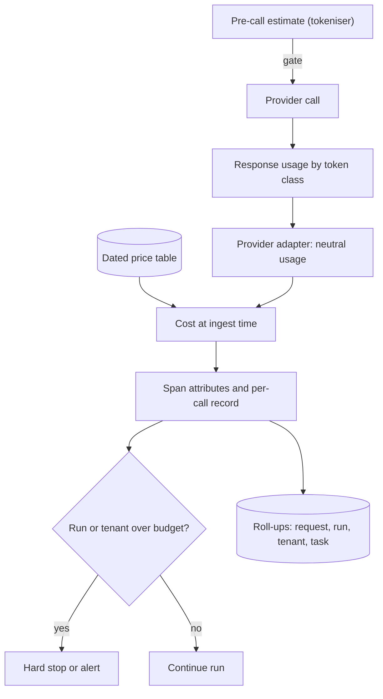

## TL;DR
LLM spend is metered per token and priced by token class and model, so record provider usage on every
call, cost it at the price then in force, and roll up by decision dimensions. Retries, agent loops and
history make averages mislead.

## Why it exists
- **The invoice is one number per model per month.** It cannot tell you that summarisation costs three
  times chat, that one tenant's agent workflow is half the bill, that last Tuesday's prompt change added
  40% to input tokens, or that retries on an overloaded provider doubled the bill for a day. Each is a
  decision you need during the month, and only your own instrumentation can attribute it.
- **"Requests × average cost" fails because cost per request is not stable.** Input and output are priced
  differently (output is typically several times more per token) and the ratio varies by feature. Agent
  runs make a variable number of calls, with a long tail where one run loops for hundreds of steps.
- **Hidden multipliers.** Conversations resend history, so turn *n* grows with *n*. Retrieval stuffs
  context. Retries and fallbacks are extra calls that never appear as extra user requests. Prompt caching
  changes the price of the same tokens depending on whether the prefix was recently seen.
- **There is a control problem too.** Stopping a runaway agent or misbehaving tenant before the money is
  spent needs the cost of a run while it is still running: usage recorded per call, attributed in real
  time and compared with budgets, not reconciled from an invoice weeks later.

## How it works
### Where the numbers come from
- **Use the provider's `usage` object:** input and output token counts and, on most providers, fields for
  cached input tokens and, for reasoning models, reasoning tokens.
- **Not your own estimates,** *because* tokenisers differ between model families and the provider's count
  is what they bill.
- **Streaming trap:** usage arrives at the end of the stream or split across the first and last events,
  and some APIs include it only if the request asks for it.
- **Cached-token trap:** providers differ on whether the headline input count includes cached tokens or
  reports them separately, so write the billable-input formula per provider after reading its docs.

### Estimating before the call
- **When you need a number before spending:** enforcing a per-request budget, deciding whether a context
  fits, routing long inputs to a cheaper model.
- **How:** a provider-specific tokeniser (such as `tiktoken` for OpenAI models) or a provider's
  token-counting endpoint.
- **Rule:** estimates are for gating; response usage is for accounting.

### Turning tokens into money
1. **Keep a versioned price table:** per model, prices per million tokens for input, output, cache write,
   cache read and any other class, each with an effective-from date, *because* prices change, models are
   deprecated, and recomputing last quarter with this quarter's prices is simply wrong.
2. **Compute cost at ingest time** and store the tokens, the computed cost and the price version used.
3. **Batch or discounted tiers are separate rows** in the table, not a multiplier applied later.

### Attribution dimensions
- **Every usage record carries:** model and provider, feature or route, prompt version, tenant, user (as
  an opaque id), conversation or session id, agent run id and step number, and whether the call was a
  retry or fallback.
- **Spans get all of them** as attributes on the generation span.
- **Metrics get only bounded labels** (model, route, tenant where the tenant count is small); unbounded
  ones (user, conversation, run) live in per-call records and the trace.

### Roll-ups that match decisions
| Roll-up | Answers |
|---|---|
| **Per request** | is this feature priced sensibly |
| **Per conversation** | sums the turns and exposes the history-growth problem |
| **Per agent run** | sums every step, retry and tool-related call; its distribution, not its mean, matters |
| **Per tenant per day** | chargeback, quotas and anomaly alerts |
| **Per successful task** | total cost over completed tasks: the number product and finance want, and it charges retries and abandoned runs correctly |

### Why conversations are expensive: a worked example
Assume a system prompt plus tool definitions of 1,500 tokens, and each turn adds about 300 user and 400
assistant tokens.

```
input(turn n) = 1,800 + 700 × (n − 1)
total input over 20 turns = 20 × 1,800 + 700 × (0 + 1 + … + 19) = 36,000 + 133,000 = 169,000
total output over 20 turns = 20 × 400 = 8,000
```

- **The history term grows with the square of the turn count.** The last turn alone sends about eight
  times the input of the first (15,100 versus 1,800 tokens).
- **Input outnumbers output about twenty to one.**
- **At illustrative prices** of 2 and 10 dollars per million input and output tokens: about 0.34 dollars
  of input against 0.08 of output. Input dominates even though each output token costs five times as
  much.
- **So** prompt caching (the repeated prefix billed at a discount) and history compaction exist, and cost
  per conversation must be tracked separately from cost per turn.

### Beyond text tokens
- **Images and audio** become tokens by provider-specific rules (image cost typically depends on
  resolution).
- **Some server-side tools** are billed per call on top of tokens.
- **Embeddings, rerankers, guardrail classifiers and LLM-as-judge calls** are separate metered calls that
  belong to the same feature.
- **Self-hosted models are metered in GPU time:** cost per token = GPU cost per hour ÷ tokens actually
  served per hour, so utilisation, not list price, moves it.
- **Each needs its own usage record and price row,** or the feature is understated by exactly the parts
  nobody thought of as "the LLM".

### Budgets and enforcement
- **Soft alerts** when a tenant or feature reaches a fraction of its daily budget.
- **Hard stops** at the gateway or in the agent loop when a run exceeds its token or dollar budget.
- **The hard stop needs the running total synchronously,** so keep it in the agent's state or a fast
  store, not the analytics warehouse.

## Diagram
One call's usage becomes a costed, attributed record; the same record feeds the synchronous budget check
and the asynchronous roll-ups.



## Examples
### A provider-neutral usage record with a dated price table
- **Prices are illustrative placeholders,** not any vendor's list; load real ones from configuration.
- **The key design choice is the neutral `usage` dict.** Each provider's SDK fields are mapped into it in
  one adapter, with `uncached_input` excluding cache reads and writes, so the formula never double counts
  cached tokens whatever a provider's headline input number includes.
- **The two printed costs** show the same 8,400-token prompt with and without a warm cache.

```python
from dataclasses import dataclass
from datetime import date

@dataclass(frozen=True)
class Price:        # USD per million tokens; illustrative placeholders, load from config
    input: float; output: float; cache_write: float; cache_read: float; effective: date

PRICES = {          # model -> prices, newest first
    "example-model": [Price(2.0, 10.0, 2.5, 0.2, date(2025, 1, 1))],
}

def price_for(model, on):
    return next(p for p in PRICES[model] if p.effective <= on)

def cost_usd(model, usage, on=None):
    p = price_for(model, on or date.today())
    return (usage["uncached_input"] * p.input
            + usage["cache_write"] * p.cache_write
            + usage["cache_read"] * p.cache_read
            + usage["output"] * p.output) / 1_000_000

def record(span, model, usage, **dims):
    """Attach tokens, cost and attribution dimensions to the generation span."""
    c = cost_usd(model, usage)
    total_in = usage["uncached_input"] + usage["cache_read"] + usage["cache_write"]
    span.set_attribute("gen_ai.usage.input_tokens", total_in)
    span.set_attribute("gen_ai.usage.output_tokens", usage["output"])
    span.set_attribute("app.cost_usd", round(c, 6))
    for k, v in dims.items():          # feature, prompt_version, tenant, run_id, is_retry
        span.set_attribute(f"app.{k}", v)
    return c

warm = {"uncached_input": 400, "cache_write": 0, "cache_read": 8000, "output": 300}
cold = {"uncached_input": 8400, "cache_write": 0, "cache_read": 0, "output": 300}
print(f"warm cache: {cost_usd('example-model', warm):.4f} USD")   # 0.0008+0.0016+0.0030 = 0.0054
print(f"cold cache: {cost_usd('example-model', cold):.4f} USD")   # 0.0168+0.0030        = 0.0198
```

### Runnable: conversation cost grows faster than turn count
The worked example as a calculator. Doubling the conversation from 20 to 40 turns more than triples the
input tokens.

```python
def conversation_tokens(turns, system=1500, user=300, assistant=400):
    per_exchange = user + assistant
    inputs = [system + user + per_exchange * (n - 1) for n in range(1, turns + 1)]
    return inputs, assistant * turns

def cost(inp, out, p_in=2.0, p_out=10.0):        # illustrative USD per million tokens
    return inp * p_in / 1e6, out * p_out / 1e6

inputs, out = conversation_tokens(20)
c_in, c_out = cost(sum(inputs), out)
print(f"first turn {inputs[0]}, last turn {inputs[-1]}, total input {sum(inputs)}, output {out}")
print(f"input ${c_in:.3f} vs output ${c_out:.3f}; input/output tokens {sum(inputs) / out:.0f}x")
for turns in (5, 10, 20, 40):
    i, o = conversation_tokens(turns)
    print(f"{turns:>2} turns: {sum(i):>7} input tokens, ${sum(cost(sum(i), o)):.3f}")
```

| Turns | Total input tokens | Total cost (illustrative prices) |
|---|---|---|
| 5 | 16,000 | $0.052 |
| 10 | 49,500 | $0.139 |
| 20 | 169,000 | $0.418 |
| 40 | 618,000 | $1.396 |

### Production snippet: provider adapters into the neutral schema
Two providers report cache usage differently, which is exactly why the adapter exists. Field names are
from the providers' documented usage objects at the time of writing; verify against current docs.

```python
def from_openai(u):        # chat completions usage: prompt_tokens INCLUDES cached tokens
    cached = getattr(u.prompt_tokens_details, "cached_tokens", 0) or 0
    return {"uncached_input": u.prompt_tokens - cached, "cache_read": cached,
            "cache_write": 0, "output": u.completion_tokens}   # reasoning is inside output

def from_anthropic(u):     # messages usage: input_tokens EXCLUDES cache reads and writes
    return {"uncached_input": u.input_tokens,
            "cache_read": u.cache_read_input_tokens or 0,
            "cache_write": u.cache_creation_input_tokens or 0,
            "output": u.output_tokens}
```

## Production patterns
- **Ask for usage on every stream.** For OpenAI chat completions, pass
  `stream_options={"include_usage": True}` and read usage from the final chunk; for Anthropic, combine the
  usage reported at message start with the final delta. Monitor the count of zero-token records per route,
  which should be zero.
- **Monthly invoice reconciliation.** Sum computed cost per model and compare it with the provider
  invoice. Monitor the gap: a small percentage is normal; more means missing calls (retries, judges,
  embeddings) or a wrong price row.
- **Per-run budget in the agent loop.** Keep a running token and dollar total in the run state, check it
  before each step, and stop with a clear user message when exceeded. Monitor p99 cost per run and the
  rate of budget stops per feature.
- **Tenant quotas at the gateway.** Increment a per-tenant daily spend counter in a fast store as each
  call is costed; alert at a fraction of the quota and reject at the limit. Monitor tenants above their
  alert threshold each day.
- **Cache effectiveness tracking.** Record cache-read and cache-write tokens separately and chart their
  ratio per prompt version. Monitor a falling read-to-write ratio after a deploy; it usually means the
  prefix stopped being byte-identical.
- **Cost per successful task as the headline.** Divide feature cost by completed tasks (not requests) on
  the weekly dashboard, and use it when comparing models. Monitor it for a week after any model switch.

## Trade-offs
- **Provider usage vs tokeniser estimates.** Provider-reported usage is exact and what you are billed
  for, but only available after the call; estimates are available before it and approximate. Use
  estimates for gating and provider usage for accounting.
- **One record per call vs storage.** Full attribution and a replayable cost history, but many rows per
  user action at agent scale. It flips to pre-aggregated roll-ups plus sampled raw records once the
  per-call table outgrows the analytics budget.
- **Hard caps vs user experience.** Hard caps protect spend and stop runaway loops but fail a user
  mid-task; soft alerts preserve the experience and risk the bill, so most teams cap per run and alert per
  tenant.
- **Cheaper model vs tokens per task.** It cuts cost per token immediately, but can raise tokens per task
  (more retries, longer outputs, more agent steps); cost per successful task is the only comparison that
  settles it.
- **Prompt caching vs write premium.** Caching lowers input cost sharply for stable prefixes, but on some
  providers adds a write premium and only pays off when the prefix is reused within the cache window.
  Tracking cache-read against cache-write tokens tells you whether it is paying.

## Pitfalls
- **One provider's tokeniser for another provider's model.** Symptom: a persistent gap between dashboard
  and invoice that grows with volume.
- **Not requesting usage on streaming calls, or reading the wrong event.** Symptom: zero-token records
  for exactly the streaming routes.
- **Counting only the successful final call.** Retries, fallbacks and judge calls are missing, so the
  dashboard undercounts by the retry rate and never matches the invoice on bad-provider days.
- **Ignoring reasoning tokens.** Reasoning models bill hidden reasoning as output tokens. Symptom: output
  counts and cost far above what the visible answer's length suggests, unexplained unless reasoning tokens
  are recorded as their own field.
- **Recomputing historical cost with current prices.** Symptom: last month's cost "changing" in reports.
- **Average cost per request for agent features.** Symptom: a budget blown by a handful of runs that
  looped, invisible in the mean.
- **Tokens attributed to a model but not a feature or prompt version.** Symptom: knowing the total went
  up and being unable to say which deploy did it.

## When to use
- **Instrument usage from the first call you ship;** the per-call record is cheap and impossible to
  backfill.
- **Attribution by feature and tenant** becomes necessary once there is more than one of either; per-run
  budgets once an agent loop exists.
- **Measure** the monthly gap between computed cost and the provider invoice (a small percentage is
  normal; more means missing calls), cost per successful task per feature, and the p99 of cost per agent
  run.
- **Day to day,** this is the first dashboard after a prompt, model or retrieval change.
- **Interviews:** expect "how would you attribute an LLM bill to tenants", "how does caching change the
  formula" and "why does conversation cost grow faster than turn count"; the worked example above is the
  reasoning expected.

## Role lens
- **Engineer:** Maps each provider's usage fields into one schema, records tokens and computed cost on
  the generation span, handles the streaming usage event, and enforces per-run budgets in the agent
  loop.
- **Architect:** Owns the price table and its versioning, the attribution dimensions, the chargeback
  model for tenants and features, and the policy for hard caps versus alerts.
- **FDE:** Reconciles the customer's invoice against the system's own numbers, explains why one
  workflow costs what it does, and tunes caching and compaction where the per-conversation roll-up
  shows history growth dominating.

## Check yourself
**Q:** Finance says the LLM bill rose 60% month over month while request volume rose 10%. Walk through
how you would find the cause using your tracking, and what you would need to have recorded for that
to be possible.
**A:** Start with the roll-ups by dimension, comparing the two months: by model (did traffic shift to
a more expensive model, or did a price change land), by feature and prompt version (did a prompt
deploy raise input tokens per request), by call type (did retries, fallbacks or judge calls increase
on days the provider was degraded), and by tenant (did one tenant's agent workflow start looping).
Then split tokens into input, output, cache read and cache write: a jump in input with flat output
usually means longer context, longer conversations or a lost cache hit rate; a jump in cache writes
with few reads means caching is being paid for but not used. For this to be answerable, every call
must have been recorded with provider usage split by token class, model, feature, prompt version,
tenant, run id and retry flag, costed with the price in force that day and stored with the price
version. Without the prompt-version and retry dimensions the question is unanswerable, which is the
argument for recording them from the start.

## Interview questions
### Why use the provider's reported usage instead of counting tokens yourself?
- **It is what you are billed for:** tokenisers differ between model families, and the provider also
  reports cached and reasoning tokens your own count cannot see.
- **Keep estimates for gating only:** a tokeniser or counting endpoint before the call to enforce budgets
  or routing, then account with the response usage.

### How would you attribute a shared LLM bill to tenants and features?
- **Record every call** with usage by token class, model, feature, prompt version, tenant, run id and
  retry flag, costed at ingest with a dated price row.
- **Roll up per tenant per day and per feature,** including retries, judge calls, embeddings and
  guardrails, then reconcile the total against the invoice each month.

### Your cost dashboard is consistently 15% below the invoice. Where do you look?
- **Missing calls:** retries, fallbacks, judge and guardrail calls, embeddings and rerankers that bypass
  the wrapper.
- **Missing token classes:** streaming routes without usage, reasoning tokens, cache writes, and
  provider-specific rules for images or server-side tools.
- **Wrong prices:** an outdated price row, or a batch tier applied as a multiplier rather than its own
  row.

### When would a cheaper model cost you more?
- **When it needs more work per task:** more agent steps, retries, longer outputs or more human
  escalations raise tokens per completed task.
- **So compare cost per successful task,** over a representative eval set or a controlled rollout, not
  price per token.

### How do prompt caching and conversation length interact in cost?
- **History makes input grow with the square of turn count,** so input dominates long conversations.
- **Caching discounts the repeated prefix** only while it is byte-identical and reused within the cache
  window; some providers charge a write premium, so track cache reads against writes to confirm it pays.

## Quiz
### Q: Why should cost be computed and stored at ingest time rather than recomputed from token counts when a report is run?
- [ ] Token counts are too large to store
- [x] Prices change and models are deprecated, so the stored cost must reflect the price in force when the call happened
- [ ] Recomputing is too slow for dashboards
- [ ] Providers do not report token counts after the call
> A price table with effective dates is the mechanism, and storing the computed cost with its price
> version means historical reports stay stable when prices move instead of silently rewriting.

### Q: A 20-turn conversation has a 1,500-token system prompt and adds about 700 tokens per turn. Which statement about its cost is correct?
- [ ] Each turn costs about the same, so cost scales linearly with turns
- [x] Later turns resend the whole history, so total input tokens grow roughly quadratically with turn count and dwarf output tokens
- [ ] Output tokens dominate because they are priced higher
- [ ] Prompt caching makes the history free after the first turn
> Each turn resends the system prompt and every earlier exchange, so input per turn grows by about
> 700 tokens a turn and the total grows with the square of the turn count, well past 150,000 tokens
> over 20 turns. Caching discounts the repeated prefix but does not make it free, and only while the
> prefix is reused within the cache window.

### Q: Why is "cost per successful task" a better comparison than "cost per request" when evaluating a cheaper model for an agent feature?
- [ ] Requests cannot be counted for agents
- [ ] Cheaper models always use fewer tokens per request
- [x] A cheaper model may need more steps, retries or re-runs to finish a task, which cost per request hides and cost per successful task includes
- [ ] Cost per request ignores output tokens
> Agent cost is the sum over a variable number of calls, and abandoned or retried runs are real spend.
> Dividing total cost by completed tasks charges those failures to the model that caused them.
