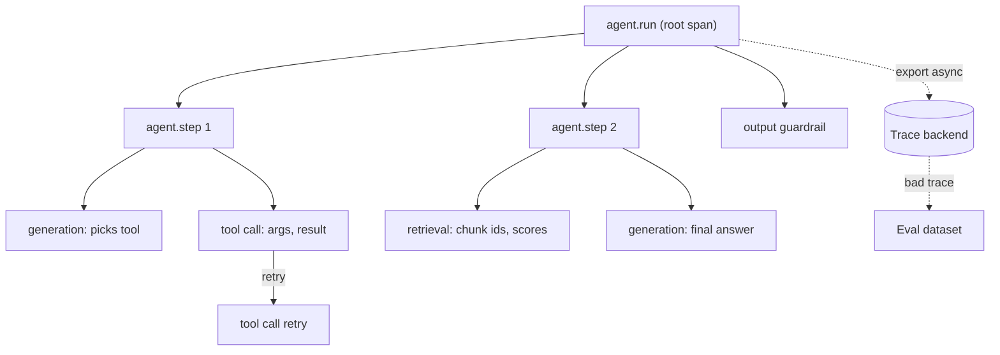

## TL;DR
A trace is the timed tree of one agent turn: every model call, tool call, retrieval and retry as nested
spans. Agents fail *semantically*, not by crashing, so you need each step's inputs, outputs and decisions
in order to debug them.

## For agent builders
- **Why it matters for agents.** An agent run is a loop of decisions you did not write: which tool, which
  arguments, when to stop. When it goes wrong there is no stack trace, only a plausible answer. The trace
  is the only record of what the model saw and chose at each step.
- **Where it shows up in your stack.** LLM tracing backends (Langfuse, LangSmith, Phoenix) or an
  OpenTelemetry collector, fed by provider-client auto-instrumentation, framework callbacks (LangGraph,
  LlamaIndex) and your own spans around tools and prompt building.
- **What you control.** The span boundaries (one per loop iteration, tool call and generation), what
  payloads are captured by value or by reference, the session id that links turns, and the sampling
  policy that keeps every failed run.
- **What you can skip.** Building a tracer yourself or the internals of the collector pipeline. Know the
  data model, self time, the critical path and context propagation; that is enough to debug agents.

## Lab
### Task
Make one agent turn's trace tell the truth. The model asked for three tools in one step; the starter
runs them in a thread pool, which silently splits the turn into four traces.

Its self-time maths also
double-counts parallel children, and it cannot name the critical path, so you cannot say which tool to
speed up. Time box: 45-60 minutes.
- **Prerequisites:** this lesson's How it works (context propagation, self time, the critical path) and
  the first example's thirty-line tracer; spans if span fields are new to you.
- **Setup:** Python 3.12, standard library only, plus `pip install pytest` (checked on pytest 9.1). Save the
  starter as `lab_trace.py` and the tests as `test_lab_trace.py`.
- **Done:** `python lab_trace.py` prints the expected tree and `pytest -q` passes.

### Starter code
```python
"""Lab: make one agent turn's trace tell the truth (checked on Python 3.12, stdlib only)."""
import contextvars, time, uuid
from concurrent.futures import ThreadPoolExecutor
from contextlib import contextmanager

_current = contextvars.ContextVar("current_span", default=None)
SPANS: list[dict] = []                      # finished spans; production code hands them to an exporter


@contextmanager
def span(name, **attrs):
    parent = _current.get()
    s = {"trace_id": parent["trace_id"] if parent else uuid.uuid4().hex,
         "span_id": uuid.uuid4().hex[:16],
         "parent_id": parent["span_id"] if parent else None,
         "name": name, "attrs": attrs, "start": time.perf_counter()}
    token = _current.set(s)
    try:
        yield s
    finally:
        s["end"] = time.perf_counter(); _current.reset(token); SPANS.append(s)


def tool(name, seconds):                    # stand-in for an HTTP tool call
    with span(f"tool.{name}"):
        time.sleep(seconds)
        return f"{name}: ok"


def run_parallel(calls):
    """LAB 1: the model asked for three tools in one step; run them in a thread pool so that
    every tool span is a child of the current agent.step (same trace_id, parent_id = step)."""
    with ThreadPoolExecutor(max_workers=len(calls)) as pool:
        futures = [pool.submit(tool, n, s) for n, s in calls]    # BUG: pool threads start with an empty context
        return [f.result() for f in futures]


def run_turn(task):
    with span("agent.run", task=task):
        with span("agent.step", iteration=1):
            with span("generation"):
                time.sleep(0.10)                                 # model picks three tools
            run_parallel([("order_status", 0.30), ("search_docs", 0.20), ("get_policy", 0.15)])
        time.sleep(0.05)                                         # history compaction, untraced
        with span("agent.step", iteration=2):
            with span("generation"):
                time.sleep(0.10)                                 # model writes the final answer
        return "Your order ships Friday."


def children(s, spans):
    return [c for c in spans if c["parent_id"] == s["span_id"]]


def self_time(s, spans):
    """LAB 2: duration minus the time covered by children. Parallel children overlap, so
    subtract the UNION of their [start, end] intervals, not the sum of their durations."""
    kids = children(s, spans)
    return (s["end"] - s["start"]) - sum(c["end"] - c["start"] for c in kids)    # BUG: sums overlaps


def critical_path(s, spans):
    """LAB 3: names on the chain that sets s's duration, in time order, starting with s.
    Take the child that ends last, then repeatedly the child that ends latest at or before the
    chosen one's start; recurse into each chosen child. Parallel siblings off the path are skipped."""
    raise NotImplementedError


def print_tree(spans):
    roots = [s for s in spans if s["parent_id"] is None]
    print("traces:", len({s["trace_id"] for s in spans}))
    root = next(s for s in roots if s["name"] == "agent.run")

    def show(s, depth):
        label = "  " * depth + s["name"]
        print(f"{label:<22} total {s['end'] - s['start']:.2f} s  self {self_time(s, spans):.2f} s")
        for c in sorted(children(s, spans), key=lambda c: (round(c["start"] - root["start"], 2), c["name"])):
            show(c, depth + 1)

    show(root, 0)
    try:
        print("critical path:", " > ".join(critical_path(root, spans)))
    except NotImplementedError:
        print("critical path: (LAB 3 not done)")


if __name__ == "__main__":
    run_turn("Where is order A-103?")
    print_tree(SPANS)
```

As given, it runs and prints `traces: 4`, a first `agent.step` with only its generation under it and
0.30 s of unexplained self time, and `critical path: (LAB 3 not done)`: the tool spans became orphan
traces.

### Expected output
```
traces: 1
agent.run              total 0.55 s  self 0.05 s
  agent.step           total 0.40 s  self 0.00 s
    generation         total 0.10 s  self 0.10 s
    tool.get_policy    total 0.15 s  self 0.15 s
    tool.order_status  total 0.30 s  self 0.30 s
    tool.search_docs   total 0.20 s  self 0.20 s
  agent.step           total 0.10 s  self 0.00 s
    generation         total 0.10 s  self 0.10 s
critical path: agent.run > agent.step > generation > tool.order_status > agent.step > generation
```

Durations can read 0.01-0.02 s higher because `time.sleep` overshoots; the tree shape, the self times
of the steps and the critical path line must match. The step's 0.40 s is 0.10 s of generation plus the
slowest tool (0.30 s), not the 0.75 s sum of everything under it.

### Tests
```python
import pytest
import lab_trace as lab


def sp(name, sid, parent, start, end):
    return {"trace_id": "t1", "span_id": sid, "parent_id": parent, "name": name, "attrs": {},
            "start": start, "end": end}


@pytest.fixture
def turn():
    lab.SPANS.clear()
    lab.run_turn("Where is order A-103?")
    return list(lab.SPANS)


def test_tool_spans_join_the_turn_trace(turn):
    assert len({s["trace_id"] for s in turn}) == 1, "tool spans started a trace of their own"
    step1 = next(s for s in turn if s["name"] == "agent.step" and s["attrs"]["iteration"] == 1)
    tools = [s for s in turn if s["name"].startswith("tool.")]
    assert len(tools) == 3 and all(t["parent_id"] == step1["span_id"] for t in tools)


def test_self_time_subtracts_the_union_of_parallel_children():
    parent = sp("agent.step", "p", None, 0.0, 1.0)
    spans = [parent, sp("tool.a", "a", "p", 0.1, 0.5), sp("tool.b", "b", "p", 0.2, 0.6),
             sp("generation", "g", "p", 0.7, 0.8)]
    assert lab.self_time(parent, spans) == pytest.approx(0.4)    # covered: 0.1-0.6 and 0.7-0.8


def test_critical_path_follows_the_slowest_parallel_branch():
    spans = [sp("agent.run", "r", None, 0.0, 1.0),
             sp("agent.step", "s1", "r", 0.0, 0.6), sp("agent.step", "s2", "r", 0.7, 1.0),
             sp("generation", "g1", "s1", 0.0, 0.1), sp("tool.slow", "t1", "s1", 0.1, 0.6),
             sp("tool.fast", "t2", "s1", 0.1, 0.3), sp("generation", "g2", "s2", 0.7, 1.0)]
    assert lab.critical_path(spans[0], spans) == [
        "agent.run", "agent.step", "generation", "tool.slow", "agent.step", "generation"]


def test_real_turn_self_time_and_path(turn):
    root = next(s for s in turn if s["name"] == "agent.run")
    assert lab.self_time(root, turn) == pytest.approx(0.05, abs=0.03)   # the untraced compaction
    assert "tool.order_status" in lab.critical_path(root, turn)
    assert "tool.search_docs" not in lab.critical_path(root, turn)
```

On the starter all four fail for the intended reason: 4 trace ids instead of 1, a self time of 0.1
instead of 0.4 because overlapping children are summed, and `NotImplementedError` from the
critical path in the last two.

### Failure scenarios
- **Inject: capture `copy_context()` once, outside the loop, and reuse it for all three tasks.**
  Observe: `RuntimeError: cannot enter context: ... is already entered` as two threads run the same
  context at once. Debug: read which call raised; a `Context` can be entered by one thread at a time,
  so copy it per task.
- **Inject: remove the `_current.reset(token)` call.** Observe: the tools and the second `agent.step`
  nest under the first `generation`, which shows a negative self time. Debug: print each span's
  `parent_id`; a span that never restores its parent leaves later siblings attached to it.
- **Inject: run the tools with `asyncio.gather` on tasks created before `agent.step` opens.** Observe:
  tool spans hang off the root instead of the step. Debug: a task copies the context at creation, so
  create tasks inside the span that should parent them.

### Submission
- **Code:** your `lab_trace.py` with LAB 1-3 done and no `# BUG` line left as it was.
- **Test run:** `pytest -q` showing 4 passed, plus your script output next to Expected output.
- **One traced turn of your own agent:** a printed tree or backend screenshot with parallel tool calls
  nested under their step.
- **A short note (3-5 sentences):** which tool you would speed up from your critical path and why
  shaving the others changes nothing the user sees.
- **Evaluation:** tests pass, the tree has one trace id, and the note names a span on the critical path.

## Why it exists
- **LLM failures do not throw.** "The assistant told the customer their order shipped, but it hadn't."
  HTTP 200 everywhere. In a chain of six steps (rewrite the query, retrieve eight chunks, rerank, call an
  order-status tool, generate, run an output guardrail) one step produced something plausible but wrong,
  and every later step faithfully built on it.
- **Log lines are flat.** Under concurrency, lines from hundreds of requests interleave, so
  reconstructing "which retrieval fed which generation" from timestamps is guesswork.
- **Log lines are lossy by default.** People log "calling model" but not the rendered prompt the model
  actually saw after templating, truncation and history compaction.
- **Log lines have no duration or hierarchy.** "The request took 9 s" cannot be decomposed into "7.8 s of
  it was one tool call that retried three times".
- **A trace fixes all three by construction.** Every step is a span with a start, an end, a parent and
  attributes, and all spans of a request share a trace id: causality, timing attribution and payloads,
  scoped to the request. Logs tell you something happened; a trace tells you what caused what. Metrics
  and logs are still needed; the trace links them into one story.

## How it works
### The data model
- **A trace is a tree.** The root span is the unit of user-visible work (one chat turn, one agent task);
  children are the steps.
- **Each span carries** a `trace_id` shared by the whole tree, its own `span_id`, a `parent_span_id`
  (empty for the root), a name, start and end timestamps, a status, and attributes (key-value pairs).
  The spans lesson covers each field.
- **It is a tree because** latency and failure only make sense relative to a parent. A 4 s model call is
  fine inside a 10 s turn budget and a disaster inside a turn meant to be a 500 ms autocomplete.

### What LLM-specific spans record
Generic tracing records "HTTP GET /orders 200 in 120 ms". That is not enough, because the interesting
failures are in the content.

| Span kind | Records |
|---|---|
| **generation** | model id, parameters (temperature, max tokens), rendered prompt or a reference to it, completion, finish reason, input and output token counts, time to first token |
| **retrieval** | query text, top-k, ids and scores of returned chunks, which index |
| **tool** | tool name, the arguments the model produced, the result (or its size and a hash), error |
| **agent step** | iteration number, the decision taken, the stopping reason |

- **Payload capture is the defining choice.** It separates LLM tracing from classic APM, and it is where
  cost, size and privacy problems come from.
- **Common answer:** capture inputs and outputs by reference (store the blob, trace the pointer), or
  sample full payload capture while keeping 100% of failures.

### How spans get created
Three mechanisms, usually combined:
1. **Manual instrumentation.** A context manager or decorator around each step. Explicit, precise, and
   you choose the boundaries.
2. **SDK wrapping / auto-instrumentation.** A library patches the provider client (`openai`,
   `anthropic`, `httpx`) so every model call becomes a span with token counts filled in. Zero effort, but
   you get only what the wrapper thought to record.
3. **Framework callbacks.** LangChain, LangGraph, LlamaIndex and similar emit events per node that a
   tracer subscribes to. Convenient, but span boundaries follow the framework's structure, not your
   mental model of the pipeline.

### Context propagation
1. **The current span lives in ambient context:** a `contextvars.ContextVar` in Python,
   `AsyncLocalStorage` in Node.
2. **A child span reads it** to set its parent, then makes itself current until it ends.
- **Why ambient:** passing a span object through every signature does not survive library code you do
  not own.
- **Where it breaks:** hopping thread pools or crossing a network boundary; the distributed-tracing
  lesson covers that.

### Reading a trace: self time and the critical path
- **Self time** is a span's duration minus the time covered by its children. Large self time on a parent
  means uninstrumented work (prompt assembly, history compaction, JSON parsing, waiting on a lock or
  connection pool). It tells you where the next span belongs.
- **The critical path** is the chain of spans that determines the root's duration. Sequential children
  add up; parallel children (fan-out to three retrievers, concurrent tool calls) cost only the slowest.
- **So** shaving 200 ms off a child not on the critical path changes nothing the user sees.
- **Both are computable only because** every span has a parent and exact start and end times.

### What an agent run looks like as a trace
| Level | Span | What to put on it |
|---|---|---|
| Root | `agent.run` (one user task or turn) | session id, user tier, final status, stopping reason, total steps |
| Child | `agent.step` per loop iteration | iteration number, decision (tool or final answer), context tokens |
| Grandchild | `generation` inside the step | model, tokens, finish reason, the tool call it emitted |
| Grandchild | `tool.<name>` inside the step | arguments, result size or hash, error, attempt number |

- **Nest tools under the step that chose them,** because "why was this tool called" is answered by the
  sibling generation span, not by the tool span itself.
- **Record the stopping reason on the root** (final answer, step budget hit, loop detected, error), since
  that one attribute separates healthy runs from runaway ones in every dashboard built on traces.

### Turns, sessions and trace size
- **Backends assume a trace finishes within minutes,** because they render it as one waterfall and
  tail-based samplers must buffer it until it ends. Conversations last days and agent tasks hours.
- **So make one trace per user turn or task,** and link a conversation's traces with a session or
  conversation id attribute. LLM-focused tools call this grouping "sessions" or "threads".
- **Keep a durable execution id** for long-running or resumed work, because the trace store expires
  earlier turns long before the conversation is over.

### Sampling, export and storage
| Approach | How | Keeps |
|---|---|---|
| **Head-based** | decide at the root, carry the decision to children | complete traces, cheaply, but errors at the same rate as healthy ones |
| **Tail-based** | keep everything briefly, decide after the trace ends | every error and slow request, at the cost of buffering |

- **Export:** spans are batched and exported asynchronously to a backend (an OpenTelemetry collector,
  Langfuse, LangSmith, Phoenix, a generic APM) that indexes by trace id, time and attributes and renders
  the waterfall.

### Traces as a data asset
- **Traces hold each step's exact inputs and outputs,** so a bad trace becomes a regression test case and
  a sampled set becomes the dataset an online LLM-judge scores.
- **That is why** LLM observability tools offer "add to dataset" from the trace view, and why error
  analysis usually starts by reading traces.

## Diagram
One agent turn as a span tree: the root owns each loop step, each step owns the generation that decided
and the tool it called, and the gap between children is self time.



## Examples
### A thirty-line tracer with context propagation
- **What it shows:** a `span` context manager discovers its parent through a context variable, records
  timing and attributes, and appends itself to an in-memory exporter. Nothing is passed between `answer`,
  retrieval and generation, which is exactly what production SDKs do.
- **The sleeps** stand in for a 120 ms search, 250 ms of untraced prompt assembly and a 600 ms model call.
- **Output** is roughly `chat.turn total 970 ms self 250 ms`, `retrieval 120/120`, `generation 600/600`.
  The root's 250 ms of self time is the gap no span explains, so add a `prompt.build` span there next.
- **Caveat:** summing children is correct here because they run sequentially; with parallel children
  subtract the union of their intervals instead.

```python
import time, uuid, contextvars
from contextlib import contextmanager

_current = contextvars.ContextVar("current_span", default=None)
SPANS = []  # production code hands finished spans to an exporter instead

@contextmanager
def span(name, **attrs):
    parent = _current.get()
    s = {"trace_id": parent["trace_id"] if parent else uuid.uuid4().hex,
         "span_id": uuid.uuid4().hex[:16],
         "parent_id": parent["span_id"] if parent else None,
         "name": name, "attrs": attrs, "start": time.perf_counter()}
    token = _current.set(s)
    try:
        yield s
        s["status"] = "ok"
    except Exception as e:
        s["status"] = f"error: {type(e).__name__}"; raise
    finally:
        s["end"] = time.perf_counter(); _current.reset(token); SPANS.append(s)

def answer(question):
    with span("chat.turn", session_id="conv-17", question=question):
        with span("retrieval", top_k=4) as r:
            time.sleep(0.12); r["attrs"]["chunk_ids"] = [11, 42]      # stand-in search
        time.sleep(0.25)                  # prompt assembly + history compaction, untraced
        with span("generation", model="example-model") as g:
            time.sleep(0.60); g["attrs"].update(input_tokens=312, output_tokens=48)
            return "Your order shipped on 2 May."                       # stand-in completion

answer("Where is my order?")
ms = lambda s: (s["end"] - s["start"]) * 1000
for s in sorted(SPANS, key=lambda s: s["start"]):
    kids = sum(ms(c) for c in SPANS if c["parent_id"] == s["span_id"])
    pad = "  " if s["parent_id"] else ""
    print(f'{pad}{s["name"]:<12} total {ms(s):5.0f} ms  self {ms(s) - kids:5.0f} ms')
```

### Worked scenario: decomposing a 9 s turn
A user reports a slow answer. The waterfall for that turn (illustrative numbers) reads:

| Span | Duration | On critical path? | Reading |
|---|---|---|---|
| `chat.turn` (root) | 9.0 s | yes | self time 0.3 s: small, instrumentation is good |
| `retrieval` ×3 in parallel | 0.4 s (slowest) | only the slowest | speeding up the other two changes nothing |
| `tool.order_status` | 7.8 s | yes | three attempts: two timeouts, one success |
| `generation` | 0.5 s | yes | normal |

- **Diagnosis:** 7.8 s of the 9 s is one tool that retried three times; fix its timeout and retry budget,
  not the model.
- **What logs alone would show:** "request took 9 s" and three interleaved retry lines with no link to
  this turn.

### Tracing a tool-calling agent loop
- **What it shows:** the `span` helper from the first example wrapped around each loop iteration, the
  model call and the tool call, with the stopping reason set on the root.
- **Why the shape matters:** every tool span is a child of the step whose generation chose it, so the
  waterfall reads as "decided, called, read result, decided again".
- **`call_model` and `TOOLS`** are stand-ins for your provider client and tool registry.

```python
MAX_STEPS = 8

def run_agent(task, call_model, TOOLS):
    with span("agent.run", session_id="conv-17", task=task) as root:
        messages = [{"role": "user", "content": task}]
        for step in range(1, MAX_STEPS + 1):
            with span("agent.step", iteration=step):
                with span("generation", model="example-model") as g:
                    reply = call_model(messages)             # returns text or a tool call
                    g["attrs"].update(finish=reply["type"], context_msgs=len(messages))
                if reply["type"] == "final":
                    root["attrs"].update(stop_reason="final_answer", steps=step)
                    return reply["text"]
                with span(f'tool.{reply["name"]}', args=reply["args"]) as t:
                    result = TOOLS[reply["name"]](**reply["args"])
                    t["attrs"]["result_chars"] = len(str(result))
                messages += [reply["message"], {"role": "tool", "content": str(result)}]
        root["attrs"].update(stop_reason="step_budget", steps=MAX_STEPS)
        return "Stopped: step budget reached."
```

### Worked scenario: an agent that looped on one tool
A support agent's turn took 41 s and returned "I could not find your order" (illustrative numbers).

| Span | Count | Reading |
|---|---|---|
| `agent.run` | 1 | `stop_reason=step_budget`, `steps=8` |
| `generation` | 8 | each emits the same `tool.order_lookup` call |
| `tool.order_lookup` | 8 | identical args `order_id="A-1O3"`: letter O, not zero |
| `retrieval` | 0 | never called |

- **Diagnosis:** the model copied a typo from the user and retried the same failing lookup until the
  8-step budget ran out. Fix the tool to return "no such order, ask the user to confirm the id" and add
  loop detection on repeated identical tool calls.
- **What logs alone would show:** eight "order not found" lines with no link to the decision behind each.

## Production patterns
- **One trace per turn, linked by session.** For chat and agents, open the root span per user turn or
  task and set a session or conversation id attribute on it. Monitor trace duration p99 and the count of
  traces that never close.
- **Payload by reference.** Store prompts and completions in a blob store and put the pointer (and a
  hash) on the span, so redaction and retention apply in one place. Monitor trace backend storage per day
  and the share of spans with a payload pointer.
- **Tail-based sampling that keeps failures.** In the OpenTelemetry Collector, the tail sampling
  processor can keep all traces with an error status or above a latency threshold plus a small
  probabilistic share of the rest. Monitor kept-trace rate and collector memory, because it buffers
  whole traces.
- **Wrap the client, then fill the gaps manually.** Turn on auto-instrumentation of the provider client
  for token counts, then add manual spans for prompt build, retrieval and tool-result handling wherever
  parent self time is large. Monitor trace completeness: the share of turns with every expected child.
- **Span per agent step with a stopping reason.** Wrap each loop iteration in its own span and set
  `stop_reason` and step count on the root. Monitor the share of runs that stop on the step budget or
  loop detection rather than a final answer, and the step-count p95 per task type.
- **Trace-to-dataset loop.** Route flagged traces (thumbs-down, guardrail trips, judge failures) into a
  review queue and promote confirmed bad ones to the regression set. Monitor how many new cases each
  week comes from production traces.

## Trade-offs
- **Full payload capture vs storage and privacy.** Traces become debuggable on their own, but storage
  multiplies by prompt size and the backend becomes a PII store. It flips to reference-only capture once
  volume or a compliance review makes the trace backend a liability.
- **Auto-instrumentation vs control.** Coverage in an afternoon, but span boundaries follow the library's
  structure. It flips to manual instrumentation when the question you keep failing to answer lives
  between the auto-generated spans (for example, "what did we do with the tool result?").
- **Head-based vs tail-based sampling.** Head-based is cheap and keeps traces complete but discards slow
  and failed requests at the same rate as healthy ones. Tail-based keeps the interesting minority at the
  price of buffering every span until the trace ends.
- **Fine-grained agent spans vs readable waterfalls.** A span per step, tool and generation makes loops
  and bad decisions obvious, but a 40-step agent run becomes a long tree. It flips toward coarser spans
  (one per step, payloads by reference) once runs regularly exceed a few dozen steps.
- **Coverage vs overhead.** Tracing every step adds a little latency and a background export thread:
  negligible around a 3 s model call, noticeable if you wrap a function called ten thousand times per
  request.

## Pitfalls
- **Tracing the model call but not prompt construction.** Symptom: a clean call with a prompt nobody can
  reproduce, because templating, truncation or compaction happened untraced. Fix: span the prompt build.
- **Starting spans in a thread pool or worker without copying context.** Symptom: orphan traces with a
  single span, and a root that appears to have done nothing for seconds. Fix: copy the context into the
  task.
- **Treating the trace store as the audit log.** Traces are sampled and retained for days, so the symptom
  is a compliance question you cannot answer three months later. Fix: a separate audit log.
- **Raw prompts or free-text user identifiers as indexed attributes.** Symptom: a backend bill or
  cardinality warnings, then a privacy review that halts the project. Fix: reference payloads, hash ids.
- **One trace for a whole conversation or long agent task.** Symptom: traces that never "finish", so tail
  sampling drops or truncates them and the waterfall is too long to read. Fix: one trace per turn.
- **Flat tool spans with no step parent.** Symptom: twenty tool spans under the root and no way to tell
  which generation chose which call or why. Fix: open an `agent.step` span per iteration and nest the
  generation and tool calls inside it.
- **Reading traces only when something breaks.** Teams that never sample healthy traces miss slow drift
  in prompt size, tool usage and retry rates until the cost or latency graph moves.

## When to use
- **Use from day one** of any system with more than one step between the user and the model, which in
  practice means every RAG or agent system. Do it before an incident, because what to capture is hard to
  retrofit.
- **Reach for a trace** when the question is about one request: why was this answer wrong, where did
  these 9 seconds go, which tool call did the agent repeat, why did the run stop.
- **Avoid for "how often" questions;** that is monitoring over aggregated span data.
- **Measure** trace completeness (fraction of requests with a root span and all expected children) and
  the export drop rate.
- **Interviews:** sketch the span tree for a RAG or agent request and say what each span should record
  and why.

## Role lens
- **Engineer:** Wraps retrieval, generation and tool steps in spans, decides which payloads to capture
  by value versus by reference, and uses the waterfall to find where latency and bad answers originate.
- **Architect:** Chooses the tracing backend and data model, sets the payload retention and redaction
  policy, and makes trace context a required part of every internal service contract.
- **FDE:** Uses a trace to show a customer exactly why an answer was wrong (the retrieved chunk, the
  tool output, the prompt), turning a trust argument into evidence, and exports the bad trace as a
  regression case.

## Check yourself
**Q:** An agent-based support bot occasionally gives a confident wrong answer with no errors in the
logs. You already have request-level logs and a latency dashboard. What would tracing add, and how
would you design the spans?
**A:** Logs and dashboards show that a request completed and how long it took; neither shows the
intermediate content that produced the wrong answer. A trace gives one tree per turn: a root span for
the turn, children for query rewriting, retrieval (with chunk ids and scores), each tool call (with
the arguments the model produced and the raw result), each generation (with the rendered prompt,
model, parameters, token counts and finish reason) and the guardrail decision. With that, a bad
answer is diagnosed by walking the tree: was the retrieved context wrong, did the model misread a
correct tool result, or was the final prompt missing context because compaction dropped it? I would
capture large payloads by reference, sample 100% while the bot is new, move to tail-based sampling
later so every flagged or slow turn is kept, and feed bad traces into the eval set.

## Interview questions
### What is a trace, and why do LLM applications need one more than a typical web service?
- **Definition:** one request's tree of timed spans sharing a trace id, each with a parent, status and
  attributes, so causality and timing are attributed to steps.
- **Why LLM apps especially:** failures are semantic (wrong chunk, misread tool result) and return HTTP
  200, so you need each step's actual inputs and outputs, which generic APM spans do not record.

### A turn takes 6 s but its child spans only add up to 2 s. How do you investigate?
- **Read it as self time:** 4 s of work in the parent is uninstrumented, typically prompt assembly,
  history compaction, JSON parsing or waiting on a lock or connection pool.
- **Check for broken context first:** if children exist as orphan traces, a thread pool or worker lost
  the context, so their time is missing from this tree.
- **Then add spans** around the suspected steps and re-measure until self time is small.

### When would you not capture full prompts and completions on spans?
- **At volume or under compliance review:** payloads multiply storage by prompt size and turn the trace
  backend into a PII store.
- **Use reference capture instead:** store the blob with its own retention and redaction, put a pointer
  and hash on the span, and keep full capture for failures or a sampled share.

### How would you sample traces for a bot handling a million turns a day?
- **Tail-based sampling:** buffer each trace until it ends, keep every error, every slow turn and every
  user-flagged turn, plus a small random share of healthy traffic for drift detection.
- **Watch the cost:** the sampler must hold whole traces in memory, which is one reason traces should be
  per turn and finish within minutes.
- **Keep metrics unsampled,** so aggregate rates stay exact even though only a fraction of traces is
  stored.

### How should a multi-day conversation or a long agent task map onto traces?
- **One trace per turn or task step,** because backends render a trace as one waterfall and tail samplers
  buffer until it ends; a trace that never finishes gets dropped or truncated.
- **Link turns with a session or conversation id attribute,** and keep a durable execution id for resumed
  work, since the trace store expires early turns first.

### Your agent sometimes burns its whole step budget and gives up. How do you use traces to fix it?
- **Filter first:** query traces where the root's stopping reason is the step budget, and group them by
  the tool name and arguments repeated across steps.
- **Read a few end to end:** check whether the model is retrying an identical failing call, misreading a
  tool result, or never receiving the context it needs.
- **Then fix and guard:** improve the tool's error message or schema, add loop detection on repeated
  identical calls, and add the failing traces to the eval set so the fix is regression-tested.

## Quiz
### Q: Why is a trace organised as a tree of spans rather than an ordered list of events?
- [ ] Trees compress better in storage than flat event lists
- [x] Latency and failure must be attributed to a parent step; the tree records which step caused or contained which
- [ ] Models produce hierarchical output, so the trace must mirror it
- [ ] Ordered lists cannot carry timestamps
> Attribution is the point: a 4 s generation only means something relative to the turn that contained
> it, and a failed tool call only matters through the step that depended on it. A flat list loses
> that containment.

### Q: Which failure mode do logs handle worst compared with traces in an LLM application?
- [ ] Recording that a provider returned HTTP 429
- [ ] Capturing a stack trace for an unhandled exception
- [x] Reconstructing which retrieved chunks fed which generation under concurrent traffic
- [ ] Measuring total request count per minute
> Logs record events well; what they lack is request-scoped structure. Under concurrency, interleaved
> lines from many requests make the causal chain between steps guesswork, which is exactly what the
> shared trace id and parent links provide.

### Q: A team enables auto-instrumentation of their model client and declares tracing done. What is the most likely gap?
- [ ] Token counts will be missing from the spans
- [ ] The traces will not have a trace id
- [x] Prompt construction, retrieval and tool handling run outside the wrapped client, so the trace shows the call but not what produced its input
- [ ] Auto-instrumentation cannot run in async code
> Client wrappers see the request as sent. The templating, truncation, retrieval and tool-result
> handling that decide what goes into that request happen before it and stay invisible unless
> instrumented manually.

## Use cases & projects
### Use cases
- **Debugging a confident wrong answer.** Walk the trace to see whether retrieval, a tool result or the
  model's reading of it introduced the error.
- **Finding runaway agent loops.** Query traces by stopping reason and repeated tool arguments to catch
  agents that burn their step budget.
- **Latency work on multi-step agents.** Self time and the critical path show whether a slow turn is the
  model, one retrying tool or untraced prompt assembly.
- **Building the eval set from production.** Flagged traces become regression cases with the exact
  inputs, tool results and outputs of the failing run.

### Mini project
**Trace a small tool-calling agent end to end (2-3 hours).**
- **Goal:** see every decision, tool call and retry of an agent run as one span tree.
- **Steps:** build an agent with two tools (one that fails on bad input); wrap the run, each step, each
  generation and each tool call in spans using the in-memory tracer or an OpenTelemetry SDK; set
  `stop_reason` on the root; run ten tasks, including two designed to trigger a loop.
- **Done when:** you can print or view a waterfall per run, list runs by stopping reason, and point to the
  step where each looping run first repeated an identical tool call.
