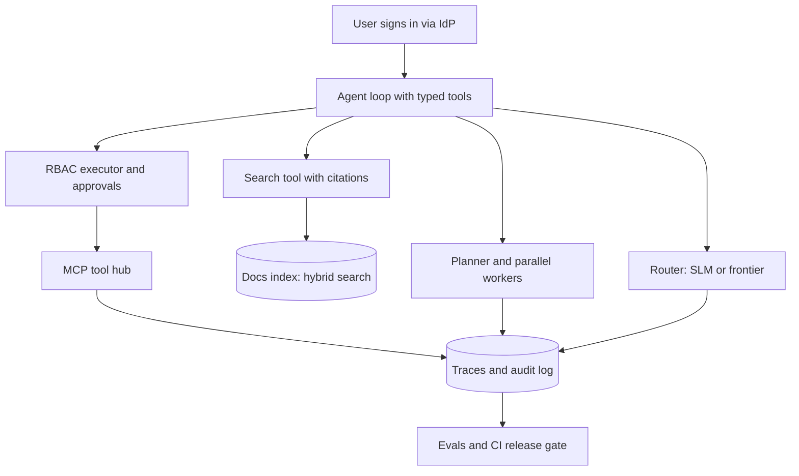

## Overview
This module is six portfolio projects that show a hiring team you can build and operate agents, not
just demo a chatbot. Each lesson describes one system end to end: what it demonstrates, the skills it
combines, what you control, what you can skip, and a first-weekend slice you can finish in 2-3 hours.

The projects share one backbone: a bounded tool-calling loop, typed tools, evals in CI, traces in
production and security controls. Each one pushes a different part of that backbone to production
grade, so together they cover the full lifecycle an agent team owns.

What this module gives an agent builder:
- **Six proof-of-skill projects.** Support agent, agentic RAG platform, multi-agent research system, self-hosted SLM agent, enterprise agent with SSO and RBAC, and an MCP tool hub.
- **A scoped first slice per project.** Each mini project is a 2-3 hour build with a "done when" table you can put in a README.
- **Clear skip lists.** No custom UI frameworks, real payment providers, vector databases, identity providers, pre-training or hand-written protocols, so time goes to the agent and its operations.
- **Numbers to show.** Recall@5, faithfulness, tool accuracy, valid-JSON rate, escalation rate, cost per run and denied-access counts.

Core versus background for agents:
- **Core (all six lessons):** every lesson has `agent_relevance: core` and difficulty advanced, because each is an agent or agent component you ship.
- **Background lives elsewhere:** the related lessons hold the theory, for example `agents/agent-loop`, `agents/multi-agent-patterns`, `agents/model-context-protocol`, `serving-inference/engines` and `system-design/workflow-orchestration`.

What you can build afterwards:
- A support agent with typed tools, an approval-gated refund, human handoff, an eval set in CI, traces, SLOs and a rollback plan.
- A retrieval platform where every claim is cited and recall, faithfulness and citation correctness gate releases.
- Agent infrastructure others depend on: a remote MCP server with OAuth, per-user permissions and usage metrics.
- A cheaper agent: a LoRA-tuned SLM served with vLLM behind an OpenAI-compatible API, with a router that escalates hard turns.

## Why it matters
- **Engineer:** You build the parts reviewers look for in a working agent: typed tool contracts, a bounded loop, server-side identity scoping, approval gates, hybrid search with citations, LoRA fine-tuning on your own traces, and eval harnesses whose numbers you can defend line by line.
- **Architect:** You make the decisions that separate an operated system from a demo: when to fan out to parallel worker agents, when a small model plus a router beats a frontier model, how user identity reaches each tool, which actions need approval, and which eval thresholds block a release.
- **FDE:** You arrive with working references for the questions customers ask first: "who can make the agent do what, and can we prove it", "why did it answer that", and "what does it cost per ticket", and you can stand up a narrow slice on their data within days.

## Mental model
Picture one operated agent. A user signs in, the agent runs a bounded loop over tools, retrieves
evidence, may delegate to workers or a cheaper model, and every step is traced, audited and scored.
Each portfolio project hardens one layer of that picture.

| Layer of the agent system | Project that proves it |
|---|---|
| Bounded loop, typed tools, approval, handoff | production-support-agent-end-to-end |
| Retrieval, citations, evals and tracing | agentic-rag-platform-with-evals-and-observability |
| Orchestration, fan-out budgets, trajectory evals | multi-agent-research-and-report-system |
| Model cost: SLM, LoRA, serving, routing | self-hosted-slm-agent-with-fine-tuning-and-routing |
| Identity, RBAC, delegated access, audit | enterprise-agent-with-sso-rbac-tools-and-audit-logs |
| Shared tools for many hosts over MCP | mcp-tool-hub-for-a-team |

- **The model is swappable; the decisions are the project.** Tool contracts, escalation policy, eval sets and SLOs are what a reviewer judges.
- **Measure before you add.** Every first slice produces a comparison table (two retrieval setups, fan-out versus one agent, SLM versus frontier) before more features go in.
- **Security is enforced in code.** Customer ids are injected server-side, roles gate tools in the executor, and the audit chain verifies with a script.

The loop sits in the support project, search in the RAG platform, workers in the research system, the
router in the SLM project, the executor and audit log in the enterprise project, and the hub in the MCP
project.

## Suggested order
1. production-support-agent-end-to-end — the base every other project builds on: a bounded loop, typed tools, identity scoping, approval-gated refunds, handoff, evals and traces.
2. agentic-rag-platform-with-evals-and-observability — turns the support agent's knowledge search into a measured subsystem with hybrid search, citations, faithfulness evals and a CI gate.
3. mcp-tool-hub-for-a-team — moves the tools you wrote into a shared remote MCP server with OAuth, per-user permissions, contract tests and metrics.
4. enterprise-agent-with-sso-rbac-tools-and-audit-logs — adds OIDC sign-in, the role-to-tool matrix, delegated downstream access and a tamper-evident audit log.
5. multi-agent-research-and-report-system — orchestration once single agents are solid: planner, parallel workers, writer and critic, with fan-out justified against one agent.
6. self-hosted-slm-agent-with-fine-tuning-and-routing — last, because it needs traces from earlier agents to fine-tune on and an eval harness to prove the SLM meets the bar.

## Capstone
### Brief
**Use case:** a mid-size software company wants one internal support and knowledge agent that staff
trust and security approves. This is the module's major project (one to two weeks): an operated agent
that combines most of the six lessons.

Staff sign in through the company IdP. The agent answers from internal docs with cited claims, reads
order and account data through typed tools, and takes refunds only behind an approval gate. Tools live
in a team MCP server, so other hosts can reuse them.

Hard or wide questions go to a planner with parallel workers. Narrow steps such as triage and tool
routing run on a LoRA-tuned SLM, escalating to a frontier model when validation fails.

What you will build:
- **Identity and access:** OIDC sign-in, roles mapped from IdP groups, an RBAC executor and a hash-chained audit log.
- **Tools:** a Streamable HTTP MCP server with `get_order`, `search_kb`, a refund tool behind approval, and `escalate`.
- **Retrieval:** hybrid search (vector plus BM25) over 50-100 pages, with citations checked against chunk ids.
- **Cost:** a vLLM or Ollama-served SLM behind an OpenAI-compatible API and a validation-based router.
- **Operations:** traces in Langfuse or LangSmith, an eval set in CI and written SLOs with a rollback plan.

### Deliverables
- A running agent service plus the MCP server, with typed tool contracts, server-side identity injection, approval-gated refunds and handoff to a human queue.
- An eval suite in CI: recall@5 for search, faithfulness and citation correctness, tool accuracy, at least 3 identity attacks and 10 role-escalation prompts, with thresholds that block a merge.
- A results table comparing frontier only, SLM only and routed, on tool accuracy, valid-JSON rate, escalation rate and cost per run.
- A multi-agent versus single-agent comparison on 5 wide questions with tokens, time and a 1-5 judge score.
- A README with an architecture diagram, threat model, SLOs, the audit verification script and a rollback plan.

### Rubric
- Every role-escalation and cross-customer attempt is denied and logged, and editing one audit row makes verification fail.
- No refund executes without an approval record, and the trace for every write shows the gate decision.
- Every cited claim maps to a retrieved chunk id, and a failing eval threshold visibly blocks a CI run.
- The routed setup is within the quality bar you set against the frontier model while cutting cost, with numbers in the table.
- Two MCP hosts list and call the same tools, and per-tool usage metrics are visible.
- The design note keeps multi-agent fan-out only where it beat the single agent on your questions.
