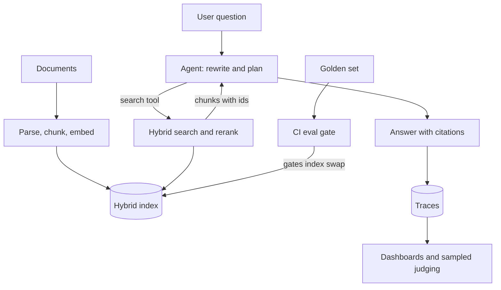

## TL;DR
A document-question platform where an agent decides when and how to search, cites every claim, and is
measured end to end: retrieval recall, faithfulness and citation correctness in CI, plus traced latency
and cost in production.

## For agent builders
- **What it demonstrates to a hiring team.** That you treat retrieval as a measurable subsystem, not a
  magic box: an ingestion pipeline, hybrid search, an agent that searches iteratively, and dashboards
  that explain every bad answer.
- **Skills it combines.** Agentic RAG, chunking and hybrid search, reranking, citation grounding,
  retrieval and faithfulness evals, tracing (`observability/langfuse` or LangSmith), and eval gates in CI.
- **What you control.** Chunking, the index, the search tool's contract, the citation format, the eval
  sets and the thresholds that block a release.
- **What you can skip.** Training embedding models and building a vector database. Use an existing
  embedding API and Postgres with pgvector, or a hosted vector store.

## Decision case
### Scenario
A 3,000-person company runs this platform as its internal knowledge assistant and must choose how much
agentic search to run per question. All figures are illustrative results from the team's own golden set
(grown to 200 questions), not benchmarks.
- **Traffic:** 20,000 questions a month; 70% are simple lookups, 30% are multi-part or vague.
- **Quality bar:** 80%+ of golden questions answered correctly with valid citations (or a correct "not
  found").
- **Latency:** p95 under 6 s for simple lookups; multi-part questions may take up to 15 s if progress
  is streamed.
- **Budget:** $500 a month for model and rerank calls.
- **Measured per configuration:** single-shot hybrid search costs about $0.01 an answer, the agent loop
  (up to 4 searches) about $0.03, a decomposition call plus parallel searches about $0.015, and a small
  router classifier $0.001 and 90% accuracy on labelled questions.

### Options
| Option | How it works | Quality (simple, multi-part, overall) | Cost a month | p95 simple / multi-part |
|---|---|---|---|---|
| Single-shot | One hybrid search and rerank, then answer | 82%, 55%, 73.9% | $200 | 3 s / 3 s |
| Always agentic | Every question goes through the search loop | 86%, 80%, 84.2% | $600 | 5 s / 11 s |
| Routed | Classifier sends simple questions to single-shot, the rest to the loop | 80.9% overall | $356 | about 5 s / 11 s |
| Decompose once | One call splits the question, searches run in parallel, no loop | 84%, 65%, 78.3% | $300 | 4 s / 4 s |

Routed quality: 63% of traffic is simple and routed right (82%), 7% simple sent to the loop (86%), 27%
multi-part routed right (80%) and 3% multi-part sent to single-shot (55%), giving 80.9%. Its cost per
answer is 0.34 x $0.03 + 0.66 x $0.01 + $0.001 = $0.0178.

Routed latency: its simple-lookup p95 is about 5 s, not 3 s. 10% of simple lookups (7 of 70) are misrouted to the loop, more than the slowest 5%, so they set the p95.

### Decision
**Route: single-shot for simple lookups, the agent loop for multi-part questions.** It is the only option
that clears the 80% bar inside the $500 budget and both latency limits.
- **Always agentic is best on quality** (84.2%) but costs $600, over budget, and spends the loop on
  questions one search already answers.
- **Single-shot and decompose-once are cheap and fast,** but miss the quality bar because multi-part
  questions need a search that depends on what the first one found.
- **The router is evaluated like any component:** its confusion matrix on labelled traces goes on the
  dashboard next to recall@5 and faithfulness.

**What would change it.** At $0.03 an answer, always agentic fits $500 below about 16,700 questions a
month, or if the budget rises to $600; it then wins by 3.3 points. If multi-part traffic grows, recompute:
routed cost rises toward always agentic, and the router's value falls.

### Trade-offs accepted
- **Misrouted multi-part questions get weak answers.** About 3% of traffic hits single-shot at 55%. Watch
  thumbs-down and "not found" rates on single-shot answers, and add those traces to router training data.
- **One more component to break.** A router regression degrades quality silently. Run the router's
  labelled set in CI and alert when its predicted multi-part share moves by more than a few points.
- **The margin is small.** 80.9% against an 80% bar is about 2 questions on 200. Re-run the decision when
  the golden set grows, and treat a drop below the bar as a release blocker.

### Review rubric
- **Quality per traffic segment:** the write-up measures each option on simple and hard questions
  separately and weights by the real traffic mix.
- **Cost recomputed from unit costs:** monthly cost is derived from per-answer cost and volume, including
  the router's own cost.
- **Latency per segment:** p95 limits are checked per question type, not as one blended number.
- **Router error counted:** misrouting is included in the quality estimate, not assumed away.
- **Statistical humility:** the write-up states the golden-set size and whether the margin is larger than
  a few questions.
- **Change triggers stated:** volume, budget or traffic-mix thresholds that would flip the choice.

## Why it exists
- **Single-shot RAG fails on real questions.** Multi-part or vague questions need query rewriting,
  several searches and a decision to stop; one top-k lookup misses half the evidence.
- **Most RAG bugs are retrieval bugs.** When the right chunk never reaches the model, prompt tweaks
  cannot help, so you need recall@k measured separately from answer quality.
- **Ungrounded answers erode trust.** Users and auditors need citations that actually support the claim,
  which means checking citation correctness, not just their presence.
- **Platforms outlive demos.** Documents change, models change and prompts change; without evals in CI
  and traces in production, quality drifts silently.

## How it works
### Architecture
1. **Ingestion.** Parse documents, chunk with overlap, attach metadata (source, section, updated_at,
   access group), embed, and upsert into a hybrid index (vector plus keyword).
2. **Search tool.** `search(query, filters, k)` runs hybrid retrieval, reranks, and returns chunks with
   stable ids, so citations point to something real.
3. **Agent loop.** The model rewrites or decomposes the question, calls `search` one or more times, and
   answers only from returned chunks with `[chunk_id]` citations, or says it cannot find the answer.
4. **Eval suite.** A golden set of questions with the chunk ids that answer them, scored offline for
   retrieval and answer quality.
5. **Observability.** One trace per question: rewrite, each search with its returned ids, rerank scores,
   the answer, tokens and cost.

### Phased plan with acceptance criteria
| Phase | Scope | Acceptance criteria |
|---|---|---|
| MVP (week 1) | Ingest 200+ docs, vector search tool, cited answers, 60-question golden set | recall@5 measured, every answer has citations or an explicit "not found" |
| Hardening (week 2) | Hybrid search, reranker, query rewriting, unanswerable cases | recall@5 up by a measured amount over the MVP, faithfulness and citation scores tracked |
| Production (week 3) | Traces, dashboards, CI eval gate, re-index job, feedback capture | CI blocks a change that drops recall or faithfulness, a dashboard shows p95 latency and cost per answer |

### Design choices and their reasons
- **Chunk ids in the contract.** The answer cites ids that the eval can verify, because free-text
  citations cannot be scored automatically.
- **Retrieval and generation scored apart.** A low score then points at the index or at the prompt,
  instead of leaving you to guess between them.
- **"Not found" is a correct answer.** Unanswerable cases in the golden set stop the agent from being
  rewarded for confident guessing.

## Diagram
Read it as two loops: the online loop (the agent searches until it has evidence, and every step lands
in traces) and the offline loop (ingest, golden set, and a CI gate that must pass before an index or
prompt change ships).



## Examples
### Core skeleton: retrieval eval plus a traced search tool
The search function is yours (pgvector, a hosted store or BM25); the harness only needs it to return
chunk ids. Tracing uses the OpenTelemetry API, which Langfuse, LangSmith and Phoenix can ingest; check
each tool's current docs for exporter setup.

```python
from opentelemetry import trace

tracer = trace.get_tracer("rag-platform")

def search(query: str, k: int = 5) -> list[dict]:
    """Your hybrid search + rerank. Returns [{'id': ..., 'text': ..., 'score': ...}]."""
    raise NotImplementedError

def traced_search(query: str, k: int = 5) -> list[dict]:
    with tracer.start_as_current_span("search") as span:
        span.set_attribute("rag.query", query)
        hits = search(query, k)
        span.set_attribute("rag.hit_ids", [h["id"] for h in hits])
        return hits

GOLDEN = [  # question -> chunk ids that contain the answer; [] means unanswerable
    {"q": "What is the refund window for annual plans?", "gold": ["billing-04#2"]},
    {"q": "Does the API support SAML?", "gold": ["sso-01#1", "sso-01#3"]},
    {"q": "What is the CEO's home address?", "gold": []},
]

def recall_at_k(k: int = 5) -> float:
    scored = [c for c in GOLDEN if c["gold"]]
    hits = sum(any(h["id"] in c["gold"] for h in traced_search(c["q"], k)) for c in scored)
    return hits / len(scored)

def citation_ok(answer_ids: list[str], retrieved_ids: list[str]) -> bool:
    return bool(answer_ids) and set(answer_ids) <= set(retrieved_ids)  # no citing unseen chunks

if __name__ == "__main__":
    r = recall_at_k()
    print(f"recall@5 = {r:.2f}")
    assert r >= 0.80, "retrieval regression: block the release"
```

### Evals and SLOs to hit
Targets are illustrative; set them from your MVP baseline and raise them as the system improves.

| Metric | How it is measured | Target |
|---|---|---|
| Retrieval recall@5 | Golden chunk in top 5 results | 0.85+ |
| Faithfulness | Judge checks each claim is supported by cited chunks | 0.90+ |
| Citation correctness | Cited ids were retrieved and support the sentence | 0.95+ |
| Unanswerable handling | "Not found" on questions with no gold chunk | 0.90+ |
| p95 answer latency | Trace duration including all searches | under 6 s |
| Cost per answer | Summed token and rerank cost from traces | tracked per release |
| Index freshness | Time from document update to searchable | under 1 hour |

## Production patterns
- **Two-tier eval in CI.** Run cheap retrieval metrics (recall@k, MRR) on every change and the judged
  metrics (faithfulness, citation support) on prompt, model or index changes; fail on a drop beyond a set
  tolerance, for example 2 points. Monitor judge agreement with a small human-labelled sample.
- **Trace with retrieval detail.** Record query rewrites, returned chunk ids, rerank scores and the final
  citations on every trace, so any bad answer can be classified as a retrieval miss or a generation
  error. Langfuse, LangSmith and Phoenix all support this.
- **Version the index like code.** Tag each index build with chunker, embedding model and parameters;
  run the golden set against a new build before swapping an alias to it, and keep the old one for
  rollback.
- **Feed failures back into the golden set.** Sample low-scored and thumbs-down traces weekly, label
  them, and add them to the eval set, so the suite tracks real traffic.
- **Cache and cap.** Cache embeddings for repeated queries, cap searches per question (for example 4),
  and alert on questions that hit the cap.
- **Access filters at query time.** Apply the user's access groups as metadata filters inside the search
  tool, because a model cannot be trusted to ignore chunks it was shown.

## Trade-offs
- **Agentic vs single-shot retrieval.** Iterative search answers harder questions but adds latency and
  cost per step; route simple lookups to one search and reserve the loop for complex ones.
- **Reranker quality vs latency.** A cross-encoder or hosted reranker usually lifts precision but adds a
  call per query; keep it when recall@5 gains justify the extra milliseconds.
- **LLM judges vs human labels.** Judges scale and run in CI but drift and carry bias; calibrate against
  a human-labelled slice and re-check when the judge model changes.
- **Big chunks vs small chunks.** Larger chunks carry context but dilute ranking; smaller ones rank
  sharply but need parent-document expansion.

## Pitfalls
- **No golden set until week three.** Symptom: every change "feels better" and nobody can prove it. Fix:
  write 30-60 questions with gold chunk ids on day one.
- **Scoring only the final answer.** Symptom: you tune prompts while the real problem is chunking. Fix:
  report recall@k next to faithfulness on every run.
- **Citations that are never checked.** Symptom: confident answers citing irrelevant chunks. Fix:
  verify cited ids were retrieved and run a support judge per cited sentence.
- **Stalling on infrastructure.** Projects stall comparing vector databases. Fix: pick Postgres with
  pgvector or one hosted store, and spend the time on evals and traces.

## When to use
- **Prerequisites:** chunking and hybrid search, embeddings, an eval harness, one tracing tool, and
  comfort writing a small ingestion job.
- **Use when:** you are targeting roles building knowledge assistants, search, or internal copilots,
  which is a large share of applied agent work.
- **Avoid when:** your other portfolio project is already a RAG chatbot; show breadth with the
  multi-agent or SLM project instead.
- **Measure:** recall@k, faithfulness, citation correctness, unanswerable handling, p95 latency, cost per
  answer and index freshness.

## Role lens
- **Engineer:** Builds the ingestion job, hybrid search tool, citation format, eval harness and CI gate,
  and can classify any bad answer from its trace.
- **Architect:** Decides index versioning, access filtering, the agentic-versus-single-shot routing rule,
  and the metrics that gate releases.
- **FDE:** Gets subject-matter experts to write and review the golden set, and explains recall versus
  faithfulness scores to customer stakeholders.

## Check yourself
**Q:** After switching embedding models, faithfulness stays at 0.92 but users report more "not found"
answers. What is happening and how do you confirm it?
**A:** Faithfulness measures whether answers are supported by what was retrieved, so it can stay high
while retrieval gets worse: the agent correctly says "not found" because the right chunks no longer reach
it. Confirm by comparing recall@k on the golden set between the old and new index builds, and by
inspecting traces of "not found" answers for missing gold chunks. Likely causes are a chunker or
normalization mismatch, or a model weaker on your domain. Roll the alias back to the old index, fix or
reject the new build, and add the failing questions to the golden set.

## Interview questions
### Why did you make retrieval agentic instead of a single top-k lookup?
- **Real questions are multi-part.** Comparisons and "what changed between" questions need several
  targeted searches, and vague questions need rewriting first.
- **But I routed.** Simple lookups still take one search, because the loop adds latency and cost that
  most questions do not need; traces showed the split.

### How do you know whether a bad answer is a retrieval or a generation problem?
- **Check the trace.** If no gold chunk was retrieved, it is retrieval: chunking, filters, embeddings or
  query rewriting.
- **If the evidence was there.** Then it is generation: the prompt, the model or context ordering. The
  eval suite reports recall and faithfulness separately for exactly this reason.

### How did you build and maintain the golden set?
- **Start small and real.** 60 questions from real user queries or SMEs, each with gold chunk ids and
  some unanswerable cases.
- **Grow from production.** Low-scored and thumbs-down traces are labelled weekly and added, and the set
  is versioned with the index so scores remain comparable.

### What does your CI gate check and what does it cost to run?
- **Cheap checks always.** Recall@k and MRR run on every pull request in seconds.
- **Judged checks selectively.** Faithfulness and citation judges run on prompt, model or index changes,
  costing a few dollars per run at this size (an illustrative order of magnitude).

### How would you stop the agent from showing a user documents they should not see?
- **Filter inside the tool.** The search tool applies the caller's access groups as metadata filters, so
  restricted chunks never enter the context.
- **Test it.** Eval cases run as different users and assert that restricted chunk ids never appear in
  retrieval or citations.

## Quiz
### Q: Faithfulness is high but recall@5 dropped after an index change. What does that most likely mean?
- [ ] The model started hallucinating
- [x] Answers are still grounded in what was retrieved, but the right chunks are retrieved less often
- [ ] The judge model is broken
- [ ] Latency increased
> Faithfulness checks support from retrieved context, so it can stay high while retrieval misses more
> gold chunks; recall@k isolates that regression to the index, chunker or embedding change.

### Q: Why should answers cite stable chunk ids rather than free-text source names?
- [ ] Ids use fewer tokens
- [ ] Users prefer ids
- [x] Ids can be checked automatically against what was retrieved and against gold labels
- [ ] Vector databases require ids in prompts
> Stable ids make citation correctness measurable in CI: the harness verifies that cited chunks were
> retrieved and that they support the claim, which free-text names do not allow.

### Q: Where should document access control be enforced in an agentic RAG system?
- [ ] In the system prompt
- [ ] In the answer post-processor
- [x] As metadata filters inside the search tool, before chunks reach the model
- [ ] In the embedding model
> Once a restricted chunk is in the context it can leak into the answer; filtering in the search tool by
> the caller's groups means the model never sees what the user is not allowed to read.

## Use cases & projects
### Use cases
- **Internal knowledge assistant.** Policies, runbooks and wikis with citations employees can verify.
- **Customer-facing docs search.** Product documentation answers that say "not found" rather than guess.
- **Compliance and legal lookup.** Clause-level citations reviewed by auditors.
- **Engineering support copilot.** Search over tickets, incidents and design docs with access filters.

### Mini project
**First-weekend slice: evaluate the search tool your agent will call (2-3 hours).**
- **Goal:** get a trustworthy recall@5 number for the agent's `search` tool on your own documents before
  writing the agent prompt, because a weak tool caps every answer the agent gives.
- **Steps:** chunk 50-100 pages of public docs; embed them into pgvector or an in-memory index; wrap
  retrieval as a `search(query, k)` function with a tool schema that returns chunk ids; write 30
  questions with gold chunk ids plus 5 unanswerable ones; compute recall@5 for vector-only, then add BM25
  and compare.
- **Variants to grow into:** wrap search as a tool for an agent, add citations and a faithfulness
  judge, then traces and the CI gate.
- **Done when:** you have a table of recall@5 for two retrieval setups and a short note on which
  questions each one missed and why.
