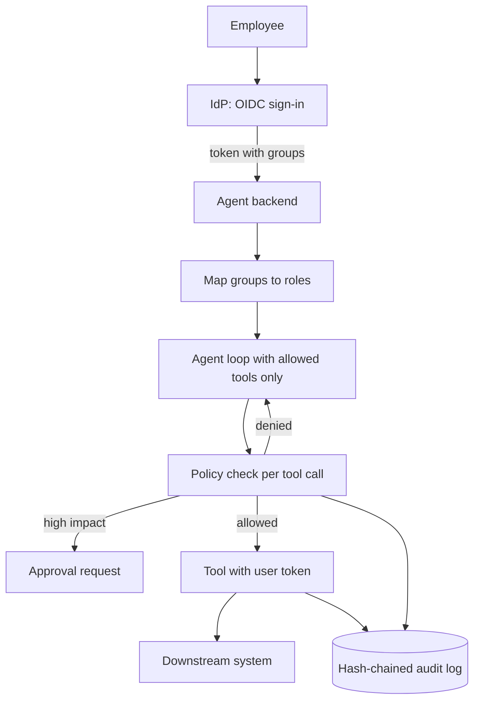

## TL;DR
An internal agent that signs users in through the company identity provider, lets each user call only
the tools their roles allow, acts with that user's delegated access, and writes a tamper-evident audit
log. It proves you can pass an enterprise security review.

## For agent builders
- **What it demonstrates to a hiring team.** That you can put an agent inside real enterprise controls:
  OIDC sign-in, role-based tool access, per-user credentials to downstream systems, approvals and an
  audit trail a security team can query.
- **Skills it combines.** OAuth 2.0 and OIDC, RBAC mapped from IdP groups, least-privilege tools,
  secrets isolation, approval gates, prompt-injection defence and audit logging.
- **What you control.** The role-to-tool matrix, how user identity reaches each tool, which actions need
  approval, what the audit record contains and how long it is kept.
- **What you can skip.** Building an identity provider. Use a free developer tenant of a hosted IdP or a
  local Keycloak, and spend the time on authorization and audit.

## Decision case
### Scenario
A 2,000-employee company is building this internal agent with tools over three systems: an ERP for
invoices, an HR system and an IT ticketing tool. The team must choose how tools authenticate downstream.
Effort figures are illustrative team estimates, not benchmarks.
- **Security review rule:** downstream access must follow the signed-in user's own permissions, and any
  exception must be documented and narrowly scoped.
- **Revocation:** under 15 minutes from IdP group removal to lost tool access (the target above). Group
  sync every 5 minutes plus 5-minute access tokens gives a worst case of 10 minutes.
- **What each system supports:** the ERP accepts tokens issued through IdP token exchange (RFC 8693); the
  HR system supports per-user OAuth consent; the ticketing tool accepts only API keys.
- **Data sensitivity:** HR is highly sensitive, ERP moderately, ticketing holds low-sensitivity IT requests.
- **Deadline:** 15 working days (the 3-week plan), two engineers.

### Options
| Option | How it works | Follows user permissions downstream? | Build effort | Passes review? |
|---|---|---|---|---|
| Shared service account | One super-user key per system, agent-side RBAC only | no | about 2 days | no: one injection reads all HR data |
| Service account plus app-side record filters | Agent re-implements each system's row-level rules | only as far as the copy is correct | about 5 days per system, 15 days | doubtful: rules drift from the source system |
| Delegated tokens everywhere | Token exchange or per-user OAuth for all three | yes | blocked: ticketing has no OAuth | n/a |
| Delegated where supported, scoped exception for ticketing | Token exchange for ERP (3 days), per-user OAuth for HR (4 days), ticketing adapter (2 days) that only creates and reads tickets whose requester is the session user | yes for ERP and HR | 9 days | yes, with a documented exception |

### Decision
**Delegate where the system supports it, and wrap ticketing in a narrowly scoped adapter as a documented
exception.** It satisfies the review rule for the two sensitive systems and fits in 9 of 15 days.
- **ERP and HR keep enforcing their own permissions,** so the agent can never exceed what the user could do
  by hand, and a permission change in HR applies on the next call.
- **The ticketing exception is acceptable** because the data is low sensitivity and the adapter stamps the
  requester from the session server-side and refuses any other ticket. The key lives in the secrets
  manager, never in a prompt.
- **The executor re-check and hash-chained audit log apply to all three,** so the exception is visible to
  auditors.

**What would change it.** If the ticketing tool adds OAuth, migrate the adapter to per-user tokens and
close the exception. If ticketing starts holding HR cases, the exception no longer holds; block that tool
until delegation exists.

### Trade-offs accepted
- **Three auth flows to maintain.** Token exchange, per-user consent and an API key each fail differently.
  Track token-acquisition failures by system and reason on the auth dashboard.
- **Users must consent to HR access once.** Some will stall at the consent screen. Watch first-use drop-off
  for HR tools and add a one-line explanation before the redirect.
- **The ticketing key is broad.** A bug in the adapter could expose other tickets. Cover it with
  adversarial tests that request another user's ticket, and alert on any adapter denial.

### Review rubric
- **Per-system capability mapped:** the write-up lists what each downstream system supports before choosing
  a pattern.
- **Exceptions justified by sensitivity:** any non-delegated path is tied to low data sensitivity and a
  server-side scope check.
- **Revocation computed:** worst-case lag is derived from sync interval and token lifetime and compared
  with the target.
- **Effort fits the deadline:** build estimates per system add up inside the stated time.
- **Audit coverage:** every path, including the exception, writes audit records.
- **Exit criteria stated:** what vendor or data change would close or revoke the exception.

## Why it exists
- **Enterprise buyers ask security questions first.** "Who can make the agent do what, and can we prove
  what it did?" often decides a deal before quality is discussed.
- **A shared service account is the naive fix, and it fails.** The agent then has everyone's access, so
  one injected prompt can read HR data for an intern. Authorization must follow the human user.
- **Prompts cannot enforce permissions.** The model will sometimes call a tool it was told not to use, so
  checks must sit in code between the model and every tool.
- **Auditors need evidence.** Regulated teams must reconstruct who asked, what the agent called, with
  which arguments, and what changed, often years later.

## How it works
### Architecture
1. **Sign-in.** The web app uses OIDC authorization code flow with PKCE against the IdP; the backend
   validates the ID or access token (signature via JWKS, issuer, audience, expiry).
2. **Role mapping.** IdP groups or claims map to application roles (for example `finance-reader`,
   `hr-admin`), kept in config, not in prompts.
3. **Tool registry with permissions.** Each tool declares the permission it needs; the agent is offered
   only tools the user's roles allow, and the executor re-checks on every call.
4. **Delegated access downstream.** Tools call systems with the user's own scoped token (for example via
   token exchange or the downstream system's OAuth) instead of a super-user key.
5. **Approvals.** High-impact tools (payments, deletions, permission changes) create an approval request
   and pause the run.
6. **Audit log.** Every model call and tool call is appended with user, roles, tool, arguments, result
   status, approval id and a hash chaining it to the previous record.

### Phased plan with acceptance criteria
| Phase | Scope | Acceptance criteria |
|---|---|---|
| MVP (week 1) | OIDC sign-in, 2 roles, 4 tools, permission check in executor, audit table | A user without a role cannot call its tools even when the prompt asks, every call has an audit row |
| Hardening (week 2) | Delegated tokens, approvals, injection test suite, PII redaction in logs | 30+ adversarial cases (role escalation, injection via documents) all blocked, approvals pause and resume runs |
| Production (week 3) | Hash-chained audit export, admin query UI or API, SCIM or group sync, alerts, threat model doc | Audit chain verifies end to end, a removed group loses tool access within minutes, threat model reviewed |

### Design choices and their reasons
- **Filter and enforce.** Hiding disallowed tools reduces attempts; re-checking in the executor stops the
  ones that still happen, because the model can hallucinate a tool name.
- **User tokens, not agent tokens.** Downstream systems keep enforcing their own permissions, so the
  agent can never exceed what the user could do by hand.
- **Append-only, hash-chained log.** Editing or deleting a record in the middle breaks the chain, which
  makes tampering detectable.
- **Anchor the head hash elsewhere.** A chain alone cannot reveal a truncated tail or a fully recomputed
  chain, so periodically copy the latest hash to separate append-only storage or the SIEM.

## Diagram
Trace one request from sign-in to audit: identity is established once, every tool call passes the policy
check, and downstream calls carry the user's own token.



## Examples
### Core skeleton: token validation, RBAC tool gate and audit record
Uses PyJWT's JWKS client for signature checks. The issuer, audience and group claim name depend on your
IdP; check its docs.

```python
import hashlib, json, time
import jwt                                    # PyJWT
from jwt import PyJWKClient

ISSUER = "https://idp.example.com/"
AUDIENCE = "agent-api"
jwks = PyJWKClient(ISSUER + ".well-known/jwks.json")   # use the jwks_uri from the IdP's discovery doc

ROLE_MAP = {"grp-finance": {"finance-reader"}, "grp-hr-admins": {"hr-admin"}}
TOOL_PERMS = {"get_invoice": "finance-reader", "list_employees": "hr-admin",
              "change_salary": "hr-admin"}
HIGH_IMPACT = {"change_salary"}
AUDIT, last_hash = [], "genesis"

def authenticate(token: str) -> dict:
    key = jwks.get_signing_key_from_jwt(token).key
    claims = jwt.decode(token, key, algorithms=["RS256"], audience=AUDIENCE, issuer=ISSUER)
    roles = set().union(*(ROLE_MAP.get(g, set()) for g in claims.get("groups", [])))
    return {"sub": claims["sub"], "roles": roles}

def allowed_tools(user: dict) -> list[str]:
    return [t for t, perm in TOOL_PERMS.items() if perm in user["roles"]]   # offer only these

def audit(user, tool, args, status):
    global last_hash
    rec = {"ts": time.time(), "sub": user["sub"], "roles": sorted(user["roles"]),
           "tool": tool, "args": args, "status": status, "prev": last_hash}
    last_hash = hashlib.sha256(json.dumps(rec, sort_keys=True).encode()).hexdigest()
    AUDIT.append({**rec, "hash": last_hash})

def execute(user: dict, tool: str, args: dict, approved: bool = False) -> dict:
    if TOOL_PERMS.get(tool) not in user["roles"]:          # re-check: never trust the model
        audit(user, tool, args, "denied")
        return {"error": "not permitted"}
    if tool in HIGH_IMPACT and not approved:
        audit(user, tool, args, "pending_approval")
        return {"status": "pending_approval"}
    result = {"status": "ok"}   # real version calls the downstream API with the user's own token
    audit(user, tool, args, result["status"])               # record the real outcome, after the call
    return result
```

### Evals and SLOs to hit
Security properties are hard gates; quality and latency targets are illustrative.

| Metric | How it is measured | Target |
|---|---|---|
| Unauthorized tool executions | Adversarial suite: role escalation, injected instructions in documents and tool results | 0 (CI gate) |
| Audit completeness | Tool calls in traces versus audit rows | 100% |
| Audit chain integrity | Recompute hashes over an export | verifies with no breaks |
| Access revocation lag | Remove user from IdP group, time until tools disappear | under 15 minutes |
| Task success for permitted users | Golden tasks per role | 85%+ |
| p95 latency overhead of policy checks | Trace span for authz | under 50 ms |

## Production patterns
- **Validate tokens properly.** Check signature via the IdP's JWKS (cached, with key rotation),
  issuer, audience and expiry on every request; reject `alg: none` by pinning allowed algorithms.
  Monitor validation failures by reason.
- **Centralise policy.** Keep the role-to-tool matrix in one policy module or engine (for example Open
  Policy Agent or Cedar) used by every tool executor, with unit tests per role, so a new tool cannot ship
  without a permission.
- **Delegate, do not impersonate.** Exchange the user's token for a narrowly scoped downstream token, or
  use the downstream system's OAuth consent, and store refresh tokens in a secrets manager scoped per
  user. Never put credentials in the prompt or tool results.
- **Audit as a product.** Write audit records to append-only storage, export them to the SIEM, give
  security an API to query by user, tool and time, and set retention by policy. Alert on denied-call
  bursts, which often signal injection attempts.
- **Sync identity changes.** Use short token lifetimes plus SCIM or group sync so offboarding removes
  tool access quickly; test revocation in staging.
- **Threat model and red-team before launch.** Document assets, trust boundaries and attack paths
  (indirect injection, confused deputy, data exfiltration via tools) and turn each into adversarial eval
  cases.

## Trade-offs
- **Delegated tokens vs simplicity.** Per-user downstream tokens keep least privilege but add token
  exchange, refresh and consent flows; a service account is simpler and fails every serious review.
- **Coarse roles vs fine-grained policy.** A few roles are easy to audit but over-grant; attribute-based
  rules (department, region, record owner) are precise but harder to test and explain.
- **Rich audit records vs privacy.** Full arguments and outputs aid investigations but store sensitive
  data; redact or hash fields and restrict who can read the log.
- **Approvals vs speed.** Approvals stop costly mistakes and slow users; apply them only to actions that
  are high impact or irreversible.

## Pitfalls
- **Permission checks only in the prompt or the tool list.** Symptom: an injected document makes the
  agent call a hidden tool. Fix: re-check permissions in the executor on every call.
- **Logging tokens and secrets.** Symptom: bearer tokens appear in traces or audit rows. Fix: redact
  authorization headers and secret fields before any log write, and test it.
- **Group claims that never refresh.** Symptom: offboarded users keep access for hours. Fix: short-lived
  tokens, group sync and a revocation test.
- **Stalling on IdP configuration.** Projects stall on enterprise SSO setup. Fix: start with a developer
  IdP tenant or local Keycloak and standard OIDC; add SAML or SCIM only as a later variant.

## When to use
- **Prerequisites:** OAuth 2.0 and OIDC basics, RBAC, a web framework with auth middleware, the agent
  loop, and familiarity with prompt-injection risks.
- **Use when:** you are targeting enterprise, B2B SaaS, platform or forward-deployed roles, where security
  reviews decide whether an agent ships.
- **Avoid when:** you have not built a basic tool-using agent yet; this project adds controls around one.
- **Measure:** unauthorized executions (must be zero), audit completeness and integrity, revocation lag,
  task success per role and authorization latency.

## Role lens
- **Engineer:** Implements token validation, the role-to-tool policy, the executor re-check, delegated
  tokens and the hash-chained audit log, with tests per role.
- **Architect:** Defines trust boundaries, chooses delegation over service accounts, and specifies the
  policy engine, approval rules and audit retention.
- **FDE:** Maps the customer's IdP groups to roles, walks their security team through the threat model
  and audit API, and gets sign-off for production.

## Check yourself
**Q:** A security reviewer asks: "If a malicious document tells the agent to call `change_salary`, what
stops it?" Answer for your design.
**A:** Several layers. The tool is only offered to users with the `hr-admin` role, so most users' agents
never see it. If the model still emits the call, the executor re-checks the caller's roles from their
validated token and denies it, logging a `denied` audit record. For permitted users, `change_salary` is
high impact, so it creates an approval request instead of executing. Downstream, the call uses the user's
own scoped token, so the HR system enforces its own permissions too. A burst of denied calls raises an
alert, and the injection case is in the adversarial eval suite that gates every release.

## Interview questions
### Why not give the agent a service account with access to everything it might need?
- **It breaks least privilege.** The agent could do anything any user could, so one injection exposes all
  data to whoever is chatting.
- **It breaks accountability.** Downstream logs show the service account, not the person, which fails
  audit requirements. Delegated per-user tokens fix both.

### Walk me through what happens between the model emitting a tool call and the tool running.
- **Parse and validate arguments** against the tool's schema.
- **Authorize** the caller's roles from the validated token against the tool's required permission, then
  check whether it is high impact and needs approval.
- **Execute with the user's token, then audit** the call, arguments (redacted), outcome and approval id
  in the hash-chained log.

### How would you prove to an auditor that the log was not edited?
- **Hash chaining.** Each record includes the previous record's hash, so changing or deleting one breaks
  every later hash; the head hash is anchored externally so a truncated tail is caught too.
- **Independent storage.** Records are also exported to append-only storage or the SIEM, and a
  verification job recomputes the chain on a schedule.

### How do you handle a user who is removed from a group mid-session?
- **Short-lived tokens.** Access tokens expire in minutes, and refresh re-reads groups from the IdP.
- **Sync and test.** SCIM or group sync updates roles, and I measured revocation lag in staging as an
  acceptance criterion.

### What did your threat model find that you did not expect?
- **Indirect injection through tool results.** Text returned by a search or email tool can instruct the
  agent, so tool outputs are treated as untrusted data and never change permissions.
- **Data exfiltration via allowed tools.** A permitted "send email" tool could leak data, so it is
  limited to internal recipients and requires approval for attachments.

## Quiz
### Q: Where must the final permission check for an agent's tool call happen?
- [ ] In the system prompt that lists allowed tools
- [ ] In the IdP when the user signs in
- [x] In the tool executor, against the caller's validated roles, on every call
- [ ] In the model's fine-tuning data
> Hiding tools reduces attempts, but models can still emit any tool name, especially under injection;
> only a check in code at execution time reliably enforces the policy.

### Q: Why should downstream tools use the user's delegated token rather than a shared service account?
- [ ] Delegated tokens are faster
- [x] The agent can never exceed the user's own access, and downstream logs attribute actions to the real person
- [ ] Service accounts cannot call APIs
- [ ] OIDC forbids service accounts
> Delegation preserves least privilege and accountability: downstream systems enforce their own
> permissions for that user, and their logs record who acted, which audits require.

### Q: What makes a hash-chained audit log tamper-evident?
- [ ] It is encrypted
- [ ] It is stored in a vector database
- [x] Each record includes the previous record's hash, so editing or removing one breaks the chain
- [ ] It is written by the model
> Recomputing the chain over an export exposes a modified or removed record, because every later hash
> would no longer match; encryption alone protects confidentiality, not integrity. Anchoring the latest
> hash in separate storage also catches records cut from the end.

## Use cases & projects
### Use cases
- **HR and finance assistants.** Employees query their own data; admins act behind approvals.
- **IT operations agents.** Access requests and account changes with per-user rights and full audit.
- **Sales and CRM copilots.** Reps see only their accounts; managers see their teams.
- **Customer-deployed agents.** FDE teams install an agent into a client's tenant using the client's IdP.

### Mini project
**First-weekend slice: two roles, three tools, one audit chain (2-3 hours).**
- **Goal:** prove that the agent cannot exceed a user's role, even when told to.
- **Steps:** set up a free IdP developer tenant or local Keycloak with two groups; validate tokens in a
  FastAPI backend; implement the RBAC executor and hash-chained audit from the skeleton; write 10 prompts
  where a low-privilege user asks for, or a document instructs, a high-privilege tool.
- **Variants to grow into:** delegated downstream tokens, approvals, SIEM export, SCIM sync and a
  written threat model.
- **Done when:** all 10 attempts are denied and logged, the audit chain verifies with a small script, and
  editing one row makes verification fail.
