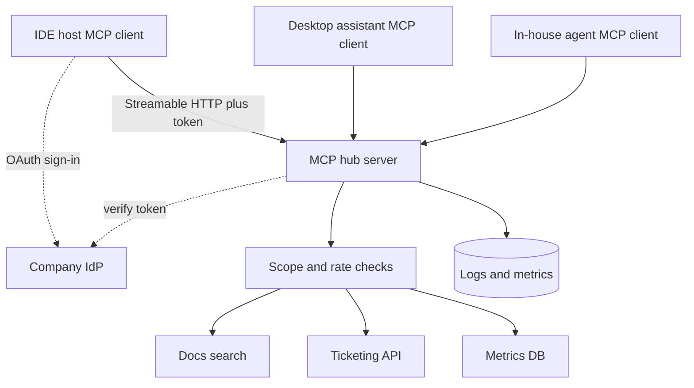

## TL;DR
A remote MCP server (or gateway) that gives a team's agents shared, well-designed tools and resources
over Streamable HTTP, with OAuth-based authorization, per-user permissions, tests and usage metrics. It
proves you can build agent infrastructure others depend on.

## For agent builders
- **What it demonstrates to a hiring team.** Platform thinking: one set of tools that every MCP host the
  team uses (desktop assistants, IDEs, in-house agents) can connect to, designed for model use, secured
  for remote access and operated with metrics.
- **Skills it combines.** MCP architecture (`agents/model-context-protocol`), server primitives (tools,
  resources, prompts), transports, OAuth for remote servers
  (`agents/mcp-authentication-authorization-transport-security`), the Python or TypeScript SDK, tool
  design for agents, testing and deployment.
- **What you control.** Which tools exist and how they are named and described, their input schemas and
  annotations, authorization scopes, rate limits, and what gets logged.
- **What you can skip.** Writing the protocol by hand. The official SDKs handle JSON-RPC, capability
  negotiation and transports; spend your time on tool design and security.

## Decision case
### Scenario
An engineering org of 80 people uses three MCP hosts (an IDE, a desktop assistant and an in-house agent)
and wants shared tools for docs, ticketing, GitHub and the metrics database. A two-person platform team
must choose the hub topology. Incident hours are illustrative, from last quarter's logs, not benchmarks.
- **Security rule:** no long-lived downstream credentials on laptops; offboarding must cut access centrally.
- **Availability:** 99.5%+ a month for the docs, ticketing and GitHub tools (the target in the evals table below).
- **Known risk:** the metrics database has slow-query incidents about 4 hours a month; in a shared process,
  those calls hold workers and stall every tool.
- **Operations capacity:** the team can run and be on call for about 3 deployments.
- **Deadline:** the 3-week phased plan below.

### Options
| Option | How it works | Credentials on laptops | Deployments | Availability of stable tools |
|---|---|---|---|---|
| Local stdio servers | Each engineer runs the 4 servers locally | 80 x 4 = 320 long-lived tokens | 0, but 80 machines to upgrade | per laptop, unmeasured |
| One remote hub | All tools in one Streamable HTTP server | none | 1 | 1 - 4 / 730 = 99.45%, under target |
| Gateway plus one server per integration | Gateway routes to 4 separate servers | none | 5, over capacity | isolated from metrics incidents |
| Gateway plus 2 servers | Stable tools in one hub, metrics DB in its own server behind the gateway | none | 3 | isolated from metrics incidents |

### Decision
**A gateway in front of two servers: one hub for docs, ticketing and GitHub, and a separate server for the
metrics database.** Isolation follows the measured risk, not the number of integrations.
- **Stdio fails the security rule:** 320 long-lived tokens on laptops, and offboarding means chasing every
  machine.
- **One hub misses availability:** the metrics incidents alone take it to 99.45%, before any other outage.
- **One server per integration isolates everything** but needs 5 deployments, more than two people can
  operate. Docs, ticketing and GitHub have no history of incidents, so splitting them buys little.
- **Hosts see one URL and one OAuth flow** through the gateway, so the split stays invisible to users.

**What would change it.** If another integration shows its own incident pattern, move it behind the
gateway as a separate server, which is the reason for having the gateway. If the metrics database gets
query timeouts and its incidents stop, fold it back into the hub to save a deployment.

### Trade-offs accepted
- **The gateway is a new single point of failure.** Run two replicas behind a health check, and track
  gateway availability separately from each server's.
- **Shared failure inside the main hub.** A bug in the ticketing tool can still affect docs and GitHub.
  Watch per-tool error rate and p95, and split any tool whose errors spill over.
- **Metrics tools are still down 4 hours a month.** Return clear errors that tell the agent the tool is
  unavailable, and alert on the metrics server separately.

### Review rubric
- **Security constraint checked first:** credential locations and offboarding are compared for each
  topology before availability or effort.
- **Availability computed from incident data:** the write-up turns measured incident hours into a monthly
  percentage per topology.
- **Isolation tied to risk:** components are split where incidents or sensitivity justify it, not by
  default.
- **Operations capacity respected:** the number of deployments fits the team that runs them.
- **Change triggers stated:** which new incident pattern or fix would split or merge servers.

## Why it exists
- **Every agent re-implements the same integrations.** Without a hub, each team writes its own Jira,
  GitHub, database and docs wrappers, each with different bugs and permissions.
- **MCP standardises the interface.** A host's MCP client connects to any compliant server and discovers
  its tools, resources and prompts, so one server works across many hosts.
- **Local stdio servers do not scale to a team.** Each laptop runs its own copy with its own long-lived
  credentials; a remote server with OAuth centralises access, updates and audit.
- **Badly designed tools waste the model's context.** Dozens of thin API-mirroring tools confuse tool
  selection; a hub is the place to design fewer, task-shaped tools with clear descriptions.

## How it works
### MCP concepts the hub uses
- **Hosts, clients, servers.** The host (an IDE, desktop app or your agent) runs one MCP client per server
  connection; your hub is a server.
- **Server primitives.** Tools (model-invoked actions with JSON Schema inputs), resources (readable data
  addressed by URI) and prompts (user-invoked templates).
- **Client primitives.** Sampling (server asks the host's model for a completion), roots (host tells the
  server which locations are in scope) and elicitation (server asks the user for input, added in the
  2025-06-18 spec revision).
- **Transports.** stdio for local subprocesses and Streamable HTTP for remote servers (Streamable HTTP
  replaced the older HTTP+SSE transport in the 2025-03-26 revision).
- **Authorization.** Remote servers use OAuth 2.1-based authorization; in the 2025-06-18 revision the MCP
  server acts as an OAuth resource server and publishes Protected Resource Metadata (RFC 9728). Check the
  current spec, because this area has changed between revisions.

### Architecture
1. **Hub server.** One Streamable HTTP endpoint built with the Python or TypeScript SDK, or a gateway that
   fronts several internal MCP servers under one URL.
2. **Tool modules.** 6-12 task-shaped tools (for example `search_docs`, `get_ticket`, `create_ticket`,
   `query_metrics`), each with a precise description, a tight schema and annotations such as read-only or
   destructive hints.
3. **Resources.** Team runbooks and schema docs exposed as resources, so hosts can attach them as context.
4. **Auth layer.** An OAuth authorization server (the company IdP) issues tokens for the hub; the hub
   validates audience and scopes per request, and calls downstream APIs with per-user credentials.
5. **Operations.** Per-tool metrics, structured logs, rate limits and a contract test suite run in CI.

### Phased plan with acceptance criteria
| Phase | Scope | Acceptance criteria |
|---|---|---|
| MVP (week 1) | 4 tools and 2 resources over stdio, then Streamable HTTP, MCP Inspector checks | Tools listed and callable from two different hosts, schemas validate, errors return useful messages |
| Hardening (week 2) | OAuth authorization, per-scope tool access, input validation, rate limits, injection tests | Unauthenticated requests rejected, a read-only scope cannot call write tools, adversarial cases pass |
| Production (week 3) | Container deploy, health checks, metrics per tool, contract tests in CI, versioning policy | Dashboards show calls, errors and p95 per tool, CI fails on a breaking schema change |

## Diagram
Look at the boundary: each host's MCP client gets a token from the IdP (shown for one client), every tool
call carries it to the hub, and the hub verifies it and checks scopes before touching downstream systems.



## Examples
### Core skeleton: a hub server with the Python SDK
Uses `FastMCP` from the official Python SDK 1.x (`pip install "mcp<2"`). In SDK 2.x it is renamed:
`from mcp.server.mcpserver import MCPServer`, and the rest of this skeleton works unchanged.
Authorization wiring differs across SDK versions, so check the docs; the tools show the design, not the
auth plumbing.

```python
from mcp.server.fastmcp import FastMCP
from mcp.types import ToolAnnotations

mcp = FastMCP("team-hub")
READ_ONLY = ToolAnnotations(readOnlyHint=True)   # a hint for hosts; permissions are enforced server-side

TICKETS = {"OPS-1": {"title": "Disk full on db-2", "status": "open"}}

@mcp.tool(annotations=READ_ONLY)
def search_docs(query: str, limit: int = 5) -> list[dict]:
    """Search team runbooks and design docs. Returns title, url and a short snippet per hit.
    Use this before answering any question about internal systems."""
    return [{"title": "DB disk runbook", "url": "https://wiki.internal/db-disk", "snippet": "..."}][:limit]

@mcp.tool(annotations=READ_ONLY)
def get_ticket(ticket_id: str) -> dict:
    """Get one ticket by id, for example OPS-1. Returns title and status, or an error."""
    return TICKETS.get(ticket_id, {"error": f"ticket {ticket_id} not found"})

@mcp.tool(annotations=ToolAnnotations(readOnlyHint=False, destructiveHint=False))
def create_ticket(title: str, severity: int) -> dict:
    """Create an ops ticket. severity is 1 (critical) to 4 (low). Confirm with the user first."""
    if not 1 <= severity <= 4:
        return {"error": "severity must be 1-4"}
    tid = f"OPS-{len(TICKETS) + 1}"
    TICKETS[tid] = {"title": title, "status": "open", "severity": severity}
    return {"ticket_id": tid}

@mcp.resource("runbook://oncall")
def oncall_runbook() -> str:
    """The current on-call runbook."""
    return "1. Acknowledge the page. 2. Check the dashboard. 3. Open a ticket."

if __name__ == "__main__":
    mcp.run(transport="streamable-http")   # use "stdio" for local testing with a desktop host
```

### Contract test: call the hub as a client
A CI test connects over Streamable HTTP (the server's default is port 8000, path `/mcp`), lists tools
and calls one. This is the recent 1.x client; older 1.x releases call it `streamablehttp_client`, and in
2.x it yields `(read, write)` without the third value.

```python
import asyncio
from mcp import ClientSession
from mcp.client.streamable_http import streamable_http_client

async def main():
    async with streamable_http_client("http://localhost:8000/mcp") as (read, write, _):
        async with ClientSession(read, write) as session:
            await session.initialize()
            tools = {t.name for t in (await session.list_tools()).tools}
            assert {"search_docs", "get_ticket", "create_ticket"} <= tools
            result = await session.call_tool("get_ticket", {"ticket_id": "OPS-1"})
            print(result.content)

asyncio.run(main())
```

### Evals and SLOs to hit
Targets are illustrative; tool-selection accuracy is measured by running a real agent against the hub.

| Metric | How it is measured | Target |
|---|---|---|
| Tool-selection accuracy | 50 task prompts through an agent connected to the hub, correct tool chosen | 90%+ |
| Argument validity | Calls that pass schema and domain validation | 98%+ |
| Unauthorized calls executed | Requests with missing or wrong scope that succeed | 0 (CI gate) |
| Availability | Health check success over a month | 99.5%+ |
| p95 tool latency | Server-side span per tool | under 1 s for reads |
| Breaking schema changes shipped | Contract tests against the last released tool list | 0 |

## Production patterns
- **Design tools for the model, not the API.** Fewer task-shaped tools with descriptions that say when
  to use them, examples of valid ids and error messages that tell the model what to do next; measure
  tool-selection accuracy with an agent eval whenever descriptions change.
- **Remote by default, OAuth on.** Deploy the hub over Streamable HTTP behind TLS, require tokens from
  the company IdP, validate audience so tokens for other services are rejected, and map scopes to tool
  groups. Never pass the client's token through to downstream APIs unchanged.
- **Treat tool output as untrusted.** Content from tickets, docs or the web can carry prompt injection;
  hosts should treat it as data, and the hub should mark write tools (destructive hints) so hosts ask
  for user confirmation. Annotations are hints, so enforce permissions server-side too.
- **Version the tool surface.** Keep a snapshot of tool names and schemas, run contract tests in CI,
  add new optional fields instead of changing types, and announce removals with a deprecation period.
- **Observe per tool.** Emit a span and metrics per tool call (count, error rate, p95, caller) and a
  structured log with redacted arguments; alert on error spikes and on unusual callers of write tools.
- **Rate-limit and isolate.** Per-user and per-tool rate limits protect downstream systems; run risky
  integrations as separate servers behind the gateway so one failure does not take down every tool.

## Trade-offs
- **One hub vs many servers.** A single hub is easy to discover and operate but becomes a shared blast
  radius; a gateway over separate servers isolates failures at the cost of more deployments.
- **Few broad tools vs many narrow ones.** Broad task-shaped tools improve selection and save context, but
  each does more and needs careful validation; narrow tools are simpler and crowd the tool list.
- **Remote vs local stdio.** Remote centralises auth, updates and audit but needs hosting and OAuth;
  stdio is trivial to start and spreads credentials across laptops.
- **Rich resources vs context budget.** Exposing many resources helps hosts attach context, but large
  documents cost tokens every time they are attached.

## Pitfalls
- **Mirroring the REST API one-to-one.** Symptom: 60 tools and the model picks the wrong one. Fix: merge
  into task-shaped tools and test selection accuracy with an agent.
- **Token passthrough.** Symptom: the hub forwards the client's token to downstream APIs, a confused
  deputy risk the spec warns against. Fix: validate tokens for the hub's own audience and obtain separate
  downstream credentials.
- **Unhelpful errors.** Symptom: agents retry the same bad call. Fix: return errors that say what was
  wrong and what valid input looks like.
- **Stalling on auth plumbing.** Projects stall wiring OAuth before any tool works. Fix: ship tools over
  stdio first, then move to Streamable HTTP and add authorization in phase two.

## When to use
- **Prerequisites:** MCP concepts, one MCP SDK, OAuth 2.0 basics, tool design for agents, and basic
  container deployment.
- **Use when:** you are targeting platform, developer-productivity or internal-AI-tooling roles, or teams
  standardising on MCP across hosts.
- **Avoid when:** you only need tools inside one agent you own; plain function tools are simpler until a
  second host needs them.
- **Measure:** tool-selection accuracy, argument validity, unauthorized calls, availability, p95 per tool
  and contract-test breaks.

## Role lens
- **Engineer:** Builds the server with an SDK, designs the tool descriptions and schemas, adds auth
  validation, metrics and contract tests, and verifies with MCP Inspector.
- **Architect:** Decides hub versus gateway topology, the OAuth and scope model, versioning policy and
  which integrations run as isolated servers.
- **FDE:** Connects a customer's hosts to the hub, maps their identity provider and scopes, and tunes tool
  descriptions from their real agent traces.

## Check yourself
**Q:** After adding 25 new tools to the hub, agents across the team start picking the wrong tools and
cost per task rises. What happened and what do you change?
**A:** Most hosts load every tool's name, description and schema into the model's context, so 25 more tools
crowd the context, raise token cost and make selection harder, especially where names and descriptions
overlap. Measure first: run the tool-selection eval and check which tools are confused. Then merge
overlapping tools into task-shaped ones, sharpen descriptions with when-to-use guidance, move rarely used
integrations behind a separate server so hosts can connect only what they need, and re-run the eval. Add
selection accuracy to CI so future additions cannot silently regress it.

## Interview questions
### Why build an MCP hub instead of giving each agent its own function tools?
- **Reuse across hosts.** One server serves IDEs, desktop assistants and in-house agents through the same
  protocol, so integrations are written and secured once.
- **Central control.** Auth, rate limits, audit and updates live in one place; with per-agent tools every
  team re-solves them differently.

### How does authorization work for your remote MCP server?
- **OAuth-based, per the spec.** The hub is a resource server; clients obtain tokens from the company IdP
  and send them on each Streamable HTTP request (2025-06-18 revision: Protected Resource Metadata tells
  clients where to authenticate).
- **The hub enforces scopes.** It validates audience and expiry, maps scopes to tool groups, and uses its
  own downstream credentials rather than passing the client's token through.

### How did you decide which tools to expose and how to describe them?
- **From real tasks.** I listed what agents actually needed from traces and interviews, then designed one
  tool per task rather than per endpoint.
- **Then measured.** A 50-prompt agent eval checks the right tool is selected; descriptions that caused
  confusion were rewritten until accuracy passed the target.

### How do you change a tool without breaking every agent that uses it?
- **Contract tests.** CI compares the tool list and schemas with the last release and fails on removals or
  type changes.
- **Additive evolution.** New optional parameters or a new tool name, a deprecation notice, and removal
  only after usage metrics show nobody calls the old one.

### What are the main security risks of a shared MCP server?
- **Prompt injection through tool output.** Ticket or doc content can instruct the agent, so write tools
  require confirmation and server-side permission checks.
- **Confused deputy and over-broad tokens.** Token passthrough or a super-user downstream credential lets
  any caller act broadly; per-user credentials and audience validation prevent it.

## Quiz
### Q: Which MCP transport fits a remote, shared team server?
- [ ] stdio
- [x] Streamable HTTP
- [ ] Unix pipes between laptops
- [ ] WebRTC
> stdio runs a server as a local subprocess of one host; Streamable HTTP is the spec's transport for
> remote servers, and it is where OAuth-based authorization applies.

### Q: Why should the hub not forward the client's access token to downstream APIs?
- [ ] Tokens are too large to forward
- [x] It creates a confused-deputy risk; the hub should accept tokens issued for itself and use separate downstream credentials
- [ ] Downstream APIs do not accept tokens
- [ ] MCP forbids HTTP headers
> Accepting only tokens whose audience is the hub, and obtaining distinct downstream credentials, keeps
> each service's authorization boundary intact; the MCP spec warns against token passthrough.

### Q: The team's agents pick the wrong tools after the hub grew to 60 tools. What is the best first fix?
- [ ] Switch to a larger model
- [ ] Remove all descriptions to save tokens
- [x] Consolidate into fewer task-shaped tools with clearer descriptions and measure selection accuracy
- [ ] Move the hub to stdio
> Tool definitions compete for the model's attention and context; fewer, well-described tools improve
> selection, and an agent eval proves the change worked rather than guessing.

## Use cases & projects
### Use cases
- **Engineering productivity hub.** Tickets, CI status, docs search and on-call runbooks for IDE agents.
- **Data access layer for analysts.** Read-only, scoped query tools over approved datasets.
- **Customer support tooling.** Shared CRM and order tools used by both human-assist and autonomous agents.
- **FDE integration kit.** A gateway installed in a client's environment exposing their systems to their
  approved AI hosts.

### Mini project
**First-weekend slice: a three-tool MCP server used from two hosts (2-3 hours).**
- **Goal:** prove one server works across hosts before adding auth or deployment.
- **Steps:** build the skeleton with `FastMCP`; run it over stdio and connect it to two hosts (for example
  an IDE and a desktop assistant, or one of them plus your own agent script); switch to Streamable HTTP
  and call it with the contract-test client; inspect it with MCP Inspector; write 15 task prompts and
  record which tool the host's model picks.
- **Variants to grow into:** OAuth with a developer IdP tenant, per-scope tool access, container deploy,
  per-tool metrics and a gateway over a second server.
- **Done when:** both hosts list and call the tools, the contract test passes, and you have a
  tool-selection table for the 15 prompts with fixes made to any confusing description.
