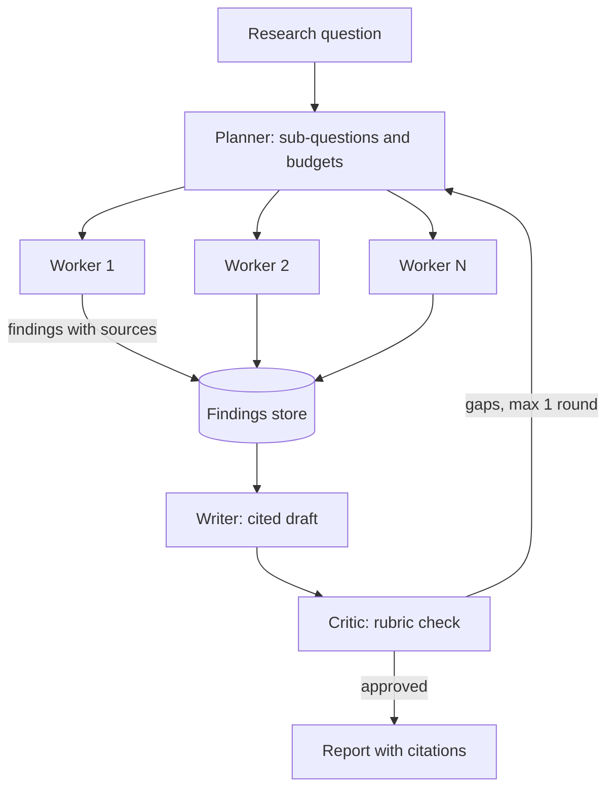

## TL;DR
A lead agent plans a research question, fans out parallel worker agents that search and summarize with
sources, then a writer and a critic produce a cited report. It proves you can coordinate agents, control
their cost and evaluate trajectories.

## For agent builders
- **What it demonstrates to a hiring team.** Orchestration judgment: when to split work across agents,
  how to pass compact context between them, how to bound fan-out and spend, and how to evaluate a run
  that has no single right answer.
- **Skills it combines.** Task decomposition, the orchestrator-worker pattern (`agents/multi-agent-patterns`),
  parallel tool calls, web or document search tools, citation grounding, trajectory evaluation and a
  durable workflow engine (`system-design/workflow-orchestration`).
- **What you control.** The plan schema, worker budgets, the hand-off format between agents, the report
  rubric and the stop conditions.
- **What you can skip.** A dozen specialised agent personas. One planner, one worker type, one writer
  and one critic cover the pattern; more roles add cost without proof of value.

## Why it exists
- **Research questions are wide.** "Compare five vendors on pricing, security and integrations" has
  independent sub-questions; one agent doing them serially fills its context and takes many minutes.
- **Parallel workers fix breadth, not quality.** Fan-out without a plan duplicates searches, and
  without budgets one run can cost many times more tokens than a single-agent chat.
- **Reports need provenance.** Readers act on the output, so every claim needs a source that a critic
  or a human can check.
- **Hiring teams ask about multi-agent trade-offs.** Showing measured cost, latency and quality against a
  single-agent baseline is far stronger than a diagram of five agents.

## How it works
### Architecture
1. **Planner (lead agent).** Turns the question into a JSON plan: 3-6 sub-questions, each with a search
   brief and a token budget.
2. **Workers.** Run in parallel; each has `search` and `fetch` tools, a step cap, and returns a compact
   finding: claims, each with a source URL or document id and a quote.
3. **Writer.** Receives only the findings (not workers' raw transcripts) and drafts a report where each
   claim carries a citation.
4. **Critic.** Checks the draft against a rubric (coverage of the plan, unsupported claims, contradictions)
   and either approves or returns specific gaps for one more worker round.
5. **Orchestration.** A workflow engine or LangGraph graph persists each step, so a crashed run resumes
   instead of restarting and paying twice.

### Phased plan with acceptance criteria
| Phase | Scope | Acceptance criteria |
|---|---|---|
| MVP (week 1) | Planner, parallel workers, writer, 15 research questions | Reports produced end to end, every claim has a citation, cost and latency logged per run |
| Hardening (week 2) | Critic loop (max 1 revision), budgets, dedup of sources, single-agent baseline | Report rubric score beats baseline on most questions, no run over the cost cap |
| Production (week 3) | Durable workflow, traces per agent, trajectory evals in CI, async job API | Crashed run resumes from last step, CI runs 10 questions and blocks on rubric drop |

### Design choices and their reasons
- **Findings, not transcripts.** Workers return a structured summary, because passing raw transcripts
  explodes the writer's context and cost.
- **Budgets per worker.** A step and token cap per worker turns cost from unbounded into plan size times
  budget, which you can predict and alert on.
- **One critic round.** One bounded revision is a sane default, because each round costs another
  draft read and possibly more workers; allow a second only if the rubric eval shows it helps.

## Diagram
Look at the fan-out and fan-in: workers never talk to each other, and only compact findings flow to the
writer, while the critic can trigger one bounded extra round.



## Examples
### Core skeleton: planner, parallel workers, writer
Plain `asyncio` with the Anthropic async client keeps the pattern visible; LangGraph or a workflow
engine adds persistence on top. Tool use inside workers is elided to keep the shape readable.

```python
import asyncio, json
import anthropic

client = anthropic.AsyncAnthropic()
MODEL = "YOUR_MODEL_ID"            # check the current docs; workers may use a cheaper model

async def ask(system: str, user: str, max_tokens: int = 1500) -> str:
    r = await client.messages.create(model=MODEL, max_tokens=max_tokens, system=system,
                                     messages=[{"role": "user", "content": user}])
    return r.content[0].text

async def plan(question: str) -> list[dict]:
    out = await ask("Return only JSON: a list of 3-6 objects with 'sub_question' and 'brief'.", question)
    return json.loads(out)[:6]   # cap fan-out in code; production validates the JSON with a schema

async def worker(task: dict) -> dict:
    # STUB: with no search tool the model invents its "sources"; this only shows the data flow.
    # Real version: a bounded tool loop with search/fetch tools, a step cap, and claims whose
    # source and quote come from fetched pages.
    text = await ask("Research the sub-question. Return JSON: {'claims': [{'text','source','quote'}]}",
                     json.dumps(task), max_tokens=1200)
    return {"task": task["sub_question"], **json.loads(text)}

async def research(question: str) -> str:
    tasks = await plan(question)
    findings = await asyncio.gather(*(worker(t) for t in tasks), return_exceptions=True)
    good = [f for f in findings if not isinstance(f, Exception)]
    report = await ask("Write a report. Cite every claim as [source]. Use only the findings given.",
                       json.dumps({"question": question, "findings": good}), max_tokens=3000)
    return report

if __name__ == "__main__":
    print(asyncio.run(research("Compare three open-source vector databases for a 10M-chunk RAG system.")))
```

### Evals and SLOs to hit
Score each run against the rubric and against a single-agent baseline on the same questions. Targets are
illustrative.

| Metric | How it is measured | Target |
|---|---|---|
| Rubric score | Judge scores coverage, accuracy and clarity 1-5 against a written rubric | beats single-agent baseline on 70%+ of questions |
| Unsupported claims | Claims whose cited source does not contain support | under 5% of claims |
| Plan coverage | Sub-questions answered in the final report | 100% or explicitly marked unknown |
| Cost per report | Summed tokens across all agents from traces | under a fixed cap, e.g. $1 |
| Wall-clock latency | Run start to report | p95 under 5 minutes |
| Resume success | Injected crash mid-run resumes without redoing finished workers | 100% |

## Production patterns
- **Run as an async job.** Expose `POST /reports` returning a job id and stream progress events, because
  multi-minute runs do not fit a request-response timeout. Persist each step in a workflow engine or a
  LangGraph checkpointer.
- **Trace per agent with a shared run id.** Each planner, worker, writer and critic call is a span under
  one trace, tagged with the agent role, so cost and latency can be broken down by role. Monitor cost per
  role and worker failure rate.
- **Budget in code.** Cap sub-questions, worker steps and total tokens per run; when the cap hits, the
  writer works with what exists and the report says which parts are incomplete.
- **Model tiering by role.** Use a strong model for planning and writing and a cheaper one for workers
  after an eval shows rubric scores hold; this is often the biggest cost lever.
- **Trajectory evals in CI.** Beyond the final rubric, assert on the trajectory: plan size within limits,
  no duplicate searches, every claim traced to a worker finding. Run 10 fixed questions per change.
- **Source hygiene.** Deduplicate URLs across workers, treat fetched pages as untrusted input (strip
  instructions, never let page text change tools or budgets), and log the source list with each report.

## Trade-offs
- **Multi-agent vs single agent.** Parallel workers cut latency and fit more evidence, but multiply
  tokens; keep the multi-agent path only where the baseline comparison shows a quality or time win.
- **Critic loop vs cost.** A critic catches unsupported claims and gaps, at the price of another full
  read of the draft and possibly another worker round; cap it at one.
- **Structured findings vs nuance.** Compact JSON findings keep context small but can drop caveats;
  include a short quote per claim so the writer keeps the source's meaning.
- **Durable engine vs simplicity.** A workflow engine makes runs resumable and observable, but adds
  infrastructure that a weekend prototype does not need.

## Pitfalls
- **No baseline.** Symptom: you cannot say the five-agent system beats one good agent. Fix: run the same
  questions through a single agent with the same tools and compare rubric, cost and time.
- **Passing transcripts between agents.** Symptom: the writer's context overflows and cost spikes. Fix:
  workers return structured findings only.
- **Unbounded fan-out.** Symptom: an occasional run costs many times the median. Fix: cap sub-questions
  and steps in code and alert on runs above the cap.
- **Stalling on agent personas.** Projects stall adding roles and prompts. Fix: one planner, one worker
  type, one writer, one critic, then measure before adding any role.

## When to use
- **Prerequisites:** the agent loop, tool calling, task decomposition, async Python, a tracing tool, and
  at least one eval with an LLM judge.
- **Use when:** you are targeting research, analyst or knowledge-work agent roles, or teams that ask
  about multi-agent design in interviews.
- **Avoid when:** you have not yet shipped a single-agent project; build the support or RAG project
  first, because this one assumes those skills.
- **Measure:** rubric score versus baseline, unsupported-claim rate, cost per report, p95 run time and
  resume success after injected failures.

## Role lens
- **Engineer:** Implements the planner, bounded workers, findings schema, async job API and per-agent
  tracing, and runs the baseline comparison.
- **Architect:** Decides when multi-agent is justified, sets budgets and model tiering per role, and picks
  the workflow engine that makes runs durable.
- **FDE:** Turns a customer's real research tasks into a rubric and test questions, and explains the cost
  per report against the analyst time it saves.

## Check yourself
**Q:** Your multi-agent research system costs about four times as much per report as a single agent but
scores only slightly higher. What do you do?
**A:** First decide whether the small gain matters for the use case; if not, the single agent wins. If it
does, find where the tokens go using per-role traces: usually raw transcripts passed to the writer,
duplicate searches across workers, or too many sub-questions. Fix those by passing compact findings,
deduplicating sources and capping plan size, then try a cheaper model for workers and re-run the rubric
eval. Keep the multi-agent path only for question types where the comparison shows a clear win, and route
the rest to the single agent.

## Interview questions
### Why did you use multiple agents instead of one agent with more tools?
- **Breadth and parallelism.** Independent sub-questions run at the same time, each in a fresh context,
  so total wall-clock time drops and no single context overflows.
- **Measured, not assumed.** I compared against a single-agent baseline on the same questions; the
  multi-agent path won on wide questions and I route narrow ones to the single agent.

### How do agents share information in your system, and why that way?
- **Through a findings store.** Workers write structured claims with sources and quotes; the writer reads
  only those.
- **Because context is the cost.** Passing full transcripts would multiply tokens and bury the evidence,
  while findings keep the writer's context small and checkable.

### How do you evaluate a research report when there is no single correct answer?
- **A written rubric.** Coverage of the plan, accuracy of claims, citation support and clarity, scored by
  a judge calibrated against my own labels on a sample.
- **Plus hard checks.** Unsupported-claim rate from citation verification, and trajectory assertions such
  as no duplicate searches and plan size within limits.

### What happens if a worker crashes or a run is interrupted?
- **Steps are persisted.** The workflow engine or checkpointer stores each worker's result, so a resumed
  run skips finished workers and does not pay for them twice.
- **Partial results are allowed.** If a worker keeps failing, the writer marks that sub-question as
  incomplete rather than blocking the whole report.

### How did you keep the cost of a run predictable?
- **Caps in code.** Maximum sub-questions, worker steps and total tokens per run, enforced by the
  orchestrator rather than the prompt.
- **Tiering and alerts.** Workers use a cheaper model where evals allow, and any run above the cost cap
  raises an alert with its trace.

## Quiz
### Q: What should worker agents pass to the writer agent?
- [ ] Their full transcripts, so nothing is lost
- [x] Compact structured findings with claims, sources and short quotes
- [ ] Only the URLs they visited
- [ ] Nothing; the writer should search again
> Full transcripts multiply tokens and bury evidence; structured findings keep the writer's context small
> while preserving provenance, and quotes keep each source's meaning for accurate citation.

### Q: What is the most convincing evidence that a multi-agent design was worth it?
- [ ] It uses more agents than competitors
- [ ] It produces longer reports
- [x] A comparison against a single-agent baseline on the same questions, showing quality or time gains at a known cost
- [ ] Each agent has a distinct persona prompt
> Multi-agent systems cost more tokens by design, so the justification has to be measured: rubric scores,
> latency and cost against a simpler baseline on identical inputs.

### Q: Why run a long research job through a durable workflow or checkpointer?
- [ ] It makes the model smarter
- [ ] It removes the need for budgets
- [x] A crash mid-run resumes from completed steps instead of restarting and paying for them again
- [ ] It is required for parallel tool calls
> Multi-minute runs will hit timeouts, deploys and provider errors; persisting each step lets the run
> resume where it stopped, saving time and tokens and making the job observable.

## Use cases & projects
### Use cases
- **Vendor and market comparisons.** Parallel workers per vendor, a cited comparison table at the end.
- **Due diligence briefs.** Company background, financial signals and risks, each claim with a source.
- **Literature reviews.** Workers per sub-topic over papers, a writer synthesising with citations.
- **Incident or competitor digests.** Scheduled runs that summarise many sources into one cited brief.

### Mini project
**First-weekend slice: planner plus parallel workers versus one agent (2-3 hours).**
- **Goal:** measure whether fan-out helps on your own questions before building critics or durability.
- **Steps:** implement the planner and parallel workers from the skeleton with a search tool (a web
  search API or a local document folder); pick 5 wide questions; run each through the multi-agent path
  and a single agent; log tokens, time and a 1-5 judge score.
- **Variants to grow into:** add the critic round, per-agent traces, a durable workflow and an async
  job API.
- **Done when:** you have a table comparing both approaches on quality, cost and time for all 5
  questions, and a written verdict on when fan-out is worth it.
