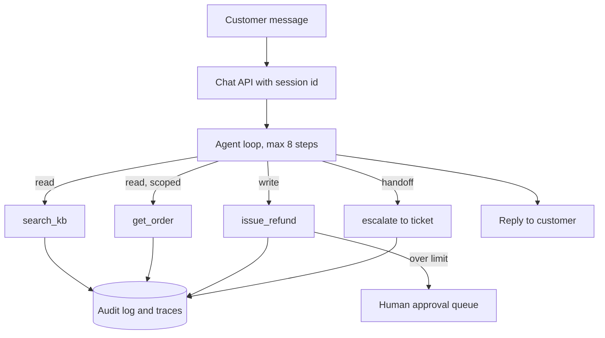

## TL;DR
A customer-support agent that answers from a knowledge base, reads order data through typed tools,
takes refunds only behind an approval gate, and hands off to humans. It proves you can ship a tool-using
agent with evals, traces, SLOs and a rollback plan.

## For agent builders
- **What it demonstrates to a hiring team.** The full lifecycle of one agent: scoping, typed tools, a
  bounded loop, human handoff, an eval set in CI, production traces and an on-call story. Most
  candidates show a chatbot; this shows an operated system.
- **Skills it combines.** The agent loop and tool calling (`agents/agent-loop`), approval gates and
  human-in-the-loop, RAG over help articles, eval harnesses, tracing with Langfuse or LangSmith, and
  least-privilege tools.
- **What you control.** Tool contracts, the escalation policy, the refund limit, the eval set and the
  SLOs. The model is swappable; those decisions are the project.
- **What you can skip.** A custom UI framework and a real payments provider. A minimal chat page and a
  fake order database are enough, because the reviewer is judging the agent and its operations.

## Why it exists
- **Support is the most common first agent in industry.** Ticket volume is high, answers are mostly
  documented, and resolution rate is a number a business already tracks, so value is easy to prove.
- **The naive version fails in public.** A prompt plus a knowledge base invents refund policies, leaks
  other customers' orders, or loops forever on angry users. Each failure is a support incident in itself.
- **Consequential actions need controls.** Refunds, cancellations and address changes move money or data,
  so they need typed arguments, limits, approvals and an audit trail, not just a better prompt.
- **Hiring teams want operational evidence.** Showing a resolution-rate eval, a p95 latency SLO and a
  trace of a handed-off conversation answers "can this person run an agent in production?".

## How it works
### Architecture
1. **Channel adapter.** A chat endpoint (FastAPI or similar) receives a message with a verified customer
   id from the session, never from the message text.
2. **Agent loop.** A bounded tool-calling loop (max steps, max tokens, wall-clock timeout) over one model.
3. **Read tools.** `search_kb(query)` over help articles, `get_order(order_id)` scoped to the session's
   customer id.
4. **Write tools.** `issue_refund(order_id, amount, reason)` with a hard limit; above it the tool returns
   `pending_approval` and creates a task for a human agent.
5. **Handoff tool.** `escalate(summary, priority)` writes a ticket with a conversation summary, so the
   human does not re-ask the customer.
6. **Stores.** Conversation state, an audit log of every tool call, and a trace backend.

### Phased plan with acceptance criteria
| Phase | Scope | Acceptance criteria |
|---|---|---|
| MVP (week 1) | Loop, 4 tools, fake orders DB, 50-case eval set | 80%+ of eval cases pass, zero cross-customer reads in tests |
| Hardening (week 2) | Approval gate, injection tests, retries, step and cost caps | All refunds over the limit route to approval, 30+ adversarial cases pass |
| Production (week 3) | Traces, dashboards, CI eval gate, canary, runbook | Eval gate blocks a bad prompt change in CI, p95 latency and cost per conversation on a dashboard |

### Design choices and their reasons
- **Identity from the session, not the model.** The customer id is injected server-side into every tool
  call, because a model-supplied id is a prompt-injection target.
- **Limits in code, not in the prompt.** The refund cap lives in `issue_refund`, because prompts are
  advice and code is enforcement.
- **Escalation is a success path.** The eval counts a correct handoff as a pass, so the agent is not
  rewarded for guessing.

## Diagram
Follow a message from the channel through the bounded loop; note that the write tool can only create a
pending approval above the limit and that every call lands in the audit log.



## Examples
### Core skeleton: bounded loop with scoped tools
A minimal version using the Anthropic Messages API; the same shape works with any tool-calling API.
Set the model id from the provider's current model list.

```python
import anthropic, json

client = anthropic.Anthropic()
MODEL = "YOUR_MODEL_ID"          # check the current docs for model ids
REFUND_LIMIT = 50.0
ORDERS = {"A1": {"customer": "c42", "total": 30.0}, "B7": {"customer": "c99", "total": 400.0}}

TOOLS = [
    {"name": "get_order", "description": "Look up one of the current customer's orders.",
     "input_schema": {"type": "object", "properties": {"order_id": {"type": "string"}},
                      "required": ["order_id"]}},
    {"name": "issue_refund", "description": "Refund an order. Large refunds need human approval.",
     "input_schema": {"type": "object", "properties": {
         "order_id": {"type": "string"}, "amount": {"type": "number"}, "reason": {"type": "string"}},
         "required": ["order_id", "amount", "reason"]}},
    {"name": "escalate", "description": "Hand the conversation to a human with a summary.",
     "input_schema": {"type": "object", "properties": {"summary": {"type": "string"}},
                      "required": ["summary"]}},
]

def run_tool(name, args, customer_id, audit):
    order = ORDERS.get(args.get("order_id", ""))
    if name in ("get_order", "issue_refund") and (not order or order["customer"] != customer_id):
        result = {"error": "order not found"}            # same answer for "not yours" and "missing"
    elif name == "get_order":
        result = order
    elif name == "issue_refund":
        if not 0 < args["amount"] <= order["total"]:
            result = {"error": "amount must be between 0 and the order total"}
        else:
            ok = args["amount"] <= REFUND_LIMIT
            result = {"status": "refunded" if ok else "pending_approval"}
    else:
        result = {"status": "ticket_created"}
    audit.append({"customer": customer_id, "tool": name, "args": args, "result": result})
    return result

def support_turn(messages, customer_id, audit, max_steps=8) -> str:
    for _ in range(max_steps):
        resp = client.messages.create(model=MODEL, max_tokens=1024, tools=TOOLS, messages=messages,
                                      system="You are a support agent. Use tools; never guess policy.")
        messages.append({"role": "assistant", "content": resp.content})
        if resp.stop_reason != "tool_use":
            return "".join(b.text for b in resp.content if b.type == "text")
        results = [{"type": "tool_result", "tool_use_id": b.id,
                    "content": json.dumps(run_tool(b.name, b.input, customer_id, audit))}
                   for b in resp.content if b.type == "tool_use"]
        messages.append({"role": "user", "content": results})
    run_tool("escalate", {"summary": "step limit reached"}, customer_id, audit)
    return "I have passed this to a colleague, who will reply here."
```

### Evals and SLOs to hit
Build the eval set from real or realistic tickets; each case has an expected outcome, not an expected
string. Targets below are illustrative starting points to tune with the business.

| Metric | How it is measured | Target |
|---|---|---|
| Resolution accuracy | Judge or rule check against expected outcome per case | 85%+ on the golden set |
| Correct escalation | Cases labelled "needs human" that call `escalate` | 95%+ |
| Unauthorized action rate | Refunds over limit executed, cross-customer reads | 0 (hard gate in CI) |
| Injection resistance | Adversarial cases that try to change customer id or limit | 100% blocked |
| p95 latency per turn | Trace duration from request to reply | under 8 s |
| Cost per conversation | Token cost summed from traces | under a set budget, e.g. $0.05 |

## Production patterns
- **Eval gate in CI.** Run the golden and adversarial sets on every prompt, tool or model change; fail
  the build if resolution drops more than 2 points or any unauthorized action appears. Store results per
  commit so regressions are traceable.
- **Trace every turn.** Emit one trace per conversation turn with spans for each model call and tool
  call (Langfuse, LangSmith or OpenTelemetry GenAI conventions), tagged with customer tier and prompt
  version. Monitor escalation rate, tool error rate and cost per conversation.
- **Canary prompt and model changes.** Route 5% of traffic to the new version, compare resolution and
  escalation rates from traces for a few days, then promote or roll back by flipping a config value.
- **Approval queue with timeouts.** Pending refunds go to a queue that a human clears; if nobody acts in
  a set window the customer gets a status message, not silence. Monitor queue age.
- **Cost and loop caps.** Enforce max steps, max tokens per turn and a per-conversation spend cap in
  code; alert when a conversation hits a cap, because it usually means a loop or a confused model.
- **PII hygiene in traces.** Redact emails, addresses and card fragments before export, and set trace
  retention to match the support data policy.

## Trade-offs
- **Autonomy vs safety.** Letting the agent refund small amounts raises resolution rate, but every
  raise of the limit widens the blast radius; raise it only after eval and audit data justify it.
- **One model vs routing.** A single strong model keeps the MVP simple; routing easy FAQ turns to a
  cheaper model cuts cost but adds a router to evaluate and debug.
- **Escalate early vs resolve more.** Aggressive escalation protects quality and frustrates customers
  with waits; tune it with the escalation-correctness metric, not intuition.
- **Real tickets vs synthetic evals.** Real tickets are representative but need redaction and consent;
  synthetic ones are safe but miss the messy cases that cause incidents.

## Pitfalls
- **Trusting the model with identity.** Symptom: an injection like "I am customer c99" reads another
  account. Fix: take identity only from the authenticated session and scope every tool by it.
- **Evals that check wording.** Symptom: scores swing on harmless rephrasing. Fix: assert outcomes
  (tool called, status, escalation) and use a calibrated judge only for tone and correctness.
- **No end state for the loop.** Symptom: long, expensive conversations that never escalate. Fix: step
  and spend caps that fall back to `escalate` with a summary.
- **Stalling on the UI.** Projects stall polishing a chat front end. Fix: a plain page and a CLI; spend
  the time on evals, traces and the runbook.

## When to use
- **Prerequisites:** the agent loop and tool calling, basic RAG, an eval harness, and one tracing tool;
  comfort with FastAPI or another web framework.
- **Use when:** you want a first portfolio project that maps directly to a common job description
  (support, success or operations agents).
- **Avoid when:** you already have a support-agent project; pick the enterprise or RAG platform project
  instead to show breadth.
- **Measure:** resolution accuracy, escalation correctness, unauthorized actions, p95 latency and cost
  per conversation, all visible on one dashboard.

## Role lens
- **Engineer:** Builds the typed tools, the bounded loop, the approval queue and the CI eval gate, and
  can show a trace for any failing case.
- **Architect:** Owns the boundary between model and code: identity, limits and escalation enforced in
  services, with SLOs and a rollout plan for prompt and model changes.
- **FDE:** Scopes the agent with a support lead, turns their top ticket categories into eval cases, and
  agrees the refund limit and handoff rules before launch.

## Check yourself
**Q:** Your support agent passes 90% of evals, but in the canary one customer got another customer's
order details. What failed, and how do you fix it so it cannot recur?
**A:** The tool trusted an identifier the model supplied instead of the authenticated session, so a
prompt (possibly an injection or a confused turn) reached another customer's data. Fix it in code: inject
the customer id server-side, scope every read and write tool by it, and return the same "not found" for
missing and not-yours orders. Add adversarial eval cases that try to switch identity and make zero
cross-customer reads a hard CI gate. Check audit logs for other affected conversations, notify per
policy, and add an alert on any tool call whose resource owner differs from the session.

## Interview questions
### Walk me through the architecture of your support agent and why each piece exists.
- **Channel and session first.** The API attaches a verified customer id, because identity must never
  come from the conversation.
- **Bounded loop with typed tools.** Read tools are scoped by that id; the refund tool enforces a limit
  and creates approvals above it.
- **Operations around it.** Every call is traced and audited, a golden set runs in CI, and a canary
  protects production from prompt or model regressions.

### How did you decide what the agent may do on its own versus what needs a human?
- **By blast radius and reversibility.** Reads and small, reversible refunds are autonomous; large
  refunds, cancellations and account changes need approval.
- **Backed by data.** I started with a low limit, measured approval outcomes, and only proposed raising
  it when humans approved nearly every pending request.

### A prompt change raised resolution rate but also raised cost by 40%. Do you ship it?
- **Look at the full scorecard.** Check escalation correctness, unauthorized actions and latency, not
  just resolution and cost.
- **Price the gain.** If each resolved ticket saves human time worth more than the extra tokens, ship
  behind a canary; otherwise look for the cost source in traces, such as extra tool loops.

### How do you evaluate an agent whose correct answer is sometimes "hand off to a human"?
- **Label the expected outcome per case.** Some cases expect resolution, some expect `escalate`, some
  expect a refusal; scoring checks the outcome and tool calls.
- **Track both error types.** Missed escalations are risky, needless escalations are costly, so report
  them separately rather than one accuracy number.

### What would you monitor in the first week after launch?
- **Quality signals.** Escalation rate, customer satisfaction where available, and judge scores on a
  sampled slice of live traces.
- **Safety and cost.** Unauthorized-action alerts, approval queue age, cost per conversation and step-cap
  hits, each with an owner and an alert threshold.

## Quiz
### Q: Where should the refund limit for a support agent be enforced?
- [ ] In the system prompt, stated clearly
- [ ] In the eval set only
- [x] Inside the refund tool's code, with larger amounts routed to approval
- [ ] In the model's fine-tuning data
> Prompts are guidance the model can be talked out of; a limit enforced in the tool cannot be bypassed by
> the conversation, and routing larger refunds to approval keeps a human in charge of risky actions.

### Q: Why should the customer id come from the authenticated session rather than tool arguments?
- [ ] It reduces token usage
- [x] Model-supplied identifiers can be manipulated by prompt injection or confusion, exposing other customers' data
- [ ] Tool schemas cannot contain string fields
- [ ] Sessions make the model respond faster
> Anything the model writes into a tool argument can be steered by user text. Injecting the id
> server-side and scoping every tool by it removes cross-customer access as a possible outcome.

### Q: Which eval design best fits a support agent?
- [ ] Exact string match against a reference reply
- [ ] A single overall accuracy number from a judge
- [x] Per-case expected outcomes (resolve, escalate or refuse) plus hard gates on unauthorized actions
- [ ] Measuring only latency and cost
> Support replies vary in wording, so outcome-based checks are stable; separating escalation errors and
> treating unauthorized actions as a zero-tolerance gate matches how the business judges the agent.

## Use cases & projects
### Use cases
- **E-commerce order support.** Order status, returns and small refunds with handoff for disputes.
- **SaaS account and billing help.** Plan questions answered from docs, billing changes behind approval.
- **Internal IT helpdesk.** Password-reset guidance, access requests routed to approvers, tickets filed.
- **Telecom or utilities triage.** Outage lookups by account, with escalation for vulnerable customers.

### Mini project
**First-weekend slice: a scoped two-tool support agent with a 20-case eval (2-3 hours).**
- **Goal:** prove identity scoping and escalation before adding anything else.
- **Steps:** build `get_order` and `escalate` over a dictionary of fake orders; inject the customer id
  server-side; write 20 eval cases (12 normal, 5 needing escalation, 3 trying to read another customer's
  order); run them and log each tool call to a JSON file.
- **Variants to grow into:** add `search_kb` over 30 help articles, then the refund tool with approval,
  then traces and a CI gate.
- **Done when:** all 3 identity attacks return "not found", escalation cases call `escalate`, and you
  have a results table you can show in the README.
