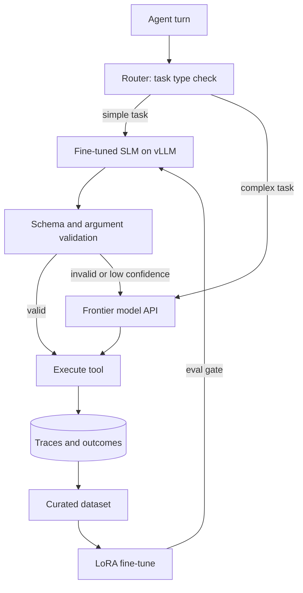

## TL;DR
A small open model, LoRA-fine-tuned on your agent's own traces, served with vLLM behind an
OpenAI-compatible API, with a router that escalates hard turns to a frontier model. It proves you can cut
agent cost while measuring quality.

## For agent builders
- **What it demonstrates to a hiring team.** The full model-ownership loop: collect traces, build a
  dataset, fine-tune with LoRA, evaluate against the large model, serve it, and route by confidence. Few
  candidates can show all of it with numbers.
- **Skills it combines.** SLM selection, tool calling and structured output with SLMs, PEFT/LoRA, an
  eval harness, a serving engine (`serving-inference/engines`), routing and cascades, and cost tracking.
- **What you control.** The task scope, the training data, LoRA settings, the router rule, the
  escalation threshold and the quality bar that the SLM must meet.
- **What you can skip.** Pre-training, full fine-tuning and multi-GPU training. A 1-8B model, LoRA and one
  GPU (or a rented one) are enough.

## Why it exists
- **Frontier models are expensive for narrow, repetitive steps.** Classification, extraction and
  well-formed tool calls make up many agent steps and rarely need the largest model.
- **Off-the-shelf SLMs are unreliable at your tool format.** They miss arguments or emit broken JSON;
  fine-tuning on one to a few thousand of your own traces often fixes format and routing behaviour,
  which your held-out eval must confirm.
- **Some data cannot leave your network.** Self-hosting keeps prompts and outputs inside your
  infrastructure, which regulated customers often require.
- **A pure SLM fails on the long tail.** A router that sends uncertain or complex turns to a large model
  keeps quality while most traffic stays cheap.

## How it works
### Architecture
1. **Trace collection.** Log the large model's agent turns (inputs, tool calls, outputs) for one narrow
   task, such as ticket triage plus tool routing, and filter to accepted outcomes.
2. **Dataset.** Convert traces to chat-format examples with tool calls; hold out 10-20% as an eval set
   that never touches training.
3. **Fine-tune.** LoRA on a 1-8B instruct model with PEFT and TRL; save the adapter, not a full copy.
4. **Serve.** vLLM serves the base model with the adapter (`--enable-lora --lora-modules`) behind an
   OpenAI-compatible endpoint; native tool calling also needs `--enable-auto-tool-choice` and a
   `--tool-call-parser` that matches the model family (for example `hermes` for Qwen2.5).
5. **Route.** A router sends each turn to the SLM first; if the output fails schema validation, a
   confidence rule or a task-type rule, it escalates to the frontier model.
6. **Measure.** Same eval set, three configurations: frontier only, SLM only, routed.

### Phased plan with acceptance criteria
| Phase | Scope | Acceptance criteria |
|---|---|---|
| MVP (week 1) | Pick task, collect 1,000+ traces, base SLM eval, LoRA run, local serving | Fine-tuned SLM beats base SLM on the held-out set, valid tool-call JSON rate measured |
| Hardening (week 2) | Router with schema check and escalation, retries, cost tracking, regression set | Routed system within 2 points of frontier quality at a measured cost cut |
| Production (week 3) | Containerised vLLM, health checks, metrics, CI eval on new adapters, rollback | New adapter must pass eval gate before promotion, dashboards show escalation rate, p95 latency and cost per 1k turns |

### Design choices and their reasons
- **Narrow task first.** One task with a clear success check gives a clean eval; "replace the whole
  agent" does not.
- **Adapters, not merged weights.** LoRA adapters are small, versionable and swappable at serve time,
  so rollback is a config change.
- **Validation-based escalation.** Schema and argument validation is a cheap, objective signal; it
  catches most SLM failures before they reach a tool.

## Diagram
Follow a turn through the router: the SLM answers first, validation decides, and only failures or hard
task types reach the frontier model, while all traces feed the next training round.



## Examples
### Core skeleton: SLM-first router with validation and escalation
Both models are called through the OpenAI-compatible Chat Completions API, which vLLM serves. The local
adapter name is whatever you registered with `--lora-modules`.

```python
import json
from openai import OpenAI
from pydantic import BaseModel, ValidationError

slm = OpenAI(base_url="http://localhost:8000/v1", api_key="local")   # vLLM server
big = OpenAI()                                                        # frontier provider
SLM_MODEL, BIG_MODEL = "triage-lora", "YOUR_FRONTIER_MODEL_ID"       # check the current docs

class Triage(BaseModel):
    category: str            # e.g. billing, bug, access
    priority: int            # 1-4
    tool: str                # which tool the agent should call next
    args: dict

SYSTEM = "Return only JSON with keys category, priority, tool, args."
ALLOWED_TOOLS = {"lookup_account", "create_ticket", "search_kb"}

def call(client, model, ticket):
    r = client.chat.completions.create(model=model, temperature=0,
        messages=[{"role": "system", "content": SYSTEM}, {"role": "user", "content": ticket}])
    return r.choices[0].message.content

def triage(ticket: str, stats: dict) -> Triage:
    if len(ticket) > 4000:                          # task-type rule: long tickets go straight up
        stats["big"] += 1
        return Triage.model_validate_json(call(big, BIG_MODEL, ticket))
    try:
        out = Triage.model_validate_json(call(slm, SLM_MODEL, ticket))
        if out.tool in ALLOWED_TOOLS and 1 <= out.priority <= 4:
            stats["slm"] += 1
            return out
    except (ValidationError, json.JSONDecodeError):
        pass
    stats["big"] += 1                                # escalate on any validation failure
    return Triage.model_validate_json(call(big, BIG_MODEL, ticket))

stats = {"slm": 0, "big": 0}
print(triage("I was charged twice for March, account 8812.", stats), stats)
```

### Fine-tune and serve: the minimal commands
A LoRA config with PEFT, trained with TRL's `SFTTrainer`; argument names in TRL move between releases,
so check the current docs before copying.

```python
from peft import LoraConfig
from trl import SFTConfig, SFTTrainer
from datasets import load_dataset

data = load_dataset("json", data_files={"train": "train.jsonl", "eval": "eval.jsonl"})
lora = LoraConfig(r=16, lora_alpha=32, lora_dropout=0.05, task_type="CAUSAL_LM",
                  target_modules=["q_proj", "k_proj", "v_proj", "o_proj"])
trainer = SFTTrainer(model="Qwen/Qwen2.5-1.5B-Instruct", train_dataset=data["train"],
                     eval_dataset=data["eval"], peft_config=lora,
                     args=SFTConfig(output_dir="triage-lora", num_train_epochs=2, learning_rate=2e-4))
trainer.train()
trainer.save_model("triage-lora")
# Serve:  vllm serve Qwen/Qwen2.5-1.5B-Instruct --enable-lora --lora-modules triage-lora=./triage-lora
```

### Evals and SLOs to hit
Compare three configurations on the same held-out set. Targets are illustrative and depend on the task.

| Metric | Frontier only | SLM only | Routed target |
|---|---|---|---|
| Task accuracy (category and tool) | baseline | measured | within 2 points of baseline |
| Valid JSON and allowed-tool rate | measured (usually near 100%) | measured | 100% after escalation |
| Escalation rate | n/a | n/a | under 20% of turns |
| p95 latency per turn | measured | measured | at or below frontier |
| Cost per 1k turns | baseline | GPU-hour based | 50%+ cheaper than baseline |

## Production patterns
- **Eval gate for adapters.** Every new adapter runs the held-out set and a regression set of past
  failures; promotion happens only if it beats the current adapter, and the previous adapter stays
  registered for instant rollback.
- **Serve with vLLM behind a gateway.** Run vLLM in a container with health checks, expose it through a
  gateway such as LiteLLM so the agent code sees one API for both models, and set `max_model_len`
  (CLI `--max-model-len`) to the task's real needs, because a shorter limit leaves KV-cache room for
  more concurrent requests.
- **Measure escalation as a first-class metric.** Track escalation rate and reasons (schema failure,
  disallowed tool, task rule) per day; a rise means drift in traffic or a weak adapter, and becomes the
  next training batch.
- **Price GPU time honestly.** Compute cost per 1k turns from GPU-hour price and measured throughput at
  realistic concurrency, including idle hours, before claiming savings over an API.
- **Keep data hygiene.** Strip PII from traces before training, record the dataset version and commit per
  adapter, and never train on the eval split.

## Trade-offs
- **Cost vs operational burden.** Self-hosting cuts per-token cost at steady volume but adds GPUs,
  upgrades and on-call; at low or spiky volume an API is usually cheaper.
- **Narrow fine-tune vs generality.** A tuned SLM excels at the trained task and may get worse at
  others; keep it scoped and route everything else to a general model.
- **Strict validation vs escalation rate.** Tighter checks catch more SLM errors and send more traffic
  to the expensive model; tune the rule on the eval set.
- **Small model vs headroom.** A 1-3B model is cheap and fast but saturates sooner as the task grows;
  a 7-8B model costs more per token and absorbs more variation.

## Pitfalls
- **Training on unfiltered traces.** Symptom: the SLM copies the big model's mistakes. Fix: keep only
  turns with verified good outcomes, and review a sample by hand.
- **Eval leakage.** Symptom: the SLM scores near perfect offline and fails live. Fix: split by time or by
  customer, and never let eval examples into training.
- **Ignoring the chat template and tool parser.** Symptom: tool calls arrive as plain text. Fix: train and
  serve with the model's own chat template and the matching vLLM tool-call parser.
- **Stalling on GPU setup.** Projects stall on drivers and clusters. Fix: rent one GPU or use a managed
  notebook for training, and a single vLLM container for serving.

## When to use
- **Prerequisites:** a working agent with logged traces, an eval harness, LoRA basics, and comfort with
  Docker and an OpenAI-compatible client.
- **Use when:** you are targeting roles that own models or cost, such as ML platform, inference or
  applied AI teams in regulated industries.
- **Avoid when:** you have no traces or no clear task with a success check; build the support agent first
  and collect data from it.
- **Measure:** task accuracy versus frontier, valid-output rate, escalation rate, p95 latency and cost per
  1k turns, all from the same eval set.

## Role lens
- **Engineer:** Builds the dataset pipeline, LoRA run, vLLM deployment and router, and proves each adapter
  against the held-out set before promotion.
- **Architect:** Decides which agent steps move to an SLM, the routing and escalation rules, and when
  self-hosting beats an API on total cost.
- **FDE:** Explains to a regulated customer how data stays on their infrastructure and shows the quality
  and cost table that justifies the SLM path.

## Check yourself
**Q:** Your fine-tuned SLM matches the frontier model offline, but in production 35% of turns escalate.
What do you investigate and in what order?
**A:** Start with escalation reasons from traces: schema failures, disallowed tools or task-type rules.
If schema failures dominate, check the serving setup first (wrong chat template or tool-call parser, a
different system prompt than training). If the content is wrong, compare live inputs with the training
distribution: new ticket types, longer inputs or another language mean the eval set was not
representative. Sample escalated turns, label them, add them to the dataset and the eval set, retrain, and
promote the new adapter only after it beats the current one on both the old and new eval cases.

## Interview questions
### How did you choose which part of the agent to move to an SLM?
- **Narrow and checkable.** I picked triage plus tool routing because it is high volume, has a clear
  correct answer and a schema that can be validated.
- **Data first.** I had over a thousand logged frontier turns with known good outcomes, which made a clean
  training and held-out split possible.

### How does your router decide when to escalate?
- **Rules before models.** Task-type rules send known-hard inputs straight to the frontier model.
- **Validation after the SLM.** Any schema failure, disallowed tool or out-of-range value escalates;
  escalations are logged with a reason and become future training data.

### When is self-hosting not worth it?
- **Low or spiky volume.** Idle GPUs cost money, so an API is cheaper until traffic is steady.
- **No ops capacity.** Without someone to own upgrades, scaling and incidents, the savings disappear
  into downtime and engineering time; a managed endpoint for the fine-tuned model may be the middle path.

### How did you prove the fine-tune helped and did not just memorise?
- **Held-out split by time.** Eval examples come from a later period than training examples.
- **Three-way comparison.** Base SLM, tuned SLM and frontier model on the same set, plus a regression set
  of earlier failures, all reported in one table.

### What breaks when you upgrade the base model or vLLM?
- **Adapters are tied to the base model.** A new base needs a new LoRA run and a fresh eval.
- **Serving flags and templates change.** Tool-call parsers and chat templates can differ between
  versions, so the eval gate runs against the new serving stack before any traffic moves.

## Quiz
### Q: What is the most reliable cheap signal to escalate an SLM turn to a larger model?
- [ ] The length of the SLM's answer
- [x] Failing schema or argument validation for the expected tool call
- [ ] The time of day
- [ ] Whether the user said "please"
> Validation is objective and costs almost nothing; it catches malformed JSON, disallowed tools and
> out-of-range arguments, which are the most common SLM failures in agents.

### Q: Why keep LoRA adapters separate rather than merging them into the base model?
- [ ] Merging is impossible
- [ ] Adapters always give higher accuracy
- [x] Adapters are small and can be swapped or rolled back at serve time without redeploying the base
- [ ] vLLM cannot serve merged models
> Serving the base once with registered adapters makes versioning and rollback a configuration change,
> and lets several task adapters share one base model on the same GPU.

### Q: Which evaluation design best shows the SLM project succeeded?
- [ ] Training loss going down
- [ ] A demo of three hand-picked examples
- [x] Frontier, SLM-only and routed configurations scored on the same held-out set for quality, latency and cost
- [ ] The SLM's benchmark score on a public leaderboard
> The claim is "same quality for less cost on our task", so it must be measured on your task's held-out
> data across all three configurations, with cost and latency next to accuracy.

## Use cases & projects
### Use cases
- **High-volume triage and routing.** Classify tickets or emails and pick the next tool at low cost.
- **Structured extraction.** Pull fields from invoices or forms into a schema, escalating messy ones.
- **On-premises agents.** Regulated customers who require prompts and outputs to stay in their network.
- **Edge or offline assistants.** Small models on local hardware with a cloud fallback when online.

### Mini project
**First-weekend slice: base SLM versus frontier on 60-100 tool-routing cases (2-3 hours).**
- **Goal:** find out how far an untuned SLM is from the frontier model on your task before training.
- **Steps:** write or export 60-100 labelled cases (input, expected tool, expected arguments); serve a
  1-3B instruct model locally with vLLM (needs a GPU) or Ollama (laptop CPU is fine), both of which expose
  an OpenAI-compatible API; run both models through the same prompt; score tool accuracy
  and valid-JSON rate; add the validation-based router and score it too.
- **Variants to grow into:** LoRA fine-tune on frontier traces, adapter eval gate, containerised serving
  and cost dashboards.
- **Done when:** you have a three-row table (frontier, SLM, routed) with accuracy, valid-JSON rate and
  escalation rate, and a note on what training data would close the gap.
