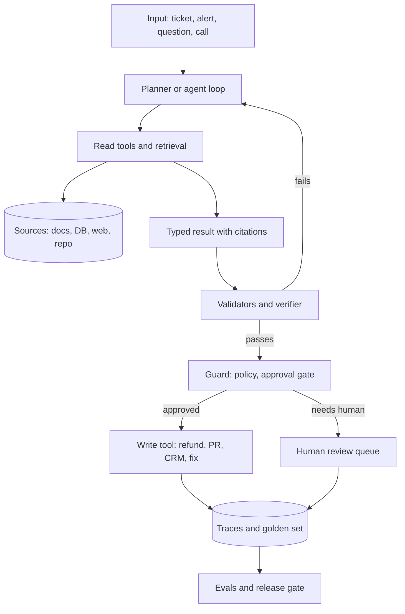

## Overview
This module is a catalogue of twelve real agent use cases you can practise building, from a support
agent that issues refunds to a voice agent with a one-second turn budget. Each lesson names the business
outcome, why the use case is hard, what it teaches, and where it shows up in your stack.

The thread that ties them together: every useful agent combines a few reusable parts (a tool-calling
loop, grounded retrieval, typed outputs, guarded writes, approval gates, traces and evals). Each use case
stresses a different part, so practising several teaches the whole toolkit.

What this module gives an agent builder:
- **A practice ladder.** Use cases ranked from core (support, data analyst, documents, knowledge, sales) to advanced (coding, research, browser, voice, ops, contracts, multi-agent).
- **The hard part named up front.** Each lesson says why the use case fails in practice, such as wrong refunds, leaked documents, wrong numbers or dead air on a call.
- **A first slice.** Each lesson says what you can skip at first, so you build a narrow, valuable version before the ambitious one.
- **Stack pointers.** Concrete tools per use case: Playwright, `run_sql` on a read-only role, Pydantic or JSON Schema contracts, Pipecat or LiveKit Agents, LangGraph, OpenAI Agents SDK, CrewAI, AutoGen, A2A, MCP servers.

Core versus background for agents:
- **Core (all twelve lessons):** every lesson here has `agent_relevance: core`, because each one is an agent you build end to end.
- **Starter use cases (difficulty core):** customer-support-agent, data-analyst-agent, document-processing-agent, internal-knowledge-assistant, sales-and-crm-agent.
- **Advanced use cases:** coding-agent, deep-research-agent, browser-and-computer-use-agent, contract-and-compliance-review-agent, it-and-sre-ops-agent, voice-agent, multi-agent-workflow.
- **Background lives elsewhere:** the related lessons each use case links to (for example `agents/tool-calling`, `agents/sandboxing`, `rag-retrieval/acl-aware-retrieval`) hold the theory.

What you can build afterwards:
- A support or ops agent with read tools, one write tool behind an approval gate, and traces on every turn.
- A grounded assistant (knowledge, research or contract review) where every claim or flag carries a verified citation.
- A multi-agent workflow with a planner, specialists and a reviewer, justified against a single-agent baseline.

## Why it matters
- **Engineer:** You build the parts every agent here needs: tool contracts, policy enforced in code rather than in the prompt, idempotent writes, schema validation with repair retries, sandboxed execution for code and browsers, and execution-based or trajectory evals that tell you whether the agent actually did the job.
- **Architect:** You choose the shape of each agent: which tools are read versus write, where approval gates and permission tiers sit, when retrieval needs ACL filters, when latency (voice) or blast radius (ops) is the main constraint, and when splitting into multiple agents is worth the hand-off cost.
- **FDE:** You walk into a customer with one of these use cases, scope the first slice (a read-only triage agent, drafts in a queue, one site and one task), prove it on their own golden set with SMEs, and show traces and citations their reviewers can check before anything touches money, production or real people.

## Mental model
Picture one agent skeleton that every use case reuses: input arrives, the agent plans, calls read tools
and retrieval, produces a typed result, and only then crosses a guard before any write. Each use case
turns up the difficulty on one part of that skeleton.

| Part of the agent | Use cases that stress it most |
|---|---|
| Tool-calling loop over a long horizon | coding-agent, browser-and-computer-use-agent |
| Grounded retrieval and citations | internal-knowledge-assistant, deep-research-agent, contract-and-compliance-review-agent |
| Typed outputs and validation | document-processing-agent, data-analyst-agent |
| Guarded writes and approval gates | customer-support-agent, sales-and-crm-agent, it-and-sre-ops-agent |
| Streaming and latency budget | voice-agent |
| Decomposition and hand-offs | multi-agent-workflow, deep-research-agent |

- **Read and write tools are different.** Reads can be broad; writes (refunds, CRM upserts, remediations, clicks) need allowlists, idempotency and a human approval point.
- **Verification beats confidence.** Tests that pass, SQL a human can read, cited spans that match the source and validators on every field are what make outputs trustworthy.
- **Untrusted input is everywhere.** Web pages, documents and tickets can carry injected instructions, so sandboxing and permission limits matter as much as prompts.
- **Start with a narrow slice.** Every lesson names what to skip; the first version should do one job well with traces and evals.

The loop, validators and guard are what you write; the sources, write targets and review queue are
systems you connect. Each use case in the table above is this picture with one box made harder.

## Suggested order
1. customer-support-agent — the canonical starter: triage, grounded answers and one money-moving write behind approval exercise every core agent part.
2. internal-knowledge-assistant — adds permission-filtered retrieval and citations, the base of any enterprise RAG agent.
3. data-analyst-agent — adds a guarded `run_sql` tool and execution-based evals, where wrong numbers look exactly like right ones.
4. document-processing-agent — adds structured outputs, validation and repair retries, and confidence-based routing to human review.
5. sales-and-crm-agent — combines research with safe writes to a shared system of record and a draft-then-approve flow.
6. deep-research-agent — the first advanced case: planning, parallel sub-questions, provenance and a verifier pass before the report ships.
7. contract-and-compliance-review-agent — builds on research and documents: playbook-grounded flags where every citation is verified in code.
8. coding-agent — a long-horizon loop with precise edit tools, sandboxed tests as the signal and a pull request as the approval point.
9. it-and-sre-ops-agent — tool permission tiers, blast-radius limits and audit trails for an agent that touches production.
10. browser-and-computer-use-agent — an adversarial environment with small action spaces, step budgets, sandboxing and approval before irreversible clicks.
11. voice-agent — reuses the tool loop under a roughly one-second turn budget with streaming, turn detection and barge-in.
12. multi-agent-workflow — last, because you should justify a planner, specialists and reviewer against the single agents you built above.

## Capstone
### Brief
**Use case:** a mid-size e-commerce company wants one agent platform for its support team. Customers
ask about orders and policies, staff ask internal questions, and some tickets need refunds. This is the
module's major project (about a week): build a support agent that combines most of the module's lessons.

The agent triages each ticket, answers from the help centre and internal wiki with citations (ACL
filtered for staff), looks up orders with a read-only SQL tool, extracts fields from attached invoices,
and issues refunds only within policy or after a human approves. Use synthetic customers, orders and documents.

What you will build:
- A tool-calling loop with read tools (help search, order lookup via `run_sql`, invoice extraction) and one write tool (refund) behind an approval gate.
- Permission-filtered retrieval over help articles and a small wiki, with citations verified against the source text.
- A planner that hands complex tickets to a research specialist and a reviewer that checks the draft reply.
- Traces on every turn and a golden set built from realistic tickets.

### Deliverables
- A running agent service with the tool loop, typed tool contracts, policy enforced in code, idempotent refund writes and a human approval step.
- A retrieval index with ACL metadata, and a test showing a staff-only document never reaches a customer answer.
- A document extraction step with a Pydantic schema, validation, one repair retry and a review queue for low-confidence fields.
- A golden set of at least 50 tickets covering triage, grounded answers, order lookups, refunds and escalations, plus an eval script reporting each category.
- A short design note comparing the multi-agent split against a single agent with the same tools, on quality, cost and latency.

### Rubric
- No refund outside policy executes without an approval record; the trace shows the gate and the idempotency key for every write.
- Every cited answer quotes text that exists in the cited source, checked in code, and zero ACL leaks appear across the golden set.
- Every SQL query runs on a read-only role and appears in the trace, and order-lookup answers match the database.
- Escalations to a human include a clean handoff summary, and each failed eval case is categorised by part (triage, retrieval, extraction, write, review).
- The design note keeps the multi-agent split only if it beats the single-agent baseline on the eval set.
