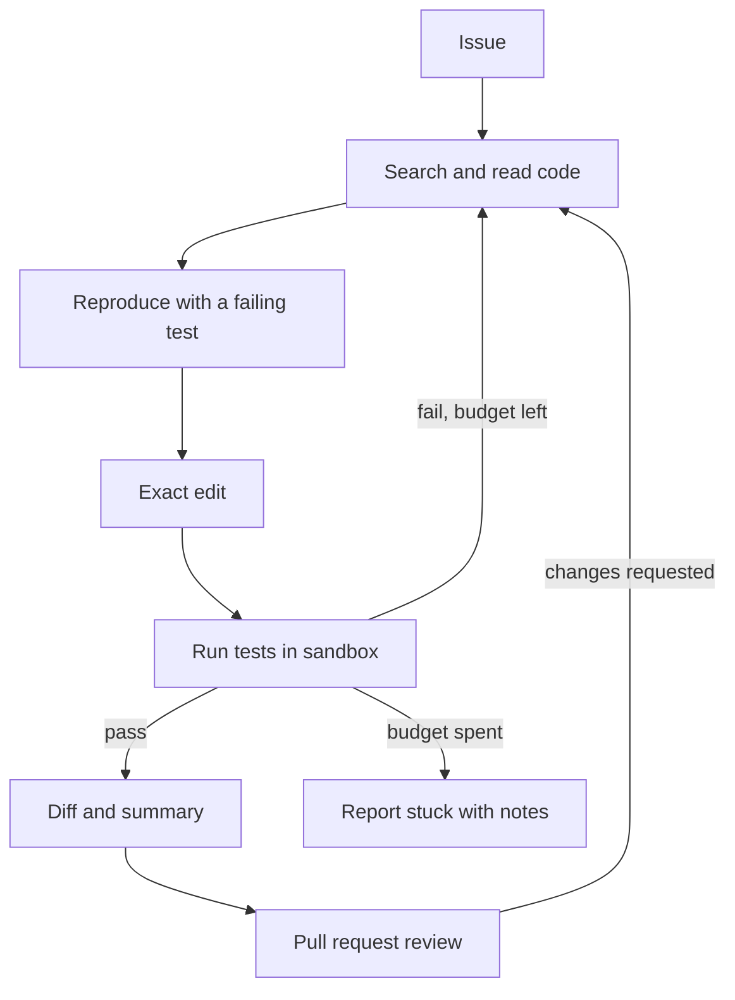

## TL;DR
A coding agent takes an issue, navigates the repository, edits files and runs the tests in a sandbox
until they pass, then opens a reviewable change. The outcome is merged fixes for routine issues with a
human reviewing every diff.

## For agent builders
- **Why it is hard.** Repositories exceed any context window, edits must apply exactly, and the only
  trustworthy signal is executing code, which is dangerous outside a sandbox.
- **What it teaches.** Long-horizon loops, context management (search instead of reading everything),
  precise edit tools, sandboxed execution, test feedback as the reward signal, and trajectory evals.
- **Where it shows up in your stack.** A tool-calling loop with file, search, edit and shell tools,
  a container or microVM per task (see `agents/sandboxing`), and a pull request as the human approval
  point.
- **What you can skip at first.** Multi-repo changes, background autonomous runs and model fine-tuning.
  One repository with a working test command is enough.

## Decision case
### Scenario
A 40-engineer company wants its coding agent to work routine issues in a Python monorepo and open pull
requests. The platform team must choose where the agent's `run(cmd)` tool executes. All figures are
illustrative planning numbers.
- **Volume:** about 300 issues a month, so 300 / 20 working days = 15 tasks a day, up to 5 at once.
- **Budget per task:** 30 minutes wall-clock cap, 2 vCPU and 4 GB; worst case 300 x 0.5 h = 150
  sandbox-hours a month.
- **Untrusted code:** the agent installs third-party packages and runs code it wrote, so treat every
  command as hostile.
- **Data residency:** source code may not leave the company's own cloud account.
- **Network:** packages come from an internal mirror; nothing else is needed.
- **Team:** two platform engineers who already run a Kubernetes cluster and container images for CI.
- **Deadline:** pilot in 8 weeks.

### Options
| Option | How it works | Isolation | Residency | Ops load for 2 people |
|---|---|---|---|---|
| Developer laptops | Agent CLI runs commands on the engineer's machine | weak: host files, SSH keys and cloud credentials in reach | yes | none |
| Plain containers on CI runners | One fresh container per task, `--network none` plus the mirror | shared host kernel; a kernel exploit escapes | yes | low: existing images |
| Containers under gVisor on the cluster | Same images, a gVisor `RuntimeClass` (runsc) intercepts syscalls; egress policy allows only the mirror | a user-space kernel sits between the code and the host kernel | yes | moderate: one runtime class, compatibility testing |
| Hosted sandbox service | Vendor runs microVMs behind an API | strong | no: code leaves the account | low |

### Decision
**Run each task in a fresh pod under gVisor on the existing cluster, with egress limited to the package
mirror and no credentials mounted.** Laptops fail the untrusted-code constraint and the hosted service
fails residency.

Plain containers fit the deadline but rely on the host kernel as the only boundary for code that is
hostile by assumption. gVisor keeps the team's images and tooling, so it fits the 8 weeks and two people.
- **Per-task lifecycle:** create pod, copy the repository, run the loop, export the diff, delete the pod.
- **Limits in the pod spec:** 2 vCPU, 4 GB, and a 30-minute `activeDeadlineSeconds`, so the cap does not
  depend on the agent loop.
- **Only the diff leaves:** the pull request is opened by a separate service, so the sandbox holds no
  Git push token.

**What would change it.**
- **Test suite incompatible with gVisor:** if tests need Docker-in-Docker, unusual syscalls or GPUs, move
  to Firecracker-style microVMs (for example Kata Containers) on the same cluster.
- **Residency relaxed:** if code may leave the account, a hosted sandbox removes most of the ops load.
- **Volume grows:** at 1,500 tasks a month the worst case is 750 sandbox-hours; re-check node capacity.

### Trade-offs accepted
- **Slower commands.** gVisor adds syscall overhead, which hurts I/O-heavy tests. Compare test-suite
  duration under runsc and the normal runtime on 20 tasks, and watch the timeout kill rate.
- **Compatibility work.** Some tools may fail under gVisor. Run the full suite in the sandbox during the
  first week and keep a list of failures with workarounds.
- **No open internet.** The agent cannot read docs online or fetch packages missing from the mirror.
  Count tasks that fail on missing packages and add packages through review.

### Review rubric
- **Threat stated first:** the write-up says the code is untrusted and what an escape would reach.
- **Every constraint checked per option:** isolation, residency, team capacity and deadline appear in
  the comparison, not just isolation.
- **Credentials accounted for:** it names which secrets exist where, and shows the sandbox holds none.
- **Limits enforced outside the agent:** CPU, memory, wall-clock and egress live in the platform config.
- **Capacity math shown:** tasks a day, concurrency and worst-case sandbox-hours follow from inputs.
- **Exit criteria named:** what finding (incompatibility, residency change, volume) moves the decision.

## Why it exists
- **The user problem.** Engineers spend hours on small bug fixes, dependency bumps, test gaps and
  migrations that are well specified but tedious.
- **Why a plain chatbot fails.** It sees only the snippet you paste, cannot check whether its patch
  compiles, and cannot discover the three other call sites that also need changing.
- **Why a script fails.** Codemods handle mechanical rewrites, but not "fix this failing test" where
  the cause must be found by reading and running code.
- **What an agent buys.** A loop of search, read, edit and run turns test failures into feedback, so
  the agent iterates like an engineer and stops when tests pass or its budget runs out.

## How it works
### The loop
1. **Understand the task.** Read the issue, then locate relevant code with `grep`-style search and a
   file tree, not by loading the repository into context.
2. **Reproduce.** Run the failing test or write a minimal reproduction, because a fix without a
   failing test first cannot be verified.
3. **Edit.** Apply small, exact edits (replace a unique string, or a unified diff), and return a clear
   error when the target text is not found.
4. **Run tests.** Execute the test command in the sandbox with a timeout and return truncated output,
   showing the failure lines first.
5. **Iterate or stop.** Repeat until the tests pass, the step budget is spent, or the agent reports it is
   stuck with what it learned.
6. **Hand off.** Produce a diff, a summary and test evidence as a pull request for human review.

### Reference components
| Component | Choice for a first build | Why |
|---|---|---|
| Navigation | `list_files`, `search` (ripgrep), `read_file` with line ranges | Reads only what is needed |
| Edit | `replace_in_file(path, old, new)` requiring a unique match | Fails loudly instead of corrupting files |
| Execution | `run(cmd)` in a container, no network by default | Contains damage from bad or hostile code |
| Memory | The transcript plus a running notes file | Survives compaction on long tasks |
| Context | Truncate tool output, compact old steps | Test logs can be thousands of lines |
| Guardrails | Workspace-only paths, command timeout, step budget | Stops runaway or destructive loops |
| Human point | Pull request review before merge | Code review is the approval gate |

### Sandbox rules
- **Isolate per task.** A fresh container or microVM with a copy of the repository, destroyed after the
  run, so one task cannot poison the next.
- **Deny by default.** No network (or an allow-list for package mirrors), no host mounts beyond the
  workspace, no production credentials.
- **Bound everything.** CPU, memory and wall-clock limits on each command and on the whole task.

## Diagram
The loop runs inside the sandbox; only the final diff crosses back out for human review.



## Examples
### The edit and test tools, with a scripted model
Runnable with the standard library. A real model replaces `PLAN`; the tools and their error messages
stay the same.

```python
import subprocess, tempfile, pathlib, sys

work = pathlib.Path(tempfile.mkdtemp())
(work / "calc.py").write_text("def add(a, b):\n    return a - b\n")
(work / "test_calc.py").write_text("from calc import add\nassert add(2, 3) == 5\nprint('ok')\n")

def safe(path):
    p = (work / path).resolve()
    if work.resolve() not in p.parents: raise ValueError("path outside workspace")
    return p

def read_file(path): return safe(path).read_text()

def replace_in_file(path, old, new):
    p = safe(path); text = p.read_text()
    if text.count(old) != 1:
        return f"error: expected exactly 1 match for old text, found {text.count(old)}"
    p.write_text(text.replace(old, new)); return "edited"

def run_tests(timeout=20):
    r = subprocess.run([sys.executable, "test_calc.py"], cwd=work, capture_output=True,
                       text=True, timeout=timeout)
    return f"exit={r.returncode}\n{(r.stdout + r.stderr)[-2000:]}"   # tail: failures are at the end

TOOLS = {"read_file": read_file, "replace_in_file": replace_in_file, "run_tests": run_tests}
PLAN = [("run_tests", {}), ("read_file", {"path": "calc.py"}),
        ("replace_in_file", {"path": "calc.py", "old": "a - b", "new": "a + b"}), ("run_tests", {})]

for step, (name, args) in enumerate(PLAN, 1):          # an LLM would choose each call
    out = TOOLS[name](**args)
    print(f"[{step}] {name} -> {out.strip()[:80]}")
    if name == "run_tests" and out.startswith("exit=0"): break
```

The subprocess here is only a stand-in; in a real agent `run_tests` executes inside a container with no
network and resource limits.

### Worked targets for a first internal deployment
Illustrative orders of magnitude for routine issues in one well-tested repository.

| Metric | Target | How you measure it |
|---|---|---|
| Resolve rate | 30-60% of a curated issue set | Hidden tests pass, as in SWE-bench style evals |
| Merge rate | Most proposed PRs merged with minor edits | PR outcomes over a month |
| Steps per task | 10-40 tool calls | Trace step counts, alert on the long tail |
| Wall-clock | Minutes per task, capped at about 30 | Sandbox lifetime per run |
| Cost | Dollars, not cents, per task | Tokens per run; long loops dominate |
| Regressions | 0 merged PRs that break main | CI on every PR plus post-merge alerts |

### Practice data
- **Benchmarks.** SWE-bench Lite or SWE-bench Verified give real GitHub issues with hidden tests and a
  harness that runs them in containers.
- **Your own repo.** Revert a past bug-fix commit, keep its test, and ask the agent to restore the fix;
  you get ground truth for free.

## Production patterns
- **One sandbox per task, thrown away after.** Teams use containers, gVisor or Firecracker-style microVMs,
  or hosted sandboxes, with network off by default. Monitor sandbox start time and kill-on-timeout counts
  (see `agent-frameworks/code-execution-sandboxes-for-agents`).
- **Tests as the stop condition.** Require a failing test before the fix and a passing run after, and
  attach the run output to the PR. Track how often the agent edits tests to make them pass; flag it.
- **Repository instructions file.** Keep build, test and lint commands plus conventions in a file the
  agent reads first, so it stops guessing how to run the project.
- **Trajectory evals and pass@k.** Score final success and also wasted steps, repeated failing commands
  and edits outside scope; run each task several times because results vary (see `evals/pass-k`).
- **Human review stays mandatory.** Agents open PRs; branch protection and CI decide what merges. Track
  review time and revert rate for agent PRs versus human PRs.

## Trade-offs
- **Autonomy vs reviewability.** Longer autonomous runs fix more, but produce large diffs that reviewers
  skim; cap diff size or split tasks so review stays real.
- **Strong model vs cost per task.** Frontier models resolve more issues but each run can cost dollars;
  route easy tasks to cheaper models and measure resolve rate per tier.
- **Network access vs safety.** Installing dependencies needs a network, but open egress lets hostile
  code exfiltrate data; use a package mirror allow-list.

## Pitfalls
- **Reading the whole repository into context.** Symptom: slow, expensive runs that still miss the
  relevant file. Fix: search tools, line-range reads and a notes file.
- **Fuzzy edits.** Symptom: patches land in the wrong place or silently fail. Fix: require a unique
  match and return the match count as an error.
- **Making tests pass by weakening them.** Symptom: green CI, broken behaviour. Fix: protect test files
  or flag test edits for review, and evaluate with hidden tests.
- **Running untrusted code on the host.** Symptom: deleted files or leaked keys. Fix: always a sandbox
  with no secrets.

## When to use
- **Good first project when** you own a repository with fast, reliable tests: the feedback loop is
  objective and the sandbox teaches isolation properly.
- **Avoid as a first project when** the codebase has no tests or a slow build, because the agent has no
  signal and every run takes too long to iterate on.
- **Measure** resolve rate on a fixed issue set, merge and revert rates, steps and cost per task.
- **Interviews** for agent teams frequently probe sandboxing and how you would evaluate a coding agent.

## Role lens
- **Engineer:** Builds the file, search, edit and run tools with exact-match edits, output truncation and
  timeouts, and wires the loop to a per-task sandbox.
- **Architect:** Chooses the sandbox technology, network policy, model routing and the PR-based approval
  flow, and sets budgets per task.
- **FDE:** Picks a customer's well-tested repository and a curated issue set, runs the pilot, and reports
  resolve and merge rates against their engineers' baseline.

## Check yourself
**Q:** Your coding agent reports success on 70% of tasks, but reviewers reject half of those PRs. What
are the likely causes, and how do you change the evaluation?
**A:** Self-reported success is not the same as a correct fix. Likely causes are edits that weaken or
delete tests, fixes that pass the visible test but break other behaviour, oversized diffs, and changes
outside the task's scope. Evaluate with hidden tests the agent never sees, run the full suite not just
one file, flag any test-file edits, cap diff size, and track merge and revert rates. Run each task
several times and report pass@k, since single runs vary.

## Interview questions
### How would you sandbox a coding agent that runs arbitrary shell commands?
- **One disposable environment per task.** A container or microVM with only a copy of the repository,
  destroyed afterwards, so mistakes and malicious code cannot persist.
- **Deny by default.** No network or an allow-listed mirror, no host credentials, read-write only in the
  workspace, CPU, memory and time limits on each command.
- **Audit.** Log every command and its exit code in the trace for review.

### The repository is two million lines. How does the agent find what to change?
- **Search, do not load.** Give it ripgrep-style search, a file tree, symbol lookup and line-range
  reads, so context holds only the relevant slices.
- **Start from evidence.** Stack traces and failing tests point to files; a repository instructions
  file explains layout, build and test commands.
- **Keep notes.** A scratch file of findings survives context compaction on long runs.

### How do you evaluate a coding agent beyond "the tests pass"?
- **Hidden tests and full suites.** Score on tests the agent never saw, plus the whole suite to catch
  regressions, as SWE-bench does.
- **Trajectory quality.** Count wasted steps, repeated failing commands and out-of-scope edits.
- **Human outcomes.** Merge rate, review time and post-merge reverts on real PRs.

### When would you not deploy a coding agent on a codebase?
- **No reliable tests.** Without fast, deterministic tests the agent cannot verify fixes and reviewers
  carry the full burden.
- **High-risk code with weak review.** Payment, security or safety-critical paths need stronger review
  than agent PR volume allows; start elsewhere.

### What makes an edit tool reliable for an LLM?
- **Exact, unique matching.** Replace a string that must occur exactly once, and return the match count
  on failure so the model can re-read and retry.
- **Small edits and fresh reads.** Encourage several small edits, re-reading the file after each, rather
  than rewriting whole files.

## Quiz
### Q: Why should the edit tool require the old text to match exactly once?
- [ ] It makes the tool faster on large files
- [x] A missing or ambiguous match returns an error the model can fix instead of editing the wrong place
- [ ] It prevents the model from editing test files
- [ ] It removes the need to run tests after editing
> With zero matches the edit would silently do nothing; with several it might change the wrong one. A
> clear error with the match count lets the model re-read the file and retry precisely.

### Q: What is the best stop signal for a coding agent's loop?
- [ ] The model says it is confident the fix is correct
- [ ] A fixed number of edits has been made
- [x] The relevant tests pass in the sandbox, or the step budget is spent
- [ ] The diff is shorter than 50 lines
> Execution is the objective signal. Self-assessment is unreliable, and edit counts or diff size say
> nothing about correctness; a budget bounds cost when the agent cannot converge.

### Q: Which sandbox setting matters most when the agent installs and runs third-party code?
- [ ] Giving the container the developer's SSH keys so it can push branches
- [x] Restricting network egress to an allow-list and keeping secrets out of the environment
- [ ] Mounting the host home directory for faster file access
- [ ] Reusing one long-lived container across tasks to save start time
> Hostile or buggy dependencies can exfiltrate data or damage the host. Limited egress and no secrets
> contain that, while fresh per-task environments stop one run from affecting the next.

## Use cases & projects
### Use cases
- **Bug fixes from issues.** Triaged issues with a reproduction become PRs with a failing-then-passing
  test.
- **Dependency and API migrations.** Upgrading a library across many call sites, with CI as the check.
- **Test generation.** Raising coverage on untested modules, with mutation testing to check the tests
  catch bugs.
- **Code review assistance.** Reading a PR, running it in a sandbox, and commenting on likely bugs
  without pushing changes.

### Mini project
**Fix-the-reverted-bug agent (2-3 hours).**
- **Goal:** an agent that restores a known bug fix in a small Python repository using only search,
  read, exact-edit and run-tests tools.
- **Steps:** pick a small repository with tests; revert three past bug-fix commits on separate branches
  while keeping their tests; build the three tools above plus a ripgrep-backed `search`; run the tools
  in a Docker container started with `--network none`; cap it at 25 steps; log each tool call.
- **Done when:** the agent fixes at least two of the three bugs, never edits test files, and you have a
  table of steps, tokens and outcome per run over three attempts each.
