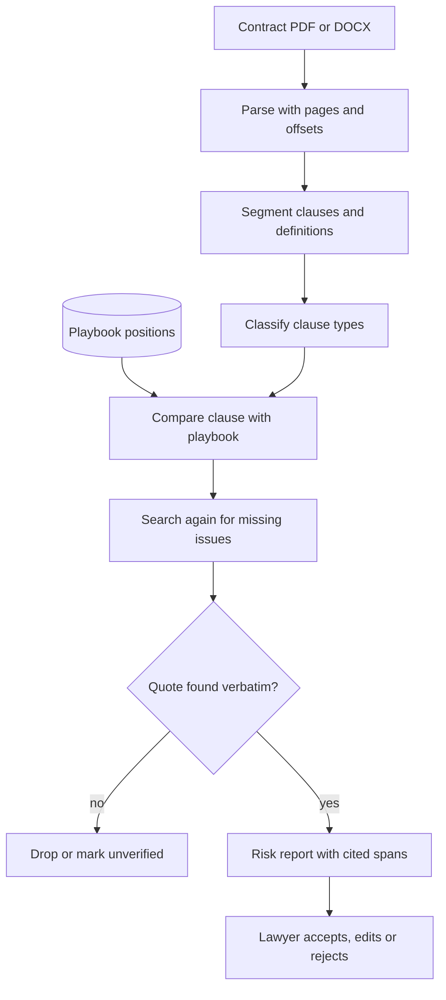

## TL;DR
A contract review agent splits a contract into clauses, compares each with the company playbook, flags
risky or missing terms with severity, and cites the exact text for every flag. The outcome is faster
first-pass review that a lawyer can trust and check.

## For agent builders
- **Why it is hard.** Every flag must be verifiable: a risk with a made-up quote is worse than no flag.
  Contracts are long, clauses cross-reference each other, and "missing" clauses are hard to prove.
- **What it teaches.** Document parsing with positions, structured extraction, playbook-grounded
  judgement, citation verification in code, SME-built golden sets, and human review as the final step.
- **Where it shows up in your stack.** A PDF or DOCX parser that keeps page and offset, a structured
  output layer (Pydantic, Instructor or provider JSON schemas), a playbook store, and a review UI that
  highlights cited spans.
- **What you can skip.** Training a legal model. Strong general models plus a precise playbook and
  verified citations go a long way; spend the effort on evals with lawyers.

## Why it exists
- **First-pass review is slow and repetitive.** Lawyers and contract managers check the same 20-40 issues
  (liability caps, indemnities, renewal, governing law, data protection) on every NDA, MSA or DPA.
- **A plain chatbot fails because it is not accountable.** It summarises the contract fluently, but
  cannot show where each claim comes from or apply this company's positions.
- **Keyword rules fail on drafting variety.** "Liability shall not exceed fees paid" and "aggregate
  exposure is capped at" mean the same thing; regexes miss one or misfire on the other.
- **An agent adds judgement with evidence:** it locates each clause, compares it with the playbook's
  standard and fallback positions, and attaches a quote a reviewer can click.

## How it works
### Reference flow
1. **Parse with positions.** Extract text with page numbers and character offsets (OCR for scans), and
   keep headings and numbering, because citations and cross-references depend on them.
2. **Segment into clauses.** Split by numbered sections and headings; keep definitions separately,
   since defined terms change meaning ("Fees" may exclude expenses).
3. **Classify clauses.** Label each with a type from the playbook taxonomy (for example CUAD's categories
   such as governing law, cap on liability, renewal term).
4. **Compare with the playbook.** For each issue the playbook lists standard, acceptable fallback and
   unacceptable positions; the model decides which applies and explains why.
5. **Detect missing clauses.** For required issues with no matching clause, search again with rewritten
   queries before flagging "missing", because absence claims are easy to get wrong.
6. **Verify citations in code.** Every flag carries a verbatim quote; code checks it exists in the source
   and stores its offsets. Flags without a verified quote are dropped or marked for review.
7. **Human review and redlines.** A lawyer accepts, edits or rejects each flag; suggested redlines are
   drafts only, and every decision is logged.

### Components
| Component | Practice choice | Why |
|---|---|---|
| Parser | PDF or DOCX text with page and offset | Citations must point to exact spans |
| Clause store | Clauses plus definitions, per contract | Retrieval for cross-references |
| Playbook | Issue list with standard, fallback, unacceptable text | Grounds judgement in company policy |
| Extractor | LLM with structured output schema | Typed findings, easy validation |
| Verifier | Code that matches quotes to source | Removes fabricated evidence |
| Memory | Prior negotiated positions per counterparty | Consistency across deals |
| Guardrails | No legal advice to non-lawyers, confidentiality, data retention | Professional and privacy duties |
| Human approval | Lawyer signs off every flag and redline | Accountability stays with people |

### Risk scoring
- **High.** Unacceptable position or a missing required clause (no liability cap, unlimited indemnity).
- **Medium.** Fallback position that needs approval (cap at 6 months of fees instead of 12).
- **Low.** Drafting or consistency issue (undefined term, wrong cross-reference).
- **Information.** Clause present and standard; listed so the reviewer sees coverage.

## Diagram
Every finding passes the citation verifier before a human sees it.



## Examples
### Typed findings with citation verification
The model returns findings as JSON matching a schema; code rejects any finding whose quote is not in the
contract. Requires `pydantic` v2; the `llm_findings` list stands in for a structured-output call.

```python
import re
from typing import Literal
from pydantic import BaseModel

class Finding(BaseModel):
    issue: Literal["cap_on_liability", "auto_renewal", "governing_law", "indemnity"]
    quote: str                                   # must be verbatim from the contract
    position: Literal["standard", "fallback", "unacceptable", "missing"]
    severity: Literal["high", "medium", "low", "info"]
    rationale: str

CONTRACT = """7. Liability. Each party's aggregate liability shall not exceed the fees paid
in the six (6) months preceding the claim.
12. Term. This Agreement renews automatically for successive one-year terms unless either
party gives ninety (90) days' notice."""

llm_findings = [   # what a structured-output call might return
    {"issue": "cap_on_liability", "quote": "shall not exceed the fees paid in the six (6) months",
     "position": "fallback", "severity": "medium", "rationale": "Playbook standard is 12 months of fees."},
    {"issue": "auto_renewal", "quote": "renews automatically for successive one-year terms",
     "position": "fallback", "severity": "medium", "rationale": "Notice of 90 days exceeds standard 30."},
    {"issue": "indemnity", "quote": "Customer shall indemnify Vendor for all claims",
     "position": "unacceptable", "severity": "high", "rationale": "Uncapped one-way indemnity."},
]
REQUIRED = {"cap_on_liability", "auto_renewal", "governing_law", "indemnity"}

def locate(quote, text):
    """Whitespace-insensitive exact match; returns character offsets or None."""
    pattern = r"\s+".join(map(re.escape, quote.split()))
    m = re.search(pattern, text)
    return (m.start(), m.end()) if m else None

report, seen = [], set()
for raw in llm_findings:
    f = Finding.model_validate(raw)             # schema check: bad enums or fields raise
    span = locate(f.quote, CONTRACT)
    if span is None:
        print(f"DROPPED unverified quote for {f.issue!r}: {f.quote!r}")
        continue
    seen.add(f.issue); report.append((f.severity, f.issue, span, f.rationale))
for issue in sorted(REQUIRED - seen):          # candidates only: search again before flagging
    report.append(("review", issue, None, "No verified clause found; confirm it is missing."))
for row in report:
    print(row)
```

### Cost, latency and accuracy targets for NDA and MSA review
Illustrative targets for a first-pass reviewer on one contract type; agree real thresholds with the
legal team using their own labelled contracts.

| Metric | Target | Notes |
|---|---|---|
| Clause detection recall per issue | 90%+ on high-severity issues | Missing a liability clause is the costly error |
| Flag precision | 80%+ | Too many false flags and lawyers stop reading |
| Citation validity | 100% of shown flags | Enforced by the verifier, not the model |
| Position accuracy (standard, fallback, unacceptable) | 85%+ agreement with lawyers | Measured on an SME-labelled set |
| Time per contract | 1-3 minutes for a 20-page MSA | Parallel per-issue calls |
| Model cost per contract | under $1 for a 20-page MSA | Long input, many issues; check current pricing |
| Lawyer review time | down 30-50% vs manual first pass | Baseline before the pilot |

### Practice data
- **CUAD.** 510 commercial contracts with expert labels for 41 clause categories, a ready golden set
  for clause detection.
- **ContractNLI.** NDAs paired with hypotheses labelled entailed, contradicted or not mentioned, good for
  "is this obligation present?" checks.
- **LEDGAR.** Labelled provisions from SEC filings for clause classification.
- **SEC EDGAR exhibits.** Real material contracts filed as exhibits, for long, messy test documents.
- **Synthetic playbook.** Write a 10-issue playbook (standard, fallback, unacceptable) and generate
  contract variants that hit each position.

## Production patterns
- **Playbook as data, versioned.** Store positions per issue with examples and owner, version them, and
  record which playbook version produced each report, because positions change after negotiations.
- **Per-issue extraction calls.** Run one focused call per issue (in parallel) over the relevant clauses
  instead of one giant prompt, which raises recall and makes failures attributable to an issue.
- **Citation verifier as a hard gate.** Quotes are matched to the source in code and rendered as
  highlights; unverifiable findings never reach the reviewer as facts. Monitor the drop rate per issue
  as a hallucination signal.
- **SME-labelled golden set.** Lawyers label 50-100 contracts with annotation guidelines; measure recall,
  precision and position agreement per issue on every prompt, model or playbook change.
- **Confidentiality and retention.** Use enterprise API terms with no training on inputs, regional
  hosting where required, access by matter, and deletion schedules for uploaded contracts.
- **Lawyer in the loop, always.** The agent produces a first-pass report and draft redlines; a lawyer
  approves every change sent to a counterparty, and accept or reject decisions feed the eval set.

## Trade-offs
- **Whole-document context vs per-clause retrieval.** Long-context models see cross-references but
  cost more and may miss details in the middle; per-issue retrieval is cheaper and sharper but can miss
  clauses that use odd headings. Many teams combine both.
- **Recall vs precision.** Tuning for recall on high-severity issues adds false flags; lawyers accept
  extra flags on liability and indemnity, not on boilerplate.
- **Generic model vs domain fine-tune.** A fine-tune can improve clause classification, but a playbook
  plus verified citations is easier to update when positions change.
- **Suggested redlines vs flags only.** Redlines save time but invite over-reliance; start with flags
  and add redlines once position accuracy is proven.

## Pitfalls
- **Paraphrased or invented quotes.** The flag sounds right but the text is not in the contract. Fix:
  verbatim quotes checked in code, with offsets, before display.
- **Ignoring definitions.** "Fees" is defined to exclude expenses, so a cap is smaller than it looks.
  Fix: retrieve definitions for defined terms used in each clause.
- **Overconfident "missing" flags.** The clause exists under an unusual heading or in a schedule. Fix:
  search again with rewritten queries and label absence as "confirm missing".
- **Losing positions in OCR.** Scanned contracts lose numbering and page links, so citations point
  nowhere. Fix: keep page and offset from OCR output and test on scanned samples.
- **Treating the output as legal advice.** Business users act on flags without counsel. Fix: route
  reports to legal reviewers and label them as first-pass analysis.

## When to use
- **Good first project when:** one contract type (NDAs or DPAs) has a written playbook and a lawyer will
  label 50 examples. Clear issues and public datasets make it very practical.
- **Avoid when:** there is no playbook, contracts are bespoke and negotiated line by line, or nobody with
  legal authority will review outputs.
- **Measure:** recall and precision per issue, citation validity, position agreement with lawyers, and
  review time saved.
- **Interviews:** expect to discuss citation verification, playbook design and SME evals.

## Role lens
- **Engineer:** Builds the parser with offsets, per-issue structured extraction, the citation verifier
  and the golden-set eval harness.
- **Architect:** Designs playbook storage and versioning, confidentiality and retention controls, and
  the review workflow where lawyers approve every outcome.
- **FDE:** Works with the legal team to turn their checklist into a playbook, runs labelling sessions,
  and sets the per-issue precision and recall targets.

## Check yourself
**Q:** Your contract agent flags "uncapped indemnity, high risk" on an MSA, but the reviewer cannot find
the quoted sentence anywhere. What went wrong and how do you make this impossible?
**A:** The model produced a plausible quote that is not in the contract, a hallucinated citation, and
nothing checked it before display. The fix is a citation verifier in code: each finding must carry a
verbatim quote, the verifier searches the parsed source with whitespace-insensitive exact matching,
stores page and offsets, and drops or marks unverified any finding without a match. The UI renders
highlights from offsets, so reviewers jump to the text. Track the drop rate per issue as a quality
signal, and add this contract to the golden set. Also check whether the indemnity lives in a schedule or
definition the parser missed, which would be a recall problem instead.

## Interview questions
### Design a contract review agent for NDAs. What are the main components?
- **Parser and segmenter** that keep page, offsets, numbering and definitions.
- **Playbook** of issues with standard, fallback and unacceptable positions.
- **Per-issue extraction** with structured output, then a **citation verifier** and a risk report
  reviewed by a lawyer.

### How do you stop the agent from fabricating evidence?
- **Require verbatim quotes** in the schema and match them to the source text in code before display.
- **Render from offsets,** not model text, so the reviewer always sees the real clause.
- **Monitor** the share of findings dropped by the verifier per issue and model version.

### How would you build the evaluation set with the legal team?
- **Annotation guidelines** per issue with examples of each position, written with lawyers.
- **50-100 labelled contracts,** double-labelled on a sample to measure agreement, plus public sets like
  CUAD for clause detection.
- **Metrics per issue:** recall, precision and position agreement, gated before each release.

### A clause is flagged as missing, but it is actually in Schedule B. How do you fix the system?
- **Parse schedules and exhibits** as part of the document, with their own headings.
- **Search again before claiming absence** using rewritten queries and definitions.
- **Label absence as "confirm missing"** so the reviewer checks, and add the case to the eval set.

### When would you not automate contract review?
- **When there is no playbook** or every deal is bespoke, because the agent has no standard to compare
  against.
- **When no lawyer reviews outputs,** since the agent's findings are first-pass analysis, not advice.

## Quiz
### Q: What is the most reliable way to guarantee that cited quotes are real?
- [ ] Ask the model to double-check its quotes
- [ ] Use a larger model with a longer context window
- [x] Verify each quote against the parsed source text in code and render highlights from offsets
- [ ] Lower the temperature to zero
> Model self-checks and lower temperature reduce but do not eliminate fabricated quotes. Matching quotes
> to the source in code and rendering from offsets makes unverifiable evidence impossible to display.

### Q: Why do playbook-based agents store standard, fallback and unacceptable positions per issue?
- [ ] To make prompts longer
- [x] So the agent can grade each clause against the company's own negotiating positions
- [ ] Because models cannot read contracts without them
- [ ] To replace the lawyer's final review
> Risk depends on the company's positions, not general legal knowledge. Explicit positions let the agent
> label a clause as standard, acceptable with approval, or unacceptable, and explain why.

### Q: The agent flags a required clause as missing. What should happen before the flag is final?
- [ ] Nothing; absence is easy to detect
- [ ] Delete the flag to avoid false positives
- [x] Search again with rewritten queries, schedules and definitions, then mark it for reviewer confirmation
- [ ] Ask the counterparty
> Clauses often hide under unusual headings or in schedules, so absence needs a second search and a
> human confirmation. Treating absence as easy creates confident, wrong high-severity flags.

## Use cases & projects
### Use cases
- **NDA triage for sales.** Classify incoming NDAs as standard, needs-approval or escalate, with cited
  reasons.
- **Vendor contract intake.** Check MSAs and DPAs for liability caps, data protection terms and auto-
  renewal before procurement signs.
- **Policy compliance checks.** Compare internal policies or vendor security documents with a regulatory
  checklist and cite gaps.
- **Contract repository analytics.** Extract renewal dates, notice periods and governing law across
  hundreds of signed contracts into a table.
- **Due diligence support.** Flag change-of-control and assignment clauses across a target's contracts.

### Mini project
**Cited clause checker on CUAD (2-3 hours).**
- **Goal:** an agent that reviews a CUAD contract against a 5-issue playbook and outputs flags with
  verified quotes and severity.
- **Steps:** download CUAD and pick 10 contracts; write a playbook for 5 issues that match CUAD
  categories (cap on liability, renewal term, governing law, non-compete, termination for convenience);
  extend the schema's `issue` list to those 5 and run one structured-output call per issue; verify quotes
  in code; compare detected clauses with CUAD labels.
- **Done when:** every displayed flag has a verified quote with offsets, you report recall and precision
  per issue against CUAD labels, and a deliberately altered quote is dropped by the verifier.
