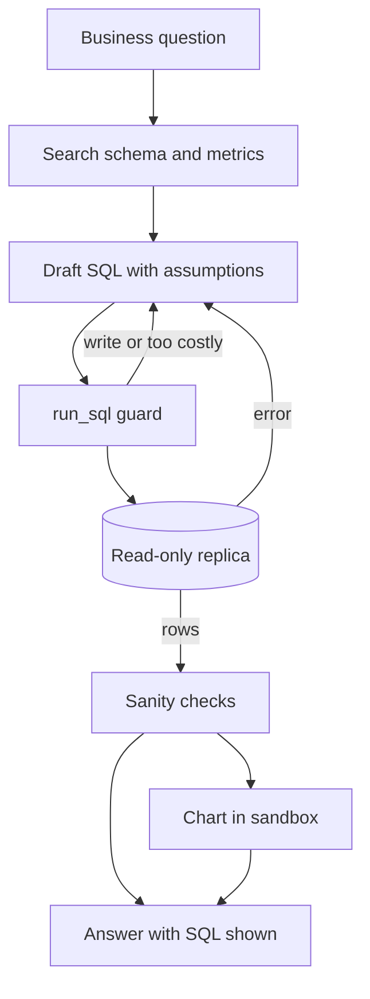

## TL;DR
A data analyst agent turns a business question into SQL against your warehouse, runs it through a
guarded read-only tool, and answers with numbers, the query and a chart. The outcome is self-serve
analytics without wrong numbers or runaway queries.

## For agent builders
- **Why it is hard.** Schemas are large and cryptic, the same question has many plausible SQL
  readings, and a query that runs is not a query that is right. Wrong numbers look exactly like right
  ones.
- **What it teaches.** Schema retrieval, tool guardrails at the database layer, error-driven retries,
  execution-based evals, and showing work (the SQL) so humans can check it.
- **Where it shows up in your stack.** A `run_sql` tool on a read-only role, a schema and metrics
  catalogue the agent can search, a code sandbox for charts, and traces holding every query.
- **What you can skip at first.** Fine-tuning a text-to-SQL model and semantic layers. A frontier model
  with a good schema description goes a long way on a small database.

## Why it exists
- **The user problem.** Business users wait days for an analyst to answer "what was revenue by region
  last quarter", and analysts spend their time on repetitive queries.
- **Why a plain chatbot fails.** It cannot see the data, so it invents numbers, or writes SQL against
  tables it guessed.
- **Why a dashboard fails.** Dashboards answer the questions someone predicted; follow-ups ("and
  excluding refunds?") need a new query.
- **What an agent buys.** It inspects the schema, writes and runs SQL, reads errors, fixes the query,
  and explains the result, with the SQL shown so an analyst can audit it.

## How it works
### The loop
1. **Ground the question.** Search a catalogue of tables, columns, metric definitions and example
   queries; put only the relevant slice into context, because full schemas blow the window.
2. **Draft SQL.** Ask for one query, with assumptions stated ("revenue means `total` minus refunds").
3. **Run through the guard.** The tool enforces read-only access, a row limit and a timeout.
4. **Repair on error.** Feed the database error back; allow two or three retries, then ask the user.
5. **Sanity-check.** Compare with known totals, check for empty or duplicated results from bad joins.
6. **Answer.** Summarise the numbers, show the SQL, and render a chart from the result in a sandbox.

### Reference components
| Component | Choice for a first build | Why |
|---|---|---|
| Schema context | Table and column descriptions plus sample rows | Names alone are ambiguous |
| Metrics | A short glossary of business definitions | "Revenue" must mean one thing |
| Query tool | `run_sql(query)` on a read-only role | The database enforces safety |
| Chart tool | Python in a sandbox, or a chart spec rendered by the UI | Never run plotting code on the host |
| Memory | Conversation plus saved, verified queries | Reuse beats regeneration |
| Guardrails | Read-only role, row limit, timeout, allow-listed schemas | Prompts cannot stop a bad query |
| Human points | New metric definitions, results feeding decisions | Wrong numbers are silent |

### Guarded queries, in layers
- **Database role.** A user with `SELECT` only on approved schemas, a statement timeout and row-level
  security where tenants share tables; this is the layer that cannot be talked around.
- **Tool checks.** Reject non-read statements, enforce a `LIMIT`, cap result size returned to the model.
- **Cost checks.** On warehouses, estimate scanned bytes first (for example a dry run) and refuse
  queries above a budget. Check your warehouse's docs for the exact mechanism.

## Diagram
The guard sits between the model's SQL and the database; errors loop back for repair.



## Examples
### A guarded `run_sql` tool on SQLite
Runnable with the standard library. The authorizer allows only reads; a progress handler aborts slow
queries; results are capped before they reach the model.

```python
import sqlite3, time

db = sqlite3.connect(":memory:")
db.executescript("""
CREATE TABLE orders(id INTEGER, region TEXT, total REAL, placed TEXT);
INSERT INTO orders VALUES (1,'EU',120,'2026-07-02'),(2,'US',80,'2026-07-15'),(3,'EU',60,'2026-08-01');
""")
ALLOWED = {sqlite3.SQLITE_SELECT, sqlite3.SQLITE_READ, sqlite3.SQLITE_FUNCTION}

def authorizer(action, arg1, arg2, dbname, source):
    return sqlite3.SQLITE_OK if action in ALLOWED else sqlite3.SQLITE_DENY

def run_sql(query, max_rows=200, timeout_s=2.0):
    deadline = time.monotonic() + timeout_s
    db.set_authorizer(authorizer)
    db.set_progress_handler(lambda: time.monotonic() > deadline, 10_000)  # non-zero aborts
    try:
        cur = db.execute(query)
        cols = [d[0] for d in cur.description]
        rows = cur.fetchmany(max_rows + 1)
        return {"columns": cols, "rows": rows[:max_rows], "truncated": len(rows) > max_rows}
    except sqlite3.Error as e:
        return {"error": f"{type(e).__name__}: {e}"}     # fed back to the model for repair
    finally:
        db.set_authorizer(None); db.set_progress_handler(None, 0)

print(run_sql("SELECT region, SUM(total) AS revenue FROM orders GROUP BY region"))
print(run_sql("DELETE FROM orders"))                      # denied by the authorizer
print(run_sql("SELECT regoin FROM orders"))               # typo: error goes back to the model
```

In production the same idea lives in the database: a read-only role, a statement timeout and a
replica, with the tool checks as a second layer.
- **SQLite file.** Open it read-only as well, with `sqlite3.connect("file:chinook.db?mode=ro", uri=True)`.
- **PostgreSQL role.** Set `statement_timeout` and `default_transaction_read_only` on the agent's role
  with `ALTER ROLE ... SET`, on top of `SELECT`-only grants.
- **Known gap.** This authorizer also denies recursive CTEs (`SQLITE_RECURSIVE`); add that code to
  `ALLOWED` if your questions need them.

### Worked targets for a first internal pilot
Illustrative orders of magnitude for one domain (for example sales) with 20-50 tables.

| Metric | Target | How you measure it |
|---|---|---|
| Execution accuracy | 80%+ on a 100-question gold set | Compare result sets with gold SQL output |
| Unsafe statements executed | 0 | Database audit log and role permissions |
| Repair success | Most errors fixed within 2 retries | Trace retries per question |
| Latency | p50 under 10 s including the query | Spans for model and database |
| Query cost | Under a per-query scan budget | Warehouse bytes scanned per query |
| Analyst review | Spot-check of 10% of answers weekly | Disagreements become gold questions |

### Practice data
- **Sample databases.** Chinook (a music store) and Northwind (orders and suppliers) are small,
  well-known schemas available for SQLite and PostgreSQL.
- **Benchmarks.** Spider and BIRD provide questions with gold SQL across many databases; BIRD adds
  messier values and external knowledge.
- **Bigger data.** NYC taxi trip records loaded into DuckDB give realistic volumes for cost and timeout
  tests.

## Production patterns
- **Read-only role on a replica.** Teams give the agent a database user with `SELECT` on approved
  schemas, a statement timeout and row-level security, pointed at a replica or warehouse. Monitor
  denied statements and timeouts by user.
- **Curated schema and metric catalogue.** Descriptions, join paths, metric definitions and verified
  example queries, retrieved per question. Track which tables appear in failed questions and improve
  their descriptions first.
- **Show the SQL and the assumptions.** Every answer displays the query and the definitions used, so
  analysts can correct the agent and users learn to trust or question it.
- **Execution-based evals.** Score result-set equality against gold SQL on a fixed question set, and
  rerun it on every prompt, model or catalogue change (see `evals/golden-dataset`).
- **Save verified queries.** When an analyst confirms an answer, store question and SQL as a few-shot
  example for retrieval. Watch the hit rate on saved queries.

## Trade-offs
- **Raw SQL vs a semantic layer.** Raw SQL handles any question but invites wrong joins; a metrics layer
  constrains the agent to defined measures, at the cost of modelling work up front.
- **Full schema vs retrieved slices.** The full schema avoids missing tables but costs tokens and
  attention; retrieval is cheaper but can omit the one table that matters.
- **Autonomy vs review.** Unreviewed answers are fast, but wrong numbers can drive decisions; require
  analyst review for anything feeding finance or external reporting.

## Pitfalls
- **Safety only in the prompt.** Symptom: an injected or confused request runs `DELETE` or scans a huge
  table. Fix: read-only role, timeout and tool checks.
- **Accepting any query that runs.** Symptom: plausible totals that double-count from a many-to-many join.
  Fix: sanity checks against known totals and execution-based evals.
- **Ambiguous metrics.** Symptom: two users get different "revenue" for the same month. Fix: a metric
  glossary the agent must cite.
- **Dumping huge results into context.** Symptom: slow, expensive turns and truncated reasoning. Fix: cap
  rows, aggregate in SQL, and summarise.

## When to use
- **Good first project when** you have a small, clean database and a list of real questions: correctness
  is checkable by running SQL, which makes evals honest.
- **Avoid as a first project when** the warehouse has hundreds of undocumented tables; you will spend the
  time documenting, not building the agent.
- **Measure** execution accuracy on a gold set, unsafe-statement count, retries and cost per query.
- **Interviews** often ask how you would stop a text-to-SQL agent from running destructive or expensive
  queries.

## Role lens
- **Engineer:** Builds the guarded query tool, schema retrieval and repair loop, and the execution-based
  eval harness over a gold question set.
- **Architect:** Chooses database roles, replicas, semantic layer versus raw SQL, and where analyst review
  is required.
- **FDE:** Works with the customer's analysts to write metric definitions and gold questions, and
  documents the tables that cause failures.

## Check yourself
**Q:** A user asks the agent "what was revenue last month" and gets a number 30% higher than finance
reports. The SQL ran without error. How do you find and prevent the cause?
**A:** A query that runs can still be wrong. Inspect the SQL in the trace: likely causes are a join that
duplicates rows (orders joined to line items or payments), counting refunds or test orders, or a
different date boundary or timezone. Fix the immediate case by adding a metric definition for revenue,
the correct join path and a verified example query to the catalogue. Prevent recurrence with an
execution-based gold question for it, and sanity checks against known monthly totals.

## Interview questions
### How do you stop a text-to-SQL agent from running a destructive query?
- **Database permissions first.** A role with `SELECT` only on approved schemas, on a replica, with a
  statement timeout; this holds even if the model is fully manipulated.
- **Tool checks second.** Reject non-read statements, enforce row limits and scan budgets, and log every
  query for audit.

### The schema has 400 tables. How does the agent pick the right ones?
- **Retrieve schema slices.** Index table and column descriptions, join paths and example queries, and
  retrieve the top matches per question.
- **Curate the hot paths.** Document the 20-50 tables most questions touch, with metric definitions,
  before trying to cover everything.

### How would you evaluate this agent?
- **Execution accuracy.** Run generated and gold SQL on the same database and compare result sets, since
  different SQL can be equally correct.
- **Safety and cost.** Count denied statements, timeouts and scanned bytes, and include adversarial
  questions in the set.
- **Human agreement.** Analysts spot-check a sample weekly; disagreements become new gold cases.

### When should the agent ask a clarifying question instead of answering?
- **When the metric or scope is ambiguous.** "Customers" could mean accounts or users, "last quarter" could
  be fiscal or calendar; the catalogue should mark such terms.
- **When results look implausible.** Empty sets, totals far from known baselines or huge row counts are
  signals to confirm assumptions before answering.

### Where do the charts get rendered, and why does it matter?
- **In a sandbox or as a declarative spec.** Generated plotting code runs in an isolated environment, or
  the agent returns a chart spec the UI renders.
- **Because generated code is untrusted.** Running it on the application host risks file access or
  network calls from code the model wrote.

## Quiz
### Q: Which control most reliably prevents a text-to-SQL agent from modifying data?
- [ ] A system prompt that forbids INSERT, UPDATE and DELETE
- [ ] A regex that rejects queries containing the word DELETE
- [x] A database role with read-only privileges on a replica
- [ ] Asking the model to double-check its query before running it
> Prompts and string filters can be bypassed or fooled. Database privileges are enforced by the
> database itself on every statement, so even a manipulated model cannot write.

### Q: Why use execution accuracy rather than exact SQL match to evaluate generated queries?
- [x] Different SQL can return the same correct result, so comparing result sets is fairer
- [ ] Exact match is too expensive to compute
- [ ] Execution accuracy ignores wrong answers
- [ ] Gold SQL is never available for benchmarks
> Many queries are equivalent (join order, aliases, subquery versus join). Running both and comparing
> results measures whether the answer is right, which is what users care about.

### Q: A generated query runs and returns a revenue total twice the expected value. What is the most likely cause?
- [ ] The database timed out halfway
- [ ] The row limit truncated the result
- [x] A join multiplied rows, for example orders joined to multiple line items before summing
- [ ] The read-only role hid half the table
> Fan-out joins duplicate parent rows, so a SUM over them counts each order several times. Sanity
> checks against known totals and documented join paths catch this class of error.

## Use cases & projects
### Use cases
- **Self-serve business analytics.** Sales, marketing and operations teams ask questions over the
  warehouse and get SQL-backed answers with charts.
- **Product analytics.** Funnel, retention and feature usage questions over event tables, with
  definitions from the metrics catalogue.
- **Finance reconciliation support.** Drafting queries that compare ledgers, with analyst review before
  any number is reported.
- **Ops dashboards on demand.** Ad-hoc breakdowns during incidents, run on a replica with tight timeouts.

### Mini project
**Guarded analyst agent over Chinook (2-3 hours).**
- **Goal:** an agent that answers 30 business questions about the Chinook database with SQL, numbers and
  a chart, and cannot modify data.
- **Steps:** load Chinook into SQLite; write table descriptions and five metric definitions; build the
  `run_sql` tool above plus a chart tool that renders a bar chart from rows; write 30 questions with gold
  SQL, including five adversarial ones; run the agent with error-driven retries.
- **Done when:** execution accuracy is reported on the 30 questions, every adversarial write attempt is
  denied, and each answer shows its SQL.
