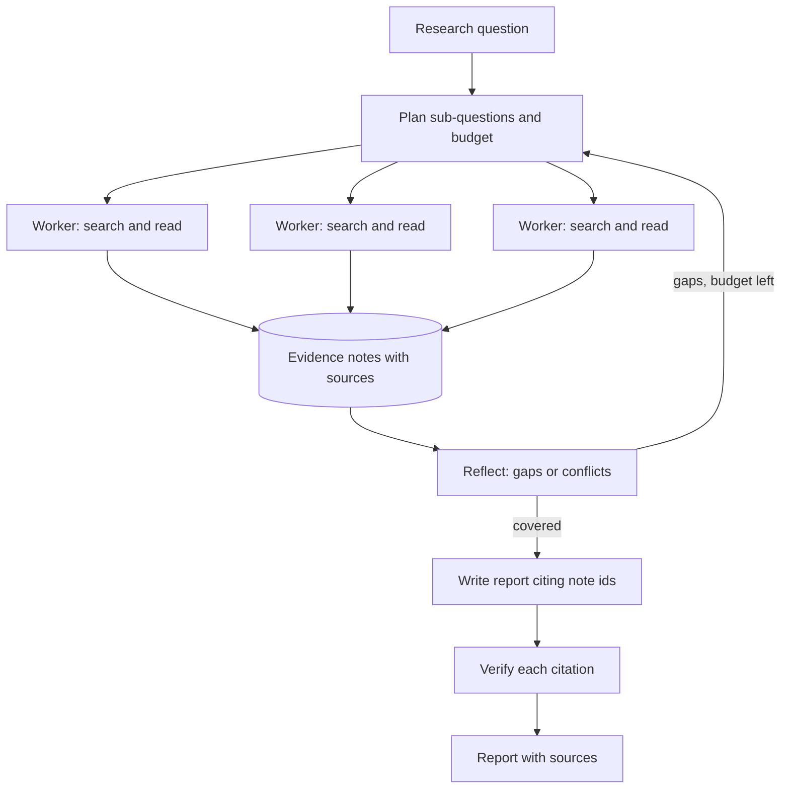

## TL;DR
A deep research agent plans sub-questions, searches and reads many sources, keeps evidence with
provenance, and writes a report where every claim cites a source. The outcome is hours of desk research
done in minutes, checkable by a reader.

## For agent builders
- **Why it is hard.** The search space is open, sources conflict or are wrong, web pages carry injected
  instructions, and the final report must stay faithful to dozens of documents the model read once.
- **What it teaches.** Planning and query decomposition, parallel sub-agents, context management through
  notes, provenance tracking, citation verification and budgets on breadth and depth.
- **Where it shows up in your stack.** A search API tool, a fetch-and-extract tool, an evidence store,
  an orchestrator that fans out sub-questions, and a verifier pass before the report ships.
- **What you can skip at first.** Live web crawling. A local corpus such as a Wikipedia subset gives the
  same loop with reproducible results.

## Why it exists
- **The user problem.** Analysts, product managers and engineers spend hours searching, opening tabs,
  skimming and copying quotes to answer one comparative or multi-part question.
- **Why a plain chatbot fails.** It answers from training data that may be stale, cannot show where a
  claim came from, and fills gaps with plausible inventions.
- **Why single-shot RAG fails.** One retrieval for a multi-hop question ("which of these three vendors
  supports X, and since when?") misses the second hop and the comparison.
- **What an agent buys.** Iterative search driven by what it has learned so far, plus a report a reader
  can verify claim by claim.

## How it works
### The loop
1. **Clarify and plan.** Restate the question, list sub-questions and what evidence would answer each,
   and set a budget (searches, pages, tokens, minutes).
2. **Search in parallel.** Run sub-questions as separate searches or sub-agents, because they are
   independent and latency adds up.
3. **Read and extract.** Fetch pages, strip boilerplate, and save short quoted evidence with the URL,
   title and retrieval date into a notes store.
4. **Reflect.** Check which sub-questions remain unanswered or contradicted, and issue follow-up
   searches; stop when covered or the budget is spent.
5. **Synthesise.** Write the report from the notes, not from raw pages, citing evidence ids.
6. **Verify.** Check every citation supports its sentence; drop or flag unsupported claims.

### Reference components
| Component | Choice for a first build | Why |
|---|---|---|
| Search | A search API, or BM25 over a local corpus | Reproducible results while you iterate |
| Read | Fetch, extract main text, chunk | Raw HTML wastes context |
| Evidence store | Notes with id, quote, source, date | Synthesis cites ids, not memory |
| Orchestration | Planner plus parallel sub-question workers | Breadth without one huge context |
| Memory | The notes store, not the transcript | Survives many reads |
| Guardrails | Page text treated as data, domain allow-lists | Pages can carry injected instructions |
| Human point | Approve the plan for expensive runs, review the report | Scope errors are costly to discover late |

### Citation discipline
- **Quote, then claim.** Extraction saves the exact supporting span, so verification is a string check
  plus a judge, not a fresh search.
- **One claim, one or more ids.** The writer must attach evidence ids to each factual sentence.
- **Verifier pass.** A cheaper model or judge checks each sentence against its quotes and flags
  unsupported or over-generalised claims.

## Diagram
The planner fans out sub-questions; only extracted evidence reaches the writer, and the verifier gates
the report.



## Examples
### Evidence notes and a citation verifier
Runnable with the standard library. A real agent uses a search API and an LLM writer; the evidence
format and the check stay the same.

```python
import re

CORPUS = {  # stand-in for fetched pages: url -> extracted text
    "https://example.org/a": "The Rust 1.0 release shipped in May 2015 after years of development.",
    "https://example.org/b": "Go 1.0 was released in March 2012 with a compatibility promise.",
}

def search(query):
    terms = set(query.lower().split())
    scored = [(sum(t in text.lower() for t in terms), url) for url, text in CORPUS.items()]
    return [url for s, url in sorted(scored, reverse=True) if s > 0]

notes = []
def save_evidence(url, quote):
    if quote not in CORPUS[url]:
        raise ValueError("quote must be copied verbatim from the page")
    notes.append({"id": len(notes) + 1, "url": url, "quote": quote})
    return notes[-1]["id"]

for q in ["rust 1.0 release", "go 1.0 released"]:     # sub-questions from the planner
    top = search(q)[0]
    sentence = re.split(r"(?<=\.)\s", CORPUS[top])[0]
    save_evidence(top, sentence)

report = "Go 1.0 shipped in March 2012 [2]. Rust 1.0 followed in May 2015 [1]. Both are popular [3]."

def verify(report, notes):
    by_id = {n["id"]: n for n in notes}
    for sent in re.split(r"(?<=\.)\s", report):
        ids = [int(i) for i in re.findall(r"\[(\d+)\]", sent)]
        ok = ids and all(i in by_id for i in ids)
        print(("OK  " if ok else "FLAG"), sent, [by_id[i]["url"] for i in ids if i in by_id])

verify(report, notes)
# The third sentence cites a note that does not exist, so it is flagged. A judge model then checks
# that each OK sentence is actually entailed by its quotes, not just that the ids exist.
```

### Worked targets for a first research agent
Illustrative orders of magnitude for a report built from 10-30 sources.

| Metric | Target | How you measure it |
|---|---|---|
| Answer correctness | 70%+ on a multi-hop benchmark slice | FRAMES or HotpotQA questions with gold answers |
| Citation precision | 95%+ cited sentences supported | Judge plus human spot-check of 50 claims |
| Citation recall | Every factual sentence has a citation | Count uncited factual sentences |
| Sources read | 10-30 per report | Trace tool calls |
| Latency | Minutes, run as a background job | Wall-clock per report |
| Cost | Dollars per report; multi-agent runs cost several times more | Tokens across all workers |

### Practice data
- **Questions with gold answers.** HotpotQA (multi-hop over Wikipedia) and FRAMES (multi-hop with
  required reasoning) give answers to score against.
- **Corpus.** A Wikipedia dump subset or the arXiv API for papers, indexed with BM25 so runs are
  repeatable before you add a live search API.

## Production patterns
- **Background jobs, not chat turns.** Research takes minutes, so run it as a durable job with progress
  events and resumable state (see `system-design/workflow-orchestration`). Monitor job duration and
  failure by step.
- **Orchestrator with parallel workers.** A lead agent plans, workers explore sub-questions in their own
  contexts and return condensed findings. Track total tokens, because fan-out multiplies cost.
- **Provenance on every note.** Store URL, title, retrieval date and the verbatim quote, and render
  citations as links the reader can click.
- **Verifier gate before delivery.** Check citation support with a judge calibrated on human labels and
  strip or flag unsupported claims (see `evals/faithfulness-groundedness`).
- **Treat fetched pages as untrusted.** Strip scripts, never follow instructions found in page text, and
  keep tools read-only so an injected page cannot trigger actions.

## Trade-offs
- **Breadth vs cost.** More workers and sources raise coverage but multiply tokens; set budgets per
  question type and measure accuracy gain per extra dollar.
- **Live web vs fixed corpus.** Live search finds fresh facts but makes evals non-reproducible; evaluate
  on a frozen corpus and spot-check live runs.
- **Long report vs verifiability.** Longer reports feel thorough but hide unsupported claims; shorter
  reports with dense citations are easier to trust and review.

## Pitfalls
- **Synthesising from memory.** Symptom: fluent claims with citations that do not support them. Fix:
  write only from saved quotes and verify every citation.
- **Unbounded exploration.** Symptom: runs that take an hour and cost far more than expected. Fix: budgets
  on searches, pages and tokens, with a stop rule in the reflect step.
- **One source repeated.** Symptom: a confident report built on a single blog syndicated many times.
  Fix: deduplicate by domain and content, and prefer primary sources.
- **Following instructions in pages.** Symptom: the report includes promotional or injected text. Fix:
  treat page text as data and filter it out of instructions.

## When to use
- **Good first project when** you want to practise planning, parallelism and grounding, and you can use
  a fixed corpus with gold answers to measure progress.
- **Avoid as a first project when** you have no way to score answers; without gold questions you will
  tune by vibes.
- **Measure** answer correctness, citation precision and recall, sources read and cost per report.
- **Interviews** use this to probe multi-agent design, context management and hallucination control.

## Role lens
- **Engineer:** Builds the search, fetch and evidence tools, the parallel worker loop and the citation
  verifier, with budgets enforced in code.
- **Architect:** Decides single-agent versus orchestrator-worker design, job infrastructure, corpus and
  search providers, and the verification gate before delivery.
- **FDE:** Defines what a good report means for the customer's analysts, builds a gold question set
  with them, and tunes source allow-lists for their domain.

## Check yourself
**Q:** Your research agent's reports read well, but a reviewer finds that a quarter of the citations do
not support their sentences. What do you change in the pipeline?
**A:** Make synthesis depend on evidence rather than memory. Extraction should save verbatim quotes with
source ids; the writer should cite note ids and only use saved notes; a verifier should check each
cited sentence against its quotes and remove or flag unsupported ones. Calibrate the verifier judge on
human-labelled claims, track citation precision on a fixed question set, and add failing reports to the
regression suite. Shorter, denser reports also help reviewers catch problems.

## Interview questions
### Design a deep research agent that produces cited reports.
- **Plan, fan out, condense.** A planner decomposes the question; parallel workers search and read in
  separate contexts and return short evidence notes with sources.
- **Write from evidence, then verify.** The writer cites note ids, and a verifier checks every citation
  before the report is delivered.
- **Run as a job.** Background execution with budgets, progress events and resumable state.

### When is a multi-agent design worth it over one agent?
- **When sub-questions are independent and broad.** Parallel workers cut latency and keep each context
  small, which helps quality on wide questions.
- **Not for narrow questions.** Fan-out multiplies tokens; a single agent with good search is cheaper
  and often as accurate for one-hop questions.

### How do you evaluate a research agent?
- **Gold answers.** Multi-hop sets such as FRAMES or HotpotQA on a frozen corpus for correctness.
- **Citation quality.** Precision (cited claims supported) and recall (factual claims cited), using a
  judge calibrated against human labels.
- **Efficiency.** Sources read, tokens and wall-clock per report.

### A web page tells the agent to include a link and praise a product. How do you defend?
- **Page text is data.** Wrap fetched content as quoted material, instruct the model never to follow it,
  and filter evidence through extraction of quotes relevant to the sub-question.
- **No consequential tools.** Keep the agent read-only, so injected text can at worst pollute a report,
  which the verifier and reviewer can catch.

### How do you keep context under control after reading thirty pages?
- **Notes, not transcripts.** Workers return condensed evidence; the orchestrator never holds full pages.
- **Compaction at boundaries.** Summarise completed sub-questions once and keep the notes store as the
  source of truth.

## Quiz
### Q: Why should the writer synthesise from saved evidence notes rather than from everything it read?
- [ ] Notes are cheaper to store than pages
- [x] Notes carry verbatim quotes and source ids, so every claim can be traced and verified
- [ ] Models cannot read full web pages
- [ ] Notes remove the need for a search API
> Writing from notes ties each sentence to a stored quote and URL. That makes citation verification a
> concrete check instead of trusting the model's memory of thirty pages.

### Q: What is the main cost of an orchestrator with many parallel research workers?
- [ ] Higher latency than a single agent
- [ ] Inability to cite sources
- [x] Token usage multiplies with the number of workers and sources read
- [ ] Workers cannot use search tools
> Parallel workers usually cut wall-clock time, but each has its own context and reads its own sources,
> so total tokens and cost rise sharply. Budgets per question type keep that in check.

### Q: Why evaluate a research agent on a frozen corpus before testing on the live web?
- [ ] The live web has no useful information
- [ ] Frozen corpora make the agent faster
- [ ] Search APIs do not support evaluation
- [x] Results are reproducible, so score changes come from your changes rather than from the web changing
> Live search results shift daily, so the same run can score differently. A fixed corpus with gold
> answers isolates the effect of prompt, model or pipeline changes.

## Use cases & projects
### Use cases
- **Competitive and vendor analysis.** Compare products on features, pricing and dates, with every cell
  linked to a source.
- **Literature reviews.** Survey papers on a topic via the arXiv API, summarising methods and results
  with citations.
- **Due diligence briefs.** Company background from filings, news and websites, with conflicts flagged.
- **Technical investigations.** "Which libraries support X, and what are the known issues?" from docs,
  changelogs and issue trackers.

### Mini project
**Cited answers over a Wikipedia subset (2-3 hours).**
- **Goal:** a research agent that answers multi-hop questions with verified citations over a local
  corpus.
- **Steps:** download 50 HotpotQA questions and their supporting Wikipedia paragraphs; index them with
  BM25; build `search`, `read` and `save_evidence` tools; let a planner split each question into
  sub-questions; write answers citing note ids; run the verifier above plus a judge.
- **Done when:** you report exact-match accuracy, citation precision and average sources read across the
  50 questions, and every unsupported sentence is flagged.
