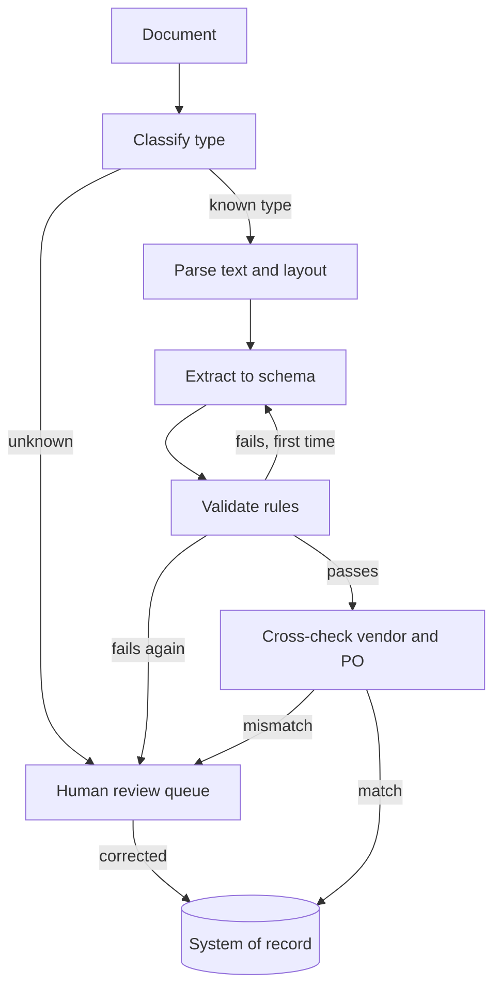

## TL;DR
A document processing agent reads invoices, forms or claims, extracts typed fields, validates them
against rules and source systems, and sends only uncertain cases to a human. The outcome is
straight-through processing for most documents with audited accuracy.

## For agent builders
- **Why it is hard.** Inputs are messy (scans, tables, handwriting, multi-page layouts), and a field
  that is 99% right per document still means many wrong records at volume. Errors are silent unless
  you validate.
- **What it teaches.** Structured outputs against a schema, validation and repair retries, cross-checks
  with tools, confidence-based routing, review queues and turning corrections into evals.
- **Where it shows up in your stack.** A parser or vision model, a Pydantic or JSON Schema contract, a
  validator layer, lookup tools (vendor master, purchase orders), a review UI and a durable job queue.
- **What you can skip at first.** Training custom layout models. Modern multimodal models extract well
  from page images; spend the effort on validation and review.

## Decision case
### Scenario
An accounts-payable team is moving its invoice agent from pilot to production and must choose the rule
that sends an invoice straight through or to a reviewer. The agent never pays; it posts records that a
payment run uses later. The rates below come from a 1,000-invoice labelled pilot and, like all figures
here, are illustrative.
- **Volume:** 8,000 invoices a month; 15% (1,200) are above 5,000 euros.
- **Escaped-error limit:** under 0.5% of straight-through invoices may have a wrong key field.
- **Review capacity:** 4 reviewers x 2 hours a day x 21 days = 168 hours a month, at about 1.5 minutes
  per flagged invoice.
- **Extraction cost:** about 0.04 euros per invoice; a second extraction costs the same again.
- **Audit:** finance samples straight-through invoices weekly and reports the error rate.

### Options
| Option | How it works | Straight-through | Review hours | Escaped error | Fits? |
|---|---|---|---|---|---|
| Review everything | Every invoice goes to a reviewer | 0% | 8,000 x 1.5 min = 200 h | about 0 | no: over 168 h |
| Model confidence 0.9+ | Straight through when the model says it is confident | 85% | 1,200 x 1.5 min = 30 h | 3.1% | no: error |
| Validation and PO match | Straight through only if all rules pass and vendor and PO match | 72% | 2,240 x 1.5 min = 56 h | 0.6% | no: error, just over |
| Validation, PO match and dual extraction above 5,000 euros | As above, plus a second extraction that must agree on key fields for large invoices | 70% | 2,400 x 1.5 min = 60 h | 0.3% | yes |

### Decision
**Route on validation and PO match, and require two agreeing extractions for invoices above 5,000
euros.** It is the only rule under the 0.5% escaped-error limit, and its 60 review hours sit well inside
the 168-hour capacity.

Self-reported confidence automates the most but lets about 6,800 x 0.031 = 211 wrong invoices a month
through.
- **Extra cost is small:** 1,200 x 0.04 = 48 euros a month for the second extractions.
- **Escaped errors:** 5,600 straight-through x 0.003 = about 17 a month, against about 35 with
  validation alone (5,760 x 0.006).
- **Disagreement is a review reason:** reviewers see both values and the page region side by side.

**What would change it.**
- **Volume triples:** at 24,000 invoices, 30% review is 7,200 x 1.5 min = 180 hours, over capacity;
  add reviewers or tighten rules for the vendors that cause most flags.
- **Audit misses the target:** if the weekly sample shows errors above 0.5%, extend dual extraction to
  a lower amount threshold and recompute cost and review load.
- **Errors cluster in one field:** add a field-specific rule rather than more extraction.

### Trade-offs accepted
- **Only 70% straight-through instead of 85%.** Track straight-through rate per vendor and work down the
  vendors with the most flags.
- **About 17 escaped errors a month remain.** They are caught later by payment-run controls and the
  weekly audit; track escaped errors by field and add each to the regression set.
- **Large invoices take longer.** Watch time from receipt to posting for invoices above 5,000 euros
  against payment terms.

### Review rubric
- **Routing signal justified:** the rule uses validation and system matches, and explains why model
  confidence alone is not enough.
- **Error limit applied to the right base:** escaped errors are measured on straight-through records.
- **Review load computed** from volume, flag rate and minutes per document, and compared with capacity.
- **Cost of extra checks shown** and tied to where errors are expensive (high amounts).
- **Measurement loop named:** audit sampling and corrections feed a regression set.
- **Change triggers stated** with the recomputed numbers.

## Why it exists
- **The user problem.** Operations teams key in invoices, claims and onboarding forms by hand: slow,
  costly and error-prone, with backlogs at month end.
- **Why a plain chatbot fails.** It can read one document in a chat, but it produces free text, has no
  schema, does not check totals or vendors, and leaves no audit trail.
- **Why template OCR fails.** Zone-based templates break when a vendor changes its layout, and every new
  supplier needs a new template.
- **What an agent buys.** Layout-tolerant extraction into a typed record, checks against business rules
  and systems of record, and human review only where the evidence is weak.

## How it works
### The pipeline
1. **Ingest and classify.** Detect document type (invoice, receipt, claim) and language; route unknown
   types to a human, because a wrong schema guarantees wrong fields.
2. **Parse.** Get text and layout from a PDF parser or OCR, or pass page images to a vision model.
3. **Extract.** Ask for output matching a typed schema, with a source page or quote per field where
   possible, so reviewers can check quickly.
4. **Validate.** Schema types first, then business rules (line items sum to the total, dates are
   plausible, tax rates are valid).
5. **Cross-check with tools.** Look up the vendor in the vendor master and match the purchase order,
   since the system of record beats the model's reading.
6. **Route.** Pass clean records straight through; send failures and low-confidence fields to a review
   queue; on repeated validation failure, re-extract once with the errors as feedback.

### Reference components
| Component | Choice for a first build | Why |
|---|---|---|
| Parsing | PDF text extraction plus page images for scans | Text is cheap, images handle layout |
| Schema | Pydantic model per document type | Types and rules in one contract |
| Extraction | Structured output or tool call returning the schema | Parseable every time |
| Validation | Field validators plus cross-field rules | Catches silent errors |
| Tools | `lookup_vendor`, `get_purchase_order` | Ground truth lives in systems |
| Memory | Per-vendor hints from past corrections | Recurring layouts get easier |
| Guardrails | PII redaction in logs, no auto-pay | Documents carry sensitive data |
| Human points | Validation failures, new vendors, high amounts | Where mistakes cost most |

### What counts as confidence
- **Validation outcome.** A record that passes every rule and matches a purchase order is strong
  evidence, more than any self-reported score.
- **Agreement.** Two extractions (different prompts or models) agreeing on a field is a useful signal
  for high-value fields.
- **Model self-reported confidence is weak.** Treat it as a hint, never as the routing rule by itself.

## Diagram
Most documents flow straight through; validation failures get one repair attempt, then a human.



## Examples
### Schema, validation and routing with Pydantic
Requires `pydantic` v2. The extraction call is stubbed with the JSON a model would return.

```python
from datetime import date
from decimal import Decimal
from pydantic import BaseModel, Field, ValidationError, model_validator

class LineItem(BaseModel):
    description: str
    quantity: Decimal = Field(gt=0)
    unit_price: Decimal = Field(ge=0)

class Invoice(BaseModel):
    vendor_name: str
    invoice_number: str
    invoice_date: date
    currency: str = Field(pattern=r"^[A-Z]{3}$")
    line_items: list[LineItem]
    total: Decimal

    @model_validator(mode="after")
    def totals_match(self):
        s = sum(li.quantity * li.unit_price for li in self.line_items)
        if abs(s - self.total) > Decimal("0.01"):
            raise ValueError(f"line items sum to {s}, total says {self.total}")
        return self

VENDORS = {"Acme Ltd"}                       # stand-in for a vendor-master lookup tool

def route(raw_json):
    try:
        inv = Invoice.model_validate_json(raw_json)
    except ValidationError as e:
        return "repair_or_review", [err["msg"] for err in e.errors()]
    if inv.vendor_name not in VENDORS:
        return "review", ["unknown vendor"]
    return "straight_through", []

good = ('{"vendor_name":"Acme Ltd","invoice_number":"INV-7","invoice_date":"2026-09-30",'
        '"currency":"EUR","line_items":[{"description":"Bolts","quantity":10,"unit_price":2.5}],'
        '"total":25}')
bad = good.replace('"total":25', '"total":52')   # a misread digit
print(route(good))   # ('straight_through', [])
print(route(bad))    # ('repair_or_review', ['Value error, line items sum to 25.0, total says 52'])
```

The error messages double as repair feedback: send them back with the page and ask for a corrected
record once, then route to a human.

### Worked targets for an invoice pilot
Illustrative orders of magnitude; agree the real thresholds with the finance team.

| Metric | Target | How you measure it |
|---|---|---|
| Field accuracy | 98%+ on key fields (number, date, total, vendor) | 300 hand-labelled invoices |
| Straight-through rate | 60-80% with no human touch | Share routed past review |
| Escaped errors | Under 0.5% of straight-through records wrong | Weekly audit sample |
| Review time | Under a minute per flagged document | Review UI timings |
| Latency | Seconds to a minute per document, batch is fine | Job duration |
| Cost | Cents per page | Tokens and parser costs per page |

### Practice data
- **Public datasets.** FUNSD (scanned forms with labelled fields), CORD and SROIE (receipts with key
  fields), and DocVQA (questions over document images).
- **Synthetic invoices.** Generate a few hundred invoices as PDFs from templates with random vendors and
  line items, keeping the generating JSON as ground truth, and add noise such as rotated scans.

## Production patterns
- **Schema per document type, versioned.** Keep Pydantic or JSON Schema contracts in code with
  versions, so a change to fields is reviewed and evals rerun. Monitor validation failure rate per
  field and vendor.
- **Validation-driven routing.** Route on rule outcomes and system cross-checks, not on model
  confidence, and track the escaped-error rate from audit samples.
- **Review UI with evidence.** Show the page with the extracted value and its source location side by
  side, so corrections take seconds. Log every correction with the original value.
- **Corrections become evals.** Feed reviewed documents into a regression set and rerun it on any
  prompt, model or schema change (see `customer-data-evaluation/customer-specific-regression-suites`).
- **Durable batch jobs.** Process documents through a queue with retries and idempotent writes keyed by
  a document hash, so reprocessing never creates duplicate records.

## Trade-offs
- **Straight-through rate vs escaped errors.** Looser rules automate more but let more wrong records
  through; tune thresholds per field from the cost of an error.
- **Vision model vs parser plus text model.** Page images handle layout and scans but cost more tokens;
  text extraction is cheap for born-digital PDFs. Many pipelines pick per document.
- **Dual extraction vs cost.** Running two extractions and comparing raises confidence on key fields but
  roughly doubles cost; reserve it for high-value documents.

## Pitfalls
- **Trusting self-reported confidence.** Symptom: high-confidence wrong totals pass straight through.
  Fix: route on validation and cross-checks.
- **No cross-field rules.** Symptom: every field is well-typed but the record is inconsistent. Fix:
  totals, date ordering and tax checks in validators.
- **Endless repair loops.** Symptom: cost spikes on unreadable scans. Fix: one repair attempt, then a
  human.
- **Logging raw documents.** Symptom: bank details and personal data in traces. Fix: redact before
  logging and restrict trace access.

## When to use
- **Good first project when** you have a document type with clear fields and a few hundred examples:
  accuracy is measurable field by field and the value is obvious.
- **Avoid as a first project when** documents are free-form contracts needing judgement; that is closer to
  review than extraction (see `practice-use-cases/contract-and-compliance-review-agent`).
- **Measure** field accuracy, straight-through rate, escaped errors and review time.
- **Interviews** often probe how you decide which documents need a human.

## Role lens
- **Engineer:** Builds the schema, validators, repair loop and idempotent job processing, and the
  regression set from reviewer corrections.
- **Architect:** Chooses parser versus vision models, routing thresholds, the review workflow and how
  records reach the system of record.
- **FDE:** Labels a sample with the customer's operations team, agrees field-level accuracy targets, and
  tunes rules for their vendors and formats.

## Check yourself
**Q:** Your invoice agent reports 95% average field confidence, yet a finance audit finds 4% of
straight-through invoices have wrong totals. What do you change?
**A:** Stop routing on self-reported confidence. Add a cross-field validator so line items must sum to
the total, cross-check vendor and amount against the purchase order, and send any failure to one repair
attempt and then human review. Measure escaped errors with a weekly audit sample, add the failed invoices
to a regression set, and consider dual extraction for high-value invoices. Report field accuracy per
field, not an average.

## Interview questions
### Design an invoice processing agent for an accounts payable team.
- **Classify, parse, extract to a schema.** One typed model per document type, with source locations
  for key fields.
- **Validate and cross-check.** Business rules plus vendor master and purchase order lookups decide
  straight-through versus review.
- **Human review and audit.** A queue with evidence side by side, corrections logged, and no automatic
  payment from the agent.

### How do you decide which documents go to a human?
- **Rule outcomes and system matches.** Validation failures, unknown vendors, PO mismatches and amounts
  above a threshold go to review.
- **Not model confidence alone.** Self-reported confidence is poorly calibrated; use it only as an extra
  signal alongside agreement between extractions.

### Extraction accuracy dropped for one vendor last week. How do you debug it?
- **Slice metrics by vendor and field.** Find which fields fail and compare recent documents with older
  ones; layout changes are a common cause.
- **Fix and lock in.** Add vendor-specific hints or examples, then add the failing documents to the
  regression set so the fix stays fixed.

### When would you use a vision model instead of text extraction?
- **Scans, photos and layout-heavy documents.** Tables, stamps and handwriting lose structure in plain text.
- **Text for born-digital PDFs.** It is cheaper and faster; a pipeline can choose per document after
  checking whether the PDF has a text layer.

### How do you keep reprocessing from creating duplicate records?
- **Idempotent writes.** Key each record by a document hash plus schema version, and upsert, so retries
  and reruns overwrite rather than duplicate.
- **Track state per document.** A job table records extracted, validated, reviewed and posted, so a
  crash resumes from the right step.

## Quiz
### Q: What is the strongest signal that an extracted invoice can skip human review?
- [ ] The model reports confidence above 0.9
- [x] It passes all validation rules and matches the vendor and purchase order in the system of record
- [ ] The document was a born-digital PDF
- [ ] The extraction finished quickly
> Business rules and independent system checks catch errors the model cannot see in itself, while
> self-reported confidence is poorly calibrated and often high on wrong answers.

### Q: Why limit the validation-repair loop to one retry before human review?
- [ ] Models cannot fix errors when told about them
- [ ] Validation errors are always caused by the schema
- [x] Unreadable or unusual documents rarely improve with more retries, so extra loops add cost without accuracy
- [ ] Human reviewers prefer to see raw documents
> A single retry with explicit error messages fixes many misreads. Beyond that, the document usually
> needs human judgement, and repeated attempts only burn tokens and delay the queue.

### Q: What should happen to corrections reviewers make in the review queue?
- [ ] They should be discarded once the record is posted
- [ ] They should be used only to retrain OCR
- [ ] They should replace the schema definition
- [x] They should be logged and added to a regression set used to evaluate future changes
> Corrections are labelled examples of real failures. Turning them into regression tests measures
> whether a prompt, model or schema change actually improves accuracy on the cases that went wrong.

## Use cases & projects
### Use cases
- **Accounts payable invoices.** Extract, match to purchase orders and post to the ERP, with exceptions
  reviewed.
- **Insurance claims intake.** Classify claim documents, extract policy and incident fields, and flag
  missing evidence.
- **KYC and onboarding forms.** Extract identity and company details, check them against registries, and
  route mismatches to compliance.
- **Logistics paperwork.** Bills of lading and customs forms parsed into shipment records.

### Mini project
**Receipt extraction with validation and a review queue (2-3 hours).**
- **Goal:** extract structured records from 100 receipts and route each one to straight-through or
  review.
- **Steps:** take 100 receipts from CORD with their labels (CORD labels line items and totals; SROIE
  labels only company, date, address and total, so it cannot test a line-item validator); define a
  Pydantic schema with a totals validator; extract with a vision or text model using structured output; add one repair retry
  with the validation errors; write rejected records to a CSV review queue.
- **Done when:** you report field accuracy per field against the labels, the straight-through rate, and
  the error rate among straight-through records.
