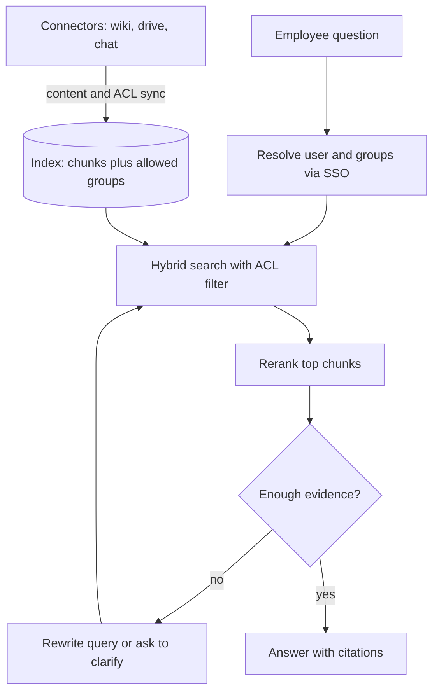

## TL;DR
An internal knowledge assistant answers employee questions from wikis, drives, tickets and chat, with
citations, and only from documents the asking user may read. The outcome is fewer repeated questions and
faster onboarding without leaking confidential content.

## For agent builders
- **Why it is hard.** Retrieval quality is only half of it; the other half is permissions. One leaked
  salary sheet or board memo ends the project, so access control must hold on every query.
- **What it teaches.** Connector ingestion, ACL sync, permission-filtered retrieval, hybrid search,
  citations, freshness and deletion, and agentic RAG (when to search again or ask a clarifying question).
- **Where it shows up in your stack.** Connectors to Confluence, SharePoint, Google Drive and Slack, an
  identity provider for groups, a vector or hybrid index with ACL metadata, and often MCP servers that
  expose search as a tool to other agents.
- **What you can skip.** Fine-tuning a model on company documents. Retrieval with ACL filters is cheaper,
  fresher and respects permissions, which fine-tuning cannot.

## Decision case
### Scenario
A 4,000-person company is piloting the assistant over Confluence, Google Drive and public Slack
channels. The open question is where permissions are enforced. All figures are illustrative planning
numbers, including the API quota.
- **Load:** a 9 a.m. peak of about 2 questions a second; each query reranks the top 20 chunks.
- **Sensitivity:** HR, legal and finance folders, all in Drive, hold about 5% of chunks, so a typical top 20 contains
  one sensitive chunk.
- **Revocation rules from the CISO:** a removed permission must stop answering within 1 hour for all
  sources and within 5 minutes for sensitive folders.
- **Latency:** first token under 2 s p95, the target from the examples.
- **Source limits:** the Drive service account may make about 10 live permission checks a second.
- **Hard rule:** zero leaks on the ACL test suite; identity comes from SSO, never from the prompt.

### Options
| Option | How it works | 1-hour rule | 5-minute rule | Live checks at peak | Latency |
|---|---|---|---|---|---|
| A. Post-filter with synced ACLs | Retrieve top-k, drop forbidden chunks | met with a 15-minute sync | fails | 0 | fast, but results thin out |
| B. Pre-filter with synced ACLs | ACL metadata in the index query, synced every 15 minutes | met | fails: up to 15 minutes stale | 0 | fast |
| C. Pre-filter plus live check on sensitive chunks | B, then re-check sensitive chunks against the source before quoting | met | met | 2 x 1 = 2 a second | slower only when a sensitive chunk is a candidate |
| D. Live check on every candidate | Source API decides every chunk | met | met | 2 x 20 = 40 a second, 4 times the quota | slow on every query |

### Decision
**Option C.** Pre-filtering keeps forbidden text out of every candidate list, and the synced ACLs meet
the 1-hour rule. The live check closes the gap only where the 5-minute rule applies, at about 2 checks a
second, a fifth of the quota.
- **Fail closed:** if a live check times out or hits the quota, the sensitive chunk is dropped and the
  answer may say "not found"; it is never shown unchecked.
- **Revocation test in CI:** remove a test user from a sensitive group and time how long until search
  stops returning the document; it must stay under 5 minutes.

**What would change it.** If sensitive content reaches 25% of chunks, live checks hit 2 x 20 x 0.25 = 10
a second, the whole quota. Then move sensitive sources to their own index with event-driven permission
sync.

If the sources push permission changes within 5 minutes, drop the live checks for B. If a vendor
product passes the same leak and revocation tests, re-run build versus buy.

### Trade-offs accepted
- **Non-sensitive sources can be 15 minutes stale.** That is inside the 1-hour rule. Run the revocation
  test for one ordinary page weekly and alert on sync lag.
- **Sensitive hits add latency.** Split p95 by whether a live check ran, so the slow path stays visible
  against the 2 s target.
- **Fail-closed answers look like gaps.** Count dropped sensitive chunks per day; a spike means quota
  trouble, not missing content.
- **Sensitivity tags can be wrong.** An untagged HR folder gets only the 15-minute sync. Owners review
  tags quarterly, and new folders under HR, legal or finance default to sensitive.

### Review rubric
- **Enforcement point named:** the write-up states where the ACL filter runs relative to ranking and
  generation, and why before is required.
- **Freshness rules mapped:** each revocation window is matched to a mechanism (sync interval or live
  check) that meets it.
- **Quota arithmetic shown:** live-check load is computed from peak queries, candidates and the
  sensitive share, and compared with the source limit.
- **Failure mode chosen:** the write-up says whether a failed check fails open or closed.
- **Leak and revocation tests gate releases,** with a timed revocation test, not just static ACL
  questions.
- **Reversal conditions stated:** the share, push support or vendor result that would reopen it.

## Why it exists
- **Knowledge is scattered.** Answers live across wikis, drives, tickets and chat threads; people ask
  colleagues instead, and the same questions repeat every week.
- **A plain chatbot fails because it does not know the company** and invents plausible policies when
  asked about internal facts.
- **Enterprise keyword search fails on phrasing.** Employees ask "can I expense a monitor?" while the
  policy says "home office equipment reimbursement".
- **Naive RAG fails on permissions.** Indexing everything into one store and filtering after generation
  leaks content the moment the model quotes a document the user should not see.

## How it works
### Reference flow
1. **Ingest through connectors.** Pull documents with their source permissions (users, groups, sharing
   links), owner, last-modified time and URL.
2. **Normalise ACLs.** Map every principal to identity-provider groups so one user check works across
   sources; store `allowed_principals` on every chunk.
3. **Chunk and index.** Split by headings, embed, and build a keyword index too, because exact names,
   codes and acronyms matter internally.
4. **Resolve the user.** At query time get the user's ID and current groups from SSO, not from the
   prompt.
5. **Retrieve with the ACL filter inside the query.** Filter by allowed principals before ranking, then
   run hybrid search and rerank.
6. **Answer with citations or decline.** The model answers only from retrieved chunks, cites each claim
   with a link, and says "I could not find this" when evidence is missing.
7. **Keep it fresh.** Incremental sync updates content and ACLs; deletions and permission removals
   propagate within a set window.

### Components
| Component | Practice choice | Why |
|---|---|---|
| Sources | Confluence, Google Drive, SharePoint, Slack exports | Where internal knowledge lives |
| Identity | SSO groups, synced with SCIM | One source of truth for who may read what |
| Index | Hybrid: BM25 plus vectors, ACL metadata per chunk | Names and paraphrases both work |
| Retrieval tool | `search(query, user)` with ACL filter in the query | Permission holds before the model sees text |
| Agentic step | Rewrite query, search again, or ask to clarify | Fixes vague or multi-part questions |
| Memory | Per-user conversation only, never shared across users | Prevents cross-user leakage |
| Guardrails | Citation required, no-answer path, PII redaction in logs | Trust and compliance |
| Human loop | Feedback button and owner notification for stale docs | Content quality improves over time |

### Where permission checks live
- **Pre-filter (preferred).** The ACL is a filter in the index query, so forbidden chunks are never
  candidates.
- **Post-filter (fallback).** Retrieve top-k, then drop forbidden chunks; simple, but results thin out
  when most hits are forbidden, so retrieve more candidates.
- **Live check at answer time.** For high-sensitivity sources, re-check access against the source API
  before quoting, because synced ACLs can be minutes or hours stale.

## Diagram
The user's groups come from SSO and filter retrieval before any text reaches the model.



## Examples
### ACL-filtered retrieval with citations
Runnable with the standard library: a tiny keyword scorer stands in for hybrid search, and the ACL
filter runs before ranking. Swap in your vector store's metadata filter in production.

```python
import math, re
from collections import Counter

DOCS = [
    {"id": "hr-12", "url": "wiki/hr/expenses", "groups": {"all-staff"},
     "text": "Home office equipment such as a monitor can be reimbursed up to 300 per year."},
    {"id": "fin-7", "url": "drive/finance/salary-bands", "groups": {"hr-admins"},
     "text": "Salary bands for 2026: engineer level 3 ranges from 90k to 120k."},
    {"id": "it-3", "url": "wiki/it/laptops", "groups": {"all-staff"},
     "text": "Laptops are refreshed every 3 years; request a monitor through the IT portal."},
]
tok = lambda s: re.findall(r"[a-z0-9]{2,}", s.lower())     # crude tokenizer, drops 1-char tokens
df = Counter(t for d in DOCS for t in set(tok(d["text"])))

def search(query, user_groups, k=2):
    visible = [d for d in DOCS if d["groups"] & user_groups]          # ACL filter BEFORE ranking
    def score(d):
        tf = Counter(tok(d["text"]))
        return sum(tf[t] * math.log(1 + len(DOCS) / df[t]) for t in tok(query) if t in tf)
    hits = sorted(visible, key=score, reverse=True)[:k]
    return [h for h in hits if score(h) > 0]

def answer(query, user_groups):
    hits = search(query, user_groups)
    if not hits:
        return "I could not find this in documents you can access."
    context = "\n".join(f"[{h['id']}] {h['text']}" for h in hits)
    # In production: send `context` to the model with "answer only from these sources, cite [id]".
    return f"{hits[0]['text']} [{hits[0]['id']}]({hits[0]['url']})\n--- context sent:\n{context}"

print(answer("can I expense a monitor", {"all-staff"}))
print(answer("salary bands engineer level 3", {"all-staff"}))           # forbidden: no leak
print(answer("salary bands engineer level 3", {"all-staff", "hr-admins"}))
```

### Cost, latency and accuracy targets
Illustrative targets for a pilot with one department's wiki and drive; set real ones from a labelled
question set.

| Metric | Target | How to measure |
|---|---|---|
| Permission leaks | 0 on the ACL test suite | Questions asked as users who must not see the answer |
| Retrieval recall@5 | 85%+ | Labelled question to source-document pairs |
| Answer faithfulness | 95%+ claims supported by citations | LLM judge plus spot checks |
| Correct "not found" | 90%+ on unanswerable questions | Questions with no source in the corpus |
| Latency to first token | under 2 s p95 | Retrieval plus rerank plus model |
| Cost per answer | a few cents | Embeddings amortised, rerank plus generation |
| ACL change propagation | under 1 hour, live check for sensitive sources | Revoke access, time until search stops returning it |

### Practice data
- **GitLab Handbook.** A large public company handbook; assign synthetic group ACLs per section (people,
  finance, engineering) to practise filtering.
- **Enron Email Dataset.** Real corporate email with natural per-mailbox ownership, ideal for testing
  that one user's mail never answers another user's question.
- **BEIR datasets.** Standard retrieval benchmarks for tuning hybrid search and reranking.
- **Synthetic sensitive docs.** Generate salary, legal and board-memo files restricted to small groups,
  and write questions that try to reach them.

## Production patterns
- **ACL test suite as a release gate.** Keep 50-100 questions asked as specific users who must not see
  the answer, including indirect phrasing ("summarise the latest board memo"). Any leak blocks the
  release; run it on every index, prompt or model change.
- **Identity from the session, never the prompt.** Resolve the user and groups from the SSO token in the
  backend and pass them to the search tool; the model cannot set or change them.
- **Incremental sync with deletion handling.** Use source change feeds or modified-since queries for
  content and permissions, tombstone deleted documents, and alert when sync lag exceeds the target.
- **Hybrid search plus reranking.** Merge the BM25 and vector result lists (for example with reciprocal
  rank fusion, which uses ranks rather than raw scores), rerank the top 20-50, and measure recall@k per source; internal acronyms make keyword search
  essential.
- **Feedback to document owners.** Thumbs-down and "not found" questions go to a review queue and to the
  owning team, which fixes stale or missing pages; this is often the biggest quality lever.
- **Expose search as a tool.** Wrap the ACL-aware search behind an MCP server or internal API, so other
  agents reuse the same permission logic instead of building their own index.

## Trade-offs
- **Pre-filter vs post-filter.** Pre-filtering is safer and keeps result counts stable but needs ACL
  metadata in the index; post-filtering is easier to add but wastes candidates and risks bugs.
- **Synced ACLs vs live checks.** Synced ACLs are fast but stale for minutes or hours; live checks
  against source APIs are exact but slower and rate-limited. Use live checks for the most sensitive
  sources only.
- **One index vs per-source indexes.** One index gives unified ranking; per-source indexes simplify
  deletion, residency and ownership. Large enterprises often run per-source indexes with a merging layer.
- **Build vs buy.** Vendor enterprise search products include connectors and ACL sync; building gives
  control over retrieval and agent behaviour. Connector maintenance is the hidden cost of building.

## Pitfalls
- **Filtering after generation.** The model already read and paraphrased the forbidden text. Fix: filter
  at retrieval, before any text enters the prompt.
- **Ignoring sharing links and nested groups.** "Anyone with the link" files and nested groups get
  mapped wrong, so documents become visible to everyone or no one. Fix: test ACL mapping per source.
- **Stale permissions after offboarding or role change.** A moved employee still retrieves old team docs.
  Fix: sync group membership often and re-check sensitive sources live.
- **Shared caches across users.** A cached answer for an HR admin is served to an engineer. Fix: include
  the user's permission set in every cache key, or cache only retrieval of public documents.
- **Answering without evidence.** The assistant fills gaps with general knowledge that contradicts
  company policy. Fix: require citations and a clear "not found" path, and eval unanswerable questions.

## When to use
- **Good first project when:** one department has a decent wiki or drive, clear group permissions, and
  repeated questions you can collect. It is the most common enterprise agent and a strong portfolio piece.
- **Avoid when:** the content is mostly outdated, permissions are a mess nobody owns, or the questions
  need live transactional data better served by a typed tool.
- **Measure:** permission leaks (must be zero), recall@k, faithfulness, correct "not found" rate, sync
  lag and user feedback.
- **Interviews:** expect to explain where ACLs are enforced, how deletions propagate and how you test leaks.

## Role lens
- **Engineer:** Builds connectors with ACL sync, the permission-filtered hybrid search tool, citation
  rendering, and the leak and retrieval eval suites.
- **Architect:** Decides index layout, identity integration, sync and live-check policy, caching rules
  and how other agents reuse the search tool.
- **FDE:** Audits the customer's permission model per source, collects real questions from employees,
  and agrees which sources are in scope for the pilot.

## Check yourself
**Q:** An engineer asks the assistant "what are the salary bands for level 3?" and the bands live in an
HR-only folder. Describe what happens at each layer so the answer does not leak.
**A:** The backend resolves the engineer's identity and groups from the SSO session, not from anything in
the prompt. The search tool applies the ACL filter inside the index query, so chunks whose allowed
principals do not include the engineer are never candidates. Retrieval returns only visible documents,
which do not contain the bands, so the model has no evidence and replies that it could not find this in
accessible documents, perhaps pointing to the HR contact page. No cache keyed only on the question is
used. The same question asked as an HR admin returns the bands with a citation. This exact pair belongs
in the ACL test suite that gates every release.

## Interview questions
### Where do you enforce document permissions in an enterprise RAG system, and why there?
- **At retrieval, as a filter inside the index query,** because anything the model reads it can quote or
  paraphrase; filtering after generation is too late.
- **With identity from the session,** resolved by the backend and passed to the search tool, so a prompt
  cannot impersonate another user.

### A user's access to a folder was revoked an hour ago, but the assistant still cites it. What happened?
- **ACL sync lag:** permissions are synced periodically and the change has not propagated, or group
  membership from the identity provider is cached.
- **Fix:** shorten sync intervals for ACLs, subscribe to change events where sources support them, and
  re-check sensitive sources live before quoting.

### How would you evaluate the assistant before rollout?
- **Retrieval:** recall@k on labelled question to source pairs per source.
- **Answers:** faithfulness to citations and correct "not found" on unanswerable questions.
- **Security:** an ACL test suite of questions asked as users who must not see the answer, with zero
  leaks as a hard gate.

### Why use hybrid search instead of only embeddings for internal documents?
- **Internal language is full of exact tokens:** project code names, ticket IDs, acronyms and product SKUs
  that embeddings often blur.
- **Keyword search catches those, vectors catch paraphrases,** and a reranker orders the merged list, so
  recall rises on both kinds of questions.

### When would you not build this assistant?
- **When content quality is poor:** retrieval over stale or contradictory pages produces confident wrong
  answers, so fix the content first.
- **When questions need live transactional data** (leave balance, order status), a typed tool over the
  system of record serves better than document search.

## Quiz
### Q: Why is filtering forbidden documents after the model generates an answer unsafe?
- [ ] It makes answers slower
- [x] The model has already read the forbidden text and may quote or paraphrase it
- [ ] It breaks citation formatting
- [ ] It reduces recall on public documents
> Once restricted text is in the prompt, it can appear in the answer in paraphrased form that no output
> filter reliably catches. The permission filter must run at retrieval, before generation.

### Q: Where should the assistant get the user's group memberships for an ACL check?
- [ ] From the user's message
- [ ] From the model's memory of earlier turns
- [x] From the authenticated SSO session, resolved by the backend
- [ ] From the document's author field
> Anything in the prompt can be forged by the user or injected content. The backend resolves identity
> from the authenticated session and passes groups to the search tool, outside the model's control.

### Q: Which test best proves the assistant does not leak restricted documents?
- [ ] Recall@5 on a public benchmark
- [ ] User satisfaction ratings
- [x] A suite of questions asked as users who lack access, checking that restricted content never appears
- [ ] A load test at peak traffic
> Leaks are a permissions property, so they are tested by impersonating users without access and
> verifying restricted content never appears. Recall and satisfaction measure quality, not safety.

## Use cases & projects
### Use cases
- **HR and policy questions.** Expenses, leave and benefits answered with links to the current policy.
- **Engineering onboarding.** "How do I deploy service X?" answered from runbooks and design docs the new
  hire can access.
- **Sales enablement.** Find the latest case study, security questionnaire answer or pricing guideline.
- **Support knowledge reuse.** Search resolved tickets and internal notes to draft replies for agents.
- **Shared search tool for other agents.** One ACL-aware MCP search server used by many internal agents.

### Mini project
**ACL-aware handbook assistant (2-3 hours).**
- **Goal:** a question-answering agent over a slice of the GitLab Handbook where each section is
  restricted to synthetic groups, with citations and zero leaks.
- **Steps:** download 50-100 handbook pages; assign groups (all-staff, people-ops, finance) per section;
  chunk and index them with a vector store that supports metadata filters plus a BM25 index; build
  `search(query, user)` with the ACL filter in the query; answer with citations or "not found"; write 20
  normal questions and 10 leak-attempt questions.
- **Done when:** recall@5 is at least 80% on the normal questions, every answer cites sources, and none
  of the 10 leak attempts returns restricted content.
