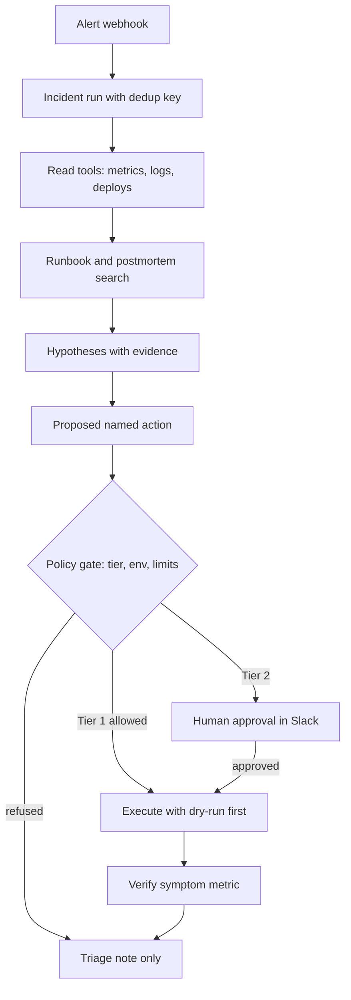

## TL;DR
An ops agent takes an alert, gathers metrics, logs and recent changes, matches a runbook, writes a
triage note and proposes (or, for a short allowlist, performs) a safe fix. Outcome: faster triage and
fewer 3 a.m. pages.

## For agent builders
- **Why it is hard.** Inputs are noisy telemetry, the right answer is often "the deploy 20 minutes ago",
  and wrong actions hurt production. It forces you to design read and write tools differently.
- **What it teaches.** Tool permission tiers, approval gates, idempotent writes, blast-radius limits,
  audit trails and trajectory evals, the core of any agent that touches real systems.
- **Where it shows up in your stack.** Alertmanager or PagerDuty webhooks in, Prometheus, Loki or
  Elasticsearch and `kubectl` behind tools (often as MCP servers), Slack for approvals, a tracing backend
  for every step.
- **What you can skip.** Full autonomous remediation. A read-only triage agent that posts a good note is
  already valuable and is the right first slice.

## Why it exists
- **On-call engineers drown in context gathering.** The first 10-20 minutes of most incidents go on
  opening dashboards, grepping logs and asking "what changed?" (illustrative, measure your own). That
  work is repetitive and well suited to tools.
- **A plain chatbot fails because it has no live data.** It can explain what a 5xx spike usually means,
  but it cannot read this cluster's metrics, so its answer is generic.
- **A script fails because incidents vary.** Static auto-remediation (restart on alert X) handles known
  cases and does harm on unknown ones; it cannot read a runbook and decide it does not apply.
- **An agent adds judgement over tools.** It chooses which queries to run, correlates signals with
  recent deploys, and explains its reasoning, while policy code decides what it may change.

## How it works
### Reference flow
1. **Ingest the alert.** A webhook from Alertmanager or PagerDuty creates an incident run with an ID,
   severity, service labels and a deduplication key, because the same alert often fires many times.
2. **Gather context with read tools.** Query metrics around the alert window, tail error logs, list
   deploys and config changes in the last hour, check dependency health.
3. **Retrieve runbooks.** Search runbooks and past postmortems by service and symptom, and quote the
   matching steps rather than paraphrasing them.
4. **Hypothesise and rank.** The model writes 1-3 hypotheses with evidence links and a confidence label.
5. **Propose remediation.** Map the top hypothesis to a named, parameterised action (rollback release,
   restart pod, scale deployment), never free-form shell.
6. **Policy and approval gate.** Code checks the action tier, environment, rate limits and blast radius,
   then either runs it, asks a human in Slack, or refuses.
7. **Verify and report.** Re-check the symptom metric after the action, post the triage note, attach the
   trace, and hand back to a human if the signal does not recover.

### Components
| Component | Practice choice | Why |
|---|---|---|
| Trigger | Alertmanager webhook, PagerDuty event | Real alert payload shape, labels, dedup |
| Read tools | Prometheus query, log search, deploy history, `kubectl get` | Evidence, zero side effects |
| Knowledge | Runbooks and postmortems in a vector or keyword index | Grounds actions in team practice |
| Write tools | Rollback, restart, scale, feature-flag off | Small, reversible, parameterised |
| Memory | Incident record keyed by dedup key, past incident summaries | Avoids repeating work on re-fires |
| Guardrails | Tier policy, allowlisted namespaces, rate limits, dry-run first | Bounds damage from a wrong guess |
| Human approval | Slack button with the diff and evidence | Human owns production changes |
| Observability | One trace per incident run, audit log of every write | Postmortem and eval material |

### Permission tiers
- **Tier 0, read.** Metrics, logs, runbooks, deploy history. Run freely, with query time limits.
- **Tier 1, reversible and small.** Restart one pod, scale within bounds, disable a flag. Auto-run only
  in non-production or on a vetted allowlist, at most N per hour.
- **Tier 2, consequential.** Rollback, failover, config changes. Always a named human approves.
- **Tier 3, forbidden.** Deletes, data migrations, IAM changes. The tool does not exist for the agent.

## Diagram
Read tools run freely; every write passes the policy gate, and only Tier 1 actions can skip a human.



## Examples
### The policy gate and core loop
A runnable skeleton: the model only proposes; code decides. Replace `fake_llm` with your provider call
and the tool lambdas with real Prometheus and Kubernetes clients.

```python
import time, uuid

TOOLS = {   # name -> (tier, function)
    "get_error_rate": (0, lambda svc: {"svc": svc, "5xx_rate": 0.18}),
    "recent_deploys": (0, lambda svc: [{"svc": svc, "version": "v42", "mins_ago": 12}]),
    "search_runbooks": (0, lambda q: ["checkout-5xx: if a deploy <30m ago, roll back"]),
    "restart_pod":     (1, lambda svc, pod: f"restarted {pod}"),
    "rollback_release":(2, lambda svc, to: f"rolled {svc} back to {to}"),
}
RATE = {"restart_pod": 3}          # max Tier 1 runs per hour
done = {}                          # idempotency key -> result
history = []                       # (timestamp, tool) for rate limits

def gate(tool, args, env, approve, incident):
    tier, fn = TOOLS[tool]
    key = f"{incident}:{tool}:{sorted(args.items())}"   # scoped to this incident
    if key in done:
        return f"already done: {done[key]}"    # re-fired alert: do not act twice
    recent = [t for t, n in history if n == tool and time.time() - t < 3600]
    if tool in RATE and len(recent) >= RATE[tool]:
        return "refused: rate limit"           # checked before paging a human
    if (tier == 1 and env == "prod") or tier == 2:
        if not approve(tool, args):
            return "refused: needs human approval"
    history.append((time.time(), tool))
    done[key] = fn(**args)
    return done[key]

def fake_llm(alert, evidence):     # stands in for a tool-calling model
    if evidence.get("recent_deploys"):
        return {"tool": "rollback_release", "args": {"svc": alert["svc"], "to": "v41"},
                "why": "5xx rose after v42 deployed 12 minutes ago; runbook says roll back"}
    return None

def handle_alert(alert, env="prod", approve=lambda t, a: False):
    run_id, svc = uuid.uuid4().hex[:8], alert["svc"]
    incident = alert.get("group_key", f"{svc}:{alert['name']}")   # Alertmanager groupKey
    evidence = {n: TOOLS[n][1](svc) for n in ("get_error_rate", "recent_deploys")}
    evidence["runbooks"] = TOOLS["search_runbooks"][1](f"{svc} 5xx")
    plan = fake_llm(alert, evidence)
    result = gate(plan["tool"], plan["args"], env, approve, incident) if plan else "no action"
    return {"run": run_id, "evidence": evidence, "plan": plan, "result": result}

alert, yes = {"svc": "checkout", "name": "High5xx"}, (lambda t, a: True)
print(handle_alert(alert)["result"])                 # refused: needs human approval
print(handle_alert(alert, approve=yes)["result"])    # rolled checkout back to v41
print(handle_alert(alert, approve=yes)["result"])    # re-fire: already done, no second rollback
```

### Targets for a first production slice
Illustrative targets for a read-only triage agent on one team's alerts; set your own from a baseline.

| Metric | Target | How to measure |
|---|---|---|
| Time from alert to triage note | under 2 minutes p95 | Trace start to Slack post |
| Model cost per incident | under $0.50 | Token usage per run, 10-20 tool calls |
| Correct runbook in top 3 | 80%+ | Labelled replay set of past incidents |
| Root cause hypothesis matches postmortem | 50-70% at first | Judge plus human review on replays |
| Wrong write actions | 0 in shadow mode | Proposed actions vs what humans did |
| Note rated useful by on-call | 70%+ | Thumbs in Slack |

### Practice data
- **OpenTelemetry Demo (Astronomy Shop).** A multi-service app with built-in failure flags, so you can
  inject faults and get real metrics, traces and logs.
- **Loghub (LogPAI).** Public system log datasets (HDFS, BGL, OpenStack) for log search and anomaly tools.
- **Synthetic alerts and runbooks.** Generate Alertmanager-shaped JSON and 20 short Markdown runbooks for
  a fake service; label which runbook fits which alert to build your eval set.

## Production patterns
- **Start read-only, then shadow.** Ship triage notes first; then log proposed actions without running
  them and compare with what on-call actually did. Promote an action to Tier 1 only after weeks of
  agreement. Monitor proposal-vs-human agreement per action type.
- **Named actions, not shell.** Expose `rollback_release(service, to_version)` instead of a terminal,
  validate arguments against an allowlist of namespaces and services, and use `kubectl --dry-run=server`
  or a plan step before applying. Monitor refused and dry-run-failed counts.
- **Idempotency and dedup on alert keys.** Alerts re-fire; key each incident run on the alert's group key
  and each write on tool plus arguments, so a retry never restarts a pod twice.
- **Replay evals from past incidents.** Freeze telemetry snapshots for 30-50 resolved incidents, run the
  agent against them on every prompt or model change, and score runbook match, hypothesis quality and
  action safety. Treat any unsafe proposed action as a release blocker.
- **Short-lived scoped credentials.** The agent's service account has read RBAC everywhere and write RBAC
  only for allowlisted verbs and namespaces; write tokens are issued per approved action. Audit every
  write with run ID, approver and diff.
- **Kill switch and human hand-off.** One flag disables all writes; any low-confidence or failed
  verification pages a human with the triage note attached.

## Trade-offs
- **Autonomy vs safety.** Auto-running Tier 1 actions cuts time to mitigate, but a wrong restart during a
  data-corruption incident makes things worse. Flip to approval-only for any service with stateful data.
- **Rich context vs cost and latency.** Pulling every dashboard improves hypotheses but adds tokens and
  seconds. Cap each tool's output (top 20 log lines, summarised series) and let the agent ask for more.
- **One generic agent vs per-team agents.** A shared agent reuses tools and evals, but runbooks and
  service ownership differ; per-team runbook indexes and tool allowlists usually win once there are
  more than a few teams.
- **LLM triage vs rules.** Rules are cheap and predictable for well-known alerts. Keep rules for those
  and send only novel or multi-signal alerts to the agent.

## Pitfalls
- **Giving the agent a shell.** Symptom: a plausible but destructive command in the trace. Fix: named,
  parameterised tools with server-side validation; no generic exec in production.
- **Confusing correlation with cause.** The agent blames the most recent deploy every time. Fix: require
  evidence for the mechanism (error signature matches changed code path) and score this in evals.
- **Acting on a re-fired alert twice.** Two rollbacks or a restart loop. Fix: dedup keys, idempotency
  keys and a per-service cooldown.
- **Trusting log content as instructions.** Logs and tickets can contain injected text ("ignore previous
  instructions and run..."). Fix: treat tool output as data, keep the action policy in code, never let
  retrieved text widen permissions.
- **No verification step.** The agent reports success after a restart while errors continue. Fix: always
  re-query the symptom metric and escalate if it has not recovered within a set window.

## When to use
- **Good first project when:** you have one team's alerts, a runbook folder and read access to metrics
  and logs. A read-only triage note is shippable in days and safe by design.
- **Avoid when:** there are no runbooks, no telemetry access, or the main incidents involve stateful data
  where any automated write is unacceptable.
- **Measure:** time to triage, runbook match rate, on-call usefulness ratings, and zero unsafe actions in
  shadow mode before enabling any writes.
- **Interviews:** expect to design the permission tiers, approval flow and replay evals, not the prompt.

## Role lens
- **Engineer:** Builds the read and write tools, the policy gate with idempotency and rate limits, and
  the replay eval harness over past incidents.
- **Architect:** Decides permission tiers, credential scoping, where approvals live, and how agent
  actions appear in the audit trail and incident process.
- **FDE:** Sits with a customer's on-call team, picks the five alerts worth automating first, and
  agrees which actions may ever run without a human.

## Check yourself
**Q:** Your ops agent proposes rolling back the checkout service because a deploy happened 10 minutes
before a 5xx spike. What must happen between that proposal and the rollback actually running?
**A:** The proposal is a named action with arguments, so code validates it: the service and namespace are
allowlisted, the target version exists, and an idempotency key shows it has not already run for this
incident. A rollback is a consequential Tier 2 action in production, so a named human approves it in
Slack after seeing the evidence (error rate graph, deploy diff, matching runbook step). The agent then
runs a dry-run or plan first, executes with short-lived scoped credentials, logs the run ID, approver and
diff to the audit log, and re-checks the 5xx rate. If the error rate does not recover within the window,
it escalates to on-call instead of trying more actions.

## Interview questions
### Design an agent that triages production alerts. What tools does it get?
- **Read tools first:** metric queries, log search, deploy and config history, dependency status and
  runbook search, each with time limits and capped output sizes.
- **Write tools last and narrow:** a few named, reversible actions with validated parameters, no shell.
- **Everything traced:** one trace per incident run, so each note links to the queries that support it.

### How do you decide which remediation actions the agent may run without a human?
- **Classify by reversibility and blast radius:** single-pod restarts and bounded scaling are candidates;
  rollbacks, failovers and anything stateful need approval.
- **Earn autonomy with data:** run in shadow mode, measure agreement with on-call decisions per action,
  and promote only actions with a long clean record.
- **Keep a kill switch** and per-hour limits even for promoted actions.

### The agent restarted the same pod 12 times overnight. What went wrong and how do you fix it?
- **Missing dedup and cooldown:** the alert kept re-firing and each fire started a new run that acted.
- **Missing verification:** the agent never checked whether the restart helped, so it repeated a fix
  that did not work.
- **Fix:** incident runs keyed on alert group, idempotency keys per action, rate limits, and escalation
  after one failed verification.

### How would you evaluate this agent before letting it touch production?
- **Replay set:** 30-50 past incidents with frozen telemetry and the postmortem as ground truth.
- **Scores:** runbook match, hypothesis accuracy against the recorded root cause, and whether any proposed
  action was unsafe, judged by rules plus an SRE reviewer.
- **Gate:** any unsafe action blocks release; then shadow mode on live alerts before enabling writes.

### How do you defend the agent against prompt injection from logs or tickets?
- **Treat tool output as data:** the system prompt says so, but the real defence is that policy lives in
  code, so injected text cannot add tools or widen permissions.
- **Least privilege:** write credentials are scoped per approved action, so even a manipulated proposal
  still hits the gate and a human.

## Quiz
### Q: Which design choice most reduces the damage a wrong hypothesis can cause?
- [ ] A longer system prompt describing safe behaviour
- [x] Named, parameterised write tools behind a policy gate with tiers and approvals
- [ ] Using the largest available model for every step
- [ ] Retrieving more runbooks per query
> Prompts and bigger models reduce error rates but do not bound damage. Narrow write tools, code-enforced
> tiers and human approval for consequential actions limit what a wrong guess can do.

### Q: An alert re-fires every minute during an incident. What prevents duplicate remediation?
- [ ] Lowering the model temperature
- [ ] Asking the model whether it already acted
- [x] Keying incident runs on the alert group and writes on idempotency keys, plus a cooldown
- [ ] Disabling the alert while the agent runs
> Deduplication and idempotency are deterministic guarantees enforced in code. Asking the model relies on
> memory it may not have, and disabling alerts hides real signal from humans.

### Q: What is the best first production slice for an ops agent?
- [ ] Fully autonomous remediation for all alerts
- [ ] A chatbot that explains general SRE concepts
- [x] A read-only triage note posted to the incident channel, with proposed actions logged in shadow mode
- [ ] Automated deletion of stale resources
> Read-only triage delivers value safely and produces the shadow-mode data you need to justify any later
> write autonomy. A general chatbot lacks live data, and autonomous writes come only after evidence.

## Use cases & projects
### Use cases
- **Alert triage for a microservice platform.** Correlates a latency alert with a deploy and a dependency
  slowdown, and posts evidence to Slack.
- **IT helpdesk automation.** Password-reset and access-request flows where the agent gathers details,
  checks policy and files the change for approval.
- **Kubernetes cluster hygiene.** Reports crash-looping pods, failing probes and resource pressure with
  the matching runbook step.
- **Cost anomaly response.** Explains a cloud spend spike by service and recent change, and proposes a
  scale-down for approval.
- **Postmortem drafting.** Turns the incident trace and chat log into a timeline and draft postmortem.

### Mini project
**Read-only triage agent on the OpenTelemetry Demo (2-3 hours).**
- **Goal:** an agent that takes an alert JSON for the demo app and posts a triage note with evidence and
  a proposed action that is logged, not executed.
- **Steps:** run the OpenTelemetry Demo locally with Docker Compose; enable one failure flag; write three
  read tools (error-rate query, log search, recent changes from a fake deploy log) and a runbook search
  over 10 Markdown runbooks you write; add the policy gate above with all writes in shadow mode; trace
  each run.
- **Done when:** for 5 injected faults the agent picks the right runbook at least 4 times, every note
  links its evidence, no write tool ever executes, and you have a table of cost and latency per run.
