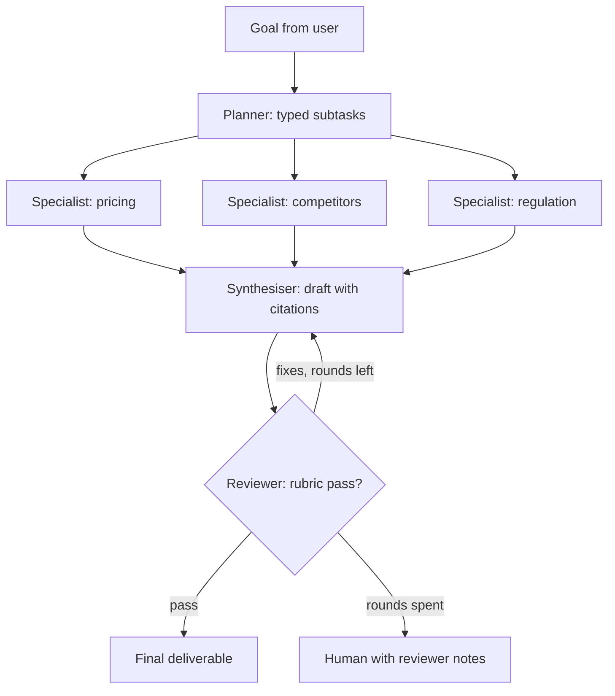

## TL;DR
A multi-agent workflow splits a job across a planner, specialist agents with their own tools and
context, and a reviewer that checks the result. The business outcome is broad tasks (research reports,
due-diligence packs, release checks) done in parallel with a quality gate.

## For agent builders
- **Why it is hard.** Every hand-off loses context, costs tokens and adds a failure point. Most "multi-
  agent" demos would work better as one agent with good tools, so you must justify the split.
- **What it teaches.** Task decomposition, typed hand-off contracts, parallel fan-out, reviewer loops
  with budgets, shared state, and tracing and evaluating trajectories across agents.
- **Where it shows up in your stack.** LangGraph supervisor graphs, OpenAI Agents SDK handoffs, CrewAI
  crews or AutoGen group chats, or a plain async orchestrator; A2A when agents belong to different teams
  or vendors.
- **What you can skip.** Free-form agents chatting with each other. Start with a fixed planner, a few
  specialists and one reviewer, wired by code.

## Decision case
### Scenario
A venture firm's platform team builds vendor due-diligence briefs covering financials, product, security
posture, legal exposure and customer sentiment. Analysts write about 200 a month at 6 hours each. The
team ran four designs on a 20-brief eval set; all figures are illustrative pilot numbers.
- **Speed:** partners want a brief within 15 minutes of asking.
- **Cost:** under $2 a brief, the target from the examples.
- **Quality:** the rubric score must beat the single-agent baseline by 15 points or more, with under 1
  unsupported claim per brief.
- **Inputs vary:** a private company has no filings but a large security questionnaire; a public one is
  the reverse, so the needed research differs per brief.
- **Team and time:** two engineers for 6 weeks.

### Options
| Option | How it works | Rubric (of 100) | Unsupported claims | Wall-clock | Cost a brief |
|---|---|---|---|---|---|
| A. Single agent, 25 tools | One loop, one context | 62 (baseline) | 3 | 22 min | $0.60 |
| B. Fixed pipeline, 5 stages | One stage per topic, no planner | 74 (+12) | 1.2 | 11 min | $1.20 |
| C. Supervisor with planner, specialists and reviewer | Planner picks specialists per brief, 2 review rounds at most | 79 (+17) | 0.6 | 9 min | $1.70 |
| D. Group chat | Agents debate until one says done | 70 (+8) | 1.5 | 25 min | $1.50 to $6, unbounded |

### Decision
**Option C, the supervisor design.** It is the only option that meets every constraint: 9 minutes
against 15, $1.70 against $2, +17 points against +15, and 0.6 unsupported claims against 1.
- **Why not A:** it misses the 15-minute limit and the claim target, and traces show tool confusion with
  25 tools in one context.
- **Why not B:** it is close, but runs every stage on every brief, falls 3 points short and misses the claim target (1.2 against 1),
because it
  cannot add a security deep dive only where needed.
- **Why not D:** its cost has no ceiling, which fails the budget by design.
- **Monthly cost:** 200 x $1.70 = $340, against $120 for A; small next to 1,200 analyst hours (200 x 6).

**What would change it.** A 17-point gap on 20 briefs is a small sample, so re-run A and C on 50 before
rollout and keep C only if the gap holds above 15.

If a single agent with a tool router and 8 tools scores 77 or more (the old baseline plus 15) with under
1 unsupported claim, in under 15 minutes and under $2, prefer it. If the needed research stops varying, B is simpler.

### Trade-offs accepted
- **About 2.8 times the cost of one agent** ($1.70 against $0.60). Alert on runs above the p95 cost and
  keep the specialists on a cheaper model tier.
- **Hand-off loss.** The synthesiser sees only structured findings. Tag reviewer fixes that trace to
  missing context and widen the findings schema when they recur.
- **A reviewer that drifts lenient.** Calibrate it monthly against a human-scored sample of briefs.
- **More moving parts to debug.** One trace across planner, specialists and reviewer is a launch
  requirement, not a later addition.

### Review rubric
- **Baseline first:** the write-up measures a single-agent design on the same eval set before proposing
  a split.
- **Every option scored on every constraint,** with the numbers in one table.
- **The split is justified by the input:** it names what varies per task that a fixed pipeline cannot
  handle.
- **Loops and cost bounded:** review rounds, steps and tokens have caps, and no option without a ceiling
  is chosen.
- **Sample size questioned:** the write-up says how many eval cases back the decision and when to re-run.
- **Reversal conditions stated:** the score or cost result that would bring back a simpler design.

## Why it exists
- **Some tasks are wide.** A market brief needs pricing, competitors, regulation and customer sentiment;
  one context window filled with all of it gets slow and confused.
- **A single agent with 40 tools degrades.** Tool selection accuracy drops and the prompt balloons, while
  specialists with 3-5 tools each stay sharp.
- **A fixed script fails because the plan depends on the input.** One brief needs a regulatory deep dive,
  another needs none; the planner decides.
- **Quality needs a second look.** A separate reviewer with a rubric catches unsupported claims the
  writer missed, because it reads the output fresh.
- **The cost is real.** Anthropic reported its multi-agent research system used roughly 15 times the
  tokens of a chat interaction, so the task must be valuable enough to pay for it.

## How it works
### Roles
| Role | Job | Tools | Output contract |
|---|---|---|---|
| Planner (orchestrator) | Break the goal into independent subtasks | None or light search | List of tasks with goal, specialist, success criteria |
| Specialists | Do one subtask in their own context | 3-5 domain tools each | Findings with sources, confidence, open questions |
| Synthesiser | Merge findings into the deliverable | None | Draft with citations to findings |
| Reviewer | Check draft against rubric and sources | Source lookup | Pass, or a list of specific fixes |
| Orchestrator code | Budgets, retries, state, stopping | Calls the roles above | Final result plus trace |

### The flow
1. **Plan.** The planner returns typed tasks (JSON schema), each with a specialist, a goal and a "done
   when", because vague hand-offs are the main cause of duplicated or missing work.
2. **Fan out.** Code runs independent tasks in parallel, each specialist with its own fresh context, tools
   and step budget.
3. **Collect.** Specialists return compact, structured findings rather than full transcripts, which keeps
   the synthesiser's context small.
4. **Synthesise.** One agent writes the deliverable, citing findings by ID.
5. **Review.** A reviewer scores the draft against a rubric and the sources; on failure it returns
   concrete fixes, and code routes them to the right specialist or the synthesiser.
6. **Stop.** On pass, on a maximum number of review rounds (often 2), or on budget; escalate to a human
   with the reviewer's notes if still failing.

### Coordination choices
- **Supervisor (hub and spoke).** One orchestrator calls specialists as tools. Easiest to trace and
  budget; the default.
- **Handoffs.** One agent transfers control to another (for example triage to billing). Good for
  conversations where one specialist should own the user.
- **Pipeline.** Fixed stages with no planner. Use when the steps never change; it is a workflow, not a
  multi-agent system.
- **Group chat or swarm.** Agents talk freely. Hard to bound and evaluate; rarely right in production.

## Diagram
The planner fans out to specialists in parallel; the reviewer either passes the draft or sends fixes
back, within a round limit.



## Examples
### A supervisor orchestrator in plain asyncio
Runnable with stubs: the planner, specialists and reviewer are fake functions so the control flow,
parallelism, budgets and review loop are visible. Replace each with a model call and tools.

```python
import asyncio, json

async def planner(goal):
    return [{"id": "t1", "specialist": "pricing", "goal": f"pricing for {goal}"},
            {"id": "t2", "specialist": "competitors", "goal": f"top 3 competitors for {goal}"}]

async def specialist(task, max_steps=5):
    await asyncio.sleep(0.1)                         # stands in for a tool-calling loop
    return {"task": task["id"], "finding": f"{task['specialist']} result",
            "sources": [f"https://example.com/{task['id']}"], "confidence": "medium"}

async def synthesise(goal, findings, fixes=None):
    body = "; ".join(f"{f['finding']} [{f['task']}]" for f in findings)
    return f"Brief on {goal}: {body}" + (" (summary added)" if fixes else "")

async def reviewer(draft, findings):
    cited = all(f"[{f['task']}]" in draft for f in findings)
    has_summary = "summary" in draft
    if cited and has_summary:
        return {"pass": True, "fixes": []}
    return {"pass": False, "fixes": [] if has_summary else ["add a one-line summary"]}

async def run(goal, max_rounds=2, token_budget=50_000):
    used = 0
    tasks = await planner(goal)
    findings = await asyncio.gather(*(specialist(t) for t in tasks))   # parallel fan-out
    used += 3_000 * len(tasks)                       # track cost per agent from usage fields
    draft, fixes = await synthesise(goal, findings), None
    for round_ in range(1, max_rounds + 1):
        verdict = await reviewer(draft, findings)
        print(f"round {round_}: {json.dumps(verdict)}")
        if verdict["pass"]:
            return {"status": "done", "draft": draft, "tokens": used}
        if used > token_budget:
            break
        fixes = verdict["fixes"]
        draft = await synthesise(goal, findings, fixes); used += 2_000
    return {"status": "needs_human", "draft": draft, "notes": fixes, "tokens": used}

print(asyncio.run(run("an EU e-bike subscription service")))
```

### Cost, latency and accuracy targets for a research brief
Illustrative targets for a 3-specialist market brief; compare every number with a single-agent baseline
on the same tasks.

| Metric | Single-agent baseline | Multi-agent target | Notes |
|---|---|---|---|
| Rubric score (judge plus human sample) | measure first | +15 points or more | Otherwise the split is not worth it |
| Unsupported claims per brief | measure first | under 1 | Reviewer checks claims against sources |
| Wall-clock time | measure first | lower, from parallel specialists | Fan-out hides specialist latency |
| Tokens per brief | 1x | 3-15x | Each agent re-reads its own context |
| Model cost per brief | measure first | under $2 | Cheaper models for specialists, strong one for review |
| Review rounds | n/a | 1-2, hard cap | More rounds rarely help |

### Practice data
- **HotpotQA.** Multi-hop questions whose answers need two documents, a natural fit for planner and
  specialist splits, with gold answers for scoring.
- **Synthetic research briefs.** Generate 20 brief requests (market, vendor comparison, regulation) with
  a rubric and a list of facts each must contain.
- **Public filings and docs.** SEC EDGAR filings or open-source project docs as the specialists' corpora.

## Production patterns
- **Beat a single-agent baseline first.** Build one agent with all the tools, measure it on the eval set,
  and add agents only where traces show context overload or tool confusion. Keep the baseline in CI.
- **Typed hand-off contracts.** Planner tasks and specialist findings follow JSON schemas with IDs,
  sources and confidence, validated in code, so synthesis and review can cite and check them.
- **Budgets per agent and per run.** Cap steps per specialist, tokens per run and review rounds, record
  cost per agent from usage fields, and alert on runs above the p95 cost.
- **One trace across all agents.** Propagate a run ID and nest each agent's spans under the
  orchestrator, so a bad final answer can be traced to the specialist or hand-off that caused it.
- **Mixed model tiers.** Use a fast, cheap model for specialists doing retrieval and extraction and a
  stronger model for planning and review, then confirm with evals that quality holds.
- **Evaluate trajectories, not just outputs.** Score plan quality (coverage, no duplicates), specialist
  success and reviewer agreement with humans, because a good final answer can hide wasteful paths.

## Trade-offs
- **Specialisation vs hand-off loss.** Separate contexts keep each agent sharp, but every hand-off drops
  nuance. Flip back to one agent when tasks are tightly coupled and need shared context.
- **Parallelism vs cost.** Fan-out cuts wall-clock time, but tokens multiply. Worth it for high-value,
  wide tasks; wasteful for simple questions.
- **Reviewer loops vs latency.** Each round can fix errors and adds a full synthesis plus review pass.
  Cap rounds and send persistent failures to humans.
- **Framework vs plain code.** LangGraph, the OpenAI Agents SDK or CrewAI give state, handoffs and
  tracing quickly; plain code gives full control. Small fixed topologies often need only plain code.

## Pitfalls
- **Splitting a simple task.** Three agents answer a one-hop question slower and costlier than one.
  Fix: route by task complexity and keep a single-agent path.
- **Vague task descriptions.** Specialists duplicate each other or miss parts of the goal. Fix: typed
  tasks with explicit scope, boundaries and "done when".
- **Passing full transcripts between agents.** Context explodes and the synthesiser loses the thread.
  Fix: specialists return compact, structured findings with sources.
- **A reviewer that always passes.** The same model with the same context rubber-stamps its own work.
  Fix: give the reviewer a rubric, the sources and fresh context, and calibrate it against human labels.
- **Unbounded agent conversations.** Agents keep delegating or debating. Fix: orchestrator-owned control
  flow, round caps and token budgets.

## When to use
- **Good first project when:** you already have a single agent working and traces show it struggling
  with breadth. It teaches orchestration, budgets and trajectory evals.
- **Avoid when:** the task is narrow, steps are fixed (use a workflow), or a single agent with better
  tools passes your evals.
- **Measure:** quality gain over the single-agent baseline, tokens and cost per run, wall-clock time,
  review rounds and reviewer agreement with humans.
- **Interviews:** expect to justify the split, design hand-off contracts and bound cost and loops.

## Role lens
- **Engineer:** Builds the orchestrator with typed hand-offs, parallel fan-out, budgets, the reviewer
  loop and cross-agent tracing.
- **Architect:** Decides when multi-agent is justified, which coordination pattern to use, model tiers
  per role, and when agents from other teams connect through A2A.
- **FDE:** Translates a customer's manual research or review process into planner and specialist roles,
  and proves the gain over a single agent on their own tasks.

## Check yourself
**Q:** A team built a five-agent system for answering internal policy questions. It costs 8 times more
than their old single agent and scores the same. What do you recommend?
**A:** Policy questions are mostly narrow lookups, so the split adds hand-offs and tokens without adding
capability. First compare traces: if the single agent rarely hit context limits or confused tools, return
to it and improve retrieval and tools. If a minority of questions are genuinely broad, add a router that
sends only those to a planner and specialists, and keep the single-agent path for the rest. Whatever
remains multi-agent needs typed hand-offs, per-agent budgets, a capped reviewer loop, and an eval that
shows a quality gain over the single-agent baseline large enough to justify the extra cost.

## Interview questions
### When is a multi-agent design justified over a single agent?
- **When the task is wide and separable:** independent subtasks that each need their own tools and
  context, and benefit from running in parallel.
- **When evals prove it:** a clear quality or latency gain over a single-agent baseline that outweighs
  several times the token cost.

### How do you design the hand-off between planner and specialists?
- **Typed tasks:** ID, specialist, goal, scope boundaries, success criteria and budget, validated in code.
- **Typed findings back:** compact results with sources and confidence, not transcripts, so synthesis
  stays small and review can check claims.

### Your reviewer agent passes 98% of drafts, but users find errors. What do you change?
- **Calibrate it:** compare reviewer verdicts with human labels on a sample and measure agreement.
- **Strengthen it:** give a specific rubric, access to the sources, fresh context, and possibly a
  different or stronger model than the writer.
- **Check claims mechanically** where possible, for example that every citation ID exists.

### How do you keep cost and loops under control?
- **Code owns control flow:** step caps per specialist, round caps for review, a token budget per run.
- **Track cost per agent** from usage fields in one trace, and alert on p95 outliers.
- **Escalate** to a human with notes when budgets run out instead of looping.

### When would you use A2A instead of calling specialists as local functions?
- **When specialists are owned by other teams or vendors,** run as separate services, and need a
  standard way to advertise capabilities and exchange tasks.
- **Inside one codebase,** local calls or a framework graph are simpler and easier to trace.

## Quiz
### Q: What should you build before a multi-agent version of a workflow?
- [ ] A group chat of agents
- [x] A single-agent baseline measured on the same eval set
- [ ] A custom agent framework
- [ ] A reviewer agent only
> Multi-agent systems cost several times more tokens. Only a measured single-agent baseline shows
> whether splitting the task actually improves quality or latency enough to pay for that.

### Q: What should specialists return to the synthesiser?
- [ ] Their full transcripts, so nothing is lost
- [ ] Only a yes or no
- [x] Compact, structured findings with sources and confidence
- [ ] The raw tool outputs
> Full transcripts and raw outputs flood the synthesiser's context and hide the key facts. Structured
> findings with sources keep context small and let the reviewer verify claims.

### Q: Which control most reliably prevents a reviewer loop from running forever?
- [ ] Asking the reviewer to be lenient
- [ ] A larger context window
- [x] A round cap and token budget enforced by the orchestrator code, with human escalation
- [ ] Letting the agents decide when to stop
> Stopping conditions must be deterministic and owned by code. Leniency and agent self-assessment are
> unreliable, and a bigger context window only lets the loop run longer.

## Use cases & projects
### Use cases
- **Market and competitor research briefs.** Specialists for pricing, competitors and regulation feed a
  synthesiser and a fact-checking reviewer.
- **Due-diligence packs.** Financial, legal and technical specialists review a target's documents in
  parallel.
- **Release readiness checks.** Specialists check tests, security scans, docs and changelog; a reviewer
  decides go or no-go for a human.
- **Customer support with handoffs.** A triage agent hands conversations to billing, technical or account
  specialists.
- **Content production.** Outline, draft, fact-check and style-review stages with a capped review loop.

### Mini project
**Planner, two specialists and a reviewer on HotpotQA (2-3 hours).**
- **Goal:** a supervisor workflow that answers multi-hop questions and beats, or honestly fails to beat,
  a single-agent baseline.
- **Steps:** load 30 HotpotQA questions with their context paragraphs; build a single agent with a
  search tool over those paragraphs and score exact match; build the asyncio orchestrator above with a
  planner that splits each question into hops, two specialists with the same search tool, and a reviewer
  that checks the answer is supported; log tokens and time per agent.
- **Done when:** you have a table comparing accuracy, tokens and latency for both versions, every run
  respects the round cap, and you can state when the split was worth it.
