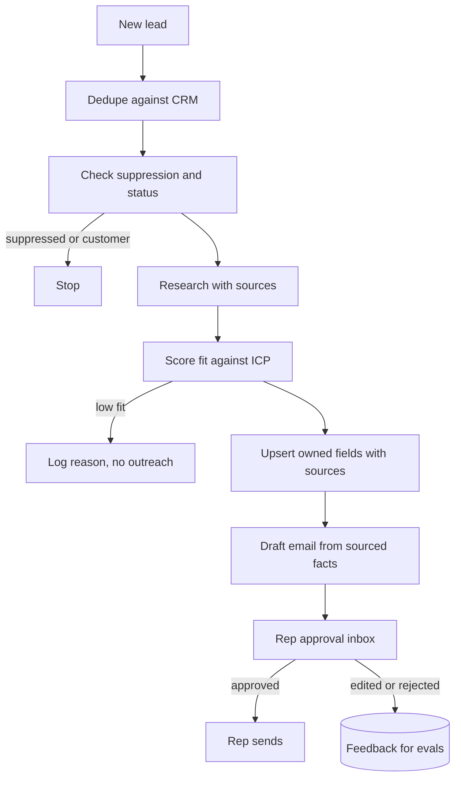

## TL;DR
A sales agent researches inbound or target accounts, enriches CRM records with sourced facts, and
drafts personalised emails that a rep approves before sending. The outcome is more qualified pipeline
per rep hour without spam or wrong CRM data.

## For agent builders
- **Why it is hard.** The agent writes to a shared system of record and drafts messages to real people,
  so wrong facts, duplicates and off-brand emails all cost trust. Personalisation must be true, not
  invented.
- **What it teaches.** Research with provenance, safe CRM writes (dedupe, field ownership, idempotency),
  draft-then-approve flows, consent and suppression rules, and judging tone at scale.
- **Where it shows up in your stack.** Search and fetch tools, a CRM API (read, upsert, create draft or
  task), a scoring step, a rep-facing approval inbox and traces per lead.
- **What you can skip at first.** Fully autonomous sequences and send scheduling. Drafts in a queue are
  the right first slice.

## Decision case
### Scenario
A B2B software company's lead agent has run in draft-only mode for a month. Marketing now wants faster
first responses to inbound demo requests and asks for auto-send. All figures are illustrative and come
from the pilot.
- **Volume:** 3,000 inbound leads a month; 40% pass suppression and fit, so 1,200 drafts.
- **Speed goal:** first response to an inbound demo request within 1 hour; today the median wait for rep
  approval is 6 hours.
- **Fact accuracy:** 98% of drafts have every referenced fact right, so 1,200 x 0.02 = 24 drafts a month
  carry a wrong fact. Reps catch about 95% of those when reviewing.
- **Brand limit:** at most 2 emails a month with a wrong fact may reach prospects.
- **Rep time:** 25 reps at about 2 minutes per draft: 1,200 x 2 = 2,400 minutes = 40 hours, 1.6 hours
  per rep a month.
- **Consent:** only contacts who submitted the form and are not suppressed may be emailed without a rep.

### Options
| Option | How it works | First response | Wrong-fact emails a month | Fits? |
|---|---|---|---|---|
| Draft-only (today) | Rep approves every personalised draft | about 6 h median | 24 x 0.05 = 1.2 | no: speed |
| Auto-send personalised | Agent sends its draft directly | minutes | 24 | no: brand |
| Instant acknowledgement plus approved draft | A fixed template with no prospect facts and a booking link goes out within 5 minutes to consented, non-suppressed form fills; the personalised follow-up stays draft-and-approve | about 5 min | 1.2, the template states no facts | yes |

### Decision
**Auto-send only the fixed acknowledgement; keep every personalised email behind rep approval.** The
risk sits in the invented or wrong facts, and the acknowledgement contains none, so automating it meets
the 1-hour goal without adding wrong-fact emails. Personalised outreach stays at about 1.2 wrong-fact
emails a month, under the limit of 2.
- **Template is reviewed once by legal and brand,** not each send; changes go through the same review.
- **Send is gated in code:** form-fill source, consent flag, suppression check and a per-domain cap,
  checked again at send time.
- **Kill switch:** marketing can stop acknowledgements without a deploy.

**What would change it.**
- **Fact accuracy rises:** at 99.9% across 1,200 drafts, auto-sent personalised emails would carry
  about 1,200 x 0.001 = 1.2 wrong facts a month, inside the limit; start with one narrow segment.
- **Volume doubles:** 2,400 drafts give 48 wrong-fact drafts and about 2.4 escaping rep review, over the
  limit; improve the fact checker before scaling, and rep time grows to 80 hours.
- **Consent rules tighten:** if a region requires prior opt-in even for replies, exclude it from
  auto-send.

### Trade-offs accepted
- **Personalised follow-up still waits hours.** Track time from acknowledgement to the rep's send and the
  share of leads who book from the template alone.
- **Template replies feel generic.** Watch reply and booking rates on acknowledgements versus drafts.
- **Rep time is unchanged at about 40 hours a month.** Measure edit distance and acceptance per rep to
  see where drafts cost the most time.

### Review rubric
- **Risk located precisely:** the write-up says which part of the message carries the risk (facts,
  tone, consent) and automates only what is free of it.
- **Error arithmetic shown:** wrong facts per month with and without human review, from stated rates.
- **Consent and suppression in code:** gates run before every automated send, not only at draft time.
- **Speed goal measured:** first-response time is tracked against the target after launch.
- **Reversible:** a kill switch and a template review process exist.
- **Graduation criteria stated:** the accuracy and volume numbers that would allow more autonomy.

## Why it exists
- **The user problem.** Reps spend much of their time researching accounts, updating CRM fields and
  writing first-touch emails, instead of talking to buyers.
- **Why a plain chatbot fails.** It writes generic emails, may invent facts about the prospect ("congrats
  on your Series B"), and cannot read or update the CRM.
- **Why a mail-merge script fails.** Templates with first-name tokens are cheap but impersonal, and they
  ignore whether the account is a fit at all.
- **What an agent buys.** It checks fit against the ideal customer profile, finds two or three sourced
  reasons to reach out, updates the CRM correctly and hands the rep a draft worth sending.

## How it works
### The flow per lead
1. **Load and dedupe.** Read the lead and match it to existing contacts and accounts by email domain
   and normalised company name, because duplicates are the most common CRM data damage.
2. **Check eligibility.** Skip suppressed, unsubscribed or existing-customer contacts before any
   research, so no effort or message goes to people who opted out.
3. **Research.** Search the company website, news and filings (for public companies, SEC EDGAR); save
   each fact with its URL.
4. **Score fit.** Compare against the ideal customer profile with structured output: industry, size,
   region, signals, and a reason per score.
5. **Enrich.** Upsert only fields the agent owns, each with a source and timestamp; never overwrite
   rep-entered values.
6. **Draft.** Write an email using only sourced facts, and create a draft or task for the rep, never a
   direct send.

### Reference components
| Component | Choice for a first build | Why |
|---|---|---|
| CRM | A developer sandbox in HubSpot or Salesforce | Real APIs, no real customers |
| Research tools | Web search, page fetch, filings lookup | Facts need URLs |
| Scoring | Structured output against ICP rules | Auditable, testable |
| Write tools | `upsert_company_fields`, `create_email_draft` | Narrow, owned fields only |
| Memory | CRM activity history per account | Avoids repeating outreach |
| Guardrails | Suppression list, dedupe, no-send, field ownership | Protects people and data |
| Human point | Rep approves each draft before it goes out | Brand and legal risk |

### Rules that live in code
- **Suppression first.** Unsubscribed, bounced and do-not-contact records end the flow before research.
- **Sourced personalisation only.** A draft may reference a fact only if it has a saved source; the
  checker rejects drafts that cite unknown fact ids, and a judge catches claims made without any
  citation.
- **Rate and volume limits.** Caps per rep and per domain, because a bug that drafts 5,000 emails should
  stall in a queue, not reach inboxes.

## Diagram
Eligibility gates the expensive research, and nothing leaves the system until a rep approves.



## Examples
### Dedupe, suppression and a draft built only from sourced facts
Runnable with the standard library; the CRM is a dictionary and the model's draft is stubbed.

```python
import re, hashlib

CRM = {"acme.com": {"company": "Acme", "owner_notes": "Met at expo", "fields": {}}}
SUPPRESSED = {"jo@globex.com"}
drafts = {}

def domain(email): return email.split("@")[1].lower()

def upsert_fields(dom, facts):
    rec = CRM.setdefault(dom, {"company": dom.split(".")[0].title(), "fields": {}})
    for f in facts:     # agent-owned fields only, each with its source
        rec["fields"][f["field"]] = {"value": f["value"], "source": f["url"]}
    return rec

def create_draft(lead_email, body, facts):
    cited = set(re.findall(r"\[(\d+)\]", body))   # uncited claims pass here; a judge checks those
    if not cited <= {str(i) for i in range(1, len(facts) + 1)}:
        return {"ok": False, "error": "draft cites facts that were not researched"}
    key = hashlib.sha256(lead_email.encode()).hexdigest()[:12]   # one open draft per lead
    drafts.setdefault(key, {"to": lead_email, "body": body, "status": "awaiting_rep_approval"})
    return {"ok": True, "draft_id": key, "status": drafts[key]["status"]}

def process(lead_email, facts, body):
    if lead_email in SUPPRESSED:
        return {"skipped": "suppressed"}
    result = create_draft(lead_email, body, facts)
    if result["ok"]:                     # write to the CRM only when the draft is grounded
        upsert_fields(domain(lead_email), facts)
    return result

facts = [{"field": "industry", "value": "Logistics", "url": "https://acme.com/about"},
         {"field": "recent_news", "value": "Opened a Rotterdam hub", "url": "https://acme.com/news/1"}]
print(process("sam@acme.com", facts, "Saw Acme opened a Rotterdam hub [2]. ..."))
print(process("sam@acme.com", facts, "Second run, same lead [2]."))   # same draft, no duplicate
print(process("jo@globex.com", facts, "Hi Jo"))                       # suppressed, no research
print(process("ann@initech.com", facts, "Congrats on your IPO [3]"))  # invented fact rejected
print(CRM["acme.com"]["owner_notes"])                                 # rep data untouched
```

In a real CRM the same checks wrap the API calls: search before create, write only owned properties,
and create drafts or tasks rather than sending. The draft itself usually lands as a CRM task or as a
draft in the rep's mailbox (Gmail and Microsoft Graph both have draft endpoints), never as a send.

### Worked targets for a rep-assist pilot
Illustrative orders of magnitude for inbound lead handling by one sales team.

| Metric | Target | How you measure it |
|---|---|---|
| Fact accuracy in drafts | 98%+ of referenced facts correct and sourced | Rep flags plus weekly sample review |
| Draft acceptance | Most drafts sent with light edits | Approved, edited or rejected per draft |
| Duplicate records created | 0 | CRM duplicate reports before and after |
| Suppression violations | 0 drafts to suppressed contacts | Join drafts with the suppression list |
| Latency | Under a minute per lead, run in the background | Job duration |
| Cost | Cents per lead | Tokens plus search API calls |

### Practice data
- **CRM sandboxes.** HubSpot developer test accounts and Salesforce Developer Edition orgs give real CRM
  APIs with no real customers.
- **Company facts.** SEC EDGAR filings for public companies, and company websites you fetch yourself.
- **Synthetic leads.** Generate a few hundred leads with Faker, including duplicates, suppressed
  addresses and existing customers, so every rule gets exercised.

## Production patterns
- **Draft, never send.** Teams create email drafts or CRM tasks for reps, and only consider autonomous
  sending for narrow, consented cases after months of acceptance data. Monitor draft acceptance and edit
  distance.
- **Field ownership and provenance.** The agent writes only designated properties, each with source URL
  and timestamp, and never overwrites human-entered values. Audit field changes weekly.
- **Search before create.** Every create is preceded by a dedupe search on domain and normalised name,
  and writes carry an idempotency key per lead (see `agent-reliability/idempotent-tool-execution`).
- **Compliance gates in code.** Suppression lists, unsubscribe status and regional consent rules checked
  before research and again before drafting; legal reviews the rules, not each email.
- **Judge tone and claims at scale.** An LLM judge scores drafts for unsupported claims and brand voice,
  calibrated against rep ratings (see `evals/llm-as-a-judge`).

## Trade-offs
- **Personalisation depth vs cost.** More research per lead gives better hooks but costs searches and
  tokens; spend it on high-fit accounts after scoring.
- **Autonomy vs brand risk.** Auto-sending saves rep time but one invented fact sent at scale damages
  reputation; draft-and-approve keeps a human on every message.
- **Rich enrichment vs data quality.** Writing many fields fills the CRM but spreads errors into reports
  and routing; enrich a few fields reps actually use.

## Pitfalls
- **Invented personalisation.** Symptom: emails congratulating prospects on events that never happened.
  Fix: drafts may reference only sourced facts, with a checker.
- **Duplicate accounts.** Symptom: two records for one company, split activity history. Fix: search
  before create on domain and normalised name.
- **Overwriting rep data.** Symptom: reps stop trusting the CRM. Fix: field ownership rules.
- **Ignoring opt-outs.** Symptom: complaints and compliance risk. Fix: suppression checks before research
  and before drafting.

## When to use
- **Good first project when** you have a CRM sandbox and a clear ideal customer profile: it combines
  research, structured scoring and a gated write with a human approver.
- **Avoid as a first project when** you would have to send real emails or touch a production CRM to
  learn; use sandboxes and synthetic leads instead.
- **Measure** fact accuracy, draft acceptance, duplicates created and suppression violations.
- **Interviews** probe how you keep an agent from spamming or corrupting the system of record.

## Role lens
- **Engineer:** Builds the research and CRM tools with dedupe, field ownership, idempotent writes and
  the sourced-facts checker for drafts.
- **Architect:** Defines which fields the agent owns, the approval flow, compliance gates and how the
  agent integrates with the CRM and email systems.
- **FDE:** Captures the customer's ideal customer profile and brand voice, sets up their CRM sandbox, and
  runs the pilot with a sales team measuring acceptance.

## Check yourself
**Q:** After a week of the pilot, reps say the agent's emails sound great but two prospects replied that
the facts mentioned were wrong. What do you change?
**A:** Personalisation must come only from researched, sourced facts. Save each fact with its URL during
research, make the drafting step reference facts by id, and run a checker that rejects drafts citing
anything not in the fact list. Have a judge flag unsupported claims, calibrated on rep ratings, and
review a weekly sample. Keep drafts behind rep approval and show each fact's source in the approval UI so
reps can verify before sending.

## Interview questions
### Design an agent that turns inbound leads into rep-ready drafts.
- **Gate early.** Dedupe and check suppression and customer status before spending on research.
- **Research with provenance, score fit.** Sourced facts and a structured ICP score with reasons decide
  whether to draft at all.
- **Write narrowly, draft only.** Upsert owned fields with sources and create a draft for rep approval,
  never a direct send.

### How do you stop the agent from corrupting CRM data?
- **Field ownership.** The agent writes only designated properties and never overwrites human-entered
  values.
- **Search before create and idempotency.** Dedupe on domain and normalised name, and key writes per lead
  so retries do not duplicate.
- **Audit.** Log every write with its source and review changes weekly.

### Would you let the agent send emails autonomously?
- **Not at first.** One invented fact at scale damages the brand and can breach consent rules, so start
  with drafts and measure acceptance and fact accuracy.
- **Maybe later for narrow cases.** Consented, low-risk follow-ups with templates and strict limits,
  after long acceptance data and with monitoring and a kill switch.

### How would you evaluate draft quality?
- **Facts first.** Every referenced fact must be sourced and correct; measure with a checker plus sampled
  human review.
- **Then usefulness.** Rep acceptance and edit distance, and a judge for tone calibrated against rep
  ratings. Reply rate is a lagging, noisy outcome metric.

### What compliance checks belong in this agent?
- **Suppression and consent.** Unsubscribed, bounced and do-not-contact checks, plus regional consent
  rules, enforced in code before drafting.
- **Data handling.** Store only needed personal data, redact it from traces, and respect deletion
  requests across CRM and logs.

## Quiz
### Q: Where should the agent's outreach stop before a message reaches a prospect?
- [ ] At the scoring step, which decides whether to send
- [ ] At the CRM upsert, which logs the email
- [x] At a rep approval inbox, where a human reviews and sends the draft
- [ ] Nowhere, if the judge scores the draft highly
> Drafts to real people carry brand and legal risk. A human approval point keeps a person accountable for
> every message while acceptance and fact accuracy are measured.

### Q: What is the most reliable way to prevent duplicate company records?
- [x] Search the CRM on domain and normalised company name before creating, and key writes per lead
- [ ] Ask the model whether the company already exists
- [ ] Create new records and merge duplicates monthly
- [ ] Only process leads from known domains
> A deterministic search before create catches existing records, and an idempotency key makes retries
> safe. Asking the model or cleaning up later lets duplicates reach reports and routing.

### Q: Why check the suppression list before doing any research on a lead?
- [ ] Research tools cannot handle suppressed contacts
- [ ] It makes the email draft shorter
- [ ] Suppressed contacts are always low fit
- [x] It ensures no effort, data collection or message is spent on people who opted out
> Opted-out contacts must not be contacted, and researching them wastes cost and collects personal data
> without purpose. Checking first ends the flow before either happens.

## Use cases & projects
### Use cases
- **Inbound lead triage.** Score and enrich form fills, route high-fit leads to reps with a draft reply.
- **Account research briefs.** One-page summaries before a call, with sourced news, filings and CRM
  history.
- **CRM hygiene.** Find duplicates, stale fields and missing industries, and propose fixes for review.
- **Renewal and expansion prep.** Summarise usage and support history for account managers with a
  suggested talking point.

### Mini project
**Lead-to-draft agent on a CRM sandbox (2-3 hours).**
- **Goal:** process 50 synthetic leads into enriched CRM records and rep-ready drafts, with no
  duplicates, no suppressed contacts and no unsourced facts.
- **Steps:** create a HubSpot developer test account or a local SQLite stand-in; generate 50 leads with
  Faker including duplicates and suppressed addresses; build dedupe, suppression, research (company site
  fetch) and draft tools; score fit with structured output; save drafts to an approval table.
- **Done when:** a report shows zero duplicates and suppression violations, every draft fact has a
  source, and you have rated 10 drafts for usefulness.
