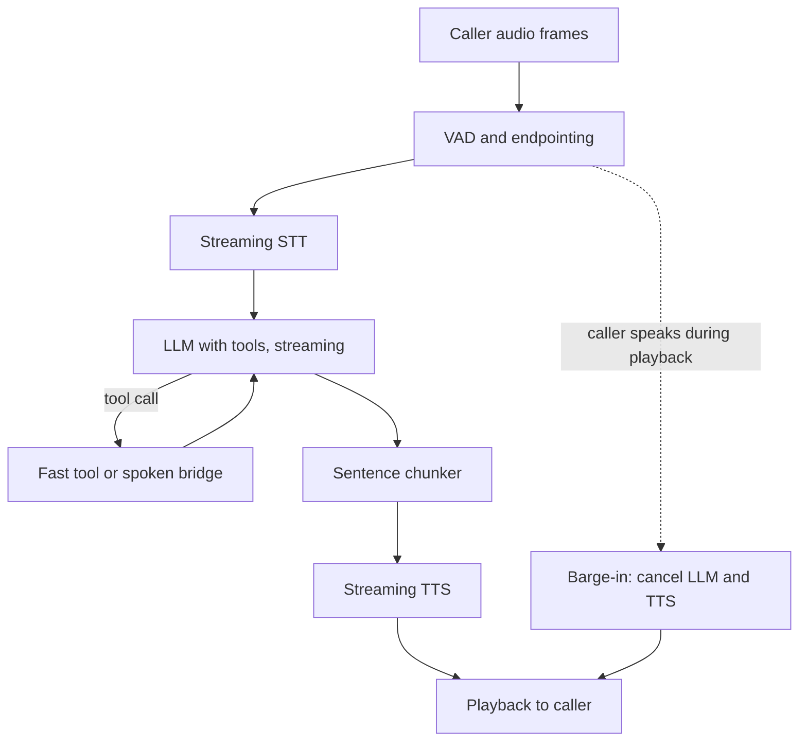

## TL;DR
A voice agent listens, transcribes, reasons and calls tools, then speaks back, all inside roughly one
second per turn. The business outcome is phone or app calls (bookings, order status, triage) handled
without a queue.

## For agent builders
- **Why it is hard.** Every component streams and every millisecond counts. A tool call that is fine in
  chat (2 seconds) is dead air on a phone, so latency is the main design constraint.
- **What it teaches.** Streaming pipelines, turn detection, interruption (barge-in) and cancellation,
  latency budgets per stage, and conversational tool design.
- **Where it shows up in your stack.** A transport (WebRTC, or telephony via SIP or Twilio Media
  Streams), voice activity detection, streaming speech-to-text, an LLM with tools, streaming
  text-to-speech, often orchestrated by Pipecat or LiveKit Agents.
- **What you can skip.** Training speech models. Use hosted or open STT and TTS and spend your effort on
  the turn loop, tools and evals.

## Decision case
### Scenario
A group of 12 outpatient clinics in the EU wants a phone agent for booking, rescheduling and cancelling
appointments, with transfer to reception for anything else. All figures are illustrative planning
numbers, not vendor quotes.
- **Volume:** about 3,000 calls a month at 3 minutes each, so 9,000 call minutes, with a Monday-morning
  peak of about 60 calls an hour, or about 3 concurrent calls (60 x 3 / 60).
- **Latency:** voice-to-voice p50 under 1 s and p95 under 1.8 s, the targets from the examples.
- **Data:** callers give names, dates of birth and symptoms. Transcripts must be redacted before storage,
  audio and text must stay in the EU, and every vendor must sign the clinics' data processing terms.
- **Accuracy:** under 5% word error rate on names and dates, with read-back before any booking.
- **Team and time:** two Python backend engineers with no speech experience; pilot at 2 clinics in 8
  weeks.
- **Budget:** a ceiling of $0.20 per call minute all-in, so 9,000 x $0.20 = $1,800 a month.

### Options
| Option | How it works | Latency | Redaction and residency | Team fit | Cost shape |
|---|---|---|---|---|---|
| A. Cascaded, hosted streaming STT, LLM and TTS | Pipecat or LiveKit Agents wiring three in-region vendors | planned p50 about 0.95 s (see below); p95 must be measured | text in the middle: redact before storage, log every turn | good: Python orchestration, swappable vendors | sum of three per-minute prices plus telephony |
| B. Speech-to-speech realtime model | One model takes and returns audio, with tool calls | often lower, fewer hops | depends on one vendor's region, terms and transcript output; check current docs | good: simplest pipeline | per audio minute or token |
| C. Cascaded, self-hosted open STT and TTS on own GPUs | Same pipeline, models run in the clinics' cloud account | depends on GPU sizing and warm capacity | full control | poor: needs GPU operations and speech tuning | fixed GPU cost even at night |

The latency plan for A keeps each stage in the lower half of its range above, as the budget requires:
300 ms endpointing + 100 STT + 250 LLM first token + 100 first sentence + 100 TTS first audio + 100
network = 950 ms.

### Decision
**Option A, cascaded with hosted in-region vendors.** The data constraints decide it: redaction before
storage and a full text audit trail need text between stages, and A lets the team pick each vendor for
EU hosting and signed terms.

C fails the team-skills and 8-week constraints. B could be faster, but its compliance depends on a
single vendor meeting every term at once.
- **Latency headroom:** the 950 ms plan is only 50 ms under the 1 s p50 target and leaves 850 ms
  under the 1.8 s p95 target for tail stages; the pilot must confirm both with per-stage timestamps.
- **Cost check:** the team prices the three vendors plus telephony per minute before signing, against
  the $0.20 ceiling.

**What would change it.** If a realtime vendor offers EU hosting, signed terms, text transcripts and tool
calls, run B against the same replay suite and switch if task success matches and p95 is lower.

If measured p50 stays above 1 s or p95 above 1.8 s after tuning, test B for the conversational turns. If volume grows to
steady high concurrency and the team hires speech engineers, re-cost C.

### Trade-offs accepted
- **Less natural turn-taking than speech-to-speech.** Watch barge-in correctness (target 95%) and
  callers who hang up in the first 30 seconds.
- **Three vendors, three failure points.** Keep a backup STT and TTS and a fixed apology plus transfer;
  watch per-stage timeout rates per day.
- **Short endpointing cuts off slow speakers.** At 300 ms, callers who pause while reading a date get
  interrupted. Watch interruptions per call, and use a turn-detection model on date and number questions.
- **Cost can creep.** Longer calls or a premium voice push past the ceiling; chart cost per call minute
  weekly.

### Review rubric
- **Latency budget summed:** the write-up adds per-stage budgets and compares the total with the p95
  target, stating the headroom.
- **Compliance mapped to architecture:** each data rule is tied to a property (where text exists, where
  data lives, who signs terms).
- **Team and deadline used to cut options:** at least one option is rejected on skills or time, with the
  reason.
- **Pilot can overturn it:** a replay suite, p95 latency and task success are named as the evidence that
  would switch the choice.
- **Fallback designed:** vendor timeout handling and human transfer are specified.
- **Cost computed from volume:** monthly cost follows from call minutes and the per-minute ceiling.

## Why it exists
- **Phone queues are expensive and slow.** Many calls are routine (opening hours, booking changes, order
  status) and follow a script a tool-using agent can run.
- **A plain chatbot fails on voice.** It waits for a full answer before speaking, writes Markdown lists
  that sound wrong aloud, and cannot handle the caller talking over it.
- **IVR scripts fail because callers do not follow menus.** "Press 2 for billing" breaks as soon as the
  caller says two things at once or changes their mind.
- **People notice delay.** Gaps between conversational turns are typically a few hundred milliseconds, so
  a 3-second pause reads as a broken line. The agent must start speaking fast and keep talking while
  tools run.

## How it works
### Two architectures
| | Cascaded (STT, LLM, TTS) | Speech-to-speech (realtime model) |
|---|---|---|
| Pipeline | Three swappable streaming stages | One model takes and returns audio |
| Latency | Sum of stages; tuned by overlap | Often lower, fewer hops |
| Control | Text in the middle: easy to log, filter, redact | Less inspectable; check current docs for transcripts |
| Tools | Any text LLM with tool calling | Supported by some realtime APIs |
| Cost | Mix and match vendors | Usually priced per audio minute or token |
| Pick when | You need control, compliance, custom voices | You want the most natural turn-taking fast |

### The cascaded turn loop
1. **Transport.** Audio frames arrive over WebRTC or a telephony media stream (often 8 kHz on phone
   lines, which lowers STT accuracy).
2. **Voice activity detection and endpointing.** A VAD (for example Silero VAD) decides speech vs
   silence; an endpointing rule or turn-detection model decides the caller has finished.
3. **Streaming STT.** Partial transcripts arrive while the caller speaks; the final transcript arrives
   shortly after end of speech.
4. **LLM with tools.** The agent streams tokens. Short spoken answers, no Markdown, numbers written as
   words where needed.
5. **Sentence chunking.** As soon as the first sentence is complete, it goes to TTS, so speech starts
   before the full reply exists.
6. **Streaming TTS and playback.** Audio frames flow back to the caller.
7. **Barge-in.** If the caller speaks during playback, stop audio, cancel the LLM and TTS tasks, and keep
   only the words actually spoken in the history.

### Latency budget (illustrative, voice-to-voice)
| Stage | Budget | Levers |
|---|---|---|
| Endpointing (silence wait) | 200-500 ms | Shorter silence threshold, turn-detection model |
| STT final transcript | 100-300 ms | Streaming STT, region close to caller |
| LLM time to first token | 200-500 ms | Smaller model, prompt caching, short prompts |
| First sentence complete | 100-300 ms | Ask for a short opening clause |
| TTS time to first audio | 100-300 ms | Streaming TTS, warm connections |
| Network and transport | 50-150 ms | Co-locate services, avoid extra hops |
| **Target total** | **about 800 ms to 1.5 s** | Measure p50 and p95 per stage |

- **The ranges do not all fit at once.** The stage ranges add up to roughly 750 ms to 2 s, so hitting
  the target means keeping most stages near the low end of their range.

### Tools in a voice turn
- **Fast tools inline.** Lookups under ~300 ms run before the reply.
- **Slow tools with a spoken bridge.** Say "Let me check that booking" first, then speak the result.
- **Confirm before acting.** Read back key details (date, name, amount) and get a spoken yes before any
  booking, cancellation or payment step; hand payments to a compliant flow, never the LLM.
- **Escalate to a human.** A transfer tool with a summary, triggered on request, repeated
  misunderstanding or sensitive topics.

## Diagram
Stages overlap: TTS starts on the first sentence, and barge-in cancels everything downstream.



## Examples
### A streaming turn with barge-in, in plain asyncio
Stubs stand in for STT, LLM and TTS, so you can see the overlap and the cancellation logic. Swap in
real streaming clients or a Pipecat or LiveKit Agents pipeline later.

```python
import asyncio, re, time

async def llm_stream(text):                  # stub: yields tokens like a streaming LLM
    reply = "Sure. Your table for two is booked at seven. Anything else?"
    for tok in re.findall(r"\S+\s*", reply):
        await asyncio.sleep(0.04); yield tok

async def tts(sentence):                     # stub: time to synthesise, then play
    await asyncio.sleep(0.15); return f"<audio:{sentence.strip()}>"

async def speak_turn(transcript, t0, spoken):
    buf = ""
    async for tok in llm_stream(transcript):
        buf += tok
        if re.search(r"[.?!]\s*$", buf):     # first full sentence goes to TTS at once
            audio = await tts(buf)
            if not spoken:
                print(f"first audio after {int((time.perf_counter()-t0)*1000)} ms")
            spoken.append(buf.strip()); print("play", audio); buf = ""

async def main(barge_in_after=None):
    spoken, t0 = [], time.perf_counter()     # t0 = end of caller speech
    turn = asyncio.create_task(speak_turn("book a table for two at 7", t0, spoken))
    if barge_in_after:
        await asyncio.sleep(barge_in_after)
        turn.cancel()                        # caller started talking: stop LLM and TTS
    try:
        await turn
    except asyncio.CancelledError:
        print("barge-in: cancelled")
    print("history keeps only:", spoken)     # never store words the caller did not hear

asyncio.run(main())
asyncio.run(main(barge_in_after=0.3))
```

### Cost, latency and accuracy targets for a booking line
Illustrative targets for a restaurant or clinic booking agent; vendor prices change, so check current
pricing.

| Metric | Target | Notes |
|---|---|---|
| Voice-to-voice latency | p50 under 1 s, p95 under 1.8 s | Measured from end of caller speech to first audio |
| Cost per call minute | low cents to tens of cents | Sum STT, LLM, TTS and telephony per minute |
| Word error rate on key slots | under 5% on names, dates, numbers | Phone audio is harder than studio audio |
| Task success (booking correct) | 85%+ on scripted test calls | Compare final booking record with script |
| Barge-in handled correctly | 95%+ | Audio stops within ~200 ms of caller speech |
| Escalation when asked | 100% | "Agent, please" must always transfer |

### Practice data
- **MultiWOZ.** Task-oriented dialogues for restaurants, hotels and taxis; turn the user sides into test
  scripts with known slot values.
- **Mozilla Common Voice and LibriSpeech.** Public speech for measuring STT accuracy on accents and noise.
- **Synthetic calls.** Generate 50 caller scripts, synthesise them with a TTS voice, add phone-band noise,
  and replay them through your agent for repeatable evals.

## Production patterns
- **Measure every stage per turn.** Emit timestamps for end of speech, STT final, LLM first token, first
  sentence, TTS first byte and first audio played; chart p50 and p95. The slowest stage is rarely the
  one you guessed.
- **Write voice-specific prompts and tools.** One or two short sentences per turn, no lists or Markdown,
  read back critical values, and tool results returned as short, speakable facts.
- **Pre-warm and co-locate.** Keep STT, LLM and TTS connections open, run them in the same region as
  the telephony edge, and use prompt caching for the stable system prompt and tool schemas.
- **Replay-based evals.** Run synthetic and recorded test calls on every change; score task success from
  the final tool state, latency from traces, and transcripts with an LLM judge for politeness and
  policy. Gate releases on p95 latency as well as success.
- **Compliance by design.** Announce recording and AI use where the law requires it, redact PII from
  transcripts before storage, and route card payments to a compliant IVR or payment provider flow so
  card numbers never enter the LLM.
- **Graceful fallback.** If a vendor stage times out, switch to a backup STT or TTS, or say a fixed
  apology and transfer to a human.

## Trade-offs
- **Cascaded vs speech-to-speech.** Cascaded gives text logs, redaction points and vendor choice;
  realtime models give smoother turn-taking with fewer hops. Flip to speech-to-speech when naturalness
  matters more than inspectability and the vendor meets your compliance needs.
- **Short endpointing vs interruptions.** A short silence threshold makes the agent snappy but cuts off
  callers who pause to think. Use a turn-detection model or adapt the threshold per question type.
- **Big model vs latency.** A larger model reasons better but adds time to first token. Route most turns
  to a fast model and escalate hard turns, or use a fast model with strong tools.
- **Natural voice vs cost.** Premium TTS voices sound better and cost more per character; test whether
  callers' task success actually changes.

## Pitfalls
- **Waiting for the full LLM reply before TTS.** Symptom: 2-4 seconds of silence on every turn. Fix:
  stream tokens, chunk by sentence, start TTS on the first one.
- **Keeping unspoken text in history.** After barge-in the model believes it said things the caller never
  heard, and contradicts itself. Fix: store only the text that finished playing.
- **Silent slow tools.** A 3-second lookup with no audio sounds like a dropped call. Fix: speak a short
  bridge phrase first and set tool timeouts.
- **Misheard numbers and names.** "Fifteen" becomes "fifty" and the wrong booking is made. Fix: read back
  and confirm critical slots, use STT keyword boosting where supported, and spell names.
- **Testing on clean laptop audio only.** Production phone audio is narrowband and noisy, so accuracy
  drops. Fix: test with 8 kHz, noisy, accented samples.

## When to use
- **Good first project when:** the calls are narrow and scripted (bookings, status checks, FAQs) and a
  human transfer is available. You learn streaming and latency without high-stakes actions.
- **Avoid when:** calls involve payments, medical or legal advice, or emotional situations without a
  human path, or when a web form would serve users better.
- **Measure:** per-stage latency p50 and p95, task success on replayed calls, slot accuracy, barge-in
  correctness and transfer rate.
- **Interviews:** expect to draw the latency budget and explain barge-in and tool bridging.

## Role lens
- **Engineer:** Builds the streaming pipeline, sentence chunking, barge-in cancellation and per-stage
  latency tracing, and tunes endpointing on real call audio.
- **Architect:** Chooses cascaded or speech-to-speech, vendor and region layout, compliance controls for
  recording and PII, and the fallback path to humans.
- **FDE:** Maps a customer's top call reasons to tools and scripts, collects real call samples for evals,
  and sets latency and success targets with the contact-centre lead.

## Check yourself
**Q:** Your booking voice agent has a p95 voice-to-voice latency of 3.2 seconds. How do you find and fix
the cause?
**A:** First instrument each stage per turn: end of speech, STT final, LLM first token, first complete
sentence, TTS first byte and first audio played, and chart p95 for each. Common culprits are waiting
for the full LLM reply before TTS (fix by streaming and sentence chunking), a long endpointing silence
threshold, cold connections to vendors, a large model with a long uncached prompt, or a slow tool with
no spoken bridge. Fix the biggest stage first: stream and chunk, pre-warm connections, co-locate in one
region, cache the stable prompt prefix, route easy turns to a faster model, and bridge slow tools with a
short phrase. Re-measure on replayed phone-quality calls, not laptop audio.

## Interview questions
### Walk me through the latency budget of a cascaded voice agent.
- **Stages:** endpointing, STT final, LLM time to first token, first sentence, TTS first audio and
  network, each with a few hundred milliseconds at most.
- **Overlap is the trick:** TTS starts on the first sentence while the LLM keeps generating, so total
  latency is far less than the sum of full stage times.

### How do you handle the caller interrupting the agent mid-sentence?
- **Detect speech during playback** with VAD, stop audio immediately and cancel LLM and TTS tasks.
- **Fix the history:** keep only the words actually played, then process the new utterance.
- **Tune false triggers:** coughs and "uh-huh" backchannels should not always stop playback.

### A tool call takes 3 seconds. How do you design around it in voice?
- **Speak a bridge phrase** before calling, so the line is not silent.
- **Parallelise or prefetch:** start likely lookups when the caller's intent is clear from partial
  transcripts, and cache common results.
- **Set a timeout** with a spoken fallback and a human transfer path.

### When would you choose a speech-to-speech model over a cascaded pipeline?
- **Choose it** when natural turn-taking and low latency matter most and the vendor supports the tools
  and compliance you need.
- **Stay cascaded** when you need text transcripts for redaction and audit, custom voices, or the freedom
  to swap STT, LLM and TTS vendors.

### How would you evaluate a voice agent before launch?
- **Replay suite:** synthetic and recorded calls with known goals, run at phone quality with noise.
- **Score outcomes from tool state** (was the booking correct), slot accuracy, latency percentiles,
  barge-in handling and transfer behaviour, plus a judge on transcripts for policy.

## Quiz
### Q: What most reduces time to first audio in a cascaded voice agent?
- [ ] Using a larger LLM
- [x] Streaming LLM tokens and sending the first complete sentence to streaming TTS immediately
- [ ] Waiting for the whole reply so TTS can plan prosody
- [ ] Increasing the endpointing silence threshold
> Overlapping stages means speech starts after the first sentence, not the full reply. Larger models and
> longer silence thresholds add latency, and waiting for the whole reply is the main cause of dead air.

### Q: After a barge-in, what should go into the conversation history?
- [ ] The full reply the LLM generated
- [ ] Nothing from that turn
- [x] Only the portion of the reply that was actually played to the caller
- [ ] The reply plus a note that it was interrupted, in full
> The model must believe what the caller heard. Storing unplayed text makes the agent refer to things
> the caller never heard and causes confusing, contradictory turns.

### Q: How should a voice agent handle a booking cancellation request?
- [ ] Cancel immediately to keep latency low
- [x] Read back the booking details and get a spoken confirmation before calling the cancel tool
- [ ] Ask the caller to type the booking ID into a web page
- [ ] Transfer every cancellation to a human
> Speech recognition errors on names and dates are common, so consequential actions need read-back and
> explicit confirmation. Transferring every case wastes the agent, and acting blindly risks wrong cancellations.

## Use cases & projects
### Use cases
- **Restaurant and clinic booking lines.** Check availability, book, change or cancel with read-back
  confirmation and a human fallback.
- **Order and delivery status.** Look up an order by phone number and spoken order ID and give a short
  spoken status.
- **After-hours IT or facilities triage.** Gather details, classify urgency and page on-call for real
  emergencies.
- **Outbound reminders.** Confirm or reschedule appointments, with consent and opt-out handling.
- **Voice front-end for an existing chat agent.** Reuse the tools; rewrite prompts and outputs for speech.

### Mini project
**Latency-instrumented booking agent (2-3 hours).**
- **Goal:** a browser or terminal voice agent that books a table against a fake availability tool, with
  per-stage latency logged for every turn.
- **Steps:** start from a Pipecat or LiveKit Agents quickstart (or the asyncio skeleton above with real
  streaming STT and TTS); add `check_availability` and `book_table` tools over an in-memory dict; add
  read-back confirmation before booking; log timestamps per stage; write 10 MultiWOZ-style caller scripts
  and run them.
- **Done when:** 8 of 10 scripted calls end with the correct booking, you have a table of p50 and p95
  latency per stage, and interrupting the agent stops audio and keeps only spoken text in history.
