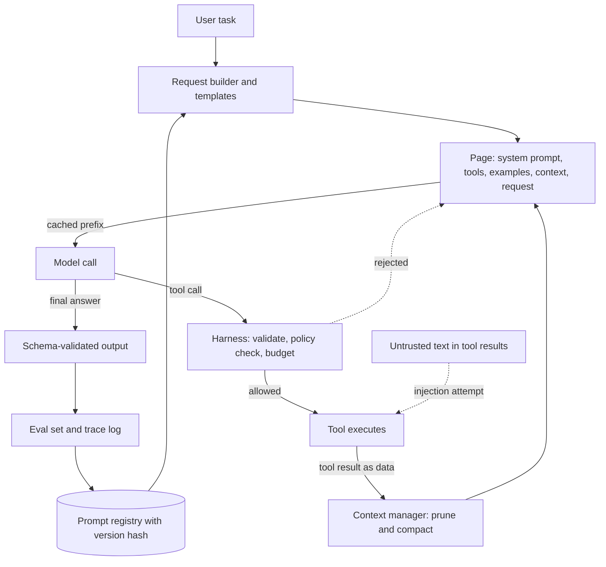

## Overview
This module treats the prompt as what it really is: the full specification of a task, written in the only
input a language model has, and handled with the same discipline as code. For an agent builder that
matters at every step, because each step of an agent loop is a prompted model call.

It opens with prompt engineering as a measured loop: specify, run against a fixed eval set, change one
variable, measure again. Then it walks through the techniques in the order you reach for them.

- **Zero-shot** is the baseline.
- **Few-shot** is for the cases where showing the shape works better than describing it.
- **Chain-of-thought** buys sequential computation for multi-step problems.
- **The system prompt** carries the operator's standing policy.

Next come the production mechanics around the words. Templates separate fixed instructions from
per-request variables. Structured outputs turn free text into a schema-valid object. Function calling and
the ReAct loop let the model ask your code to look things up and act.

Context engineering decides what fills a finite, billed window, and prompt caching makes a stable prefix
nearly free. Versioning makes every response traceable to the exact prompt that produced it. The module
ends with prompt injection and jailbreaks, which show why the prompt can never be a security boundary.

**What this module gives an agent builder:**
- **A spec for every step.** System prompt, tool descriptions, examples and output format are how you tell an agent which tool to call, how to fill it and when to stop.
- **The agent loop itself.** Tool calling plus ReAct is the round trip every agent runs on, with budgets, stop conditions and errors owned by your harness.
- **Cost and traceability.** Static-first layout, caching, context budgets and a version hash on every trace keep long loops cheap and regressions datable.
- **A security posture.** Policy enforced in tool code, not in wording, so a successful injection or jailbreak produces words with no effect.

**Core for agents (you use these directly):** prompt-engineering, zero-shot, few-shot, chain-of-thought,
system-prompt, prompt-templates, structured-outputs-json-mode, function-tool-calling, react,
context-engineering, prompt-caching, prompt-versioning and prompt-injection.

**Useful (you meet it when operating agents):** jailbreaks.

**What you can build afterwards:**
- **A production request builder.** Take a vague prompt to a versioned, tested, cache-friendly request builder with schema-checked output and tool use.
- **A tool-using agent loop.** Write a ReAct loop with step and token budgets, validated tool arguments and approval gates.
- **An informed escalation.** Explain why each part works in terms of how the model was trained and how it runs, and say when prompting should give way to retrieval, tools or fine-tuning.

It matters most for AI Engineers, who write and ship these prompts every day, and for FDEs, who tune them
against a customer's real data.

## Why it matters
- **Engineer:** You write the agent's request builder, the templates, the tool schemas and the agent loop, so you need to set a zero-shot baseline, add examples or reasoning only when the eval shows a gain, put static text first so caching works on every step, get zero parse failures from constrained decoding, and record a prompt version on every trace.
- **Architect:** You decide what lives in the agent's prompt and what has to live in code: policy with money or legal consequences, tool permissions and injection containment belong outside the model, while context budgets, compaction strategy and the prompt registry with its eval gate and rollback path are platform choices that set both cost and auditability.
- **FDE:** On a customer engagement you turn their vague requirement into a precise spec for the agent, choose few-shot examples from their own tickets or documents, threat-model their data sources for injection, red-team the bot against their business policies, and hand over a versioned prompt plus an eval set they can rerun after every model upgrade.

## Mental model
Picture each model call, including every step of an agent loop, as one assembled document that the model
reads from top to bottom and then continues, with no hidden channel and no memory beyond what is on the
page. Every topic in this module is a decision about that page.

| Region of the page | What it holds | Lessons |
|---|---|---|
| **Top: cacheable prefix** | Byte-stable system section with policy, tool definitions and examples | system-prompt, few-shot, function-tool-calling, prompt-caching |
| **Middle: managed context** | Retrieved material, compacted history and tool results, kept within a token budget and placed where attention reaches it | context-engineering |
| **Bottom: request variables** | Per-request values rendered through a template | prompt-templates, zero-shot |
| **Generation** | Reasoning space before the answer, a schema that constrains which tokens can appear, or a structured tool call that hands control back to your code | chain-of-thought, structured-outputs-json-mode, react |
| **Label on the page** | The version that lets you reproduce it later | prompt-versioning |

- **Everything on the page is just tokens.** That one fact explains why precise specification works, why caching depends on exact prefixes and why injected text can steer the model.
- **Certainty lives outside the page.** Anything that must hold for certain has to be enforced in the code around the page, never in the words on it.
- **The loop re-renders the page.** In an agent, each tool result is appended and the whole page is sent again, so layout, budgets and caching repeat their effect on every step.

## Suggested order
1. prompt-engineering — orients the module: the prompt as a specification and the measure-change-measure loop every later technique is judged by.
2. zero-shot — sets the baseline: a precise instruction with no examples, how to read its failures, and why every tool description is a zero-shot spec.
3. few-shot — the first lever when a precise zero-shot prompt plateaus, along with the order, label and copy biases examples bring to tool calls.
4. chain-of-thought — adds reasoning tokens for multi-step tasks and agent planning, building on the baseline-versus-variant A/B habit from the previous two.
5. system-prompt — moves from single prompts to deployed products: the operator's channel, why the model honours it and why it guarantees nothing.
6. prompt-templates — turns system and user text into a typed, rendered, testable artefact with the static-first layout.
7. structured-outputs-json-mode — makes output machine-consumable with constrained decoding, which you need before code can consume tool arguments.
8. function-tool-calling — uses schemas to let the model request actions your code executes, the boundary agents are built on.
9. react — wraps tool calls in a reason-act-observe loop and shows what the harness owns: budget, termination and safety checks.
10. context-engineering — manages the window that loops and retrieval fill: budgets, ordering, pruning and compaction.
11. prompt-caching — rewards the stable prefixes that templates and context layout produce, with the economics of writes versus reads.
12. prompt-versioning — makes the effective prompt identifiable, evaluated before promotion and revertible, now that it has many moving parts.
13. prompt-injection — the attack that follows from "everything is tokens", and why containment lives in architecture, not wording.
14. jailbreaks — finishes with attacks on safety training and operator policy, measured with attack suites rather than asserted.

## Capstone
### Brief
**Use case.** A fictional SaaS product's support team is drowning in inbound tickets. They want a
support-triage agent that sorts each ticket, pulls out the facts a human needs and drafts a reply, which
you then deliver as if a customer team will take it over.

**What the agent does:**
- **Classifies** the ticket into a fixed label set.
- **Extracts** structured fields (product area, severity, account id, requested action) into a schema-constrained object.
- **Drafts a reply** by running a short ReAct loop over three mock tools: knowledge-base search, account lookup, and a refund-request tool that only creates a pending request a human must approve.

**How you build it (over several days):**
- **Measure first.** Start zero-shot, measure on a labelled golden set of at least 60 tickets, and add few-shot examples or a reasoning field only where the eval shows a gain.
- **Lay out for caching.** The system prompt and tool definitions live in versioned template files rendered static-first, so prompt caching hits from the second call.
- **Budget the context.** A context budget prunes old tool results in longer loops.
- **Trace everything.** Every call logs the prompt version hash and token usage.

**Then attack your own build.** Seed tickets and knowledge-base articles with indirect injection
attempts, and run a jailbreak suite against two business policies: never promise a refund, and never
reveal the system prompt. Show that the refund rule is enforced in code, not only in the prompt.

### Deliverables
- A runnable repository with the request builder, versioned prompt templates with metadata headers, JSON schemas for the extraction output and tool definitions, the ReAct loop with step and token budgets, and the mock tools.
- A golden set of 60+ labelled tickets plus an eval script that reports label accuracy, field-level extraction accuracy, parse failure rate, tokens, latency and cache hit ratio for each prompt version.
- An experiment log comparing zero-shot, few-shot and chain-of-thought variants on the same set, with the decision each comparison led to.
- An attack suite of injected tickets and documents and at least three jailbreak families per policy, with attack success rate and benign pass rate reported per prompt version.
- A one-page handover note covering the prompt versions shipped, how to roll back, and which rules are enforced in code versus in the prompt.

### Rubric
- Parse failure rate on the golden set is zero, and the eval script prints a per-label confusion matrix plus a per-version comparison table that the experiment log's decisions refer to.
- A second identical request reports cache reads in the usage fields, an integration test asserts this, and no per-request field is rendered above the static instructions.
- Every logged call carries a prompt version hash, and rolling back to the previous version is a single command that the eval then confirms.
- The ReAct loop ends every run with an answer, a budget stop or a handled error, never by looping until the context overflows, and tool-call arguments that fail validation are rejected before execution.
- No injected ticket or jailbreak creates an executed refund. The refund tool only ever produces pending requests, which a test checks even when the model is told to approve them.
