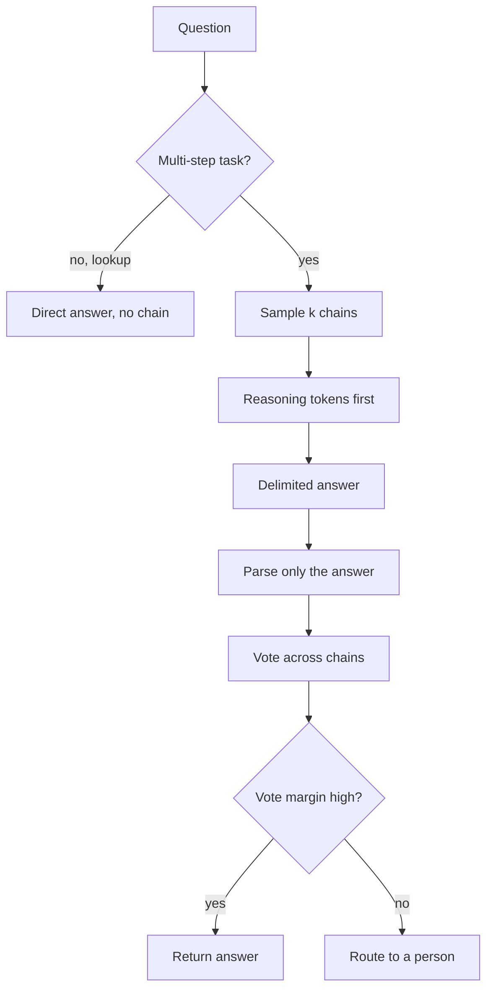

## TL;DR
Chain-of-thought (CoT) has the model reason before it answers or calls a tool, buying sequential compute
one token cannot supply. Agents need it for planning and multi-step choices, not lookups; the chain is
not guaranteed to be the decision's real cause.

## For agent builders
- **Why it matters for agents.** Planning, choosing among tools with constraints, and reading a messy
  tool result are multi-step problems; reasoning before the call raises accuracy there. But every agent
  step that reasons pays for it in output tokens and latency, multiplied by the number of steps.
- **Where it shows up in your stack.** Extended thinking or effort settings on reasoning models (often
  with thinking between tool calls), a `reasoning` field before the action in structured outputs,
  "plan first" instructions in the system prompt, and self-consistency votes in evals and judges.
- **What you control.** Which steps get reasoning or a higher effort, the token budget per step, whether
  reasoning precedes the action, and whether chains are logged or shown to users.
- **What you can skip.** The circuit-complexity proofs. Keep the one-line version: one token is a fixed
  amount of compute, so dependent steps need intermediate tokens.

## Why it exists
- **Same weights, different result.** Ask for the final answer to a multi-step word problem and the model
  often fails; ask it to show its work first and it often succeeds.
- **The cause is architectural.** Generating one token runs the input through a fixed number of layers
  once: no loop, no scratchpad, no way to do step three after step two inside that pass. Theoretical work
  on bounded-depth transformers shows some inherently serial problems are out of reach without
  intermediate tokens (under standard complexity assumptions) and become solvable with them.
- **Writing steps changes the computation.** Every emitted token is another full pass conditioned on all
  previous ones, so serial compute grows with chain length and partial results reach later steps through
  attention.
- **The naive fixes fail.** A bigger model still has fixed per-token compute: it raises the ceiling at
  great cost without removing it. Answer-then-explain is post-hoc rationalisation, because the answer token
  was sampled before any reasoning existed.
- **It needs scale.** CoT was first shown with few-shot worked rationales, then as a zero-shot trigger
  phrase. Gains appeared only above a certain model scale; smaller models write fluent chains that reach
  wrong answers.

## How it works
### Compute per token, and why order matters
1. **Each token gets the same compute.** The same number of layers, with attention to every earlier token.
2. **The text is the only memory.** Decoding is a sequence of bounded-depth computations; a chain of k
   reasoning tokens gives roughly k additional passes, each able to read the partial results so far.
3. **So reasoning must come before the answer.** Generation is left to right and a field cannot influence
   one already emitted: in JSON the "reasoning" field precedes the "answer" field; with tags, `<reasoning>`
   then `<answer>`.

### Variants
| Variant | How | Note |
|---|---|---|
| **Few-shot CoT** | Demonstrations include the rationale | Model copies reasoning style and granularity; flawed rationales get copied too |
| **Zero-shot CoT** | A trigger such as "think step by step before answering" | Cheaper to set up, less control over the chain's shape |
| **Self-consistency** | Sample several chains, take the majority final answer | Costs k times the tokens; needs a discrete answer to vote on |
| **Built-in reasoning** | Models trained, typically with reinforcement learning, to produce long internal chains | Often hidden or summarised by the API; controlled by a budget or effort setting, not a prompt trigger |

- **Why self-consistency works:** different chains make different mistakes, so wrong answers spread
  across many values while the right answer is reached repeatedly.
- **On reasoning models, skip the trigger.** An explicit "think step by step" is usually redundant and can
  produce a second, visible chain duplicating the hidden one; tune the effort setting and measure instead.
  The reasoning-models lesson covers the mechanism.

### Why voting works, in numbers
- **Strict majority of five.** If one chain is right with probability 0.6, five independent chains are
  right when at least three are: 10·0.6³·0.4² + 5·0.6⁴·0.4 + 0.6⁵ ≈ 0.35 + 0.26 + 0.08 = 0.68.
- **Plurality does better** when wrong chains scatter across different wrong numbers, because the correct
  answer can win with two votes against four singletons.
- **It backfires on consistent mistakes.** If one wrong answer is more likely than the truth, voting
  amplifies it.
- **It needs independence.** With identical sampling or a shared misreading of the question, five votes
  carry little more information than one.
- **Read the margin.** A 5/5 majority and a 2/5 plurality deserve different confidence; the margin is a
  cheap uncertainty signal for routing low-agreement cases to a person.

### What the chain is, and is not
- **It is a computation** and a useful debugging artefact: failed chains show whether the model misread
  the question, dropped a constraint or made an arithmetic slip.
- **It is not a faithful account** of why the answer was produced. When demonstrations are biased (the
  correct option always "A"), models write chains that never mention the bias while their answers follow
  it.
- **Treat it as evidence to inspect, never as an audit trail.**

### Reasoning inside an agent loop
| Agent step | Reasoning? | Why |
|---|---|---|
| Initial plan for a multi-part task | Yes | Decomposition and ordering are dependent steps |
| Choosing a tool under constraints ("cheapest flight under 2 stops") | Yes | Several conditions to check together |
| Reading a large or contradictory tool result | Often | The next action depends on combining facts |
| Routing, simple lookups, formatting the final answer | Usually no | Nothing to derive; pay latency for nothing |

- **Reason before the action, not after.** The same ordering rule applies: a `reasoning` field before
  `action` in the schema, or thinking before the tool call, so the reasoning can change which call is made.
- **Reasoning cost compounds.** Output tokens for reasoning are paid on every step that reasons, so a
  12-step run multiplies the per-step chain by 12.
- **Stated reasons are not an audit trail.** An agent's written justification for a tool call can omit
  what actually drove it; log the inputs and the call itself.

### Where it does not help
- **Lookups:** fact retrieval, short-text classification, sentiment. There are no intermediate steps, so
  you pay latency for nothing.
- **Most non-math benchmarks.** Surveys report gains concentrated in math and symbolic reasoning, with
  little or negative effect elsewhere.
- **Format-sensitive tasks.** Extra prose makes outputs harder to parse and occasionally worse.
- **Missing knowledge.** A chain built on a missing fact is confidently wrong.

### Operational details
- **Reasoning needs room.** Size `max_tokens` for the chain, not the answer, or the output truncates
  mid-chain with no answer at all.
- **Hidden thinking still counts.** On built-in reasoning models the thinking tokens typically count
  against the same limit and are billed as output even when you never see them.
- **Parse only the delimited answer.**
- **Decide whether users see the chain.** It can leak the contents of the context and reads as
  authoritative even when unfaithful.
- **Count the tokens.** Output tokens are typically priced several times above input tokens, and a chain
  can multiply output length by an order of magnitude.

## Diagram
Reasoning tokens come first so they can shape the answer; with self-consistency, several chains vote and
the margin decides whether to trust the result.



## Misconceptions
- **"CoT works because the model explains itself."** It works because each emitted token is another
  full forward pass, so a chain buys serial compute that one fixed-depth pass cannot supply. The text is
  the only scratchpad.
- **"Answer first, then explain, is equivalent."** Generation is left to right: the answer token is
  sampled before any reasoning exists, so the explanation is post-hoc. Put the `reasoning` field before
  the answer or the tool call.
- **"The chain shows why the agent did what it did."** Chains can be unfaithful: with biased
  demonstrations, models follow the bias without mentioning it. Treat the chain as evidence to inspect;
  log inputs and the actual call for audits.
- **"Reasoning on every agent step is the safe default."** Lookups, routing and formatting gain nothing,
  yet each reasoning step adds output tokens and latency across the whole run. Route reasoning to plan
  and constraint-checking steps.
- **"Self-consistency always improves accuracy."** Voting helps when wrong answers scatter; with one
  systematic error more likely than the truth, five chains do worse than one (about 0.32 against 0.40
  in the simulation below).
- **"Reasoning models still need 'think step by step'."** They already produce an internal chain; the
  trigger is usually redundant and can add a visible duplicate. Tune the effort or budget setting and
  measure.

## Examples
### Direct vs CoT with self-consistency
Three disciplines in one script: the reasoning block comes before the answer, only the delimited answer is
parsed, and self-consistency takes a majority over five sampled chains. The direct-answer variant runs the
same way so the comparison is like for like.

```python
import anthropic, re, collections

client, MODEL = anthropic.Anthropic(), "claude-opus-5-5"
QUESTION = ("A warehouse ships 3 pallets per truck. On Monday 4 trucks leave, on Tuesday twice as many, "
            "and on Wednesday 5 pallets are returned. How many pallets are out at the end of Wednesday?")

DIRECT = "Answer with just the number inside <answer></answer> tags."
COT = ("First work through the problem inside <reasoning></reasoning> tags, one step per line. "
       "Then give the final number inside <answer></answer> tags. Nothing after the answer tag.")

def ask(style):
    r = client.messages.create(model=MODEL, max_tokens=2048, system=style,     # room for the chain
                               messages=[{"role": "user", "content": QUESTION}])
    text = next((b.text for b in r.content if b.type == "text"), "")
    m = re.search(r"<answer>\s*(-?\d+)\s*</answer>", text)                    # parse only the answer
    return (m.group(1) if m else "PARSE_FAIL"), text

for style in (DIRECT, COT):
    votes = collections.Counter(ask(style)[0] for _ in range(5))             # self-consistency: 5 chains
    answer, n = votes.most_common(1)[0]
    print(f"{'direct' if style is DIRECT else 'cot':<7} majority={answer} ({n}/5) votes={dict(votes)}")
# Expected: 4*3 + 8*3 - 5 = 31. If your model reasons internally (thinking or effort settings),
# expect little gap: the hidden chain already supplies the computation. To see the classic CoT
# effect, run both styles on a model without built-in reasoning. The ordering and parsing
# discipline shown here applies to any model.
```

### When voting helps and when it backfires
Pure Python, no API: the exact strict-majority formula from above, plus a simulation of plurality voting
over five chains under two error patterns.

```python
import random, collections
from math import comb

def majority_exact(p, k=5):
    """P(a strict majority of k independent chains is correct)."""
    return sum(comb(k, j) * p**j * (1 - p)**(k - j) for j in range(k // 2 + 1, k + 1))

def plurality_sim(answer_dist, k=5, trials=100_000, seed=0):
    """answer_dist: {answer: probability}; 'right' is the correct one. Ties count as wrong."""
    rng, answers = random.Random(seed), list(answer_dist)
    weights, wins = list(answer_dist.values()), 0
    for _ in range(trials):
        top = collections.Counter(rng.choices(answers, weights, k=k)).most_common(2)
        wins += top[0][0] == "right" and (len(top) == 1 or top[0][1] > top[1][1])
    return wins / trials

print(f"majority, p=0.6: {majority_exact(0.6):.2f}")                       # 0.68
scattered = {"right": 0.6, **{f"wrong{i}": 0.4 / 8 for i in range(8)}}     # errors spread out
print(f"plurality, scattered errors: {plurality_sim(scattered):.2f}")
consistent = {"right": 0.4, "same_wrong": 0.5, "other_wrong": 0.1}        # one systematic error
print(f"plurality, consistent error: {plurality_sim(consistent):.2f}")
```

| Error pattern | Single chain | Five chains, voted |
|---|---|---|
| Strict majority, p = 0.6 | 0.60 | 0.68 |
| Plurality, wrong answers scattered over 8 values | 0.60 | about 0.84 |
| Plurality, one wrong answer at 0.5, truth at 0.4 | 0.40 | about 0.32, worse than one chain |

- **Scattered errors are where voting shines**, because the truth wins with a small plurality.
- **A systematic misreading is amplified.** Fix the prompt or add a rule; more samples will not help.

### Worked scenario: reasoning on every agent step vs routed effort
A travel-booking agent averages 12 steps per task. Reasoning on every step averages 800 output tokens
per step; the team routes reasoning only to the plan step and the 3 constraint-checking steps
(illustrative numbers from one eval run).

| Setup | Reasoning tokens per task | Task success (200 tasks) | p95 latency per task |
|---|---|---|---|
| No reasoning | 0 | 71% | 28 s |
| Reasoning on all 12 steps | 12 × 800 = 9,600 | 86% | 95 s |
| Reasoning on plan + 3 constraint steps | 4 × 800 = 3,200 | 85% | 47 s |

- **Most of the gain came from 4 of 12 steps.** The other 8 were lookups and formatting, so their chains
  added tokens and latency, not accuracy.
- **A one-point gap is inside the noise** at 200 tasks; keep routed effort unless a larger eval shows a
  real loss.

## Production patterns
- **Route reasoning by request class.** Classify or route requests so only multi-step classes (math,
  date logic, multi-constraint selection) get a chain or a higher effort setting; lookups and
  classifications go direct. Monitor accuracy, output tokens and p95 latency per class.
- **Reasoning field before answer in the schema.** In structured outputs, declare `reasoning` before
  `answer` (or `<reasoning>` before `<answer>` tags) and parse only the answer. Monitor parse-failure rate,
  which spikes when the chain bleeds into the answer.
- **Budget for the chain.** Set `max_tokens` well above answer length; on models with extended thinking,
  set the thinking budget or effort explicitly and keep it below the output limit. Alert on responses that
  stop at the token limit with no answer tag.
- **Self-consistency with margin routing.** For high-stakes discrete answers, sample several chains, vote,
  and send low-margin cases (for example 2/5) to human review. Monitor the margin distribution and the cost
  multiple.
- **Keep chains internal.** Show users the answer, log chains for debugging under the same retention and
  access rules as the context they may quote. Review a sample of failed chains weekly to find recurring
  misreadings.
- **Per-step effort in agents.** Give the planning and constraint-heavy steps a higher effort or thinking
  budget, and run routing, lookups and final formatting with little or none. Monitor reasoning tokens per
  step, task success and p95 task latency per agent version.
- **Plan, then act.** For long tasks, ask for a short numbered plan first, store it in the agent state,
  and re-check it after surprising tool results. Monitor how often runs revise the plan and whether
  revisions precede failures.

## Trade-offs
- **Accuracy vs latency and output tokens.** Multi-step accuracy rises, but output tokens cost more than
  input tokens; the trade becomes a net loss on lookups and short classifications, where there is nothing
  to derive.
- **Self-consistency vs k times the cost.** It buys a further accuracy gain, and stops paying when
  single-chain accuracy is already high or the answer is free text that cannot be voted on.
- **Debugging aid vs leak and liability.** A visible chain can expose context contents and reads as an
  explanation even when it is not one; hide it from end users unless the product is about showing work.
- **Prompt trigger vs effort setting.** On reasoning-native models an explicit CoT instruction duplicates
  work the model already does, so the lever becomes the effort or budget setting; on models without
  built-in reasoning the prompt trigger is still the main lever.

## Pitfalls
- **Asking for the answer first and the reasoning after.** Symptom: articulate justifications of wrong
  answers that never change the answer.
- **Setting `max_tokens` for the answer length.** Symptom: truncated chains and missing answer tags,
  showing up as parse failures.
- **Parsing the whole response as the answer.** Symptom: JSON decode errors because the chain is prose.
- **Reading the chain as the cause of the answer.** Symptom: answers that track a feature of the prompt the
  chain never mentions.
- **Applying CoT to every call by default.** Symptom: latency and cost tripling on a classification task
  with no accuracy change.
- **Few-shot CoT with sloppy rationales.** Symptom: the model copies the same shortcut and fails on exactly
  the cases the shortcut misses.
- **Maximum reasoning on every agent step.** Symptom: tasks that take minutes and cost several times more
  with the same success rate. Fix: measure per step type and route effort only where it moves success.

## When to use
- **Use when** the task has intermediate steps: arithmetic, unit conversion, date logic, multi-constraint
  selection, planning, code reasoning, anything where a person would want scratch paper.
- **Skip for** lookups, sentiment, short classification and plain extraction; add a reasoning field to
  structured outputs only when the eval shows a gain.
- **Measure:** always A/B against the direct-answer prompt, tracking accuracy, output tokens and latency
  together; add self-consistency only where remaining errors are inconsistent across samples.
- **Reasoning models:** treat the effort or budget setting as the dial and measure before adding prompt
  triggers.
- **Interviews:** the expected depth is the compute-per-token argument, the ordering rule,
  self-consistency and the faithfulness caveat.

## Role lens
- **Engineer:** Adds a delimited reasoning section before the answer, sizes `max_tokens` for the chain,
  parses only the answer, and reports accuracy against tokens for each variant.
- **Architect:** Decides which request classes get a reasoning budget, since it multiplies latency and
  output cost, and sets the policy on exposing chains to users.
- **FDE:** Uses failed chains from the customer's data to show their experts where the model misreads the
  domain, turning each recurring pattern into a rule or an example.

## Check yourself
**Q:** An extraction pipeline returns JSON. A teammate added "think step by step" to the instruction;
parsing now fails on a third of requests and accuracy on the other two thirds did not move. What happened
and what would you do?
**A:** Two things. The chain is prose, and it now appears before or around the JSON, so a parser expecting
a bare object fails; and extraction is largely a lookup task with few intermediate steps to compute, so the
chain added tokens without adding accuracy. I would first revert and confirm the baseline. If I believed
some fields need reasoning, say deriving a total from line items, I would put the reasoning in a delimited
block or in a "reasoning" field that precedes the answer fields, parse only the answer part, raise
`max_tokens` so the chain cannot truncate, and A/B it on the eval set measuring accuracy, parse-failure
rate, latency and output tokens. If the model has built-in reasoning I would tune its effort setting
instead of adding a trigger. Keeping CoT would require a measured gain, not a hunch.

## Interview questions
### Why does chain-of-thought help on multi-step problems at all?
- **Fixed compute per token.** One token is one bounded pass through the layers, so a problem with more
  dependent steps than the depth can absorb cannot be solved in a single token.
- **The chain is the scratchpad.** Each reasoning token is another pass that can read earlier partial
  results through attention, so serial compute grows with chain length.

### Your CoT prompt explains its answers well but accuracy did not improve. What do you check?
- **Order.** If the answer comes before the reasoning, the explanation is post-hoc and cannot change it.
- **Task type.** Lookups and classification have no intermediate steps, so CoT adds tokens, not accuracy.
- **Truncation and parsing.** Confirm `max_tokens` fits the chain and only the delimited answer is parsed.

### When would you not use self-consistency?
- **When single-chain accuracy is already high**, since k times the cost buys little.
- **When the answer is free text** with no discrete value to vote on.
- **When errors are systematic.** If one wrong answer beats the truth, voting amplifies it: at truth 0.4
  and one wrong answer at 0.5, five-chain plurality drops to about 0.32.

### Can you use the chain as an explanation for auditors?
- **No.** Biased-prompt experiments show chains omitting the real cause of the answer, so the chain is not
  a faithful account.
- **Use it as debugging evidence** to find misreadings, and keep auditable decisions in code, logged inputs
  and deterministic rules.

### How do you budget tokens for reasoning in an agent in production?
- **Size for the chain.** `max_tokens` must cover hidden or visible reasoning plus the answer or tool call,
  or responses truncate with no action.
- **Price output separately.** Output tokens typically cost several times more than input, and chains can
  multiply output length by an order of magnitude, so route only multi-step classes to reasoning.
- **Multiply by steps.** Per-step reasoning is paid on every step; a 12-step agent at 800 reasoning tokens
  per step spends 9,600 per task.

### Your agent's tasks got slower and pricier after enabling thinking, with little accuracy gain. What do you do?
- **Break it down by step type.** Measure reasoning tokens and success contribution for plan, tool-choice,
  lookup and formatting steps.
- **Route effort.** Keep reasoning on the steps where removing it lowers success on the eval, and turn it
  down elsewhere; compare success, cost and p95 latency per task.

## Quiz
### Q: Why does writing out intermediate steps improve a model's accuracy on multi-step arithmetic?
- [ ] The extra tokens raise the sampling temperature, which improves exploration
- [x] Each generated token is one bounded pass through the network, so a chain of tokens supplies the sequential computation a single token cannot
- [ ] The model retrieves similar solved problems when it sees the word "step"
- [ ] Longer outputs are weighted higher by the reward model at inference time
> Per-token compute is fixed by depth. A problem with more dependent steps than one pass can absorb needs
> the sequence itself to carry partial results, which is exactly what the chain does.

### Q: In a JSON output with both a reasoning field and an answer field, why must reasoning come first?
- [ ] JSON parsers require string fields before numeric fields
- [ ] The API discards fields that appear after the answer
- [x] Generation is left to right, so a field emitted later cannot influence one already produced
- [ ] The model's attention is limited to the first field
> If the answer is generated first it was chosen without the reasoning, and the reasoning becomes a
> rationalisation. Ordering reasoning before answer is what lets the computation affect the result.

### Q: Self-consistency improves CoT accuracy by sampling several chains and voting. Why does this work?
- [ ] Averaging token probabilities across chains produces a lower-perplexity answer
- [x] Different chains make different mistakes, so wrong answers scatter while the correct answer is reached repeatedly
- [ ] The longest chain is usually the correct one
- [ ] Repeated sampling triggers the API's caching layer, which stores verified answers
> Correct chains converge on the same answer while wrong chains tend to disagree with each other, so the
> majority is usually right when single-chain accuracy is reasonable. It fails when the model makes the
> same mistake consistently, costs k times the tokens and needs a discrete answer to vote on.

## Use cases & projects
### Use cases
- **Planning agents.** A short reasoned plan before the first tool call orders multi-part tasks such as
  "compare three vendors and draft an email".
- **Constraint-heavy tool choice.** Booking, scheduling and pricing agents reason before calls that must
  satisfy several conditions at once.
- **LLM judges with self-consistency.** Several sampled judgments with a vote and a margin give a cheap
  confidence signal for agent evals.
- **Cost tuning of reasoning models.** Per-step effort routing keeps an agent's accuracy while cutting
  reasoning tokens and latency.

### Mini project
**Per-step reasoning budget for an agent (2-3 hours).**
- **Goal:** find which steps of an agent actually need reasoning.
- **Steps:** build an agent with 3 tools for a multi-constraint task (for example, pick a meeting slot that
  fits several calendars and a room); write 20 tasks; run with no reasoning, reasoning on every step, and
  reasoning only on the plan and slot-choice steps; log reasoning tokens per step, success and latency.
- **Done when:** you have a 3-row table like the worked scenario above and a recommendation of which
  steps get reasoning, backed by the numbers.
