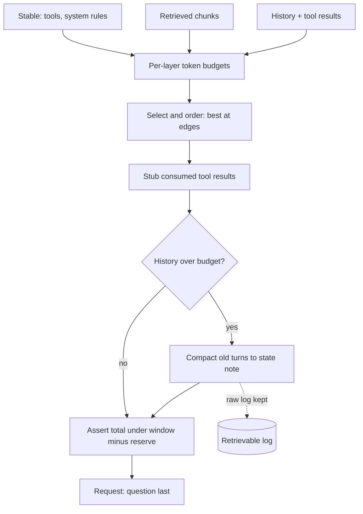

## TL;DR
The context window is an agent's whole working memory for each step: finite, billed per token, attended
unevenly. Context engineering decides which tools, documents, history and tool results go in, in what
order and budget; in agent loops that decides quality and cost.

## For agent builders
- **Why it matters for agents.** An agent's context grows every step with tool calls and results, so the
  failure is rarely overflow on step 1; it is a confused agent on step 40 acting on stale results while
  its plan sits in the middle of the window.
- **Where it shows up in your stack.** Your request builder, tool-result clearing and compaction in
  agent frameworks, token-count endpoints, memory stores, and sub-agent boundaries.
- **What you control.** Per-layer budgets, placement order, when consumed tool results are stubbed, the
  compaction threshold and state-note schema, just-in-time fetching, and what sub-agents return.
- **What you can skip.** Attention internals. Know that the middle of a long context is used worst and
  that edits to earlier history break the prompt cache.

## Why it exists
- **More material than the model can use well.** A single chat turn fits any modern window. Problems
  start with an agent on step 60 with sixty tool results behind it, a retrieval pipeline with forty
  candidate chunks, or a customer's 300-page manual. Prompt engineering writes the instructions; context
  engineering manages everything around them: tools, documents, memory, history, tool results.
- **Cost grows faster than context.** Cost and latency scale with tokens, and a loop re-sends the whole
  history every turn, so a linearly growing context produces a quadratically growing bill.
- **Attention is uneven, and noise distracts.** Models use the start and end of a long context better than
  the middle. Irrelevant tokens lower accuracy as context grows ("context rot"; how fast varies by model
  and task). Unmanaged, the window also overflows mid-task, at the worst moment.
- **Aggressive truncation fails the other way.** It drops the one earlier fact the next step needed, so
  the agent redoes work or contradicts a decision from ten steps ago.
- **The resolution:** treat context as a managed resource with a budget, a priority order and a
  lifecycle, the way an operating system treats memory.

## How it works
### What the context contains, in layers
Every API renders the request in a fixed order (on Anthropic's: tool definitions, then the system prompt,
then messages; other providers fix their own). Inside that, stability varies:

| Layer | Changes |
|---|---|
| Identity and rules | never |
| Tool definitions | rarely |
| Long-lived reference and memory | per deployment or per user |
| Session state (retrieved chunks, user profile) | per task |
| Conversation history | grows |
| Latest tool results | short-lived |
| Current question | every call |

Stability drives placement *because* caching is a prefix match, and because the model should meet the
durable rules before the volatile data.

### Budgeting
1. **Give each layer a token budget** summing to less than the window minus a reserve for output.
2. **Count tokens, never characters**, with the tokenizer or the provider's count endpoint, since code
   and non-Latin text produce more tokens per character than English prose.
3. **Trigger compaction at a threshold well below the limit** (say 70% of the window, an illustrative
   figure) rather than on overflow, because compaction itself needs room to run.

### Placement
- **Stable content first** so it caches.
- **Critical instructions at the start, the question at the end**, exploiting primacy and recency.
- **Best retrieved documents at the edges, weakest in the middle**, where attention is weakest. This is a
  heuristic from the lost-in-the-middle results; how much it helps varies by model, so verify it on your
  own evals.
- **Explicit delimiters** (XML tags, headed sections) so the model can tell instruction from data, and
  **labels on untrusted content** so it is less likely to be followed as instruction.

### Selection: preload or fetch just in time
| | Preload | Fetch on demand (search, read file, query tools) |
|---|---|---|
| Gain | simple, no retrieval misses | small, current context |
| Pick when | corpus small and stable, latency matters | corpus large, changing, or only partly relevant |

Agents increasingly keep lightweight references (file paths, record ids) and fetch content when a step
needs it.

### Lifecycle: pruning, compaction, memory
1. **Prune tool results.** They are the highest-volume, shortest-lived content. Once consumed, clear one
   or replace it with a one-line note, keeping the decision it informed.
2. **Compact near the threshold.** Summarise older turns into a structured note (goal, decisions made,
   open items, current state of files or records) and keep recent turns verbatim.
3. **Keep the raw log outside the context**, because compaction is lossy and the detail may be needed.
4. **Persist cross-session facts in a memory store**, loaded selectively (the agents module covers it).

### The tension between pruning and caching
- **Every edit to earlier context changes the prefix from that point** (stubbing a tool result,
  compacting, deleting a reminder), so the next request re-writes everything after the edit.
- **Worked numbers** (writes about 1.25×, reads about 0.1× of base input; provider-dependent): in a
  100k-token history, stubbing a 30k-token result at position 20k forces an 80k re-write, about
  80k × (1.25 − 0.1) ≈ 92k token-equivalents extra, once.
- **The saving is small per turn:** 30k tokens no longer read is only about 3k-equivalents a turn at the
  cached rate, so the edit takes roughly thirty turns to pay back in money. (That count is an upper bound;
  see the calculator below.)
- **So the reasons to prune cached content are attention quality and window headroom, not cost.** It is
  not "never prune": prune in batches when a threshold is crossed (one re-write, many tokens removed),
  keep edits close to the tail, and never edit history on every turn.

### Isolation through sub-agents
- **A read-heavy subtask** (explore a codebase, survey twenty documents) runs in a sub-agent with its own
  context and returns only a distilled result.
- **Gain:** the parent's context stays small and focused. **Cost:** coordination and loss of shared
  detail.

### Progressive disclosure
- **Expose an index and load on demand** instead of every tool definition and instruction set: a
  tool-search tool over a large catalogue, skill instructions pulled in when the task matches.
- The model sees what the current step needs, not everything it might ever need.

### Measuring
- Tokens per turn and per task, cache hit ratio, and task success as a function of context size.
- Needle tests on your own documents rather than published benchmarks, because position sensitivity
  varies by model and by content.

## Diagram
Each call is assembled from layers under budgets; pruning and compaction run only when a threshold
trips, and the total is checked before sending.



## Misconceptions
- **"If it fits in the window, the model will use it."** The window is a ceiling, not a target: the
  middle of a long context is used worst and irrelevant tokens lower accuracy, so an agent can degrade
  at step 40 without ever overflowing.
- **"Context cost grows linearly with steps."** A loop re-sends the whole history every turn, so a
  linearly growing context produces a quadratically growing bill. Caching the prefix cuts the rate on
  re-sent tokens to about a tenth but the sum stays quadratic; only bounding the context (clearing
  consumed tool results, compaction) keeps per-step cost flat.
- **"Pruning old tool results always saves money."** In a cached loop an edit mid-history re-writes
  everything after it: stubbing a 30k result at 20k in a 100k history costs about 58k token-equivalents
  once and saves about 3k a turn, roughly 19 turns to pay back. Prune in batches for attention and
  headroom, near the tail.
- **"Compaction is safe once the summary is good."** Summaries are lossy; without a fixed state note
  (goal, decisions, ids and paths, open items), recent turns kept verbatim and a retrievable raw log, the
  agent redoes finished work or contradicts an earlier choice.
- **"Character counts are a fine budget proxy."** Code, tables and non-Latin text produce more tokens
  per character than English prose; count tokens with the tokenizer or the provider's count endpoint.
- **"Context engineering is just prompt engineering with more text."** The prompt is the instructions;
  in agents most tokens are tool results, history and retrieved material, and choosing, ordering,
  budgeting and expiring those is a separate design job.

## Examples
### A budgeted context assembler
Retrieved chunks are kept while they fit and ordered best-at-the-edges. Consumed tool results are
stubbed, not deleted, because every `tool_use` block in history must keep its matching `tool_result`.
History is compacted at a plain user-text turn when over budget, and the total is asserted against the
window minus the output reserve.
- `count` wraps your tokenizer or the provider's token-count endpoint.
- `summarize` is a model call that writes a structured state note.

```python
WINDOW, OUTPUT_RESERVE = 200_000, 16_000
BUDGET = {"system": 6_000, "tools": 8_000, "retrieved": 40_000, "history": 100_000}   # illustrative split

def stub(m):        # same tool_use_ids, one-line content: the call/result pairing stays valid
    return {"role": "user", "content": [{"type": "tool_result", "tool_use_id": b["tool_use_id"],
            "content": "[consumed; see state note]"} for b in m["content"]]}

def fresh_user_turn(m):    # a turn of plain user text, never a tool_result (its tool_use would be cut off)
    return m["role"] == "user" and isinstance(m["content"], str)

def assemble(system, tools, retrieved, history, consumed, question, count, summarize):
    assert count(system) <= BUDGET["system"] and count(tools) <= BUDGET["tools"]
    # 1. retrieval: keep the best chunks that fit, then put the strongest at the edges, weakest in the middle
    kept, used = [], 0
    for chunk in retrieved:                                    # sorted by relevance, best first
        if used + count(chunk.text) > BUDGET["retrieved"]:
            break
        kept.append(chunk); used += count(chunk.text)
    ordered = kept[0::2] + kept[1::2][::-1]                     # best, 3rd, 5th ... 4th, 2nd
    docs = "\n".join(f"<doc id='{c.id}' source='{c.source}'>\n{c.text}\n</doc>" for c in ordered)
    # 2. history: stub consumed tool results (indexes in `consumed`), then compact if still over budget
    hist = [stub(m) if i in consumed else m for i, m in enumerate(history)]
    if count(hist) > BUDGET["history"]:
        cut = max(len(hist) - 10, 1)
        while cut < len(hist) and not fresh_user_turn(hist[cut]):
            cut += 1
        if cut == len(hist):
            raise RuntimeError("no safe compaction point in the recent turns")
        head, tail = hist[:cut], hist[cut:]
        hist = [{"role": "user", "content": f"<summary>{summarize(head)}</summary>"},
                {"role": "assistant", "content": "Understood. Continuing from the summary."}] + tail
    messages = hist + [{"role": "user", "content": f"<documents>\n{docs}\n</documents>\n\n{question}"}]
    total = count(system) + count(tools) + count(messages)
    assert total <= WINDOW - OUTPUT_RESERVE, f"{total} tokens over budget"
    return {"system": system, "tools": tools, "messages": messages}
```

In a cached agent loop, call `assemble` with a `consumed` set that changes only when the history budget
trips, not every turn. Otherwise each newly stubbed index rewrites the prefix from that message on and the
cache never covers the history (see the pruning-versus-caching arithmetic above).

### Pruning versus caching, calculated (runnable)
The rough figure above counts the whole 80k after position 20k as re-written. Strictly, the stubbed
result itself shrinks to one line, so the re-write is closer to 50k; and an edit at the tail costs almost
nothing.

```python
def prune_payback(history, pos, size, stub=50, write=1.25, read=0.1):
    """Stub a tool result of `size` tokens at `pos` in a cached history of `history` tokens."""
    rewrite = history - pos - size + stub          # everything after the edit is written again
    extra_once = rewrite * (write - read)          # it would have been read; now it is written
    saved_per_turn = (size - stub) * read          # tokens no longer read on each later turn
    return round(rewrite), round(extra_once), round(saved_per_turn), round(extra_once / saved_per_turn, 1)

for label, pos in [("result at 20k (mid-history)", 20_000), ("result at 70k (tail)", 70_000)]:
    rw, extra, saved, turns = prune_payback(100_000, pos, 30_000)
    print(f"{label}: rewrite {rw:,}, extra {extra:,} once, saves {saved:,}/turn, payback {turns} turns")
# result at 20k (mid-history): rewrite 50,050, extra 57,557 once, saves 2,995/turn, payback 19.2 turns
# result at 70k (tail): rewrite 50, extra 57 once, saves 2,995/turn, payback 0.0 turns
```

| Edit (100k history, 30k result) | Re-written | Extra cost once | Saved per turn | Payback |
|---|---|---|---|---|
| Rough upper bound, result at 20k | 80k | ≈ 92k | ≈ 3k | ≈ 30 turns |
| Precise, result at 20k | ≈ 50k | ≈ 58k | ≈ 3k | ≈ 19 turns |
| Result at the tail (70k to 100k) | ≈ 0 | ≈ 0 | ≈ 3k | immediate |

Either way, the lesson holds: batch edits, and prefer edits near the tail.

## Production patterns
- **Per-layer budgets with real token counts.** Count with the provider's token-count endpoint (for
  example `client.messages.count_tokens` in Anthropic's SDK) or the model's tokenizer, and log tokens per
  layer per call. Alert when one layer (usually tool results) dominates the request.
- **Threshold-triggered compaction with a state-note schema.** Compact once history crosses a set
  fraction of the window, into a fixed structure (goal, decisions, files or records touched, open items),
  keeping the last turns verbatim and the raw log in storage. Monitor post-compaction regressions such as
  redone work.
- **Batch tool-result clearing.** Stub consumed results only when a budget trips, all at once, so the
  cache re-writes once. Monitor cache-read ratio before and after each clearing event.
- **Snapshot tests for the request builder.** Render a fixed scenario and assert layer order, delimiters,
  budgets and that every `tool_use` has its `tool_result`, because the builder is the most important
  file in the product.
- **Needle tests on your own corpus.** Plant a known fact at several positions and context sizes in your
  real documents and chart accuracy by position, before trusting edge-ordering or long-context claims.
- **Sub-agents for broad exploration.** Give a sub-agent the search and read tools and a cap on its
  returned summary, and pass only that summary to the parent. Monitor parent tokens per step and total
  task tokens.

## Trade-offs
- **Whole documents vs retrieval.** Loading whole documents is simpler with no retrieval misses, but costs
  tokens every turn and degrades attention. It flips to retrieval once the corpus exceeds a fraction of
  the window or the same context is re-sent across many turns.
- **Compaction vs fidelity.** It saves tokens but is lossy; it becomes harmful when the task depends on
  exact earlier details such as diffs or numbers, unless the raw log stays retrievable.
- **Just-in-time fetching vs latency.** Small, fresh context, but extra tool round trips; preload wins
  for small, stable corpora on latency-sensitive paths.
- **Sub-agent isolation vs shared detail.** Each context stays focused, but coordination costs tokens and
  shared detail is lost; it pays when the subtask would flood the parent with raw material.
- **Delimiters and labels vs tokens.** They cost tokens but separate data from instruction, which also
  raises injection resistance; the cost is small next to the content they wrap.
- **Output reserve and headroom vs usable input.** Size them from the observed distribution of output
  lengths rather than a fixed guess.

## Pitfalls
- **Letting tool results accumulate forever.** Symptom: overflow mid-task, or a quality collapse after a
  few dozen steps even though the window was never exceeded.
- **Key constraints in the middle, or the question before the documents.** Symptom: the model ignores an
  instruction it demonstrably received.
- **Counting characters instead of tokens.** Symptom: intermittent overflow on code, tables or
  non-English text that looked short.
- **Compacting only at overflow.** Symptom: a failed request with no room left to run the summary.
- **Compaction that loses state** (paths, ids, decisions). Symptom: the agent redoes finished work or
  contradicts an earlier choice right after a summary.
- **Every tool definition on every call.** Symptom: wrong tool selection and a prefix that dwarfs the
  actual task.
- **Rewriting earlier history without regard for caching.** Symptom: a cache write the size of the
  conversation on every turn.

## When to use
- **Always, deliberately.** Every system does context engineering, deliberately or by accident; start
  deliberately once multi-turn agents, retrieval, long documents, more than a handful of tools, or
  sessions spanning days appear.
- **Measure:** tokens per turn and per task, cache hit ratio, success rate against context length, and
  retrieval precision. Rising tokens with flat success is the signal to prune.
- **Treat the request builder as core code:** it is the most important file in an LLM product, and it
  deserves tests.
- **Interviews:** "how would you keep a 200-step agent within budget without losing state" expects
  budgets, pruning of tool results, threshold-triggered compaction with a structured state note, and
  just-in-time retrieval.

## Role lens
- **Engineer:** Owns the assembler: per-layer budgets, placement order, pruning of consumed tool results,
  compaction triggers, token counting, and tests that the rendered prompt matches the design.
- **Architect:** Decides long context versus retrieval versus memory per workload, where sub-agent
  boundaries fall, and which state must survive compaction as a matter of correctness.
- **FDE:** Fits the customer's manuals, tickets and systems into the budget, chooses chunking and
  retrieval over wholesale loading, and shows how context size moves their cost and accuracy numbers.

## Check yourself
**Q:** A coding agent works well for the first twenty tool calls and degrades after about forty, yet the
context window is never exceeded. Diagnose it and describe the fix.
**A:** The window is not the limit; usable attention and budget are. By step forty the context is
dominated by stale tool results (file contents, test output), the original plan and constraints sit in
the middle where attention is weakest, and older outputs contradict the current state of the files, so
the model acts on stale information and re-reads what it already saw. The fix has four parts: clear or
stub tool results once consumed; keep a structured state note (goal, decisions, files touched, open
items) that is refreshed rather than appended; compact at a threshold while the recent turns stay
verbatim and the raw log stays retrievable; and switch from loading whole files to just-in-time reads of
the regions a step needs, with sub-agents for broad exploration. Measure tokens per step and success
against step count to confirm the curve flattens.

## Interview questions
### How is context engineering different from prompt engineering?
- **Prompt engineering writes the instructions**; context engineering decides everything else in the
  window per call: tools, retrieved documents, memory, history and tool results, plus order, form and
  budget.
- **Why it matters:** in multi-step systems the non-instruction material dominates the tokens, so it
  decides quality and cost.

### Your RAG agent ignores a policy clause that was definitely retrieved. What do you check?
- **Position:** was the chunk in the middle of a long context? Reorder so the best chunks sit at the
  edges and the question comes last.
- **Noise:** were forty chunks sent when five were relevant? Tighten the retrieval budget or rerank.
- **Separation:** are documents wrapped in delimiters and is the instruction clearly separate? Verify with
  a needle test on your own documents.

### When would you preload a corpus instead of fetching just in time?
- **Preload when** the corpus is small and stable and the path is latency-sensitive, because it avoids
  tool round trips and retrieval misses, and caches well.
- **Fetch when** it is large, changing or only partly relevant to any one task.
- **Hybrid:** keep references (paths, ids) in context and fetch content when a step needs it.

### Pruning a tool result made the agent's bill go up. Why?
- **Editing earlier history invalidates the cached prefix after the edit**, so the next request writes
  it at about 1.25× instead of reading it at about 0.1×.
- **Pruned mid-history every turn**, the cache never covers the history.
- **Fix:** prune in batches when a threshold trips and prefer edits near the tail; prune for attention
  and headroom, not to save money.

### What must a compaction summary contain for an agent to keep working?
- **A fixed structure:** goal, decisions made, files or records touched with ids and paths, open items,
  and current state.
- **Recent turns verbatim**, because the next step usually depends on them exactly.
- **A retrievable raw log**, because the summary is lossy; watch for redone work after compaction as the
  failure signal.

## Quiz
### Q: Why is "load everything that fits" a poor default even when the window is large enough?
- [ ] Large contexts are rejected by most providers above a few thousand tokens
- [x] Cost scales with tokens every turn, and irrelevant material degrades attention and accuracy
- [ ] The model reads only the first few thousand tokens of any request
- [ ] Tool definitions must be the only content in a long context
> Tokens are billed on every re-send and attention is uneven, so extra material costs money and can
> lower accuracy. The window size is a ceiling, not a target.

### Q: Where should the most important instructions and the current question be placed in a long prompt?
- [ ] Both in the middle, surrounded by supporting documents
- [ ] Instructions at the end and the question at the start
- [x] Instructions near the start and the question at the end, with weaker material in the middle
- [ ] Anywhere, because position has no measurable effect on modern models
> Models use the beginning and end of long contexts best. Stable instructions first also cache; the
> question last is what the model attends to immediately before generating.

### Q: When does compaction do more harm than good?
- [ ] Whenever the conversation exceeds ten turns
- [x] When later steps depend on exact earlier details that the summary dropped and cannot be retrieved
- [ ] When the summary is written by the same model that runs the task
- [ ] When tool results are included in the summary
> Compaction is lossy by design. It is safe when decisions and state are preserved and the raw log is
> retrievable; it fails when precision mattered and the detail is simply gone.

## Use cases & projects
### Use cases
- **Long-running coding agents.** Stubbing consumed file reads and test output, plus a state note, stop
  quality from collapsing after a few dozen steps; confirm it by charting success against step count.
- **RAG agents.** Retrieval budgets and best-at-the-edges ordering decide whether the retrieved clause is
  actually used.
- **Research agents with sub-agents.** Each sub-agent surveys sources in its own context and returns a
  capped summary to the orchestrator.
- **Agents with large tool catalogues.** Progressive disclosure and a tool-search tool keep definitions
  from dwarfing the task.

### Mini project
**Keep a 50-step agent within budget (2-3 hours).**
- **Goal:** show that budgets, batch stubbing and threshold compaction keep an agent's tokens per step
  flat without losing state.
- **Steps:** build a toy agent that reads 50 fake files of ~2k tokens each and must report three facts
  planted early; run it with no management, then with the `assemble` function above, batch stubbing and
  compaction at 70% of a reduced window; log tokens per step and cache reads.
- **Done when:** a chart shows tokens per step for both runs, the managed run still reports all three
  planted facts, and you can point to the one cache re-write per compaction event.
