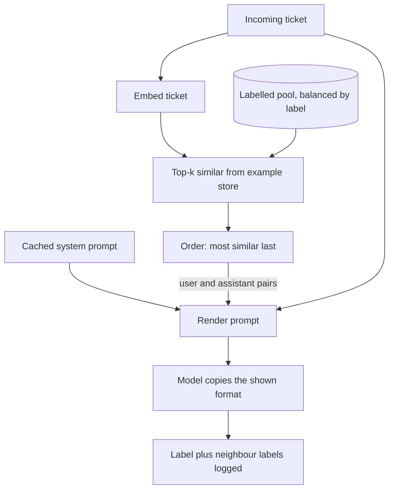

## TL;DR
Few-shot prompting puts input → output demonstrations in the prompt; in agents, these are example tool
calls and short trajectories. The model copies their format and boundaries with no weight update, at a
per-call token cost plus order, frequency and copying biases.

## For agent builders
- **Why it matters for agents.** When an agent keeps formatting an argument wrong, picks the wrong tool
  at a fuzzy boundary, or skips a step, one or two demonstrated calls usually fix it faster than more
  rules. The same copying makes it paste an example's order ID into a real call.
- **Where it shows up in your stack.** `<example>` blocks in the system prompt, example user/assistant
  (and tool-call) pairs before the real turn, retrieved past trajectories in memory-backed agents, and the
  labeled examples inside LLM-judge prompts.
- **What you control.** Which cases you show (boundaries, not easy ones), label and tool balance, order,
  placeholder values, and whether examples are static and cached or retrieved per request.
- **What you can skip.** The interpretability detail of induction heads; remember only that the model
  copies what it sees, especially the nearest example.

## Why it exists
- **Instructions are poor at conveying shape.** Try writing rules for the exact layout of a changelog
  entry, the tone of a refund email, or where "bug" ends and "feature request" begins for one product.
  Each rule covers one case and may contradict another.
- **Models follow a demonstrated pattern more reliably than a described one**, because pattern continuation
  is what they were trained on from the first token.
- **The ability emerged, it was not trained.** Sufficiently large pretrained models learned tasks from a
  handful of demonstrations alone, with no gradient steps. Next-token prediction over text full of lists,
  tables and repeated structures produced it.
- **More rules fail; fine-tuning is slow.** Rules cannot enumerate a shape. Fine-tuning takes hours to days
  per iteration versus seconds, and typically needs far more labelled examples than the handful that works
  in context before it pays off.
- **Few-shot is the middle.** Show the shape, measure, adjust the examples, and bake them into weights
  only once volume makes the per-call token cost the larger bill.

## How it works
### What demonstrations actually teach
- **Task inference.** The demonstrations make "do the same thing to the next input" the overwhelmingly
  most probable continuation.
- **Labels matter less than you think.** Swapping demonstration labels for random ones kept much of the
  gain for many models and tasks; what matters most is the input distribution, the label space and the
  output format.
- **It is a tendency, not a law.** Larger and more recent models appear to use the labels more, and the
  picture varies by task.
- **Practical reading:** examples are a format and boundary specification first and a source of knowledge
  a distant second. They do not teach the model facts it lacks.

### A partial mechanism: induction heads
- **What they are.** Interpretability work identified "induction heads": attention circuits that find an
  earlier occurrence of the current token pattern and copy what followed it. Their formation in training
  was linked to the onset of in-context learning.
- **What it explains.** A demonstrated format is copied with high fidelity, surface details leak from
  examples into answers, and the example nearest the query has outsized pull.
- **What it does not.** It accounts for the copying, not for how models infer a task from examples.

### How many, and which
- **Returns diminish quickly.** A few to around ten examples is a typical working range (illustrative, not
  a rule), and cost grows linearly with each one.
- **Coverage beats count.** Every label represented, with examples drawn from the boundary cases where the
  zero-shot prompt was inconsistent, not from the easy middle. An obviously-billing ticket teaches nothing
  the label definition did not.
- **Many-shot moved the ceiling.** Work on many-shot in-context learning in 2024 reported accuracy still
  rising with hundreds of demonstrations on some tasks, blurring the line with fine-tuning: the examples
  act like a training set read on every call.
- **Whether it pays is arithmetic.** Three hundred 60-token examples are 18,000 input tokens per request.
  A static, cached block makes that mostly cache reads; uncached, it is a per-call bill a fine-tune would
  remove.

### Static versus dynamic selection
| | Static | Dynamic |
|---|---|---|
| How | Hand-picked, fixed examples | Embed the input, retrieve the k most similar labelled examples, render them |
| Accuracy | Good on homogeneous inputs | Higher on heterogeneous inputs, because each request sees look-alike demonstrations |
| Caching | Stable prefix, caches well | Content differs per request, forfeits prefix caching unless examples sit after the cached block |
| Cost | None beyond tokens | A retrieval step on the request path and an example store to maintain |

### The biases examples introduce
Measured on classification tasks:
- **Majority-label bias:** the model favours whichever label appears most among the demonstrations.
- **Recency bias:** the last example's label is over-predicted.
- **Common-token bias:** labels that are frequent words get a head start.
- **Order alone** can swing accuracy substantially on the same set of examples.

Mitigations:
1. **Balance labels.**
2. **Choose the order by eval**, not by accident.
3. **Restate the instruction after the examples.**
4. **Calibrate classification.** Measure the output on a content-free input (such as "N/A") and correct the
   decision for the skew it reveals. The original method rescales label probabilities, so it needs an API
   that exposes log-probabilities; without them, approximate it from sampled label frequencies.

### Where the examples live in a chat API
| Placement | Strength | Risk |
|---|---|---|
| Delimited `<example>` blocks in the system prompt | Simple, clearly marked as demonstrations | Slightly weaker format anchoring |
| Alternating user/assistant pairs before the real turn | Matches the fine-tuning structure, anchors format most strongly | Model may treat them as real conversation history |

Either way, label them as examples and keep the instructions distinct from them.

### Demonstrations in an agent
| What you show | What it fixes |
|---|---|
| One example call per tricky tool | Argument formats (dates, IDs, units) the schema description did not pin down |
| A short trajectory (call, result, next call) | Step order, such as "look up the customer before issuing a refund" |
| A boundary pair (same-looking requests, different tools) | Confusion between two overlapping tools |
| A "do not call a tool" example | Answering directly when no tool is needed |

- **Use obvious placeholders.** Values like `ORDER-EXAMPLE-1` are easy to detect if they leak into real
  calls; realistic IDs are not.
- **Keep trajectories short.** A full 15-step example costs tokens on every step of every run and pulls
  the agent toward that exact plan.

### Examples usually beat instructions when they conflict
- **The pattern wins.** If an instruction says "respond in one sentence" and the examples show three, the
  model will usually produce three; how strongly varies by model.
- **So every example must comply with every rule**, rather than relying on the instruction to win.

## Diagram
Dynamic selection on one request: the static instructions stay in the cached prefix, and the retrieved
demonstrations go after it, most similar last.



## Misconceptions
- **"Few-shot examples teach the model the task's facts."** They mainly specify format, label space and
  boundaries. Random labels kept much of the gain in studies of many models; examples do not supply
  knowledge the model lacks, so a knowledge gap needs retrieval or a tool.
- **"More examples are always better."** Returns diminish after a few to around ten (illustrative), and
  every example is paid on every call. Coverage of boundary cases and every label beats count.
- **"Order and label mix do not matter if each example is correct."** Majority-label and recency bias
  are measured effects, and order alone can swing accuracy on the same set. Balance labels and choose the
  order by eval.
- **"The instruction wins if it conflicts with an example."** The demonstrated pattern usually wins: an
  instruction for one sentence loses to three paragraph-long examples. Every example must obey every
  rule.
- **"Realistic example values make demonstrations better."** The model copies surface details, so a
  realistic order ID can leak into a real tool call. Use obvious placeholders such as `ORDER-EXAMPLE-1`
  and block calls that carry them.
- **"Dynamic selection is a free accuracy upgrade."** Per-request examples break the shared prefix and
  forfeit caching unless they sit after the cached block, and add a retrieval step plus a store to
  maintain.

## Examples
### Dynamic few-shot selection
A small labelled pool is embedded once. The four nearest neighbours of each ticket are rendered as
user/assistant pairs ahead of the real request, most similar last so it sits nearest the query, and the
model copies their format.

In production the pool would be a few hundred curated boundary cases, balanced by label, and the lookup a
vector index rather than a dot product over a list.

```python
import anthropic, json
import numpy as np
from sentence_transformers import SentenceTransformer

client, MODEL = anthropic.Anthropic(), "claude-opus-5-5"
embedder = SentenceTransformer("all-MiniLM-L6-v2")

# Labelled pool: in practice a few hundred boundary cases curated from real traffic, balanced by label.
POOL = [("Charged twice for March", "billing"), ("Refund never arrived", "billing"),
        ("Export button does nothing on Safari", "bug"), ("Dashboard shows yesterday's numbers", "bug"),
        ("Please add dark mode", "feature_request"), ("Could reports be scheduled weekly?", "feature_request"),
        ("Thanks, all working now", "other"), ("What is your office address?", "other")]
POOL_VECS = embedder.encode([t for t, _ in POOL], normalize_embeddings=True)

SYSTEM = ("Classify the ticket into one of: billing, bug, feature_request, other. "
          "The examples show where the boundaries fall; copy their format exactly: JSON {\"label\": ...} only.")

def classify(ticket, k=4):
    q = embedder.encode([ticket], normalize_embeddings=True)[0]
    nearest = np.argsort(-(POOL_VECS @ q))[:k][::-1]               # cosine top-k, most similar last
    messages = []
    for i in nearest:                                             # demonstrations as user/assistant pairs
        text, label = POOL[i]
        messages += [{"role": "user", "content": f"<ticket>{text}</ticket>"},
                     {"role": "assistant", "content": json.dumps({"label": label})}]
    messages.append({"role": "user", "content": f"<ticket>{ticket}</ticket>"})
    r = client.messages.create(model=MODEL, max_tokens=1024, system=SYSTEM, messages=messages)
    text = next((b.text for b in r.content if b.type == "text"), "")  # thinking counts toward max_tokens
    shown = [POOL[i][1] for i in nearest]                         # labels the model was shown
    try:
        return json.loads(text)["label"], shown
    except (json.JSONDecodeError, KeyError, TypeError):
        return "FORMAT_ERROR", shown

label, shown = classify("My invoice total is wrong and the PDF download is broken")
print(label, "<- neighbours:", shown)
```

- **This ticket straddles two labels**, so its neighbours are likely a mix of billing and bug examples, and
  the label in the last slot, nearest the query, tends to have the most pull.
- **Log `shown` across a few hundred requests.** If predictions agree with the neighbour majority far more
  often than with the gold label, the model is copying the neighbourhood rather than reading the ticket.
- **Fixes:** a larger, balanced pool, a smaller *k*, or a decision rule for two-issue tickets ("label the
  issue the customer asks to have fixed first") stated in the system prompt and demonstrated by one
  example that obeys it.

### Calibrating away majority-label bias
Without log-probabilities, approximate contextual calibration from sampled label frequencies: divide out
the skew the prompt shows on a content-free input. Pure Python; the counts are illustrative.

```python
LABELS = ["billing", "bug", "feature_request", "other"]

def normalise(d):
    s = sum(d.values())
    return {k: v / s for k, v in d.items()}

def calibrate(p_input, p_null, floor=1e-3):
    """Divide out the skew the prompt shows on a content-free input, then renormalise."""
    return normalise({y: p_input[y] / max(p_null[y], floor) for y in LABELS})

# Label frequencies over 20 samples of a content-free input ("N/A") with the same examples:
p_null = normalise({"billing": 2, "bug": 12, "feature_request": 3, "other": 3})
# Frequencies over 20 samples of a real, borderline ticket:
p_input = normalise({"billing": 8, "bug": 10, "feature_request": 1, "other": 1})

raw = max(p_input, key=p_input.get)
cal = calibrate(p_input, p_null)
print("raw:", raw, "| calibrated:", max(cal, key=cal.get))
print({k: round(v, 2) for k, v in cal.items()})
# raw: bug | calibrated: billing
# {'billing': 0.73, 'bug': 0.15, 'feature_request': 0.06, 'other': 0.06}
```

- **The null input exposes the prior.** With no content, the prompt still says "bug" 60% of the time:
  that is the bias of the example set, not evidence about any ticket.
- **Better still, fix the source.** Calibration corrects a skew; balancing the examples removes it.

### Example tool calls in an agent prompt, with a leak check
A refund agent kept sending dates as "March 3" and refunding before checking the order. Two short
demonstrated trajectories go in the cached system prompt; a check on every real tool call catches
example values leaking into arguments.

```python
import json

EXAMPLES = [  # placeholders are deliberately fake so leaks are detectable
    {"user": "Refund order ORDER-EXAMPLE-1, it arrived broken",
     "calls": [("get_order", {"order_id": "ORDER-EXAMPLE-1"}),
               ("issue_refund", {"order_id": "ORDER-EXAMPLE-1", "reason": "damaged"})]},
    {"user": "What did I order on 2000-01-15?",
     "calls": [("search_orders", {"date": "2000-01-15"})]},
]
# Only placeholder values: an enum value such as "damaged" is legitimate in real calls too.
EXAMPLE_VALUES = {"ORDER-EXAMPLE-1", "2000-01-15"}

def render_examples():
    blocks = []
    for ex in EXAMPLES:
        steps = "\n".join(f"call {name} {json.dumps(args)}" for name, args in ex["calls"])
        blocks.append(f"<example>\nuser: {ex['user']}\n{steps}\n</example>")
    return "Examples of correct tool use (values are placeholders):\n" + "\n".join(blocks)

def leaked(tool_args: dict) -> bool:
    """True if a real call reuses a value that only exists in the examples."""
    return any(isinstance(v, str) and v in EXAMPLE_VALUES for v in tool_args.values())

SYSTEM = "You are a refund agent. Always call get_order before issue_refund. Dates are YYYY-MM-DD.\n"
SYSTEM += render_examples()          # static: stays inside the cached prefix
print(leaked({"order_id": "ORDER-EXAMPLE-1"}), leaked({"order_id": "A-88231"}))   # True False
```

- **Two examples, not twenty.** They fix the date format and the get-before-refund order; the rule is
  also stated in words, and every example obeys it.
- **Block on a leak.** A real call carrying `ORDER-EXAMPLE-1` is rejected before it reaches the refund API.

### Worked scenario: many-shot or fine-tune?
300 examples of 60 tokens each, 100,000 requests a day. Cache reads at an illustrative 0.1× of the base
input price; check your provider.

| Option | Example tokens billed per day |
|---|---|
| Many-shot, uncached: 100,000 × 18,000 | 1.8B |
| Many-shot, static and cached: 1.8B × 0.1 | about 180M equivalents |
| Many-shot, dynamically selected per request | back toward 1.8B, since nothing is shared |
| Fine-tuned model, no examples | 0, plus training cost and slower iteration |

Static cached many-shot is often the sweet spot while behaviour is still changing; fine-tune once it is
stable and volume stays high.

## Production patterns
- **Curated, versioned example set.** Keep demonstrations in a reviewed file with label, source ticket and
  reason for inclusion, and pin the version in each trace. Monitor the per-label confusion matrix per
  example-set version.
- **Static examples inside the cached prefix.** Render a fixed, ordered set in the system prompt or as
  leading message pairs, never shuffled per request. Monitor the cache-read token count; a drop to zero
  means the order or content became dynamic.
- **Dynamic selection after the cache boundary.** When inputs are heterogeneous, retrieve the top k from a
  vector index of labelled boundary cases and place them after the cached instructions. Monitor retrieval
  latency and the agreement rate between prediction and neighbour majority.
- **Held-out eval with no demonstrations in it.** Build the eval set disjoint from the example pool and
  compare every change against the zero-shot baseline, so gains are real and not memorised.
- **Harvest failures into the pool.** Route production cases the model got wrong (or split on) to expert
  labelling, then add balanced boundary cases to the pool. Track pool label balance as it grows.
- **Demonstrate only the tools that fail.** Add an example call for a tool only when traces show
  repeated argument or ordering errors on it, using obvious placeholder values. Monitor argument
  validation failures per tool and leaked placeholder values in real calls.
- **Retrieve past successful trajectories.** Memory-backed agents can store solved tasks and insert the
  most similar one or two as examples after the cached block. Monitor whether retrieved trajectories
  raise task success against a no-example baseline, and prune ones that lead to failures.

## Trade-offs
- **Specification by demonstration vs per-call tokens.** The balance flips toward fine-tuning once volume
  is high and behaviour is stable, because fine-tuning is effectively few-shot with the examples moved into
  the weights.
- **Dynamic accuracy vs cost and caching.** Dynamic selection raises accuracy on diverse inputs, against a
  retrieval step, an example store and a per-request prompt caching cannot reuse; on homogeneous inputs a
  static, cached set is cheaper and nearly as good.
- **Format anchoring vs copied content.** Examples anchor format strongly, but the model copies their
  content (names, numbers, phrasing); for creative or diverse outputs that anchoring is a defect, and
  zero-shot or lighter guidance is better.
- **Stability vs context cost and position.** More examples stabilise the boundary until context cost and
  position effects take over; long example lists push the real input toward the middle of the context,
  where it is used least reliably.

## Pitfalls
- **Unbalanced labels among the examples.** Symptom: systematic over-prediction of the majority label,
  visible as a skewed confusion matrix.
- **Examples that violate the instruction they accompany.** Symptom: the model follows the examples while
  the rule appears to be ignored.
- **Choosing only clear-cut examples.** Symptom: boundary cases fail exactly as they did zero-shot.
- **Copied entities.** Entities or numbers from the examples appear in outputs for unrelated inputs.
  Symptom: hallucinations that look suspiciously like your demonstrations.
- **Evaluating on the demonstrations.** Symptom: an eval score that collapses on production traffic.
- **Rotating or re-ordering examples per request without need.** Symptom: a cache hit rate near zero and
  bills that do not drop after caching is enabled.
- **Realistic values in agent examples.** Symptom: a real tool call carries the example's order ID or
  email address. Fix: obvious placeholders and a code check that rejects arguments matching example
  values.

## When to use
- **Use when** a precise zero-shot prompt is still inconsistent on cases humans label consistently, the
  output format is intricate, tone or style is hard to describe, or domain labels are better shown than
  defined.
- **Avoid when** outputs should be diverse, every token matters at very high volume (fine-tune instead), or
  as a substitute for missing knowledge (retrieve instead).
- **Measure:** the delta against the zero-shot baseline on a held-out set, the per-label confusion matrix
  for bias, tokens per request and, if examples are dynamic, retrieval latency.
- **Interviews:** explain what in-context learning actually conditions on, and name the three biases and
  their fixes.

## Role lens
- **Engineer:** Curates a balanced example set from real boundary cases, renders it as cached message
  pairs or a retrieval-selected block, and watches the confusion matrix for label bias.
- **Architect:** Decides when per-call example tokens cost more than fine-tuning, and whether an example
  store and its retrieval step belong on the request path at all.
- **FDE:** Runs labelling sessions with the customer's experts to harvest the boundary cases that become
  demonstrations, then holds out a separate set to prove the gain on their data.

## Check yourself
**Q:** A classifier uses six fixed examples, five labelled "bug" and one "billing", in that order. In
production it over-predicts "bug", including for clear billing tickets. Explain the cause and how you would
fix and verify it.
**A:** Two documented biases are stacked. Majority-label bias: five of six demonstrations carry the same
label, so "do the same thing" favours it before the input is even read. Recency bias: if a "bug" example is
last, its label gets a further boost. The fix is to balance the set, at least one strong example per label
and more for the labels with fuzzy boundaries, choose the order by eval rather than leaving it to chance,
and restate the label definitions after the examples. For a classification task I would also calibrate:
send a content-free input, observe the label probabilities it produces (or, without log-probabilities,
the label frequencies over repeated samples), and correct the decision for that skew. Verification is a per-label confusion matrix on a held-out set containing none of the
demonstrations, compared against the zero-shot baseline, plus a check that the examples are rendered in a
stable prefix so caching still works.

## Interview questions
### What does a model actually learn from few-shot examples?
- **Task inference, not weights.** The examples make "do the same to the next input" the most probable
  continuation; nothing is trained.
- **Mostly shape.** Random-label experiments kept much of the gain, so examples mainly convey input
  distribution, label space and format, and they cannot add missing facts.

### Your agent's outputs and tool calls start containing names from your demonstrations. What is going on and how do you fix it?
- **Surface copying.** Induction-style copying leaks entities and numbers from examples, especially the one
  nearest the query; in an agent the leak lands in tool arguments, where it causes real actions.
- **Fix:** use varied, neutral placeholder content in examples, add more diverse examples so no single one
  dominates, check outputs for example-specific strings in the eval, and reject tool calls whose arguments
  match example values.

### Static or dynamic example selection: how do you choose?
- **Static** when inputs are homogeneous: a fixed set caches as a stable prefix and costs nothing extra.
- **Dynamic** when inputs are heterogeneous and accuracy matters: top-k retrieval gives look-alike
  demonstrations, at the price of a retrieval step and lost caching unless examples follow the cached
  block.

### When would you stop adding examples and fine-tune instead?
- **When volume is high and behaviour is stable.** 300 examples of 60 tokens are 18,000 tokens per request;
  at 100,000 requests a day that is 1.8B tokens uncached.
- **When many-shot keeps helping.** Rising accuracy with hundreds of examples means a training set is
  being read every call; moving it into weights removes the per-call bill but slows iteration.

### How do you test for order and label bias in a few-shot prompt?
- **Permute and measure.** Run the eval under several example orders; a large accuracy swing means order
  sensitivity.
- **Content-free probe.** Send "N/A" with the same examples; a skewed label distribution reveals the prior
  the examples impose.
- **Confusion matrix per label** on a held-out set, compared against the zero-shot baseline.

### Your agent keeps formatting a tool argument wrong despite a schema description. What do you try?
- **One demonstrated call.** Add a short example showing the exact format with a placeholder value, after
  checking the description states the format plainly.
- **Then guard in code.** Validate the argument against the schema and return a clear error the agent can
  fix on its next step; measure validation failures per tool before and after.
- **Watch for leaks** of the example value into real calls.

## Quiz
### Q: What do few-shot demonstrations mainly teach the model?
- [ ] New facts about the domain that the model did not have
- [x] The output format, the label space and what inputs look like, so the correct continuation is to do the same thing to the next input
- [ ] A better tokenisation of the input
- [ ] The weights of a small classifier head trained during the request
> No weights change. In-context learning is task inference from the pattern in the prompt. Examples
> specify shape and boundaries; they do not supply missing knowledge, which needs retrieval or fine-tuning.

### Q: What is the main cost of selecting examples dynamically by embedding similarity?
- [ ] The model can no longer see the instruction
- [ ] It requires fine-tuning the embedding model on every request
- [x] A retrieval step on the request path and per-request prompt content that forfeits prefix caching unless the examples come after the cached block
- [ ] It forces all the examples to share one label
> Dynamic selection improves relevance on heterogeneous inputs, but each request now renders different
> demonstrations, so the cached static prefix must end before them and the retrieval latency is paid on
> every call.

### Q: An instruction says "answer in one sentence" but the three examples each answer in a paragraph. What will the model most likely do?
- [ ] Follow the instruction, because instructions outrank examples
- [x] Answer in a paragraph, because the demonstrated pattern is the stronger signal
- [ ] Refuse because the prompt is contradictory
- [ ] Alternate between the two formats
> Pattern continuation is what the model does natively, so a demonstrated format usually dominates a
> described one; there is no fixed rule that instructions outrank examples. Every example must comply with
> every rule, or the rule is effectively overwritten.

## Use cases & projects
### Use cases
- **Fixing tool-argument formats.** One demonstrated call settles dates, IDs and units that a schema
  description left ambiguous.
- **Enforcing step order.** A short example trajectory teaches "look up before you act" for refund,
  booking or deployment agents.
- **Disambiguating overlapping tools.** A boundary pair of similar requests mapped to different tools
  fixes recurring misroutes.
- **Calibrating LLM judges.** Labeled pass and fail trajectories inside the judge prompt align its scores
  with human reviewers.

### Mini project
**Few-shot fix for a misbehaving agent tool (1-2 hours).**
- **Goal:** cut argument errors on one agent tool with the fewest examples possible.
- **Steps:** build an agent with a `search_orders(date)` tool that requires YYYY-MM-DD; write 20 tasks
  using natural-language dates; run zero-shot and log validation failures; add one, then two placeholder
  examples; add the leak check from this lesson.
- **Done when:** you have a table of validation-failure rate and task success for 0, 1 and 2 examples, and
  the leak check reports zero placeholder values in real calls.
