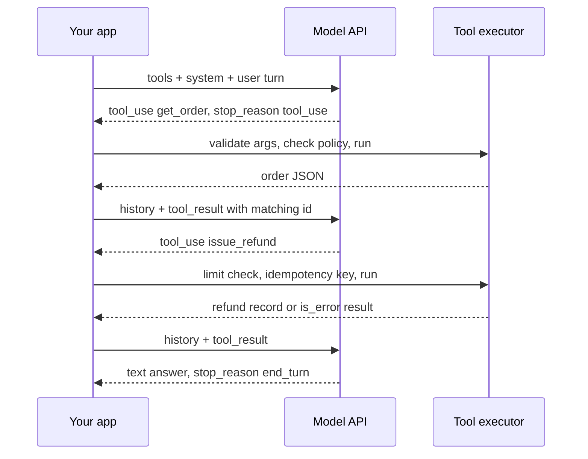

## TL;DR
Tool calling is a trained protocol: you describe functions with a name, description and JSON schema; the
model emits a structured call; your code executes it and returns the result. The model never runs
anything, so execution, permissions and errors are yours.

## Why it exists
- **A model can only emit tokens.** From weights alone it has a knowledge cutoff, no access to your
  database, no way to send an email, and a tendency to get long multiplications wrong.
- **Text parsing was the first workaround, and it is not enough.** Ask for `ACTION: search("refund policy")`,
  parse with a regex, run it, paste the result back; ReAct-style prompting made this systematic. But the
  model drifts in formatting, invents function names, writes arguments as prose, and nothing tells you a
  call was intended rather than quoted.
- **Function calling fixes it in the model.** Providers fine-tune models to read registered tool
  definitions rendered into the prompt and to emit calls as a dedicated structured block with well-formed
  JSON arguments and a distinct stop reason.
- **The schema does three jobs:** it tells the model what exists, constrains the arguments, and gives
  your code a contract to validate against.
- **The payoff is a boundary.** A reliable, inspectable line between "the model decided" and "the system
  did", which is exactly what agents, permissions and audit logs are built on.

## How it works
### The definition
- **A tool is** a name, a description and an `input_schema` in JSON Schema.
- **Rendered into the prompt** in a fixed position (ahead of the system prompt on Anthropic's API), in
  the format the model was trained on, so definitions cost input tokens on every request. That is why a
  stable, deterministically ordered tool list belongs in the cached prefix.
- **The description is the model's only guide to *when* to call.** State the trigger condition ("call
  this before answering any question about an order's status"), not merely what the function does.

### The round trip
1. **You send** the tools and the messages.
2. **The model decides** to answer in text or call. A call is a `tool_use` content block with an `id`,
   the tool `name` and a JSON `input`; the response stops with `stop_reason: "tool_use"`. Several
   `tool_use` blocks in one response express parallel calls.
3. **Your code** validates the input against the schema and business rules, checks permissions,
   executes, and appends a user message with one `tool_result` block per call, each carrying the matching
   `tool_use_id`.
4. **Failures go back as results** with `is_error: true`, not as an exception that ends the conversation,
   so the model can adapt.
5. **All results for one assistant turn go in one user message**, because splitting them teaches the
   model that parallel calls do not work.
6. **The model reads the results** and either calls again or finishes with `end_turn`.

- **Why ids exist:** parallel and out-of-order results need correlation; without them the model could not
  tell which result belongs to which request.
- **Keep the assistant message with the `tool_use` blocks verbatim in history**, since the result refers
  to it.

### Why the model sometimes does not call
- **Selection is a generation decision.** The model emits `tool_use` when, given descriptions and
  conversation, a call is the most plausible continuation.
- **Nothing forces a call when a fact is missing.** A model that believes it knows the answer answers from
  weights; hence trigger conditions matter more than summaries.
- **Measure three failure classes separately:** "should have called but did not", "called the wrong
  tool" and "called with wrong arguments".

### Who controls the decision
| Control | Effect |
|---|---|
| `tool_choice` `auto` (default) | the model decides |
| `none` | forbids calls |
| forced mode (`any`, or a named tool) | some providers; several of Anthropic's newest models (as of late 2026) reject forced modes with an error |
| `disable_parallel_tool_use` (a field of `tool_choice`) | at most one call per turn; matters for side effects; applies to the whole request, not one tool |
| `strict: true` on a tool | constrained decoding on the arguments, the same mechanism as structured outputs, so input validates exactly |

Check your model. Where forcing is unavailable, steer with the prompt, and use structured outputs when
the forced call only existed to obtain JSON.

### The loop is yours
- **Each iteration is a full request carrying the whole history**, so cost grows with steps; a cached
  prefix keeps that affordable.
- **A step budget is mandatory**, because a tool that keeps failing can otherwise be retried forever.
- The agents module covers the loop, stopping conditions and selection accuracy in depth; this lesson is
  the protocol they build on.

### Tool results are untrusted input
- **Whatever a tool returns** (a web page, a document) enters the context as data the model will read.
- **If it contains instructions, the model may follow them.** That is prompt injection, and the tool
  boundary is where it enters; the lesson on it covers the defences.

### Beyond your own functions
- **Server-side tools** (web search, code execution) run at the provider; their calls never reach your
  code.
- **The Model Context Protocol** standardises how tools are discovered and invoked across clients.
- Both are the same contract seen from a different side.

## Diagram
One user question, two tool calls, three requests: each request re-sends the whole history, and nothing
executes until your code runs the call.



## Examples
### A support agent loop
A read tool and a consequential write tool. The refund limit is enforced in the execution code, not in
the prompt; errors go back to the model as results; all results for a turn are returned in one message;
a step budget bounds the loop. `db` and `payments` stand for your own services.

```python
import json, anthropic

client = anthropic.Anthropic()
TOOLS = [
    {"name": "get_order", "strict": True,
     "description": "Look up an order by id. Call this before answering any question about an order's status, items or refund eligibility.",
     "input_schema": {"type": "object", "properties": {"order_id": {"type": "string", "description": "e.g. ORD-10422"}},
                      "required": ["order_id"], "additionalProperties": False}},
    {"name": "issue_refund", "strict": True,
     "description": "Refund an order. Only call after get_order shows the order is eligible.",
     "input_schema": {"type": "object", "properties": {"order_id": {"type": "string"}, "amount_cents": {"type": "integer"}},
                      "required": ["order_id", "amount_cents"], "additionalProperties": False}},
]

def run_tool(name, args):                                   # your code: validation, policy, side effects
    if name == "get_order":
        return json.dumps(db.get_order(args["order_id"]))
    if name == "issue_refund":
        if args["amount_cents"] > 50_00:                    # policy lives here, where a prompt cannot override it
            return {"error": "amount above auto-approval limit; escalate to a human"}
        return json.dumps(payments.refund(args["order_id"], args["amount_cents"]))
    return {"error": f"unknown tool {name}"}               # never return None as a tool result

def chat(user_text, max_steps=6):
    messages = [{"role": "user", "content": user_text}]
    for _ in range(max_steps):
        r = client.messages.create(model="claude-opus-5-5", max_tokens=4096,  # thinking counts too
                                   system="You are a support agent for Acme.", tools=TOOLS, messages=messages)
        messages.append({"role": "assistant", "content": r.content})   # keep tool_use blocks verbatim
        if r.stop_reason != "tool_use":
            return next((b.text for b in r.content if b.type == "text"), "")  # also end_turn / max_tokens
        results = []
        for b in r.content:
            if b.type == "tool_use":
                out = run_tool(b.name, b.input)                            # b.input is parsed JSON already
                err = isinstance(out, dict) and "error" in out
                results.append({"type": "tool_result", "tool_use_id": b.id,
                                "content": json.dumps(out) if err else out, "is_error": err})
        messages.append({"role": "user", "content": results})             # all results in ONE user message
    raise RuntimeError("step budget exhausted")
```

### What crosses the wire
For "Refund order ORD-10422, it arrived broken" (values illustrative):
1. **Request 1** carries tools, system and the user turn; the model replies with one block,
   `tool_use{id: "toolu_01", name: "get_order", input: {"order_id": "ORD-10422"}}` and
   `stop_reason: "tool_use"`.
2. **Your code returns** `tool_result{tool_use_id: "toolu_01", content:
   '{"status": "delivered", "total_cents": 3999, "refundable": true}'}`.
3. **Request 2** re-sends everything so far plus that result; the model now calls `issue_refund` with
   `{"order_id": "ORD-10422", "amount_cents": 3999}`, which passes the 5,000-cent limit and executes.
4. **Request 3** re-sends the whole history again and the model ends with a text confirmation.

- **Three requests, three full prefills** of a growing history: the tool definitions alone are paid three
  times, which is why they belong in the cached prefix.
- **Had the customer asked for 7,500 cents**, the third request would carry an `is_error` result and the
  model would explain the escalation instead of claiming a refund that never happened.

### A hardened executor (runnable)
Production executors check more than the limit: that the id actually appeared in the conversation, that
the amount is sane, and that a retried or parallel call cannot refund twice. Every path returns a
`tool_result`, never an exception.

```python
import json

REFUND_LIMIT_CENTS = 50_00
_refunds = {}                     # order_id -> record; stands in for a DB unique constraint

def execute(call: dict, seen_ids: set) -> dict:
    """Run one tool_use block; always return a tool_result, never raise into the loop."""
    try:
        if call["name"] != "issue_refund":
            raise LookupError(f"unknown tool {call['name']}")
        oid, amt = call["input"]["order_id"].strip(), call["input"]["amount_cents"]
        if oid not in seen_ids:
            raise ValueError(f"{oid} never appeared in the conversation; ask the user for the id")
        if not isinstance(amt, int) or amt <= 0:
            raise ValueError("amount_cents must be a positive integer")
        if amt > REFUND_LIMIT_CENTS:
            raise PermissionError("amount above auto-approval limit; escalate to a human")
        record = _refunds.setdefault(oid, {"order_id": oid, "amount_cents": amt})  # one refund per order
        return {"type": "tool_result", "tool_use_id": call["id"], "content": json.dumps(record)}
    except (KeyError, LookupError, ValueError, PermissionError) as e:
        return {"type": "tool_result", "tool_use_id": call["id"], "content": str(e), "is_error": True}

seen = {"ORD-10422"}
for i, (oid, amt) in enumerate([("ORD-10422", 3999), ("ORD-10422 ", 3999),
                                ("ORD-10422", 7500), ("ORD-00001", 1000)], 1):
    print(execute({"id": f"toolu_0{i}", "name": "issue_refund",
                   "input": {"order_id": oid, "amount_cents": amt}}, seen))
print(len(_refunds), "refund(s) issued")   # 1: duplicate replayed, 7500 escalated, ORD-00001 rejected
```

## Production patterns
- **Policy in the executor, guidance in the prompt.** Enforce limits, eligibility and permissions in the
  code behind the tool, with a human-approval gate above a threshold. Monitor `is_error` results by
  reason; a rise in limit hits can mean an injection attempt or a policy that is too tight.
- **Idempotency for write tools.** Derive a key from the business object (order id) or the conversation
  plus `tool_use_id`, and enforce it with a unique constraint, so retries and parallel calls cannot
  double-act. Monitor rejected duplicates.
- **Serial turns for side effects.** Send `tool_choice={"type": "auto", "disable_parallel_tool_use": True}`
  on requests that expose write tools, or have the executor run them one at a time. Watch latency, since
  read-only fan-out loses parallelism.
- **Log every call as a span.** Record tool name, validated arguments, latency, `is_error` and the
  `tool_use_id`. From the traces compute selection accuracy, argument validity rate, should-have-called
  rate, steps per task and cost per task.
- **Step budget and per-tool retry cap.** Bound the loop (for example `max_steps=6`) and stop retrying a
  tool after a couple of identical errors, returning a final error the model can explain. Alert on
  budget-exhausted runs.
- **Sanitised error results.** Return a short, actionable message ("amount above auto-approval limit")
  and keep stack traces and secrets in server logs only.

## Trade-offs
- **Native calling vs portability.** Reliable structure, parallel calls and a distinct stop reason, but a
  provider-specific wire format; it flips toward an abstraction layer or MCP when you must stay portable.
- **More tools vs selection accuracy.** More capability, but lower selection accuracy and a larger prefix
  on every request; as the set grows, group tools, defer loading, or expose a search tool over the
  catalogue.
- **Detailed descriptions vs tokens.** Trigger-stating descriptions raise the should-call rate but cost
  tokens every request; a cached prefix makes that close to free, so err on the side of detail.
- **Forcing a call vs judgement.** Forcing guarantees a structured result but removes the model's
  judgement about whether a call is needed; prefer structured outputs when all you want is JSON.
- **Errors as results vs retry loops.** The model can self-correct, but a persistent error becomes a
  retry loop; cap retries per tool and per task.
- **Parallel calls vs side effects.** They cut latency but complicate side effects (two refunds at once);
  disable parallelism or enforce idempotency keys for non-idempotent tools.

## Pitfalls
- **Treating a `tool_use` block as execution.** Symptom: the model reports "I have sent the email" when
  nothing ran, or, worse, code executes unvalidated arguments straight from the block.
- **Dropping the assistant's `tool_use` blocks or splitting results across messages.** Symptom: API
  errors about unmatched ids, or the model quietly ceasing to make parallel calls.
- **Descriptions that say what but not when.** Symptom: answering from memory instead of calling, or
  calling for every message including greetings.
- **Loose parameter types with no enums or format hints.** Symptom: dates in three formats, amounts in
  the wrong unit, ids with stray whitespace.
- **Policy only in the prompt** ("never refund more than $50"). Symptom: a successful injection or
  jailbreak producing a refund the code happily executed.
- **Letting the model fill required arguments it was never given.** Symptom: lookups of plausible but
  non-existent ids (`ORD-00001`). Fix: say in the description to ask the user when the value is unknown,
  and check ids against what appeared in the conversation.
- **Returning only the text on `max_tokens` or `refusal`.** Symptom: empty or half-finished replies, or a
  truncated `tool_use` whose arguments were cut off, because the loop treated every non-`tool_use` stop as
  success.
- **No step budget.** Symptom: a runaway loop on a persistently failing tool and a surprising bill.
- **Raw stack traces or secrets in tool results.** Symptom: credentials in traces or the model echoing
  internal paths to the user.

## When to use
- **Use when** the model needs facts it does not have, must act on the world, needs exact computation, or
  must choose among several structured next steps.
- **Avoid when** a fixed pipeline suffices: if every request needs the same lookup, do it in code and put
  the result in the prompt, which is cheaper and deterministic.
- **Measure:** tool selection accuracy, argument validity rate, tool-call success rate, steps per task and
  cost per task; inspect traces for calls that should not have happened.
- **Interviews:** narrate the round trip, explain why ids exist, say who executes the call, and state
  where policy must live.

## Role lens
- **Engineer:** Writes schemas and trigger-stating descriptions, validates inputs, implements the loop
  with a step budget, returns errors as results, and logs every call with its arguments and outcome.
- **Architect:** Defines which capabilities are exposed as tools and with what privileges, where approval
  gates and idempotency sit, and whether the organisation standardises on MCP for tool exposure.
- **FDE:** Wraps the customer's internal APIs as tools, maps authorisation to the customer's identity
  model, and tunes descriptions from the mis-selections visible in the customer's traces.

## Check yourself
**Q:** You are building a support agent that must look up orders and sometimes issue refunds. Design the
tool interface and the loop, and say where the refund rules live and why.
**A:** Two tools: `get_order` (read) and `issue_refund` (write), each with a strict schema and a
description stating when to call it, for instance "only after get_order shows eligibility". The loop
sends tools and history, executes any `tool_use` blocks after schema validation, returns all results for
the turn in one user message with matching ids and `is_error` on failures, and stops on `end_turn` or a
step budget. The refund rules (limit, eligibility window, one refund per order) live in the execution
code behind the tool, with an idempotency key and a human-approval gate above a threshold, because
anything stated only in the prompt can be overridden by a jailbreak or by instructions hidden in an order
note. Parallel calls are disabled for the request (the switch is per request, not per tool) or the
executor runs refund calls serially and rejects a second refund for the same order; every call is
logged, and tool results are treated as untrusted text.

## Interview questions
### What actually happens when a model "calls a function"?
- **It emits a message, not an execution.** The response contains a `tool_use` block with an id, a tool
  name and JSON arguments, and stops with a `tool_use` stop reason.
- **Your code does the rest:** validate, check permissions, execute, and return a `tool_result` with the
  matching id.
- **Why it matters:** the call is a clean boundary between deciding and doing, which is where permissions
  and audit logs attach.

### The agent keeps answering order questions from memory instead of calling get_order. How do you debug it?
- **Read the description.** If it says what the tool does but not when to call it, rewrite it with an
  explicit trigger ("call before answering any question about an order").
- **Measure the should-have-called rate** on a labelled set, separately from wrong-tool and wrong-argument
  errors, so you can tell which fix worked.
- **If it persists**, and every such request needs the lookup, do the lookup in code and put the result
  in the prompt.

### When would you not use tool calling?
- **When a fixed pipeline suffices.** If every request needs the same lookup, code is cheaper and
  deterministic.
- **When you only need JSON.** Use structured outputs rather than forcing a fake tool call.
- **When the tool set is huge and unfiltered**, selection accuracy drops; group tools, defer loading or
  add a search tool first.

### A turn produced two parallel issue_refund calls for the same order. What should have stopped it?
- **Idempotency in the executor:** a key on the order id (one refund per order) enforced by a unique
  constraint, so the second call returns the first result.
- **Serial execution for write tools**, via `disable_parallel_tool_use` on the request or a serial
  executor.
- **Approval gates above a threshold**, because the prompt alone cannot be trusted to prevent it.

### How do cost and latency grow in a tool loop, and how do you control them?
- **Each step is a full request with the whole history**, so a three-step task prefills the tool
  definitions three times and the history grows each step.
- **Cache the stable prefix** (deterministically ordered tools and system prompt) so repeats bill at the
  read rate.
- **Bound the loop** with a step budget and per-tool retry caps, and track steps and cost per task.

## Quiz
### Q: When the model "calls a tool", who executes the function?
- [ ] The provider's servers, inside a sandbox attached to the model
- [x] Your application code, after receiving the structured request from the model
- [ ] The model itself, during generation of the response
- [ ] The tokenizer, which maps the call to a registered handler
> A tool call is a content block the model emits; nothing runs until your code reads it, validates the
> arguments and executes. Server-side tools are the exception and are declared separately.

### Q: Why does every tool result carry the id of the tool_use block it answers?
- [ ] So the provider can bill the call to the correct tool
- [ ] Because the model cannot read results without an id
- [x] To correlate results with calls when a turn contains several parallel or reordered calls
- [ ] To let the API deduplicate repeated calls automatically
> One assistant turn can request several calls, and results may arrive in any order. The id is the
> only link between a request and its answer; a mismatch breaks the conversation.

### Q: Where should the rule "never refund more than $50 automatically" be enforced?
- [ ] In the system prompt, so the model knows the limit
- [ ] In the tool description, so the model applies it when choosing the tool
- [x] In the code that executes the refund tool, with the prompt stating it only as guidance
- [ ] In the user message, restated on every turn
> Prompt text can be overridden by injection or jailbreaks. A rule that must hold is enforced where
> execution happens; the prompt may repeat it so the model explains the refusal gracefully.
