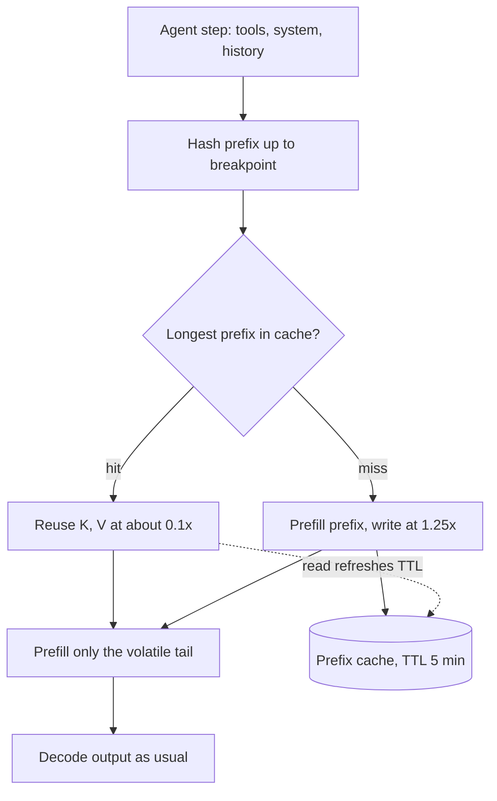

## TL;DR
Every agent step re-sends tools, system prompt and a growing transcript. Prompt caching reuses stored
state for that exact repeated prefix, cutting input cost and time-to-first-token, so request layout
decides what a long agent loop costs.

## For agent builders
- **Why it matters for agents.** An agent loop is the best case for caching: step *t* repeats everything
  from step *t* - 1 and appends a tool call and result. Append-only transcripts get most input tokens at
  the read rate; one volatile byte at the top makes every step pay full price or more.
- **Where it shows up in your stack.** `cache_control` breakpoints and the `usage` fields on Anthropic's
  API, automatic prefix caching on other providers, and prefix caching in vLLM or SGLang when self-hosting.
- **What you control.** Render order (tools, system, history, new turn), deterministic tool serialization,
  where breakpoints sit, when you compact, and how you launch parallel sub-agents.
- **What you can skip.** The attention math. Know that state at position *i* depends on all earlier
  tokens, so only exact prefixes match.

## Why it exists
- **Most of every prompt repeats.** System instructions, tool definitions, few-shot examples and long
  reference documents are identical from one request to the next, yet every request re-runs prefill over
  the whole prompt.
- **Prefill is expensive.** It is compute-bound and grows at least linearly with prompt length (the
  attention part quadratically). A support assistant with a 20,000-token system prompt plus 2,000
  varying tokens, at 1,000 requests an hour, prefills 20 million identical tokens an hour. You pay for
  it, and the user waits for it before the first output token.
- **The naive fixes cost something you want to keep.** Shortening the prompt throws away instructions
  that earned their place. Fine-tuning instructions into the weights makes iteration slow and expensive
  and still re-sends the reference document. Your own server with prefix caching needs self-hosting.
- **The enabling fact.** In a causal transformer, K and V at position *i* depend only on tokens 0..*i*.
  Two requests sharing their first *n* tokens have identical K and V for those *n* positions in every
  layer. Prompt caching is the KV cache applied across requests rather than across decode steps.

## How it works
### What is stored and why the match must be exact
- **Stored:** per-layer K and V tensors for a prefix, keyed by a hash of the exact token sequence up to a
  breakpoint.
- **Exact match:** position *i*'s state depends on every earlier token, so one different token at
  position *n* changes everything from *n* onward. The cache serves positions before *n*; the rest is
  recomputed.
- **Lookup is longest matching prefix.** That is why hosted APIs describe caching as a prefix match, and
  why one stray timestamp at the top of the system prompt defeats it entirely.

### Render order and breakpoints (Anthropic's API)
1. **Fixed render order:** tool definitions, then the system prompt, then the messages. Other providers
   have their own fixed order.
2. **Explicit breakpoints:** `cache_control: {"type": "ephemeral"}` on a content block marks where a
   cacheable prefix ends (up to four breakpoints per request). It caches everything from the start of the
   request up to and including that block.
3. **Automatic breakpoint:** a top-level `cache_control` on the request places the breakpoint on the last
   cacheable block, which suits growing conversations.
4. **Bounded lookback:** each breakpoint looks back a bounded number of blocks for an earlier entry to
   extend, so very long turns benefit from an intermediate breakpoint.
5. **Other providers** cache automatically on any repeated prefix without markers; the prefix rule is the
   same, only the control differs.

### Lifetime
- **TTL:** five minutes by default on Anthropic's API, with a one-hour option at a higher write price. A
  read refreshes the timer, so a prefix reused more often than the TTL stays warm indefinitely.
- **Measured start to start.** The lifetime runs from the start of the request that writes or reads the
  entry, so a long generation eats into the window.
- **Scope:** entries are scoped to the model and not shared between customers (organization-scoped on
  hosted APIs). Check your provider's exact isolation rule before relying on it for tenant separation.
- **Eviction is best-effort.** A correctly laid-out prefix can still miss, so cost models use the
  measured hit ratio, not an assumed 100%.

### Economics
| Item (Anthropic's API) | Price vs ordinary input |
|---|---|
| Cache write, five-minute TTL | about 1.25× |
| Cache write, one-hour TTL | about 2× |
| Cache read | about 0.1× (lower on some newer models) |
| Break-even, five-minute TTL | two requests: 1.25 + 0.1 = 1.35 versus 2.0 uncached |
| Break-even, one-hour TTL | three requests |

- **Minimum cacheable prefix:** varies by model from a few hundred to a few thousand tokens. Shorter
  prefixes are silently not cached, with no error.

### The invalidation hierarchy
A change invalidates its own tier and everything after it, because of render order.

| Change | Invalidates |
|---|---|
| Tool definitions (add, remove, reorder) | tools, system and messages |
| System prompt | system and messages (tools entry kept) |
| A message | from that message onward |
| Model | everything: caches are model-scoped |
| Generation config rendered into the prompt (thinking, effort) | messages tier, and on some models earlier tiers too |

Pin thinking and effort settings per route rather than varying them per request.

### Observing it
The response `usage` block reports three input counts; the prompt size is their sum:
- `input_tokens`: the uncached remainder;
- `cache_creation_input_tokens`: written this request, at the write premium;
- `cache_read_input_tokens`: served from cache.

A healthy multi-turn loop shows reads growing turn over turn and small writes. Reads stuck at zero mean
something volatile sits before the breakpoint.

### Concurrency
- **An entry is readable only once the first response has started.**
- **So N identical parallel requests all miss** and all pay the write premium.
- **For fan-out:** send one request, wait for its first token, then send the rest.

### What it does not change
- **Semantically transparent.** The reused K and V are the ones the model would compute anyway, so the
  output distribution matches an uncached call.
- **Not response caching.** A "semantic cache" returns a stored answer for a similar question and can be
  wrong when the question differs in a detail.
- **Prefill only.** Output tokens are billed and decoded as before, so output-heavy workloads (short
  prompt, long answer) save little; time-to-first-token improves, time per output token does not.

### Self-hosted equivalents
- **vLLM automatic prefix caching:** hashes each fixed-size KV block together with everything before it
  and shares blocks whose hashes match, so reuse is at block granularity. No markers.
- **SGLang RadixAttention:** keeps cached prefixes in a radix tree and matches the longest one.
- The serving module covers the memory side.

## Diagram
Each agent step's prefix up to the breakpoint is hashed and looked up; a hit skips its prefill and bills
it at the read rate, a miss prefills everything and writes the entry.



## Misconceptions
- **"Similar prompts will share the cache."** Reuse needs an exact token prefix, because each position's
  K and V depend on every earlier token; one timestamp at the top of the system prompt makes every
  request a miss from that byte on.
- **"Turning caching on can only save money."** A write costs about 1.25× ordinary input and is wasted if
  never read; in the 10-step agent example a per-step reminder at the top costs ~203k
  full-price-equivalent tokens versus 162.5k uncached.
- **"Only edits to the system prompt or messages break the cache."** Tools render first, so adding,
  removing or reordering one invalidates everything after it; switching models, or toggling thinking and
  effort per request, causes misses even when every byte of prompt text is identical.
- **"Fifty parallel calls on one document pay for one write."** An entry is readable only once the first
  response has started, so simultaneous requests all miss; warm with one request, then fan out.
- **"Prompt caching is a response cache, so it can return a stale answer."** It reuses attention state
  the model would compute anyway, so the output distribution matches an uncached call; a semantic cache
  that returns stored answers is a different thing.
- **"Caching makes the whole response faster."** It skips prefill only: time-to-first-token and input
  cost fall, while output tokens are decoded and billed as before.

## Examples
### Two calls sharing a 20k-token prefix
The same 20k-token policy document and tool list, different questions. Stable content is rendered first
with one breakpoint at the end of the system block; the only volatile part is the user turn after it. The
`usage` fields show the write on the first call and the read on the second.

```python
import anthropic, json

client = anthropic.Anthropic()
MODEL = "claude-opus-5-5"

SYSTEM = open("policies.md").read()                       # ~20k tokens, byte-identical every request
TOOLS = sorted(json.load(open("tools.json")), key=lambda t: t["name"])   # deterministic order

def ask(question: str):
    r = client.messages.create(
        model=MODEL, max_tokens=1024,
        tools=TOOLS,                                              # rendered first; must not vary
        system=[{"type": "text", "text": SYSTEM,
                 "cache_control": {"type": "ephemeral"}}],        # breakpoint: caches tools + system
        messages=[{"role": "user", "content": question}],        # volatile tail, after the breakpoint
    )
    u = r.usage
    print(f"uncached={u.input_tokens} written={u.cache_creation_input_tokens} read={u.cache_read_input_tokens}")
    return r

ask("Can a Basic-plan customer get a refund after 45 days?")
# illustrative: uncached=~20  written=~20000  read=0        -> paid the 1.25x write once
ask("Does the 14-day trial convert to a paid plan automatically?")
# illustrative: uncached=~20  written=0       read=~20000   -> prefix at the read rate (0.1x on most models)
```

### Worked cost: 1,000 requests an hour
20k stable prefix, 2k variable tail, an illustrative $3 per million input tokens and the common 0.1× read
rate.

| | Billed tokens per request | Cost per request | Cost per hour |
|---|---|---|---|
| Uncached | 22k | about $0.066 | $66 |
| Cached | 2k full + 20k at 0.1× = 4k equivalent | about $0.012 | $12 |

- **Roughly an 80% cut in input cost**, with the occasional write after an idle gap adding a few cents.
- **Time-to-first-token drops** because 20k tokens of prefill are skipped.

The same arithmetic as a runnable calculator, plus a helper that finds the byte where two rendered
prompts diverge (the usual way to locate a cache-breaking timestamp):

```python
import os

def hourly_cost(req_per_hour, prefix, tail, price_per_m=3.0, read=0.1, write=1.25, writes_per_hour=0):
    uncached = req_per_hour * (prefix + tail)
    cached = (req_per_hour * (tail + prefix * read)        # every request reads the prefix
              + writes_per_hour * prefix * (write - read))  # a miss pays the write instead of the read
    return uncached * price_per_m / 1e6, cached * price_per_m / 1e6

u, c = hourly_cost(1000, 20_000, 2_000)
print(f"uncached ${u:.2f}/h, cached ${c:.2f}/h, saving {1 - c / u:.0%}")   # $66.00, $12.00, 82%
print(f"${hourly_cost(1000, 20_000, 2_000, writes_per_hour=2)[1]:.2f}/h")  # $12.14 with 2 idle-gap writes

def first_divergence(a: str, b: str) -> int:
    return len(os.path.commonprefix([a, b]))

a = "You are a support agent. Today is 2026-10-20T09:14:03Z.\nPolicies..."
b = "You are a support agent. Today is 2026-10-20T09:14:07Z.\nPolicies..."
i = first_divergence(a, b)
print(i, repr(a[max(0, i - 20):i + 10]))   # the timestamp: everything after it is a cache miss
```

### Worked scenario: a 10-step tool-calling agent
Tools plus system prompt are 8k tokens; each step appends ~1.5k tokens (tool call plus result). Units are
full-price-equivalent input tokens, using the 1.25× write and 0.1× read rates. Illustrative.

| Layout | What happens each step | Input over 10 steps |
|---|---|---|
| Uncached | prefill 8k + 1.5k·*t* | 162.5k |
| Append-only, breakpoint on system plus automatic tail | step 1 writes 9.5k; later steps read history, write 1.5k | ~42.7k (about 74% less) |
| "Current step: N" reminder at the top of the system prompt | every step writes the whole prompt at 1.25× | ~203k (25% more than uncached) |

- **The fix for the third row** is to put the reminder in the newest user turn, after the cached prefix.
- **Read the `usage` fields per step.** In the good layout `cache_read_input_tokens` climbs by ~1.5k each
  step while writes stay near 1.5k.

## Production patterns
- **Append-only agent transcripts, volatile data last.** Avoid editing or deleting earlier tool results
  mid-run. Put per-step reminders, current date, user name, plan and retrieved snippets in the newest
  turn or after the shared breakpoint, never at the top of the system prompt. Monitor cached share of
  input per step, and diff two rendered prompts (as above) whenever reads stay at zero.
- **Compact or clear at a boundary, not every step.** When the transcript nears the window, summarize old
  steps (or clear stale tool results) once, in one batch, and accept one write, instead of trimming a
  little each step and missing the cache every time.
- **Layered request builder.** Build every request as stable (tools, policies), session and turn layers,
  serialized deterministically (`json.dumps(..., sort_keys=True)`, tools sorted by name), with breakpoints
  at the layer boundaries. Monitor hit ratio per route.
- **Cache regression test in CI.** Send the same request twice against a test key and assert the second
  reports `cache_read_input_tokens` greater than zero, because the common failure is a later change that
  silently breaks caching for months.
- **Hit-ratio dashboard from usage fields.** Log the three usage counts per call and chart reads over
  total prompt tokens; alert when it drops after a deploy. A spike in `cache_creation_input_tokens` with
  flat traffic points to a volatile byte in the prefix.
- **Warm before fan-out.** For N parallel calls on one prefix, stream the first request, wait for its
  first token, then release the other N - 1. Monitor writes per batch; it should be one.
- **Prefix caching when self-hosting.** Keep automatic prefix caching enabled in vLLM or SGLang and route
  requests sharing a system prompt to the same replica, so the shared blocks stay resident. Monitor the
  engine's prefix-cache hit rate and time to first token.

## Trade-offs
- **Layout constraint vs discount.** You accept stable content first, volatile last. It flips to a
  surcharge when the prompt is mostly unique per request, because the write premium is paid and never
  read back.
- **Write premium vs one-off use.** A prefix used once within the TTL costs more than not caching. The
  break-even is two uses, so cache parts you know repeat and leave one-off documents uncached.
- **One-hour TTL vs price.** It doubles the write price to survive idle gaps; it pays only when requests
  sharing a prefix arrive 5 to 60 minutes apart, and buys nothing under continuous traffic.
- **Personalisation vs sharing.** Per-user content (name, plan, profile) in the system prompt creates one
  prefix per user. Moving it after the shared breakpoint keeps cross-user sharing; a second per-user
  breakpoint pays only when that user makes many requests within the TTL.
- **Releases vs warm caches.** A prompt release invalidates every cached prefix at once, so a deploy
  costs a cost and latency blip. A gradual alias move spreads the writes, at the price of running two
  prompt versions for a while.

## Pitfalls
- **A timestamp, request id or UUID in the system prompt.** Symptom: `cache_creation_input_tokens` near
  the full prompt on every request and reads stuck at zero.
- **Non-deterministic serialization.** `json.dumps` without `sort_keys`, iterating a set, or a tool list
  built per user. Symptom: an intermittent hit rate nobody can explain from the prompt text.
- **Automatic breakpoint after a unique per-request tail.** Symptom: a write on every request while reads
  never cover the full shared prefix.
- **A prefix below the model's minimum cacheable size.** Symptom: zero writes and zero reads with no
  error, usually on a short prompt someone assumed was cached.
- **Rewriting earlier history** (injecting then deleting a reminder, truncating the middle of a
  conversation). Symptom: a write the size of the whole conversation on every turn of an agent loop.
- **Fan-out of N identical requests at once.** Symptom: N writes and no reads at the start of each batch.
- **Switching models or toggling thinking and effort per request.** Symptom: full misses on
  byte-identical text, which looks impossible until you remember caches are model- and config-scoped.

## When to use
- **Use when** a prefix larger than the model's minimum repeats within the TTL: shared system prompts and
  tool sets, few-shot examples, a long document interrogated with many questions, and above all agent
  loops, where every turn re-sends the growing history.
- **Skip** one-off requests with unique content and batch jobs where only a few hundred tokens of
  instructions are shared.
- **Measure:** hit ratio (reads over total prompt tokens), time-to-first-token before and after, and cost
  per request from the usage fields. Add an integration test asserting a second identical request shows
  reads.
- **Interviews:** prefix match, render order, write-versus-read economics, and where to put the
  breakpoint.

## Role lens
- **Engineer:** Structures the request builder as stable, session and turn layers, places breakpoints at
  those boundaries, and asserts in CI that the second identical request reports `cache_read_input_tokens`.
- **Architect:** Decides what is shared across users versus per tenant, sets TTL policy per route, and
  puts the expected hit ratio into the cost model instead of pricing every request at full input cost.
- **FDE:** Finds the customer-injected context (user profile, current date) sitting at the top of the
  prompt, moves it after the shared breakpoint, and shows the before-and-after usage fields as proof.

## Check yourself
**Q:** An agent runs 30 turns per task; tools plus system prompt are 40k tokens and each turn adds about
3k tokens of history. Where do you put breakpoints, and roughly how much input cost does caching save?
**A:** One explicit breakpoint at the end of the system block guarantees a read point for the expensive
shared part, and top-level automatic caching covers the growing conversation tail. Uncached, turn *t*
sends 40k + 3k·*t* tokens, so 30 turns send about 1.2M + 1.4M ≈ 2.6M tokens. Cached, turn 1 writes
43k at 1.25×; each later turn reads everything so far at about 0.1× and writes only the new 3k at 1.25×.
Reads total roughly 2.5M tokens, equivalent to about 250k at full price, plus about 160k-equivalent of
writes, so around 410k-equivalent versus 2.6M: an 80-85% reduction, with time-to-first-token falling on
every turn. The conditions: turns start less than the TTL apart, history is append-only, the tool list is
deterministic, and the model and thinking settings do not change mid-task.

## Interview questions
### What is prompt caching, and how is it different from a semantic cache?
- **Definition:** reuse of the per-layer K and V state for an exact token prefix across requests, so
  prefill over that prefix is skipped and billed at a read rate.
- **Why it is safe:** the reused state is exactly what the model would recompute, so outputs have the
  same distribution as an uncached call.
- **A semantic cache** returns a stored answer for a similar question, which can be wrong when the new
  question differs in a detail.

### Your hit ratio dropped to zero after a deploy. How do you debug it?
- **Read the usage fields.** Writes near the full prompt on every request with zero reads means the
  prefix is never seen twice.
- **Diff two rendered requests** and find the first differing byte: usually a timestamp, request id,
  per-user field or unsorted JSON before the breakpoint.
- **Check tier changes.** A reordered tool list or a per-request thinking toggle invalidates everything
  after it; also confirm the prefix still exceeds the model's minimum.

### When would caching make a workload more expensive?
- **When prefixes rarely repeat within the TTL.** Every request pays about 1.25× to write an entry that
  is never read.
- **When the one-hour TTL is used under continuous traffic.** The 2× write buys nothing, because reads
  already refresh the five-minute entry.
- **Output-heavy workloads** gain little either way, since output tokens are unaffected.

### You fan out 50 parallel calls over the same 30k-token document. What happens and what do you change?
- **All 50 miss.** An entry is readable only once the first response has started, so each call pays the
  write premium.
- **Fix:** send one request, wait for its first streamed token, then release the other 49; they read the
  prefix at about 0.1×.
- **Monitor** writes per batch, which should fall from 50 to one.

### Where do you place breakpoints in a long-running agent loop?
- **One explicit breakpoint at the end of the system block**, so the expensive shared tools and
  instructions always have a read point.
- **Automatic caching on the conversation tail**, so each turn reads the history and writes only the new
  turn, with an intermediate breakpoint if a single turn is very long.
- **Keep history append-only** and pin model and thinking settings, or each turn rewrites the whole
  conversation.

### Your agent's cost per task doubled after you added dynamic tool loading. Why, and what do you change?
- **Tools render first.** Adding or removing tools per step changes the earliest tier, so every step
  invalidates tools, system and history and pays the write premium on the whole transcript.
- **Fix:** keep a fixed, sorted tool list for the whole run and gate availability in the tool handler or
  instructions, or change the tool set only at a compaction boundary.
- **Verify** with per-step writes and reads from the usage fields.

## Quiz
### Q: Why must a cached prefix match the new request byte for byte?
- [ ] The hash function cannot tolerate partial matches
- [x] Each position's keys and values depend on every earlier token, so one changed token changes all state after it
- [ ] Tokenizers are non-deterministic, so only exact bytes are comparable
- [ ] The cache stores text rather than tensors and is compared as a string
> Attention state at position *i* is a function of tokens 0..*i*. A change at position *n* leaves earlier
> state valid but makes everything from *n* on different, so only the longest exact prefix can be reused.

### Q: Usage shows `cache_creation_input_tokens` near the full prompt on every request and reads near zero. Most likely cause?
- [ ] The TTL is too short for the request rate
- [ ] The model does not support caching, so writes are wasted
- [x] Something volatile, such as a timestamp or request id, sits in the prefix before the breakpoint
- [ ] More breakpoints are needed to cover the whole prompt
> A write on every request means the prefix is never seen twice. A TTL problem would show gaps, not
> constant misses, and an unsupported model would show zero writes. Diff two rendered prompts to find the
> changing bytes.

### Q: When does the one-hour TTL pay off over the default five-minute TTL?
- [ ] Always, because a longer lifetime means more hits
- [ ] Under continuous traffic, where requests arrive every few seconds
- [x] When requests sharing the prefix arrive 5 to 60 minutes apart
- [ ] When the prefix is below the minimum cacheable size
> Under continuous traffic every read refreshes the five-minute entry, so the doubled write price of the
> one-hour TTL buys nothing. It pays only across idle gaps longer than five minutes and shorter than an hour.

## Use cases & projects
### Use cases
- **Long-running coding and research agents.** Append-only transcripts bill the ever-growing history at
  the read rate, so step 30 costs a fraction of its uncached price and its time to first token stays low.
- **Agents with large tool sets.** Dozens of tool schemas form a stable prefix that every step reads at the
  read rate instead of re-paying.
- **Document-grounded agents.** A contract or codebase summary loaded once is questioned across many steps
  and sessions within the TTL.
- **Parallel sub-agents.** Warming one request before fan-out turns N cache writes into one.

### Mini project
**Measure caching in a tool-calling loop (1-2 hours).**
- **Goal:** show the cost difference between an append-only agent transcript and one with a volatile
  value at the top.
- **Steps:** build a 10-step agent with two fake tools and a ~5k-token system prompt; run it with a
  breakpoint on the system block and automatic tail caching; run again with a timestamp at the top of the
  system prompt; log the three `usage` counts per step.
- **Done when:** you have a per-step table for both runs, a computed cost per task for each, and the
  `first_divergence` output pointing at the timestamp.
