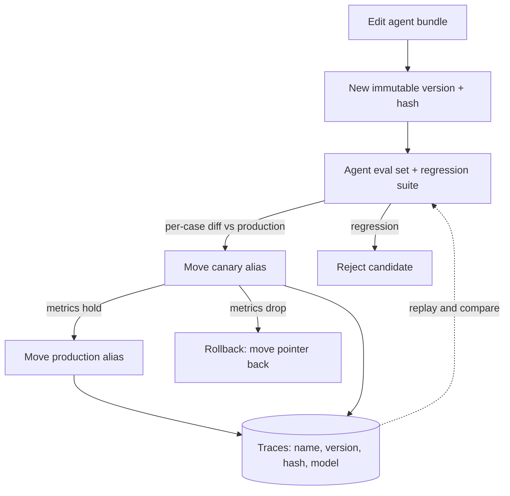

## TL;DR
An agent's behaviour is a bundle of prompts, tool descriptions, schemas and a pinned model. Version it
immutably, log the version on every step, eval before promotion and roll back with one pointer move, or
agent regressions cannot be dated or replayed.

## For agent builders
- **Why it matters for agents.** An agent has many prompts (system, planner, sub-agents, tool
  descriptions, summarizer), and rewording any one shifts tool choice and stopping behaviour. Without a
  version on each step's trace, "the agent got worse on Tuesday" cannot be tied to a change.
- **Where it shows up in your stack.** Prompt files in the repo, a registry such as Langfuse or LangSmith,
  span attributes in your tracing, and the CI job that runs your agent eval suite.
- **What you control.** The versioned unit (include tool schemas and the model snapshot), aliases for
  canary and production, and the promotion gate on per-category agent eval scores.
- **What you can skip.** Building a registry product. Files plus an alias file and a hash on every trace
  cover most agent teams until non-engineers edit prompts weekly.

## Why it exists
- **The prompt changes most and is guarded least.** Behaviour is model × prompt × parameters × tools ×
  retrieval. The prompt is often a string literal edited by a product manager in a vendor console, or
  hot-patched on a Friday to fix one complaint. "The prompt in production" becomes whatever someone last
  pasted from a playground.
- **Irreproducibility.** A user reports a wrong answer on Tuesday; the prompt was edited on Wednesday;
  nobody can say which wording produced the complaint, so nobody can test the fix.
- **Silent regression and coupled rollout.** A sentence added "to handle one edge case" shifts behaviour
  on a few percent of unrelated traffic, found by customers because no eval ran. Prompts only in code
  need a code rollback; prompts only in a database can drop a variable the code expects, failing at
  runtime rather than at review.
- **"It is in git" is half right.** Git versions the file. It does not record which commit produced which
  response, does not capture runtime variables, and hides that the model id and tool descriptions changed
  in the same pull request.
- **This is configuration debt.** Sculley et al. note that mature ML configuration is large, rarely
  reviewed with code's rigour, and a common source of costly mistakes. Versioning turns the *effective
  prompt* into an identifiable, testable, revertible artifact.

## How it works
### The versioned unit is the bundle
Version all of it, *because* a change to any part changes behaviour:
- template text: system prompt, user-turn scaffolding, few-shot examples;
- tool names, descriptions and schemas, and the output schema;
- the model id, sampling and output parameters;
- the rendering code that fills variables.

A bundle that records only the template reports "no change" after someone edits a tool description.

### Agents multiply the bundle
- **One agent, many prompts.** A planner prompt, an executor prompt, sub-agent prompts, a compaction
  summarizer and every tool description all shape a run. Version them as one agent bundle with one hash,
  because they are tuned together and a run uses all of them.
- **Log per step, not per run.** Each LLM step in the loop records the bundle hash, so a trace where a
  sub-agent ran an older version (mid-rollout) is visible instead of confusing.
- **Tool code is versioned separately.** The tool's implementation ships with code; its name, description
  and schema ship with the bundle, because those are what the model reads.

### Two identities: hash and label
| Identity | Example | Property | Where it goes |
|---|---|---|---|
| Content hash | SHA-256 of a canonical serialization of the bundle | exact, automatic, changes when any byte changes; the one you trust | every trace |
| Human label | `v14`, or semver-style `2.1.0` (major bump = behaviour changed, re-evaluate) | the one you talk about | changelog and alias file |

Use both.

### Immutable versions, mutable aliases
1. **Versions never change once created.**
2. **Deployment is a pointer.** An alias such as `production` or `canary` resolves to a version; release
   means moving the pointer. This mirrors container tags.
3. **Why:** it decouples prompt rollout from code deploys and makes rollback a one-line change with no
   rebuild.
4. **The cost:** code and prompt evolve separately. So each version declares its variable contract (the
   placeholders it expects) and the loader checks it at startup, rather than discovering a missing
   variable in a 3 a.m. request.

### Where versions live
| Layout | How | Best when |
|---|---|---|
| Repository files | `prompts/<name>/v14.md` with a metadata header; reviewed in pull requests, promoted by CI, tied to a commit | engineers own prompts |
| Registry | Langfuse, LangSmith, PromptLayer or a table you own; fetched by alias at runtime, editable in a UI, hot-swappable without a deploy | domain experts iterate daily |
| Both | files are the source of truth; CI pushes them to the registry | you want review *and* runtime decoupling |

### Record the version on every call
- **This step makes the rest pay off.** Each trace carries prompt name, version label, content hash,
  model id and the rendered variables (or their hash when sensitive).
- **Then questions become queries.** "Show every response from v13 next to v14 on the same inputs" and
  "replay the exact prompt behind this complaint" stop being archaeology.

### Promotion through evals
A new version is a candidate until it has:
1. run against the golden dataset and the regression suite;
2. been compared case by case against the current production version;
3. survived a canary slice of live traffic.

The eval exists *because* prompt changes have non-local effects that reading the diff cannot predict; the
canary exists because the golden set never covers the real distribution.

### Two interactions worth knowing
- **Prompt cache.** A release changes bytes near the front of the request, so every request on the new
  version misses the cache until the new prefix is written once. Expect a short cost and
  time-to-first-token blip, larger at high concurrency where many requests miss before the first write
  lands. A gradual alias move keeps most traffic on the still-warm old prefix while the new one warms.
- **Model upgrades are prompt versions.** Prompts are tuned to a model, so pin it in the bundle and
  re-evaluate when it changes. Pin a dated snapshot id, not a floating alias (many providers offer both),
  *because* a floating alias can move underneath an unchanged bundle hash: exactly the silent change
  versioning is meant to rule out. Store the dated id (such as `gpt-4o-2024-08-06` rather than `gpt-4o`)
  in the version metadata.

### Replay reproduces the input, not the output
- **Sampling is non-deterministic.** Even at temperature 0, providers do not promise bit-identical output
  across runs.
- **So replay means a distribution.** Re-send the identical request several times. Most samples wrong:
  the version is at fault. One in ten wrong: it is variance, and the fix is a tighter prompt, an output
  schema or a check rather than a revert.
- **Compare versions the same way.** Score each version on several samples per case, or a one-sample
  difference between v13 and v14 may be noise.

## Diagram
An agent bundle moves through gates by pointer moves only; every agent step logs which version answered,
so rollback and replay are both cheap.



## Examples
### A minimal file-based registry
Immutable version files, an alias file for promotion, a content hash over the whole bundle (template plus
model, parameters and tool schemas), a variable-contract check at load time, and the trace line that
records which version answered.
- Swapping the directory for a registry client changes `load`, nothing else.
- Promotion is a CI job that runs the golden set against `canary` and `production`, diffs results per
  case, and only then edits `aliases.yaml`.

```python
import hashlib, json, pathlib, re
import yaml                                  # pip install pyyaml

ROOT = pathlib.Path("prompts")               # prompts/support_triage/{aliases.yaml, v13.md, v14.md}

def load(name: str, alias: str = "production") -> dict:
    aliases = yaml.safe_load((ROOT / name / "aliases.yaml").read_text())   # {"production": "v13", "canary": "v14"}
    version = aliases[alias]
    header, _, template = (ROOT / name / f"{version}.md").read_text().partition("\n---\n")
    meta = yaml.safe_load(header)            # model (dated snapshot), max_tokens, tools, variables
    found = set(re.findall(r"{{(\w+)}}", template))
    assert found == set(meta["variables"]), f"variable contract drift: {found ^ set(meta['variables'])}"
    canon = json.dumps({"meta": meta, "template": template}, sort_keys=True).encode()  # tools are in meta
    return {"name": name, "version": version, "hash": hashlib.sha256(canon).hexdigest()[:12],
            "meta": meta, "template": template}

def render(p: dict, **vars) -> str:
    missing = set(p["meta"]["variables"]) - vars.keys()
    if missing:
        raise ValueError(f"{p['name']}@{p['version']} needs {missing}")
    return re.sub(r"{{(\w+)}}", lambda m: str(vars[m.group(1)]), p["template"])

def triage(client, ticket: str, tracer) -> str:
    p = load("support_triage")               # alias resolved per call: rollback = edit aliases.yaml
    system = render(p, product="Acme Billing", tier="enterprise")
    r = client.messages.create(model=p["meta"]["model"], max_tokens=p["meta"]["max_tokens"],
                               tools=p["meta"].get("tools", []), system=system,
                               messages=[{"role": "user", "content": ticket}])
    tracer.log(prompt=p["name"], version=p["version"], hash=p["hash"],   # the line that makes replay possible
               model=p["meta"]["model"], input_tokens=r.usage.input_tokens)
    return r.content[0].text
```

### A per-category promotion gate (runnable)
The aggregate can rise while one category collapses. Weight by case count, then block on any category
drop beyond a tolerance. Numbers are illustrative.

```python
cases = {"billing": 400, "refunds": 100, "outage": 100}
base  = {"billing": 0.85, "refunds": 0.95, "outage": 0.80}   # production version
cand  = {"billing": 0.93, "refunds": 0.70, "outage": 0.82}   # candidate version

def mean(scores):
    return sum(scores[c] * n for c, n in cases.items()) / sum(cases.values())

def gate(base, cand, max_drop=0.02):
    drops = {c: (base[c], cand[c]) for c in base if cand[c] < base[c] - max_drop}
    return not drops, drops

print(f"mean {mean(base):.3f} -> {mean(cand):.3f}")   # mean 0.858 -> 0.873
ok, drops = gate(base, cand)
print("promote" if ok else f"blocked: {drops}")       # blocked: {'refunds': (0.95, 0.7)}
```

| Category | Cases | v13 (production) | v14 (candidate) |
|---|---|---|---|
| billing | 400 | 85% | 93% |
| refunds | 100 | 95% | 70% |
| outage | 100 | 80% | 82% |
| **weighted mean** | 600 | 85.8% | 87.3% |

A mean-only gate would have shipped v14; the per-category gate catches the refunds regression.

### Worked scenario: a tool description edit that "changed nothing"
A support agent has three tools: `lookup_order`, `issue_refund` and `escalate`. An engineer rewords the
`issue_refund` description to sound friendlier. The template is untouched. Numbers are illustrative.

| Metric on 200 agent eval tasks | v21 (production) | v22 (description reworded) |
|---|---|---|
| Correct tool on first call | 91% | 84% |
| `issue_refund` called without a prior `lookup_order` | 2% | 9% |
| Median steps per task | 4 | 5 |
| Bundle hash | changes | changes, because tool schemas are in the bundle |

- **Because the description is in the bundle**, v22 gets a new hash, runs the agent eval and is blocked
  on the tool-order regression before reaching users.
- **If only the template were hashed**, the trace would show v21 for both, and the refund incidents
  would look like model drift.

## Production patterns
- **Version the whole agent, log it on every step.** Put the planner, sub-agent and summarizer prompts plus
  tool schemas in one bundle, and set its hash on every LLM span in the loop. Monitor runs whose steps
  carry more than one bundle hash; they mean a rollout happened mid-run.
- **Gate on agent metrics, not only answers.** The promotion eval scores task success, correct tool
  choice, steps per task and cost per task per category. Block on any category drop, because a prompt
  change often shows up as extra tool calls before it shows up as wrong answers.
- **Version and hash as trace attributes.** On every LLM span, set prompt name, version label, content
  hash and model id as attributes (for example in your OpenTelemetry or Langfuse traces). Monitor the
  share of calls carrying a version; it should be 100%.
- **CI eval gate on prompt paths.** Trigger the golden-set and regression run whenever files under
  `prompts/` change (a path filter in your CI), post the per-case diff on the pull request, and block
  merge on any category drop. Monitor eval delta between consecutive versions.
- **Canary by stable hash.** Route a fixed slice (for example 5%) to the `canary` alias by hashing the
  user or conversation id, so a user stays on one version. Compare escalation rate, refusals and cost
  per version before moving `production`.
- **Cached alias resolution with fallback.** Resolve the alias through a short-TTL in-process cache and
  keep the last known version if the registry is unreachable, so the registry is not a hard dependency
  of every request. Monitor registry errors and alias staleness.
- **Read-only production in the console.** Let people edit drafts in the registry UI, but allow only CI
  (or a reviewed action) to move the `production` label. Monitor label moves as audit events.

## Trade-offs
- **Files in git vs a registry.** Files give pull-request review and atomic code-plus-prompt changes, but
  couple rollout to deploys and lock out non-engineers. It flips to a registry once domain experts edit
  prompts weekly or a fix must ship without a release.
- **Hot swaps vs contract drift.** A registry allows hot swaps and UI editing but invites drift between
  what the code expects and what the prompt provides; a declared variable contract checked at load time
  is the price of that freedom.
- **Hashes vs labels.** Content hashes are exact but meaningless to humans; labels communicate intent but
  depend on discipline. Using both costs nothing and avoids arguing about which one is "real".
- **Request-time resolution vs dependency.** Resolving the alias per request makes rollback instant but
  puts the registry in the request path; cache the resolution with a short TTL and fall back to the last
  known version on failure.
- **Full eval vs speed.** Running the full eval on every version is slow. It is mandatory for a major
  bump and overkill for a typo fix, which is exactly the distinction the version label exists to express.

## Pitfalls
- **Editing in the vendor console and pasting into production.** Symptom: a live prompt that matches no
  commit and a regression nobody can date. Fix: console is read-only for production.
- **Changing model and prompt in the same version.** Symptom: an eval drop attributable to neither, so
  both get reverted. Fix: one change per version.
- **Not recording the version on each call.** Symptom: a complaint you cannot reproduce because you do
  not know which prompt that user received.
- **Versioning the template but not tool descriptions, few-shot examples or the output schema.** Symptom:
  "the prompt did not change" while behaviour did after someone reworded a tool.
- **Promoting on the aggregate score alone.** Symptom: a mean up one point while one critical category
  fell from 95% to 70%, visible only in per-case diffs.
- **Releasing to 100% of traffic at once.** Symptom: a regression reaching every user before any metric
  flags it, plus a brief cost and latency spike as all traffic misses the prompt cache together.
- **Resolving the alias on every agent step.** Symptom: a long run switches prompt versions halfway when
  the alias moves, producing plans one version wrote and another cannot follow. Fix: resolve once per run
  and carry the version through the loop.

## When to use
- **Start:** from the first prompt that reaches a user, or the first agent run that calls a real tool.
- **Minimum that pays for itself in a week:** prompt in a file with a metadata header, a content hash
  logged on every call, and the golden set run in CI before merge.
- **Add later:** aliases when you need rollback without a deploy, a registry when non-engineers edit,
  canary routing when traffic is large enough that a 5% slice is informative.
- **Measure:** fraction of calls whose trace carries a prompt version (should be 100%), time from "bad
  release noticed" to "rolled back", and the eval delta between consecutive versions.
- **Interviews:** "how do you ship a prompt change safely" expects version, evaluate, canary, promote,
  roll back, with the trace link that makes each step auditable.

## Role lens
- **Engineer:** Keeps prompts as versioned files or registry entries, logs the version and hash on
  every call, and wires the golden-set eval into CI so an unevaluated version cannot be promoted.
- **Architect:** Defines the versioned unit (template plus model, tools and schemas), chooses where
  the registry lives, and sets the promotion policy from candidate to canary to production.
- **FDE:** Maintains per-customer prompt variants as versions of a shared base, so a fix to the base
  can be re-evaluated and rolled out across customers instead of hand-merged into each one.

## Check yourself
**Q:** A product manager edits the support bot's system prompt in the vendor console on Friday to fix
one complaint. On Monday, escalations to human agents are up 20%. Walk through what should have
happened, and how you would set things up so this cannot recur.
**A:** The edit should have produced a new candidate version with its own hash, not a mutation of
production. That candidate should have run against the golden set and the regression suite, with a
case-by-case comparison against the current version, which would likely have shown the new sentence
changing behaviour on unrelated tickets. It should then have gone to a canary alias for a few percent
of traffic while escalation rate was watched, and only then been promoted. Recovery on Monday is a
pointer move back to the previous version, which is possible only if versions are immutable and
aliased. To make it stick: prompts live in files or a registry with aliases, the console is read-only
for production, every call logs prompt name, version and hash so Monday's escalations can be joined
to the version that caused them, and CI blocks promotion of any version without an eval run.

## Interview questions
### Why isn't keeping prompts in git enough to call them versioned?
- **Git versions the file, not the call.** It does not record which commit produced which response, so a
  complaint cannot be tied to a version without a per-call record.
- **The effective prompt is a bundle.** Model id, tool descriptions, output schema and rendered
  variables also shape behaviour, and they can change in the same pull request unnoticed.
- **So add a hash per call.** Hash the whole bundle and log it on every trace, alongside name, label and
  model id.

### A complaint arrives about an answer from last week. How do you reproduce it?
- **Find the trace.** Look up prompt name, version, hash, model id and rendered variables for that call.
- **Rebuild and resend the exact request several times.** Output is not bit-identical even at
  temperature 0, so look at the distribution of answers.
- **Decide by rate.** If most samples are wrong, fix or revert the version; if roughly one in ten is
  wrong, treat it as variance and tighten the prompt, add a schema or add a check.

### You release a new prompt version and cost and TTFT spike for a few minutes. Why?
- **Prompt cache misses.** The new version changes bytes near the front of the request, so every request
  misses until the new prefix has been written once.
- **Worse at high concurrency.** Many requests miss before the first write lands.
- **Mitigate with a gradual alias move.** Most traffic stays on the warm old prefix while the new one
  warms; watch cache-read tokens per version.

### How do you stop a provider model update from silently changing your prompt's behaviour?
- **Pin a dated snapshot id in the bundle**, not a floating alias, because the alias can move to a new
  model while your bundle hash stays the same.
- **Treat a model change as a new prompt version.** Run the golden set and regression suite, compare per
  case, and canary it like any other change.
- **Never combine it with a prompt edit**, or an eval drop cannot be attributed to either.

### Your agent started calling the wrong tool after a deploy where "only code changed". How do you find out why?
- **Diff the bundle hashes on the traces.** If the hash changed, something rendered into the request
  changed: often a tool description or schema generated from code, such as a docstring edit.
- **Compare tool-choice metrics per version.** Correct first tool and steps per task for old versus new
  hash on the same eval tasks show whether the change is the cause.
- **Fix the process.** Put generated tool schemas in the bundle so they are hashed, evaluated and
  canaried like any prompt.

### How do you roll out a new version of a multi-agent system without breaking runs in progress?
- **Pin the bundle at run start.** Resolve the alias once when an agent run begins and carry that version
  through every step and sub-agent, so a run never mixes planner v13 with executor v14.
- **Canary by conversation id.** New runs on the canary slice get the new bundle; existing runs finish on
  the old one.
- **Monitor per version.** Task success, cost per task and escalation rate, before moving `production`.

## Quiz
### Q: Which single piece of data makes prompt versioning pay off most once it is in place?
- [ ] A human-readable changelog entry for each version
- [x] The prompt name, version and content hash recorded on every call's trace
- [ ] A semantic version number that follows semver strictly
- [ ] A diff of the template stored alongside each version
> Changelogs and diffs describe what changed; only the per-call record ties a specific response, and
> therefore a complaint or a metric, to the version that produced it, which is what makes replay and
> comparison possible.

### Q: Why keep aliases such as `production` separate from immutable version identifiers?
- [ ] So that versions can be edited in place without changing their name
- [ ] Because registries cannot store more than one version per prompt
- [x] So that release and rollback are pointer moves that need no rebuild, and a version's eval results stay valid
- [ ] To hide the version number from the model
> If `production` were itself a mutable version, every edit would silently invalidate whatever eval
> had been run on it; separating the pointer from the content keeps versions testable and rollback
> instant.

### Q: A team versions the system prompt template but not the tool descriptions. What is the consequence?
- [ ] None, because tool descriptions do not influence model behaviour
- [ ] Tool calls will fail schema validation
- [x] Behaviour can change with no recorded version change, because tool descriptions are part of the effective prompt
- [ ] The prompt cache will stop working
> The model selects and uses tools by reading their descriptions, so rewording one changes behaviour
> exactly like rewording the system prompt; the versioned unit must include everything that is
> rendered into the request.

## Use cases & projects
### Use cases
- **Shipping agent prompt changes safely.** Every planner or tool-description edit becomes a candidate
  version that runs the agent eval suite before any user sees it.
- **Debugging an agent incident.** The bundle hash on each step's trace tells you which prompts and tool
  schemas produced the bad run, so you can replay it.
- **Model upgrades for agents.** Moving to a new model snapshot is a new bundle version, evaluated on tool
  choice and task success like any prompt edit.
- **Per-customer agent variants.** Forward-deployed teams keep customer-specific prompts as versions of
  a shared base, so a base fix can be re-evaluated across all customers.

### Mini project
**Version and gate a small tool-calling agent (2-3 hours).**
- **Goal:** make every agent run traceable to a bundle hash, and block a promotion that regresses tool
  choice.
- **Steps:** put the system prompt, two tool schemas and the model id in `prompts/agent/v1.md` with an
  `aliases.yaml`; hash the bundle at load; log the hash on every step; write 20 eval tasks scoring correct
  first tool; create v2 by rewording one tool description and run the per-category gate.
- **Done when:** traces show the hash per step, the gate prints a per-category table for v1 versus v2, and
  rolling back is a one-line edit to `aliases.yaml`.
