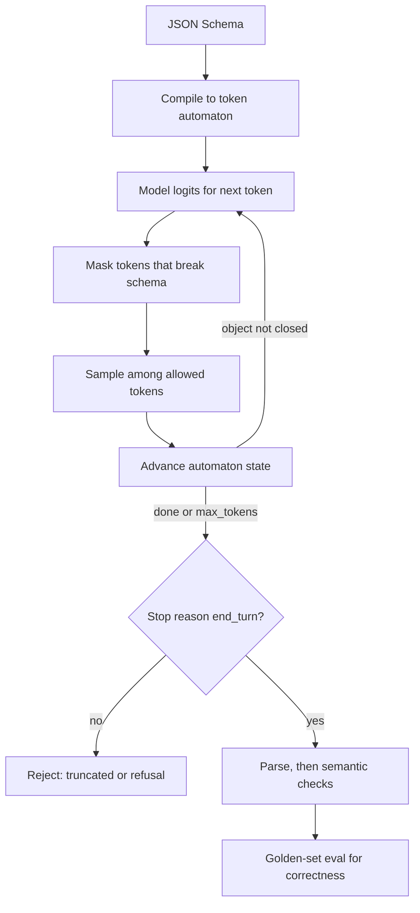

## TL;DR
Agents hand model output to code at every step: routing decisions, tool arguments, sub-agent results.
Structured outputs mask invalid tokens so output always fits your schema; that removes parse failures,
not wrong answers, so validation and evals stay yours.

## For agent builders
- **Why it matters for agents.** A loop that parses the model's decision at every step multiplies any
  format failure rate by the number of steps. A 1% failure per step is roughly a 10% chance one step of a
  10-step run breaks, so agents need the guarantee, not a tendency.
- **Where it shows up in your stack.** Strict tool schemas, the provider's output-format option, SDK parse
  helpers with Pydantic or Zod, and typed results returned from sub-agents to an orchestrator.
- **What you control.** Field order (reasoning before decision), escape values such as `ask_user` or
  `unknown`, nullable fields, the stop-reason check, and semantic validation before acting.
- **What you can skip.** Building token automata yourself. Know that the mask forces form, cannot make
  the model abstain, and is compiled once per schema.

## Why it exists
- **Code consumes most LLM output.** Production calls extract fields, classify tickets, route requests
  or produce arguments for another system. Downstream code needs a parseable object with known keys and
  types, but a language model emits free text.
- **"Respond only with JSON" works most of the time, and "most" is the problem.** The model wraps the
  object in markdown fences, adds a closing sentence, uses single quotes, returns `"42"` where an integer
  was expected, drops a field or invents a key. A 1% failure rate on 100,000 calls a day is 1,000 crashes
  or silently dropped records a day.
- **The usual mitigations are weak.** Regex extraction of the first `{...}` block is brittle. A
  validate-and-retry loop doubles cost and latency on the failing tail and still fails when the model
  repeats the mistake. Few-shot examples help but promise nothing.
- **The decisive observation.** The model samples one token at a time from a distribution your serving
  layer controls. Forbid tokens that would break the format before sampling, and invalid output cannot be
  produced. JSON mode applies this to JSON's grammar; structured outputs apply it to your schema.

## How it works
### Three levels of guarantee
| Level | Guarantee | Gap |
|---|---|---|
| **Prompting** ("return JSON with these keys") | none, only a strong tendency | everything |
| **JSON mode** (name from OpenAI's `response_format` option; other providers have equivalents) | output parses as JSON | keys, types and required fields not enforced: `{"result": "I could not find the invoice"}` is valid for a request for `{"invoice_id", "total"}` |
| **Schema-constrained output** (structured outputs, strict mode) | output validates against the JSON Schema you pass | values can still be wrong |

### Constrained decoding
1. **Compile.** The server compiles your schema into a grammar and, from it, a state machine over
   *tokens* rather than characters. This is the hard part, because one token can span several characters
   and several grammar transitions (the contribution of Willard and Louf's guided-generation work).
2. **Mask.** At each step the model produces a logit for every vocabulary token; the state machine yields
   the tokens that keep the output valid, and every other logit is set to negative infinity.
3. **Sample.** The model chooses among allowed tokens by its own probabilities, so it decides the
   *content* while the mask decides the *form*.
4. **Cache.** Compilation is paid once per new schema and cached by the provider, so the first request
   with a schema is slower than the rest. The serving module covers open-source engine internals.

### A concrete step, and the abstention problem
- **Setup:** `severity` is one of `low`, `medium`, `high`; the output so far is
  `{"evidence": ["..."], "severity": "`.
- **Mask:** only tokens that begin one of those three strings survive (`low`, `med`, `high`, `h`, ...).
- **Effect:** if the model's top choice was `crit` (for "critical"), it is masked, probability is
  renormalised over the allowed tokens, and the model emits whichever allowed value it found most
  plausible.
- **Key consequence: the mask can force an answer but cannot make the model abstain unless the schema has
  a way to say so.** If the document has no total and `total` is a required number, the model still
  writes some number.
- **Escape hatches:** nullable fields and explicit `unknown` or `other` enum values keep a forced format
  from turning into forced fabrication.

### Why masking beats rejection sampling
- **Generate-validate-retry** spends a full generation on each failure and has no bound on attempts.
- **Masking** makes invalid output impossible in a single pass at almost no cost per step, because the
  allowed-token set comes from the automaton state, not from re-running the model.

### Schema limits
- **Providers accept a subset of JSON Schema.** Typical rules: every object needs
  `additionalProperties: false` and a `required` list; enums, `anyOf` and references are usually
  supported.
- **Often not:** recursion, numeric bounds (`minimum`, `maximum`) and string length constraints. SDKs
  strip those and validate them client-side after the response.
- **Treat the provider's list as the contract** and keep your own validation for anything it cannot
  express.

### Field order is prompt engineering
- **Generation is left to right**, so an earlier field is produced before, and conditions, a later one.
- **Put `evidence` or `reasoning` before `label`.** The model commits after writing its justification;
  label first produces a label followed by a rationalisation. This is chain-of-thought as schema layout,
  often the most effective lever once the format is fixed.
- **Smaller effect with extended or adaptive thinking**, which reasons in a separate block before the
  first output token, but it costs nothing and helps when that reasoning is short.
- **For long free reasoning:** reason first in an unconstrained step (or with extended thinking), then
  extract in a second, constrained call.

### Tool calling as structured output
- **The older trick:** define a tool whose input schema is the object you want and force the model to
  call it.
- **Still useful when** the model should choose among several output shapes: one tool per shape expresses
  the choice, and strict tool schemas give the same conformance guarantee for arguments.
- **For a single fixed shape**, native structured output is cleaner.

### Where agents use it
- **Step decisions.** A router or planner step returns `{reasoning, next_action, args}` with an enum of
  actions, so the loop dispatches on a value instead of parsing prose.
- **Sub-agent handoffs.** A sub-agent returns a typed result (findings, sources, confidence) that the
  orchestrator can merge without another LLM call to interpret it.
- **Eval judges.** An LLM judge returns a score and a rationale in a fixed shape, so agent evals aggregate
  cleanly.
- **Escape actions are mandatory here.** Without `ask_user` or `finish` in the action enum, an agent with
  no good move is forced to pick a tool anyway.
- **Native tool calls are the other half.** Most agent loops take actions through tool calling with
  strict tool schemas; a typed decision schema fits routers, planners and judges. With tools, the escape
  hatch is an `ask_user` tool or permission to answer in text.

### What you still own
- **Truncation:** a `max_tokens` stop cuts the JSON mid-object, so check the stop reason before parsing.
- **Refusals:** a safety refusal may not match the schema.
- **Wrong but valid values:** a hallucinated, well-formed email address passes every check, which is why
  fields for possibly absent data should be nullable rather than required.

## Diagram
The schema is compiled once; then every decoding step is mask, sample, advance. Validation of truth
happens after, in your agent code, before any tool runs on the result.



## Misconceptions
- **"Schema-valid output is correct output."** The mask decides form; the model still picks content
  among allowed tokens, so a well-formed but invented email or wrong label passes every check. Accuracy
  is measured by the golden-set eval and semantic checks in your code.
- **"JSON mode and structured outputs are the same guarantee."** JSON mode only promises the output
  parses; keys, types and required fields are enforced only when a schema is compiled into the mask.
- **"A constrained model will leave a field empty when it does not know."** A required field cannot be
  skipped, so the mask forces some value; abstention needs a nullable field or an `unknown` enum value,
  and an agent action enum needs `ask_user` and `finish`.
- **"With constrained decoding the response always parses."** A `max_tokens` stop truncates the object
  mid-way and a refusal may not match the schema, so check the stop reason before parsing.
- **"Field order in the schema is cosmetic."** Generation is left to right, so a label written before
  `reasoning` or `evidence` is a commitment followed by a rationalisation; put evidence first.
- **"Every JSON Schema keyword is enforced server-side."** Providers accept a subset; bounds like
  `minimum` or `maxLength` are often stripped and must be validated client-side.

## Examples
### Ticket triage with a Pydantic schema
The `evidence` field comes first so the label is conditioned on quoted justification; `customer_tier` is
nullable so the model is not forced to invent one; the stop reason is checked before the parsed object is
trusted; a semantic rule the schema cannot express is enforced in code.

```python
from enum import Enum
from pydantic import BaseModel, Field
import anthropic

class Severity(str, Enum):
    low = "low"
    medium = "medium"
    high = "high"

class Triage(BaseModel):
    evidence: list[str] = Field(description="Quotes from the ticket that justify the decision")
    product_area: str
    severity: Severity
    customer_tier: str | None          # nullable: absent data must not be invented
    needs_human: bool

client = anthropic.Anthropic()

def triage(ticket: str) -> Triage:
    r = client.messages.parse(
        model="claude-opus-5-5", max_tokens=4096,   # thinking tokens also count against this cap
        system="Classify support tickets. Quote evidence before deciding.",
        messages=[{"role": "user", "content": ticket}],
        output_format=Triage,          # SDK helper; sent as output_config.format, compiled server-side
    )
    if r.stop_reason != "end_turn":    # max_tokens => truncated JSON; refusal => may not match schema
        raise RuntimeError(f"unusable output: {r.stop_reason}")
    t = r.parsed_output                # validated Triage instance; SDK re-validates client-side
    if t.severity == Severity.high and not t.evidence:
        raise ValueError("high severity without evidence")   # semantic rule the schema cannot state
    return t

print(triage("Checkout returns 500 for every EU customer since 09:00 UTC. We are an enterprise account."))
# Triage(evidence=['Checkout returns 500 for every EU customer'], product_area='checkout',
#        severity=<Severity.high: 'high'>, customer_tier='enterprise', needs_human=True)  (illustrative)
```

### An agent router step with an escape action
Each loop step asks the model for a typed decision. `reasoning` comes first, `ask_user` and `finish` give
the model ways not to call a tool, and the loop validates before dispatching.

```python
from enum import Enum
from pydantic import BaseModel
import anthropic

class Action(str, Enum):
    search_orders = "search_orders"
    issue_refund = "issue_refund"
    ask_user = "ask_user"              # escape: missing information
    finish = "finish"                  # escape: nothing left to do

class Step(BaseModel):
    reasoning: str                     # first, so the action is conditioned on it
    action: Action
    order_id: str | None               # nullable: never invent an id
    message: str | None                # question for the user or final answer

client = anthropic.Anthropic()

def decide(transcript: list[dict]) -> Step:
    r = client.messages.parse(model="claude-opus-5-5", max_tokens=2048,
                              system="You are a refunds agent. Decide the next step.",
                              messages=transcript, output_format=Step)
    if r.stop_reason != "end_turn":
        raise RuntimeError(f"unusable step: {r.stop_reason}")
    s = r.parsed_output
    if s.action == Action.issue_refund and not s.order_id:
        return Step(reasoning="no order id", action=Action.ask_user, order_id=None,
                    message="Which order should I refund?")   # semantic rule, enforced in code
    return s
```

### Worked numbers: format failures compound over agent steps
A 10-step agent parsing a free-text decision each step, at an illustrative per-step failure rate.

| Per-step parse failure | Chance a 10-step run hits at least one | Broken runs per 10,000 |
|---|---|---|
| 1% (prompt-only JSON) | about 9.6% | ~956 |
| 0.1% | about 1% | ~100 |
| 0 from format (schema-constrained) | only truncation and refusals remain | caught by the stop-reason check |

### The token mask in miniature (runnable)
A toy next-token step for the `severity` enum. The logits are made up; the mechanism is the real one:
disallowed tokens get zero probability and the rest is renormalised.

```python
import math

ENUM = ["low", "medium", "high"]                       # schema: severity is one of these
logits = {"crit": 3.1, "high": 2.4, "h": 0.9, "med": 1.0, "low": 0.2, "none": 1.5}

def softmax(d):
    z = sum(math.exp(v) for v in d.values())
    return {k: round(math.exp(v) / z, 3) for k, v in d.items()}

def allowed(prefix, vocab):
    """A token is allowed if prefix + token still starts some enum value."""
    return [t for t in vocab if any(v.startswith(prefix + t) for v in ENUM)]

print("unmasked:", softmax(logits))   # crit 0.503, high 0.25, none 0.102, ...
ok = allowed("", logits)
print("masked:  ", softmax({t: logits[t] for t in ok}))   # high 0.633, med 0.156, h 0.141, low 0.07
# The model wanted "crit" or "none"; the mask forces a valid enum value. Without an "unknown"
# value in the enum, abstaining is impossible.
```

### Worked numbers: why "most of the time" is not enough
Illustrative daily volume of 100,000 extraction calls.

| Approach | Parse failures per day | What happens to them |
|---|---|---|
| Prompt-only JSON at 1% failure | 1,000 | crashes or silently dropped records |
| Prompt-only + one retry | fewer, never zero | each retry costs a full extra generation and latency; repeats of the same mistake still fail |
| Schema-constrained output | 0 from format (truncation still possible) | remaining failures are `max_tokens` stops and refusals, caught by the stop-reason check |

The remaining risk moves from format to content, which is what the golden-set eval measures.

## Production patterns
- **Typed step decisions in the loop.** For router or planner steps, return a schema with an action enum
  that includes `ask_user` and `finish`, and dispatch on the enum; for tool-calling steps, use strict tool
  schemas plus an `ask_user` tool. Monitor the action distribution per version;
  a spike in one tool or zero `ask_user` on ambiguous eval tasks signals a forced choice.
- **Typed sub-agent results.** Give each sub-agent an output schema the orchestrator validates before
  merging, with nullable fields for what it could not find. Monitor null rates and validation failures per
  sub-agent.
- **Schema as a versioned contract.** Keep the Pydantic or Zod model next to the prompt in the same
  version bundle and log its version on each trace, because a schema change changes behaviour. Monitor
  accuracy per schema version on the golden set.
- **Stop-reason gate before parsing.** Treat anything other than a normal end of turn as unusable: retry
  with a larger `max_tokens` on truncation, route refusals to a fallback. Monitor truncation and refusal
  rates per route; parse failures should be zero.
- **Escape values for absent data.** Make optional fields nullable and add `unknown` or `other` to
  enums, then add blank and off-topic documents to the golden set. Monitor the rate of `unknown`; a
  jump means inputs changed, zero on blank inputs means the escape hatch is not being used.
- **Client-side validation of stripped constraints.** Express bounds the provider cannot enforce in your
  model (for example Pydantic `Field(ge=0)`) and validate after the response, so out-of-range values fail
  loudly instead of reaching the database.
- **Reason-then-extract for hard cases.** When the golden set drops after switching, make an
  unconstrained reasoning call (or use extended thinking) and a second, constrained extraction call.
  Monitor the added latency and tokens against the accuracy gain.

## Trade-offs
- **Parseability vs expressiveness.** It flips for summaries and explanations, where a schema with one
  free-text field adds nothing and a plain response is better.
- **Constrained tokens vs reasoning quality.** Constraining the distribution can shift quality on
  reasoning-heavy tasks; if a golden-set eval drops after switching, reason unconstrained first and
  extract in a second constrained call.
- **Compilation latency vs schema churn.** Negligible for a few stable schemas, material when schemas are
  generated per user or per request.
- **Tool-call-as-output vs native format.** Tools let the model pick among several shapes but mix "take an
  action" with "produce a result"; native output format is simpler for exactly one shape.
- **JSON mode portability vs enforcement.** Cheap and portable across providers but enforces nothing about
  keys or types; fine for a prototype, not for a contract other services depend on.
- **Strictness vs volunteered information.** Strict schemas forbid extra keys; add an explicit `notes`
  field if that matters, and version the schema because changing it changes behaviour.

## Pitfalls
- **Parsing without checking the stop reason.** Symptom: `JSONDecodeError` only on long inputs, where
  `max_tokens` truncated the object.
- **Required fields for often-absent data.** Symptom: plausible invented values (emails, dates, ids) that
  pass validation and corrupt the database.
- **Label before the reasoning field.** Symptom: accuracy below the old chain-of-thought prompt even
  though parse failures went to zero.
- **Relying on `minimum`, `maxLength` or regex patterns the provider does not enforce.** Symptom:
  out-of-range values that passed server-side and were never checked client-side.
- **Treating "valid" as "correct" and dropping the eval.** Symptom: silent mislabeling discovered by a
  downstream team weeks later.
- **No escape value in a required enum or number field.** Symptom: confident labels or figures on inputs
  lacking the information, visible when you feed the golden set blank or off-topic documents.
- **Overlapping or too many enum categories.** Symptom: near-identical tickets get different labels,
  visible as low agreement on paraphrased test cases.
- **Prompt text contradicting the schema** (asking for markdown while forcing JSON). Symptom: fences and
  formatting characters inside string fields.
- **An agent action enum with no way out.** Symptom: on tasks missing information the agent calls some
  tool anyway, often with invented arguments. Fix: add `ask_user` and `finish` and test them with
  ambiguous eval tasks.

## When to use
- **Use schema-constrained output** whenever code consumes the result: extraction, classification,
  routing, tool arguments, agent step decisions, sub-agent results, and eval judges that return scores.
- **Use plain JSON mode** only for prototypes or when the provider offers nothing stronger.
- **Avoid both** for user-facing prose and open-ended generation, and avoid deeply nested or recursive
  schemas, since providers reject them and the model handles them poorly anyway.
- **Measure:** parse failure rate (should be zero), semantic accuracy on a golden set before and after
  the switch, and the latency and token delta.
- **Interviews:** how constrained decoding works, why it guarantees form and not truth, and why field
  order matters.

## Role lens
- **Engineer:** Defines the Pydantic or Zod model, uses the SDK parse helper, checks stop reasons, adds
  semantic validation and keeps the schema under version control next to the prompt.
- **Architect:** Treats typed model outputs as API contracts between the LLM layer and the services that
  consume them, and decides where validation lives and how schema changes are rolled out.
- **FDE:** Maps the customer's CRM or ticketing fields and legacy enum values onto the schema, and uses
  the parse failure rate dropping to zero as the adoption argument with the customer's engineers.

## Check yourself
**Q:** You replaced a "respond in JSON" prompt with schema-constrained output. Parse errors went from 2%
to zero, but accuracy on the classification golden set fell four points. What happened and what do you do?
**A:** Constrained decoding changes the form of the output, not what the model knows, so the drop comes
from what the schema took away. The most common cause is field order: the old prompt let the model reason
in prose before answering, and the new schema asks for the label first, so the label is produced before
any reasoning and the rest is rationalisation. Other causes are enum names that no longer match the
wording the old prompt used, and the loss of extended reasoning on hard cases. The fix is to add an
evidence or reasoning field ahead of the label, check the enum names and descriptions, and for hard
cases split into an unconstrained reasoning call followed by a constrained extraction. Re-run the golden
set per category rather than in aggregate, and keep the schema versioned so the change is attributable.

## Interview questions
### What is the difference between JSON mode and structured outputs?
- **JSON mode** guarantees the output parses as JSON, but not its keys, types or required fields.
- **Structured outputs** compile your JSON Schema into a token automaton and mask invalid tokens at each
  step, so the output validates against the schema.
- **Neither guarantees truth.** The model still chooses the content among allowed tokens.

### Your agent's CRM-update tool writes invented email addresses. What went wrong?
- **The field was required.** Constrained decoding cannot abstain unless the schema allows it, so when
  the document had no email the model still produced a well-formed one.
- **Fix the schema:** make it nullable (or add an explicit unknown value) and add documents without
  emails to the golden set.
- **Add a semantic check**, such as requiring the email to appear verbatim in the source text.

### When would you not use schema-constrained output?
- **User-facing prose and open-ended generation**, where a single free-text field adds nothing.
- **Reasoning-heavy tasks where the eval drops**, unless you split into an unconstrained reasoning step
  and a constrained extraction step.
- **Schemas generated per request**, where compilation latency on every first use becomes material.

### Parse failures are zero after the switch, but a few responses still fail. Why?
- **Truncation:** the response hit `max_tokens` mid-object; with thinking enabled, thinking tokens count
  against the same cap.
- **Refusals:** a safety refusal may not match the schema.
- **Fix:** check the stop reason before parsing, raise the cap or shorten the schema, and track both rates
  per route.

### How does field order in a schema affect accuracy?
- **Earlier fields condition later ones**, because generation is left to right.
- **Evidence or reasoning before the label** gives chain-of-thought in schema form; label first produces
  a commitment followed by a rationalisation.
- **Measure it:** compare per-category accuracy on the golden set with both orders before shipping.

### How would you design the output of each step in a tool-calling agent?
- **A typed decision per step:** reasoning first, then an action enum, then nullable arguments, so code
  dispatches on a value and never parses prose.
- **Escape actions:** `ask_user` and `finish` let the agent stop or ask instead of forcing a tool call.
- **Validate before acting:** check the stop reason and semantic rules (an id that exists, an amount
  within policy) before any side-effecting tool runs, and eval tool choice per version.

## Quiz
### Q: What does schema-constrained decoding actually guarantee?
- [ ] That the values in the output are factually correct
- [x] That the output conforms to the schema, with the model still choosing the content
- [ ] That the model will never refuse or hit the token limit
- [ ] That the output is identical across repeated requests
> The token mask forbids tokens that would break the grammar; among allowed tokens the model samples as
> usual. Correctness, refusals and truncation remain the caller's responsibility to check.

### Q: Which schema design choice most directly improves classification accuracy?
- [ ] Adding more enum values to cover every edge case
- [ ] Setting additionalProperties to true so the model can add context
- [x] Placing a reasoning or evidence field before the label field
- [ ] Placing the label first so it is not influenced by the reasoning
> Generation is left to right, so earlier fields condition later ones. Reasoning before the label is
> chain-of-thought in schema form; label first produces a commitment followed by a rationalisation.

### Q: Output from a structured-output call fails to parse. What is the most likely cause?
- [ ] The schema compilation cache expired mid-request
- [x] The response stopped on max_tokens and the JSON was truncated
- [ ] The model ignored the schema because the prompt contradicted it
- [ ] JSON mode was not enabled alongside the schema
> With constrained decoding the model cannot emit invalid tokens, but it can run out of output budget
> mid-object. The stop reason tells you; raise max_tokens or shorten the schema.

## Use cases & projects
### Use cases
- **Agent routers and planners.** Each step returns a typed next action, so the loop is a `match` on an
  enum rather than string parsing.
- **Orchestrator and sub-agent contracts.** Research or extraction sub-agents return validated objects
  the orchestrator merges directly.
- **Agents that write to business systems.** CRM, ticketing or billing updates go through a schema with
  nullable fields, so missing data is not invented.
- **LLM-as-judge for agent evals.** Judges return a score, a label and a rationale in a fixed shape that
  dashboards aggregate.

### Mini project
**Typed decisions for a refunds agent (2 hours).**
- **Goal:** replace free-text step parsing in a small agent with a schema-constrained decision, and show
  the escape action working.
- **Steps:** implement the `Step` schema above with two fake tools; write 15 eval tasks, 5 of them missing
  the order id; run with and without `ask_user` in the enum; log action, stop reason and validation
  failures per step.
- **Done when:** parse failures are zero, the 5 ambiguous tasks end in `ask_user` with the escape value
  present, and a table shows what the agent did on them without it.
