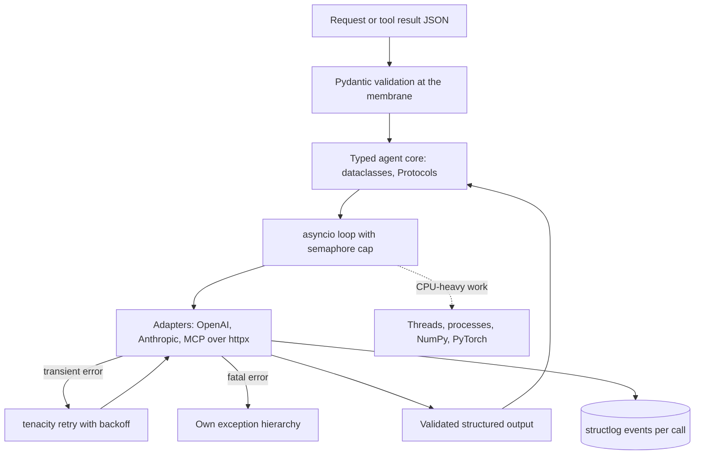

## Overview
This module covers the Python you need to build AI agents and services that hold up once they leave
the notebook. An agent is mostly Python plumbing around model calls: typed state, validated tool
arguments, concurrent I/O, retries, logs and tests. This module teaches that plumbing.

It starts with the language itself, then the project around the code, then concurrency, because AI
services mostly wait. Next comes the integration layer that talks to models and tools, then testing,
then the data and model stack. Profiling and security scanning close the module.

- **Language:** the object model and mutability explain the aliasing bugs that leak state between requests. Type hints, `TypedDict`, `Literal`, Protocols and generics give names to the shapes moving through your code. Dataclasses handle trusted internal records and Pydantic validates untrusted JSON.
- **Idioms:** exceptions, generators, decorators and context managers are the idioms every later library depends on.
- **Project:** uv, lockfiles, a `src/` layout, configuration from `.env` files and pydantic-settings, and Ruff and mypy as gates.
- **Concurrency:** async/await and asyncio, cancellation, locks and semaphores, the GIL, and how to choose between asyncio, threads and processes.
- **Integration:** httpx, tenacity, structured logging, dependency injection, the OpenAI and Anthropic SDKs, tiktoken, LiteLLM, Instructor and the MCP SDK.
- **Testing:** from pytest and test doubles up to property-based, contract and integration tests.
- **Data and models:** Jupyter, NumPy, pandas, pyarrow, Polars, scikit-learn, PyTorch, Hugging Face, safetensors, sentence-transformers and Outlines.

Which lessons matter most for agents:

- **Core (you use them directly in an agent):** the language and idiom lessons, json-jsonl, python-dotenv, pydantic-settings, every concurrency lesson except gil, the whole integration layer, sentence-transformers, pytest, test-doubles-mocks-fixtures, pytest-asyncio and integration-and-end-to-end-testing.
- **Useful (you meet them when packaging, fine-tuning, serving or operating agents):** uv-poetry-pip, lockfiles, package structure, Ruff, mypy, gil, property-based and contract testing, the data stack, PyTorch, Hugging Face, safetensors, Outlines, profiling and security scanning.
- **Background:** none; every lesson here is code an agent team writes or runs.

Afterwards you can:

- Write a typed, tested, reproducible Python agent service or pipeline that calls models and tools concurrently and safely.
- Expose your own functions as MCP tools and get validated, structured decisions back from models.
- Handle agent data, traces and eval results efficiently, and fail in ways you can diagnose.

The module matters most for Engineers, who write this code every day. FDEs rely on it too, because
they have to make the same code install, configure and run inside a customer's environment.

## Why it matters
- **Engineer:** You write the agent loops, SDK wrappers, async fan-outs over tool calls, Pydantic schemas, data pipelines and test suites. A mutable default shared across tenants, a blocking call on the event loop, a swallowed `CancelledError` or retries on a non-retryable error are all agent bugs that end up in your code.
- **Architect:** You decide where the agent's trust boundaries are and which ones get Pydantic validation, which vendor SDKs sit behind small Protocols, how the import graph is layered and what concurrency model each workload uses. Those choices decide whether the provider can be swapped, whether the agent core runs in tests without credentials, and where the system's throughput limit sits.
- **FDE:** Customer environments have proxies, pinned Python versions, air-gapped package mirrors, their own secrets stores and their own models. You are the one who gets a locked, audited environment to install, injects agent settings without code changes, points the SDK at their gateway through httpx, and profiles the job that runs out of memory on their hardware.

## Mental model
Think of an AI program, and an agent above all, as a typed core surrounded by a membrane of
boundaries, running on an event loop, with a data plane next to it.

| Part | What lives there | Rule | Lessons |
|---|---|---|---|
| Typed core | Frozen dataclasses, Protocols, pure functions, the agent's decision logic | Testable without a network, a key or a GPU | object model, type hints, dataclasses, protocols |
| Membrane | Pydantic validation of every JSON payload, model output, tool argument and setting; adapters around OpenAI, Anthropic, MCP and httpx clients | Adapters translate vendor failures into your own exception hierarchy; tenacity retries only what is safe to repeat | pydantic, pydantic-settings, exceptions, httpx, tenacity, SDK lessons, instructor, mcp-python-sdk |
| Event loop | The I/O: model calls, tool calls, streams | May wait as often as it likes but must never block; cancellation, semaphores and context managers keep resources bounded and released | async-await, asyncio, cancellation, race conditions |
| Off-loop work | CPU-heavy work | Leaves the loop for threads, processes or vectorised libraries | gil, asyncio-vs-threads-vs-multiprocessing |
| Data plane | Tables and tensors through NumPy, Arrow, Parquet, Polars and PyTorch | No row-by-row Python | data and model lessons |
| Tooling | Lockfiles, type checkers, Ruff, tests, logs, profiles | Lockfiles fix the environment, checkers and Ruff fix the shapes, tests pin each layer, logs and profiles show what actually happened | project, testing, logging, profiling lessons |

The diagram shows one agent step crossing these parts: a request enters through validation, the core
decides, the loop runs bounded calls through adapters, and every crossing is validated and logged.

## Suggested order
1. object-model-and-mutability — agent core: names, aliasing and mutation underlie every later bug about shared state, defaults and caches.
2. type-hints — agent core: the annotation syntax that checkers, dataclasses, Pydantic and FastAPI all read.
3. typeddict-literal-enum — agent core: types the wire-format dicts and closed vocabularies (roles, finish reasons) that SDKs pass around.
4. protocols-generics-structural-typing — agent core: lets the consumer define small interfaces for LLM clients, embedders and stores without inheritance.
5. dataclasses — agent core: the default record type for trusted internal values, built on the hints just learned.
6. pydantic — agent core: adds runtime validation and JSON Schema for the untrusted data that dataclasses deliberately do not check.
7. exceptions-and-custom-exception-hierarchies — agent core: organises failures by handling policy before any remote call is written.
8. generators — agent core: lazy pipelines and token streams, which context managers and streaming SDKs build on.
9. decorators — agent core: the mechanism behind retries, tracing, tool registration and routes in later lessons.
10. context-managers-resource-cleanup — agent core: guaranteed release of clients, streams, sessions and locks, the base for `async with`.
11. json-jsonl — agent core: the formats of API payloads, eval sets and fine-tuning data, validated with Pydantic line by line.
12. python-dotenv — agent core: local configuration through environment variables, and where its limits are.
13. pydantic-settings — agent core: typed, validated configuration that fails at startup instead of mid-request.
14. async-await — agent core: coroutines and the never-block rule, the base for every async lesson that follows.
15. asyncio — agent core: the event loop, tasks, gather and queues that run concurrent model and tool calls.
16. async-cancellation-and-exception-propagation — agent core: how timeouts, TaskGroups and disconnects actually stop work and release resources.
17. race-conditions-and-synchronization-primitives — agent core: locks for check-then-act and semaphores to cap concurrent provider calls.
18. gil — useful, but a prerequisite here: explains why threads do not speed up pure-Python CPU work, which the next lesson relies on.
19. asyncio-vs-threads-vs-multiprocessing — agent core: picks the concurrency model by what the work waits on.
20. httpx — agent core: the async HTTP client under the provider SDKs, whose timeouts and pools become your SDK's behaviour.
21. tenacity — agent core: declarative retries with backoff and error classification for those remote calls.
22. logging-structlog — agent core: structured events with request, model and token fields, so retries and calls can be queried.
23. dependency-injection-and-interface-boundaries — agent core: wraps slow, paid dependencies behind Protocols before the SDK lessons start.
24. openai-sdk — agent core: the de facto request shape, used directly and through `base_url` for compatible servers.
25. anthropic-sdk — agent core: content blocks, tool-result turns and prompt caching, which differ from OpenAI's shape.
26. tiktoken — agent core: local token counting for context budgets, chunking and cost estimates on those calls.
27. litellm — agent core: one interface across providers, once you know what it translates and what it hides.
28. instructor — agent core: validated Pydantic objects from hosted models with re-prompting when validation fails.
29. mcp-python-sdk — agent core: exposes typed Python functions as tools to any MCP host, combining decorators, Pydantic and asyncio.
30. sentence-transformers — agent core: embeddings and cross-encoder reranking from open encoders for the agent's retrieval and memory tools; its high-level API works before the PyTorch details.
31. pytest — agent core: fixtures, parametrization and assertions as the base of every test lesson.
32. test-doubles-mocks-fixtures — agent core: fakes and stubs for model APIs and clocks, enabled by the interface boundaries.
33. pytest-asyncio — agent core: tests concurrency caps, timeouts and cancellation on a managed event loop.
34. integration-and-end-to-end-testing — agent core: checks the assumptions behind the doubles against real databases and HTTP stacks.
35. uv-poetry-pip — useful: sets up projects and environments as the code grows dependencies.
36. lockfiles-and-dependency-pinning — useful: makes that environment reproducible across laptops, CI and containers.
37. package-structure-and-import-design — useful: a src layout and one-way imports turn the code into a testable, layered package.
38. ruff — useful: a fast lint and format gate from the first commit, including async and security rules.
39. mypy — useful: makes the type hints enforceable in CI, now that the code has real types to check.
40. property-based-testing — useful: Hypothesis finds the edge cases in chunkers, parsers and serialisers.
41. contract-testing — useful: keeps doubles and services in agreement on interfaces without full environments.
42. jupyter — useful: the exploration environment for the data lessons, and its reproducibility pitfalls.
43. numpy — useful: arrays, shapes, dtypes and broadcasting, which every later data and model library builds on.
44. pandas — useful: labelled tables for eval results and logs that fit in memory.
45. pyarrow — useful: the columnar format and Parquet I/O shared by pandas, Polars, DuckDB and datasets.
46. polars — useful: lazy, multi-core DataFrames on Arrow for gigabyte-scale or scheduled pipelines.
47. scikit-learn-basics — useful: baselines, pipelines and honest metrics that any LLM solution must beat.
48. pytorch — useful: tensors, autograd and devices, the base of the open-model stack.
49. hugging-face — useful: loading, tokenising, fine-tuning and evaluating open models on top of PyTorch.
50. safetensors — useful: the safe weight format those models should be stored and exchanged in.
51. outlines — useful: constrained decoding for self-hosted models, contrasted with Instructor's retry approach.
52. memory-and-performance-profiling — useful: measures CPU, wall time and native memory across everything built so far.
53. security-scanning-and-dependency-auditing — useful: pip-audit and Bandit on the locked environment and code as the final CI gate.

## Capstone
### Brief
**Use case:** a support team wants an agent component that triages tens of thousands of support
tickets exported as JSONL into categories, urgency levels and extracted fields. It must also be
callable as a tool by their agents, and they want proof that it beats a cheap baseline. This is the
module's major project and takes several days.

Build it as an installable Python package with a `src/` layout, managed and locked with uv.

- **Input:** validate every ticket line with Pydantic and report rejected lines by line number.
- **Configuration:** provider, model, concurrency and budget come from pydantic-settings, with a committed `.env.example`.
- **Core:** the classifier depends on a small `LLMClient` Protocol. Implement it twice, with the OpenAI SDK and the Anthropic SDK, each built on a shared httpx client with explicit timeouts. Get typed outputs through Instructor, or through native structured output.
- **Runtime:** run calls concurrently on asyncio with a semaphore cap, tenacity retries that apply only to transient errors, a custom exception hierarchy, and a per-run token budget estimated with tiktoken. Cancelling the run must release every connection.
- **Observability:** log one structlog event per call with model, tokens, latency and retry count.
- **Tool surface:** expose single-ticket triage as an MCP tool with the MCP Python SDK, so an agent host can call it.
- **Baseline:** embed tickets with sentence-transformers and train a scikit-learn classifier. Write results to Parquet and compare both approaches with Polars.

Ship it with tests and CI that a reviewer can run.

### Deliverables
- A repository with `pyproject.toml`, `uv.lock`, a `src/` package and a CLI entry point that runs the full pipeline from a JSONL file to a Parquet results file.
- Two provider adapters behind one Protocol, a Pydantic output schema, an exception hierarchy separating retryable, input-too-large and fatal errors, and a settings class that rejects invalid configuration at startup.
- An MCP server exposing a `triage_ticket` tool whose arguments and result are the same Pydantic schemas, and which returns a model-readable error for invalid input.
- A test suite with a fake LLM client, pytest-asyncio tests for the concurrency cap, timeout and cancellation, Hypothesis properties for the JSONL parser and token-based chunker, and one integration test against a local fake HTTP server.
- A CI workflow running `uv sync --locked`, Ruff, mypy in strict mode on the package, pytest, pip-audit and Bandit.
- A short report, as a notebook that passes Restart and Run All plus a Markdown summary, comparing LLM and embedding-baseline accuracy, macro F1, cost and wall time on a held-out labelled set, with a profile of the slowest stage.

### Rubric
- Running the test suite with network access disabled and no API keys passes, and switching providers is a one-line settings change with no edits to the core.
- With concurrency set to 8, logs never show more than 8 calls in flight, a 429 is retried with backoff, and an invalid-key error fails once without any retry.
- Pressing Ctrl+C mid-run exits within two seconds, leaves no open connections or half-written output file, and logs how many tickets were completed.
- A malformed JSONL line is reported with its line number and skipped, and mypy strict and Ruff report zero errors without blanket `type: ignore` or `noqa` comments.
- An MCP host lists the `triage_ticket` tool with its schema, a valid call returns a validated result, and an invalid call returns an error message instead of crashing the server.
- A fresh clone on another machine reproduces the same environment from the lockfile, and pip-audit reports no unaddressed known vulnerabilities.
- The report states whether the LLM beats the scikit-learn baseline on macro F1 and cost per thousand tickets, using the same held-out split for both.
