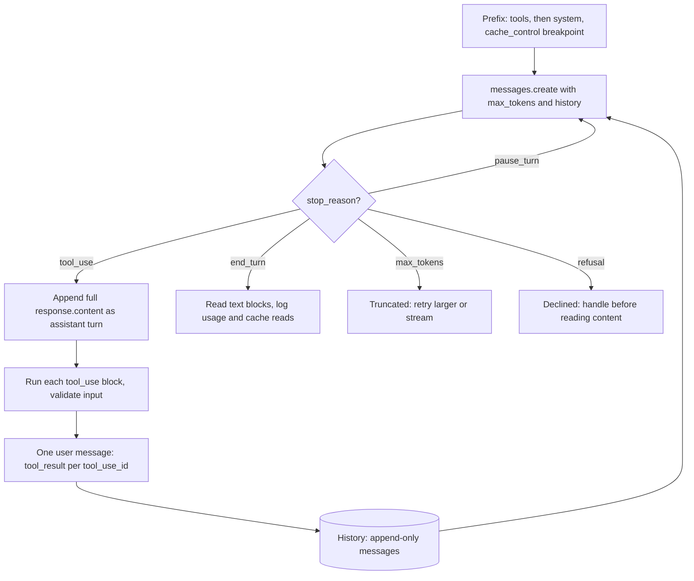

## TL;DR
The `anthropic` package is the typed client for building Claude agents on the Messages API: typed content
blocks, top-level `system`, required `max_tokens`, tool results as user blocks, and explicit
`cache_control`. Its tool loop and caching rules decide agent correctness and cost.

## For agent builders
- **Why it matters for agents.** A Claude agent is a loop driven by `stop_reason`: on `tool_use`, echo
  every block back, run the tools, return all results in one user message, repeat. Most broken Claude
  agents break one of those rules, and most expensive ones miss the prompt cache.
- **Where it shows up in your stack.** Directly in hand-written agents, under LangChain's `ChatAnthropic`
  (the `langchain-anthropic` package) and so LangGraph nodes, under Anthropic's Claude Agent SDK, inside
  LiteLLM for Claude models, and on Bedrock, Vertex AI or Microsoft Foundry through this SDK's platform
  clients.
- **What you control.** Prompt layout for caching (tools, then system, then messages), `max_tokens`,
  `tool_choice` and `strict` tools, append-only history, streaming, batches for evals, and per-path
  timeouts and retries.
- **What you can skip.** Raw SSE parsing and hand-merging stream deltas; the streaming helper and
  `get_final_message()` do it. Learn the content-block shapes before trusting a wrapper to translate them.

## Why it exists
- **The usual transport problems.** Authentication, retries on 429 and 5xx, timeouts and server-sent-event
  streaming, as with any LLM API.
- **Responses are mixed lists.** One response can hold reasoning blocks, text and one or more tool calls.
  Agent loops must echo assistant content back faithfully, including blocks your code does not display,
  because the API expects history to contain them.
- **Caching is exacting.** Prompt caching pays off only if the cached prefix is byte-identical across
  requests and the breakpoints sit in the right places.
- **Naive clients lose data.** Hand-rolled HTTP clients treat the response as one string, silently
  dropping tool calls, losing reasoning blocks needed for the next turn, or mis-concatenating stream
  deltas. Generic multi-provider wrappers often lag or flatten provider features such as cache
  breakpoints, citations, batches or extended reasoning controls.
- **The SDK makes the real shape the easy path.** Typed parameters, content-block classes you branch on
  with `.type`, streaming helpers that assemble the final message, an exception hierarchy separating
  retryable from fatal failures, and helpers for token counting, batches and the tool loop. Client classes
  for Amazon Bedrock, Google Vertex AI and Microsoft Foundry keep calling code the same (feature
  availability still differs per platform).

## How it works
### Client
- **Credentials from the environment.** `anthropic.Anthropic()` typically reads `ANTHROPIC_API_KEY`;
  `AsyncAnthropic` is the asyncio twin. Create it once per process, like any pooled HTTP client.
- **Defaults.** Timeout ten minutes; `max_retries` 2, covering connection errors, 408, 409, 429 and 5xx
  with exponential backoff. Set them on the client or per call via `client.with_options(...)`.
- **Timeouts are retried too**, so worst-case wall-clock time is the timeout times the number of attempts.

### The Messages call
`client.messages.create(model=..., max_tokens=..., system=..., messages=[...])`

| Design choice | Because |
|---|---|
| **`system` is top-level**, not a message | it is operator configuration rather than a turn, and separating it makes a stable, cacheable prefix |
| **`max_tokens` is required** | every call gets an explicit output ceiling; hitting it ends with `stop_reason == "max_tokens"`, which code must treat as truncation |
| **`messages` alternates user and assistant turns** | consecutive same-role turns are merged; each `content` is a string or a list of blocks (text, image, document, tool_result) |

### Content blocks
`response.content` is a list; branch on `block.type`:
- **`"text"`** — the answer.
- **`"thinking"`** — reasoning; opt-in on older models, on by default on recent ones. Its visible text
  may be summarised or empty depending on the display setting.
- **`"tool_use"`** — with `id`, `name`, and `input` already parsed as a dict.

### Stop reasons
| `stop_reason` | Do next |
|---|---|
| `end_turn` | done |
| `tool_use` | run tools and continue |
| `max_tokens` | truncated |
| `stop_sequence` | a stop sequence matched |
| `pause_turn` | a long server-side tool turn to resume |
| `refusal` | declined; check it before reading content |

### Thinking signatures and append-only history
- **Echo thinking blocks unchanged** on the next turn with the same model. They carry a cryptographic
  `signature` the server verifies and uses to continue reasoning across tool calls.
- **Treat history as append-only.** Rewriting or trimming earlier assistant turns can invalidate their
  thinking.
- **Enforcement varies** by model and account on recent models; check the current docs before building a
  harness that edits history.

### Tool loop
1. **Declare tools** as `name`, `description`, `input_schema` (JSON Schema).
2. **On `tool_use`**, append the assistant's full `response.content` as an assistant message.
3. **Run each requested tool.**
4. **Reply with one user message** containing a `tool_result` block per call, each with the matching
   `tool_use_id`. Set `is_error: True` for failures rather than dropping them.

- **All results for one turn in one message**; splitting them breaks the parallel-call pattern.
- **Beta tool runner.** The SDK's beta tool runner can drive this loop for decorated Python functions.
- **`tool_choice`** controls whether the model may or must call tools (`auto`, `none`, and on some models
  forced `any` or a named tool).
- **Portable well-formed calls.** Forcing is not supported on every current model, so use `auto` plus a
  clear instruction, with `strict: true` on the tool so `input` always validates against `input_schema`
  (strict mode needs the schema to list `required` fields and set `additionalProperties: false`).
- **Your guards still apply.** Schema-valid input is not permission: cap iterations, set a task
  deadline, allow-list tool names, and check what each call may touch before running it.

### Structured output
- **Schema-constrained JSON.** `output_config={"format": ...}` with a JSON Schema constrains the response.
- **Pydantic helper.** `client.messages.parse(...)` accepts a Pydantic model and returns the validated
  object, replacing the old trick of a fake tool just to get structured arguments.
- **Still check `stop_reason`:** a refusal or `max_tokens` cut-off means no complete object to parse.

### Prompt caching
- **Mark a breakpoint** with `cache_control={"type": "ephemeral"}` on a block, or use top-level automatic
  caching.
- **Prefix in render order:** tools, then system, then messages, up to the breakpoint.
- **Byte-identical prefixes** read it later at a large discount and lower latency.
- **Verify** with `usage`: `cache_creation_input_tokens` and `cache_read_input_tokens`.
- **Any earlier change invalidates everything after** it: a timestamp in the system prompt, reordered
  tools.

### Streaming, counting, batches
- **Streaming helper.** `with client.messages.stream(...) as s:` yields events and `s.text_stream`;
  `s.get_final_message()` returns the assembled message, so you never hand-merge deltas.
- **Stream long outputs.** Recommended for long outputs and large `max_tokens`, where a non-streaming
  request can hit HTTP timeouts. The Python SDK refuses a non-streaming request whose `max_tokens` implies
  an expected duration beyond its timeout and tells you to stream instead.
- **Exact counts.** `client.messages.count_tokens(...)` returns the exact input token count, the right
  tool for Claude because local OpenAI tokenizers do not match.
- **Batches.** `client.messages.batches` submits many requests for asynchronous processing at a discount,
  results keyed by your `custom_id`.

## Diagram
The agent loop is driven by `stop_reason`: on a tool call, echo every content block back, then answer
all calls in one user message; the cached prefix (tools, then system) stays fixed across iterations.



## Examples
### Minimal tool-use loop with a cached system prompt
Model IDs change; take them from configuration.

```python
import os, anthropic

MODEL = os.environ.get("CLAUDE_MODEL", "claude-opus-5-5")
client = anthropic.Anthropic(max_retries=3)
SYSTEM = [{"type": "text", "text": "You are an order-support agent. Use tools for facts.",
           "cache_control": {"type": "ephemeral"}}]  # caches only above the model's minimum prefix length
TOOLS = [{"name": "get_order", "description": "Look up an order by id.",
          "input_schema": {"type": "object", "properties": {"order_id": {"type": "string"}},
                           "required": ["order_id"]}}]

def get_order(order_id: str) -> str:
    return f'{{"order_id": "{order_id}", "status": "shipped", "eta": "2 days"}}'

messages = [{"role": "user", "content": "Where is order A-1042?"}]
while True:
    resp = client.messages.create(model=MODEL, max_tokens=8192, system=SYSTEM,   # thinking counts too
                                  tools=TOOLS, messages=messages)
    print(resp._request_id, resp.usage.input_tokens, resp.usage.cache_read_input_tokens)
    if resp.stop_reason != "tool_use":
        break
    messages.append({"role": "assistant", "content": resp.content})   # echo every block back
    results = []
    for block in resp.content:
        if block.type == "tool_use":
            out = get_order(**block.input) if block.name == "get_order" else "unknown tool"
            results.append({"type": "tool_result", "tool_use_id": block.id, "content": out})
    messages.append({"role": "user", "content": results})               # all results, one message

if resp.stop_reason == "refusal" or resp.stop_reason == "max_tokens":
    print("did not finish normally:", resp.stop_reason)
print("".join(b.text for b in resp.content if b.type == "text"))
```

Trace of a typical run:

| Call | Returns | History after |
|---|---|---|
| 1 | `stop_reason="tool_use"`, content such as `[thinking, tool_use(id="toolu_…", name="get_order", input={"order_id": "A-1042"})]` | three messages: the user question, the assistant turn with every block intact, a user turn with one `tool_result` whose `tool_use_id` matches |
| 2 | resends all three; the model reads the result and returns `stop_reason="end_turn"` with a text block | done |

- **Input grows every iteration**, because each call re-reads the whole history; that is exactly the cost
  caching the stable prefix attacks.
- **This toy prompt likely will not cache.** Its tools and system prompt are probably shorter than the
  minimum cacheable prefix (model-dependent, from a few hundred to a few thousand tokens), so expect
  `cache_read_input_tokens` to stay at zero with no error. With a realistic multi-thousand-token system
  prompt and tool list it rises from the second call.
- **A production loop also** caps iterations, validates `block.input` before running a tool, and catches
  `anthropic.RateLimitError`, `anthropic.APIStatusError` and `anthropic.APIConnectionError` separately.

### Streaming a long answer and pricing it first
Reuses `client`, `MODEL` and `SYSTEM` from the loop above.

```python
msgs = [{"role": "user", "content": "Write a migration guide for our v2 API."}]

n = client.messages.count_tokens(model=MODEL, system=SYSTEM, messages=msgs).input_tokens
print("input tokens:", n)                                  # exact, before spending anything

with client.messages.stream(model=MODEL, max_tokens=64000, system=SYSTEM, messages=msgs) as s:
    for text in s.text_stream:                             # forward deltas to the user
        print(text, end="", flush=True)
    final = s.get_final_message()                          # assembled Message, no hand-merging
print("\n", final.stop_reason, final.usage.output_tokens)
```

### Worked scenario: what caching saves in an agent loop
A 6,000-token system prompt and tool list, resent on 10 consecutive calls within the cache lifetime.
Typical multipliers on the base input price: cache writes ~1.25× with the default 5-minute lifetime (2×
for the 1-hour option), cache reads ~0.1× (illustrative; the read multiplier is lower on some models, so
check current pricing).

| | Prefix cost in input-token equivalents |
|---|---|
| No caching: 10 × 6,000 | 60,000 |
| Call 1 writes: 1.25 × 6,000 | 7,500 |
| Calls 2-10 read: 9 × 0.1 × 6,000 | 5,400 |
| **With caching** | **12,900, about 78% less** |

If a timestamp sits at the top of the system prompt, every call is a write and the saving goes negative.

### Worked scenario: a 15-step coding agent with and without a warm prefix
Illustrative: 8,000 tokens of tools and system prompt, each step appends ~1,500 tokens of tool call and
result, same multipliers as above, all steps inside the cache lifetime. History is not cached here, only
the prefix.

| Step | Prefix cost, no caching | Prefix cost, cached |
|---|---|---|
| 1 | 8,000 | 10,000 (write at 1.25×) |
| 2-15 (14 steps) | 14 × 8,000 = 112,000 | 14 × 800 = 11,200 (reads at 0.1×) |
| **Total prefix** | **120,000** | **21,200** |

- **The history still grows** by ~1,500 tokens a step; a second breakpoint on the latest turn lets
  earlier history be read from cache on the next step too, if the history is append-only.
- **Editing earlier turns** (trimming tool results mid-run) moves the cache miss to that point, so
  compact rarely and in one step.

## Production patterns
- **Trace every agent step.** Log `resp._request_id`, `stop_reason`, tool names, `usage` including cache
  fields, and latency per call, to a tracer such as LangSmith, Langfuse or OpenTelemetry. Replaying one
  bad trajectory beats reading aggregate metrics.
- **Lay out prompts for the cache.** Put tools and a frozen system prompt first with one `cache_control`
  breakpoint after them, and volatile data (dates, user names, retrieved text) after it. Alert when
  `cache_read_input_tokens` / input tokens drops on a route that should be warm.
- **Stream anything long.** Use `client.messages.stream(...)` with `get_final_message()` for large
  `max_tokens`, instead of non-streaming calls that hit HTTP timeouts. Monitor time to first token and
  `stop_reason == "max_tokens"` rate.
- **Batch offline work.** Send evals and backfills through `client.messages.batches` at a discount, poll
  until `processing_status` is `"ended"`, and join results on `custom_id` because order is arbitrary.
  Track errored and expired counts per batch.
- **Count before you send.** Use `client.messages.count_tokens(...)` for admission control and cost
  estimates on long documents, not tiktoken. Log estimate vs `usage.input_tokens`.
- **Guard the tool loop.** Cap iterations, set `strict: true` on tools, validate `block.input`, and return
  failures as `tool_result` with `is_error: True`. Monitor loop iterations per task and tool error rate.
- **Budget timeouts per path.** Derive `client.with_options(timeout=..., max_retries=...)` variants: short
  and few retries for interactive calls, generous for background jobs. Alert on `RateLimitError` and
  `APIConnectionError` separately.

## Trade-offs
- **Full fidelity vs portability.** The native SDK exposes Claude-specific features fully (cache
  breakpoints, content blocks, batches, reasoning controls), but the code is not portable; a router helps
  once several providers are genuinely in production.
- **Explicit breakpoints vs automatic caching.** Explicit placement gives precise control over what is
  cached and what it costs but requires disciplined prompt layout; automatic caching is simpler when you
  do not need per-block placement.
- **Batch discount vs latency.** Batches cut cost substantially for offline work, but results arrive
  asynchronously and in any order, so they suit evals and backfills, not interactive requests.
- **Free retries vs worst-case latency.** Built-in retries absorb transient failures cheaply, but on long
  timeouts they multiply worst-case latency; interactive paths should set short timeouts and few retries.

## Pitfalls
- **Reading `response.content[0].text` blindly.** When the first block is thinking or a tool call, you get
  an attribute error or an empty answer, and tool calls are silently ignored.
- **Appending only the text of an assistant turn instead of `response.content`.** The next request fails
  validation because `tool_result` blocks reference `tool_use` ids no longer in history.
- **A timestamp or request ID at the top of the system prompt.** `cache_read_input_tokens` stays at zero
  on every call and costs never drop.
- **A small `max_tokens` without checking `stop_reason`.** Answers or JSON are cut off mid-way. Symptom:
  parse errors that look like model mistakes.
- **Budgeting Claude prompts with tiktoken.** Counts differ and requests near the context limit fail; use
  `count_tokens` instead.

## When to use
- **Use when** Claude is a primary model and you want its features at full fidelity: tool-using agents,
  long cached system prompts or documents, citations, batch evaluation, or reasoning controls.
- **Wrap it** behind your own narrow interface so tests can fake it.
- **Use the Bedrock or Vertex client classes** when the customer's contract or data residency requires
  those platforms, keeping the same calling code.
- **Choose LiteLLM or a gateway only when** multi-provider routing is a real requirement, and check that
  the features you depend on survive the translation.
- **Measure** cache read ratio, stop-reason distribution, tool-loop iterations per task and error rates
  by class.
- **Interviews:** walk through the tool loop and explain why a cache hit rate is zero.

## Role lens
- **Engineer:** Implements the tool loop with correct block handling, streams long outputs, lays out
  prompts so caching hits, and logs request IDs and usage for every call.
- **Architect:** Decides provider abstraction boundaries, which platform (first-party, Bedrock, Vertex)
  each workload uses, and where batches replace synchronous calls to cut cost.
- **FDE:** Integrates Claude through the customer's cloud account on Bedrock or Vertex, and debugs
  auth, region and quota differences while keeping application code unchanged.

## Check yourself
**Q:** A team's Claude agent has a 6,000-token system prompt and tool list, and they enabled prompt
caching, yet `cache_read_input_tokens` is always zero. Walk through how you would diagnose it.
**A:** Caching is a prefix match over tools, then system, then messages, so anything that varies early in
that order breaks every hit. I would diff two consecutive request bodies byte for byte: typical culprits
are a timestamp or user name interpolated into the system prompt, tools built from an unordered set so
their order changes, or JSON serialised without sorted keys. I would check the breakpoint is placed after
the stable content and that the prefix exceeds the model's minimum cacheable length. I would confirm
requests arrive within the cache lifetime and use the same model, since caches are model-scoped. Then I
would move volatile data after the last breakpoint and watch the read counter rise.

## Interview questions
### How does the Messages API shape differ from OpenAI's Chat Completions, and why does it matter?
- **`system` is top-level**, not a message, because it is operator configuration and a stable, cacheable
  prefix.
- **`max_tokens` is required** and responses are typed content blocks (`text`, `thinking`, `tool_use`)
  rather than one string, so code must branch on `block.type`.
- **Tool results go back as user `tool_result` blocks** keyed by `tool_use_id`; porting OpenAI code
  without these changes is the source of most integration bugs.

### The second request in your tool loop fails validation. What went wrong?
- **Likely cause:** the code appended only the assistant's text instead of the full `response.content`, so
  the `tool_result` blocks reference `tool_use` ids no longer in history.
- **Other suspects:** results split across several user messages, a missing result for one of several
  parallel calls, or thinking blocks dropped or edited, since their `signature` is verified.
- **Fix:** treat history as append-only and return every result, including failures with `is_error: True`.

### Your Claude agent runs 30 steps per task and costs keep climbing per step. How do you design for it?
- **Cache the stable prefix:** tools and a frozen system prompt first with a `cache_control` breakpoint,
  volatile data after it; verify `cache_read_input_tokens` rises from step 2.
- **Keep history append-only** and compact at a boundary when it nears the window, accepting one cache
  miss rather than one per step; echo thinking blocks unchanged.
- **Cap the loop:** iteration limit, deadline and per-tool result size, and measure tokens and steps per
  task alongside task success.

### When would you not use the native Anthropic SDK?
- **When several providers are genuinely in production** and you need routing, fallbacks or central spend
  tracking, a router or gateway may fit better.
- **But check feature survival:** generic wrappers often lag or flatten cache breakpoints, citations,
  batches or reasoning controls.
- **For Bedrock or Vertex contracts** you usually still use this SDK's platform client classes, keeping
  calling code the same.

### How much does caching save on a 6,000-token prefix resent on 10 calls?
- **Without caching:** 10 × 6,000 = 60,000 input-token equivalents.
- **With caching, using illustrative multipliers:** one write at ~1.25× is 7,500, nine reads at ~0.1× are
  5,400, total 12,900, about 78% less; check current pricing per model.
- **It only works** if the prefix is byte-identical and above the model's minimum cacheable length;
  confirm with `cache_read_input_tokens`.

### A long generation fails with a timeout or the SDK refuses the request. What do you change?
- **Stream it:** the Python SDK refuses a non-streaming request whose `max_tokens` implies a duration
  beyond its timeout, and long non-streaming calls can hit HTTP timeouts.
- **Use the helper:** `client.messages.stream(...)` with `s.text_stream` for deltas and
  `get_final_message()` for the assembled message and usage.
- **Remember retries:** timeouts are retried, so worst-case wall clock is the timeout times attempts.

## Quiz
### Q: After a response with `stop_reason == "tool_use"`, what must the next request contain?
- [ ] Only the tool result text appended to the system prompt
- [ ] A new user message summarising the tool call
- [x] The assistant's full content blocks, then a user message with a `tool_result` block per `tool_use` id
- [ ] A request with `tool_choice` reset so the model cannot call tools again
> The API validates that each `tool_result` matches a `tool_use` in the preceding assistant turn. Echoing
> the full content and returning every result in one user message keeps history consistent.

### Q: Why might a correctly marked cache breakpoint still produce no cache reads?
- [ ] Because caching only works for streaming requests
- [x] Because something earlier in the prefix changes between requests, such as a timestamp in the system prompt
- [ ] Because cache reads are reported only in the billing dashboard
- [ ] Because caching requires the Batches API
> Caching matches the exact prefix up to the breakpoint. Any byte that varies before it, in tools or
> system, creates a new prefix, so every request writes a cache entry and none read one.

### Q: Why is `max_tokens` a required parameter, and what should code do with it?
- [ ] It sets the input context limit; code should truncate prompts to fit it
- [ ] It controls billing tier; higher values cost more per token
- [x] It caps output length explicitly; code must check for `stop_reason == "max_tokens"` as truncation
- [ ] It limits the number of tool calls per turn
> Requiring an output ceiling makes cost and latency bounds explicit. When the model hits it, the response
> is incomplete, so treating that stop reason as success produces cut-off answers and broken JSON.
