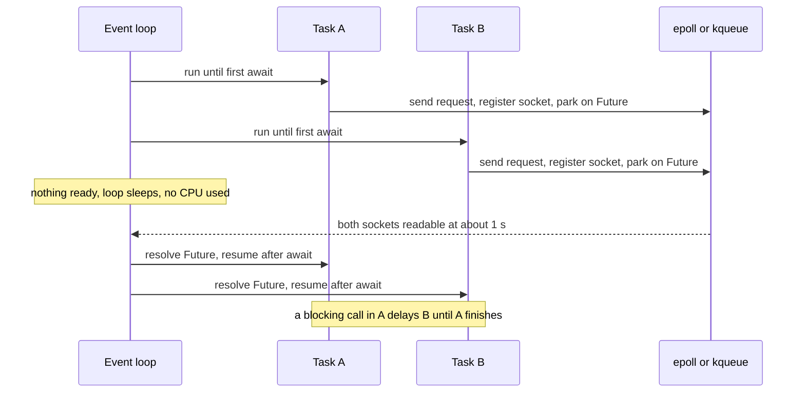

## TL;DR
`async def` defines a coroutine that pauses at `await` while waiting on I/O, letting an event loop run
other coroutines on one thread. AI work is mostly waiting on networks, so this beats a thread per call;
it does nothing for CPU-bound work.

## Why it exists
- **AI workloads are mostly waiting.** An LLM request takes on the order of seconds (illustrative; it
  varies with model and output length). One retrieval-augmented agent turn may issue an embedding call,
  several vector-store queries, a few tool calls and two or three model calls; a batch evaluation issues
  thousands of independent calls. Nearly all that time the CPU is idle on a socket.
- **Sequential code serializes the waits.** Twenty independent one-second calls take twenty seconds.
- **Threads work but scale badly for this shape.** `concurrent.futures` makes a thread per in-flight call
  easy, but each OS thread carries its own stack and kernel scheduling state, shared state needs locks,
  and the small CPU portions (JSON parsing, prompt assembly) contend on the GIL. A streaming response,
  with tokens arriving over seconds, pins a thread for its whole duration.
- **One thread, explicit pause points.** A coroutine awaiting a network response yields; the loop runs
  another; when the socket becomes readable the first resumes. Ten thousand waiting coroutines are ten
  thousand small Python objects, not ten thousand threads.
- **Cooperative *because* that is what makes it cheap:** no preemption, no kernel involvement, and no lock
  needed to protect state between two `await`s. The price is discipline: anything that blocks without
  awaiting freezes every other coroutine.

## How it works
### Coroutines and awaitables
- **Calling does not run.** Calling an `async def` function returns a coroutine object, a suspended
  computation.
- **`await coro` runs it** until it either finishes (the `await` expression evaluates to the return value)
  or hits an `await` on something not yet ready, at which point control returns to the event loop.
- **Built on generators.** `await x` is roughly `yield from x.__await__()`, and the coroutine's frame is
  kept alive between resumptions.
- **What you can await:** coroutines, `Task`s, `Future`s and any object implementing `__await__`.

### The event loop
1. **`asyncio.run(main())`** creates a loop and runs it to completion.
2. **The loop keeps a queue of ready callbacks** and asks the operating system's I/O multiplexer (epoll,
   kqueue, IOCP) which sockets are ready.
3. **A network read registers interest in a socket** and returns a `Future`.
4. **When the OS reports readiness,** the loop resolves the Future and reschedules the coroutine awaiting it.
5. **One callback runs at a time.** That is why there is no data race between two `await` points, and also
   why a long computation inside a coroutine blocks every other one.

### A trace: two calls on one thread
Tasks A and B each send a request and await a reply that takes 1 s.

| Time | Loop does | Why it matters |
|---|---|---|
| t=0 | Runs A until it awaits the socket read; A's frame is parked with a pending Future | Control returns to the loop |
| t=0 | Runs B the same way | Both requests are now in flight |
| 0 to 1 s | Nothing is ready, so it sleeps inside `epoll`/`kqueue` | No CPU used |
| t≈1 s | Both sockets readable: resolves both Futures, resumes A then B, each from the line after its `await` | Total ≈1 s, not 2 s |

- **At no moment did two pieces of Python run at once.** That is the safety property (no torn updates
  between awaits) and the hazard: had A computed for 1 s instead of awaiting, B would not even have
  *sent* its request until A finished.

### Function colouring
- **`await` is legal only inside `async def`,** so a function that needs to await must itself become
  async, and so must its callers, up to `asyncio.run` or a framework that owns the loop.
- **Why accept it:** you can see every place your code can be interleaved, *because* each one is spelled
  `await`.
- **Consequences:** an async SDK cannot be called from plain sync code without starting a loop, a sync
  helper cannot await, and libraries often ship both a sync and an async client (`OpenAI` and
  `AsyncOpenAI`, `httpx.Client` and `httpx.AsyncClient`) rather than one that works in both worlds.

### Concurrency: tasks, gather, groups
| Construct | Behaviour | Use when |
|---|---|---|
| `await a(); await b()` | Sequential: `b` starts after `a` finishes | Steps depend on each other |
| `asyncio.create_task(coro)` | Wraps it in a `Task` and schedules it immediately; await the task later | Overlap work you will collect later |
| `asyncio.gather(*coros)` | Runs a list concurrently and returns results in order; `return_exceptions=True` makes failures appear as values instead of raising the first | Partial results are valuable |
| `asyncio.TaskGroup` (3.11) | Structured: tasks started inside `async with` are all awaited at the block's end; if one fails the others are cancelled and failures are raised together as an `ExceptionGroup` | Fan-out where a partial result is useless |

### Limits and timeouts
- **Unbounded fan-out against a provider turns into a rate-limit storm.**
- **`asyncio.Semaphore(n)`** with `async with sem:` around the call caps in-flight requests at `n`, the
  knob that matches your provider's concurrency allowance.
- **It bounds concurrency, not rate.** Five slots with half-second calls still allow about ten requests per
  second, so a requests- or tokens-per-minute quota needs a token-bucket limiter alongside it.
- **`async with asyncio.timeout(seconds):`** (3.11; earlier, `asyncio.wait_for`) cancels the awaited work
  when the budget expires and raises `TimeoutError`, which is how you stop a hung stream from holding a
  slot forever.

### Async iteration and context managers
- **`async for chunk in stream:`** consumes an async generator or iterator, awaiting each item: the natural
  shape for token streaming, where each chunk arrives from the socket at its own time.
- **`async with client:`** runs `__aenter__`/`__aexit__`, which themselves await; this is how an
  `httpx.AsyncClient` or an SDK client opens and closes its connection pool.

### What blocks the loop
- **Calls that never await:** `time.sleep`, `requests.get`, a synchronous database driver, a synchronous
  SDK client, heavy `json.loads` on a huge payload, a CPU-bound embedding computation. The loop cannot
  switch away from any of them.
- **The symptom is global:** every request's latency rises together, and a "fast" endpoint becomes slow
  because a different endpoint blocked.
- **Fixes:** use async libraries, move blocking I/O to a thread with `await asyncio.to_thread(fn, ...)`,
  and move CPU work to a process pool.
- **Scope:** the GIL, threads versus processes and cancellation semantics each have their own lesson in
  this module; this one is about the syntax and the cooperative model they build on.

## Diagram
The two-call trace above as messages: both tasks park at `await`, the loop sleeps in the OS
multiplexer, and both resume when their sockets are readable, for about 1 s total instead of 2 s.



## Examples
### Capped fan-out, per-call timeout and a token stream
Twenty simulated model calls with a concurrency cap of five, a per-call timeout, references kept to every
task, and an async generator standing in for a token stream. `asyncio.sleep` plays the role of network
latency.

```python
import asyncio, random, time

MAX_INFLIGHT = 5
in_flight = peak = 0

async def llm_call(prompt: str, sem: asyncio.Semaphore) -> str:
    global in_flight, peak
    async with sem:                                    # at most MAX_INFLIGHT past this line
        in_flight += 1; peak = max(peak, in_flight)    # safe: no await between these two lines
        try:
            async with asyncio.timeout(2.0):           # per-call budget; raises TimeoutError
                await asyncio.sleep(random.uniform(0.2, 0.6))   # stands in for the network wait
            return f"answer to {prompt!r}"
        finally:
            in_flight -= 1

async def fan_out(prompts: list[str]) -> list[str | BaseException]:
    sem = asyncio.Semaphore(MAX_INFLIGHT)
    tasks = [asyncio.create_task(llm_call(p, sem)) for p in prompts]   # keep references
    return await asyncio.gather(*tasks, return_exceptions=True)

async def stream_tokens(text: str):
    for tok in text.split():
        await asyncio.sleep(0.02)                      # a real client awaits each chunk here
        yield tok

async def main() -> None:
    t0 = time.perf_counter()
    results = await fan_out([f"q{i}" for i in range(20)])
    print(f"{len(results)} results in {time.perf_counter() - t0:.2f}s, peak in-flight={peak}")
    # roughly: 20 results in ~1.7-1.9s, peak in-flight=5  (sequential ~8s)
    async for tok in stream_tokens("tokens arrive as the model produces them"):
        print(tok, end=" ", flush=True)
    print()

asyncio.run(main())
```

- **Break it on purpose:** replace `await asyncio.sleep(...)` with `time.sleep(...)` and the run takes the
  full sequential time with `peak in-flight=1`: the blocking call never yields, so no other coroutine can
  start.

### Worked numbers: the same 20 calls under different settings
Each call waits 0.2 to 0.6 s (mean 0.4 s), measured with the fan-out above. Times are random, so
expect run-to-run spread of a few tenths of a second.

| Setting | Wall time (approx.) | Peak in flight | Why |
|---|---|---|---|
| Semaphore of 1 (sequential) | ~7.5-8 s | 1 | 20 × 0.4 s of waits, one after another |
| Semaphore of 5 | ~1.7-2.2 s | 5 | Each slot serves about 4 calls: 20 × 0.4 / 5 = 1.6 s, plus waiting for the last slow call |
| No cap (all 20 at once) | ~0.6 s | 20 | Bounded by the slowest call, and by the provider's patience |
| Cap of 5 but `time.sleep` inside | ~7.5-8 s | 1 | The loop never regains control, so it degrades to sequential |

- **The last row is the production incident:** the code looks concurrent and the profile shows idle CPU.

### Check-then-act across an `await`: an overspent budget
No two coroutines run at once, yet state read before an `await` can be stale after it. Five tasks each
check a budget of 10 units before spending 4.

```python
import asyncio

budget = 10            # quota left, in arbitrary token units
COST = 4

async def model_call() -> None:
    await asyncio.sleep(0.1)          # stands in for the provider round trip

async def spend_racy() -> None:
    global budget
    if budget >= COST:                # every task passes the check...
        await model_call()            # ...because all of them suspend here first
        budget -= COST

async def spend_safe() -> None:
    global budget
    if budget < COST:                 # check and reserve with no await in between
        return
    budget -= COST
    try:
        await model_call()
    except Exception:
        budget += COST                # refund if the call failed
        raise

async def main() -> None:
    global budget
    await asyncio.gather(*(spend_racy() for _ in range(5)))
    print("racy:", budget)            # racy: -10  (20 units spent from a budget of 10)
    budget = 10
    await asyncio.gather(*(spend_safe() for _ in range(5)))
    print("safe:", budget)            # safe: 2    (only two calls admitted)

asyncio.run(main())
```

- **Overspend by roughly the concurrency factor:** 5 tasks spent 20 units of 10.
- **Reserve before awaiting,** or hold an `asyncio.Lock` across the check-and-act when the check itself
  must await (for example reading the budget from Redis).

## Production patterns
- **One shared async client per process.** Create a single `httpx.AsyncClient` or `AsyncOpenAI` at startup
  (for example in a FastAPI lifespan), reuse it for every request and close it with `async with` or
  `aclose()` on shutdown, so connections are pooled. Monitor connection-pool waits and open sockets.
- **Per-provider semaphore plus timeout.** Wrap every call in `async with sem:` sized to the provider's
  concurrency allowance and an `asyncio.timeout(...)` budget, with a token-bucket limiter on top for
  per-minute quotas. Monitor in-flight count, 429 rate and timeout rate per provider.
- **Find blocking calls with debug mode.** Run staging with `asyncio.run(main(), debug=True)` or
  `PYTHONASYNCIODEBUG=1`; the loop then logs callbacks slower than `loop.slow_callback_duration`
  (default 0.1 s). In production, export event-loop lag from a heartbeat task that sleeps a fixed interval
  and records how late it woke.
- **Offload, do not block.** Wrap unavoidable sync SDKs in `await asyncio.to_thread(...)` and send CPU work
  (tokenizing a corpus, local embeddings) to a `ProcessPoolExecutor` via `loop.run_in_executor`. Monitor
  executor queue depth; `to_thread` shares the loop's default thread pool.
- **Keep references to background tasks.** Add each `create_task` result to a module-level `set` and call
  `task.add_done_callback(tasks.discard)`, so the loop's weak reference is not the only one. Log
  exceptions from the done callback so failures are not silent.

## Trade-offs
- **Thousands of cheap waits vs one blocking call freezes all.** One thread handles thousands of
  concurrent waits cheaply, but a single blocking call freezes all of them; the model flips to threads or
  processes when you cannot avoid blocking libraries.
- **No preemption vs interleaving at `await`.** No data races between `await`s and no locks for simple
  state, yet any state touched across an `await` can be interleaved and needs the same care as threaded
  code.
- **Fan-out speed vs rate limits.** `gather` collapses wall-clock time, but without a semaphore it
  collapses into provider rate limits and retries that cost more than the sequential version.
- **End-to-end async vs one sync dependency.** Async SDKs and drivers are required end to end; a stack
  with one synchronous dependency in the request path gains little and complicates debugging, so
  sometimes a thread pool is the honest choice.
- **Structured concurrency vs partial results.** `TaskGroup` gives clean cancellation and error
  aggregation, but forces all-or-nothing semantics; when partial results are valuable, `gather` with
  `return_exceptions=True` fits better.

## Pitfalls
- **Calling a coroutine without `await`.** `client.chat(...)` instead of `await client.chat(...)`: nothing
  runs, and the only hint is a `RuntimeWarning: coroutine ... was never awaited`, emitted when the unused
  coroutine object is garbage-collected (often right away, sometimes much later).
- **A synchronous SDK client or `requests` inside an async endpoint.** Symptom: every endpoint's p99
  latency rising together under modest load. Fix: an async client or `to_thread`.
- **Discarding the result of `create_task`.** The loop holds only a weak reference, so the task can be
  garbage-collected mid-execution and silently disappear.
- **`gather` over thousands of provider calls with no semaphore.** Symptom: a burst of 429 responses
  followed by a retry storm that can end up slower than running sequentially.
- **Read, await, then write based on what you read.** `if budget > cost: await call(); budget -= cost`:
  every task passes the check before any of them subtracts, so a token budget or quota is overspent by
  roughly the concurrency factor. Hold an `asyncio.Lock` across the check-and-act, or reserve before
  awaiting.
- **Calling `asyncio.run()` from inside a running loop** (notebooks, some frameworks). It raises
  `RuntimeError`; `await` directly or use the framework's loop.
- **Catching `BaseException` or bare `except:` around awaits.** It swallows `CancelledError` and produces
  tasks that cannot be cancelled and shutdowns that hang.

## When to use
- **Use when** the work is I/O-bound and concurrent: fan-out model calls, parallel tool execution,
  streaming tokens to a client, serving many simultaneous chats from one process.
- **Avoid when** the work is CPU-bound (tokenization of large corpora, local embedding computation) or
  your critical dependencies are synchronous; use threads or processes there, or wrap the blocking parts
  in `to_thread`.
- **Measure** event-loop lag (how late scheduled callbacks run) and in-flight counts; a rising lag with low
  CPU points at a blocking call.
- **Day to day,** this is the shape of every FastAPI endpoint, agent loop and evaluation harness you will
  write.
- **Interviews:** be ready to explain what `await` actually does, why one `time.sleep` breaks everything,
  and how you bound concurrency against a rate limit.

## Role lens
- **Engineer:** Writes agent loops and eval harnesses with `create_task`, `gather`, semaphores and
  timeouts, and keeps every call in the request path on an async client.
- **Architect:** Decides which services run on the event loop versus thread or process pools, and
  sets concurrency caps and rate limiters per provider so fan-out stays inside negotiated quotas.
- **FDE:** Finds the one synchronous call (a legacy auth client, a sync database driver) stalling a
  customer's async service and moves it to `to_thread` or an async driver.

## Check yourself
**Q:** A FastAPI service with async endpoints handles 50 requests per second comfortably, but after
a developer adds a feature that calls a legacy sync HTTP client, latency on *every* endpoint rises
under load, with the CPU mostly idle. Explain the mechanism and how you would fix and verify it.
**A:** The sync client blocks the event-loop thread for the whole request round trip. During that
time no other coroutine can run, so every in-flight request, including unrelated endpoints, waits.
CPU stays idle because the thread is blocked on a socket, not computing. The fix is to make the
call non-blocking: switch to an async client such as `httpx.AsyncClient`, or wrap the legacy call
in `await asyncio.to_thread(...)` so it runs in a worker thread while the loop continues. Verify by
measuring event-loop lag or by load-testing one endpoint while the slow one is exercised; after the
fix the unrelated endpoint's latency should no longer move.

## Interview questions
### What actually happens when a coroutine executes `await`?
- **If the awaitable is ready,** execution simply continues with its result.
- **If not,** the coroutine suspends with its frame kept alive (the generator machinery under `await`),
  control returns to the event loop, and the loop runs other ready callbacks.
- **Resumption:** when the OS multiplexer reports the socket ready, the loop resolves the `Future` and
  resumes the coroutine on the line after its `await`.

### Why can asyncio handle thousands of concurrent LLM calls when a thread-per-call design struggles?
- **Cost per wait:** a waiting coroutine is a small Python object, while each OS thread carries its own
  stack and kernel scheduling state.
- **No locks between awaits:** only one callback runs at a time, so simple shared state needs no locking.
- **Streaming fits:** a stream that delivers tokens over seconds parks a coroutine, not a whole thread.

### An agent's token budget is sometimes overspent by about 5x when it fans out tool calls. What is the bug?
- **Check-then-act across an `await`:** every task reads the budget, suspends on the model call, and only
  then subtracts, so all of them pass the check first.
- **Overspend matches the concurrency factor,** which is the tell.
- **Fix:** reserve (subtract) before awaiting and refund on failure, or hold an `asyncio.Lock` across the
  whole check-and-act when the check itself awaits.

### When would you not use async, or prefer a thread pool?
- **CPU-bound work** such as tokenizing a large corpus or computing embeddings locally: it never yields,
  so it belongs in a process pool.
- **A stack whose key dependencies are synchronous:** one sync driver in the request path removes most of
  the benefit, and a thread pool is simpler and more honest.
- **Glue around one blocking call** can stay async if that call goes through `asyncio.to_thread`.

### You must call a provider with a limit of 20 concurrent requests and a per-minute token quota. How do you design the client?
- **`asyncio.Semaphore(20)`** around each call bounds in-flight requests.
- **A token-bucket limiter on top,** because a semaphore bounds concurrency, not rate: short calls can still
  exceed a per-minute quota.
- **`asyncio.timeout(...)` per call** so a hung stream releases its slot, plus retry with backoff only on
  transient errors; monitor in-flight count, 429 rate and event-loop lag.

## Quiz
### Q: What happens when a coroutine hits `await` on a network response that is not yet ready?
- [ ] The thread blocks until the response arrives
- [x] The coroutine suspends and the event loop runs other ready coroutines until the socket is readable
- [ ] A new thread is spawned to wait for the response
- [ ] The response is polled in a busy loop until it arrives
> `await` yields control to the loop, which uses the OS I/O multiplexer to learn when the socket is
> ready and then resumes the coroutine. No thread blocks and no busy-waiting occurs.

### Q: Why does a single `time.sleep(1)` inside one coroutine delay every other request in the process?
- [ ] `time.sleep` acquires the GIL exclusively
- [ ] asyncio runs each coroutine on its own thread and `time.sleep` joins them
- [x] The loop is cooperative and single-threaded; a call that never awaits never yields, so nothing else can run
- [ ] `time.sleep` cancels pending tasks
> Coroutines only switch at `await`. A blocking call holds the one thread the loop uses, so all
> scheduled work waits. `await asyncio.sleep(1)` yields instead and the problem disappears.

### Q: What is the purpose of wrapping each provider call in `async with asyncio.Semaphore(5)`?
- [ ] To make the calls run in parallel on five CPU cores
- [ ] To retry each call up to five times
- [x] To cap the number of in-flight calls at five so fan-out cannot flood the provider all at once
- [ ] To guarantee results are returned in order
> A semaphore bounds concurrency: the sixth call waits until one of the five completes. `gather`
> alone would start all calls at once and trigger 429 responses. Note it limits calls in flight, not
> requests per minute; a requests- or tokens-per-minute quota needs a rate limiter on top.
