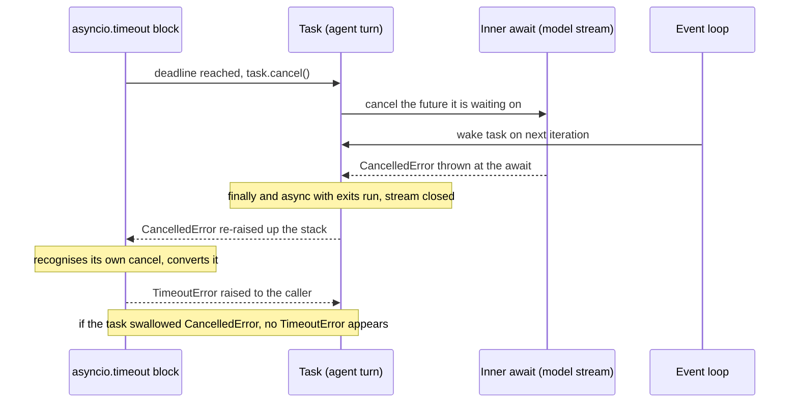

## TL;DR
Stopping an agent turn (user hit Stop, deadline passed, a tool failed) means cancelling tasks. asyncio
throws `CancelledError` at the next `await` so `finally` closes streams; `TaskGroup` and `asyncio.timeout`
depend on it, so swallowing it breaks deadlines and leaves tools running.

## For agent builders
- **Why it matters for agents.** An agent turn is a tree of concurrent awaits: a model stream, parallel
  tool calls, a retrieval query, maybe sub-agents. Cancellation is how that tree stops when the user
  leaves, a step budget runs out or one tool fails, without leaking tokens or half-done side effects.
- **Where it shows up in your stack.** Client disconnects on streaming FastAPI routes, per-tool and
  per-turn `asyncio.timeout`, `TaskGroup` around parallel tool calls, and the async run and stream methods
  of agent frameworks, which cancel your tool coroutines when the run is cancelled.
- **What you control.** Re-raising `CancelledError` in every tool, releasing resources in `finally` or
  `async with`, choosing fail-fast (`TaskGroup`) or best-effort (`gather(return_exceptions=True)`) per
  step, and shielding only short critical writes such as an audit record.
- **What you can skip.** The internals of `Task.uncancel()` bookkeeping and the pre-3.12 `wait_for`
  implementation. Know the contract, the TaskGroup versus gather table and how to test it.

## Why it exists
- **Concurrent work must stop cleanly.** An agent turn runs three tool calls and a retrieval query; then
  the user closes the tab, the 30-second deadline passes, or one tool returns a fatal error that makes the
  others pointless.
- **Stopping badly is expensive.** An LLM stream keeps generating (and, depending on the provider, keeps
  billing), a connection never returns to the pool, a checkpoint store gets a half-written row.
- **Killing from outside is unsafe.** Interrupting a thread or coroutine at an arbitrary instruction
  leaves locks held and sockets half-written, which is why Python offers no safe way to kill a thread.
- **A `stop` flag only works if every piece of code checks it**, and library code you call (provider SDKs,
  framework internals) never will.
- **Ignored background errors are worse.** A task that raised but was never awaited loses its exception
  until garbage collection logs "Task exception was never retrieved", long after the agent returned a
  wrong answer.

**asyncio's answer:** cooperative cancellation delivered as an exception. A coroutine can only be
suspended at an `await`, so that is the only place it can be interrupted; cancellation arrives at a known
point and travels up the stack through ordinary `try/finally` and `async with` cleanup. Structured
concurrency (`TaskGroup`) then supplies rules for siblings when one child fails.

## How it works
### Cancellation is a request, delivered at an await
`task.cancel()` does three things:
1. **Cancel what it waits on.** If the task is suspended on a future, it cancels *that* future. If it
   was awaiting another task (`await other_task`), the inner task is cancelled too, so the request
   travels **down** the await chain to whatever is actually waiting on I/O (the model stream, the tool's
   HTTP call).
2. **Wake the task.** Cancelling the future wakes the task on the next loop iteration, exactly as a
   result would.
3. **Throw.** On resume, `CancelledError` is thrown into the coroutine at the suspended `await`, and
   travels **up** the call stack.

What follows from that:
- **Running or ready tasks only get a flag;** the throw happens at the next suspension point.
- **Code between awaits runs to completion;** a CPU loop with no await cannot be cancelled at all.
- **Unwinding is ordinary:** `finally` blocks run, `async with` exits run (the `httpx` client closes the
  stream, the lock is released).
- **`BaseException` since Python 3.8.** `CancelledError` subclasses `BaseException`, not `Exception`,
  *because* the common `except Exception:` retry or logging block used to catch it by accident and keep
  the task alive.

**The contract:** catch `CancelledError` to clean up or log, but always re-raise it. A task that swallows
it reports as completed, and whoever cancelled it (a timeout, a TaskGroup, server shutdown) believes the
cancellation failed or never happened.

### Timeouts are cancellation plus translation
1. `asyncio.timeout(delay)` (3.11+) schedules a cancel of the current task at the deadline.
2. When that `CancelledError` reaches the `async with` exit, the context manager recognises it as its
   own and converts it into `TimeoutError`.

- **`asyncio.wait_for`** is built on `asyncio.timeout` since 3.12. Before that it ran the awaitable as a
  separate inner task and cancelled that task, with the same cancel-then-translate shape.
- **Hence the bug:** a swallowed cancellation inside a timeout block makes the deadline silently not fire,
  so an agent with a 30-second turn budget can run for minutes.
- **Telling cancellations apart.** Python 3.11 added `Task.cancelling()` and `Task.uncancel()` so these
  constructs can distinguish their own cancellation from one requested from outside.

### Where a task's exception goes
- **Stored, not raised.** An exception inside a task is stored on the task.
- **It surfaces only** when someone awaits the task (re-raised in the awaiter with its original
  traceback) or calls `task.result()` / `task.exception()`.
- **Otherwise it is lost for a while.** The loop logs "Task exception was never retrieved" when the task
  object is garbage-collected, which may be minutes later or never.
- **So every task needs an owner:** something that awaits it, a TaskGroup, or a done-callback that logs.
  A background memory write or trace upload without an owner fails invisibly.
- **`asyncio.wait` follows the same rule:** it never raises children's exceptions; it hands you `done`
  tasks whose results you must still check.

### Propagation: gather versus TaskGroup
| Construct | When a child (tool) fails | Other children | Error you see |
|---|---|---|---|
| `asyncio.gather(*aws)`, default `return_exceptions=False` | First exception propagates to the caller | Keep running, orphaned | The first exception |
| `gather(..., return_exceptions=True)` | Exceptions returned as list items | Keep running | None raised; inspect every result |
| Cancelling the gather itself | — | All cancelled | `CancelledError` |
| `asyncio.TaskGroup` (3.11+) | Group cancels remaining children (and the `async with` body if still running), waits for them to unwind | Cancelled, cleanup runs | `ExceptionGroup` of every child failure |

- **No child outlives the block** in a TaskGroup; that is structured concurrency, and it means no tool
  writes to a CRM after the turn already returned.
- **Cancelled children are not reported as failures**, *because* the group itself caused them.
- **Handle the group with `except*`**, which matches by type inside the group, *because* concurrent code
  can genuinely fail in several ways at once and a single exception would hide the others.

### Shielding
- **What it does.** `asyncio.shield(aw)` protects an inner awaitable from a cancellation aimed at the
  outer task.
- **Why it is needed.** Because of step 1 above, cancelling the outer task would otherwise cancel the
  inner one it awaits. `shield` inserts a separate future between them, so the outer `await` still raises
  `CancelledError` while the inner work continues.
- **Keep a reference to the inner task**, or it can be garbage-collected once nobody awaits it.
- **Use it narrowly**, for work that must complete even when the requester is gone, such as committing an
  audit record or a usage row for billing.

## Diagram
A turn deadline firing: the cancel request travels down to the model stream, `CancelledError` travels back
up through `finally`, and the timeout block converts it to `TimeoutError` only if nobody swallowed it.



## Examples
### Fail-fast parallel tool calls with a turn deadline
```python
import asyncio

async def call(name: str, delay: float, fail: bool = False) -> str:
    try:
        await asyncio.sleep(delay)            # stands in for an HTTP call
        if fail:
            raise ValueError(f"{name}: malformed tool output")
        return f"{name}: ok"
    except asyncio.CancelledError:
        print(f"{name}: cancelled, closing stream")
        raise                                 # re-raise, always
    finally:
        print(f"{name}: connection released")

async def agent_turn() -> None:
    try:
        async with asyncio.timeout(2.0):      # overall turn deadline
            async with asyncio.TaskGroup() as tg:
                tg.create_task(call("retriever", 0.5))
                tg.create_task(call("calculator", 0.2, fail=True))
                tg.create_task(call("llm", 5.0))
    except* ValueError as eg:
        for exc in eg.exceptions:
            print("tool failed:", exc)
    except* TimeoutError:
        print("turn deadline exceeded")

asyncio.run(agent_turn())
```

**Timeline as written:**
| Time | Event |
|---|---|
| 0 s | Three children start and suspend on their sleeps |
| 0.2 s | The calculator raises `ValueError` and releases its connection |
| just after | The TaskGroup cancels the retriever and the LLM call; each prints "cancelled" and "connection released" as `CancelledError` unwinds it |
| then | The group raises an `ExceptionGroup`, which `except* ValueError` handles |

**With `fail=False`:** the 2-second timeout fires instead. It cancels `agent_turn`, the group passes that
cancellation to its children, the LLM call unwinds, and the caller sees `TimeoutError`.

**If you delete the `raise` in the child:** this particular run would not break, because the timeout
belongs to `agent_turn`, not the child. But the cancelled child would then report success, and the same
swallow in the task that owns a timeout makes the block exit normally, so no `TimeoutError` is ever raised.

### Worked scenario: the Stop button that did not stop
A support agent streams its answer while two tools run. The user clicks Stop 2 seconds in. Figures are
illustrative.

| Implementation | What keeps running after Stop | Effect |
|---|---|---|
| `gather` and a tool that wraps its call in a bare `except:` returning `None` | The model stream finishes its remaining tokens; the swallowing tool completes its CRM write | Tokens billed for an answer nobody reads, and a side effect the user cancelled |
| `TaskGroup`, every tool re-raises, stream iterated inside `async with` | Nothing; each child unwinds through `finally` within one loop iteration of its next await | Connections back in the pool, no late writes |
| Same, plus the usage row written under `asyncio.shield` | Only the short usage write | Billing and audit stay correct |

The test below is how you prove the second row before shipping.

### Test that cancellation actually cleans up
A test that cancels mid-call and checks resources are back to idle catches swallowed cancellations
before production does. Runs on Python 3.8+.

```python
import asyncio

in_flight = 0

async def stream_llm(swallow: bool = False):
    global in_flight
    in_flight += 1
    try:
        await asyncio.sleep(10)          # stands in for a long LLM stream
    except asyncio.CancelledError:
        if not swallow:
            raise                        # correct: re-raise
        return "partial"                 # bug: swallows the cancellation
    finally:
        in_flight -= 1                   # runs on cancellation too

async def cancel_mid_call(swallow: bool) -> None:
    t = asyncio.create_task(stream_llm(swallow))
    await asyncio.sleep(0.1)             # let it start and suspend
    assert in_flight == 1
    t.cancel()
    try:
        await t
    except asyncio.CancelledError:
        pass
    print(f"swallow={swallow}: cancelled={t.cancelled()}, in_flight={in_flight}")

asyncio.run(cancel_mid_call(swallow=False))   # cancelled=True, in_flight=0
asyncio.run(cancel_mid_call(swallow=True))    # cancelled=False, in_flight=0
```
In both runs the `finally` releases the resource, but only the correct version reports
`cancelled=True`; the swallowing one looks like a normal return to whoever cancelled it. Assert on
`t.cancelled()` in tests of every tool wrapper.

## Production patterns
- **Nested deadline budget per agent run.** Give each run and each turn an outer `asyncio.timeout(...)`
  and each tool or model call a shorter inner one, so inner deadlines fire first with a specific error the
  agent can report to the model. Monitor timeout counts per layer; outer timeouts firing means an inner one
  is missing or too long.
- **Owner for every task.** Put parallel tool calls in a `TaskGroup`; for true background work (trace
  upload, memory consolidation), add a done-callback that logs `t.exception()` when `not t.cancelled()`.
  Alert on "Task exception was never retrieved" in logs.
- **Close the upstream stream on disconnect.** In a streaming agent endpoint, iterate the provider stream
  inside `async with` so cancellation closes it, and check `await request.is_disconnected()` (Starlette)
  in the loop. Monitor upstream tokens generated after client disconnect.
- **Bound cleanup awaits.** Inside `finally`, wrap slow cleanup (checkpoint flush, sandbox teardown) in its
  own `asyncio.timeout(...)` so a hung close cannot stall shutdown. Monitor shutdown duration against the
  process manager's kill timeout.
- **Shield only short, critical writes.** Create the audit or billing write as its own task, keep it in a
  set, and `await asyncio.shield(task)`. Monitor the number of shielded tasks in flight during incidents.

## Trade-offs
- **Fail-fast vs partial results.** TaskGroup stops wasted work and guarantees no orphans, but one flaky
  optional tool cancels the whole fan-out. When partial results are acceptable (the model can work with
  two of three tool results), catch errors inside each child and return them as tool messages.
- **Keep everything vs manual inspection.** `gather(return_exceptions=True)` keeps every result and never
  cancels siblings, at the cost of manual inspection. It is the better choice when children are
  independent and best-effort, such as an eval batch.
- **Safe cleanup vs reach.** Cooperative cancellation keeps cleanup safe and predictable, but cannot
  interrupt CPU-bound or blocking code. Such work must run in a thread or process, where cancellation only
  abandons the wait.
- **Guaranteed completion vs pile-up.** `shield` makes critical work finish, but that work outlives the
  request and can pile up during an incident. It is only safe when the shielded work is short and bounded.

## Pitfalls
- **Swallowing cancellation in a tool wrapper.** A bare `except:` or `except BaseException:` without
  re-raise (or `except Exception` on Python 3.7 and earlier). Symptom: timeouts that never fire and
  shutdowns that hang, when the swallow runs in the task that owns the deadline (an inline `await`, not a
  separate child task). Fix: re-raise.
- **Fire-and-forget `asyncio.create_task(...)`** without keeping a reference or awaiting it. Symptom:
  "Task exception was never retrieved" in logs and occasionally tasks garbage-collected mid-flight.
  Fix: keep tasks in a set with a done-callback that discards and logs them, or use a `TaskGroup`.
- **Assuming a `gather` failure stops the other tool calls.** Symptom: token spend and tool side effects
  continue after the agent already returned an error. Fix: `TaskGroup`.
- **Unbounded awaits in `finally` during cancellation.** A slow cleanup call can itself hang, so shutdown
  stalls until the process manager kills it. Fix: a timeout around cleanup.
- **Expecting cancel to stop a blocking `requests.get` or a tight loop.** Symptom: a task that stays
  "cancelling" until the blocking call returns on its own. Fix: use an async client, or run the call in
  `asyncio.to_thread` with its own timeout (for example `requests.get(url, timeout=10)`), because
  cancelling there only abandons the wait while the thread keeps running.

## When to use
- **You meet it whenever** an agent starts more than one task or has a deadline, which is almost always:
  per-request timeouts on model calls, client disconnects on streaming endpoints, parallel tool calls,
  step budgets, graceful shutdown.
- **Defaults:** `TaskGroup` for fan-out where all results matter, `asyncio.timeout` for deadlines,
  `gather(return_exceptions=True)` for best-effort batches.
- **Resources:** every tool coroutine that holds a resource releases it in `finally` or `async with`.
- **Test it:** cancel mid-call and assert the connection pool and locks are back to idle.
- **Interviews:** explain why `CancelledError` is a `BaseException` and how TaskGroup differs from gather
  when one child fails.

## Role lens
- **Engineer:** Writes children that re-raise `CancelledError`, wraps fan-out in `TaskGroup`, and
  tests that a client disconnect actually closes the upstream LLM stream.
- **Architect:** Sets the deadline budget across layers so inner timeouts are shorter than outer
  ones, and decides which side effects are shielded versus abandoned on cancel.
- **FDE:** Diagnoses a customer's hanging worker or runaway token bill by finding the swallowed
  cancellation or orphaned gather in their integration code.

## Check yourself
**Q:** An agent runs five tool calls with `asyncio.gather`. One raises; the endpoint returns 500, yet
logs show the other four tools finishing later and one writing to a CRM. Explain and fix.
**A:** `gather` without `return_exceptions` propagates the first exception to the caller but does not
cancel the remaining children, so they keep running as orphans and complete their side effects after
the response was sent. Switching to `asyncio.TaskGroup` cancels siblings when one fails and waits for
them to unwind before raising an `ExceptionGroup`, so nothing outlives the request. Each tool must
re-raise `CancelledError` and release resources in `finally`. Because cancellation only lands at an
await, a CRM write already sent cannot be undone, so consequential tools also need idempotency keys
or a compensating action.

## Interview questions
### How does task.cancel() actually stop a coroutine in asyncio?
- **It is a request, not a kill.** `task.cancel()` cancels the future the task is suspended on (and
  any task it awaits), then wakes it so `CancelledError` is thrown at that `await`.
- **It unwinds through ordinary cleanup.** `finally` blocks and `async with` exits run on the way up,
  so connections and locks are released.
- **Code between awaits runs to completion**, so a CPU loop with no await cannot be cancelled.

### An agent's 30-second turn timeout sometimes never fires. How do you debug it?
- **Suspect a swallowed cancellation.** `asyncio.timeout` works by cancelling the task and converting
  the `CancelledError` at block exit; a bare `except:` or `except BaseException:` without re-raise in a
  tool or retry wrapper leaves nothing to convert.
- **Grep for broad handlers** and retry wrappers in the call path, and add a test that cancels mid-call
  and asserts `t.cancelled()` is true.
- **Also check for blocking calls** such as `requests.get` in a tool, which keep the task cancelling until
  they return on their own.

### When would you choose gather with return_exceptions=True over a TaskGroup for tool calls?
- **Independent, best-effort children:** a batch of embedding calls or optional enrichment tools where
  one failure should not cancel the rest, and the model can reason over partial results.
- **The cost is manual inspection.** Exceptions come back as list items, siblings are never cancelled,
  and you must check every result yourself.
- **Choose TaskGroup** when every result matters or a failure makes the others pointless, because it
  cancels siblings and reports an `ExceptionGroup`.

### A user presses Stop on a streaming agent. What must happen, and how do you verify it?
- **The route's task is cancelled** when the client disconnects, and the cancellation must reach the
  provider stream and every running tool, so iterate the stream inside `async with` and run tools in a
  `TaskGroup`.
- **Every tool re-raises `CancelledError`** and releases its connection in `finally`; only a short usage
  or audit write runs under `asyncio.shield`.
- **Verify with metrics and tests:** upstream tokens generated after disconnect should be near zero, and a
  test that cancels mid-call should see `t.cancelled()` true and an idle pool.

### What does asyncio.shield protect, and what are the risks in production?
- **It protects inner work from outer cancellation.** The outer `await` still raises `CancelledError`,
  but the inner awaitable keeps running, which suits committing an audit or billing record.
- **Keep a reference** to the inner task, or it can be garbage-collected once nobody awaits it.
- **Shielded work outlives the request**, so during an incident it can pile up; keep it short and
  bounded and monitor how many shielded tasks are in flight.

### Why did Python 3.8 make CancelledError a BaseException, and what changed for retry code?
- **Accidental swallowing.** Retry and logging blocks written as `except Exception:` used to catch
  cancellation and keep the task alive, breaking timeouts and shutdown.
- **Now generic handlers let it pass**, but anything catching `BaseException` or using a bare `except:`
  must still re-raise it, and code on Python 3.7 and earlier keeps the old risk.

## Quiz
### Q: Why does `CancelledError` inherit from `BaseException` rather than `Exception` in modern Python?
- [ ] So that it cannot be caught by any handler at all
- [x] So generic `except Exception` blocks for retries and logging do not swallow cancellation by accident
- [ ] Because it is raised by the interpreter rather than by user code
- [ ] So that it propagates across threads as well as tasks
> Broad `except Exception` handlers are common in retry and logging code; when cancellation was an
> `Exception` they absorbed it and kept the task alive. It can still be caught explicitly, and must then be re-raised.

### Q: A child inside `asyncio.TaskGroup` raises `ValueError` while two siblings are awaiting network calls. What happens?
- [ ] The ValueError propagates immediately and the siblings continue in the background
- [ ] The siblings are killed instantly without running their finally blocks
- [x] The siblings are cancelled, the group waits for them to unwind, then raises an ExceptionGroup
- [ ] The group retries the failed child once before failing
> TaskGroup guarantees that no child outlives the block: it cancels the others, waits for their cleanup
> to run, and reports all failures together. The first option describes `gather`, not TaskGroup.

### Q: A coroutine running `async with asyncio.timeout(5):` catches `CancelledError` and returns `None`. What is the effect?
- [ ] The timeout raises TimeoutError as normal after cleanup
- [ ] The event loop logs a warning and re-raises automatically
- [ ] Nothing changes, because timeouts do not use cancellation
- [x] The block exits normally, so the expected TimeoutError is never raised and the deadline is silently lost
> `asyncio.timeout` works by cancelling the task and converting the arriving `CancelledError` into
> `TimeoutError` at block exit; swallowing the exception means there is nothing to convert.

## Use cases & projects
### Use cases
- **User presses Stop mid-turn.** Cancelling the turn's task closes the model stream and aborts the
  in-flight tool calls instead of letting them run on and bill.
- **Per-turn and per-tool deadlines.** `asyncio.timeout` around each tool and the whole turn keeps a slow
  search API from holding a session past its latency budget.
- **Fail-fast parallel tools.** A `TaskGroup` cancels the sibling tools as soon as one hits a fatal error,
  so the agent can re-plan without waiting on pointless work.
- **Client disconnects on streaming routes.** When the browser drops an SSE connection, cancellation
  unwinds the agent loop and releases its connections and sandboxes.
- **Audit writes that must land.** A short shielded write records what the agent did, even when the turn
  around it is cancelled.

### Mini project
**Make an agent turn stop cleanly (1-2 hours).**
- **Goal:** prove that cancelling a turn stops every tool, runs every cleanup and keeps deadlines
  working.
- **Steps:** build a fake turn that streams "tokens" and runs three tools in a `TaskGroup`, each logging
  in `finally`; cancel the turn after 1 second and check all cleanups ran; give one tool its own
  `asyncio.timeout` and make it swallow `CancelledError` inside that block, then show its `TimeoutError`
  never fires; fix it by re-raising; finally compare a failing tool under `TaskGroup` with
  `gather(return_exceptions=True)`.
- **Done when:** a pytest file asserts cleanup on cancel, timeout firing, and the fail-fast versus
  best-effort behaviour, and the swallowing tool's test fails until you fix it.
