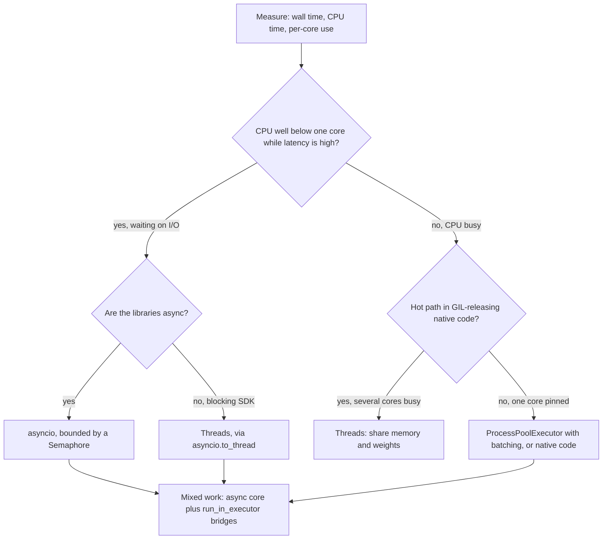

## TL;DR
Pick by what the work waits on: asyncio for many network waits, threads for blocking libraries and
GIL-releasing C code, processes for CPU-bound pure Python. AI pipelines mix all three: async core,
`asyncio.to_thread` for blocking SDKs, a process pool for parsing.

## Why it exists
- **AI backends do two kinds of work.** Most wall-clock time is waiting (model provider, embedding API,
  vector database, S3 download). Some is pure CPU (parsing PDFs, chunking, tokenising, JSON-schema
  validation of large outputs, local re-ranking). Each of Python's three models fits only some of it.
- **"Everything async" breaks on the first sync library** (a vendor SDK, a PDF parser, a database driver
  without async support): it blocks the event loop and every concurrent request stalls behind it.
- **"Everything threads" does not speed up pure-Python CPU work**, because in standard CPython the GIL
  lets only one thread run bytecode at a time, and thousands of threads for thousands of in-flight
  requests are heavy.
- **"Everything multiprocessing" costs memory and pickling.** Each process has its own memory, model copies
  and connection pools, and every argument and result is pickled across a pipe, which can cost more than
  the work itself.
- **Getting it wrong is quietly expensive.** Usually not a crash, but a service whose throughput does not
  move however many workers you add.

## How it works
### The three models at a glance
| | asyncio | Threads | Processes |
|---|---|---|---|
| Scheduling | Cooperative, only at `await` | Preemptive, by the kernel | Separate interpreters, each with its own GIL |
| Parallel Python CPU | None | No (one thread runs bytecode at a time) | Yes, across cores |
| Practical count | Tens of thousands of waits on one thread | Hundreds to low thousands | About the core count |
| Shared state | Shared; races only across awaits | Shared; needs `threading.Lock` | No shared heap; data is pickled |
| Main cost | Every layer must be async | GIL for pure Python | Pickling, startup, memory per worker |

### asyncio: one thread, many waits
- **Mechanism.** An event loop multiplexes sockets and resumes coroutines when their I/O is ready.
- **Cheap.** A suspended coroutine is a small heap object, so tens of thousands of concurrent LLM streams
  are feasible on one thread.
- **Easier races.** Switching happens only at `await`.
- **The cost is "function colouring":** every layer must be async, and any blocking call freezes the
  loop. It gives no CPU parallelism at all.

### Threads: preemptive, shared memory, GIL-limited
- **Mechanism.** OS threads are kernel-scheduled and share the process's memory.
- **When the GIL is released.** A thread holds the GIL while running bytecode and releases it on blocking
  I/O and inside C extensions that choose to (NumPy on large arrays, many PyTorch ops, hashlib,
  compression).
- **So threads give real concurrency** for I/O and GIL-releasing native code, but pure-Python CPU work runs
  one thread at a time.
- **Bounded count.** Each thread reserves its own stack and the OS schedules it: hundreds to low
  thousands, not tens of thousands.
- **Shared state needs `threading.Lock`**, because switching can happen between almost any two bytecodes.

### Processes: true parallelism, no shared heap
- **Mechanism.** `multiprocessing` and `ProcessPoolExecutor` start separate interpreters, each with its own
  GIL, so CPU-bound Python scales across cores.
- **Costs.** Arguments and results are pickled (lambdas and open clients cannot be sent), each worker pays
  startup and import cost, and memory is multiplied by the number of workers.

**Start methods:**
| Method | Behaviour | Caveat |
|---|---|---|
| `fork` | Copies the parent quickly | Unsafe if the parent has threads or CUDA state |
| `spawn` | Default on macOS and Windows; starts clean | Re-imports your modules |
| `forkserver` | Linux default since 3.14 | Same import requirements as spawn |

- **Guard entry points.** Under spawn and forkserver, worker entry points must be importable and guarded
  by `if __name__ == "__main__":`.
- **Heavy per-worker state** (a tokenizer, a parser model) belongs in the pool's `initializer=` function,
  which runs once per worker, *because* passing it with every task would pickle it every time.
- **The payoff test is a ratio:** per-task compute time against the time to pickle arguments and result
  (`len(pickle.dumps(arg))` and a quick timing tell you).
- **Batch small items** into chunks (`chunksize=` on `map`) until compute dominates.

### A decision procedure
1. **Measure first:** wall time, process CPU time and per-core utilisation for a representative run.
2. **CPU well below one core while latency is high:** you are waiting. Use asyncio if the libraries are
   async, threads if they are blocking. Either way, bound concurrency to what the dependency allows.
3. **One core pinned and adding threads changes nothing:** pure-Python CPU work under the GIL. Use
   processes, or move the hot loop into native code (NumPy, Polars, a compiled library).
4. **Several cores busy with threads:** the hot path is in GIL-releasing native code, and threads are the
   cheapest parallelism you have, sharing memory and model weights.
5. **The work mixes both:** keep one async core and push each kind of work to the executor that matches it.

### Bridges between them
- **`await asyncio.to_thread(fn, *args)`** (3.9+) runs a blocking call in the default thread pool without
  blocking the loop.
- **`loop.run_in_executor(process_pool, fn, *args)`** sends CPU work to processes and returns an awaitable.
- **The usual shape:** async at the edges for I/O fan-out, executors for everything else.
- **Free-threaded CPython (PEP 703)** removes the GIL in an optional build, which may change the
  thread-versus-process answer for CPU work. Check its status and your dependencies' support for your
  Python version before relying on it.

## Diagram
The decision procedure as a path: measure first, then let what the work waits on pick the model. Mixed
workloads keep one async core and bridge out to the matching executor.



## Examples
### Worked scenario: ingesting 2,000 PDFs
Illustrative numbers. Each PDF: download from S3 (about 0.3 s, network), extract text with a pure-Python
parser (about 0.5 s CPU), embed chunks via an API (about 0.4 s, network). 8-core machine.

| Design | Time | Why |
|---|---|---|
| Sequential | 2,000 × 1.2 s = 2,400 s, about 40 minutes | Nothing overlaps |
| All asyncio, parser called directly | at least ~17 minutes | Parsing alone is 2,000 × 0.5 s = 1,000 s on one core; during each parse no downloads or embeddings progress |
| Threads for everything | the same ~1,000 s floor, plus contention | I/O overlaps, but parses serialise on the GIL |
| Async I/O + process pool of 8 for parsing | near the parse floor, a couple of minutes | Parse time ≈ 1,000 s ÷ 8 ≈ 125 s if it scales cleanly, with I/O bounded by a semaphore and overlapped |

The last row holds only if pickling the PDF bytes in and the extracted text back is cheap relative to
0.5 s of work.

```python
import asyncio

async def handle(pdf_key, pool, sem):                   # pool: ProcessPoolExecutor(8)
    loop = asyncio.get_running_loop()
    async with sem:
        raw = await s3_get(pdf_key)                     # async I/O
    text = await loop.run_in_executor(pool, parse, raw) # CPU in a process
    async with sem:
        return await embed(chunk(text))                 # async I/O
```

### Measure it yourself: threads, processes and chunksize
Pure Python, standard library only.

```python
import time
from concurrent.futures import ThreadPoolExecutor, ProcessPoolExecutor

def score(doc: str) -> int:                  # pure-Python CPU work: holds the GIL
    return sum(ord(c) % 7 for c in doc)

def timed(executor, docs, chunksize=1) -> float:
    t = time.perf_counter()
    with executor as ex:                     # map's chunksize is ignored by thread pools
        list(ex.map(score, docs, chunksize=chunksize))
    return time.perf_counter() - t

if __name__ == "__main__":                   # required under spawn and forkserver
    big = ["chunk this text " * 15_000] * 64  # few large tasks: compute dominates
    tiny = ["short doc"] * 50_000             # many tiny tasks: overhead dominates
    print(f"big,  1 thread      {timed(ThreadPoolExecutor(1), big):.2f}s")
    print(f"big,  8 threads     {timed(ThreadPoolExecutor(8), big):.2f}s")
    print(f"big,  8 processes   {timed(ProcessPoolExecutor(8), big):.2f}s")
    print(f"tiny, 8 proc, cs=1  {timed(ProcessPoolExecutor(8), tiny):.2f}s")
    print(f"tiny, 8 proc, cs=1k {timed(ProcessPoolExecutor(8), tiny, 1000):.2f}s")
```

What to expect (one laptop run, illustrative, not a benchmark):
- **8 threads ≈ 1 thread** (about 0.56 s each): the GIL serialises pure-Python work.
- **8 processes about 3× faster** (0.16-0.20 s), less than 8× because pool startup and pickling are
  included in the timing.
- **Tiny tasks: about 4.4 s with `chunksize=1`, under 0.1 s with `chunksize=1000`.** Per-task overhead in
  the parent dominated until batching made compute the larger share.

## Production patterns
- **Bound the default thread pool.** At startup, call
  `loop.set_default_executor(ThreadPoolExecutor(max_workers=N))` so `to_thread` calls to a slow sync SDK
  cannot grow without limit. Monitor executor queue length and the latency of offloaded calls.
- **Initialise workers once, recycle them.** Create `ProcessPoolExecutor(max_workers=..., initializer=load_parser)`
  and, on 3.11+, set `max_tasks_per_child=` to restart workers that leak memory. Monitor per-worker RSS.
- **Choose the start method explicitly.** Pass `mp_context=multiprocessing.get_context("spawn")` (or
  `"forkserver"`) when the parent has threads or CUDA, instead of relying on the platform default. Watch
  for intermittent worker hangs, the fork-with-threads fingerprint.
- **Batch CPU tasks.** Send hundreds of small documents per task (`chunksize=` or explicit batches) and
  tune the size empirically against throughput. Monitor tasks/s and the parent process's CPU.
- **Split CPU work into its own service.** Run parsing and chunking as queue-fed workers scaled separately
  from the I/O-bound API tier. Monitor queue depth and age of the oldest job.
- **Size server workers against memory.** Each Uvicorn/Gunicorn worker process duplicates models and pools,
  so set the worker count from the memory budget, not only from cores. Monitor RSS per worker.

## Trade-offs
- **Concurrency per byte vs async everywhere.** asyncio gives the most concurrency per byte of memory but
  demands async libraries throughout; one synchronous dependency in the hot path makes threads the
  pragmatic choice.
- **Easy parallel I/O vs no CPU gain.** Threads are the easiest way to parallelise blocking SDK calls, but
  shared state needs locks and pure-Python CPU work gains nothing. That flips when the CPU work is in
  GIL-releasing native code.
- **Real CPU parallelism vs overhead.** Processes pay pickling, startup and memory per worker; they stop
  paying off when each task is so small that serialisation dominates the compute.
- **Free scaling vs memory.** Separate server workers (Uvicorn/Gunicorn processes) scale a web tier across
  cores without code changes, but multiply model memory and connection pools per worker, which matters
  with local models.

## Pitfalls
- **A synchronous SDK or `requests` inside `async def`.** Symptom: p99 latency rises for all requests on a
  worker while CPU stays low. Fix: async client or `to_thread`.
- **Threads to speed up pure-Python parsing or tokenisation.** Symptom: CPU sits at about one core and wall
  time barely changes. Fix: processes or native code.
- **Large objects per task to a process pool** (documents, NumPy arrays, model weights). Symptom: profiling
  shows most time in pickling, and worker memory spikes. Fix: `initializer=` or shared storage.
- **`fork` after starting threads or initialising CUDA.** Symptom: workers that deadlock intermittently on a
  lock some parent thread held at fork time, or PyTorch's "Cannot re-initialize CUDA in forked subprocess"
  error. Fix: spawn or forkserver.
- **Loading a local model at import time in a module that `spawn` re-imports.** Each worker loads its own
  copy and the machine runs out of memory. Fix: load in the initializer or behind the main guard.

## When to use
- **Measure first.** CPU low while latency is high means I/O-bound; one core pinned means CPU-bound in Python.
- **API server calling LLMs and vector stores:** asyncio with async clients such as `httpx` or the official
  async SDKs; wrap unavoidable blocking calls in `asyncio.to_thread`.
- **Heavy parsing, chunking or local inference preprocessing:** a process pool, or a separate worker service.
- **GPU inference:** the work runs in native code, and a dedicated serving engine usually beats rolling your
  own concurrency.
- **Interviews:** justify the choice from the bottleneck, not from preference.

## Role lens
- **Engineer:** Keeps the event loop free of blocking calls, uses `to_thread` and process pools as
  bridges, and profiles before adding workers.
- **Architect:** Splits I/O-bound request handling from CPU-bound batch work into separately scaled
  services, and decides worker counts against memory budgets.
- **FDE:** Finds the synchronous call blocking a customer's async service, or the thread pool that
  cannot speed up their parser, and fixes it in their codebase.

## Check yourself
**Q:** A team's chunking step (pure-Python regex and string splitting, about 2 ms per document) is too slow.
They wrap it in a 16-thread pool: no change, and `top` shows the process at about 100% CPU. They switch to a
`ProcessPoolExecutor(16)` submitting one document per task, and it gets slower. Explain both results and
what you would do.
**A:** The threads changed nothing because the work is pure-Python bytecode: under the GIL only one thread
runs at a time, and "100% CPU" means one core, the fingerprint of GIL-bound work. The process pool removed
the GIL limit but introduced a per-task cost paid serially in the parent: it pickles every document,
pushes it through a pipe, tracks a future per task, and unpickles every list of chunks that comes back.
Sixteen workers each finishing a task every 2 ms demand thousands of tasks per second from that one
parent thread, so the parent becomes the bottleneck, and when documents are large the per-task
serialisation alone can exceed the 2 ms of work it is shipping. The fix keeps
processes but changes the grain: send batches of a few hundred documents per task (`map` with
`chunksize`, or explicit batches) so compute dominates, initialise any heavy objects once per worker,
and size the pool to physical cores. Then measure throughput against batch size, because the optimum is
empirical. If the hot loop can be expressed as vectorised Polars string operations, that may beat both.

## Interview questions
### What is the core difference between asyncio, threads and processes in Python?
- **asyncio** is cooperative scheduling on one thread, switching only at `await`, so tens of thousands of
  network waits are cheap but there is no CPU parallelism.
- **Threads** are preemptive and share memory, giving real concurrency for blocking I/O and GIL-releasing
  C code, but pure-Python bytecode runs one thread at a time in standard CPython.
- **Processes** each have their own interpreter and GIL, so CPU-bound Python scales across cores at the
  cost of pickling, startup and memory per worker.

### An async API calls a vendor SDK that has no async client. How do you integrate it?
- **Offload each call** with `await asyncio.to_thread(sdk_call, ...)`, so the event loop keeps serving
  other requests while the call blocks in a worker thread.
- **Bound the pool:** set `loop.set_default_executor(ThreadPoolExecutor(max_workers=N))` at startup and
  cap in-flight calls, because each offloaded call holds a thread.
- **Monitor** executor queue length and offloaded-call latency, and switch to an async client when one
  exists.

### When would multiprocessing make a job slower, and how do you fix it?
- **When per-task compute is small relative to pickling.** The parent pickles every argument and result
  and tracks a future per task, so tiny tasks make the parent the bottleneck.
- **Fix the grain:** batch with `chunksize=` or explicit batches, load heavy state once in
  `initializer=`, and check the ratio with `len(pickle.dumps(arg))` and a quick timing.
- **In the lesson's run**, tiny tasks took about 4.4 s at `chunksize=1` and under 0.1 s at 1000.

### Why would you choose spawn or forkserver over fork for a worker pool?
- **`fork` copies the parent's state**, including locks held by other threads and CUDA state, so
  children can deadlock intermittently or hit "Cannot re-initialize CUDA in forked subprocess".
- **`spawn` and `forkserver` start clean** but re-import your modules, so entry points need the
  `if __name__ == "__main__":` guard and models must load in the initializer, not at import.
- **Pass the context explicitly** with `mp_context=` rather than relying on platform defaults.

### How do you size Uvicorn or Gunicorn workers for a service that loads a local model?
- **Memory first:** each worker process duplicates the model and connection pools, so the count comes
  from the memory budget divided by per-worker RSS, not only from cores.
- **Keep the I/O tier async** so each worker handles many concurrent requests, and move CPU-heavy parsing
  to a separately scaled queue-fed worker service.
- **Monitor** RSS per worker, queue depth and oldest-job age.

## Quiz
### Q: Which workload is the best fit for a `ProcessPoolExecutor` rather than threads or asyncio?
- [ ] Calling an LLM API 5,000 times with async-capable clients
- [ ] Running large NumPy matrix multiplications that release the GIL
- [x] Parsing thousands of documents with a pure-Python parser
- [ ] Streaming tokens from a model provider to many websocket clients
> Pure-Python CPU work is serialised by the GIL in threads and blocks the loop in asyncio, so only
> separate processes run it in parallel. NumPy releasing the GIL makes threads viable for the second option.

### Q: What does `await asyncio.to_thread(fn)` achieve inside a coroutine?
- [ ] It makes `fn` run in parallel with other Python bytecode regardless of the GIL
- [x] It runs the blocking `fn` in a worker thread so the event loop keeps serving other coroutines
- [ ] It converts `fn` into a coroutine that yields at each line
- [ ] It runs `fn` in a separate process to avoid the GIL
> The event loop stays responsive because the blocking call waits in another thread. It does not
> bypass the GIL, so it helps for blocking I/O but not for pure-Python CPU work.

### Q: Why can a process pool make a job slower than running it sequentially?
- [ ] Processes share one GIL, so they contend more than threads
- [ ] The operating system limits processes to one core each by default
- [ ] Process pools cannot run more than one task per worker
- [x] Each task's arguments and results are pickled and copied, which can cost more than tiny tasks
> Processes have separate memory, so data crosses a pipe as pickled bytes. When per-task compute is
> small or the payload is large, serialisation and startup overhead outweigh the parallel speed-up.
