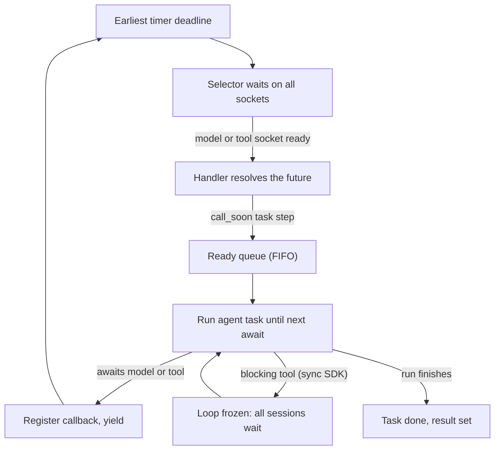

## TL;DR
An agent mostly waits on the model, tools, MCP servers and vector stores. asyncio runs those waits as
coroutines on one event loop, so one process drives many agent runs and parallel tool calls cheaply,
provided nothing on the loop blocks.

## For agent builders
- **Why it matters for agents.** Each agent step is "call the model, then call one or more tools, then
  call the model again". Every one of those is network I/O, so the loop decides whether a worker serves
  ten agent sessions or a thousand, and whether three tool calls the model asked for run in parallel.
- **Where it shows up in your stack.** The async clients of the OpenAI and Anthropic SDKs, `httpx`,
  FastAPI routes, the MCP SDK, and the async entry points of agent frameworks (LangGraph's `ainvoke` and
  `astream`, for example) all sit on an asyncio loop.
- **What you control.** Fan-out of parallel tool calls (`TaskGroup`, `gather`), a concurrency cap per
  provider (`Semaphore`), a timeout on every tool and model await, and keeping sync tools off the loop
  with `asyncio.to_thread`.
- **What you can skip.** Writing your own event loop, transports and protocols, or custom selectors.
  Know what happens at an `await`, why one blocking tool freezes every session, and how to measure lag.

## Why it exists
- **Agents mostly wait.** An agent backend calling a model with a 3-second median response holds a
  synchronous thread for those 3 seconds doing nothing but waiting on a socket, and a 10-step run does
  that ten times plus every tool call.
- **Threads are an expensive way to wait.** 1,000 concurrent agent sessions need 1,000 threads, each with
  a kernel object, scheduler time and a reserved stack (512 KB on macOS to 8 MB on typical Linux, mostly
  virtual address space rather than resident memory). Under the GIL they cannot even run Python in parallel.
- **A bigger pool moves the ceiling, not the cost shape.** A waiting agent step needs almost no state: a
  socket to watch and the point in the code to resume from.
- **The OS already watches many sockets cheaply** (`epoll` on Linux, `kqueue` on macOS, IOCP on Windows).
  Python lacked a way to suspend a function mid-body, keep its locals and resume it later. Generators had
  that since `yield`; PEP 492 gave it syntax (`async def` / `await`); asyncio is the scheduler joining
  suspended functions to OS readiness events.
- **Coroutines beat callbacks for readability.** Callback frameworks solved the same problem, but an agent
  loop written as callbacks reads as a graph; coroutines read top to bottom and behave the same underneath.

## How it works
### The three objects
| Object | What it is | Role in an agent |
|---|---|---|
| **Coroutine** | What calling an `async def` function returns: a suspended frame that has not started | `run_tool(call)` before anything drives it |
| **Future** | One-shot result holder with callbacks: "when this is set, call these" | Socket readiness, timers and thread results (a sync tool in `to_thread`) all surface as futures |
| **Task** | A coroutine wrapped in a future, plus the driver | On each `await` of a not-ready future, registers a callback and returns control to the loop; when the future resolves, the task is rescheduled and resumes exactly where it stopped |

### One iteration of the loop
The event loop is a single-threaded `while True`:
1. **Find the next deadline.** Compute how long until the earliest timer (`asyncio.sleep`, tool timeouts).
2. **Wait on the selector.** Ask the OS for readable or writable sockets, waiting at most that long. This
   is the only place the thread blocks, and it blocks on behalf of *all* tasks (every agent session) at once.
3. **Queue handlers.** For each ready socket or expired timer, queue its handler. The handler reads the
   bytes and resolves the future; resolving schedules the waiting task's step callback with `call_soon`,
   so it lands on the ready queue too.
4. **Drain the ready queue.** Run the callbacks that were ready when this iteration began, in FIFO order,
   each task until its next `await`. New work waits for the next iteration, *because* a task that keeps
   rescheduling itself could otherwise starve the selector and every timer.

**Why "cooperative":** a task runs until it voluntarily yields at an `await` on a not-yet-ready future.
- Awaiting an already-complete future, or a plain coroutine that never touches I/O, does not yield at all.
- `await asyncio.sleep(0)` is the explicit "let others run" hint, useful inside a long parsing step.

### Design choices and their reasons
- **Single thread**, *because* it removes data races between awaits: between two `await`s, no other task
  can touch your agent state. It does not remove races *across* an await (read memory, await the model,
  write memory); that is what `asyncio.Lock` is for.
- **The cost of one thread.** A blocking call (`time.sleep`, `requests.get` inside a tool, a CPU-heavy
  loop) freezes every task, because there is no other thread to keep the loop turning.
- **Explicit `await` points**, *because* they make interleaving visible in the source. A sync-looking line
  can never secretly switch tasks, which is why most agent code is reasonable without locks.
- **`create_task` schedules rather than runs**, *because* the creator should continue; the new task starts
  on a later loop iteration. `asyncio.gather(*coros)` wraps each coroutine in a task and returns results in
  order; `asyncio.TaskGroup` (3.11+) does the same with structured cancellation.
- **Blocking work goes off the thread** with `asyncio.to_thread(fn, *args)` (a `ThreadPoolExecutor` under
  the hood) or `loop.run_in_executor(process_pool, fn)`; the result comes back as an awaitable future. The
  loop stays responsive, but pure-Python work is still serialized by the GIL.

### Coordinating parallel tool calls and sub-agents
The primitives differ in what they give back and when, which is the real choice:

| Primitive | Returns | Use it in an agent when |
|---|---|---|
| `gather` | All results, input order, once every child is done | The model asked for three tools and needs all three results in the next message |
| `as_completed` | Results in finish order | Stream partial findings to the UI as each sub-agent finishes |
| `asyncio.wait(..., return_when=FIRST_COMPLETED)` | `(done, pending)` sets; pending tasks keep running | Race two search backends, take the first good answer, cancel the rest |
| `TaskGroup` | Like `gather`, with structured cleanup | One failed tool should cancel its siblings |
| `asyncio.Queue(maxsize=N)` + fixed workers | Whatever workers produce | Batch evals or ingestion that must bound concurrency and memory |

- **Queues give backpressure**, *because* producers block on `put` when consumers fall behind.
- **`gather` does not**: over 10,000 coroutines it creates 10,000 tasks up front.

### Measuring loop health
- **Loop lag is the health number:** schedule a callback for time *t* and record when it actually runs.
- **Measure it directly:** a task doing `await asyncio.sleep(0.5)` in a loop and logging
  `actual_elapsed − 0.5`.
- **Read it:** lag near zero means tasks are yielding. Lag that tracks your slowest synchronous tool means
  something is blocking, and every agent session on that loop pays it.

### Entry and exit
- **`asyncio.run(main())`** creates a fresh loop, runs `main` as a task, then cancels still-pending tasks,
  finalizes async generators and closes the loop. Use it in eval scripts and CLIs.
- **Not inside a running loop.** It cannot be called there; Jupyter already runs one, so use `await main()`.
- **Debug mode** (`PYTHONASYNCIODEBUG=1` or `asyncio.run(..., debug=True)`) adds the creation traceback to
  "coroutine was never awaited" warnings and logs callbacks that hog the loop longer than
  `loop.slow_callback_duration` (100 ms by default). It is the first tool for finding a blocking tool.

## Diagram
One loop iteration: the thread blocks only in the selector, then runs each ready agent task until its next
`await`. A blocking tool call inside a task step stops every session on the loop.



## Examples
### Parallel tool calls in an agent step
The model returned three tool calls in one turn. Run them concurrently under a `TaskGroup`, give each a
timeout, push the one sync tool to a thread, and send every result back (errors included) in one message.
The model call is a stub so the example runs offline; swap in your provider's async client.

```python
import asyncio, inspect, json, time

async def call_model(messages):                     # stub: a real agent awaits the provider here
    await asyncio.sleep(0.3)
    if messages[-1]["role"] == "tool":
        return {"content": "Done.", "tool_calls": []}
    return {"content": None, "tool_calls": [
        {"id": "a", "name": "search", "args": {"q": "refund policy"}},
        {"id": "b", "name": "lookup_order", "args": {"order": 42}},
        {"id": "c", "name": "legacy_crm", "args": {"user": 7}}]}

async def search(q):        await asyncio.sleep(1.0); return f"3 docs for {q}"
async def lookup_order(order): await asyncio.sleep(0.8); return {"order": order, "status": "shipped"}
def legacy_crm(user):       time.sleep(0.5); return {"user": user, "tier": "gold"}   # sync, blocking

TOOLS = {"search": search, "lookup_order": lookup_order, "legacy_crm": legacy_crm}

async def run_tool(call, timeout=5.0):
    fn = TOOLS[call["name"]]
    try:
        async with asyncio.timeout(timeout):          # 3.11+: no tool may hang the step
            if inspect.iscoroutinefunction(fn):
                out = await fn(**call["args"])
            else:
                out = await asyncio.to_thread(fn, **call["args"])   # keep the loop free
        return {"role": "tool", "tool_call_id": call["id"], "content": json.dumps(out)}
    except Exception as e:                            # report failures to the model, do not crash the run
        return {"role": "tool", "tool_call_id": call["id"], "content": f"error: {e!r}"}

async def agent(task, max_steps=5):
    messages = [{"role": "user", "content": task}]
    for _ in range(max_steps):
        reply = await call_model(messages)
        if not reply["tool_calls"]:
            return reply["content"]
        t0 = time.perf_counter()
        async with asyncio.TaskGroup() as tg:
            tasks = [tg.create_task(run_tool(c)) for c in reply["tool_calls"]]
        messages += [t.result() for t in tasks]
        print(f"{len(tasks)} tools in {time.perf_counter() - t0:.2f}s")   # ~1.0s, not 2.3s
    return "step limit reached"

print(asyncio.run(agent("Where is my order and can I get a refund?")))
```

**The timeline:**
1. `TaskGroup` wraps the three tool coroutines in tasks.
2. On the next loop iteration each runs until its first not-ready await and yields, so all three are in
   flight within a few milliseconds; the sync CRM call runs in a worker thread.
3. The step costs about the slowest tool (1.0 s) instead of the sum (2.3 s).

### Fan out twenty chat completions
Twenty calls share one HTTP connection pool; a blocking tokenizer step moves to a thread so it cannot
stall the loop. Point `API` at any OpenAI-compatible server (a local vLLM or Ollama instance works). This
is the shape of an eval harness running twenty agent prompts.

```python
import asyncio, time
import httpx

API = "http://localhost:8000/v1/chat/completions"
HEADERS = {"Authorization": "Bearer local"}

async def ask(client: httpx.AsyncClient, question: str) -> str:
    body = {"model": "small-chat", "messages": [{"role": "user", "content": question}]}
    r = await client.post(API, headers=HEADERS, json=body, timeout=60)   # the await is where we yield
    r.raise_for_status()
    return r.json()["choices"][0]["message"]["content"]

def count_tokens(text: str) -> int:
    time.sleep(0.05)                      # pretend this is a slow, blocking tokenizer
    return len(text.split())

async def main(questions: list[str]) -> None:
    async with httpx.AsyncClient() as client:          # one connection pool for every call
        t0 = time.perf_counter()
        answers = await asyncio.gather(*(ask(client, q) for q in questions))
        # blocking work goes to a thread so the loop keeps serving other tasks meanwhile
        counts = await asyncio.gather(*(asyncio.to_thread(count_tokens, a) for a in answers))
        print(f"{len(questions)} calls in {time.perf_counter() - t0:.2f}s, {sum(counts)} tokens")

asyncio.run(main([f"Summarise item {i} in one line." for i in range(20)]))
```

### Worked numbers: what the fan-out buys and what caps it
| Scenario | Wall time | Why |
|---|---|---|
| Sequential, each call 1.5 s | about 20 × 1.5 = 30 s | One call at a time |
| `gather` over 20 calls | roughly 1.5 s plus scheduling overhead | About the slowest single call |
| Server allows four parallel requests | the other sixteen queue | Server-side cap |
| Client pool full | request 101 waits for a free connection | `httpx` allows 100 connections by default |
| 20 × `time.sleep(0.05)` inline in the coroutine | one full second, back to back | No other task (say another user's agent stream) gets a single step |
| Same 20 via `to_thread` | roughly 50 ms | Default executor has `min(32, cpu_count + 4)` threads, so all twenty run at once on an 8-core machine, and `time.sleep` releases the GIL |
| 20 pure-Python CPU loops via `to_thread` | no overlap | Loop stays responsive but the GIL serialises them; use a process pool |

### A loop-lag probe you can run
A blocking tool is invisible in CPU graphs but obvious in lag. This prints lag every 0.5 s.

```python
import asyncio, time

async def lag_probe(interval=0.5):
    while True:
        t = time.perf_counter()
        await asyncio.sleep(interval)
        lag = time.perf_counter() - t - interval
        print(f"loop lag {lag * 1000:.0f} ms")

async def main():
    probe = asyncio.create_task(lag_probe())
    await asyncio.sleep(1.2)
    time.sleep(1.0)          # blocking call on the loop thread
    await asyncio.sleep(1.2)
    probe.cancel()

asyncio.run(main())
# Prints lag of a few ms, then one reading of about 700 ms (the probe was due mid-block), then a few ms again.
```

## Production patterns
- **Run the model's parallel tool calls concurrently.** When one turn returns several tool calls, run
  them under a `TaskGroup` (or `gather(..., return_exceptions=True)`) and convert each failure into a tool
  result message, so one bad tool does not lose the step. Monitor tool latency per name and step latency.
- **Bound every fan-out.** When an agent or eval harness calls a provider for many items, wrap each call
  in `async with sem:` where `sem = asyncio.Semaphore(32)` (size it to the provider's rate limit), or use a
  `Queue` with N workers. Monitor 429 rate, in-flight count and queue depth.
- **One shared client per process.** Create a single `httpx.AsyncClient` (and one provider SDK client) at
  startup (FastAPI lifespan), size it with `httpx.Limits(max_connections=...)`, and close it on shutdown.
  Monitor pool-wait timeouts and connection errors.
- **Timeouts on every external await.** Wrap model, tool and MCP calls in `asyncio.timeout(seconds)`
  (3.11+) or `asyncio.wait_for`, so one hung socket cannot hold an agent run forever. Add an overall
  run budget too. Monitor timeout counts per dependency.
- **Export loop lag and debug in staging.** Run the lag probe as a background task and publish lag as a
  gauge; alert when p99 lag approaches your step latency budget. In staging set `PYTHONASYNCIODEBUG=1` and
  a lower `loop.slow_callback_duration` (for example 0.05 s); keep it off in production for overhead.
- **Keep references to background tasks.** For fire-and-forget work such as writing a trace or memory
  update, follow the docs pattern: add each task to a set and call `task.add_done_callback(tasks.discard)`,
  or run them in a `TaskGroup`. Monitor the set's size for leaks.

## Trade-offs
- **Cheap waits vs CPU work.** Thousands of concurrent agent waits cost kilobytes each instead of a thread
  apiece, but once a step is CPU-bound Python (local re-ranking, big JSON parsing) the single loop thread
  is the bottleneck and threads or processes win.
- **Auditable interleaving vs function colour.** Explicit await points make interleaving visible, but
  "colour" is contagious: an async agent loop cannot call a blocking tool library without `to_thread`, so
  library choice (httpx vs requests, async vs sync database driver) is dictated by the loop.
- **No preemption vs blast radius.** Cooperative scheduling has no preemption overhead and needs no locks
  for most state, but one misbehaving tool (a tight loop, a sync HTTP call) degrades every agent session on
  the loop, where a thread pool would only lose one worker.
- **Concurrency vs debuggability.** A traceback shows the await chain inside one task but not which task
  spawned it, and profilers see interleaved task steps under the loop's frames. Named tasks, debug mode
  and per-run trace IDs (LangSmith or OpenTelemetry spans) close most of the gap.

## Pitfalls
- **Blocking inside a coroutine** (`time.sleep`, the sync OpenAI client, `requests` in a tool,
  `pandas.read_csv` on a large file). Symptom: p99 step latency climbs under load while CPU sits idle,
  and debug mode logs "Executing <Task ...> took 2.3 seconds". Fix: async client or `to_thread`.
- **Forgetting to `await` a coroutine.** Nothing runs. Symptom: `RuntimeWarning: coroutine 'x' was never
  awaited` and a tool or memory write that silently does nothing.
- **Fire-and-forget `asyncio.create_task(...)` without a reference.** The loop holds tasks weakly, so a task
  can be garbage-collected mid-flight. Symptom: trace uploads or memory writes that sometimes vanish. Fix:
  store tasks in a set and discard on completion, or use a `TaskGroup`.
- **`asyncio.run` inside a running loop** (a FastAPI handler, a notebook, a framework callback). Symptom:
  `RuntimeError: asyncio.run() cannot be called from a running event loop`. Fix: `await` directly.
- **Treating `gather` as a limiter.** Fanning out 5,000 embedding calls or eval cases at once floods the
  provider and your own sockets. Symptom: a wave of 429s and connection errors. Fix: bound it with a
  `Semaphore`.

## When to use
- **Use when** time is dominated by waiting on many independent network operations: LLM and embedding
  calls, tool and MCP servers, vector stores, streaming to many clients. That is most of an agent service,
  which is why FastAPI, httpx, the OpenAI and Anthropic SDKs and the MCP SDK all expose async APIs.
- **Avoid when** the goal is speeding up CPU-bound code; asyncio will not help and makes that code harder
  to run. A one-off sync script calling one model is fine without it.
- **Measure:** event-loop lag (time between scheduling a callback and it running), the number of pending
  tasks, and per-step latency of agent runs; together they tell you whether the loop is healthy.
- **Interviews:** explain what happens at an `await`, why a blocking tool hurts every session, and when you
  would move work to a thread or process instead.

## Role lens
- **Engineer:** Writes async handlers and clients, fans out model and tool calls with `gather` or
  `TaskGroup`, and keeps blocking work off the loop with `to_thread`.
- **Architect:** Decides which services are async-native and where the sync/async boundaries sit, so
  one blocking dependency cannot stall a whole worker process.
- **FDE:** Diagnoses a customer's "slow under load but CPU is idle" by finding the blocking call on
  their loop, often a sync SDK inside an async route.

## Check yourself
**Q:** A FastAPI service declares its chat route `async def`, and inside it calls the provider with a
synchronous SDK client. At ten concurrent users p99 latency is about thirty seconds while CPU sits at
five percent. Explain the mechanism and give two fixes with their trade-offs.
**A:** The route runs on the event loop thread, and the sync client blocks that thread for the whole
provider round-trip, so every other request on the worker waits in line: with ten users and a
three-second call, the last one waits around thirty seconds, which matches the symptom, and CPU is idle
because the thread is parked on a socket. Fix one: switch to the SDK's async client so the call becomes
an `await` and the loop keeps serving others; this is the right default but requires async-compatible
code throughout the call chain. Fix two: keep the sync client but call it via
`await asyncio.to_thread(...)`, or declare the route with plain `def` so the framework runs it in its
thread pool; this is a smaller change, but the pool is bounded (AnyIO, which FastAPI uses, defaults to
40 threads), so concurrency caps at its size and each call still costs a thread. To confirm the
diagnosis before fixing, turn on asyncio debug mode or a loop-lag probe: lag of about three seconds per
request is the fingerprint.

## Interview questions
### What actually happens when a coroutine hits an await on a model or tool call?
- **The task registers and yields.** The awaited future is not ready, so the task adds a callback to it
  and returns control to the event loop; its frame and locals (the agent's messages) stay suspended.
- **The loop waits for all sockets at once.** The selector (`epoll`, `kqueue`, IOCP) blocks on behalf of
  every task, and when the socket is readable the handler resolves the future.
- **Resolution reschedules the task.** `call_soon` puts its step on the ready queue, and it resumes
  exactly after the `await` on a later iteration.

### The model returns four tool calls in one turn. How do you execute them, and what about failures?
- **Run them concurrently** under a `TaskGroup` or `gather`, because they are independent network waits:
  the step costs about the slowest tool instead of the sum.
- **Give each a timeout** with `asyncio.timeout`, and push sync tools through `asyncio.to_thread`.
- **Turn failures into tool results** (an error string with the tool call id) rather than letting one
  exception cancel the siblings and kill the run, so the model can retry or route around it.

### Is asyncio agent code free of race conditions because it is single-threaded?
- **Free between awaits, not across them.** No other task can run between two `await`s, so a plain
  read-modify-write with no await in the middle is safe.
- **A read, await, write sequence is not safe**, because another task (a parallel tool or sub-agent) can
  change shared memory while the first is suspended. Guard that section with `asyncio.Lock` or restructure
  so the write does not depend on a stale read.

### You must embed 50,000 chunks for an agent's RAG index through a provider capped at 32 concurrent requests. How do you write it?
- **Do not `gather` all 50,000 coroutines**, because that creates 50,000 tasks up front, floods the
  provider with 429s and holds every result and socket in memory.
- **Bound concurrency:** an `asyncio.Semaphore(32)` around each call, or an `asyncio.Queue(maxsize=N)`
  with 32 workers, which also gives backpressure to the producer.
- **Add per-call timeouts and retries**, and monitor in-flight count, 429 rate and queue depth.

### When would you not use asyncio, or move work off the loop?
- **CPU-bound Python** (re-ranking loops, parsing large files) gains nothing, because the loop thread
  is the bottleneck; use a process pool via `loop.run_in_executor`.
- **Blocking tool libraries with no async version** go through `asyncio.to_thread`, accepting that the
  default executor has `min(32, cpu_count + 4)` threads and pure-Python work stays GIL-serialized.
- **Mostly-sync codebases** may be simpler with a thread pool than with function colour everywhere.

### You raise the fan-out semaphore from 32 to 200, but throughput barely moves and some calls fail with PoolTimeout. Why?
- **The client pool is the real cap.** A default `httpx.AsyncClient` allows 100 connections, so above
  100 in-flight calls the extra tasks wait for a free connection instead of sending.
- **Pool waits count against the timeout.** httpx's default timeout (5 seconds) also covers acquiring a
  connection from the pool, so tasks queued behind 3-second LLM calls can raise `httpx.PoolTimeout`.
- **Match the numbers:** size `httpx.Limits(max_connections=...)` to the semaphore and keep both under the
  provider's concurrency limit, because the provider's cap (seen as 429s) is the one you cannot change.

## Quiz
### Q: A coroutine on the event loop calls `time.sleep(2)`. What happens to the other tasks?
- [ ] They continue, because the loop runs each task in its own thread
- [x] They all stall for two seconds, because the one loop thread is blocked and cannot resume anyone
- [ ] Only tasks waiting on the same socket stall
- [ ] The loop detects the block and migrates the call to a thread automatically
> asyncio is single-threaded and cooperative. A blocking call never returns control to the loop, so no
> ready callback or timer can run until it finishes. Only `asyncio.sleep` or `to_thread` keep the loop
> free while waiting.

### Q: Why should you keep a reference to a task created with `asyncio.create_task`?
- [ ] Tasks cannot start until they are awaited by someone
- [ ] The result is discarded unless a reference exists
- [x] The loop keeps only weak references, so an unreferenced task can be garbage-collected before it finishes
- [ ] `create_task` returns a coroutine, not a task, until it is referenced
> The task starts on a later loop iteration regardless, but the event loop does not own it. Without a
> strong reference elsewhere, garbage collection may destroy it mid-execution, which is why the docs
> recommend storing tasks in a collection or using a TaskGroup.

### Q: Which workload gains the most from moving to asyncio?
- [ ] Re-ranking 10,000 candidates with a pure-Python scoring loop
- [x] Calling an embeddings API for 2,000 chunks with a concurrency cap of 32
- [ ] Parsing a 5 GB JSONL file into pandas
- [ ] Training a small model with PyTorch on a GPU
> The embeddings fan-out is I/O-bound: each call waits on the network, so one thread can keep 32
> requests in flight. The other options are CPU- or GPU-bound and would not benefit; they would block
> the loop instead.
