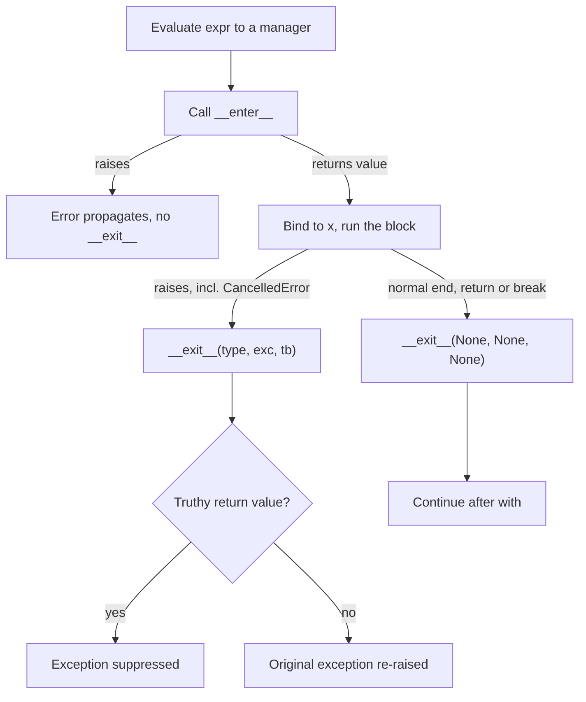

## TL;DR
A context manager pairs setup with guaranteed teardown: `with` runs `__enter__`, the block, then
`__exit__` on return, error or cancellation. Agent runs open streams, MCP sessions, sandboxes and spans;
`async with` and `contextlib` stop them leaking when a run fails or is stopped.

## For agent builders
- **Why it matters for agents.** An agent run acquires a lot: a model stream, MCP server sessions, a code
  sandbox or browser, a temp working directory, a trace span, a DB transaction for memory writes. Runs fail
  and get cancelled often (bad tool output, user Stop, step limit), and every one of those paths must
  release everything.
- **Where it shows up in your stack.** `httpx.AsyncClient` and provider stream helpers, the MCP Python SDK
  client (its transports and sessions are async context managers), FastAPI `lifespan`, SQLAlchemy
  sessions, tracing spans, `asyncio.timeout` and `asyncio.Lock`.
- **What you control.** Which resources are process-scoped (clients, pools in a lifespan) versus run-scoped
  (sandbox, MCP session, span), an `AsyncExitStack` for the tools a run turns out to need, and bounded,
  non-masking cleanup.
- **What you can skip.** The exact PEP 343 expansion beyond its three consequences, and writing class-based
  managers when `@asynccontextmanager` will do.

## Why it exists
- **Resources leak on the unhappy path.** A streaming LLM call opens a connection; the client
  disconnects, a parser raises on malformed JSON, or a timeout cancels the task, and the line that closes
  the stream never runs. A sandbox container started for a code tool stays up after the run crashes.
- **Small leaks compound.** An agent backend does this thousands of times an hour: the connection pool
  fills, new requests wait for a free connection, and latency climbs until the service looks down. GPU
  code has the same shape: forget to restore a mode or release a buffer and memory creeps up.
- **The naive fixes fall short.**
  - Calling `close()` at the end of the function misses every early return and exception.
  - `try/finally` is correct, but must be repeated at every call site, nested for each additional
    resource, and written correctly every time.
  - Relying on `__del__` or garbage collection gives no timing guarantee: reference cycles delay it, other
    interpreters do not refcount, and async cleanup cannot run from a finaliser at all.
- **PEP 343 packaged `try/finally` into the resource itself.** The object that knows how to acquire also
  knows how to release, and the `with` statement guarantees the release runs. Callers write one line and
  cannot get the cleanup wrong.
- **What it covers:** HTTP connection pools, streams, DB sessions, locks, temp files and GPU memory
  modes, which all leak quietly when cleanup depends on every code path remembering it.

## How it works
### The protocol
`with expr as x:` runs these steps:
1. **Evaluate** `expr` to a manager.
2. **Enter:** call `manager.__enter__()` and bind its return value to `x`.
3. **Run the block.**
4. **Always exit:** call `manager.__exit__(exc_type, exc, tb)`. On a normal exit all three are `None`; on
   an exception they describe it.

- **Suppression.** If `__exit__` returns a truthy value the exception is **suppressed**, *because* some
  managers (`contextlib.suppress`) exist precisely to do that; everyone else must return `None` or `False`.
- **Reverse unwinding.** Multiple managers in one statement exit in reverse order of entry, so
  dependencies unwind correctly.

Written out, `with mgr as x: body` is approximately what PEP 343 specifies:

```
enter, exit = type(mgr).__enter__, type(mgr).__exit__   # looked up on the type, once
x = enter(mgr)                    # if this raises, exit is never called
ok = True
try:
    body
except BaseException as e:
    ok = False
    if not exit(mgr, type(e), e, e.__traceback__):
        raise                     # falsy return: propagate the original
finally:
    if ok:
        exit(mgr, None, None, None)   # normal exit, including return/break
```

Three consequences follow from that expansion:
| Consequence | Why | What to do |
|---|---|---|
| `__exit__` runs only if `__enter__` succeeded | The protocol cannot know how far a failed setup got | A manager that acquires two things in `__enter__` must clean up the first itself if the second fails |
| Interrupts trigger cleanup too | `except BaseException` catches `KeyboardInterrupt` and `CancelledError` | Rely on `with` for cleanup in cancellable agent code |
| A raising `__exit__` replaces the original error | The original survives only as `__context__` in the traceback | A cleanup that can fail should log and swallow its own error rather than mask the real one |

### async with
- **Awaited entry and exit.** `async with` calls `await __aenter__()` and `await __aexit__(...)`,
  *because* closing a network resource is itself I/O: flushing a stream, returning a connection, sending a
  close frame, stopping a sandbox.
- **Common examples:** `httpx.AsyncClient`, async DB sessions, MCP client sessions and `asyncio.Lock` are
  all async context managers.
- **Cancellation passes through.** It arrives as `CancelledError` and passes through `__aexit__` like any
  exception, which is why `async with` is the reliable way to release resources when a user stops a run.
- **Keep exit code short and bounded**, because it can itself be interrupted during shutdown.

### contextlib: managers without classes
- **`@contextmanager` turns a generator into a manager.** Code before `yield` is setup, the yielded value
  is bound by `as`, code after is teardown.
- **Teardown belongs in `finally`.** The exception from the block is thrown in at the `yield`, so teardown
  must sit in `finally` or it is skipped on error.
- **`@asynccontextmanager`** is the async version, and it is what FastAPI's `lifespan` expects.
- **`ExitStack` and `AsyncExitStack`** manage a number of resources known only at runtime (the MCP servers
  and tools this particular run needs) and unwind whatever was entered if a later setup step fails, which
  is exactly the partial-setup problem from the expansion above.
- **Smaller helpers:** `closing()` for objects with only `close()`, `suppress()`, `nullcontext()` for
  optional managers, and `aclosing()` for async generators.
- **Rules for generator managers.** A `@contextmanager` object is single-use (it wraps one generator, so
  entering it twice raises), and its generator must yield exactly once.
- **It doubles as a decorator:** `@timed_span()` above a function wraps every call in the block.

### When there is no block to hang it on
- **Some lifetimes do not fit a lexical block:** an object handed to a caller, a cache entry, a worker
  that lives until shutdown, a long-lived agent session that spans many HTTP requests.
- **Then the owner of that lifetime closes it explicitly:** the app's lifespan, the pool, the session
  manager's idle timeout, or the cache's eviction hook.
- **`weakref.finalize(obj, cleanup)` is a better last resort than `__del__`**, since it runs at most once
  and also at interpreter exit. It still runs on garbage-collection timing, so treat it as leak insurance,
  not as the cleanup plan.

### Context managers that are not about I/O
- **Mode switches:** `torch.no_grad()` and `torch.inference_mode()` switch autograd off for a block and
  restore it after.
- **Temporary state:** `decimal.localcontext()` and temporary environment patches in tests follow the same
  pattern: change state, guarantee restoration.
- **The principle generalises** to anything with a "before" and a mandatory "after", including a trace span
  around an agent step.

## Diagram
The life of one `with` statement: `__exit__` runs on every path once `__enter__` has succeeded, and its
return value decides whether an exception propagates.



## Examples
### Per-run resources for an agent with AsyncExitStack
A run opens a sandbox and only the tool servers its task needs, decided at runtime. Whether the run
finishes, a tool fails or the user stops it, everything closes in reverse order. Resources are stubs.

```python
import asyncio
from contextlib import AsyncExitStack, asynccontextmanager

@asynccontextmanager
async def resource(kind: str, name: str):
    print(f"open  {kind}:{name}")
    try:
        yield f"{kind}:{name}"
    finally:
        await asyncio.sleep(0)                       # async teardown: stop container, close session
        print(f"close {kind}:{name}")

async def agent_run(task: str, servers: list[str], fail: bool = False) -> str:
    async with AsyncExitStack() as stack:
        await stack.enter_async_context(resource("span", task))         # trace span for the run
        sandbox = await stack.enter_async_context(resource("sandbox", "py"))
        sessions = [await stack.enter_async_context(resource("mcp", s)) for s in servers]
        await asyncio.sleep(0.05)                    # model and tool steps would run here
        if fail:
            raise RuntimeError("tool returned malformed output")
        return f"done with {sandbox} and {len(sessions)} servers"

async def main():
    print(await agent_run("triage", ["github", "jira"]))
    try:
        await agent_run("triage", ["github"], fail=True)
    except RuntimeError as e:
        print("run failed:", e)
    t = asyncio.create_task(agent_run("long", ["github", "jira"]))
    await asyncio.sleep(0.01); t.cancel()            # user pressed Stop
    try:
        await t
    except asyncio.CancelledError:
        print("run cancelled")

asyncio.run(main())
```

- **Every path closes everything:** success, the raised tool error and the cancellation all print the same
  `close` lines, newest first, so the MCP sessions close before the sandbox and the span ends last.
- **The list of servers is data**, which is why `AsyncExitStack` beats nested `async with` here.

### App lifespan with AsyncExitStack
Two process-scoped clients opened in a lifespan; a crash mid-request still closes both, in reverse order.

```python
import asyncio
from contextlib import AsyncExitStack, asynccontextmanager

class Client:                              # stands in for httpx.AsyncClient, a DB pool
    def __init__(self, name: str): self.name = name
    async def aclose(self): print(f"{self.name}: closed")

@asynccontextmanager
async def open_client(name: str):
    client = Client(name)
    print(f"{name}: opened")
    try:
        yield client
    finally:
        await client.aclose()              # runs on success, error or cancellation

@asynccontextmanager
async def lifespan(app=None):              # FastAPI calls lifespan(app) with this shape
    async with AsyncExitStack() as stack:
        llm = await stack.enter_async_context(open_client("llm-http"))
        db = await stack.enter_async_context(open_client("vector-db"))
        yield {"llm": llm, "db": db}

async def main() -> None:
    try:
        async with lifespan() as deps:
            print("serving with", sorted(deps))
            raise RuntimeError("crash mid-request")
    except RuntimeError as exc:
        print("propagated:", exc)

asyncio.run(main())
```

**Output, in order:**
1. `llm-http: opened`, `vector-db: opened`, `serving with ['db', 'llm']`.
2. `vector-db: closed` then `llm-http: closed`, in reverse order.
3. `propagated: crash mid-request`.

- **The error is not suppressed**, both clients are closed, and the dependency opened last is closed first.
- **The clients are created once per process**, not once per request or agent run, which is the point of
  putting them in a lifespan.

### Guarding partial setup, plus a timing span that is also a decorator
A class that acquires two resources in `__enter__` uses an `ExitStack` so a failure on the second closes
the first, then hands the stack over with `pop_all()`. Runs on Python 3.9+.

```python
import time
from contextlib import ExitStack, contextmanager

@contextmanager
def resource(name: str, fail: bool = False):
    if fail:
        raise ConnectionError(f"{name}: connect failed")
    print(f"{name}: opened")
    try:
        yield name
    finally:
        print(f"{name}: closed")              # runs on success and on error

class Pipeline:                               # acquires two resources in __enter__
    def __init__(self, fail_second: bool = False):
        self.fail_second = fail_second

    def __enter__(self):
        with ExitStack() as stack:
            self.llm = stack.enter_context(resource("llm"))
            self.db = stack.enter_context(resource("db", fail=self.fail_second))
            self._stack = stack.pop_all()     # success: keep both open past this block
        return self                           # failure: the with above closes llm

    def __exit__(self, *exc):
        return self._stack.__exit__(*exc)     # unwind in reverse order

@contextmanager
def timed_span(name: str):
    start = time.perf_counter()
    try:
        yield
    finally:
        print(f"{name}: {(time.perf_counter() - start) * 1000:.0f} ms")

@timed_span("embed")                          # also works as a decorator, fresh generator per call
def embed(texts: list[str]) -> int:
    time.sleep(0.05)
    return len(texts)

with Pipeline():
    print(embed(["a", "b"]))
try:
    with Pipeline(fail_second=True):
        pass
except ConnectionError as exc:
    print("setup failed:", exc)
# llm: opened / db: opened / embed: 50 ms (about) / 2 / db: closed / llm: closed
# llm: opened / llm: closed / setup failed: db: connect failed
```

Without the `ExitStack` in `__enter__`, the failing run would leak `llm`, because `__exit__` never runs
when `__enter__` raises.

### Worked incident: a stream leaked on the error path
Illustrative numbers for one agent worker using a shared `httpx.AsyncClient` (100 connections by default).

| Step | What happens |
|---|---|
| Code opens the provider stream, parses chunks, closes it at the end | Happy path releases the connection |
| About 1% of responses contain malformed JSON (a bad tool-call payload) and the parser raises | The close line is skipped, the connection stays checked out |
| At 10,000 streams an hour, about 100 leak per hour | The pool's 100 connections are gone in roughly an hour |
| New requests wait for a free connection, then hit pool timeouts | Latency climbs while CPU is idle; restarts "fix" it for an hour |
| Fix: iterate inside `async with client.stream(...)` | The connection returns on success, parse error and cancellation |

## Production patterns
- **One exit stack per agent run.** Open run-scoped resources (sandbox, MCP sessions, browser, temp
  directory, trace span) through an `AsyncExitStack` owned by the run, so success, failure and Stop share
  one cleanup path. Monitor sandboxes and sessions still open after their run ended; the number should be
  zero.
- **Process-scoped clients in a lifespan.** Open shared clients and pools in an `@asynccontextmanager`
  passed to FastAPI as `lifespan=`, with an `AsyncExitStack` when there are several. Monitor open
  connections and pool wait time per worker.
- **Keep streams open exactly as long as they are consumed.** Put `async with client.stream(...)` inside
  the async generator you hand to `StreamingResponse`, so the stream closes when iteration ends or the
  client disconnects. Monitor open upstream connections after client disconnects.
- **Make leaks loud in tests.** `ResourceWarning` is ignored by default, so run the suite with
  `-W error::ResourceWarning` (pytest accepts the same flag), or `python -X dev` to at least show them,
  and treat "unclosed" warnings as failures. Add error-injection tests that
  assert the pool is idle afterwards.
- **Bound cleanup that does I/O.** Wrap awaited cleanup in `__aexit__` or `finally` with
  `asyncio.timeout(...)`, and log rather than raise if it fails, so a hung close (a sandbox that will not
  stop) neither stalls shutdown nor masks the real error. Monitor shutdown duration.
- **Transactions as managers for memory writes.** Use the driver's transaction manager (for example
  `with Session(engine) as session, session.begin():` in SQLAlchemy) so commit happens on success and
  rollback on any exception. Monitor rollback rate and long-open transactions.

## Trade-offs
- **Visible cleanup point vs tied lifetime.** `with` guarantees cleanup at a lexically visible point, but
  ties resource lifetime to a block. When a resource must outlive the function (a pool shared by all
  requests, an agent session spanning many turns), move it to an app-level lifespan or a session manager.
- **Short vs easy to get wrong.** `@contextmanager` is far shorter than a class, but forgets cleanup on
  error if you omit `try/finally`. A class with `__exit__` is clearer when the manager carries state or is
  reused often.
- **Dynamic sets vs readable control flow.** `ExitStack` handles dynamic resource sets, at the cost of less
  obvious control flow. For two or three fixed resources a single multi-item `with` statement is easier to
  read.
- **Graceful degradation vs hidden bugs.** Suppressing exceptions in `__exit__` can turn a crash into
  graceful degradation, but hides real bugs unless the manager suppresses only specific, expected
  exception types.

## Pitfalls
- **Creating an `httpx.AsyncClient` inside each request with `async with`.** Cleanup is correct but there is
  no connection reuse. Symptom: high latency from repeated TLS handshakes. Fix: one client per process,
  opened in the lifespan.
- **Returning a lazy stream or generator from inside a `with` block.** The resource closes on return.
  Symptom: the consumer later fails with "stream closed" or reads nothing.
- **Writing `@contextmanager` teardown after `yield` without `finally`.** It runs in tests on the happy path
  and silently does not run when the block raises. Fix: wrap the `yield` in `try/finally`.
- **An `__exit__` that returns `True` by accident** (e.g. returning the result of a cleanup call).
  Symptom: exceptions vanish and callers see `None` results with no traceback. Fix: return `None`
  explicitly unless suppression is the manager's purpose.
- **Relying on `__del__` to close connections.** Symptom: "unclosed client session" warnings and pool
  exhaustion that varies with garbage-collection timing.
- **Acquiring a second resource in `__enter__` after the first without guarding it.** When the second
  fails, `__exit__` never runs, and the first leaks only on that rare setup-failure path. Symptom: slowly
  climbing open connections after upstream outages. Fix: an `ExitStack` in `__enter__`, as above.
- **A cleanup step in `__exit__` or `finally` that can raise** (closing an already-broken stream). Symptom:
  the traceback reports the cleanup error and the real cause is buried under "During handling of the above
  exception". Fix: log and swallow the cleanup's own error so the original propagates.

## When to use
- **Use for anything with an acquire-and-release pair:** clients and connection pools, streams, MCP
  sessions, sandboxes, DB sessions and transactions, locks and semaphores, temp files and directories,
  tracing spans, and temporary mode changes such as `torch.inference_mode()`.
- **Prefer the library's own manager** over manual `close()` calls.
- **Match scope to lifetime:** give long-lived resources a lifespan-scoped manager, per-run resources a
  run-scoped exit stack, and short-lived ones a block-scoped manager.
- **Measure:** watch open connections, pool wait time and file descriptors under load and after error
  injection; if they climb after errors, a path is skipping cleanup.
- **Interviews:** expect to explain `__exit__`'s arguments and return value and write a `@contextmanager`
  with a correct `finally`.

## Role lens
- **Engineer:** Wraps every client, stream, session and lock in `with`/`async with`, and writes
  `@asynccontextmanager` helpers with cleanup in `finally`.
- **Architect:** Defines resource lifetimes, process-scoped pools in a lifespan versus per-request sessions,
  so connection counts and shutdown behaviour are predictable.
- **FDE:** Traces a customer's "connection pool exhausted" incident to a stream opened without a context
  manager on an error path, and fixes it under their load.

## Check yourself
**Q:** A helper does `with httpx.stream("POST", url, json=body) as r: return r.iter_lines()`, and callers loop over
the result. It fails in production with errors about a closed stream. Why, and how should it be written?
**A:** `return` leaves the `with` block, so `__exit__` runs immediately and closes the response before
anyone iterates; `iter_lines()` is lazy, so the caller iterates a closed stream. The context manager must
stay open for as long as the data is consumed. Either make the helper a generator that `yield`s lines
inside the `with` block, so the stream closes when iteration ends, with consumers using `closing()` or
`aclosing()` for early exit, or have the helper itself be a context manager that yields the response so
the caller controls its lifetime with `with`.

## Interview questions
### What are the arguments and return value of __exit__, and why do they matter?
- **Arguments:** `exc_type`, `exc` and `tb` describe the exception that left the block, or are all
  `None` on a normal exit, so the manager can clean up differently (for example roll back instead of
  commit).
- **Return value:** truthy suppresses the exception, which is how `contextlib.suppress` works; anything
  else must return `None` or `False`, or errors silently vanish.

### An agent run uses a code sandbox and a varying set of MCP servers. How do you guarantee cleanup?
- **One `AsyncExitStack` per run.** Enter the span, the sandbox and each MCP session through it as the run
  discovers what it needs, so the set can be decided at runtime.
- **Every exit path unwinds it:** success, a tool error and cancellation from a user Stop all run the
  stack's exits in reverse order, newest resource first.
- **Bound and isolate cleanup:** wrap slow teardown in `asyncio.timeout`, log rather than raise, and
  monitor resources still open after their run ended.

### Write a @contextmanager that always releases its resource. What is the common bug?
- **Setup before `yield`, teardown in `finally`.** The block's exception is thrown in at the `yield`, so
  teardown placed after it without `finally` is skipped on error.
- **Yield exactly once**, and remember the object is single-use; for async resources use
  `@asynccontextmanager` and await the close.
- **Test the error path:** raise inside the block and assert the resource was released.

### An agent service's open connections climb slowly after every upstream outage. How do you find the leak?
- **Suspect a setup-failure or error path.** A second resource acquired in `__enter__` without a guard
  leaks the first when it fails, because `__exit__` never runs.
- **Reproduce with error injection** while watching open connections, pool wait time and file
  descriptors; enable `ResourceWarning` to see "unclosed" objects.
- **Fix with `ExitStack` in `__enter__`** or by moving each resource into its own `with`.

### When should a resource not be scoped to a with block?
- **When it must outlive the function**, such as an `httpx.AsyncClient` pool shared by all requests;
  per-request `async with` gives correct cleanup but repeated TLS handshakes.
- **Move it to the owner of its lifetime:** the app lifespan, the pool or the cache's eviction hook.
- **Use `weakref.finalize(obj, cleanup)` only as leak insurance**, since it runs on garbage-collection
  timing.

### Why is async with the reliable way to release resources in cancellable asyncio code?
- **Cancellation is an exception.** `CancelledError` passes through `await __aexit__(...)` like any other
  error, so the close runs when a timeout or disconnect cancels the task.
- **Closing is I/O**, such as returning a connection or sending a close frame, so it must be awaited
  rather than run from a finaliser.
- **Keep exit short and bounded**, because shutdown can interrupt it too.

## Quiz
### Q: What happens if an `__exit__` method returns `True` while the block raised an exception?
- [ ] The exception is re-raised after cleanup completes
- [x] The exception is suppressed and execution continues after the `with` statement
- [ ] Python raises a TypeError because `__exit__` must return None
- [ ] The block is retried once before the exception propagates
> A truthy return from `__exit__` tells the interpreter the exception was handled. That is how
> `contextlib.suppress` works, and why accidental truthy returns hide bugs.

### Q: Why does an async HTTP client use `async with` rather than plain `with`?
- [ ] Because plain `with` cannot be used inside an `async def` function
- [ ] Because `async with` runs the block in a separate thread
- [x] Because opening and closing it involve I/O that must be awaited without blocking the event loop
- [ ] Because `async with` suppresses CancelledError during cleanup
> Releasing connections and closing streams involve network I/O, so `__aenter__`/`__aexit__` are
> coroutines. Ordinary `with` remains usable inside async code for purely synchronous resources.

### Q: A `@contextmanager` function has setup, `yield conn`, then `conn.close()` with no try/finally. When does the connection leak?
- [ ] Never, because the decorator always runs code after the yield
- [ ] Only when the generator is garbage-collected before the block starts
- [ ] Only when the block returns early with `return`
- [x] When the block raises, because the exception is thrown in at the yield and skips the close
> The exception from the block is raised inside the generator at the `yield`, so code after it runs
> only if it is in `finally`. An early `return` exits normally and does run it.

## Use cases & projects
### Use cases
- **MCP sessions per agent run.** The MCP client's transports and sessions are async context managers, so
  an `AsyncExitStack` closes every server a run opened.
- **Code sandboxes and browsers.** A run-scoped context manager stops the container or browser even when
  the run crashes or the user presses Stop.
- **Process-scoped clients.** FastAPI `lifespan` opens model and HTTP clients once and closes them on
  shutdown, instead of per request.
- **Tracing and memory writes.** Spans and DB transactions close or roll back on every exit path, so traces
  and agent memory never end up half-written.

### Mini project
**Leak-proof agent run with an exit stack (1-2 hours).**
- **Goal:** acquire several run-scoped resources and show they are all released on success, error and
  cancellation.
- **Steps:** write three `@asynccontextmanager` fakes (an MCP session, a sandbox, a trace span) that log
  open and close; in an agent run, enter only the ones the plan needs via `AsyncExitStack`; run it three
  ways: normal finish, a tool that raises, and a task cancelled mid-run; count open resources after each.
- **Done when:** every scenario ends with zero open resources, the logs show reverse-order cleanup, and a
  test fails if any close is skipped.
