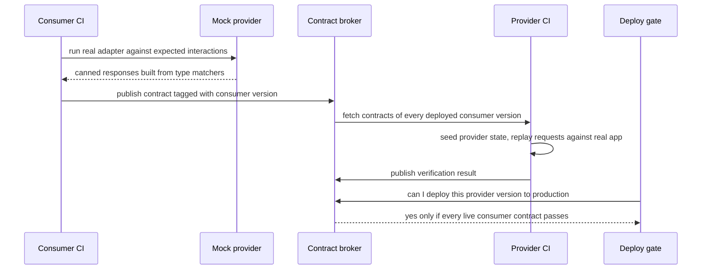

## TL;DR
An agent sits on many interfaces: tool services, retrieval, MCP servers, tool schemas. A contract test
checks that two sides agree on one (shapes, fields, status codes, errors) without running both: the
consumer records what it relies on, the provider verifies it.

## For agent builders
- **Why it matters for agents.** When a tool or retrieval service renames a field, an agent rarely
  crashes; it quietly answers without context or calls a tool with arguments that no longer mean
  anything. Contracts turn that silent degradation into a failed build in the commit that caused it.
- **Where it shows up in your stack.** The agent as consumer of retrieval, tool gateways and MCP
  servers; your tool service as provider to several agents; tool and structured-output JSON schemas,
  which are a contract with the model; vendor model APIs, which you can only validate and canary.
- **What you control.** Which boundaries get consumer-driven contracts versus a shared schema, strict
  validation at every boundary, a snapshot of each tool schema the model sees, and a deploy gate on
  deployed versions.
- **What you can skip.** Running a broker for interfaces one team owns end to end; shared Pydantic
  models and a schema snapshot are enough there.

## Lab
### Task
The agent reads `doc_id`, `score` and `text` from a retrieval service owned by another team. You will
write the provider-side verifier that replays the agent's contract against each provider version, so a
rename or retype fails the provider's build with a message naming the agent.

Pydantic does the schema work; you write the replay loop that Pact automates.
- **Time box:** 45-75 minutes.
- **Prerequisites:** Pydantic, Test doubles, mocks and fixtures, and this lesson's Consumer-driven
  contracts and Evolving a contract sections.
- **Setup:** Python 3.10+, `pip install pytest pydantic` (checked against Pydantic 2.14.1 and pytest
  9.1.1). Save the starter as `contract_lab.py` and the tests as `test_contract_lab.py`.
- **Goal:** compatible providers (`v1`, and `expanded` with an extra `content` field) pass; `renamed`,
  `retyped`, an unseeded state and a moved endpoint each produce exactly one readable failure.

### Starter code
```python
"""contract_lab.py: an agent's contract with a retrieval service, and provider variants to verify."""
from pydantic import BaseModel, ConfigDict, ValidationError


class Hit(BaseModel):                       # consumer side: only the fields the agent reads
    model_config = ConfigDict(extra="ignore", strict=True)
    doc_id: str
    score: float
    text: str


class SearchResponse(BaseModel):
    model_config = ConfigDict(extra="ignore", strict=True)
    hits: list[Hit]


CONTRACT = {
    "consumer": "agent-service", "provider": "retrieval-service",
    "interactions": [{
        "description": "search returns scored hits",
        "provider_state": "index contains doc d1 about refunds",
        "request": {"method": "POST", "path": "/search", "json": {"query": "refund policy", "k": 3}},
        "response": {"status": 200, "schema": SearchResponse, "min_hits": 1},
    }],
}


def make_provider(variant="v1"):
    """A stand-in for the provider's real app: handle(method, path, body) -> (status, json body)."""
    index = []

    def seed(state):
        index.clear()
        if state == "index contains doc d1 about refunds":
            index.append({"doc_id": "d1", "score": 0.9, "body": "Refunds take 5 days."})

    def handle(method, path, body):
        if (method, path) != ("POST", "/search"):
            return 404, {"error": "not found"}
        hits = []
        for d in index[: body["k"]]:
            hit = {"doc_id": d["doc_id"], "score": d["score"], "text": d["body"]}
            if variant == "renamed":
                hit["content"] = hit.pop("text")
            elif variant == "expanded":
                hit["content"] = hit["text"]
            elif variant == "retyped":
                hit["score"] = str(hit["score"])
            hits.append(hit)
        return 200, {"hits": hits, "took_ms": 3}

    return seed, handle


def verify(contract, seed, handle):
    """Replay every interaction against the provider; return a list of failure messages (empty = pass).

    Each message names the consumer, the interaction description and what broke.
    """
    raise NotImplementedError("EXERCISE: seed the state, replay the request, check status and schema")


if __name__ == "__main__":
    for variant in ["v1", "expanded", "renamed", "retyped"]:
        seed, handle = make_provider(variant)
        try:
            failures = verify(CONTRACT, seed, handle)
            print(f"{variant:9} {'PASS' if not failures else 'FAIL'} {failures}")
        except NotImplementedError as e:
            print(f"{variant:9} not verified: {e}")
```

### Expected output
`python contract_lab.py` with a working `verify` (message wording is yours, but it must name the
consumer, the interaction and the field). The starter prints `not verified` four times.

```text
v1        PASS []
expanded  PASS []
renamed   FAIL ['agent-service / search returns scored hits: hits.0.text: Field required']
retyped   FAIL ['agent-service / search returns scored hits: hits.0.score: Input should be a valid number']
```

`pytest -v` then reports `6 passed`.

### Tests
All 6 fail on the starter with `NotImplementedError`, which is the unimplemented verifier.

```python
import pytest

from contract_lab import CONTRACT, make_provider, verify


@pytest.mark.parametrize("variant", ["v1", "expanded"])
def test_compatible_providers_pass(variant):
    assert verify(CONTRACT, *make_provider(variant)) == []      # extra fields are fine


def test_renamed_field_fails_and_names_the_consumer():
    failures = verify(CONTRACT, *make_provider("renamed"))
    assert len(failures) == 1
    assert "agent-service" in failures[0]
    assert "search returns scored hits" in failures[0]
    assert "text" in failures[0]


def test_retyped_score_fails_under_strict_validation():
    failures = verify(CONTRACT, *make_provider("retyped"))
    assert len(failures) == 1 and "score" in failures[0]


def test_provider_state_is_seeded_not_assumed():
    seed, handle = make_provider("v1")
    empty_state = {**CONTRACT, "interactions": [
        {**CONTRACT["interactions"][0], "provider_state": "index is empty"}]}
    failures = verify(empty_state, seed, handle)
    assert len(failures) == 1 and "hit" in failures[0]           # min_hits=1 not met


def test_wrong_status_is_reported():
    seed, handle = make_provider("v1")
    moved = {**CONTRACT, "interactions": [{**CONTRACT["interactions"][0],
             "request": {"method": "POST", "path": "/v2/search", "json": {"query": "q", "k": 3}}}]}
    failures = verify(moved, seed, handle)
    assert len(failures) == 1 and "404" in failures[0]
```

### Failure scenarios
- **Inject: drop `strict=True` from `Hit`.** The retyped test fails because lax mode coerces the string
  `"0.9"` back into a float and verification passes. Debug: validate the raw body and print
  `e.errors()`; a retype that passes here still breaks a consumer that does not coerce.
- **Inject: `extra="forbid"` on `Hit`.** The `expanded` provider now fails, so the expand step of a
  rename is blocked. Debug: contracts must allow additions, or every provider change becomes a flag day.
- **Inject: skip `seed()` in `verify`.** The index stays empty and `v1` fails on hit count, or, without
  `min_hits`, passes on the empty path only. Debug: assert the promised state produced data.
- **Inject: add `chunk_id: str` to `Hit` although the agent never reads it.** Every provider fails.
  Debug: the contract must list only fields the real adapter uses, or the provider can change nothing.

### Submission
- **Your `verify` implementation**, with the given tests unchanged and all 6 passing.
- **The demo output** for all four variants.
- **An expand-and-contract walk-through:** a fifth provider variant that returns only `content`, and a
  second consumer contract that reads `content`, with a note on which contract blocks removing `text`.
- **A short note** on what this verifier cannot catch (a provider returning the right shape with the
  wrong document).
- **Evaluated by:** one failure per broken interaction, every message naming consumer, interaction and
  field, and no failures for additive changes.

## Why it exists
- **AI systems are services talking over interfaces.** An agent service calls a retrieval service, a
  tool gateway, a model gateway and customer APIs; tools exchange JSON with the model; an MCP server
  exposes schemas to clients. Each side is tested in isolation with doubles.
- **Mocks drift from the real service silently.** The agent's tests stub retrieval as
  `{"hits": [{"doc_id", "score", "text"}]}` and pass. The retrieval team renames `text` to `content`.
  Both suites stay green, because each checks only its own assumptions, and production shows the agent
  quietly answering without context.
- **Shared end-to-end environments are too slow and fragile.** They catch the rename, but they are flaky,
  expensive to keep in sync, and report the break long after the commit that caused it.
- **A spec document nobody executes does not help.** Asking teams to "follow it" fails because nothing
  runs the spec against the code. The provider also cannot know which fields consumers use, so every
  change feels risky and APIs ossify.
- **Contract testing makes the agreement executable and splits it in two.** Each consumer's expectations
  become a file the provider runs against its real code on every build, so a breaking change fails the
  provider's CI in the commit that caused it, naming the consumer it would break.

## How it works
### Consumer-driven contracts
1. **Consumer test.** The consumer's test talks to a mock provider configured with expected
   interactions: "given the index contains a refunds document, `POST /search` with this body returns
   200 and a list of hits each having a string `doc_id`, a number `score` and a string `text`."
   - The consumer code runs for real against that mock, so the expectations are exactly what the code
     uses.
2. **Contract file.** The run writes the interactions to a contract (a pact file in Pact's terms).
   - Matchers express "a string" or "a list of at least one like this" rather than exact values, because
     the consumer depends on shape, not on today's data.
3. **Provider verification.** The provider's CI fetches every consumer's contract, puts its real
   application into each named **provider state** (seeds the test index), replays each request, and
   checks the response matches.
   - Extra fields are fine; missing or retyped ones fail.
4. **Broker and deploy gate.** Contracts are published to a shared store (the Pact Broker or similar)
   tagged by version and environment.
   - The provider verifies against what is actually deployed, and a "can I deploy" check blocks
     releasing a version that breaks a live consumer.

### Why the direction matters
- **The consumer states only what it uses**, so the provider learns exactly which fields are
  load-bearing and is free to change everything else.
- **Asynchronous messages work the same way**, though there is no request to replay. The consumer records
  the event payload it expects (a `document.indexed` event on a queue), and the provider's verification
  calls the producing code and checks the message it would publish.

### Evolving a contract without a flag day
Contracts make breaking changes visible; they do not make them free. Renaming `text` to `content`
safely is an expand-and-contract sequence, and the broker's version matrix says when each step is
allowed.
1. **Expand.** The provider returns both `text` and `content`. Every existing contract still passes,
   because extra fields are allowed.
2. **Migrate.** Each consumer switches to `content` and publishes a new contract that no longer
   mentions `text`.
3. **Contract.** The provider removes `text`. Verification now passes only if *every deployed*
   consumer version has stopped relying on it, so the "can I deploy" check blocks the removal until the
   last old consumer has actually been redeployed, not merely merged.

- **The order matters because services deploy independently.** At any moment several versions of each
  are live, and the contract that must hold is the one between the versions actually running together.

### Provider-driven, schema-based contracts
- **The alternative:** the provider publishes a schema (OpenAPI, JSON Schema, protobuf) and both sides
  test against it.
- **Schemathesis** generates requests from an OpenAPI document and checks the real service's responses
  conform, which is property-based testing applied to an API.
- **What each catches:** schema checks catch "the service does not do what its spec says"; they do not
  tell you which consumers break when the spec changes, which is what consumer-driven contracts add.

| Approach | Who writes it | Catches | Cannot tell you |
|---|---|---|---|
| Consumer-driven (Pact) | each consumer | removed or retyped fields a consumer reads | whether the provider meets its own spec elsewhere |
| Schema-based (OpenAPI + Schemathesis) | the provider | responses that violate the published schema | which consumer a change breaks |

### Contracts you cannot verify
You cannot run provider verification against a model vendor's API. For third-party providers:
- **Validate every response at your boundary** with strict models.
- **Keep recorded real responses** as consumer test fixtures.
- **Pin SDK versions.**
- **Run a small scheduled canary** against the live API that validates real responses against your
  models, so a vendor-side change fails a check before users notice.
- **Tool schemas and structured-output schemas shown to a model are contracts too**, verified the same
  way: by validating what actually comes back.

### The agent's contract map
| Boundary | Agent's role | Contract style | Verified by |
|---|---|---|---|
| Retrieval or tool service another team owns | consumer | consumer-driven (Pact or hand-rolled) | provider CI plus deploy gate |
| Your tool service used by several agents | provider | consumer-driven, one contract per agent | your CI |
| MCP server's tool list and result shapes | consumer | schema snapshot plus strict validation | your CI and a live canary |
| Tool schemas shown to the model | provider (the model consumes) | committed schema snapshot | review on every change |
| Vendor model API | consumer, unverifiable | strict boundary models | recorded fixtures and a canary |

## Diagram
Follow one contract from the consumer's build to the provider's deploy gate; the provider never needs
the consumer running, only its published file.



## Examples
### Agent scenario: snapshot the tool schemas the model sees
A renamed argument or a tightened limit changes what the model is told, so it is an interface change
with the model as consumer. This test fails on any schema change until someone reviews the diff and
regenerates the committed file. Runnable with `pip install pydantic pytest`.

```python
import json
from pathlib import Path
import pytest
from pydantic import BaseModel, Field

class SearchDocs(BaseModel):
    """Search the help-centre index and return the top passages."""
    query: str = Field(description="What to search for, in the user's words")
    k: int = Field(3, ge=1, le=10, description="How many passages to return")

TOOLS = {"search_docs": SearchDocs}
SNAPSHOT = Path(__file__).with_name("tool_schemas.json")

def current_schemas() -> dict:
    return {name: model.model_json_schema() for name, model in TOOLS.items()}

def test_tool_schemas_match_snapshot():
    if not SNAPSHOT.exists():                      # first run: write it, commit it
        SNAPSHOT.write_text(json.dumps(current_schemas(), indent=2, sort_keys=True))
        pytest.skip("snapshot created; commit tool_schemas.json")
    assert current_schemas() == json.loads(SNAPSHOT.read_text()), (
        "tool schema changed: review what the model will now see, then regenerate the snapshot")

def test_model_tool_call_honours_schema():
    raw = '{"query": "refund policy", "k": 3}'      # a recorded real tool call
    assert SearchDocs.model_validate_json(raw).k == 3
```

- **Descriptions are part of the contract.** Rewording a field description changes model behaviour, so
  the snapshot flags it for review just like a renamed field.
- **Recorded tool calls as fixtures** check the other direction: what the model actually sends still
  validates against the schema you now publish.

### Hand-rolled contract: consumer model, provider verification
An agent service consumes a retrieval service. The consumer models only the fields it reads and
publishes one interaction; the provider's test replays it against the real app in a seeded state. This
hand-rolled version shows the mechanism that Pact automates with matchers and a broker.

```python
from pydantic import BaseModel, ConfigDict

class Hit(BaseModel):                      # consumer side: only fields the agent reads
    model_config = ConfigDict(extra="ignore", strict=True)   # strict: "0.9" is not a float
    doc_id: str
    score: float
    text: str

class SearchResponse(BaseModel):
    model_config = ConfigDict(extra="ignore", strict=True)
    hits: list[Hit]

CONTRACT = {                               # published by the consumer's CI
    "consumer": "agent-service", "provider": "retrieval-service",
    "interactions": [{
        "description": "search returns scored hits",
        "provider_state": "index contains doc d1 about refunds",
        "request": {"method": "POST", "path": "/search", "json": {"query": "refund policy", "k": 3}},
        "response": {"status": 200, "schema": SearchResponse},  # shipped as model_json_schema()
    }],
}

# provider side, in the retrieval service's own test suite
from fastapi.testclient import TestClient
from retrieval.app import app, seed_state  # the provider's real code

def test_retrieval_honours_agent_contract():
    client = TestClient(app)
    for it in CONTRACT["interactions"]:
        seed_state(it["provider_state"])
        req = it["request"]
        r = client.request(req["method"], req["path"], json=req["json"])
        assert r.status_code == it["response"]["status"]
        body = it["response"]["schema"].model_validate_json(r.content)  # missing/retyped field raises
        assert body.hits, "provider state promised at least one hit"
```

- **What fails and what passes.** If the retrieval team renames `text` to `content`, the provider test
  fails in their pull request; adding a new `chunk_id` field passes because the consumer ignores extras.
- **Why `strict=True` matters.** Pydantic's default lax mode would coerce a `score` that became the
  string `"0.9"` back into a float. The retype would pass verification while breaking any consumer that
  does not coerce.
- **In a real setup** the consumer publishes the JSON Schema (or Pact matchers) rather than a Python
  class.

### Consumer side: the real adapter against a stub built from the interaction
The matching consumer test runs the agent's real retrieval adapter against a stub server that returns a
response built from the same interaction. The contract then cannot list a field the adapter does not
parse, or omit one it does; that pairing is what Pact's mock provider automates. Runnable with
`pip install httpx pydantic pytest`.

```python
import json
import httpx
from pydantic import BaseModel, ConfigDict

class Hit(BaseModel):
    model_config = ConfigDict(extra="ignore", strict=True)
    doc_id: str
    score: float
    text: str

class SearchResponse(BaseModel):
    model_config = ConfigDict(extra="ignore", strict=True)
    hits: list[Hit]

def retrieve_context(http: httpx.Client, query: str, k: int = 3) -> list[str]:
    """The agent's real adapter: the passages it will put in the prompt."""
    r = http.post("/search", json={"query": query, "k": k})
    r.raise_for_status()
    return [h.text for h in SearchResponse.model_validate_json(r.content).hits]

INTERACTION = {
    "request": {"method": "POST", "path": "/search", "json": {"query": "refund policy", "k": 3}},
    "response": {"status": 200,
                 "json": {"hits": [{"doc_id": "d1", "score": 0.9, "text": "Refunds take 5 days."}]}},
}

def stub_provider(it: dict) -> httpx.MockTransport:
    def handler(request: httpx.Request) -> httpx.Response:
        exp = it["request"]
        assert (request.method, request.url.path) == (exp["method"], exp["path"])
        assert json.loads(request.content) == exp["json"]     # adapter sends what the contract says
        return httpx.Response(it["response"]["status"], json=it["response"]["json"])
    return httpx.MockTransport(handler)

def test_adapter_matches_contract():
    with httpx.Client(transport=stub_provider(INTERACTION), base_url="http://retrieval.test") as http:
        assert retrieve_context(http, "refund policy") == ["Refunds take 5 days."]
```

If the adapter starts sending `"top_k"` instead of `"k"`, the request assertion fails here, before the
provider ever sees the change.

### Worked scenario: removing `text` across independent deploys
Illustrative version numbers; the point is which check blocks which step.

| Day | Provider | Agent on main | Agent in production | Gate result for removing `text` |
|---|---|---|---|---|
| 1 | v41 returns `text` and `content` | v12 reads `text` | v12 | not attempted; all contracts pass |
| 3 | PR removes `text` | v13 reads `content` | v12 | **blocked**: deployed v12 still reads `text` |
| 5 | same PR, re-checked | v13 | v13, deployment recorded | allowed |

Verifying only against main (v13) on day 3 would have passed and caused an outage for the v12 still
running.

## Production patterns
- **Gate releases on deployed versions.** When a service ships, record it with
  `pact-broker record-deployment`; before each release run
  `pact-broker can-i-deploy --pacticipant <name> --version <sha> --to-environment production`. Monitor
  blocked releases and how long contracts sit unverified.
- **Verify when a contract changes, not only when the provider changes.** Configure a broker webhook that
  triggers the provider's verification build when a consumer publishes a changed contract, so the
  consumer learns within one build whether its new expectation is met. Track verification lag.
- **Schema fuzzing in provider CI.** Run Schemathesis against the running app's OpenAPI document
  (`schemathesis run <url-to-openapi.json>`) on each pull request. It catches responses that violate the
  spec, 500s on edge-case inputs and undocumented status codes. Watch for endpoints excluded from the run.
- **Canary the vendor APIs you cannot verify.** A scheduled job sends a fixed small prompt to each model
  provider, validates the response with the same strict models used at the boundary, and alerts on
  validation failure. Pair it with pinned SDK versions and re-recorded fixtures on upgrade.
- **Snapshot tool and structured-output schemas.** A test compares each tool's `model_json_schema()` with
  a committed JSON file, so any change to what the model is shown needs an explicit, reviewed update.
  Monitor schema validation failures on model tool calls after each change.
- **Pin and validate MCP servers you consume.** Snapshot the tool list and input schemas a third-party
  MCP server advertises, validate every tool result with strict models, and run a scheduled check that
  lists its tools and diffs them against the snapshot. Alert on any added, removed or changed tool.

## Trade-offs
- **Fast interface checks vs narrow coverage.** Contracts catch interface breaks in seconds per build,
  but only interface breaks; a provider that returns the right shape with the wrong documents still
  passes, which integration tests or evals cover.
- **Precise consumer knowledge vs process cost.** Consumer-driven contracts tell providers exactly which
  fields matter, but need a broker, versioning discipline and buy-in from both teams; with one team
  owning both sides, a shared schema is often enough.
- **Schema-first simplicity vs blind spots.** Schema-first contracts are simple to adopt and serve many
  unknown consumers, but cannot report which consumer a change breaks; they flip to the better choice for
  public APIs with external clients.
- **Loose matchers vs semantic gaps.** Type-not-value matchers keep contracts stable but can admit
  semantically wrong data; tighten them only where a value is genuinely part of the agreement, such as an
  enum of error codes.

## Pitfalls
- **Pinning exact values from the consumer's fixtures.** Symptom: provider verification fails whenever
  test data changes, until teams stop trusting and then stop running it. Fix: type matchers.
- **Recording fields the consumer does not read.** Symptom: a provider that cannot remove or rename
  anything, because every field appears load-bearing. Fix: generate the contract from the real adapter.
- **Missing provider states.** Verification runs against an empty database. Symptom: contracts that only
  ever verify the "no results" path while the populated path breaks unnoticed.
- **Treating a vendor LLM API as stable because your mocks are.** Symptom: a production parse error after
  an SDK or response-format change that no test of yours could have seen. Fix: boundary validation and a
  live canary.
- **Removing a field as soon as consumers' main branches stop using it.** Symptom: an outage in the window
  before the last consumer is redeployed, which a deploy gate on deployed versions prevents.
- **Verifying against the main-branch contract instead of the deployed one.** Symptom: a provider release
  that passes CI and still breaks the consumer version currently running in production.
- **Tool schema edits shipped without review.** A renamed argument or reworded description reaches the
  model unnoticed. Symptom: tool-call validation errors or a drop in tool-selection accuracy right after
  a deploy. Fix: a committed schema snapshot plus an eval run on schema changes.

## When to use
- **Use consumer-driven contracts when** separately deployed services are owned by different teams and
  interface breaks have actually reached production; that is when the broker and process pay for
  themselves.
- **Use schema-based checks when** one team owns both sides or the API is public: OpenAPI plus
  Schemathesis, or shared Pydantic models.
- **For third-party model and SaaS APIs:** boundary validation plus a live canary.
- **Avoid when:** you want to test behaviour; contracts are not a substitute for integration tests of
  behaviour.
- **Interviews:** contract testing is the expected answer to "how do you stop mocks drifting from the real
  service?"

## Role lens
- **Engineer:** Writes consumer tests that record only the fields the code reads, and provider tests
  with explicit states, so contract failures point at real breaks.
- **Architect:** Decides where contracts sit (service APIs, tool schemas, MCP surfaces, event payloads)
  and wires a deploy gate so breaking changes cannot ship to a live consumer.
- **FDE:** Captures the customer system's real request and response shapes as a contract early, so an
  upstream change in their API fails a check instead of a live integration.

## Check yourself
**Q:** Your agent calls an internal tool service owned by another team and a public LLM API. Mocks on
both sides keep passing while production breaks. Design the testing for each boundary.
**A:** For the internal tool service, I would use consumer-driven contracts: the agent's tests run
against a mock built from recorded interactions that use type matchers and name provider states; the
contract is published to a broker; the tool team's CI verifies it against their real service and a
deploy gate checks deployed versions. For the LLM API, I cannot run provider verification, so I would
validate every response with strict models at the boundary, keep recorded real responses as fixtures,
pin the SDK, and run a scheduled canary that calls the live API and validates the shape. Neither
replaces evals of answer quality; contracts only guarantee the shape of the conversation.

## Interview questions
### What is a consumer-driven contract, and why is the consumer the one writing it?
- **Definition:** the consumer's tests run its real code against a mock provider and record the
  interactions it relies on; the provider replays them against its real application in its own CI.
- **Why the consumer:** it states only the fields it actually reads, so the provider learns which fields
  are load-bearing and can change everything else freely.
- **Result:** a breaking change fails the provider's build in the commit that caused it, naming the
  consumer.

### How would you rename a response field that three consumers read, without an outage?
- **Expand:** return both the old and new field; every existing contract still passes because extra fields
  are allowed.
- **Migrate:** each consumer switches and publishes a contract without the old field.
- **Contract:** remove the old field only when the "can I deploy" check passes against every *deployed*
  consumer version, because merged-but-undeployed consumers still read it.

### When would you choose OpenAPI plus Schemathesis over Pact?
- **One team owns both sides, or the API is public** with unknown consumers: a provider-published schema
  is simpler and needs no broker or cross-team process.
- **What you give up:** a schema cannot tell you which consumer a change breaks, because it records what the
  provider offers, not what each consumer uses.
- **Pact pays off** when separately deployed services owned by different teams have shipped interface
  breaks to production.

### Your agent parses responses from a vendor LLM API. How do you get contract-like safety without provider verification?
- **Validate every response at the boundary** with strict Pydantic models, so a shape change fails loudly
  instead of degrading answers.
- **Keep recorded real responses as fixtures and pin the SDK**, re-recording on upgrades.
- **Run a scheduled canary** that calls the live API with a small fixed prompt and validates the shape, so a
  vendor-side change alerts before users notice.

### Your agent depends on a third-party MCP server. How do you protect it from changes on their side?
- **Treat it as an unverifiable provider:** you cannot run verification in their CI, so validate every
  tool result with strict models at your boundary.
- **Snapshot what it advertises:** the tool names and input schemas, diffed by a scheduled job that
  alerts on any change.
- **Keep recorded results as fixtures** for your own tests, and pin the server version where you can.

### Provider verification passes, yet the consumer in production broke. What are the likely causes?
- **Verified against the wrong version:** the provider checked the consumer's main-branch contract, not
  the version actually deployed.
- **Lax validation:** a field was retyped (a `score` that became the string `"0.9"`) and Pydantic's lax mode
  coerced it back, so verification passed while a non-coercing consumer failed.
- **Missing provider state:** verification ran against an empty index and only exercised the "no results"
  path.

## Quiz
### Q: In consumer-driven contract testing, who verifies the contract against real code?
- [ ] The consumer, by calling the real provider in its test suite
- [x] The provider, by replaying the consumer's recorded interactions against its real application
- [ ] A shared end-to-end environment that runs both services together
- [ ] Nobody; the contract file is documentation reviewed by humans
> The consumer runs against a mock to produce the contract; the provider verifies it in its own build.
> That split is what removes the need for a shared environment to catch interface breaks.

### Q: Why should consumer contracts use type matchers rather than exact values?
- [ ] Exact values make contract files too large to store
- [x] The consumer depends on response shape, so exact values cause failures whenever test data changes
- [ ] Type matchers let the provider omit fields the consumer uses
- [ ] Exact values cannot be serialised to JSON
> Pinning values couples the contract to fixtures rather than to the interface, making verification
> brittle. Matchers still fail when a used field is missing or changes type.

### Q: What can schema-based contract checks not tell a provider that consumer-driven contracts can?
- [ ] Whether responses match the published OpenAPI schema
- [ ] Whether a field has the declared type
- [x] Which specific consumers would break if a field were removed
- [ ] Whether the service handles malformed requests
> A schema describes what the provider offers, not what each consumer uses. Consumer-driven contracts
> record actual usage, so a removal fails against exactly the consumers that read that field.

## Use cases & projects
### Use cases
- **Agent and retrieval service.** A consumer contract records the fields the agent reads from search
  hits, so a rename on the retrieval side fails the retrieval team's build.
- **Shared tool services.** A tool gateway used by several agents runs each agent's contract, and can
  remove a field only when no deployed agent still reads it.
- **Tool schemas the model sees.** A snapshot test of every tool's JSON schema makes a change to what the
  model is offered a reviewed diff, not an accident.
- **MCP servers.** The schemas an MCP server exposes are validated in CI so clients do not discover a
  breaking change at runtime.

### Mini project
**Add a contract between an agent and its search tool (2-3 hours).**
- **Goal:** catch a breaking change in a search service before the agent quietly loses its context.
- **Steps:** build a small search service and an agent client that reads `doc_id`, `score` and `text`;
  write the consumer's expectations as a contract file from the agent's tests; verify the contract
  against the real provider code in its own test; snapshot the agent's tool schema; then rename `text`
  to `content` in the provider.
- **Done when:** the rename fails the provider's check with a message naming the agent as the broken
  consumer, and changing the tool schema shows up as a snapshot diff.
