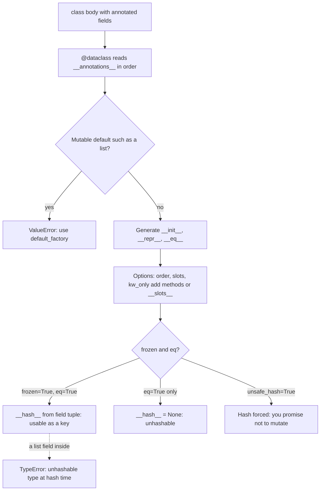

## TL;DR
Inside an agent, `@dataclass` is the record type for trusted state: steps, run budgets, generation
configs, retrieved chunks. It generates `__init__`, `__repr__`, `__eq__` and optionally hashing and
`__slots__`, but validates nothing; model output goes through Pydantic first.

## For agent builders
- **Why it matters for agents.** A run is a sequence of records: each tool call, its arguments, output
  and token cost. Frozen dataclasses make those records safe to share, hashable for loop detection and
  caching, and readable in traces.
- **Where it shows up in your stack.** Your own step, run and config types; trace spans you export;
  cache keys for LLM and tool calls. Frameworks mix styles (LangGraph state is often a `TypedDict` or
  Pydantic model), so the line you draw is "validated at the edge, dataclass inside".
- **What you control.** `frozen=True` for anything shared or used as a key, `default_factory` for
  per-run lists, `repr=False` on huge tool outputs and prompts, `slots=True` on high-volume records.
- **What you can skip.** `order=True`, `InitVar` and `match_args` details; you rarely need them in agent
  code.

## Lab
### Task
Build the trace records of an agent run: a frozen, slotted, keyword-only `ToolStep` whose canonical
arguments make repeated calls hashable and countable, a `Run` that enforces a step budget, and a
`replace`-based retry that never edits history.

Time box: 45-60 minutes. Do "How it works" here and the `type-hints` lesson first.
- **Change** the `ToolStep` decorator and the `output` field; keep the field names.
- **Implement** `make_step`, `retry_of`, `Run.record`, `Run.tokens` and `Run.repeats` in `lab.py`.
- **Run** on Python 3.10+ (for `slots` and `kw_only`), standard library plus pytest (checked on
  Python 3.12.14, pytest 9.1.1).

### Starter code
Save as `lab.py`. It runs and stops at the first unimplemented function.

```python
"""lab.py: immutable trace records, a step budget and loop detection for an agent run."""
from __future__ import annotations

import json
from collections import Counter
from dataclasses import asdict, dataclass, field, replace

class BudgetExceeded(RuntimeError): ...

@dataclass        # LAB: make it immutable and hashable, slotted, keyword-only; keep `output` out of repr
class ToolStep:
    index: int
    tool: str
    args_json: str                 # canonical JSON text of the arguments
    output: str                    # can be 40 KB of HTML
    input_tokens: int
    output_tokens: int

def make_step(index: int, tool: str, args: dict[str, object], output: str,
              input_tokens: int, output_tokens: int) -> ToolStep:
    """Build a step whose args_json is canonical, so equal calls compare and hash equal."""
    raise NotImplementedError("LAB: make_step")

def retry_of(step: ToolStep, *, input_tokens: int) -> ToolStep:
    """The next attempt of the same call: index + 1, new input_tokens, the original left untouched."""
    raise NotImplementedError("LAB: retry_of")

@dataclass
class Run:
    task: str
    max_steps: int = 4
    steps: list[ToolStep] = field(default_factory=list)

    def record(self, step: ToolStep) -> None:
        """Append, or raise BudgetExceeded(f"step budget of {self.max_steps} exhausted") when full."""
        raise NotImplementedError("LAB: Run.record")

    @property
    def tokens(self) -> int:
        """Input plus output tokens over all steps."""
        raise NotImplementedError("LAB: Run.tokens")

    def repeats(self) -> dict[tuple[str, str], int]:
        """(tool, args_json) -> count, only for calls made more than once: the loop signal."""
        raise NotImplementedError("LAB: Run.repeats")

def to_trace(run: Run) -> str:
    """JSON text of the whole run (outputs included) for the trace store."""
    return json.dumps(asdict(run))

def main() -> None:
    run = Run("Find the refund policy")
    s = make_step(0, "search", {"q": "refund", "k": 3}, "...40 KB of HTML...", 1800, 60)
    run.record(s)
    run.record(retry_of(s, input_tokens=2400))
    run.record(make_step(2, "search", {"k": 3, "q": "refund"}, "...40 KB of HTML...", 2500, 40))
    print(run.steps[0])
    print("tokens:", run.tokens)
    print("repeats:", run.repeats())
    try:
        run.record(make_step(3, "fetch", {"url": "/refunds"}, "<html>", 900, 20))
        run.record(make_step(4, "fetch", {"url": "/terms"}, "<html>", 900, 20))
    except BudgetExceeded as e:
        print("budget:", e)
    print("trace keys:", sorted(json.loads(to_trace(run))))

if __name__ == "__main__":
    try:
        main()
    except NotImplementedError as e:
        print("not implemented:", e)
```

### Expected output
`python lab.py` with a correct solution prints exactly (tokens: 1,860 + 2,460 + 2,540 = 6,860):

```
ToolStep(index=0, tool='search', args_json='{"k": 3, "q": "refund"}', input_tokens=1800, output_tokens=60)
tokens: 6860
repeats: {('search', '{"k": 3, "q": "refund"}'): 3}
budget: step budget of 4 exhausted
trace keys: ['max_steps', 'steps', 'task']
```

### Tests
Save as `test_lab.py` and run `python -m pytest -q`. On the starter all five fail with
`NotImplementedError`; once `make_step` works, the immutability, slots and repr checks still fail until
the decorator is changed.

```python
import json
from dataclasses import FrozenInstanceError
import pytest
from lab import BudgetExceeded, Run, ToolStep, make_step, retry_of, to_trace

def step(i=0, args=None, tokens=100):
    return make_step(i, "search", args or {"q": "refund", "k": 3}, "x" * 40_000, tokens, 10)

def test_step_is_immutable_hashable_and_canonical():
    a, b = step(args={"q": "refund", "k": 3}), step(args={"k": 3, "q": "refund"})
    with pytest.raises(FrozenInstanceError):
        a.tool = "fetch"
    assert a == b and len({a, b}) == 1
    assert json.loads(a.args_json) == {"q": "refund", "k": 3}

def test_step_is_slotted_keyword_only_and_quiet_in_logs():
    s = step()
    assert not hasattr(s, "__dict__")
    assert "xxxx" not in repr(s) and "output=" not in repr(s)
    with pytest.raises(TypeError):
        ToolStep(0, "search", "{}", "out", 1, 1)

def test_retry_is_a_new_record():
    s = step(tokens=1800)
    r = retry_of(s, input_tokens=2400)
    assert (r.index, r.input_tokens, s.index, s.input_tokens) == (1, 2400, 0, 1800)

def test_budget_tokens_and_repeats():
    run = Run("t", max_steps=3)
    for i in range(3):
        run.record(step(i, tokens=100))
    with pytest.raises(BudgetExceeded, match="step budget of 3 exhausted"):
        run.record(step(3))
    assert run.tokens == 330
    assert run.repeats() == {("search", '{"k": 3, "q": "refund"}'): 3}
    assert Run("a").steps is not Run("b").steps

def test_trace_keeps_outputs():
    run = Run("t"); run.record(step())
    assert len(json.loads(to_trace(run))["steps"][0]["output"]) == 40_000
```

### Failure scenarios
- **Dump args without `sort_keys=True`.** The same arguments in key order `q, k` and `k, q` give
  different text, so the two steps compare unequal and the loop goes unnoticed. Print both `args_json`
  values side by side.
- **Store `args: dict[str, object]` on the frozen step.** Construction works, but `{a, b}` raises
  `TypeError: unhashable type: 'dict'`, because the generated hash covers every field. The traceback
  points at the set or `Counter`, not the class.
- **Write `step.index += 1` in `retry_of`.** It raises `FrozenInstanceError`; on a non-frozen class it
  would silently rewrite history. Use `dataclasses.replace`.
- **Forget `repr=False` on `output`.** Every log line carries 40 KB; `repr(step)` in the test contains
  the payload. Check the length of `repr(step)` in a log.

### Submission
- **`lab.py` and `test_lab.py`,** with the `python -m pytest -q` output showing 5 passed.
- **The output of `python lab.py`,** matching the expected block, and a hand check of the token total.
- **One extension:** an `alert_on` threshold so `Run.record` raises when the same `(tool, args_json)`
  appears three times, with a test.
- **A note of 2-3 sentences:** which inputs to this run you would validate with Pydantic before they
  become `ToolStep`s, and why the dataclass itself does not check them.
- **Evaluation:** tests pass unmodified, no step is ever mutated after creation, and the repeat count
  survives key reordering.

## Why it exists
- **Systems fill up with mostly-data classes.** A `GenerationConfig` with a model name and temperature, a
  `RetrievedChunk` with text and a score, an agent `Step` with a tool name, arguments and output.
- **Hand-written, each costs thirty lines.** An `__init__` assigning every field, a `__repr__` for readable
  logs, an `__eq__` for tests, and sometimes `__hash__` for cache keys.
- **The boilerplate is where bugs live.** A field added to `__init__` but forgotten in `__eq__`, a repr
  missing the one field you needed in the incident log, a `__hash__` that disagrees with `__eq__` and
  silently breaks sets.
- **The alternatives fail specifically.** A plain dict has no checkable field names, no repr beyond braces
  and no methods. A tuple or `NamedTuple` is immutable and hashable but also indexable, so `chunk[1]`
  compiles and position 1 changes meaning when you add a field. Hand-written dunders are correct until
  the second person edits the class.
- **One source of truth, ordinary class.** Methods are generated from the annotated field list, so they
  cannot disagree with it. Generating code at class creation (not a dynamic `__getattr__` trick) keeps
  fast attribute access, normal inheritance and nothing magic at call time.

## How it works
### What the decorator generates
`@dataclass` reads the class's `__annotations__` in definition order, creates a field per annotated name,
then attaches methods:

| Option | Generated behaviour |
|---|---|
| default | `__init__(self, a, b=default)` assigning each field; defaulted fields after non-defaulted ones (the function-parameter rule, for the same reason) |
| default | `__repr__` printing `ClassName(a=..., b=...)`, which makes agent traces readable |
| default | `__eq__` comparing field tuples, only when the other object is the same class |
| `order=True` | `__lt__` and friends comparing field tuples in order |
| `frozen=True` | `__setattr__` and `__delattr__` that raise `FrozenInstanceError` |
| `slots=True` (3.10) | `__slots__`: no per-instance `__dict__`, less memory, faster attribute access, and assignment to undeclared attributes is rejected, catching typos like `cfg.temprature = 0.5` |
| `kw_only=True` (3.10) | all fields keyword-only: add fields in any order, avoid positional mistakes on many same-typed fields |

### When `__hash__` is generated
| Settings | `__hash__` | Why |
|---|---|---|
| `frozen=True` with `eq=True` | hash of the field tuple | Fields cannot change, so the hash is stable |
| `eq=True` alone | `__hash__ = None` (unhashable) | *Because* a mutable object whose hash changes would corrupt any set or dict holding it |
| `unsafe_hash=True` | forced | You promise not to mutate |

### Defaults and `field()`
- **Mutable defaults are rejected.** `x: list[str] = []` raises `ValueError: mutable default ... use default_factory`,
  because a class-level default is evaluated once and shared by every instance; the module checks
  explicitly since the aliasing bug is otherwise silent.
- **The check is a heuristic.** It rejects unhashable defaults (`list`, `dict`, `set`; before 3.11 exactly
  those three). A mutable but hashable object, such as an instance of an ordinary class, passes and is
  shared.
- **`field(default_factory=list)`** calls the factory per instance.
- **`field()` controls participation:** `repr=False` hides large payloads from logs, `compare=False`
  excludes a timestamp from equality, `init=False` marks a derived field set in `__post_init__`.

### Hooks and helpers
| Helper | What it does |
|---|---|
| `__post_init__` | Runs after the generated `__init__`; derived fields and cheap invariant checks (`if not 0 <= self.temperature <= 2: raise ValueError`) |
| `InitVar[T]` | Init-only parameter passed to `__post_init__` but not stored |
| `dataclasses.replace(obj, **changes)` | New instance with some fields changed; the idiom for "modifying" a frozen instance |
| `asdict(obj)` | Recursive conversion to dicts and lists, deep-copying along the way: convenient for logging, expensive for large nested structures |
| `fields(cls)` | Field metadata for generic code |
| `match_args` (3.10) | Positional destructuring in `match` statements |

### Inheritance
1. **Fields are collected in reverse MRO order:** base-class fields first, in declaration order, then the
   subclass's; a redeclared name keeps its original position.
2. **The generated `__init__` is one flat parameter list in that order**, *which is why* a subclass cannot
   add a required field after a base with a default: the signature would be
   `(model, temperature=0.0, tenant)`, which Python rejects.
3. **Fix:** `kw_only=True` on the subclass, or a `_: KW_ONLY` sentinel before the new fields, moves them
   out of the positional sequence and the conflict disappears.

### Frozen classes and derived fields
- **The generated `__init__` bypasses the freeze** by setting fields through `object.__setattr__`.
- **Your `__post_init__` does not get that privilege:** `self.n_tokens = ...` raises `FrozenInstanceError`.
- **Fix:** a derived field (`n_tokens: int = field(init=False)`) is set with
  `object.__setattr__(self, "n_tokens", ...)`, the same escape hatch the decorator uses.

### Where it stops
- **No type validation:** `GenConfig(temperature="hot")` constructs happily.
- **No JSON parsing, schemas or coercion.** Those are Pydantic's job, and Pydantic even offers
  `pydantic.dataclasses.dataclass`, which adds validation to the stdlib form.
- **The dividing line:** dataclasses for records *you* construct from already-trusted values; Pydantic for
  data that arrives from outside.

## Diagram
What happens once, at class creation: the decorator reads the annotated fields and generates methods,
and the `eq` and `frozen` settings decide whether instances can be hashed (and so used as LLM cache
keys or loop-detection entries for agent steps).



## Examples
### An agent run trace: immutable steps, a budget, loop detection
Steps are frozen records, the run owns a fresh list, a retry is a `replace` rather than a mutation, and
the hashable step fields make a repeated identical tool call visible. Passes `mypy --strict`.

```python
import json
from dataclasses import asdict, dataclass, field, replace

@dataclass(frozen=True, slots=True, kw_only=True)
class ToolStep:                                  # one immutable entry in the agent's trace
    index: int
    tool: str
    args_json: str                               # canonical JSON text, so the step stays hashable
    output: str = field(repr=False)              # can be huge: keep out of logs
    input_tokens: int
    output_tokens: int

@dataclass(slots=True)
class Run:
    task: str
    max_steps: int = 8
    steps: list[ToolStep] = field(default_factory=list)   # fresh list per run

    def record(self, step: ToolStep) -> None:
        if len(self.steps) >= self.max_steps:
            raise RuntimeError("step budget exhausted")
        self.steps.append(step)

    @property
    def tokens(self) -> int:
        return sum(s.input_tokens + s.output_tokens for s in self.steps)

run = Run("Find the refund policy")
s = ToolStep(index=0, tool="search", args_json=json.dumps({"q": "refund"}, sort_keys=True),
             output="...40 KB of HTML...", input_tokens=1800, output_tokens=60)
run.record(s)
run.record(replace(s, index=1, input_tokens=2400))     # a retry: new record, original untouched
print(run.steps[0])            # ToolStep(index=0, tool='search', args_json='{"q": "refund"}', input_tokens=1800, output_tokens=60)
print(run.tokens)              # 4320
seen = {(st.tool, st.args_json) for st in run.steps}
print(len(seen))               # 1: the same call twice, a loop signal
trace = asdict(run)            # deep copy, ready for json.dumps to a trace store
print(sorted(trace))           # ['max_steps', 'steps', 'task']
```

- **Why `args_json` and not `args: dict`:** a dict field would make the frozen step unhashable, so it
  could not go in the `seen` set; canonical JSON text (`sort_keys=True`) keeps equal calls equal.
- **The repr hides the 40 KB output**, so printing the step in a log line stays one line.

### Frozen config as a cache key, mutable step record
A frozen, slotted config works as a cache key; the step record gets a per-instance default list; `replace`
produces a varied config without touching the original.

```python
import time
from dataclasses import dataclass, field, replace, asdict
from functools import lru_cache

@dataclass(frozen=True, slots=True)
class GenConfig:
    model: str
    temperature: float = 0.0
    max_tokens: int = 256
    stop: tuple[str, ...] = ()            # tuple, not list, so the instance stays hashable

    def __post_init__(self) -> None:
        if not 0.0 <= self.temperature <= 2.0:
            raise ValueError(f"temperature out of range: {self.temperature}")

@dataclass(slots=True)
class Step:
    tool: str
    args: dict[str, object]
    started: float = field(default_factory=time.time)
    output: str | None = field(default=None, repr=False)   # keep big payloads out of logs
    notes: list[str] = field(default_factory=list)         # a fresh list per instance

@lru_cache(maxsize=1024)
def completion(prompt: str, cfg: GenConfig) -> str:        # cfg is hashable, so it can be a key
    return f"<{cfg.model}@{cfg.temperature}> {prompt[:24]}"

base = GenConfig(model="gpt-4o-mini")
hot = replace(base, temperature=0.9)                       # new object; base unchanged
completion("Summarise the KV cache", base)
completion("Summarise the KV cache", GenConfig("gpt-4o-mini"))
print(completion.cache_info().hits)                        # 1: equal configs are the same key
try:
    base.temperature = 1.0
except Exception as e:
    print(type(e).__name__)                                # FrozenInstanceError

s1, s2 = Step("search", {"q": "a"}), Step("search", {"q": "b"})
s1.notes.append("retried"); print(s2.notes)                # []: default_factory did its job
print(s1)                                                  # Step(tool='search', args={'q': 'a'}, started=..., notes=['retried'])
print(asdict(s1)["notes"] is s1.notes)                     # False: asdict deep-copies
```

- **Break it on purpose:** change `stop` to `list[str]` with a `default_factory` and `lru_cache` raises
  `TypeError: unhashable type`, because a frozen dataclass's hash is built from its fields and a list
  has none.

### Derived field on a frozen class, plus a required subclass field
The `object.__setattr__` escape hatch sets `n_tokens`, and `KW_ONLY` lets a subclass add a required
`tenant` after a defaulted base field. Passes `mypy --strict`.

```python
from dataclasses import KW_ONLY, dataclass, field, fields

@dataclass(frozen=True)
class Chunk:
    text: str
    score: float = 0.0
    n_tokens: int = field(init=False)          # derived, not a constructor argument

    def __post_init__(self) -> None:
        # self.n_tokens = ... would raise FrozenInstanceError here
        object.__setattr__(self, "n_tokens", len(self.text.split()))

@dataclass(frozen=True)
class TenantChunk(Chunk):
    _: KW_ONLY
    tenant: str                                # required, yet after a defaulted base field

c = TenantChunk("kv cache stores keys and values", 0.82, tenant="acme")
print(c.n_tokens, c.tenant)                    # 6 acme
print([f.name for f in fields(c)])             # ['text', 'score', 'n_tokens', 'tenant']
print(c == TenantChunk("kv cache stores keys and values", 0.82, tenant="acme"))  # True
print(len({c, c}))                             # 1: frozen + eq gives a hash
```

## Production patterns
- **Immutable step records, append-only runs.** Record each model turn and tool call as a frozen
  dataclass appended to the run, never edited in place, so traces, replays and evals see exactly what
  happened. Key `(tool, canonical args)` into a counter per run to catch an agent repeating itself, and
  alert on runs that hit the step budget.
- **Frozen configs as cache and dedup keys.** Model generation settings as `@dataclass(frozen=True)` with
  tuple-typed collections, and key `lru_cache` or a response cache on them. Monitor cache hit rate via
  `cache_info()`; a hit rate near zero often means a field like a timestamp should be `compare=False`.
- **Slots for high-volume records.** Use `slots=True` on chunks, token events and trace spans created in
  large numbers. Verify the saving with `tracemalloc` snapshots before and after, because on 3.11+ the
  gain is smaller than older benchmarks suggest.
- **`repr=False` on large or sensitive fields.** Raw documents, embeddings and prompt bodies stay out of
  logs and tracebacks. Watch log volume per request; a jump often means a new field leaked into a repr.
- **Validate at the edge, dataclass inside.** Parse external input with Pydantic, then build internal
  dataclasses from the validated values. Keep only cheap invariant checks in `__post_init__`.
- **`kw_only=True` on wide records.** Records with many same-typed fields (several `float` scores, several
  `str` IDs, input and output token counts) become keyword-only, so a reordered field never silently
  swaps two values.

## Trade-offs
- **Free dunders vs no validation.** Methods are correct and consistent, but once input comes from outside
  the process, a Pydantic model is the right tool despite its extra weight.
- **`frozen=True`: safe sharing vs allocation.** Hashability and safe sharing across threads and cache keys,
  but every update allocates a new object via `replace`, which matters only in tight loops over large
  records.
- **`slots=True`: memory and typo safety vs no `__dict__`.** Libraries that stash attributes on objects or
  rely on `vars(obj)` break.
- **`order=True`: free sorting vs wrong ordering.** It compares fields positionally in declaration order,
  rarely the ordering you mean for a domain object.
- **`asdict`: convenience vs deep copy.** It copies the whole tree; for large nested records a hand-written
  `to_dict` (or `vars(obj)`, on non-slotted classes) is cheaper.

## Pitfalls
- **Trusting the mutable-default check completely.** `field(default=[])` is rejected like `= []`, but
  `field(default=RetryPolicy())` (a hashable object of an ordinary class) or an unannotated base-class
  attribute is silently shared. Symptom: one instance's changes appear in every other instance.
- **Hand-written `__eq__` or `eq=True` on a mutable class used as dict keys.** Symptom:
  `TypeError: unhashable type` or, with `unsafe_hash`, items vanishing from sets after mutation.
- **Required field after a defaulted one in a subclass.** Symptom:
  `TypeError: non-default argument follows default argument` at import, fixed by `kw_only=True`.
- **Assigning a derived field in a frozen class's `__post_init__`.** `FrozenInstanceError` from inside the
  constructor looks like the object was frozen too early. Use `object.__setattr__` for that assignment.
- **Expecting coercion.** `GenConfig(temperature="0.7")` stores the string, and the error appears later as
  a `TypeError` in arithmetic. Validate in `__post_init__` or use Pydantic.
- **A list inside a frozen dataclass.** The reference is frozen but the list is not, so hashing fails or,
  worse, the "immutable" config changes.

## When to use
- **Use for trusted in-process records:** configs, intermediate results, agent steps, cache keys, test
  fixtures. Day to day, the default container for anything with more than two fields.
- **Prefer `frozen=True`** for anything shared across tasks or used as a key, and `slots=True` for anything
  created in large numbers (retrieved chunks, token events).
- **Switch away** to Pydantic when data crosses a trust boundary or needs a schema, and to `NamedTuple`
  only when tuple unpacking is genuinely the interface.
- **Measure** memory with `tracemalloc` when instance counts reach the millions. Slots remove the
  per-instance `__dict__`, which can be a large share of a small record's footprint, though the saving is
  smaller on 3.11+ where instance dicts are stored more compactly, so measure rather than assume.
- **Interviews:** explain `default_factory`, when `__hash__` is generated and why, and the line between
  dataclasses and Pydantic.

## Role lens
- **Engineer:** Models generation configs and agent steps as frozen, slotted dataclasses so they
  are hashable cache keys with readable reprs in traces.
- **Architect:** Sets the rule that internal records are dataclasses and boundary types are
  Pydantic, so validation cost and schema generation stay where they belong.
- **FDE:** Turns a customer's ad-hoc dicts into dataclasses during an integration, giving their
  pipeline checked field names and reprs that make the first incident debuggable.

## Check yourself
**Q:** You want to memoize LLM calls keyed on the prompt plus a configuration object holding the
model, temperature and a list of stop sequences. The config is a mutable dataclass and `lru_cache`
raises `TypeError: unhashable type`. Explain why and how you would fix it.
**A:** A dataclass with `eq=True` (the default) and `frozen=False` sets `__hash__ = None`, because
a hashable object must not change its hash, and a mutable record can. Even with `frozen=True`, the
`list` of stop sequences is unhashable, so the generated hash, which hashes the field tuple, fails.
The fix is `@dataclass(frozen=True)` with `stop: tuple[str, ...]` instead of a list, which gives a
stable hash and lets `replace` produce variants. If the config really must be mutable, derive an
explicit immutable key (a tuple of the fields) and cache on that instead.

## Interview questions
### What does `@dataclass` actually do, and why generate code instead of using a dynamic base class?
- **It generates methods at class creation** (`__init__`, `__repr__`, `__eq__`, optionally ordering,
  hashing and `__slots__`) from the annotated field list, so they cannot disagree with it.
- **Why generation:** the result is an ordinary class with fast attribute access, normal inheritance and
  nothing magic at call time, unlike a `__getattr__`-style trick.

### One agent step's notes are appearing on every other step. How do you find the cause?
- **Suspect a shared default.** The dataclass check rejects `list`, `dict` and `set` defaults, but a
  hashable object of an ordinary class (`field(default=RetryPolicy())`) or an unannotated base-class
  attribute is silently shared.
- **Confirm** with `a.notes is b.notes` on two fresh instances.
- **Fix:** `field(default_factory=...)` so each instance gets its own object.

### How would you model an agent's run history so it supports tracing, replay and loop detection?
- **Frozen step records** (tool, canonical argument JSON, output, token counts) appended to a run that
  owns its list via `default_factory`, so nothing rewrites history after the fact.
- **Hashability buys loop detection:** a set or counter of `(tool, args)` per run flags the same call
  repeating, and the step budget is enforced in one `record` method.
- **Keep big fields out of reprs** with `repr=False`, and validate model output with Pydantic before it
  becomes a step, because the dataclass will store whatever it is given.

### When would you not use a dataclass?
- **At a trust boundary:** it validates and coerces nothing, so `GenConfig(temperature="hot")`
  constructs happily; use Pydantic for external input or when you need a schema.
- **When tuple unpacking is the interface:** a `NamedTuple` fits that better.
- **When a library relies on `vars(obj)`** or stashes attributes on objects, `slots=True` breaks it.

### Your pipeline creates millions of chunk records and memory is high. What would you try, and how would you check it helped?
- **Try `slots=True`:** it removes the per-instance `__dict__`, which can be a large share of a small
  record's footprint, and rejects typo attributes as a bonus.
- **Measure, do not assume:** compare `tracemalloc` snapshots before and after, because on 3.11+ instance
  dicts are stored more compactly and the saving is smaller than older benchmarks suggest.
- **Also check** whether `asdict` is deep-copying large trees on a hot path.

### A subclass adds a required `tenant` field and the module fails at import. Why, and what is the fix?
- **Why:** fields are collected base first, and the generated `__init__` is one flat parameter list, so a
  required field after a defaulted base field gives `non-default argument follows default argument`.
- **Fix:** `kw_only=True` on the subclass, or a `_: KW_ONLY` sentinel before the new fields, which moves
  them out of the positional sequence.

## Quiz
### Q: Why does `@dataclass` reject `tags: list[str] = []` with a ValueError?
- [ ] Lists cannot be dataclass fields
- [x] The default would be evaluated once and shared by every instance, so the module demands `default_factory`
- [ ] Empty lists are falsy and would break `__eq__`
- [ ] Type hints for lists require `List[str]` from `typing`
> A class-level default is a single object. Sharing it across instances is the classic aliasing bug,
> so dataclasses raise at definition time and `field(default_factory=list)` creates one per instance.

### Q: Under which setting does `@dataclass` generate a usable `__hash__`?
- [ ] `eq=True` alone
- [ ] `order=True` alone
- [x] `frozen=True` together with `eq=True`
- [ ] `slots=True` alone
> Hashing requires the hash to be stable, which a mutable object cannot guarantee; `eq=True` without
> `frozen` therefore sets `__hash__ = None`. Frozen plus eq hashes the field tuple safely.

### Q: What is the main thing a dataclass does not do that Pydantic does?
- [ ] Generate a readable `__repr__`
- [ ] Support default values
- [x] Validate and coerce field values at construction
- [ ] Support inheritance
> Dataclasses generate methods from annotations but never check them; `Config(temperature="hot")`
> succeeds. Pydantic validates, coerces and reports structured errors, which is why it owns boundaries.

## Use cases & projects
### Use cases
- **Step and run records.** A frozen `Step` holding tool name, arguments, output and token cost makes
  each run a readable, shareable trace.
- **Loop detection and caching.** Hashable frozen records of (tool, arguments) let the loop spot a
  repeated call and serve cached tool results.
- **Run budgets and generation configs.** Small dataclasses carry max steps, token limits, model and
  temperature through the loop with one readable repr.
- **Retrieved chunks.** A `RetrievedChunk` with text, score and source moves between retrieval, reranking
  and prompt assembly with checkable field names.

### Mini project
**Trace an agent run with frozen records (1-2 hours).**
- **Goal:** record every step of a tool-calling loop as dataclasses and use them to stop loops.
- **Steps:** define a frozen, slotted `Step` with `repr=False` on the tool output and a `Run` with a
  `default_factory` list of steps and a budget; append a `Step` per tool call; keep a
  `collections.Counter` of (tool, canonical argument JSON) keys and stop when any key reaches three;
  export the run as JSON.
- **Done when:** a scripted run that issues the same call over and over stops on its third occurrence,
  the repr stays short with large outputs, and the exported trace lists every step with its cost.
