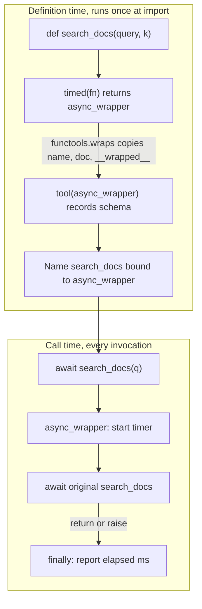

## TL;DR
A decorator takes a function and returns a replacement, applied with `@name`. Retries, tracing, caching
and tool or route registration are written once and attached declaratively. Watch three edges: missing
`functools.wraps`, sync wrappers on async functions, and stacking order.

## Why it exists
- **Every model and tool call needs the same wrapping:** retry on 429 and timeouts with backoff, record
  latency and token counts, open a trace span, check permissions, cache identical calls.
- **Inline copies drift.** Every function starts with the same fifteen lines of try/except/sleep/log, the
  copies diverge, and one forgotten retry is an outage.
- **Helper calls at top and bottom still repeat** (`start = timer(); ...; log(start)`), and miss early
  returns and exceptions unless each is wrapped in `try/finally`.
- **Base classes and manual wrapping are worse.** Inheritance forces unrelated functions into class
  hierarchies; `fetch = with_retry(fetch)` works but sits apart from the definition, easy to forget.
- **Functions are first-class objects**, so a function can take another and return a new one that adds
  behaviour. `@` (PEP 318) puts that on the definition, where readers see it. Frameworks use it for
  registration: `@app.get("/chat")` in FastAPI, `@mcp.tool()` in the MCP SDK and agent-framework tool
  decorators record your function and read its signature and docstring to build a schema.

## How it works
### Desugaring
```
@timed
def embed(texts): ...
```
- **Is exactly `embed = timed(embed)`,** executed once, at definition time (usually import time).
- **Typical shape:** `timed` defines an inner `wrapper(*args, **kwargs)` that does work before and after
  calling the original, and returns `wrapper`.
- **The wrapper is a closure:** it keeps a reference to the original function in its enclosing scope,
  which is how it can call it later.

### Preserve identity with functools.wraps
- **The problem.** The wrapper has its own `__name__`, `__doc__` and signature, so every decorated function
  looks like `wrapper(*args, **kwargs)` to logs, debuggers and, critically, frameworks that build tool or
  API schemas from signature and docstring.
- **The fix.** `@functools.wraps(fn)` copies the name, docstring, module and annotations, and sets
  `__wrapped__` so `inspect.signature` reports the original signature.

### Decorators with arguments are factories
1. `@retry(attempts=3)` calls `retry(attempts=3)` first.
2. That returns the real decorator, which receives the function.
3. The decorator returns the wrapper.

Three levels of nesting: factory, decorator, wrapper. Class decorators (PEP 3129) work the same way on
classes; `@dataclass` is one.

### Async functions need async wrappers
- **Calling an `async def` returns a coroutine without running it.**
- **So a plain sync wrapper** measures how long it took to *create* the coroutine (microseconds), and its
  `try/except` never sees the real errors, which happen later at `await`.
- **Fix:** a decorator meant for both checks `inspect.iscoroutinefunction(fn)` and returns an `async def`
  wrapper that awaits the call.

### Typing: runtime metadata is not static types
- **`wraps` fixes runtime only.** A type checker sees the wrapper's declared type. Annotate a decorator as
  `Callable[..., Any] -> Callable[..., Any]` and every decorated function loses its parameter types in mypy
  and the IDE.
- **`ParamSpec` (PEP 612, 3.10+) carries them through:**
  `def deco(fn: Callable[P, Awaitable[R]]) -> Callable[P, Awaitable[R]]`, with the wrapper taking
  `*args: P.args, **kwargs: P.kwargs`.
- **Signature-changing decorators** (injecting a client argument, say) need `Concatenate` to say so.

### Class-based decorators and methods
- **Any callable works**, including a class whose `__call__` wraps the function; handy when the decorator
  holds state such as counters or a cache.
- **The catch is method binding.** Plain functions are descriptors, so `obj.method` binds `self`
  automatically. An instance of your class is not, so decorating a method with it silently drops `self`
  unless the class implements `__get__`.
- **Function-based wrappers avoid this**, because the wrapper is itself a function.

### Stacking order
```
@traced
@retry(attempts=3)
def call(): ...
```
- **Equals `call = traced(retry(attempts=3)(call))`.** Decorators apply bottom-up, so at call time the
  outermost one, `traced`, runs first.
- **Here one span covers all three attempts;** swap them and each attempt gets its own span. Order is a
  design decision, not style.
- **Registration decorators go on top.** `@mcp.tool()` or `@app.get(...)` registers whatever object it
  receives. Put it below `@retry` and the framework registers the un-retried function, while the retrying
  wrapper is bound to a module name nobody calls.

## Diagram
Two phases for the stacked `@tool` over `@timed` example below: decorators run bottom-up once at import,
then every call enters the outermost wrapper first.



## Examples
### An async retry decorator with backoff and jitter
```python
import asyncio, functools, inspect, random, time
from collections.abc import Awaitable, Callable
from typing import ParamSpec, TypeVar

P, R = ParamSpec("P"), TypeVar("R")

class Transient(Exception): ...

def retry(attempts: int = 3, base_delay: float = 0.5):
    def decorator(fn: Callable[P, Awaitable[R]]) -> Callable[P, Awaitable[R]]:
        if not inspect.iscoroutinefunction(fn):
            raise TypeError("retry() here supports async functions only")

        @functools.wraps(fn)
        async def wrapper(*args: P.args, **kwargs: P.kwargs) -> R:
            for attempt in range(1, attempts + 1):
                start = time.perf_counter()
                try:
                    return await fn(*args, **kwargs)
                except Transient as exc:
                    ms = (time.perf_counter() - start) * 1000
                    print(f"{fn.__name__} attempt {attempt} failed after {ms:.0f} ms: {exc}")
                    if attempt == attempts:
                        raise
                    delay = base_delay * 2 ** (attempt - 1)
                    await asyncio.sleep(delay * random.uniform(0.5, 1.5))  # jitter
        return wrapper
    return decorator

@retry(attempts=4, base_delay=0.1)
async def complete(prompt: str) -> str:
    """Call the model provider."""
    await asyncio.sleep(0.05)
    if random.random() < 0.5:
        raise Transient("429 rate limited")
    return f"answer to {prompt!r}"

print(complete.__name__, complete.__doc__)     # complete Call the model provider.
print(asyncio.run(complete("hi")))
```

**The numbers** (4 attempts, 0.1 s base delay, 50% failure rate):
| Quantity | Value |
|---|---|
| Waits between failures | about 0.1, 0.2 and 0.4 s, with ±50% jitter |
| A call that never succeeds | gives up after roughly 0.7 s of backoff plus four call durations (0.2 s here) |
| Probability all four attempts fail | 0.5⁴ = 1/16, so about 6% of calls still raise |

- **Retries change the error rate; they do not remove it.**
- **What ran when:** `retry(...)` executed once at import and returned `decorator`; `decorator(complete)`
  also ran once at import and rebound the name `complete` to `wrapper`; only `wrapper`'s body runs per call.
- **Why jitter:** many clients failing on the same 429 would otherwise retry in lockstep and hit the
  provider together again.
- **In production** you would usually use `tenacity` rather than hand-roll this.

### A tool registry that survives decoration
Registration plus an async-aware timer, stacked in the right order. Remove the `@functools.wraps(fn)`
above `async_wrapper` and the registry records `async_wrapper` with no docstring and params
`['args', 'kwargs']`: exactly the schema an LLM would then guess against.

```python
import asyncio, functools, inspect, time

TOOLS: dict[str, dict] = {}

def tool(fn):                                    # registration: records whatever it receives
    TOOLS[fn.__name__] = {"doc": inspect.getdoc(fn),
                          "params": list(inspect.signature(fn).parameters)}  # follows __wrapped__
    return fn

def timed(fn):
    def report(start: float) -> None:
        print(f"{fn.__name__} took {(time.perf_counter() - start) * 1000:.0f} ms")

    if inspect.iscoroutinefunction(fn):          # async in, async out
        @functools.wraps(fn)
        async def async_wrapper(*args, **kwargs):
            start = time.perf_counter()
            try:
                return await fn(*args, **kwargs)  # time the awaited work, not coroutine creation
            finally:
                report(start)
        return async_wrapper

    @functools.wraps(fn)
    def wrapper(*args, **kwargs):
        start = time.perf_counter()
        try:
            return fn(*args, **kwargs)
        finally:
            report(start)
    return wrapper

@tool                                            # on top, so it registers the timed wrapper
@timed
async def search_docs(query: str, k: int = 5) -> list[str]:
    """Search the knowledge base."""
    await asyncio.sleep(0.12)                    # stands in for a vector-store query
    return [query] * k

print(TOOLS)       # {'search_docs': {'doc': 'Search the knowledge base.', 'params': ['query', 'k']}}
print(inspect.iscoroutinefunction(search_docs))  # True: frameworks will await it
asyncio.run(search_docs("refund policy"))        # search_docs took 120 ms (about)
```

## Production patterns
- **Retries via tenacity, scoped to transient errors.** Use
  `@retry(stop=stop_after_attempt(4), wait=wait_random_exponential(multiplier=0.5, max=10), retry=retry_if_exception_type(...))`
  listing only rate-limit, timeout and 5xx errors, with `before_sleep=before_sleep_log(logger, logging.WARNING)`.
  Monitor retries per call and final failure rate.
- **Retry only idempotent tools.** Mark side-effecting tools (email, CRM writes) as non-retryable, or pass an
  idempotency key the downstream API honours, so a timeout after the write cannot duplicate it. Alert on
  duplicate-key rejections.
- **Order deadlines deliberately.** For per-attempt timeouts put `@retry` above the timeout decorator; wrap
  the whole call in an outer deadline as well. Check traces: each attempt's span should end at its own timeout.
- **Check library decorators handle async.** Before adopting a tracing or metrics decorator, decorate an
  `async def` and assert the recorded duration includes the awaited work, because a sync wrapper inside a
  library has the same microsecond-latency bug.
- **Bounded caches with visibility.** Use `functools.lru_cache(maxsize=...)` only for pure functions on hashable
  arguments (prompt templates, tokenizer loading), and export `fn.cache_info()` hits and misses. Use a TTL
  cache elsewhere.
- **Test the generated schema.** Add a unit test that every registered tool has a docstring and no
  `args`/`kwargs` parameters, which catches a missing `wraps` or a misplaced registration decorator.

## Trade-offs
- **Less duplication vs hidden control flow.** Decorators remove duplicated cross-cutting code and make it
  visible at the definition, but hide control flow. When behaviour depends on per-call context, an explicit
  wrapper or context manager is clearer.
- **Concise registration vs import-time effects.** Registration decorators make tool and route definitions
  concise but run at import time, so import order and module side effects start to matter, which bites in
  large packages and test setups.
- **Instant memoisation vs lifetime.** `functools.lru_cache` and `cache` key on arguments and live for the
  process; they are wrong for unhashable inputs, per-user data or anything that must expire.
- **One decorator for both vs simplicity.** Generic sync-and-async decorators are convenient, at the cost of
  branching and harder typing; separate decorators are simpler when a codebase is all-async.

## Pitfalls
- **Omitting `functools.wraps`.** Symptom: every tool in an agent's schema named `wrapper` with no
  description, or FastAPI dependencies resolving the wrong parameters.
- **A sync wrapper on an `async def`.** Latency metrics show microseconds and retries never fire, because the
  error only appears when the coroutine is awaited elsewhere.
- **`lru_cache` or `cache` on a method.** The cache holds a reference to `self` in every key, so instances
  stay alive while cached (forever under `cache`). Symptom: steadily growing memory.
- **Retry and timeout stacked the wrong way round.** Traces show either one timeout killing all retries or
  retries continuing far past the deadline.
- **Expensive work in the decorator body instead of the wrapper.** It runs once at import, which slows
  startup or freezes a value that should be read per call.
- **A framework's registration decorator below your wrappers.** The framework registers the bare function.
  Symptom: tools or routes that work but never retry, trace or check auth.
- **Generic retry on non-idempotent calls** (a tool that sends an email or writes a CRM row). A timeout after
  the side effect happened shows up as duplicate emails or rows.

## When to use
- **Use when** the same behaviour wraps many functions and does not depend on their internals: retries,
  timeouts, tracing spans, metrics, auth checks, caching, framework registration.
- **Prefer established libraries:** tenacity for retries, OpenTelemetry or your tracing SDK's decorator,
  `functools.cache`, over hand-rolled versions.
- **Avoid** decorators for logic that varies per call or that the reader must see to understand the function.
- **Review checklist:** every wrapper uses `wraps`, handles async correctly, and is stacked in the intended order.
- **Interviews:** write a parameterised decorator and explain the desugaring.

## Role lens
- **Engineer:** Writes async-aware decorators with `functools.wraps` for retries and tracing, and uses
  framework decorators to register tools and routes.
- **Architect:** Standardises the cross-cutting layer, one retry policy and one tracing decorator, so
  every model and tool call is observable and resilient by default.
- **FDE:** Adds tracing or retry decorators to a customer's existing functions without rewriting them,
  quickly instrumenting a pilot to find where latency goes.

## Check yourself
**Q:** A team adds `@timed` (sync wrapper, no `wraps`) to their async tool functions and registers them with an
agent framework. Latency dashboards show 0.01 ms per tool and the model starts calling tools with wrong
arguments. Explain both symptoms.
**A:** The sync wrapper calls the async function, which only creates a coroutine and returns immediately, so
the timer measures coroutine creation, not the awaited work; the real latency happens later, if at all, when
the framework awaits the returned coroutine. Frameworks that decide how to call a tool with
`inspect.iscoroutinefunction` now see a sync function, and may never await the result. Without `functools.wraps`, the wrapper exposes its own name,
missing docstring and `(*args, **kwargs)` signature, so the framework generates tool schemas with no
parameter names or descriptions, and the model guesses the arguments. The fix is an `async def` wrapper
that awaits the call, decorated with `functools.wraps(fn)` so name, docstring and signature survive.

## Interview questions
### What does the @ decorator syntax actually do, and when does it run?
- **It is a rebinding:** `@timed` above `def embed` is exactly `embed = timed(embed)`, executed once at
  definition time, usually import.
- **The wrapper is a closure** that keeps a reference to the original function and runs per call, while
  the decorator body itself never runs again.
- **So expensive work in the decorator body** slows startup or freezes a value that should be read per
  call.

### Write a decorator that takes arguments, such as retry(attempts=3). Why three levels?
- **Factory, decorator, wrapper.** `retry(attempts=3)` is called first and returns the real decorator,
  which receives the function and returns the wrapper.
- **The arguments live in the factory's closure**, so every decorated function gets its own settings.
- **For async targets** the wrapper must be `async def` and await the call, and `ParamSpec` (PEP 612,
  3.10+) keeps parameter types visible to mypy and the IDE.

### Traces show one span covering three retry attempts, but you wanted a span per attempt. What happened?
- **Stacking order.** Decorators apply bottom-up, so `@traced` above `@retry(...)` makes the span wrap
  all attempts.
- **Swap them** so `@retry` is outermost and each attempt gets its own span; the same reasoning puts
  `@retry` above a per-attempt timeout decorator.
- **Keep registration decorators on top**, or the framework registers the unwrapped function.

### When would you avoid a decorator, or a functools cache, in an AI service?
- **When behaviour depends on per-call context** the reader must see; an explicit wrapper or context
  manager is clearer than hidden control flow.
- **`lru_cache` on methods or per-user data** keeps `self` alive in every key and never expires, so
  memory grows steadily; use a TTL cache instead.
- **Generic retries on non-idempotent tools** (email, CRM writes) duplicate side effects after a timeout.

### With 4 attempts and a 50% transient failure rate, how many calls still fail, and how long do they take?
- **All four fail with probability 0.5⁴ = 1/16**, so about 6% of calls still raise: retries change the
  error rate, they do not remove it.
- **Backoff of 0.1, 0.2 and 0.4 s** adds roughly 0.7 s before giving up, plus the four call durations,
  and jitter of ±50% stops clients retrying in lockstep.
- **Monitor** retries per call and the final failure rate, not just the success count.

## Quiz
### Q: What is `@a` stacked above `@b` above `def f` equivalent to?
- [ ] `f = b(a(f))`, so `b` runs first on each call
- [x] `f = a(b(f))`, so `a`'s wrapper runs first on each call
- [ ] `f = a(f); f = b(f)` with `b` outermost
- [ ] It depends on which decorator was imported first
> Decorators apply bottom-up at definition time, so the top decorator wraps everything below it and
> its wrapper is entered first at call time. That determines, for example, whether a span covers all retries.

### Q: Why does an agent framework that reads function signatures need decorated tools to use `functools.wraps`?
- [ ] Because `wraps` makes the function run faster
- [ ] Because frameworks reject any function that has been decorated
- [x] Because otherwise the framework sees the wrapper's generic name, docstring and `*args, **kwargs` signature
- [ ] Because `wraps` converts the function into a coroutine automatically
> Tool schemas are built from name, docstring and parameters. `wraps` copies metadata and sets
> `__wrapped__`, so `inspect.signature` reports the original parameters instead of the wrapper's.

### Q: A sync timing decorator wraps an `async def` model call. What does it actually measure?
- [ ] The full network round-trip of the model call
- [ ] Nothing, because Python refuses to decorate coroutines
- [ ] The time until the first token arrives
- [x] Only the time to create the coroutine object, since the call runs later when it is awaited
> Calling an async function returns a coroutine without executing its body. Timing, retries and
> exception handling must happen in an async wrapper that awaits the call.
