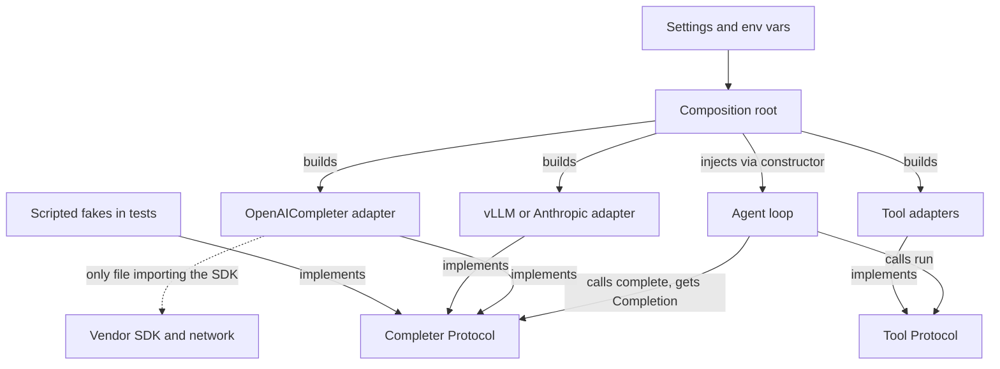

## TL;DR
An agent loop receives its model client, tools, memory store and clock from outside, typed as small
`Protocol` ports you own. That lets you test a ten-step tool-calling run with a scripted fake model in
milliseconds and swap providers in one file.

## For agent builders
- **Why it matters for agents.** An agent is a loop around the slowest, most expensive and least
  deterministic dependency you have: the model. Without injection, every test of planning, tool routing
  or stop conditions needs an API key, costs money and returns different text each run.
- **Where it shows up in your stack.** LangChain's chat-model interface and LangGraph nodes are already
  ports you call through; FastAPI `Depends` and a lifespan wire agent services; an OpenTelemetry
  tracer or a LangSmith client can be injected like any other collaborator. Your own `Completer`, `Tool` and
  `MemoryStore` protocols sit on top so business logic does not import any of them.
- **What you control.** Which ports exist (model, tools, retriever, memory, clock), what types cross
  them (your `Completion` and tool-call dataclasses, not vendor objects), and the one composition root
  that picks real implementations per environment.
- **What you can skip.** DI containers and their decorators. A hand-written root plus constructor
  injection covers almost every agent service.

## Lab
### Task
Implement a tool-calling agent loop that receives its model, tools and clock from outside, plus the
composition root that picks the real adapter from config. The goal is an agent whose routing, error
handling and step budget are proven in CI with no key, no network and no flaky text. Time box: 45-60 min.
- **Prerequisites:** Protocols, generics and structural typing; Test doubles, mocks & fixtures.
- **Setup:** Python 3.10+ and `pip install pytest`. Save the starter as `lab.py` and the tests as
  `test_lab.py` in one folder.
- **Rules:** fill in the two `YOUR CODE HERE` functions only; `lab.py` must import cleanly with no
  environment variables set.

### Starter code
```python
"""Lab: an agent loop that runs with injected model, tools and clock. Run: python lab.py"""
from __future__ import annotations
from dataclasses import dataclass
from typing import Callable, Protocol

@dataclass(frozen=True)
class ToolCall:
    name: str
    args: dict

@dataclass(frozen=True)
class Step:                                  # your type: adapters translate vendor replies into it
    text: str = ""
    tool_call: ToolCall | None = None

class Model(Protocol):                       # the port
    def next_step(self, transcript: list[dict]) -> Step: ...

class StepBudgetExceeded(RuntimeError):
    pass

@dataclass(frozen=True)
class RunResult:
    answer: str
    tools_called: list[str]
    elapsed_s: float

class Agent:
    def __init__(self, model: Model, tools: dict[str, Callable[..., str]],
                 clock: Callable[[], float], max_steps: int = 4) -> None:
        self.model, self.tools, self.clock, self.max_steps = model, tools, clock, max_steps

    def run(self, task: str) -> RunResult:
        # YOUR CODE HERE
        # - transcript starts as [{"role": "user", "content": task}]
        # - read self.clock() once at the start and once just before returning
        # - final answer (tool_call is None): return RunResult(answer, tools_called, elapsed_s)
        # - tool call: record name in tools_called (unknown names too), then append
        #   {"role": "tool", "name": name, "content": result}
        # - unknown tool, or a tool that raises: content is "error: <message>", the run continues
        # - after max_steps model calls without an answer: raise StepBudgetExceeded
        raise NotImplementedError

class HostedModel:                           # the real adapter: needs a key and a network
    def __init__(self, api_key: str) -> None:
        self.api_key = api_key
    def next_step(self, transcript: list[dict]) -> Step:
        raise ConnectionError("no network in this lab")

def build_agent(env: dict[str, str], tools: dict[str, Callable[..., str]],
                clock: Callable[[], float]) -> Agent:
    # YOUR CODE HERE: composition root, the only place that reads config
    # - env["MODEL_PROVIDER"] == "hosted" -> Agent(HostedModel(env["API_KEY"]), tools, clock)
    # - missing API_KEY -> ValueError mentioning API_KEY (at build time, never at import)
    # - any other provider -> ValueError mentioning the provider name
    raise NotImplementedError

if __name__ == "__main__":
    class Replay:                            # a dumb scripted fake
        def __init__(self, steps): self.steps = list(steps)
        def next_step(self, transcript): return self.steps.pop(0)
    ticks = iter([100.0, 102.5])
    order = Replay([Step(tool_call=ToolCall("lookup_order", {"order_id": "A17"})),
                    Step(text="Order A17 has shipped.")])
    r = Agent(order, {"lookup_order": lambda order_id: "shipped"}, clock=lambda: next(ticks)).run("Where is A17?")
    print("answer:", r.answer)
    print("tools:", r.tools_called)
    print("elapsed_s:", r.elapsed_s)
    loop = Replay([Step(tool_call=ToolCall("lookup_order", {"order_id": "A17"}))] * 9)
    try:
        Agent(loop, {"lookup_order": lambda order_id: "shipped"}, clock=lambda: 0.0).run("loop")
    except StepBudgetExceeded:
        print("budget: StepBudgetExceeded after", 9 - len(loop.steps), "model calls")
```

### Expected output
`python lab.py` with a correct solution prints exactly:

```
answer: Order A17 has shipped.
tools: ['lookup_order']
elapsed_s: 2.5
budget: StepBudgetExceeded after 4 model calls
```

### Tests
Run `pytest -q test_lab.py`. On the starter all 5 fail with `NotImplementedError`; a correct solution
passes all 5 (checked with Python 3.12 and pytest 9.1).

```python
import pytest
from lab import Agent, HostedModel, Step, StepBudgetExceeded, ToolCall, build_agent

class Scripted:                                   # replays steps, records every transcript it saw
    def __init__(self, steps):
        self.steps, self.seen = list(steps), []
    def next_step(self, transcript):
        self.seen.append([dict(m) for m in transcript])
        return self.steps.pop(0)

def clock(*ticks):
    it = iter(ticks)
    return lambda: next(it)

def call(name, **args):
    return Step(tool_call=ToolCall(name, args))

def test_routes_tool_and_feeds_result_back():
    m = Scripted([call("lookup_order", order_id="A17"), Step(text="Shipped.")])
    r = Agent(m, {"lookup_order": lambda order_id: f"{order_id}: shipped"}, clock(10.0, 12.5)).run("A17?")
    assert (r.answer, r.tools_called, r.elapsed_s) == ("Shipped.", ["lookup_order"], 2.5)
    assert m.seen[1][-1] == {"role": "tool", "name": "lookup_order", "content": "A17: shipped"}

def test_tool_error_goes_back_to_the_model():
    def lookup_order(order_id):
        raise KeyError(f"order {order_id} not found")
    m = Scripted([call("lookup_order", order_id="Z99"), Step(text="I could not find Z99.")])
    r = Agent(m, {"lookup_order": lookup_order}, clock(0.0, 1.0)).run("Z99?")
    assert r.answer == "I could not find Z99."
    assert m.seen[1][-1]["content"].startswith("error:") and "Z99" in m.seen[1][-1]["content"]

def test_unknown_tool_is_an_error_result_not_a_crash():
    m = Scripted([call("refund", order_id="A17"), Step(text="I cannot refund.")])
    r = Agent(m, {}, clock(0.0, 1.0)).run("refund A17")
    assert r.tools_called == ["refund"] and "refund" in m.seen[1][-1]["content"]
    assert m.seen[1][-1]["content"].startswith("error:")

def test_step_budget_counts_model_calls():
    m = Scripted([call("ping")] * 10)
    with pytest.raises(StepBudgetExceeded):
        Agent(m, {"ping": lambda: "pong"}, clock(0.0, 1.0), max_steps=3).run("loop")
    assert len(m.seen) == 3

def test_root_validates_config_at_build_time():
    with pytest.raises(ValueError, match="API_KEY"):
        build_agent({"MODEL_PROVIDER": "hosted"}, {}, clock(0.0))
    with pytest.raises(ValueError, match="mystery"):
        build_agent({"MODEL_PROVIDER": "mystery", "API_KEY": "k"}, {}, clock(0.0))
    agent = build_agent({"MODEL_PROVIDER": "hosted", "API_KEY": "k"}, {}, clock(0.0))
    assert isinstance(agent.model, HostedModel) and agent.model.api_key == "k"
```

### Failure scenarios
- **Inject `time.time()` inside `run` instead of `self.clock()`.** `test_routes_tool_and_feeds_result_back`
  fails with an elapsed value like `0.0001` instead of `2.5`. Debug by grepping `run` for any clock,
  network or environment access that did not come through the constructor.
- **Let a tool exception propagate.** `test_tool_error_goes_back_to_the_model` fails with
  `KeyError: 'order Z99 not found'` and the model never sees the error. Fix by catching inside the loop
  and appending an `error:` tool message, so the model can correct its arguments.
- **Build `HostedModel(os.environ["API_KEY"])` at module top level.** `import lab` fails with `KeyError`
  during test collection, before any test runs. Find it by running `python -c "import lab"` with no
  environment set; move construction into `build_agent`.
- **Run the tool but forget to append its result to the transcript.** The routing test fails because
  `m.seen[1][-1]` is still the user message; against a real model the agent calls the same tool again
  until the budget trips. Print `len(t)` for each transcript in `m.seen`: it should grow by one per tool.

### Submission
- **`lab.py` with both functions implemented** and no other changes to the starter's public names.
- **A green `pytest -q test_lab.py` run** (5 passed), pasted as text.
- **The output of `python lab.py`**, matching the expected output exactly.
- **One added test of your own** for a tool that returns an empty string, with a note on what the model
  should see.
- **A three-line note:** which file would change to add an Anthropic or vLLM adapter, and why `Agent`
  would not.
- **Evaluated on:** tests passing, no clock, network or `os.environ` access inside `Agent`, and a root
  that fails at build time, not at import.

## Why it exists
- **Agents are glue around external services.** Models, tools, vector stores and memory are slow,
  expensive, non-deterministic and owned by someone else. The first version is always a module-level
  `client = OpenAI()` plus a `client.chat.completions.create(...)` call inside whichever function needs
  an answer.
- **Testing breaks.** Every unit test of that function needs an API key and a network, costs money,
  takes seconds and returns a different string each run, so the test either hits production or gets
  skipped. For an agent that loops ten times, each run multiplies that cost and flakiness.
- **Swapping and configuration break.** Evaluating Anthropic, a self-hosted vLLM endpoint or a cheaper
  model means vendor shapes scattered through forty files. Reading `OPENAI_API_KEY` at import time makes
  a script that only wanted a helper either crash or silently talk to the wrong environment.
- **The naive fixes fail.** `unittest.mock.patch("app.summarize.client")` breaks when a refactor moves the
  module, because it couples to an internal path, not a contract. `if os.getenv("FAKE_LLM")` puts test
  branches in production. A global registry (`get_llm_client()`) hides the dependency one hop away:
  nothing in the function signature says it needs a model.
- **DI flips the direction.** The code that needs a completer is given one; the boundary names the need
  in types your code owns; one composition root wires it. The cost is explicitness; the payoff is a
  visible, testable dependency graph changeable in one place.

## How it works
### Move 1: name the dependency as an interface you own
- **Declare a narrow port.** A `Protocol` with exactly the methods your agent calls:
  `Completer.complete(system, user, *, max_tokens) -> Completion`, or a `Tool` with a name, a JSON
  schema and `run(args)`.
- **`typing.Protocol`, not an ABC,** *because* protocols are structural: the vendor adapter and the test fake
  satisfy it by having the right method, without inheriting from your package, and mypy checks the
  match statically.
- **It lives next to the domain code,** so the dependency arrow points from the adapter toward your
  code, never the other way round.

### Move 2: translate at the edge
- **The adapter returns your own `Completion` dataclass** (text, tool calls, token counts, finish
  reason). If `openai.types.chat.ChatCompletion` objects flow through your services, the vendor is still a
  dependency of everything that touches them, and a provider switch becomes a rewrite.
- **The boundary is only as strong as the types that cross it.** Tool-call formats differ by provider,
  so normalize them into one `ToolCall(name, args)` type in the adapter.
- **One file per vendor imports the SDK.** It handles the SDK's exception types and maps status codes
  into your error hierarchy: `openai.RateLimitError` becomes your `ProviderRateLimited`, so the upstream
  retry policy is written once and works for every vendor.
- **This is dependency inversion in practice:** high-level policy (the agent loop) and the low-level SDK
  both depend on an abstraction the high-level side owns.

### Move 3: inject at construction, wire at the root
1. **Constructor injection** (`Summarizer(completer)`, `Agent(completer, tools, memory)`) is the Python
   default *because* the dependency is in the signature: readers, type checkers and test authors all
   see it.
2. **The composition root** (`main()`, an app factory, a FastAPI lifespan) is the single place that reads
   settings, instantiates real clients and connects them.
3. **Tests and evals build the same graph with fakes** or with recorded responses.
4. **Nothing else reads environment variables or creates network clients,** which removes import-time
   side effects.

### Not every dependency needs a class
- **Inject a callable for a single operation:**
  `def __init__(self, now: Callable[[], datetime] = datetime.now)` or
  `embed: Callable[[list[str]], list[list[float]]]`. Still DI, *because* the caller decides what runs;
  it is the smallest possible interface. Many agent tools are exactly this: a typed function.
- **Promote to a Protocol** when a second method appears or the call needs named, typed options.
- **Default-argument trap.** A default is evaluated once, when the `def` runs at import time, so
  `completer: Completer = OpenAICompleter(OpenAI())` quietly reintroduces an import-time client. Defaults
  are safe only for cheap, side-effect-free values such as `datetime.now` itself.

### Sync or async is part of the contract
| Mismatch | What happens |
|---|---|
| Async service calls a sync adapter | event loop blocks on every network call |
| Sync service handed an async adapter | gets an un-awaited coroutine; mypy flags it, the runtime only fails later (an `AttributeError` reading `.text` off the coroutine, plus a "never awaited" warning) |

- `def complete(...)` returns a `Completion`; `async def complete(...)` returns a coroutine. They are
  different interfaces, so decide at the port.
- **Need both?** Define two ports (`Completer`, `AsyncCompleter`), not one that tries to be both. Agents
  that run tools in parallel almost always want the async port.

### Why Python rarely needs a container
- **Java-style containers** reflect on constructors to auto-wire graphs.
- **Python already has the tools:** first-class functions, closures, `functools.partial` and dataclasses
  cover almost every wiring need in a dozen lines.
- **FastAPI's `Depends`** is a request-scoped injector that handles per-request lifetime for you.
- **Reach for a container** (`dependency-injector`, `punq`, `lagom`) only with dozens of services of mixed
  lifetimes (singleton HTTP clients and loaded models vs per-request sessions) and a hand-written root
  that has become the hardest file to read.

### Where to draw boundaries in an agent
- **At I/O and non-determinism:** LLM and embedding providers, vector stores, memory stores, tool
  backends (HTTP, databases, filesystem, sandboxes), the clock, randomness.
- **Not around pure logic:** a `PromptBuilder` that renders a dataclass into a string, or a function that
  trims a transcript to a token budget, needs no interface, just a direct test.
- **Working rule:** if you would replace it in a test, an eval run or at deployment time, it is a port;
  otherwise it is just code.
- **Keep ports narrow, widen deliberately** (add `stream()` when a use case streams). A port mirroring the
  SDK's fifteen methods is the SDK with extra steps, and nobody can write a fake for it.

### Lifetimes
- **Shared, created once at the root:** an `httpx.AsyncClient` with its connection pool, a loaded
  sentence-transformer, the model client.
- **Per-request or per-run, created by the handler:** a bound logger with `request_id`, a DB session,
  the agent's scratchpad memory for one conversation.
- **Constructor injection makes sharing cheap,** because the same instance is simply passed to several
  consumers.

### Test doubles at the boundary
- **Hand-written fake:** returns scripted answers (including scripted tool calls) and records calls, so
  agent-logic tests are fast and deterministic.
- **Contract test for the real adapter:** against the real API or a recorded response, so fake and
  reality cannot drift unnoticed.
- **Keep fakes dumb:** a fake that re-implements vendor logic will pass tests the real thing fails.

## Diagram
The composition root (`main()`, an app factory or a FastAPI lifespan) is the only place that reads settings
and builds real clients; every adapter's arrow points toward the ports your agent owns, and tests plug
fakes into the same ports.



## Examples
### Port, adapter, fake and composition root
`Summarizer` and the `Completer` protocol import nothing from any SDK, the vendor import is deferred into
the root, and the test needs no network.

```python
from dataclasses import dataclass
from typing import Protocol

@dataclass(frozen=True)
class Completion:
    text: str
    input_tokens: int
    output_tokens: int

class Completer(Protocol):                       # the port: your vocabulary, your types
    def complete(self, system: str, user: str, *, max_tokens: int) -> Completion: ...

class OpenAICompleter:                           # the adapter: the only file that imports the SDK
    def __init__(self, client, model: str) -> None:
        self._client, self._model = client, model
    def complete(self, system, user, *, max_tokens):
        r = self._client.chat.completions.create(
            model=self._model, max_tokens=max_tokens,
            messages=[{"role": "system", "content": system}, {"role": "user", "content": user}])
        return Completion(r.choices[0].message.content or "",
                          r.usage.prompt_tokens, r.usage.completion_tokens)

class FakeCompleter:                             # test double: scripted answers, records calls
    def __init__(self, answers: list[str]) -> None:
        self.answers, self.calls = list(answers), []
    def complete(self, system, user, *, max_tokens):
        self.calls.append((system, user, max_tokens))
        return Completion(self.answers.pop(0), 10, 5)

class Summarizer:                                # domain service: knows nothing about vendors
    def __init__(self, completer: Completer, max_tokens: int = 200) -> None:
        self._c, self._max = completer, max_tokens
    def summarize(self, doc: str) -> str:
        return self._c.complete("Summarize in two sentences.", doc, max_tokens=self._max).text

def build_summarizer() -> Summarizer:            # composition root: the one place real things are chosen
    from openai import OpenAI
    return Summarizer(OpenAICompleter(OpenAI(), model="gpt-4o-mini"))

def test_summarizer_passes_document_through():
    fake = FakeCompleter(["Short summary."])
    assert Summarizer(fake).summarize("long text") == "Short summary."
    assert fake.calls[0][1] == "long text" and fake.calls[0][2] == 200
```

### Agent scenario: testing a tool-calling loop with a scripted model
The loop depends on two ports: a model that returns either a tool call or a final answer, and a dict of
tools. The test scripts a two-step run and checks routing, arguments and the step budget, with no
network. Standard library only.

```python
from __future__ import annotations
from dataclasses import dataclass, field
from typing import Callable, Protocol

@dataclass(frozen=True)
class ToolCall:
    name: str
    args: dict

@dataclass(frozen=True)
class Step:                                      # your type: adapters translate vendor tool calls into it
    text: str = ""
    tool_call: ToolCall | None = None

class Model(Protocol):
    def next_step(self, transcript: list[dict]) -> Step: ...

class Agent:
    def __init__(self, model: Model, tools: dict[str, Callable[..., str]], max_steps: int = 8):
        self._model, self._tools, self._max = model, tools, max_steps
    def run(self, task: str) -> str:
        transcript = [{"role": "user", "content": task}]
        for _ in range(self._max):
            step = self._model.next_step(transcript)
            if step.tool_call is None:
                return step.text
            result = self._tools[step.tool_call.name](**step.tool_call.args)
            transcript.append({"role": "tool", "name": step.tool_call.name, "content": result})
        raise RuntimeError("step budget exhausted")

@dataclass
class ScriptedModel:                             # dumb fake: replays steps, records what it saw
    steps: list[Step]
    seen: list[int] = field(default_factory=list)
    def next_step(self, transcript):
        self.seen.append(len(transcript))
        return self.steps.pop(0)

calls = []
def lookup_order(order_id: str) -> str:
    calls.append(order_id)
    return "shipped"

model = ScriptedModel([Step(tool_call=ToolCall("lookup_order", {"order_id": "A17"})),
                       Step(text="Your order A17 has shipped.")])
assert Agent(model, {"lookup_order": lookup_order}).run("Where is A17?") == "Your order A17 has shipped."
assert calls == ["A17"] and model.seen == [1, 2]   # the tool result reached the second model call
```

### Injecting the clock and translating errors at the edge
A rate-limited retry wrapper that depends only on your exception and an injected `sleep`, so the test
runs instantly and works for every vendor adapter. Runnable with the standard library alone.

```python
from typing import Callable

class ProviderRateLimited(Exception):            # your error type, raised by every adapter
    pass

class RetryingCompleter:
    def __init__(self, inner, sleep: Callable[[float], None], attempts: int = 3) -> None:
        self._inner, self._sleep, self._attempts = inner, sleep, attempts
    def complete(self, system, user, *, max_tokens):
        for i in range(self._attempts):
            try:
                return self._inner.complete(system, user, max_tokens=max_tokens)
            except ProviderRateLimited:
                if i == self._attempts - 1:
                    raise
                self._sleep(2 ** i)               # 1s, 2s ... in production; recorded in tests

class FlakyFake:
    def __init__(self, failures: int) -> None:
        self.failures = failures
    def complete(self, system, user, *, max_tokens):
        if self.failures:
            self.failures -= 1
            raise ProviderRateLimited()
        return "ok"

slept: list[float] = []
c = RetryingCompleter(FlakyFake(failures=2), sleep=slept.append)
assert c.complete("s", "u", max_tokens=10) == "ok" and slept == [1, 2]
```

### Worked scenario: adding a provider to a live agent, before and after
A team must route one agent's planning step to a self-hosted vLLM endpoint while tool calls stay on a
hosted model.

| Measure | Module-level client | Port + adapters |
|---|---|---|
| Files touched | every file that calls `client.chat.completions.create` | one new adapter + the root |
| Unit tests needing a key | all of them | none (fakes) |
| Retry logic | per call site, per vendor exception | once, against `ProviderRateLimited` |
| Tool-call parsing | per call site, per vendor format | once per adapter, into `ToolCall` |
| Proof the adapter works | manual | one contract test per adapter |

## Production patterns
- **One composition root per entry point.** Build the agent graph in `main()`, an app factory or a
  FastAPI lifespan, and store shared clients there; handlers receive them via `Depends`. Monitor startup
  time and that no module creates clients at import (a CLI `--help` should not need credentials).
- **Provider and model selected by config, at the root only.** Read a setting such as the provider name
  once and construct the matching adapter; the agent loop never branches on it. Watch per-provider error
  rates, latency and tokens per run, tagged by adapter.
- **Error translation in every adapter.** Map each SDK's rate-limit, timeout and auth exceptions to your
  own hierarchy so retries, fallbacks and alerts are written once. Monitor counts per translated error
  type.
- **Scripted-model tests for agent control flow.** Replay a fixed sequence of tool calls and answers to
  test routing, step budgets, error handling and stop conditions in CI on every commit; keep real-model
  evals for answer quality. Track how long the unit suite takes; it should stay seconds, not minutes.
- **Contract tests per adapter.** Run a small suite against the real API (nightly or behind a marker) or
  replay recorded responses, and assert the adapter returns a valid `Completion`. Alert when it fails,
  since that is the drift your fakes cannot see.
- **Shared resources injected, never re-created.** One `httpx.AsyncClient` and one loaded embedding model
  per process, passed to every consumer, including tools. Monitor open connections and process memory.

## Trade-offs
- **Testability and swappability vs an extra file and hop per boundary.** Flips for a 200-line script with
  one call site, where calling the SDK directly is right.
- **Vendor independence vs provider features.** A lowest-common-denominator port hides tool-call formats,
  prompt caching controls and logprobs; when you deliberately depend on those, widen the port on purpose
  rather than pretending neutrality.
- **Your ports vs a framework's.** LangChain or LangGraph interfaces already abstract providers; wrapping
  them again buys isolation from framework upgrades at the cost of one more layer. Worth it when the
  framework is likely to change under you; skip it for a prototype.
- **Fast, deterministic fakes vs drift.** A fake can drift from the real adapter, so keep a thin
  integration or contract test against the real API or a recorded response.
- **Explicit constructors vs long signatures.** A class taking eight collaborators does too much; split it
  or group related settings, rather than blaming injection.
- **Container vs hand-written root.** A container automates wiring for a large graph with mixed
  lifetimes but hides it behind decorators and configuration; below a few dozen services the hand-written
  root is clearer.

## Pitfalls
- **Clients created at import time** (`client = OpenAI()` at the top of a file). Symptom: tests fail on
  import with a missing API key, or a CLI `--help` takes seconds and needs production credentials. Fix:
  build clients in the root.
- **Vendor objects in agent code.** Symptom: `response.choices[0].message.content` in business logic and
  a provider switch touching dozens of files. Fix: translate to your dataclass in the adapter.
- **Patch-heavy tests** (`@patch("app.services.summarize.openai.OpenAI")` stacked three deep). Symptom:
  thirty tests break when a module is renamed, each re-implementing a slice of the vendor response. Fix:
  inject a fake.
- **A port mirroring the SDK surface with one implementation.** Symptom: nobody can write a fake, so
  tests mock the port's internals. Fix: narrow it to what the use case calls.
- **Clever fakes** that parse the prompt and generate plausible answers. Symptom: green tests for
  behaviour the real provider does not exhibit. Fix: scripted answers only.
- **A sync port in an async service** (or an adapter wrapping an async SDK in `asyncio.run`). Symptom:
  request latency that grows with concurrency because each LLM call blocks the event loop, or
  `RuntimeError: asyncio.run() cannot be called from a running event loop`. Fix: an `AsyncCompleter` port.
- **Threading config values** (`api_key`, `model`, `temperature`) through five layers. Symptom:
  signatures change whenever a setting is added. Fix: inject the configured adapter instead.

## When to use
- **Use when:** agent code meets something slow, paid, non-deterministic or third-party: model providers,
  embedding services, vector stores, memory stores, tool backends, databases, HTTP, time and randomness.
- **Avoid when:** the logic is pure; test it directly.
- **Measure:** can the agent loop run in a test with no network and no credentials, and how many files
  would a provider switch touch?
- **Day to day:** the adapter you write when adding a provider or tool, the fake you hand to a test, the
  one root you edit when configuration changes.
- **Interviews:** explain why Protocols beat ABCs here, why the boundary's types must be yours, and why a
  composition root exists at all.

## Role lens
- **Engineer:** Writes the `Completer` and `VectorStore` protocols, one adapter per provider, dumb
  fakes for tests, and keeps the SDK import inside the adapter and the composition root.
- **Architect:** Owns where boundaries sit and what crosses them: which provider features are exposed
  through the port, how adapters report errors, and which objects are shared versus per-request.
- **FDE:** Swaps a customer's mandated provider, on-prem endpoint or internal vector database in by
  writing one adapter against the existing port, without touching the delivered business logic.

## Check yourself
**Q:** A service class imports both `openai` and `anthropic` and switches between them on a config
string inside its methods. The team says this is already "provider-agnostic". What is wrong, and how
would you restructure it?
**A:** The service still depends on both SDKs: any test imports both, any new provider edits the
service, and vendor response objects are handled inline in domain code. Provider choice belongs in the
composition root, not in the service. Define a `Completer` protocol in your own types, write one
adapter per vendor that imports its SDK and translates responses into your `Completion` dataclass,
and have the service take a `Completer` in its constructor. The root reads the config string once and
constructs the matching adapter. Tests pass a fake; adding a vendor adds one file; the service never
changes. A strong answer also mentions keeping the port narrow and a contract test per adapter so the
fakes cannot drift from reality.

## Interview questions
### What is dependency injection, and why does it matter more in agents than in typical CRUD code?
- **Definition:** a component receives its collaborators from outside (usually through its constructor)
  instead of creating or importing them, so the caller decides what actually runs.
- **Why it matters here:** an agent loops over LLM providers, tools, vector stores and memory that are
  slow, paid, non-deterministic and third-party, so unit tests need a fake and deployments need to swap
  providers.
- **Result:** agent logic runs in a test with no network and no API key, and a provider switch is one
  new adapter plus a change in the composition root.

### How would you unit-test an agent's tool-routing and stop logic without calling a model?
- **Inject the model as a port** that returns your own `Step` type: either a tool call or a final answer.
- **Script a fake** that replays a fixed sequence (call `lookup_order`, then answer) and records the
  transcript length it saw, so you can assert the tool result was fed back.
- **Cover the edges:** unknown tool names, a tool raising, and the step budget being exhausted; leave
  answer quality to real-model evals.

### Your test suite fails at import with a missing `OPENAI_API_KEY`. How do you debug and fix it?
- **Find the import-time side effect:** look for a module-level `client = OpenAI()`, a settings object read
  at import, or a default argument such as `completer: Completer = OpenAICompleter(OpenAI())`.
- **Move construction to the root:** build clients in `main()`, an app factory or a FastAPI lifespan and pass
  them into constructors.
- **Verify:** importing every module, or running a CLI `--help`, should succeed with no credentials set.

### Why use `typing.Protocol` for a port instead of an ABC, and when would you widen the port?
- **Structural typing:** an adapter or a fake satisfies a Protocol by having the right methods, checked
  statically by mypy, without inheriting from your package.
- **Narrow by default:** expose only the methods the use case calls, so a fake is a few lines.
- **Widen on purpose:** add `stream()` or tool-call support when a use case needs it, accepting that the
  port is no longer lowest-common-denominator.

### When would you not introduce an interface boundary?
- **Pure logic:** a prompt renderer or a token-budget calculator has no I/O, so test it directly.
- **Small scripts:** a 200-line script with one call site gains nothing from a port and an adapter.
- **Single-method needs:** inject a callable such as `now: Callable[[], datetime]` rather than a full
  Protocol class.

### How do you make sure a fake does not drift from the real provider adapter in a production agent?
- **Keep fakes dumb:** scripted answers and recorded calls, never logic that parses the prompt.
- **Add a contract test per adapter:** run it against the real API nightly or behind a marker, or replay
  recorded responses, and assert it returns a valid `Completion` with correctly parsed tool calls.
- **Alert on failure,** because a failing contract test is exactly the drift green unit tests cannot see.

## Quiz
### Q: Why is `typing.Protocol` usually preferred over an abstract base class for a port such as `Completer`?
- [ ] Protocols are checked at runtime, so a bad adapter fails at construction time
- [x] Protocols are structural, so vendor adapters and test fakes satisfy them without inheriting from your package
- [ ] Abstract base classes cannot have more than one concrete implementation
- [ ] Protocols are faster because they skip method resolution
> A class satisfies a Protocol by having the right methods, checked statically by mypy, so adapters
> stay decoupled from your code. Protocols are not enforced at runtime (`@runtime_checkable` only
> checks that method names exist, not signatures), and ABCs support many implementations; the
> difference is nominal versus structural typing.

### Q: Which of these should NOT get its own interface boundary in a typical RAG service?
- [ ] The vector store client used for retrieval
- [ ] The system clock used by a rate limiter
- [x] A pure function that renders a dataclass into a prompt string
- [ ] The embedding model that turns chunks into vectors
> Boundaries belong at I/O and non-determinism, where you want to substitute a fake in tests or a
> different implementation at deployment. Pure, deterministic logic is tested directly; wrapping it
> in a Protocol adds indirection with nothing to swap.

### Q: What is the main purpose of a composition root?
- [ ] To cache expensive objects so they are constructed only once per process
- [ ] To validate configuration before the application starts
- [x] To be the single place that chooses concrete implementations and wires them into the object graph
- [ ] To provide a global registry that any module can query for a dependency
> The root is where real adapters are instantiated and handed to the services that need them, so
> nothing else reads settings or builds clients. A queryable global registry is the service-locator
> anti-pattern, which hides dependencies instead of making them explicit.

## Use cases & projects
### Use cases
- **Deterministic agent-loop tests.** A scripted fake `Completer` replays tool calls in order, so planning,
  routing and stop conditions are tested in CI with no API key and no flaky text.
- **Swapping model providers.** One `Completer` port with an adapter per vendor lets a team move a step to a
  cheaper or self-hosted model by changing the composition root, not the agent logic.
- **Per-environment tool wiring.** The same agent runs with sandboxed or read-only tools in staging and real
  ticketing or payment tools in production, chosen in one place.
- **Replay and eval harnesses.** Injecting a recorded-response model and a fixed clock lets the eval suite
  re-run yesterday's production traces against a new prompt.

### Mini project
**Make a tool-calling agent testable without a model (1-2 hours).**
- **Goal:** prove the agent loop's logic is correct using only injected fakes.
- **Steps:** define `Completer`, `Tool` and `Clock` protocols and your own `Completion` and tool-call
  dataclasses; write a small loop that calls the model, runs requested tools and stops on a final answer or
  a step cap; build a composition root with a real provider adapter and a scripted fake that returns a
  fixed list of tool calls; write pytest cases for "calls the right tool", "stops at the step cap" and
  "surfaces a tool error back to the model".
- **Done when:** the tests pass offline in under a second, the loop module imports no vendor SDK, and
  switching to the real adapter needs a change only in the composition root.
