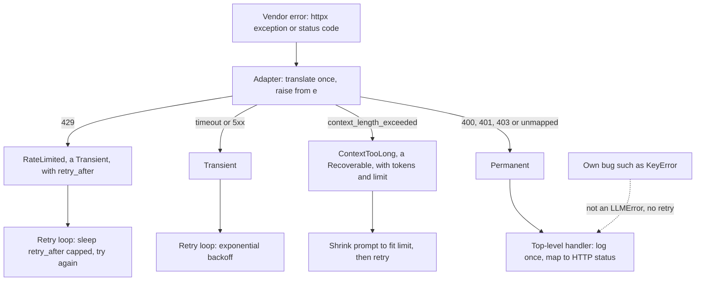

## TL;DR
For every failure an agent must know who handles it: retry it, shrink the context, show it to the
model as a tool error, or stop the run. A custom hierarchy groups failures by that *handling policy*, so
your bugs never retry at provider prices.

## For agent builders
- **Why it matters for agents.** A tool-calling loop has a policy most services lack: some errors belong
  to the model ("order not found", "bad date format") and go back as an error tool result so it can
  re-plan, while others (rate limits, timeouts, your own bugs) must never reach the transcript.
- **Where it shows up in your stack.** Provider SDK error classes you translate in an adapter, tenacity
  retry predicates, LangGraph and other frameworks' retry or error-handling options on nodes and tools,
  `TaskGroup` fan-out of parallel tool calls, and the error flag on tool results in provider APIs.
- **What you control.** The policy branches (`Transient`, `Permanent`, `Recoverable`, model-visible
  `ToolError`), where vendor errors are translated, and the step and retry budgets that end a run.
- **What you can skip.** Exception internals such as traceback objects and frame details; `except*`
  beyond fan-out of tools.

## Lab
### Task
Build the provider adapter and retry policy of an agent's model call. A fake transport replays
recorded provider responses (a 429, a context-length error, a 401, an outage, a changed body), so the
lab runs offline. Translate each failure once into the hierarchy, then let `answer` handle it by class.

Time box: 60-90 minutes. Do "How it works" here first; `tenacity` is the library version of this loop.
- **Implement** `call_provider` (translation with `raise ... from e`) and `answer` (the policy).
- **Fix** the planted bug in `ContextTooLong` so the error survives pickling, as it must when eval
  workers run in other processes.
- **Run** on Python 3.10+, standard library plus pytest (checked on Python 3.12.14, pytest 9.1.1).

### Starter code
Save as `lab.py`. It runs and reports every recorded case as not implemented.

```python
"""lab.py: translate recorded provider failures once, then handle each by policy."""
from __future__ import annotations

import time
from collections.abc import Callable
from dataclasses import dataclass, field

@dataclass
class Response:                                  # one recorded HTTP response from the provider
    status: int
    headers: dict[str, str] = field(default_factory=dict)
    body: dict[str, object] = field(default_factory=dict)

class ProviderHTTPError(Exception):              # what the vendor SDK raises: must not pass the adapter
    def __init__(self, response: Response) -> None:
        super().__init__(response)
        self.response = response

class FakeTransport:
    """Replays recorded responses in order and records the length of every prompt it was sent."""
    def __init__(self, responses: list[Response]) -> None:
        self.responses = list(responses)
        self.sent: list[int] = []
    def post(self, prompt: str) -> dict[str, object]:
        self.sent.append(len(prompt))
        r = self.responses.pop(0)
        if r.status >= 400:
            raise ProviderHTTPError(r)
        return r.body

class LLMError(Exception): ...
class Transient(LLMError): ...                   # safe to retry
class Permanent(LLMError): ...                   # do not retry
class Recoverable(LLMError): ...                 # retry only after changing the request

class RateLimited(Transient):
    def __init__(self, retry_after: float) -> None:
        super().__init__(retry_after)
        self.retry_after = retry_after

class ContextTooLong(Recoverable):
    def __init__(self, tokens: int, limit: int) -> None:
        super().__init__(f"{tokens} tokens > limit {limit}")   # LAB bug: args differ from the ctor's
        self.tokens, self.limit = tokens, limit

def call_provider(transport: FakeTransport, prompt: str) -> str:
    """Return body["text"]. Translate ProviderHTTPError once, always `raise ... from e`:
    429 -> RateLimited(float(retry-after) if it is all digits, else 2.0); 5xx -> Transient(f"provider
    returned {status}"); body error code "context_length_exceeded" -> ContextTooLong(tokens, limit);
    anything else -> Permanent(f"provider returned {status}")."""
    raise NotImplementedError("LAB: call_provider")

def answer(transport: FakeTransport, prompt: str, attempts: int = 3,
           sleep: Callable[[float], None] = time.sleep) -> str:
    """Up to `attempts` calls. Sleep only when another attempt follows: RateLimited -> min(retry_after, 30);
    other Transient -> 2 ** n for 0-based attempt n. ContextTooLong -> cut the prompt to
    len(prompt) * limit * 9 // (10 * tokens) characters, no sleep. Permanent and bugs propagate at once.
    When attempts run out: raise Permanent(f"gave up after {attempts} attempts") from the last error."""
    raise NotImplementedError("LAB: answer")

RECORDED = {
    "rate limit then ok": [Response(429, {"retry-after": "7"}), Response(200, body={"text": "ok after wait"})],
    "context too long": [Response(400, body={"error": {"code": "context_length_exceeded",
                                                       "tokens": 12000, "limit": 8000}}),
                         Response(200, body={"text": "ok after shrink"})],
    "auth": [Response(401, body={"error": {"code": "invalid_api_key"}})],
    "outage": [Response(503), Response(503), Response(503)],
    "changed body": [Response(200, body={"output": "field renamed by the provider"})],
}

if __name__ == "__main__":
    for name, responses in RECORDED.items():
        t, slept = FakeTransport(responses), []
        try:
            text = answer(t, "x" * 1000, sleep=slept.append)
            print(f"{name}: {text} | sleeps={slept} sent={t.sent}")
        except Exception as e:                   # report only; real code lets these propagate
            print(f"{name}: {type(e).__name__}: {e} | cause={type(e.__cause__).__name__} "
                  f"sleeps={slept} sent={t.sent}")
```

### Expected output
`python lab.py` with a correct solution prints exactly. The shrink is 1,000 × 8,000 × 9 // (10 ×
12,000) = 600 characters, and the outage sleeps 1 and 2 seconds but not after the third attempt.

```
rate limit then ok: ok after wait | sleeps=[7.0] sent=[1000, 1000]
context too long: ok after shrink | sleeps=[] sent=[1000, 600]
auth: Permanent: provider returned 401 | cause=ProviderHTTPError sleeps=[] sent=[1000]
outage: Permanent: gave up after 3 attempts | cause=Transient sleeps=[1, 2] sent=[1000, 1000, 1000]
changed body: KeyError: 'text' | cause=NoneType sleeps=[] sent=[1000]
```

### Tests
Save as `test_lab.py` and run `python -m pytest -q`. On the starter five fail with
`NotImplementedError` and the pickle test fails with `TypeError` from the planted bug.

```python
import pickle
import pytest
from lab import (RECORDED, ContextTooLong, FakeTransport, LLMError, Permanent, ProviderHTTPError,
                 RateLimited, Response, Transient, answer, call_provider)

def raised(responses):
    with pytest.raises(LLMError) as info:
        call_provider(FakeTransport(responses), "x")
    assert isinstance(info.value.__cause__, ProviderHTTPError), "translate with raise ... from e"
    return info.value

def test_adapter_classifies_once():
    e = raised([Response(429, {"retry-after": "7"})])
    assert type(e) is RateLimited and e.retry_after == 7.0
    assert raised([Response(429, {"retry-after": "Wed, 21 Oct 2026 07:28:00 GMT"})]).retry_after == 2.0
    assert type(raised([Response(503)])) is Transient
    assert type(raised(RECORDED["auth"])) is Permanent
    c = raised(RECORDED["context too long"][:1])
    assert type(c) is ContextTooLong and (c.tokens, c.limit) == (12000, 8000)

def run(responses):
    t, slept = FakeTransport(responses), []
    return t, slept, (lambda: answer(t, "x" * 1000, sleep=slept.append))

def test_rate_limit_waits_with_a_cap():
    t, slept, go = run(RECORDED["rate limit then ok"])
    assert go() == "ok after wait" and slept == [7.0]
    t, slept, go = run([Response(429, {"retry-after": "120"}), Response(200, body={"text": "ok"})])
    assert go() == "ok" and slept == [30]

def test_context_too_long_shrinks_instead_of_retrying_blindly():
    t, slept, go = run(RECORDED["context too long"])
    assert go() == "ok after shrink" and t.sent == [1000, 600] and slept == []

def test_outage_gives_up_with_the_cause_kept():
    t, slept, go = run(RECORDED["outage"])
    with pytest.raises(Permanent, match="gave up after 3 attempts") as info:
        go()
    assert type(info.value.__cause__) is Transient and slept == [1, 2] and len(t.sent) == 3

def test_permanent_and_bugs_are_never_retried():
    t, _, go = run(RECORDED["auth"])
    with pytest.raises(Permanent):
        go()
    assert t.sent == [1000]
    t, _, go = run(RECORDED["changed body"])
    with pytest.raises(KeyError):
        go()
    assert t.sent == [1000]

def test_errors_survive_a_process_boundary():
    c = pickle.loads(pickle.dumps(ContextTooLong(12000, 8000)))
    r = pickle.loads(pickle.dumps(RateLimited(7.0)))
    assert (c.tokens, c.limit, r.retry_after) == (12000, 8000, 7.0)
```

### Failure scenarios
- **List `except Transient` before `except RateLimited`.** Python accepts the unreachable handler, so
  the 429 sleeps 1 second instead of 7 and `slept == [7.0]` fails. Print `type(e).__mro__` for the
  caught error and reorder the handlers subclass first.
- **Raise the domain error without `from e`.** The behaviour tests pass but `raised()` fails: there is
  no `__cause__`, only `__context__`, and logs read "During handling of the above exception". Check
  `e.__cause__` in a debugger.
- **Catch `Exception` in `answer`.** The changed body is retried three times and ends as `Permanent:
  gave up after 3 attempts` caused by `IndexError` (the fake ran out of responses): a bug retried at
  provider prices and mislabelled. Count `t.sent`; more than one call for a `KeyError` is the tell.
- **Keep the planted `ContextTooLong` bug.** Unpickling calls `ContextTooLong("12000 tokens > limit
  8000")` and fails with a missing `limit` argument. Pass the constructor arguments to
  `super().__init__` and give the class a `__str__` for logs instead.

### Submission
- **`lab.py` and `test_lab.py`,** with the `python -m pytest -q` output showing 6 passed.
- **The output of `python lab.py`,** matching the expected block, with the 600-character shrink
  checked by hand.
- **One new recorded case:** a 400 with code `content_filter`, mapped to a new `Refused(Permanent)`
  leaf, with a test showing it is never retried.
- **A note of 3-5 sentences:** which of these errors an agent loop would show the model as an error
  tool result, and which it must keep out of the transcript.
- **Evaluation:** tests pass unmodified, no handler inspects a status code or message string outside
  `call_provider`, and every translated error keeps its `__cause__`.

## Why it exists
- **One LLM call, a dozen failure modes, different fixes.**

| Failure | Correct response |
|---|---|
| Rate limit | Wait and retry |
| Timeout | Retry, maybe with a smaller request |
| Context-length error | Shrink the input; never a plain retry |
| Output fails schema validation | Corrective re-prompt |
| Authentication error or content-policy refusal | No retry; a human |
| `KeyError` in your own parsing code | A bug fix, not a retry loop that quietly triples your bill |
| A tool reports bad arguments or "not found" | Return it to the model as an error tool result, so it can fix the call or re-plan |

- **`except Exception: retry()` is wrong.** If all of these arrive as "an exception", the handler can
  only pick one policy. It retries the unretryable, including your own bugs, and hides them behind
  success-after-retry statistics.
- **Return codes, `None` and message matching are worse.** Codes and `None` get ignored by the first
  caller that forgets to check, lose the stack trace, and spread `if result is None` everywhere.
  `if "rate limit" in str(e)` couples logic to vendor wording and breaks on the next SDK release.
- **Vendor classes everywhere couple you to one provider.** Switching or adding a fallback model means
  touching every call site.
- **Hierarchies fix this because `except` matches a class *and all subclasses*.** Inner nodes are policies
  (`Transient`, `Permanent`); leaves carry data (`RateLimited.retry_after`, `ContextTooLong.limit`). Each
  layer catches what it can act on, and translating vendor errors once, at the adapter, keeps the rest
  vendor-neutral.

## How it works
### Raising, unwinding and catching
1. **`raise X(...)`** creates an instance, attaches a traceback, and unwinds frame by frame until a `try`
   with a matching `except` is found.
2. **Matching uses `isinstance`,** so `except Transient` catches every subclass.
3. **Handlers are tested in order,** which is why a subclass handler must come before its base or it is
   unreachable.
4. **`else`** runs when no exception occurred; **`finally`** always runs; a **bare `raise`** in a handler
   re-raises the current exception with its original traceback intact.
5. **Cost:** since Python 3.11 a `try` block costs nothing when nothing is raised; raising and unwinding
   still cost, so exceptions are for failures, not routine control flow in hot loops.

### The built-in tree and what `except Exception` means
- **Everything derives from `BaseException`;** `Exception` is the branch for errors a program may recover
  from.
- **`KeyboardInterrupt`, `SystemExit`, `GeneratorExit` and `asyncio.CancelledError` hang directly off
  `BaseException`** *so that* `except Exception` does not swallow them: an "any error" handler must not
  stop Ctrl-C, interpreter shutdown or task cancellation.
- **Catching `BaseException` or writing a bare `except:`** breaks exactly those mechanisms.

### Designing the hierarchy
```
LLMError(Exception)              one base per subsystem: "anything from the LLM layer"
├── Transient                    safe to retry
│   └── RateLimited              .retry_after seconds
├── Permanent                    do not retry
└── Recoverable                  optional: retry only after changing something
    └── ContextTooLong           .tokens, .limit
```

- **Split by handling policy, not by source.**
- **Agents add a model-visible branch.** A `ToolError(AgentError)` subtree (`ToolInputError`, `NotFound`)
  means "the model can act on this": the loop turns it into an error tool result and continues. Every
  other branch is handled by code and never enters the transcript.
- **Leaves carry what the handler needs** as attributes: `retry_after` seconds, token counts and limits,
  the list of validation errors. Give leaves a clear `__str__` for logs.
- **Keep it shallow.** Three levels is usually enough, and every class must match a different decision
  somewhere, otherwise it is noise.
- **Also inherit a built-in when outsiders catch it.** `class ProviderTimeout(Transient, TimeoutError)` is
  caught by your retry loop *and* any framework's `except TimeoutError`, because `except` checks the
  whole MRO.
- **Classes for `except` decisions, attributes for `if` decisions.** When handling depends on data (the
  same `ProviderHTTPError` is retryable for 503, not for 400), a `retryable: bool` attribute can beat a
  split. Prefer classes where you can, because an `except` clause cannot forget to check a flag.

### Chaining: keep the cause
| Form | Sets | Traceback says |
|---|---|---|
| `raise Domain(...)` inside `except` | `__context__` (automatic) | "During handling of the above exception, another exception occurred", which misreads as a second bug |
| `raise Domain(...) from e` | `__cause__` | "The above exception was the direct cause": the honest story, vendor stack trace kept |
| `raise Domain(...) from None` | suppresses context | Only the new error, for when the original is irrelevant noise |

- **`e.add_note("request_id=...")`** (3.11) attaches context without changing the type.

### Translate at the boundary, decide at the top
1. **Translate** vendor SDK or HTTP errors into your hierarchy in the one adapter that talks to the vendor.
2. **Propagate** through layers that cannot act. Do not catch-log-reraise at every level, which prints the
   same stack trace five times.
3. **Decide** where the policy lives: the retry loop catches `Transient`, the request handler maps
   `Permanent` to an HTTP status, the top level catches `LLMError` for the user-facing message.
4. **Stay picklable** if exceptions cross process boundaries: pass the constructor arguments to
   `super().__init__`.

### Concurrent failures
- **Several tasks can fail at once** (an `asyncio.TaskGroup` fanning out tool calls), so there is no
  single exception to raise.
- **`ExceptionGroup` (3.11) bundles them,** and `except* Transient` selects the matching members while
  re-raising the rest, keeping the retry/no-retry split correct for parallel work.

## Diagram
The decision path for one failed provider call: the adapter classifies once with `raise ... from e`,
and every layer above decides by class, never by status code or message text.



## Examples
### Agent tool step: model-visible errors versus infrastructure errors
`ToolError` subclasses become an error tool result the model reads; `Transient` is retried silently;
when retries run out the run aborts. Passes `mypy --strict`.

```python
class AgentError(Exception): ...
class ToolError(AgentError):                     # the model can act on it: show it, keep going
    def __init__(self, tool: str, message: str):
        super().__init__(tool, message)
        self.tool, self.message = tool, message
class ToolInputError(ToolError): ...             # bad arguments: the model should fix the call
class NotFound(ToolError): ...                   # valid call, empty world: the model should re-plan
class Transient(AgentError): ...                 # infrastructure blip: retry, the model never sees it
class RunAborted(AgentError): ...                # stop the run, keep the trace

def lookup(order_id: str) -> str:
    if not order_id.startswith("ORD-"):
        raise ToolInputError("lookup", f"order_id must look like ORD-123456, got {order_id!r}")
    if order_id == "ORD-000000":
        raise NotFound("lookup", "no such order")
    if order_id == "ORD-999999":
        raise Transient("orders API timed out")
    return f"{order_id}: shipped"

def run_tool(order_id: str, retries: int = 2) -> dict[str, object]:
    for attempt in range(retries + 1):
        try:
            return {"content": lookup(order_id)}
        except ToolError as e:                   # model-visible: becomes the tool result
            return {"content": f"{type(e).__name__}: {e.message}", "is_error": True}
        except Transient:
            if attempt == retries:
                raise RunAborted("lookup kept failing") from None
    raise AssertionError("unreachable")          # loop always returns or raises

print(run_tool("12345"))       # {'content': "ToolInputError: order_id must look like ORD-123456, got '12345'", 'is_error': True}
print(run_tool("ORD-000000"))  # {'content': 'NotFound: no such order', 'is_error': True}
print(run_tool("ORD-123456"))  # {'content': 'ORD-123456: shipped'}
# run_tool("ORD-999999") retries twice, then raises RunAborted; a KeyError in lookup escapes at once
```

| Failure in a tool step | Seen by the model? | Cost |
|---|---|---|
| `ToolInputError` | yes, as an error result | one more model turn to fix the call |
| `NotFound` | yes | one more turn to re-plan |
| `Transient`, then success | no | a retry, no extra tokens |
| `Transient` three times | no; run ends with `RunAborted` | the run, with its trace kept |
| Your own `KeyError` | no; escapes as a bug | zero retries, one clear trace |

### A hierarchy, an adapter and a policy-aware retry loop
HTTP failures are translated once at the adapter; the loop retries only what is marked retryable. The
error-body shape is illustrative; map your provider's codes the same way.

```python
import time, httpx

class LLMError(Exception): ...
class Transient(LLMError): ...                      # safe to retry
class Permanent(LLMError): ...                      # do not retry
class Recoverable(LLMError): ...                    # retry only after changing the request

class RateLimited(Transient):
    def __init__(self, retry_after: float):
        super().__init__(retry_after)               # args == ctor args keeps it picklable
        self.retry_after = retry_after
    def __str__(self) -> str:
        return f"rate limited, retry after {self.retry_after:.1f}s"

class ContextTooLong(Recoverable):
    def __init__(self, tokens: int, limit: int):
        super().__init__(tokens, limit)
        self.tokens, self.limit = tokens, limit

def call_provider(client: httpx.Client, prompt: str) -> str:
    try:
        r = client.post("/v1/complete", json={"prompt": prompt}, timeout=30)
        r.raise_for_status()
    except httpx.TransportError as e:               # timeouts, refused or reset connections
        raise Transient(f"transport error: {e!r}") from e   # keep the cause for logs
    except httpx.HTTPStatusError as e:
        status = e.response.status_code
        if status == 429:
            ra = e.response.headers.get("retry-after", "2")      # may also be an HTTP date
            raise RateLimited(float(ra) if ra.isdigit() else 2.0) from e
        if status >= 500:                           # check before parsing: 5xx bodies are often HTML
            raise Transient(f"provider returned {status}") from e
        is_json = "json" in e.response.headers.get("content-type", "")
        body = e.response.json() if is_json else {}
        if body.get("error", {}).get("code") == "context_length_exceeded":
            raise ContextTooLong(body["error"]["tokens"], body["error"]["limit"]) from e
        raise Permanent(f"provider returned {status}: {body}") from e   # 400/401/403: stop
    return r.json()["text"]

def answer(client: httpx.Client, prompt: str, attempts: int = 3) -> str:
    last: LLMError | None = None
    for n in range(attempts):
        try:
            return call_provider(client, prompt)
        except RateLimited as e:                    # subclass handler before its base
            last = e; time.sleep(min(e.retry_after, 30))   # cap a hostile or huge hint
        except Transient as e:
            last = e; time.sleep(2 ** n)
        except ContextTooLong as e:                 # recoverable: shrink, then try again
            last = e; prompt = prompt[: len(prompt) * e.limit * 9 // (10 * e.tokens)]
    raise Permanent(f"gave up after {attempts} attempts") from last   # Permanent: propagates
```

### Worked trace: three failures through that code
| Provider response | Adapter raises | What `answer` does | Cost |
|---|---|---|---|
| 429 with `retry-after: 7` | `RateLimited(7.0)`, chained to the `HTTPStatusError` so the vendor trace survives | Matches `except RateLimited` first (listed before its base), sleeps seven seconds, loops | One wait, one retry |
| 401 | `Permanent` | No handler names it, so it propagates immediately to the request handler | Zero retries spent |
| 200 with a changed body | `r.json()["text"]` raises `KeyError`, not an `LLMError` | Escapes on the first attempt as the bug it is | Zero retries, one clear trace |

- **The handlers never inspect a status code or a message string;** the classification happened once, in
  the adapter.

### Parallel tool calls with `except*` (Python 3.11+)
A `TaskGroup` fails with an `ExceptionGroup`; `except*` splits it by policy.

```python
import asyncio

class LLMError(Exception): ...
class Transient(LLMError): ...
class Permanent(LLMError): ...

async def tool(name: str) -> str:
    await asyncio.sleep(0.01)
    if name == "search":
        raise Transient("search timed out")
    if name == "crm":
        raise Permanent("crm: 403 forbidden")
    return f"{name}: ok"

async def fan_out(names: list[str]) -> None:
    async with asyncio.TaskGroup() as tg:
        for n in names:
            tg.create_task(tool(n))

async def main() -> None:
    try:
        await fan_out(["search", "crm", "calendar"])
    except* Transient as eg:                      # only the retryable members
        print("retry:", [str(e) for e in eg.exceptions])
    except* Permanent as eg:                      # the rest, handled separately
        print("stop:", [str(e) for e in eg.exceptions])

asyncio.run(main())
# retry: ['search timed out']
# stop: ['crm: 403 forbidden']
```

- **Why both failures appear:** both tasks fail in the same event-loop step. After the first failure a
  `TaskGroup` cancels its remaining tasks, so a sibling that would have failed later is cancelled and
  never shows up in the group; collect results with `gather(..., return_exceptions=True)` if you need
  every outcome.

## Production patterns
- **Model-visible errors as tool results, with a budget.** Catch only `ToolError` in the agent loop and
  return it as an error tool result with a short, actionable message (what was wrong, what a valid call
  looks like). Count those turns against the step budget, and monitor error-result rate per tool; a high
  rate on one tool means its schema or description is unclear.
- **Retry by class, not by catch-all.** With tenacity, use `retry=retry_if_exception_type(Transient)` plus
  `stop_after_attempt(3)` and exponential waits, so `Permanent` and your own bugs fail on the first
  attempt. Monitor retries per exception class; a rise in one leaf points at one cause.
- **One adapter per provider, unmapped means `Permanent`.** Every vendor exception is translated in a
  single module with `raise ... from e`, and anything unrecognised becomes `Permanent`, not a silent
  retry. Alert on a new or rising count of unmapped errors after SDK upgrades.
- **Map the hierarchy to HTTP once, log once at the top.** In FastAPI, register
  `@app.exception_handler(Permanent)` and friends so `RateLimited` becomes 429 and `ContextTooLong` a 4xx
  with the limit in the body. Track the status mix per route.
- **Notes on the way up.** Add identifiers on the way up with `e.add_note(...)`, and call
  `logger.exception` only in the top-level handler, so one failure is one trace with the full chain.
- **Trip a breaker on `Transient` rate.** When `Transient` errors from one provider exceed a threshold in
  a window, route to a fallback model instead of retrying; this works because classification is already
  done. Monitor breaker open time per provider.

## Trade-offs
- **Precise catching vs class sprawl.** A policy-based tree lets callers catch exactly what they can handle,
  but every class must map to a distinct decision; a tree mirroring the vendor's twenty error codes is
  coupling in disguise.
- **Vendor neutrality vs mapping upkeep.** Translating at the adapter costs a mapping maintained as
  providers add codes; unmapped errors should land in `Permanent`, not vanish.
- **Structured data vs pickling.** Attributes like `retry_after` and `limit` make handlers precise, but
  non-trivial constructors must stay pickle-compatible if the exception ever crosses a process pool.
- **Faithful parallel failures vs readability.** `except*` semantics (partial matching, re-raising the
  remainder) are harder to read than a sequential loop; use them only where fan-out genuinely happens.

## Pitfalls
- **`except Exception:` with a retry around the provider call.** Symptom: a `KeyError` in your own parser
  appears in logs five times, each with a paid request behind it.
- **A bare `except:` or `except BaseException:`.** Ctrl-C is ignored and async tasks refuse to cancel,
  because `CancelledError` and `KeyboardInterrupt` were swallowed.
- **`except Transient` before `except RateLimited`.** The leaf handler is unreachable and the
  `retry_after` hint is ignored, so you hammer a rate-limited endpoint with exponential backoff instead.
- **A domain error raised without `from e`.** The traceback says "during handling of the above exception,
  another exception occurred", and on-call chases a phantom second bug.
- **`assert` to reject bad model output or tool arguments.** Asserts are removed under `python -O`, so
  validation works in tests and silently vanishes in an optimised deployment. Raise a real exception.
- **Feeding raw stack traces to the model.** Catching everything in the tool step and returning `str(e)`
  or a traceback as the tool result leaks internals, wastes tokens and invites the model to retry a bug.
  Fix: only `ToolError` messages reach the model; the rest propagate.
- **Matching on `str(e)` from an SDK.** It works until a minor release rewords the message and every rate
  limit becomes a permanent failure overnight.
- **`logger.exception` at every layer, then re-raise.** One failure produces a dozen stack traces, which
  trains people to ignore logs.
- **A custom `__init__` with keyword-only arguments that passes a formatted string to `super()`.** Symptom:
  `TypeError` when a worker process tries to unpickle the exception.

## When to use
- **Introduce a hierarchy** as soon as a subsystem has more than one failure policy, which for anything
  calling a model or external API is immediately.
- **Keep it small:** one base plus policy branches plus data-carrying leaves; add a class only when a
  handler would treat it differently.
- **Flow:** translate at the adapter, propagate through the middle, decide at the top.
- **Measure:** retries per error type, and that no handler catches `Exception` around a paid call.
- **Day to day,** this is the shape of every provider client wrapper.
- **Interviews:** "how do you decide what to retry" has the answer "by exception class, with the mapping
  done once where the vendor error enters the system".

## Role lens
- **Engineer:** Writes the adapter that maps SDK and HTTP errors into `Transient`/`Permanent` leaves
  and the retry loop that catches only `Transient`, with backoff hints read from the exception.
- **Architect:** Owns the shared hierarchy across services so retry, fallback and circuit-breaker
  policies key off the same classes, and decides which failures reach the user as which status.
- **FDE:** Extends the mapping for a customer's gateway or proxy that rewrites provider errors, so a
  429 hidden inside a 502 is still classified as transient.

## Check yourself
**Q:** A colleague wraps every provider call in `except Exception as e: log(e); retry()` with three
attempts and reports that reliability improved. What is wrong with that picture, and how would you
restructure it?
**A:** The improvement is partly fake: transient failures were already retryable, while the policy
also retries permanent ones (bad API key, content refusal, context overflow) and your own bugs,
tripling cost and latency on exactly the calls that cannot succeed, and hiding `KeyError`-style bugs
behind eventual success or a generic failure. The log line at that layer also duplicates whatever the
top level logs. Restructure with a small hierarchy under `LLMError`: `Transient` for timeouts, 429s
and 5xx with a `retry_after` attribute, `Permanent` for 4xx auth and policy errors, and a recoverable
`ContextTooLong` carrying the limit. Translate vendor exceptions into it once in the adapter with
`raise ... from e`, retry only `Transient`, shrink on `ContextTooLong`, and let everything else
propagate to a single top-level handler that logs once with the full chain and maps to a status.

## Interview questions
### Why build a custom exception hierarchy instead of catching the SDK's exceptions directly?
- **Policy, not source:** branches such as `Transient`, `Permanent` and `Recoverable` let each layer
  catch exactly what it can act on, because `except` matches a class and all its subclasses.
- **Vendor neutrality:** translating once in the adapter means adding a fallback provider touches one
  module, not every call site, and handlers never depend on vendor message wording.

### After a refactor, Ctrl-C no longer stops your agent worker and shutdown hangs on cancelled tasks. What do you look for?
- **A handler that is too broad:** a bare `except:` or `except BaseException:` around the agent loop or an
  `await`. `KeyboardInterrupt` and `asyncio.CancelledError` hang off `BaseException`, not `Exception`,
  so only those forms swallow them.
- **Fix:** catch `Exception` (or your `LLMError` base) instead; if cleanup really must see every exit,
  use `finally` or re-raise with a bare `raise` after the cleanup.
- **Verify** by sending SIGINT in staging and checking that `TaskGroup` or `task.cancel()` completes
  within your shutdown timeout.

### In an agent loop, which tool failures should the model see, and how do you enforce that?
- **The model sees what it can act on:** invalid arguments, not-found results, permission denials it can
  route around. These are `ToolError` subclasses returned as error tool results with a short fix hint.
- **Code handles the rest:** rate limits and timeouts are retried by class without spending a model turn,
  and your own bugs propagate to the top-level handler, never into the transcript.
- **Enforce it structurally:** the loop catches only `ToolError`; both kinds count toward step and retry
  budgets so a confused model cannot loop forever.

### When would you use an attribute such as `retryable` instead of a new subclass?
- **When handling depends on data,** for example the same `ProviderHTTPError` is retryable for 503 but
  not for 400, and splitting every status into a class would be sprawl.
- **Prefer classes where you can,** because an `except` clause cannot forget to check a flag, while every
  `if e.retryable` is a place to get it wrong.

### Three parallel tool calls fail at once inside a `TaskGroup`. How do you retry only the retryable ones?
- **The group raises an `ExceptionGroup`** (3.11) bundling all failures, since there is no single
  exception to raise.
- **Use `except* Transient`** to select the retryable members and `except* Permanent` for the rest;
  anything unmatched is re-raised, so the retry or no-retry split stays correct for parallel work.

### What is the difference between `raise Domain(...) from e` and `from None`, and when would you use each?
- **`from e`** sets `__cause__`, so the traceback shows the vendor error as the direct cause: the default
  for adapter translation, because on-call needs the vendor trace.
- **`from None`** suppresses the context and shows only the new error, for when the original is
  irrelevant noise, such as a `KeyError` from a lookup you are reporting more clearly.

## Quiz
### Q: Why does `except Exception:` not catch `KeyboardInterrupt` or `asyncio.CancelledError`?
- [ ] Those are warnings, not exceptions, and are handled by the `warnings` module
- [x] They derive from `BaseException` directly, so a handler for recoverable errors cannot accidentally block shutdown or cancellation
- [ ] They are raised in a different thread than the handler
- [ ] They are only catchable with `except*` because they arrive as exception groups
> The split between `BaseException` and `Exception` is deliberate: "any error I might recover from"
> must not include interrupts and cancellations. Catching `BaseException` or using a bare `except`
> does swallow them and breaks Ctrl-C and task cancellation.

### Q: What does `raise ContextTooLong(...) from e` change compared with a plain `raise ContextTooLong(...)` inside an `except` block?
- [ ] It discards the original exception to keep the traceback short
- [ ] It converts `e` into an instance of `ContextTooLong`
- [x] It sets `__cause__` so the traceback shows the original as the direct cause instead of an unrelated error that occurred during handling
- [ ] It makes the new exception retryable
> Both forms keep the original reachable, but implicit chaining prints "during handling ... another
> exception occurred", which reads as two bugs. Explicit `from e` records intent and keeps the vendor
> trace for debugging.

### Q: Which principle should organise a custom exception tree for an LLM client?
- [ ] One class per vendor error code so nothing is lost
- [ ] One class per module that can raise, mirroring the package layout
- [x] Branches by handling policy (retry, recover, stop) with leaves that carry the data handlers need
- [ ] A flat list of classes all inheriting directly from `Exception`
> Handlers catch by class, so the tree should let a retry loop say `except Transient` and a request
> handler say `except Permanent`. Mirroring vendor codes or modules forces every caller to know
> details that belong in the adapter.

## Use cases & projects
### Use cases
- **Provider adapters.** Vendor SDK errors are translated once into `Transient` or `Permanent`, so the
  agent core never imports a provider's exception classes.
- **Model-visible tool errors.** A `ToolError` such as "order not found" goes back as an error tool
  result so the model can fix its call or re-plan.
- **Context-length recovery.** A context-length error triggers history compaction or a smaller request
  instead of a plain retry.
- **Parallel tool fan-out.** A `TaskGroup` running several tools raises an `ExceptionGroup`, and
  `except*` splits model-visible errors from bugs.

### Mini project
**Give an agent loop an error policy (1-2 hours).**
- **Goal:** a tool-calling loop where every failure is routed by class to retry, repair, recover or stop.
- **Steps:** define `AgentError` with `Transient`, `Permanent`, `Recoverable` and `ToolError` branches;
  write an adapter that maps fake provider errors onto them; retry only `Transient` with a capped
  budget; on `ContextTooLong` (a `Recoverable`) trim the history before retrying; return `ToolError` to
  the model; let a planted `KeyError` propagate; log each decision.
- **Done when:** a scripted run shows a rate limit retried, a context-length error recovered by trimming,
  a bad tool argument repaired by the model, an auth error stopping the run, and the planted bug failing
  loudly with no retry.
