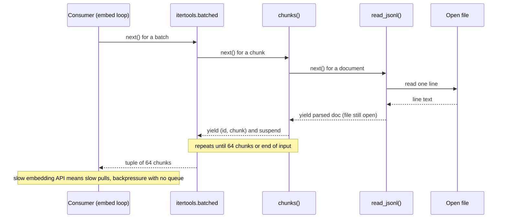

## TL;DR
A generator `yield`s values one at a time, pausing with its state intact. Agents use them everywhere:
streaming tokens and step events to the UI with async generators, and lazy pipelines that chunk a 10 GB
corpus for RAG one batch at a time.

## For agent builders
- **Why it matters for agents.** Users expect to watch an agent think: tokens, "calling search...", tool
  results, the final answer. An async generator that yields those events is the natural shape of a
  streaming agent loop, and plain generators keep RAG ingestion and eval runs at flat memory.
- **Where it shows up in your stack.** Provider SDK streaming (`async for` over chunks), FastAPI's
  `StreamingResponse` for SSE, agent-framework streaming APIs (LangGraph's `stream` and `astream` yield
  step updates), and ingestion pipelines feeding an embedding API in batches.
- **What you control.** The event schema your agent loop yields, closing upstream streams with
  `contextlib.aclosing()` when the user stops, batch size at the API boundary, and checkpoint positions so
  long ingestion or eval jobs resume.
- **What you can skip.** Hand-written iterator classes and generator-based coroutines (pre-`async`). Know
  laziness, single-pass behaviour, `yield from` and async-generator cleanup.

## Lab
### Task
Turn an eager RAG ingestion job into a lazy, resumable generator pipeline. The starter reads the whole
export into lists before the first embedding call and has no checkpoints, so a crash replays
everything. Time box: 60 minutes. Do **JSON / JSONL** first.
- **Goal:** the first batch goes out after reading two lines, malformed lines are counted and skipped,
  and a crash mid-run resumes from a checkpoint that never loses a chunk.
- **The embedding API is a local callback,** so the lab runs offline; swap in your provider's batch
  call later.
- **Constraints:** standard library only; Python 3.12+ (`itertools.batched`). Checked on Python 3.12.14
  with pytest 9.1.

### Starter code
Save as `lab_ingest.py`. It runs as given and shows 100 lines read before the first batch.

```python
import itertools, json
from collections.abc import Callable, Iterable, Iterator

Chunk = tuple[int, str, str, bool]          # (line_no, chunk_id, text, is_last_chunk_of_its_doc)

def read_jsonl(lines: Iterable[str], stats: dict) -> Iterator[tuple[int, dict]]:
    """Yield (line_no, doc) per valid line; count malformed lines in stats["bad"].
    LAB 1: make this lazy: read one line per document the consumer pulls."""
    out = []
    for line_no, line in enumerate(lines, 1):
        if not line.strip():
            continue
        try:
            out.append((line_no, json.loads(line)))
        except json.JSONDecodeError:
            stats["bad"] += 1
    return iter(out)

def chunks(docs: Iterable[tuple[int, dict]], size: int = 8) -> Iterator[Chunk]:
    """Yield fixed-size chunks; chunk_id is "<doc id>:<offset>".
    LAB 2: make this lazy as well."""
    out = []
    for line_no, doc in docs:
        text = doc["text"]
        for start in range(0, len(text), size):
            out.append((line_no, f"{doc['id']}:{start}", text[start:start + size],
                        start + size >= len(text)))
    return iter(out)

def embed_corpus(lines: Iterable[str], embed: Callable[[list], None], batch_size: int = 4,
                 start_after: int = 0, checkpoint: Callable[[int], None] = lambda n: None) -> dict:
    """Send (chunk_id, text) batches to embed() and return {"bad": ..., "sent": ...}.
    LAB 3: skip documents on lines <= start_after (resume after a crash).
    LAB 4: after each batch call checkpoint(n): n is the line of the batch's last chunk if that chunk
    completes its document, else that line minus 1. Resuming after n must never lose a chunk."""
    stats = {"bad": 0, "sent": 0}
    for batch in itertools.batched(chunks(read_jsonl(lines, stats)), batch_size):
        embed([(cid, text) for _, cid, text, _ in batch])
        stats["sent"] += len(batch)
    return stats

def corpus(n_docs: int, reads: list | None = None) -> Iterator[str]:
    """A fake JSONL export: every doc has 3 chunks of size 8; line 3 is malformed."""
    for i in range(1, n_docs + 1):
        if reads is not None:
            reads.append(i)
        yield "{not json" if i == 3 else json.dumps({"id": f"d{i}", "text": f"document {i:02d} body..."})

if __name__ == "__main__":
    reads, first = [], []
    def embed(batch):
        if not first:
            first.append(len(reads))
    print(embed_corpus(corpus(100, reads), embed), "| lines read before the first batch:", first[0])

    sent, ckpts, calls = [], [], [0]
    def crash_on_third(batch):
        calls[0] += 1
        if calls[0] == 3:
            raise ConnectionError("embedding API down")
        sent.extend(cid for cid, _ in batch)
    try:
        embed_corpus(corpus(10), crash_on_third, checkpoint=ckpts.append)
    except ConnectionError as e:
        print(f"crashed: {e}; checkpoints {ckpts}")
    resume = ckpts[-1] if ckpts else 0
    embed_corpus(corpus(10), lambda b: sent.extend(c for c, _ in b), start_after=resume)
    print(f"resumed after line {resume}: {len(set(sent))} of 27 chunks, "
          f"{len(sent) - len(set(sent))} sent twice")
```

### Expected output
The starter prints 100 lines read, `checkpoints []` and `8 sent twice`. A correct solution prints:

```
{'bad': 1, 'sent': 297} | lines read before the first batch: 2
crashed: embedding API down; checkpoints [1, 3]
resumed after line 3: 27 of 27 chunks, 2 sent twice
```

**Read the numbers:** 99 valid documents × 3 chunks = 297. With 9 valid documents in the crash run (27
chunks), the first batch ends inside document 2, so the checkpoint is 1, not 2.

### Tests
Save as `test_lab_ingest.py` and run `pytest -q`. On the starter four fail: building the pipeline reads
all 50 lines, the first batch waits for 100, and no checkpoint is ever recorded.

```python
import lab_ingest as lab

def test_building_the_pipeline_reads_nothing():
    reads = []
    lab.chunks(lab.read_jsonl(lab.corpus(50, reads), {"bad": 0}))
    assert reads == [], f"{len(reads)} lines read before anyone asked for a chunk"

def test_first_batch_needs_only_two_lines():
    reads, first = [], []
    def embed(batch):
        if not first:
            first.append(len(reads))
    lab.embed_corpus(lab.corpus(100, reads), embed, batch_size=4)
    assert first == [2], f"read {first[0]} lines before the first batch; 2 are enough"

def test_malformed_lines_are_counted_and_skipped():
    got = []
    stats = lab.embed_corpus(lab.corpus(10), lambda b: got.extend(b))
    assert stats == {"bad": 1, "sent": 27} and len(got) == 27

def test_checkpoints_never_skip_a_partly_sent_doc():
    ckpts = []
    lab.embed_corpus(lab.corpus(10), lambda b: None, checkpoint=ckpts.append)
    assert ckpts == [1, 3, 5, 6, 7, 9, 10]

def test_crash_and_resume_loses_nothing_and_resends_little():
    sent, ckpts, calls = [], [], [0]
    def crash_on_third(batch):
        calls[0] += 1
        if calls[0] == 3:
            raise ConnectionError("embedding API down")
        sent.extend(cid for cid, _ in batch)
    try:
        lab.embed_corpus(lab.corpus(10), crash_on_third, checkpoint=ckpts.append)
    except ConnectionError:
        pass
    assert ckpts, "no checkpoint was recorded before the crash"
    lab.embed_corpus(lab.corpus(10), lambda b: sent.extend(c for c, _ in b), start_after=ckpts[-1])
    assert len(set(sent)) == 27, "chunks were lost across the crash"
    assert len(sent) - len(set(sent)) < 4, "resume replayed more than one partial batch"
```

### Failure scenarios
- **Inject a naive checkpoint** (the line of the batch's last chunk). The resume test fails with 26
  unique chunks: document 4 was split across batches and its last chunk is skipped. Debug: print each
  batch's chunk ids next to the checkpoint and find the one that straddles a document.
- **Inject `list(...)` around `read_jsonl(...)` for debugging.** The laziness tests fail again with 50
  and 100 lines read. Debug: put the `reads` counter on the source and check it before the first batch.
- **Inject a `try/except json.JSONDecodeError` around the `read_jsonl(...)` call** instead of inside the
  loop. Line 3 now crashes the job, because the error is raised during iteration, outside the handler.
  Debug: read the traceback; it points at the consuming loop, not at the call.
- **Iterate one generator twice** (count the chunks, then embed them). The second pass sends nothing and
  `sent` is 0. Debug: generators are single-pass; rebuild the pipeline per pass.

### Submission
- **Your `lab_ingest.py`** with the four LAB markers resolved, using `yield` rather than lists.
- **A `pytest -q` run** showing 5 passed, plus the starter's run, in `NOTES.md`.
- **The fixed script's output**, matching the expected block exactly.
- **Two sentences** explaining why the checkpoint is "line minus 1" when a batch ends mid-document, and
  why idempotent upserts by `chunk_id` make the 2 re-sent chunks harmless.
- **Evaluation:** tests pass, no stage builds a list of the dataset, and the resume rule is justified.

## Why it exists
- **Agent data is too big or too slow to materialise:** a corpus to chunk and embed, an eval set of 50,000
  prompts, a vector store export, server-sent events from a model, a long agent run's event stream.
- **Lists fail three ways.** Read every line, parse every document, chunk everything, then embed: memory
  grows with the dataset, the first embedding call waits for the whole corpus, and a crash at item
  900,000 loses all work in flight. For an agent, a list means the user sees nothing until the run ends.
- **Hand-written iterator classes are inside-out.** `__iter__`, `__next__` and explicit state fields
  ("which file, which line, which chunk offset") turn a simple nested loop into an error-prone state
  machine.
- **Generators keep the natural loop.** The frame is suspended at `yield` and resumed on the next request,
  so locals, the open file and the loop position survive between items.
- **The consumer pulls**, so streaming, early results and bounded memory come for free.

## How it works
### The protocol
1. **Calling creates, does not run.** Calling a function that contains `yield` runs none of its body; it
   returns a generator object, which is an iterator.
2. **`next()` resumes** execution until the next `yield`, which hands a value out and freezes the frame.
3. **Return ends it.** The generator raises `StopIteration` (carrying the return value), and `for` loops
   treat that as the end.
4. **Single-pass.** Once exhausted, iterating again yields nothing, with no error.

**Mechanically:** the generator object owns a frame (locals, evaluation stack, position of the last
executed instruction). An ordinary call discards its frame on return; a generator keeps it alive between
`next()` calls, which is the whole trick.

| `inspect.getgeneratorstate(g)` | Meaning |
|---|---|
| `GEN_CREATED` | Before the first `next()` |
| `GEN_RUNNING` | Currently executing |
| `GEN_SUSPENDED` | Paused at a `yield` |
| `GEN_CLOSED` | Finished |

- **No re-entry.** A running generator cannot be resumed, so `next()` on one already executing (say from a
  second thread) raises `ValueError: generator already executing`.

### Pipelines compose lazily
- **Building does no work.** `chunks(read_jsonl(path))` builds a pipeline; nothing happens until the
  consumer asks for the first item. Then one line is read, parsed, chunked and passed down.
- **Memory is bounded by what each stage holds**, not by the dataset, *because* items flow one at a time.
- **Pull-based backpressure.** The consumer's `next()` propagates up the chain, so a slow consumer (an
  embedding API at its rate limit) automatically slows reading and nothing piles up between stages. That
  is backpressure without any queue.
- **Standard parts.** Generator expressions, `(f(x) for x in xs)`, are the inline form; `itertools`
  (`islice`, `chain`, and `batched` from 3.12) supplies the standard pipeline stages.

### Two-way communication and delegation
`yield` is an expression, so the caller can talk back:

| Call | Effect at the paused `yield` |
|---|---|
| `gen.send(value)` | Resumes; the `yield` evaluates to `value` |
| `gen.throw(exc)` | Raises the exception there |
| `gen.close()` | Raises `GeneratorExit` there, so `finally` blocks run |
| `yield from sub` (PEP 380) | Delegates to a sub-generator, forwarding sends and throws, evaluating to its return value |

- **`yield from` exists** *because* refactoring a generator into helpers would otherwise need hand-written
  forwarding. Async generators have no `yield from`; re-yield with `async for x in sub: yield x`.
- **Ancestor of coroutines.** This send-and-suspend machinery is where `async`/`await` came from:
  generator-based coroutines.

### Cleanup and async generators
- **When resources are released.** A generator holding a resource (an open file inside `with`) releases it
  when it finishes, when `close()` is called, or when it is garbage-collected, since `close()` runs the
  `finally`.
- **Early exit leaks until then.** If a consumer breaks out early and keeps a reference, the resource stays
  open.
- **Async generators** (PEP 525): `async def` with `yield`, consumed with `async for`. Their `finally` may
  need to await, so handle early exit with `contextlib.aclosing()` (3.10+) to close deterministically rather
  than leaving cleanup to the event loop's finaliser. This is the Stop-button path of every streaming agent.

## Diagram
One pull through the RAG embedding pipeline below: each `next()` travels up the chain, one line is read,
and each stage suspends at `yield` again with its state intact. Nothing moves until the consumer asks.



## Examples
### A streaming agent loop as an async generator
The loop yields typed events (tokens, tool start and end, final answer) that a UI or SSE endpoint renders
as they happen. The model and tool are stubs so it runs offline.

```python
import asyncio
from contextlib import aclosing

async def model_stream(messages):              # stub for a provider's streaming call
    if messages[-1]["role"] == "tool":
        for tok in ["Your order", " shipped", " today."]:
            await asyncio.sleep(0.01); yield {"type": "token", "text": tok}
    else:
        yield {"type": "tool_call", "name": "lookup_order", "args": {"id": 42}}

async def lookup_order(id):
    await asyncio.sleep(0.05); return f"order {id}: shipped"

async def run_agent(question, max_steps=4):
    messages = [{"role": "user", "content": question}]
    for step in range(max_steps):
        call, text = None, []
        async with aclosing(model_stream(messages)) as stream:   # closed even if our consumer stops
            async for ev in stream:
                if ev["type"] == "token":
                    text.append(ev["text"]); yield ev            # stream tokens straight through
                else:
                    call = ev
        if call is None:
            yield {"type": "final", "text": "".join(text), "steps": step + 1}
            return
        yield {"type": "tool_start", "name": call["name"]}
        result = await lookup_order(**call["args"])
        yield {"type": "tool_end", "name": call["name"], "result": result}
        messages.append({"role": "tool", "content": result})

async def main():
    async with aclosing(run_agent("Where is order 42?")) as events:
        async for ev in events:
            print(ev)

asyncio.run(main())
```

- **One generator, many consumers.** The same `run_agent` feeds a CLI, an SSE endpoint
  (`StreamingResponse` over formatted events) or an eval harness that collects only `final` events.
- **Stopping is closing.** If the client disconnects, closing `run_agent` runs `aclosing` on the inner
  model stream, so the upstream connection is released at a known point.

### A lazy embedding pipeline for the agent's index
```python
import itertools, json
from collections.abc import Iterator

def read_jsonl(path: str) -> Iterator[dict]:
    with open(path, encoding="utf-8") as f:      # stays open while iterated
        for line_no, line in enumerate(f, 1):
            if not line.strip():
                continue
            try:
                yield json.loads(line)
            except json.JSONDecodeError:
                print(f"skipping malformed line {line_no}")

def chunks(docs: Iterator[dict], size: int = 800) -> Iterator[tuple[str, str]]:
    for doc in docs:
        text = doc["text"]
        for start in range(0, len(text), size):
            yield doc["id"], text[start:start + size]

def embed_corpus(path: str, batch_size: int = 64) -> int:
    sent = 0
    for batch in itertools.batched(chunks(read_jsonl(path)), batch_size):  # 3.12+
        # vectors = embed_api([text for _, text in batch])  -> upsert by id
        sent += len(batch)
    return sent
```

**Worked sizes (illustrative), 4 GB JSONL corpus:**
| | List-based | This pipeline |
|---|---|---|
| Held in memory | Parsed corpus plus every chunk, before the first API call | One line, one parsed document, one batch of 64 × 800 characters (about 50 KB of text) |
| First batch ready | After the whole corpus is parsed | Within milliseconds of starting |
| Malformed line | Often kills the job | Skipped and logged |

**See the laziness:** put a `print` in each stage and run it on a two-document file with 2,000-character
texts.
1. Output interleaves: read doc 1, chunk 1a, chunk 1b, chunk 1c, read doc 2, chunk 2a, and so on.
2. The batch closes once 64 chunks (or the end of input) arrive.
3. A list pipeline would print every "read" before the first "chunk".
4. The mechanism: `batched` pulls a chunk, `chunks` needs a document, `read_jsonl` resumes inside its `for`
   over the file, reads one line, and suspends again at `yield`, with the file still open and the line
   counter intact.

### Stop a token stream early, cleanly
An async generator stands in for a provider's SSE stream. With `aclosing`, breaking out runs the
generator's async `finally` before the next line, so the connection is released at a known point.

```python
import asyncio
from contextlib import aclosing

async def token_stream(prompt: str):
    print("open connection")
    try:
        for tok in ["The", " answer", " is", " 42", "."]:
            await asyncio.sleep(0.01)          # stands in for an SSE chunk arriving
            yield tok
    finally:
        await asyncio.sleep(0)                 # async cleanup, e.g. await response.aclose()
        print("connection closed")

async def first_n(n: int) -> str:
    out = []
    async with aclosing(token_stream("q")) as stream:
        async for tok in stream:
            out.append(tok)
            if len(out) == n:
                break                          # aclosing awaits aclose() as the block exits
    print("after block")
    return "".join(out)

print(asyncio.run(first_n(2)))
# open connection / connection closed / after block / The answer
```
Without `aclosing`, "connection closed" would print only when the event loop finalises the generator,
which under load means connections held open well past the request.

## Production patterns
- **Yield typed agent events, not raw text.** Have the agent loop yield small dicts or Pydantic models
  (`token`, `tool_start`, `tool_end`, `final`, `error`) with a step number, and format them as SSE only at
  the HTTP edge. Monitor time to first event and events per run.
- **Stream responses with an async generator.** Pass an async generator to FastAPI's `StreamingResponse`,
  open the upstream stream inside it with `aclosing`, and release it in `finally`. Monitor open upstream
  connections and stream duration after client disconnects.
- **Batch at the boundary to the API.** Feed generator stages into `itertools.batched(it, n)` (3.12+), or on
  older Pythons `while batch := tuple(islice(it, n)): ...`, sized to the provider's max inputs per call.
  Monitor peak RSS and items per second.
- **Checkpoint the position, not the data.** Yield the line number or record id with each item and persist the
  last fully processed one every N batches, so a crash at item 900,000 resumes instead of restarting.
  Monitor checkpoint age.
- **Count and quarantine bad records.** Replace the `print` in `read_jsonl` with a counter and a write to a
  dead-letter file. Alert on malformed-record rate, because a spike usually means an upstream format change.
- **Paginate tool APIs as a generator.** Wrap cursor pagination in a generator that yields items and fetches
  the next page only when the consumer needs it, so `islice(items(), 100)` stops after the pages it used.
  Monitor pages fetched per job.

## Trade-offs
- **Flat memory vs single pass.** Lazy pipelines keep memory flat and deliver first results early, but each
  item is produced once. For random access, `len()` or several passes, materialise to a list or reopen the
  source.
- **Plain-loop readability vs late errors.** Streaming code reads like a plain loop, but errors surface at
  consumption time, not at the call, so a traceback may point at the consumer far from the faulty stage.
  In a streaming agent, an exception after the first event cannot change the HTTP status, so yield an
  `error` event instead.
- **Negligible overhead vs numeric hot loops.** Per-item overhead is negligible for I/O-bound work, but over
  millions of small values vectorised NumPy or Polars operations are far faster than yielding Python objects.
- **Natural streams vs cleanup.** Async generators expose network streams naturally, at the cost of trickier
  cleanup when consumers stop early. For complex flows (several producers, sub-agents streaming at once), a
  bounded `asyncio.Queue` between tasks can be clearer.

## Pitfalls
- **Iterating the same generator twice**, for example once to count and once to process. The second pass
  silently yields nothing and an eval reports zero results. Fix: materialise to a list if it fits, or
  rebuild the generator for each pass.
- **Expecting side effects from a call.** Nothing runs until iteration, so a "write records" generator that
  is never consumed writes nothing, and an agent generator nobody iterates never calls its tools.
- **Breaking out of an async generator wrapping an HTTP stream without `aclosing`.** Symptom:
  connection-pool exhaustion or "unclosed" warnings under load. Fix: `async with aclosing(gen) as s:`.
- **`try/except` around the generator call.** Exceptions are raised later during iteration, outside the
  handler, so the guard never triggers. Fix: wrap the consuming loop, or handle errors inside the stage.
- **Leaving a debugging `list(gen)` in.** Memory returns to dataset-sized and the job slows on large inputs;
  on an agent stream it also hides every event until the run ends.
- **Bare `next(it)` inside a generator on an iterator that may be exhausted.** Since PEP 479 the stray
  `StopIteration` becomes `RuntimeError: generator raised StopIteration` instead of silently ending the outer
  generator. Use `next(it, None)` or catch it explicitly.
- **Sharing one generator between threads or DataLoader-style workers.** Symptom:
  `ValueError: generator already executing` or duplicated and missing items. Give each worker its own source
  or put a `queue.Queue` between them.

## When to use
- **Use when** sequences are large, slow to arrive or potentially unbounded: streaming model output and
  agent step events to a client, reading JSONL and Parquet exports row by row, chunking documents for
  embedding, batching requests, paginating an API. FastAPI's `StreamingResponse` and most SDK streaming
  interfaces accept or return (async) iterators.
- **Prefer a list when** the data is small and you need it more than once, such as the message history you
  send to the model each step.
- **Measure:** peak memory before and after converting a list pipeline, and time to first event for streams.
- **Interviews:** explain laziness, single-pass behaviour, `yield from`, and how async generators relate to
  token streaming.

## Role lens
- **Engineer:** Writes ingestion and eval pipelines as generator stages with batching, and wraps
  streaming responses in async generators closed with `aclosing`.
- **Architect:** Designs data and streaming paths so memory stays bounded by batch size, not dataset
  size, and so backpressure flows from the consumer to the source.
- **FDE:** Rewrites a customer's notebook that loads a whole export into memory into a streaming script
  that runs on their modest VM without crashing.

## Check yourself
**Q:** An eval script does `cases = (load(x) for x in paths)`, logs `sum(1 for _ in cases)` cases, then runs
the model over `cases`. It reports 500 cases loaded but zero scored. Explain and fix it.
**A:** `cases` is a generator expression, a single-pass iterator. Counting consumes it completely, so when
the scoring loop iterates it the generator is already exhausted and yields nothing, silently. The fix depends
on size: if the cases fit in memory, materialise once with `cases = [load(x) for x in paths]` and use
`len(cases)`; if not, count while scoring in the same pass, or rebuild the generator from `paths` for each
pass. A good answer also notes that generators raise no error on reuse, so a test asserting the scored
count equals the loaded count would have caught this.

## Interview questions
### What is a generator in Python, and why does it save memory?
- **A function that pauses at `yield`.** Calling it returns a generator object without running the
  body; each `next()` resumes the saved frame until the next `yield`.
- **It saves memory because items flow one at a time**, so a pipeline holds the current item or batch
  instead of the whole dataset.
- **The kept frame is the trick:** locals, the open file and the loop position survive between items.

### How would you design the streaming interface of an agent that calls tools mid-answer?
- **Make the agent loop an async generator** that yields typed events: tokens, tool start, tool end with
  a short result, final answer, error. The HTTP layer only formats them as SSE.
- **Close inner streams with `aclosing`**, so a client disconnect closes the run generator, which closes
  the model stream and releases the connection.
- **Yield an `error` event** for failures after the first byte, because the status code is already sent,
  and monitor time to first event.

### A streaming endpoint exhausts its HTTP connection pool when clients disconnect early. What is wrong?
- **The async generator wrapping the upstream stream is not closed deterministically.** Breaking out
  without `contextlib.aclosing()` leaves its async `finally` to the event loop's finaliser.
- **Fix:** iterate inside `async with aclosing(stream) as s:` and release the upstream response in the
  generator's `finally`.
- **Monitor** open upstream connections and stream duration after disconnect, and watch for "unclosed"
  warnings under load.

### When would you not use a generator pipeline?
- **When you need the data more than once**, random access or `len()`, because a generator is
  single-pass and a second iteration silently yields nothing.
- **For numeric hot loops over millions of small values**, where vectorised NumPy or Polars beats yielding
  Python objects.
- **For complex multi-producer flows**, where a bounded `asyncio.Queue` between tasks can be clearer.

### How would you make a 10-hour embedding job for a RAG index resumable?
- **Yield the position with each item**, such as the line number or record id, alongside the data.
- **Persist the last fully processed position every N batches**, so a crash at item 900,000 resumes
  there instead of restarting from zero.
- **Make upserts idempotent by id**, so replaying a partly written batch is harmless, and alert on
  checkpoint age.

### What do send(), throw() and yield from add beyond plain iteration?
- **`send(value)`** resumes the generator with the `yield` evaluating to that value; **`throw(exc)`**
  raises an exception at the paused `yield`; **`close()`** raises `GeneratorExit` so `finally` runs.
- **`yield from sub`** (PEP 380) delegates to a sub-generator, forwarding sends and throws and evaluating
  to its return value.
- **This machinery is the ancestor of `async`/`await`**, through generator-based coroutines.

## Quiz
### Q: What happens when you call a function whose body contains `yield`?
- [ ] The body runs until the first `yield` and returns that value
- [x] None of the body runs; a generator object is returned that runs the body on iteration
- [ ] The whole body runs eagerly and the yielded values are collected into a list
- [ ] It raises TypeError unless called inside a for loop
> The presence of `yield` makes the function a generator function. Calling it only creates the
> generator; execution starts on the first `next()` and pauses at each `yield`.

### Q: Why does a generator pipeline over a large JSONL file keep memory roughly constant?
- [ ] Because Python compresses generator state automatically
- [ ] Because generators store their outputs on disk instead of in memory
- [ ] Because the file is memory-mapped by the generator
- [x] Because each stage holds only the current item or batch, pulled on demand by the consumer
> Items flow one at a time from the source through each stage, so peak memory depends on batch size
> and per-item size, not on how many items the file contains.

### Q: What is the safest way to stop consuming an async generator that wraps an HTTP stream early?
- [ ] Delete the variable and rely on reference counting to close it immediately
- [x] Iterate it inside `contextlib.aclosing()` so its cleanup is awaited when the block exits
- [ ] Raise StopIteration inside the async for loop body
- [ ] Call `next()` on it until it is exhausted
> Async generator cleanup may need to await, which garbage collection cannot do synchronously.
> `aclosing` awaits `aclose()` deterministically, releasing the connection at a known point.

## Use cases & projects
### Use cases
- **Streaming agent events to a UI.** An async generator yields tokens, tool-call starts and tool results,
  and FastAPI's `StreamingResponse` sends them as SSE.
- **RAG ingestion at flat memory.** A chain of generators reads, chunks and batches a large corpus for the
  embedding API without loading it all.
- **Large eval runs.** Prompts stream from a JSONL file through the agent, with results written as they
  arrive and a checkpoint so a crash resumes.
- **Stopping a stream early.** When the user stops a run, `contextlib.aclosing()` closes the upstream model
  stream at a known point.

### Mini project
**Stream an agent loop as typed events (1-2 hours).**
- **Goal:** turn a two-tool agent loop into an async generator of events and stream it to a browser.
- **Steps:** define an event schema (token, tool_call, tool_result, final); write the loop as an async
  generator that yields those events from a fake model and two fake tools; expose it through a FastAPI
  `StreamingResponse` as SSE; wrap the upstream stream in `aclosing()` and log when it closes.
- **Done when:** `curl` shows events arriving one at a time, closing the client mid-run logs the upstream
  close, and memory stays flat over 1,000 simulated runs.
